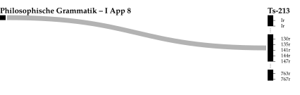

# Philosophical Grammar – I App 8

1933, 9 remarks, Ts-213

### [Ts-213](/ts-213/#136r.1) [136r\[1\]](https://cdn.wittgensteinnachlass.com/2000px/webp/Ts-213/136r.webp)

_The concept “roughly”._ _The problem of the ‘heap of sand’._

### [Ts-213](/ts-213/#136r.2) [136r\[2\]](https://cdn.wittgensteinnachlass.com/2000px/webp/Ts-213/136r.webp)

“He came from _roughly_ there ↑”. “The brightest point on the horizon is roughly _there_”. “Make the board roughly 2 m long”. To be able to say that, must I know limits that determine the latitude for this length? Obviously not. Is it not enough, for example, to say: “a latitude of ± 1 cm is certainly allowed; ± 2 cm would already be too much”? – Surely it is also essential to the sense of my sentence that I am unable to give the latitude “exact” limits. Isn’t this plainly because the space I am working in here has a different metric from Euclidean space? For if one tried to determine the latitude exactly by experiment, changing the length and asking each time whether this length was still acceptable or no longer so, after a few steps of narrowing it down one would arrive at contradictions: on one occasion a point would still be said to lie within the limits, on another a point further inside would be declared inadmissible; both, perhaps, with the comment that the judgements were no longer (_quite_) certain.

### [Ts-213](/ts-213/#137r.1) [137r\[1\]](https://cdn.wittgensteinnachlass.com/2000px/webp/Ts-213/137r.webp)

The uncertainty is of the same kind as that involved in specifying the highest point of a curve. We are simply not in Euclidean space, and there is no highest point here in the Euclidean sense. The answer will be: “the highest point is roughly _there_”, and the grammar of the word “roughly” – in this context – _then_ belongs to the geometry of our space.

### [Ts-213](/ts-213/#137r.2) [137r\[2\]](https://cdn.wittgensteinnachlass.com/2000px/webp/Ts-213/137r.webp)

Isn’t it like the way one weighs things at the butcher’s, say, only to the nearest decagram, although that, on the other hand, is arbitrary and determined only by the customary brass weights? Here it is enough to know: it weighs no more than P1 and no less than P2. One could say: in principle, stating the weight here consists not in specifying a number but in specifying an interval, and the intervals form a discontinuous series.

### [Ts-213](/ts-213/#137r.3) [137r\[3\]](https://cdn.wittgensteinnachlass.com/2000px/webp/Ts-213/137r.webp)

One could surely say: “in any case, keep _within_ ± 1 cm”, thereby setting an arbitrary limit. – If it were then said: “all right, but that isn’t the actual limit of the permissible latitude: what is it, then?”, the answer might be “I don’t know of one; I only know that ± 2 cm would already be too much”.

### [Ts-213](/ts-213/#137r.4+138r.1+139r.1+140r.1) [137r\[4\]](https://cdn.wittgensteinnachlass.com/2000px/webp/Ts-213/137r.webp),[138r\[1\]](https://cdn.wittgensteinnachlass.com/2000px/webp/Ts-213/138r.webp),[139r\[1\]](https://cdn.wittgensteinnachlass.com/2000px/webp/Ts-213/139r.webp),[140r\[1\]](https://cdn.wittgensteinnachlass.com/2000px/webp/Ts-213/140r.webp)

 Let us imagine the following psychological experiment: we show the subject two lines G1, G2, with the straight line A drawn across them. I shall call the part of this straight line lying between G1 and G2 the segment a. We now draw b at an arbitrary distance from a and parallel to it, and ask whether he sees the segment b as longer than a or can no longer distinguish the two lengths. He replies that b appears longer than a. We then move closer to a by bisecting the distance from a to b with our measuring instruments and drawing c. “Do you see c as longer than a?” – “Yes”. We bisect the distance c–a and draw d. “Do you see d as longer than a?” – “Yes”. We bisect a–d. “Do you see e as longer than a?” – “No”. So we bisect e–d. “Do you see f as longer than e?” – “Yes”. So we bisect e–f and draw h. We could also approach the segment a in this way from the left, and then say that in Euclidean space there corresponds to a seen length a not _one_ length but an interval of lengths, and likewise that what corresponds to _one_ seen position of a line (say, the pointer of an instrument) is an interval of positions in Euclidean space: but this interval does not have sharp boundaries. That is: it is bounded not by points but by converging intervals that do not converge to a point. (Like the series of binary fractions that we generate by tossing a coin for heads or tails.) What is characteristic of two intervals bounded in this way, not by points but _fuzzily_, is that in certain cases the answer to the question whether they overlap or lie apart is “undecided”. And that the question whether they touch, whether they have an endpoint in common, is always senseless, since they have no endpoints. But one could say: they have _provisional_ endpoints. In the sense in which the expansion of π has a provisional end. There is of course nothing mysterious about this property of the ‘fuzzy’ interval; what is _somewhat_ paradoxical is cleared up by the two uses of the word “interval”. This is the same case as that of the two uses of the word “chess”, when it means, on the one hand, the totality of the rules of chess now in force, and on the other: the game that N.N. invented in Persia and that developed in such-and-such a way. In one case it is nonsensical to speak of a change in the rules of chess, in the other it is not. We can call either what comes out of a particular measurement I carry out at 5 o’clock today the “length of a measured segment” – in which case there is no “ ± etc.” for this specification of length – or something that measurements approach, etc.: in the two cases the word “length” is used with a quite different grammar. And likewise the word “interval” when I call something complete an interval in one case, and something developing an interval in the other.

I) the intervals lie apart

II) they lie apart and touch provisionally

III) undecided

IV) undecided

V) undecided

VI) they overlap

VII) they overlap

 But we cannot be surprised that an interval should now have such strange properties, since we are now using the word “interval” in an unusual sense. And we cannot say that we have discovered new properties of certain intervals. Any more than we would discover new properties of the chess king if we changed the rules of the game but kept the designations “chess” and “king”. (Contrast Brouwer, on the law of excluded middle.) So that experiment essentially yields what we called a “fuzzy” interval; but of course other experiments would be possible that yield a sharp interval instead. Imagine, for instance, moving a ruler from the initial position b, keeping it parallel to that position, towards a until some definite reaction occurred in our subject: then we could call the point at which the reaction begins the boundary of our strip. – In this way we could of course also call the result of a weighing “the weight of a body”, and in this sense there would then be an absolutely exact weighing, i.e. one whose result does not have the form “G ± g”. We have thereby changed our way of expressing ourselves and must now say that the weight of the body fluctuates, and does so according to a law unknown to us. (The distinction between “absolutely exact” weighing and “essentially inexact” weighing is grammatical and relates to two different meanings of the expression “result of the weighing”.)

### [Ts-213](/ts-213/#140r.2) [140r\[2\]](https://cdn.wittgensteinnachlass.com/2000px/webp/Ts-213/140r.webp)

The indeterminacy of the word “heap”. I could define it as follows: a body of a certain shape and consistency, etc., is a heap if its volume is K m³ or more; anything below that I shall call a little heap. Then there is no largest little heap; that is: it is then senseless to speak of the “largest little heap”. Conversely, I could stipulate that anything larger than K m³ is to count as a heap, and then the expression “the smallest heap” would have no meaning. But isn’t this distinction idle? Certainly, – if by volume we understand the result of a measurement in the ordinary sense; for this result has the form “V ± v”. Otherwise, though, the distinction might be as useless as the one between five dozen apples and 61 apples.

### [Ts-213](/ts-213/#140r.3) [140r\[3\]](https://cdn.wittgensteinnachlass.com/2000px/webp/Ts-213/140r.webp)

On the problem of the “heap of sand”: here, as in similar cases, one could imagine an official concept, say: a heap is anything larger than half a m³. But this would still not be the concept we ordinarily use. There is no boundary for that concept (and if we lay one down, we change the concept); there are only cases that we count as falling within the extension of the concept and cases that we no longer count as falling within its extension.

### [Ts-213](/ts-213/#141r.1) [141r\[1\]](https://cdn.wittgensteinnachlass.com/2000px/webp/Ts-213/141r.webp)

“Make me a heap of sand here”. – “All right, he’ll surely still call that a heap”. I could carry out the command, so it was in order. But what about this command: “Make me the smallest heap you would still call a heap”? I would say: that is nonsense; I can only fix a provisional upper and lower limit.
