# Philosophical Grammar – I

1933–1934, 594 remarks, Ms-140, Ms-114, Ts-213, Ms-115

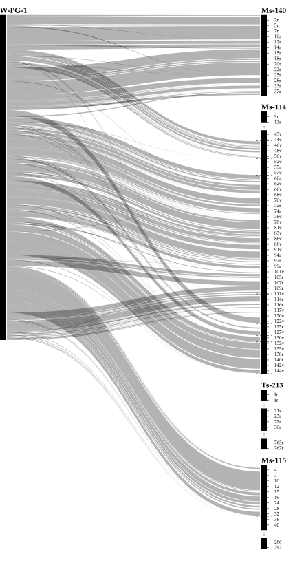

### [Ms-140](/ms-140/#1r.1) [1r\[1\]](https://cdn.wittgensteinnachlass.com/2000px/webp/Ms-140/1r.webp)

1 How can one speak of ‘understanding’ & ‘not understanding’ a sentence; is it not only a sentence when one understands it?

### [Ms-140](/ms-140/#1r.2) [1r\[2\]](https://cdn.wittgensteinnachlass.com/2000px/webp/Ms-140/1r.webp)

Does it make sense to point to a group of trees & ask: “Do you understand what this group of trees is saying?” Generally not; but could one not express a sense through the arrangement of trees, could that not be a secret language?

### [Ms-140](/ms-140/#1r.4) [1r\[4\]](https://cdn.wittgensteinnachlass.com/2000px/webp/Ms-140/1r.webp)

One will then call the groups of trees that one understands ‘sentences’, but also others that one does not understand, if one assumes that the planter understood them.

### [Ms-140](/ms-140/#1r.5) [1r\[5\]](https://cdn.wittgensteinnachlass.com/2000px/webp/Ms-140/1r.webp)

“Does understanding not begin only with the sentence, with the whole sentence? Can one _understand_ half a sentence?” – Half a sentence is not a whole sentence. – But perhaps what the question means can be understood as follows: Let us imagine that the knight’s move in chess were always carried out by two displacements of the knight (one straight, one oblique); then someone could say: “in chess there is no half knight’s move”, & mean: a half knight’s move is not related to a whole one as half a bread roll is to a whole one. One means to say: it is not a difference of degree.

### [Ms-140](/ms-140/#1r.6) [1r\[6\]](https://cdn.wittgensteinnachlass.com/2000px/webp/Ms-140/1r.webp)

It would indeed be strange if science & mathematics used sentences but did not speak of understanding these sentences.

### [Ms-140](/ms-140/#1r.7+2r.1) [1r\[7\]](https://cdn.wittgensteinnachlass.com/2000px/webp/Ms-140/1r.webp),[2r\[1\]](https://cdn.wittgensteinnachlass.com/2000px/webp/Ms-140/2r.webp)

2 One sees the essential thing in understanding, the incidental thing in the sign. – Besides, what is the sign for at all, then? – If one thinks, merely to make oneself understood by others, – then one presumably regards the sign as a medicine that is supposed to produce in the other person the same state as the one I have.

### [Ms-140](/ms-140/#2r.2) [2r\[2\]](https://cdn.wittgensteinnachlass.com/2000px/webp/Ms-140/2r.webp)

If, in answer to the question “what do you mean by this movement of the hand?” the answer is: “I mean, you are to go out”, then this answer would not have been more correct as: “I mean what I mean by the sentence ‘You are to go out’”.

### [Ms-140](/ms-140/#2r.3) [2r\[3\]](https://cdn.wittgensteinnachlass.com/2000px/webp/Ms-140/2r.webp)

When Frege speaks against the formal conception of arithmetic, he says _as it were_: these petty explanations concerning the signs are superfluous if we _understand_ the signs. And understanding would consist, as it were, in seeing a picture from which all the rules follow, thereby becoming intelligible. But Frege does not seem to see that this picture is itself again a sign, or a calculus that explains the written calculus to us.

### [Ms-140](/ms-140/#2r.4) [2r\[4\]](https://cdn.wittgensteinnachlass.com/2000px/webp/Ms-140/2r.webp)

What we call “understanding a language” is often of the kind of understanding we acquire of a calculus when we learn about the history of its origin, or its practical application. And there too we become familiar with a more easily surveyable symbolism in place of the unfamiliar one. Let us imagine that someone had originally learnt chess as a writing game, & later was shown the ‘interpretation’ of chess as a board game. “Understanding” here means something similar to “having a clear view of the whole”.

### [Ms-140](/ms-140/#2r.5+2v.1+3r.1) [2r\[5\]](https://cdn.wittgensteinnachlass.com/2000px/webp/Ms-140/2r.webp),[2v\[1\]](https://cdn.wittgensteinnachlass.com/2000px/webp/Ms-140/2v.webp),[3r\[1\]](https://cdn.wittgensteinnachlass.com/2000px/webp/Ms-140/3r.webp)

When I give someone a command, it is quite enough for me to give them signs. And, receiving a command, I would never say: “These are just words, & I must penetrate behind the words”. And if I have asked someone something & they give me an answer, I am satisfied – that was precisely what I expected – & do not object: “That is just an answer”.

### [Ms-140](/ms-140/#3r.2) [3r\[2\]](https://cdn.wittgensteinnachlass.com/2000px/webp/Ms-140/3r.webp)

But if one says: “How am I supposed to know what he means, I only see his signs?” – I say: “How is _he_ supposed to know what he means; he only has his signs too”.

### [Ms-140](/ms-140/#3r.3) [3r\[3\]](https://cdn.wittgensteinnachlass.com/2000px/webp/Ms-140/3r.webp)

What is said can be explained only through language, so one cannot explain _language itself_, in this sense.

### [Ms-140](/ms-140/#3r.4) [3r\[4\]](https://cdn.wittgensteinnachlass.com/2000px/webp/Ms-140/3r.webp)

Language must speak for itself.

### [Ms-140](/ms-140/#3r.5) [3r\[5\]](https://cdn.wittgensteinnachlass.com/2000px/webp/Ms-140/3r.webp)

3 One can say: What is meant falls out of the language; for what a sentence means is said again by means of a sentence.

### [Ms-140](/ms-140/#3r.6) [3r\[6\]](https://cdn.wittgensteinnachlass.com/2000px/webp/Ms-140/3r.webp)

“What did you mean by these words?” “Did you _mean_ these words?” The first question is not a more precise formulation of the second. The first is answered by a sentence that replaces the sentence that was not understood. Similar to the second question is: “Did you mean that seriously or as a joke?” The case is different with: “Did you mean something by this movement of the hand, – & what?”

### [Ms-140](/ms-140/#3r.7+4r.1) [3r\[7\]](https://cdn.wittgensteinnachlass.com/2000px/webp/Ms-140/3r.webp),[4r\[1\]](https://cdn.wittgensteinnachlass.com/2000px/webp/Ms-140/4r.webp)

The words “understand”, “mean” signify, in part of their applications, a psychic reaction on hearing, reading, uttering, etc., the sentence. Understanding is then the phenomenon that occurs when I hear the sentence in a language familiar to me, and not when I hear the sentence in a language unfamiliar to me. Learning the language _brings about_ its understanding. But that belongs to the history of this reaction. – The understanding of the sentence happens to me in the same way as hearing the sentence & accompanies the hearing.

### [Ms-140](/ms-140/#4r.2) [4r\[2\]](https://cdn.wittgensteinnachlass.com/2000px/webp/Ms-140/4r.webp)

I can speak of an ‘experience’ of the sentence. “I don’t just say that, I also mean something by it”: If one considers what happens within us when we _mean_ words (& do not merely say them), it seems to us as if something were then coupled with these words, whereas otherwise they ran empty. As if they _intervened_ in us.

### [Ms-140](/ms-140/#12r.1) [12r\[1\]](https://cdn.wittgensteinnachlass.com/2000px/webp/Ms-140/12r.webp)

4 Understanding a sentence is more akin to understanding a piece of music than one would think. Why must these bars be played precisely this way? Why do I want to bring the increase & decrease of volume & tempo precisely onto this picture? – I would like to say: “because I know what it all means”. But what does it mean? – I would not know how to say. As an explanation I can only translate the musical picture into the picture of another process; & let this picture illuminate the former.

### [Ms-140](/ms-140/#4r.3+5r.1) [4r\[3\]](https://cdn.wittgensteinnachlass.com/2000px/webp/Ms-140/4r.webp),[5r\[1\]](https://cdn.wittgensteinnachlass.com/2000px/webp/Ms-140/5r.webp)

The understanding of a sentence can also be compared with what we call understanding a picture. Let us imagine a still-life, and that we were unable to see it as a spatial representation, but saw only patches & lines on the picture surface. We can then say “we do not understand the picture”. But we also say this, (in another sense,) when although we see the picture spatially, we do not recognise familiar things (books, animals, bottles) in the spatial forms. Suppose the picture were a genre painting & the people in it about an inch long. If I had once seen real people of this height, I could recognise them in this picture & take the picture as their life-size representation. My visual experience of the picture would in this case be _different_ from when I normally see the picture as a reduced representation, although the illusion of spatial seeing is the same in both cases. – Seeing real people an inch tall is here given only as a possible cause of that visual experience; in other respects the latter is independent of it. Just as a drawing of a cube may be seen spatially only by someone who has already looked at many real cubes: but the description of the spatial visual image contains nothing of what distinguishes a real cube from a painted one. The different experiences when I see a picture once one way, once another, are to be compared with reading a sentence with understanding, and without understanding. (Let us recall what it is like when we read a sentence with incorrect emphasis, and therefore do not understand it, – & then realise how it is to be read.)

### [Ms-140](/ms-140/#5r.2) [5r\[2\]](https://cdn.wittgensteinnachlass.com/2000px/webp/Ms-140/5r.webp)

(Seeing a clock as a clock, i.e., as a dial with hands, is similar to seeing the Orion as a walking man.)

### [Ms-140](/ms-140/#25r.5+26r.1) [25r\[5\]](https://cdn.wittgensteinnachlass.com/2000px/webp/Ms-140/25r.webp),[26r\[1\]](https://cdn.wittgensteinnachlass.com/2000px/webp/Ms-140/26r.webp)

5 It is odd: we would like to explain our understanding of a gesture as translating it into words, & understanding words as translating them into gestures. And indeed, we explain words through a gesture & a gesture through words.

### [Ms-140](/ms-140/#25r.4) [25r\[4\]](https://cdn.wittgensteinnachlass.com/2000px/webp/Ms-140/25r.webp)

On the other hand one says “I understand this gesture” in the sense: “I understand this theme”, “it says something to me”, & that means here: I follow it with a particular experience.

### [Ms-140](/ms-140/#5r.3) [5r\[3\]](https://cdn.wittgensteinnachlass.com/2000px/webp/Ms-140/5r.webp)

Think of the difference in understanding when, in a sentence, a word is felt on one occasion to belong together with this word and on another occasion with that word. And I could have said that the word is on one occasion construed, understood, seen, or spoken as belonging to this word, and on another occasion to that word.

### [Ms-140](/ms-140/#5r.4) [5r\[4\]](https://cdn.wittgensteinnachlass.com/2000px/webp/Ms-140/5r.webp)

We can then call ‘sentence’ what is construed once one way, once another; but also this or that construal (itself). Here is a source of confusions.

### [Ms-140](/ms-140/#5r.5+6r.1) [5r\[5\]](https://cdn.wittgensteinnachlass.com/2000px/webp/Ms-140/5r.webp),[6r\[1\]](https://cdn.wittgensteinnachlass.com/2000px/webp/Ms-140/6r.webp)

I read the sentence from the middle of a story: “after he had said that, he left her as on the previous day”. Do I understand the sentence? – That is not entirely easy to answer. It is a German sentence, & in that respect I understand it. I would know how one could use this sentence; I could invent a context for it. And yet I do not understand it in the sense in which I would understand it if I had read the story. (Compare: different language-games. Description of a state of affairs, inventing a story, etc. What is a meaningful sentence in the one case, what in the other?)

Do we _understand_ poems by Christian Morgenstern, or Lewis Carroll’s poem “Jabberwocky”? It becomes clear here that the concept of understanding is fluid.

### [Ms-140](/ms-140/#6r.2) [6r\[2\]](https://cdn.wittgensteinnachlass.com/2000px/webp/Ms-140/6r.webp)

6 Let a sentence be given to me in a cipher unfamiliar to me & at the same time the key to deciphering it. Then, in a certain sense, everything necessary for understanding the sentence is given to me. And yet, if asked whether I understand the sentence, I would answer: “I must first decipher it”, & if I had deciphered it as a German sentence before me, I would say “Now I understand it”. If one now asks: “At what moment in the translation into German does understanding begin?” – one gains an insight into the essence of what we call “understanding”.

### [Ms-140](/ms-140/#6r.3) [6r\[3\]](https://cdn.wittgensteinnachlass.com/2000px/webp/Ms-140/6r.webp)

I say a sentence: “I see a black patch over there”; but the words are arbitrary, so I replace them in order by the first 6 letters of the alphabet. It now reads: “a b c d e f”. But now it becomes clear that I – as one might say – cannot immediately think the sense of the above sentence in the new expression. I could also put it this way: I am not used to saying ‘a’ instead of ‘I’, ‘b’ instead of ‘see’, ‘c’ instead of ‘there’, etc. But I do not mean that I am not used to associating the sign ‘a’ immediately with the word ‘I’, etc.; rather, I am not used to using ‘a’ in place of ‘I’.

### [Ms-140](/ms-140/#6r.4) [6r\[4\]](https://cdn.wittgensteinnachlass.com/2000px/webp/Ms-140/6r.webp)

“Understanding a sentence” can mean “knowing what the sentence says”, i.e.: being able to answer the question ‘what does this sentence say’.

### [Ms-140](/ms-140/#6r.5+7r.1) [6r\[5\]](https://cdn.wittgensteinnachlass.com/2000px/webp/Ms-140/6r.webp),[7r\[1\]](https://cdn.wittgensteinnachlass.com/2000px/webp/Ms-140/7r.webp)

It is a frequently appearing view that a person can only _show_ their understanding imperfectly. That, as it were, they can only ever point to it from a distance, even approach it, but can never touch it with their hand. And that the final thing must always remain unsaid. – One says: “Understanding is indeed something _different_ from the expression of understanding. _Understanding_ cannot be shown; it is something inner, mental. –” Or also: “Whatever I do as a sign of understanding, whether I repeat the explanation of a word, or carry out a command as a sign that I have understood it, these actions _must_ nevertheless not be interpreted as proofs of understanding.” This is similar to what one also says: “I cannot show another person my toothache; & I cannot _prove_ to them that I have toothache.” But the impossibility spoken of (here) is supposed to be a logical one. “Is it not the case that the expression of understanding is precisely an imperfect expression?” That presumably means an expression lacking something – but something essentially _inexpressible_; for otherwise I could simply find a better one. And “essentially inexpressible” means that it makes no sense to speak of a more perfect expression.

### [Ms-140](/ms-140/#7r.2) [7r\[2\]](https://cdn.wittgensteinnachlass.com/2000px/webp/Ms-140/7r.webp)

We are not interested in the psychic processes that experience shows to accompany a sentence. But we are interested in understanding, as laid down in an explanation of the sense.

### [Ms-140](/ms-140/#7r.3) [7r\[3\]](https://cdn.wittgensteinnachlass.com/2000px/webp/Ms-140/7r.webp)

7 To understand the grammar of the word “mean”, one must ask oneself what the criterion is for an expression being meant _this way_. What is to be regarded as the criterion of what is meant? –

### [Ms-140](/ms-140/#7r.4) [7r\[4\]](https://cdn.wittgensteinnachlass.com/2000px/webp/Ms-140/7r.webp)

The answer to the question “how is that meant” establishes the connection between two linguistic expressions. So the question, too, asks about this connection.

### [Ms-140](/ms-140/#7r.5+8r.1) [7r\[5\]](https://cdn.wittgensteinnachlass.com/2000px/webp/Ms-140/7r.webp),[8r\[1\]](https://cdn.wittgensteinnachlass.com/2000px/webp/Ms-140/8r.webp)

<s>The manner & way in which the words “sense”, “meaning”, “mean”, etc. are used leads us to think that this sense, etc., stands in the same relation to the sign as the name does to its bearer.</s> The process that we call understanding a sentence, a description, is sometimes a transferring from one symbolism into another; a following-through of the picture, a copying, a transferring into another form of representation. Understanding the description then means making oneself a picture of what is described. And the process is more or less similar to making a drawing from a description.

### [Ms-140](/ms-140/#8r.2) [8r\[2\]](https://cdn.wittgensteinnachlass.com/2000px/webp/Ms-140/8r.webp)

And we also say: “I understand this picture perfectly, I could model it in clay.”

### [Ms-140](/ms-140/#8r.3) [8r\[3\]](https://cdn.wittgensteinnachlass.com/2000px/webp/Ms-140/8r.webp)

8 We speak of understanding a sentence as the condition for our being able to apply it. We say: “I cannot follow a command if I do not understand it”, or also: “I cannot follow it before I understand it”. Must I really understand a sentence in order to act according to it? – “Certainly, otherwise you would not know what you have to do.” – But what use is this knowledge to me; there is a leap from knowing to doing. “But surely I must understand a command in order to act according to it” – here the “must” is suspect. If this is a logical must, then the sentence is a grammatical remark.

### [Ms-140](/ms-140/#8r.4) [8r\[4\]](https://cdn.wittgensteinnachlass.com/2000px/webp/Ms-140/8r.webp)

One could ask here: How long before following it _must_ you understand the command? – But the sentence “I must understand the command before I can act according to it” naturally has a good sense. Only no metalogical one. – And ‘understand’, ‘mean’ are not metalogical concepts.

### [Ms-140](/ms-140/#8r.5+9r.1) [8r\[5\]](https://cdn.wittgensteinnachlass.com/2000px/webp/Ms-140/8r.webp),[9r\[1\]](https://cdn.wittgensteinnachlass.com/2000px/webp/Ms-140/9r.webp)

If “understanding a sentence” means acting according to it in some way, then understanding cannot be the condition for our acting according to it. But the particular action of understanding can, as a matter of experience, be the prior condition for following the command.

### [Ms-140](/ms-140/#9r.2) [9r\[2\]](https://cdn.wittgensteinnachlass.com/2000px/webp/Ms-140/9r.webp)

“I cannot execute the command because I do not understand what you mean. – Yes, now I understand you.” – What was happening when I suddenly understood the other person? There are _many_ possibilities. For example: the command could have been given in a language familiar to me, but with incorrect emphasis, & suddenly the correct emphasis occurred to me. I would then say to a third person, say: “Now I understand him; he means …” & would then repeat the command with the correct emphasis. And in grasping the familiar sentence I would have understood the command. I mean: I would not now have to grasp an abstract sense first. – Or: I had understood the command in _this_ sense, so it was a proper German sentence; but it seemed nonsensical to me. In such a case I would say: “I do not understand you; for surely you cannot mean _that_”. Then a more comprehensible interpretation would occur to me. Several interpretations, i.e., several explanations, might have floated before me before understanding, and I then decided on one of them. (The process of understanding when the absent-minded person turns left at the command “right turn”, and then, clutching his forehead, says: “Oh, I see, ‘right turn’” and turns right.)

### [Ms-140](/ms-140/#9r.3+10r.1) [9r\[3\]](https://cdn.wittgensteinnachlass.com/2000px/webp/Ms-140/9r.webp),[10r\[1\]](https://cdn.wittgensteinnachlass.com/2000px/webp/Ms-140/10r.webp)

9 Let us put the command to form the squares of a series of numbers in the form of a table:

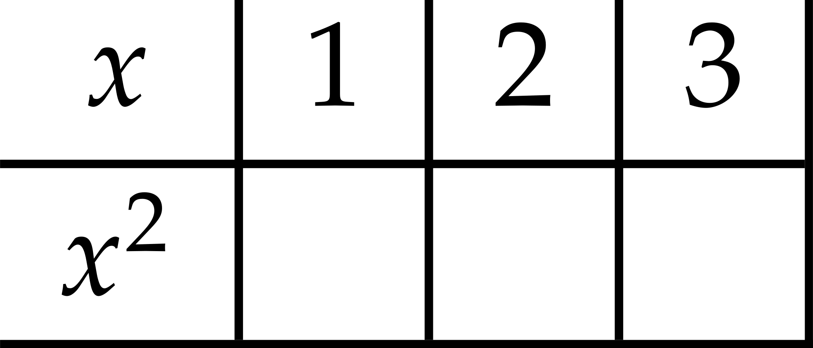

– It seems to us as if, through understanding, we added something to the command that fills the gap between command & execution. So that we could reply to someone who says “but you understand it, so it is not incomplete”: “Yes, I understand it, but only because I add something else; the interpretation, namely.” – But what prompts you to give precisely _this_ interpretation? If it is the command –, then it was already unambiguous, since it commanded this interpretation. Or did you add the interpretation arbitrarily, – in that case you did not understand the command either, but only what you made of it.

### [Ms-140](/ms-140/#10r.2) [10r\[2\]](https://cdn.wittgensteinnachlass.com/2000px/webp/Ms-140/10r.webp)

(We see problems in philosophical thinking at places where there are none. And philosophy is supposed to show that there is no problem there.)

### [Ms-140](/ms-140/#10r.3) [10r\[3\]](https://cdn.wittgensteinnachlass.com/2000px/webp/Ms-140/10r.webp)

An interpretation is presumably something that is given in signs. It is _this_ interpretation as opposed to another. (The latter is worded differently.) So if one said: “every sentence still requires an interpretation”, that would mean: no sentence can be understood without an addition.

### [Ms-140](/ms-140/#10r.4) [10r\[4\]](https://cdn.wittgensteinnachlass.com/2000px/webp/Ms-140/10r.webp)

Of course it happens that I _interpret_ signs, give signs an interpretation; but not whenever I understand a sign! (If someone asks me “what time is it?”, no work of interpretation goes on in me; rather, I simply react to what I see & hear. Someone brandishes a knife at me – then I do not say: “I interpret that as a threat”.)

### [Ms-140](/ms-140/#10r.5) [10r\[5\]](https://cdn.wittgensteinnachlass.com/2000px/webp/Ms-140/10r.webp)

10 “Understanding a word” can mean: _knowing_ how it is used; _being able_ to apply it.

### [Ms-140](/ms-140/#10r.6+11r.1) [10r\[6\]](https://cdn.wittgensteinnachlass.com/2000px/webp/Ms-140/10r.webp),[11r\[1\]](https://cdn.wittgensteinnachlass.com/2000px/webp/Ms-140/11r.webp)

“Can you lift this sphere?” – “Yes.” Then I try & do not succeed. I might then say: “_I was mistaken_, I cannot do it”. But perhaps: “I cannot do it _now_, because I am too tired; but when I said I could, I could”. Similarly: “I thought I could play chess, but I have already forgotten how”, but on the other hand: “When I said ‘I can play chess’, I could, but now it has all slipped my mind”. – But what is the criterion for my having been able to do it then? – How did I know that I could? One would answer: “I could always lift such a weight”, “I had just lifted it”, “I played chess not long ago & my memory is good”, “I had just recapitulated the rules”, etc. What I regard as an answer to that question will show me how I use the word “can”.

### [Ms-140](/ms-140/#11r.2) [11r\[2\]](https://cdn.wittgensteinnachlass.com/2000px/webp/Ms-140/11r.webp)

One will want to call knowledge, ability, capacity a _state_. Let us compare sentences, each of which describes a state in a different sense: “I have had toothache since yesterday” “I have longed for him since yesterday” “I have been expecting him since yesterday” “I have known since yesterday that he would come” “I have been able to play chess since yesterday”.

Can one say: “I have known continuously since yesterday that he would come”? In which of these sentences can one meaningfully insert the word “continuously”?

### [Ms-140](/ms-140/#11r.3) [11r\[3\]](https://cdn.wittgensteinnachlass.com/2000px/webp/Ms-140/11r.webp)

If one calls knowledge a “state”, then in the sense in which one speaks of the state of a body, of a physical model. Thus also in the physiological sense, or in that of a psychology that speaks of unconscious states of a mental model. And of course everyone would concede that; but now one must be clear that one has moved out of the grammatical domain of “conscious states” into another grammatical domain. I can indeed speak of unconscious toothache if the sentence “I have unconscious toothache” is supposed to mean something like: “I have a bad tooth that does not hurt”. But the expression “conscious state” (in the earlier sense) does not now stand in the same grammatical relation to the expression “unconscious state” as the expression “an armchair that I see” does to “an armchair that I do not see because it is behind me”.

### [Ms-140](/ms-140/#11r.4) [11r\[4\]](https://cdn.wittgensteinnachlass.com/2000px/webp/Ms-140/11r.webp)

“Knowing something”, instead of this we can say: “having a slip of paper with it written down on it”.

### [Ms-140](/ms-140/#12r.2) [12r\[2\]](https://cdn.wittgensteinnachlass.com/2000px/webp/Ms-140/12r.webp)

If “understanding the meaning of a word” means knowing the grammatical possibilities of its application, then I can ask: “How can I then know straight away what I mean by a word that I utter; surely I cannot have the whole manner of application of the word in my head all at once?”

### [Ms-140](/ms-140/#12r.3) [12r\[3\]](https://cdn.wittgensteinnachlass.com/2000px/webp/Ms-140/12r.webp)

I can have the possibilities of applying a word in my head in the sense in which the chess player has all the rules of chess in his head; but at the same time also the ABC & the multiplication tables. Knowledge is the hypothetical reservoir from which the water seen flows.

### [Ms-140](/ms-140/#12r.4) [12r\[4\]](https://cdn.wittgensteinnachlass.com/2000px/webp/Ms-140/12r.webp)

11 So one must not think that understanding, meaning a word, is a matter of an act of grasping the grammar instantaneously, so to speak non-discursively. As if one could, as it were, swallow it all at once.

### [Ms-140](/ms-140/#12r.5) [12r\[5\]](https://cdn.wittgensteinnachlass.com/2000px/webp/Ms-140/12r.webp)

It is as if I were preparing tools for future use in the toolbox of language.

### [Ms-140](/ms-140/#12r.6) [12r\[6\]](https://cdn.wittgensteinnachlass.com/2000px/webp/Ms-140/12r.webp)

“I can apply the word ‘yellow’” is analogous to: “I can move with the king in chess”.

### [Ms-140](/ms-140/#12r.7+13r.1) [12r\[7\]](https://cdn.wittgensteinnachlass.com/2000px/webp/Ms-140/12r.webp),[13r\[1\]](https://cdn.wittgensteinnachlass.com/2000px/webp/Ms-140/13r.webp)

And here in chess we can once again find the double meaning of the word “understand”. If someone who knows the game watches a game of chess, then, at a move in the game, he generally has an experience different from that of someone who watches without understanding the game. (And again a different experience from someone who does not even know that it is a game.) One can also say that it is knowledge of the rules of chess that distinguishes the first spectator from the second, & therefore also that it is knowledge of the rules through which the first experiences the chess move in his particular way. But this experience is not knowledge of the rules. We are nevertheless inclined to call both “understanding”.

### [Ms-140](/ms-140/#13r.2) [13r\[2\]](https://cdn.wittgensteinnachlass.com/2000px/webp/Ms-140/13r.webp)

The understanding of language, of the game, as it were, seems like a background against which the individual sentence first acquires meaning. – But this understanding, knowledge of the language, is not a state of consciousness that accompanies the sentences of the language. Even if it had such a state in its wake. Rather, it is of the same kind as understanding, mastering a calculus, that is, as being able to multiply.

### [Ms-140](/ms-140/#14r.6) [14r\[6\]](https://cdn.wittgensteinnachlass.com/2000px/webp/Ms-140/14r.webp)

12 What if one asked: When _can_ you play chess? Always? Or while you are saying that you can? Or during a move in a game of chess? – And how strange that knowing how to play chess takes so little time & a game of chess so much longer! (Augustine: “_When_ do I measure a period of time?”)

### [Ms-140](/ms-140/#14r.7) [14r\[7\]](https://cdn.wittgensteinnachlass.com/2000px/webp/Ms-140/14r.webp)

It may seem to us as though the grammatical rules were, in some sense, an unfolding of what we experience all at once when using the word.

### [Ms-140](/ms-140/#13r.3) [13r\[3\]](https://cdn.wittgensteinnachlass.com/2000px/webp/Ms-140/13r.webp)

To become clearer about the grammar of the word “understand”, let us ask: _When_ do we understand the sentence? – When we have uttered it completely? Or while we are uttering it? – Is understanding an articulated process like the speaking of the sentence; & does its articulation correspond to that of the sentence? Or is it unarticulated& accompanies the sentence as an organ point accompanies a theme?

### [Ms-140](/ms-140/#13r.4) [13r\[4\]](https://cdn.wittgensteinnachlass.com/2000px/webp/Ms-140/13r.webp)

How long does it take: to understand a sentence?

And if we understand the sentence for an hour, do we keep starting afresh?

### [Ms-140](/ms-140/#13r.5+14r.1) [13r\[5\]](https://cdn.wittgensteinnachlass.com/2000px/webp/Ms-140/13r.webp),[14r\[1\]](https://cdn.wittgensteinnachlass.com/2000px/webp/Ms-140/14r.webp)

13 Chess is characterised by its rules (its list of rules). If I define the game by its rules (distinguish it from draughts), then these rules belong to the grammar of the word “chess”. Must a definition of the word hover before the mind of someone who uses the word “chess” meaningfully? Certainly not. – Asked what he understands by “chess”, he will give one only then.

If I now asked: “When you uttered the word, what did you mean by it?” – If he answers me: “I meant the game we have played so often etc. etc.”, then I know that this explanation had in no way been in his mind when he used the word; & that his reply does not answer my question in _the_ sense of telling me what “went on in him” when he uttered the word.

### [Ms-140](/ms-140/#14r.2) [14r\[2\]](https://cdn.wittgensteinnachlass.com/2000px/webp/Ms-140/14r.webp)

What the person who interprets, understands a sign in such-and-such a sense, does is a step in a calculus (a calculation, as it were). He approximately _does_ what he _says_ when he gives expression to his interpretation.

### [Ms-140](/ms-140/#14r.3) [14r\[3\]](https://cdn.wittgensteinnachlass.com/2000px/webp/Ms-140/14r.webp)

By “thought” one can understand a particular psychic process that, say, accompanies the uttering of the sentence; but also: the sentence itself in the system of language.

### [Ms-140](/ms-140/#14r.4) [14r\[4\]](https://cdn.wittgensteinnachlass.com/2000px/webp/Ms-140/14r.webp)

“He said these words, but wasn’t thinking anything as he said them.” – “Yes, I was thinking something as I said them.” – “And what, precisely?” – “Well, what I said.”

### [Ms-140](/ms-140/#14r.5) [14r\[5\]](https://cdn.wittgensteinnachlass.com/2000px/webp/Ms-140/14r.webp)

One cannot essentially ask, in response to the statement “this sentence has sense”: “which?” Just as one cannot ask, in response to the sentence “this arrangement of words is a sentence”: “which one?”

### [Ms-114](/ms-114/#45r.4) [45r\[4\]](https://cdn.wittgensteinnachlass.com/2000px/webp/Ms-114/45r.webp)

14 Can I describe what the grammatical rules say about a word in another way, namely by describing the process that takes place in understanding? So if grammar is – for instance – the geometry of negation, can I replace it with a description of what, so to speak, stands behind the word “not” when it is applied? We say: “Whoever understands negation knows that double negation yields an affirmation”.

### [Ms-114](/ms-114/#45r.5+45v.1) [45r\[5\]](https://cdn.wittgensteinnachlass.com/2000px/webp/Ms-114/45r.webp),[45v\[1\]](https://cdn.wittgensteinnachlass.com/2000px/webp/Ms-114/45v.webp)

This sounds like: “carbon & oxygen gives carbonic acid”. But in reality double negation _gives_ nothing, but _is_ something. Here something misleads us into thinking there is a physical fact. As though we saw a result of the logical process. Whereas the result is only that of the physical process.

### [Ms-114](/ms-114/#45v.2) [45v\[2\]](https://cdn.wittgensteinnachlass.com/2000px/webp/Ms-114/45v.webp)

One wants to say: “negation has the property of yielding an affirmation when doubled.” Whereas the rule does not describe negation more closely but constitutes it. Negation has the property of negating a sentence according to the truth. Thus a circle – say, one painted on a surface – has the property of standing here or there, of having this colour, of being intersected by a straight line (colour boundary), etc.; but not properties which geometry seems to ascribe to it. (Namely, the property of _being able_ to have those properties.) And the number one does not have the property of yielding two when added to itself.

### [Ms-114](/ms-114/#45v.3+46r.1) [45v\[3\]](https://cdn.wittgensteinnachlass.com/2000px/webp/Ms-114/45v.webp),[46r\[1\]](https://cdn.wittgensteinnachlass.com/2000px/webp/Ms-114/46r.webp)

15 Geometry speaks no more of cubes than logic speaks of negation. But it defines the cubical form; it does not describe it. If a description of a cube says that it is red & hard, then ‘description of the cubical form’ is a sentence like: “this box is cubical”. But if I describe how to make a cubical box, does this not also contain a description of the cubical form? A description only insofar as this thing is said to be cubical, and otherwise an analysis of the concept of a cube. It is not the cubical form that has the property of having all its faces equal; but a wooden block has this property. Nor does “the number one have the property of yielding two when added to itself”.

### [Ms-114](/ms-114/#46r.2) [46r\[2\]](https://cdn.wittgensteinnachlass.com/2000px/webp/Ms-114/46r.webp)

“This paper is _not_ black, & two such negations yield an affirmation”. The addition recalls: “and two such horses can pull the carriage”. But it says nothing about negation; rather, it is a rule for replacing one sign by another.

### [Ms-114](/ms-114/#46r.3+46v.1) [46r\[3\]](https://cdn.wittgensteinnachlass.com/2000px/webp/Ms-114/46r.webp),[46v\[1\]](https://cdn.wittgensteinnachlass.com/2000px/webp/Ms-114/46v.webp)

“Surely the fact that two negations yield an affirmation must already lie in the negation that I am now using.” Am I here in the process of inventing a mythology of symbolism? It seems as if one could _infer_ from the meaning of negation that “~~p” means p. As though the rules for the negation sign _followed_ from the nature of negation. So that, in a certain sense, negation would be there first, & then the rules of grammar. It is as if the nature of negation had a twofold expression in language: the one whose meaning I grasp when I understand the expression of negation in a sentence, & the consequences of this meaning in grammar.

### [Ms-114](/ms-114/#46v.4+47r.1) [46v\[4\]](https://cdn.wittgensteinnachlass.com/2000px/webp/Ms-114/46v.webp),[47r\[1\]](https://cdn.wittgensteinnachlass.com/2000px/webp/Ms-114/47r.webp)

16 What does it mean that in the sentence “the rose is red” “is” has a different meaning than in “2 times 2 is 4”? If one answers that it means that different rules apply to these two words, then one must say that here we have only _one_ word. – And if I pay attention only to the grammatical rules, these simply allow the use of the word “is” in both contexts. – But the rule which shows that the word “is” has different meanings in the two sentences is the one which allows the word “is” in the second sentence to be replaced by “is equal”, & which prohibits this replacement in the first sentence.

### [Ms-114](/ms-114/#47r.2) [47r\[2\]](https://cdn.wittgensteinnachlass.com/2000px/webp/Ms-114/47r.webp)

“Now is this rule merely the consequence of the _first_ thing: that the word ‘is’ has different meanings in the two sentences? Or is it rather that the rule is precisely the expression of the fact that the word means something different in the two contexts?”

### [Ms-114](/ms-114/#46v.3) [46v\[3\]](https://cdn.wittgensteinnachlass.com/2000px/webp/Ms-114/46v.webp)

B It seems as if in a sentence that, for example, contains the word “sphere”, the shadow of other uses of this word were already contained. Namely, precisely the _possibility_ of forming those other sentences. To whom does it seem so? and under what circumstances?

### [Ms-114](/ms-114/#47r.4+47v.1) [47r\[4\]](https://cdn.wittgensteinnachlass.com/2000px/webp/Ms-114/47r.webp),[47v\[1\]](https://cdn.wittgensteinnachlass.com/2000px/webp/Ms-114/47v.webp)

The comparison suggests itself that the word “is” has different _bodies of meaning_ behind it in different cases; that, for example, each time it is a square-shaped surface, but in one case the end face of a prism and in the other the end face of a pyramid. Let us now imagine this case: we had glass cubes that were completely transparent, but one of whose faces was coloured red. If we arrange these cubes in space, only certain arrangements of red squares can arise, determined by the form of the glass bodies. I could express the rule according to which the red squares can be arranged without mentioning the cubes, but the nature of the cubical form would nevertheless be contained in it. Not, of course, that glass cubes stand behind the red squares, but certainly the geometry of the cube. But if we now _see_ such a cube, are the laws of possible arrangement already given with it; that is, the geometry of the cube? Can I read the geometry of the cube off a cube?

### [Ms-114](/ms-114/#47v.2) [47v\[2\]](https://cdn.wittgensteinnachlass.com/2000px/webp/Ms-114/47v.webp)

The cube is then a notation of the rule. And if we had found such a rule, we really could not notate it better than by means of a drawing of a cube. (And the fact that a drawing can take the place of the cube here is significant.) But how can the cube (or the drawing) serve as a notation of a geometrical rule? Only insofar as it belongs, as a sentence or part of a sentence, to a system of sentences.

### [Ms-140](/ms-140/#26r.2) [26r\[2\]](https://cdn.wittgensteinnachlass.com/2000px/webp/Ms-140/26r.webp)

17 (If asked what I mean by the word “and” in the sentence “give me the bread and the butter”, I would answer with a summarizing gesture; & this gesture would _illustrate_ what I mean. Similarly, as a green sample illustrates the meaning of “green” & the W-F notation the meaning of “not”, “and”, etc.)

### [Ms-114](/ms-114/#47v.4) [47v\[4\]](https://cdn.wittgensteinnachlass.com/2000px/webp/Ms-114/47v.webp)

The sign of negation “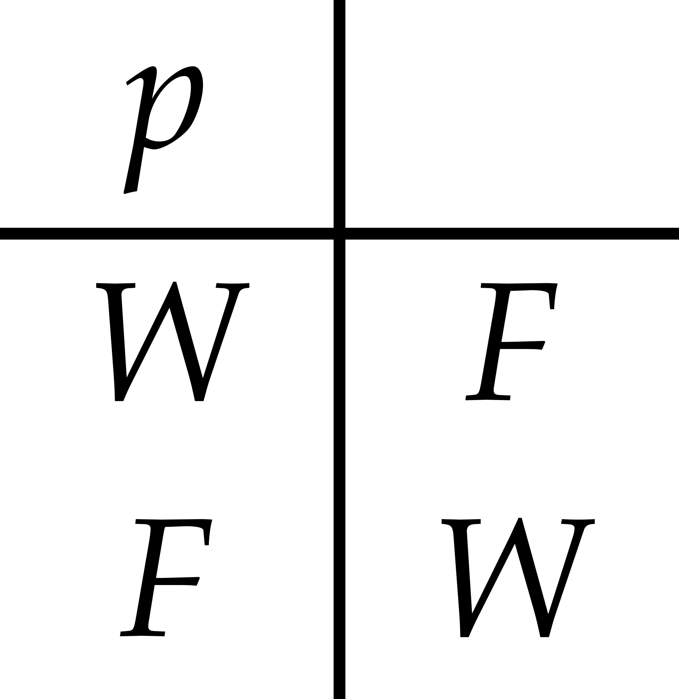”, for example,

is equivalent to every other sign of negation; it is just as much a complex of strokes as the expression “not p”, & it becomes a sign for negation only through the way it ‘_works_’, – I mean: through the way it is used in the game.

(Analogously, for the W-F schemas of tautology & contradiction.)

### [Ms-114](/ms-114/#47v.5) [47v\[5\]](https://cdn.wittgensteinnachlass.com/2000px/webp/Ms-114/47v.webp)

I would like to say: the sign works only dynamically, not statically.

### [Ms-114](/ms-114/#47v.6+48r.1) [47v\[6\]](https://cdn.wittgensteinnachlass.com/2000px/webp/Ms-114/47v.webp),[48r\[1\]](https://cdn.wittgensteinnachlass.com/2000px/webp/Ms-114/48r.webp)

18 It seems easy here to think that the sign summed up the whole grammar; that it would be contained in it like a string of pearls in a box & all we would have to do is pull it out. (But it is precisely such a picture that misleads us.) As though understanding were an instantaneous grasp of something from which later only the consequences were drawn, & in such a way that these consequences already existed in an ideal sense before they were drawn. As though the cube already contained the geometry of the cube & all I had to do was unfold it. But which cube? The cube we see, or an iron cube? Or is there an ideal geometrical cube? What we evidently have in mind is the process in which we derive propositions of geometry from a drawing, a mental image (or a model). But what role does the model play in this? Presumably that of the sign; the sign that is used in a particular game. – And it is interesting & curious how this sign is used, how, for example, we use the drawing of the cube again & again, in ever different combinations. – And it is this sign (_with the identity of a sign_) that we take for that cube in which the geometrical laws already lie. (They lie in it just as little as the dispositions to be used in a certain way lie in the chess king.)

### [Ms-114](/ms-114/#48r.2+48v.1) [48r\[2\]](https://cdn.wittgensteinnachlass.com/2000px/webp/Ms-114/48r.webp),[48v\[1\]](https://cdn.wittgensteinnachlass.com/2000px/webp/Ms-114/48v.webp)

One is always in danger in philosophy of giving a mythology of symbolism, or of psychology; instead of simply saying what one knows.

### [Ms-114](/ms-114/#48v.3) [48v\[3\]](https://cdn.wittgensteinnachlass.com/2000px/webp/Ms-114/48v.webp)

19 The concept of meaning, as I adopted it into my philosophical discussions, derives from a primitive philosophy of language.

### [Ms-114](/ms-114/#48v.4) [48v\[4\]](https://cdn.wittgensteinnachlass.com/2000px/webp/Ms-114/48v.webp)

“Meaning” comes from “deuten”.

### [Ms-114](/ms-114/#48v.5+49r.1) [48v\[5\]](https://cdn.wittgensteinnachlass.com/2000px/webp/Ms-114/48v.webp),[49r\[1\]](https://cdn.wittgensteinnachlass.com/2000px/webp/Ms-114/49r.webp)

When Augustine speaks of learning language, he speaks only of how we give things names, or understand the names of things. _Naming_ seems here to be the foundation and the be-all and end-all of language.

Augustine does not speak of a difference between parts of speech & by “names” evidently means words such as “tree”, “table”, “bread” & certainly the proper names of people; but then presumably also “eat”, “give”, “here”, “there”; in short, all words.

But he is certainly thinking in the first instance of _nouns_, & of the others as something that will sort itself out. (And Plato says that the sentence consists of nouns & verbs.) They simply describe the game as simpler than it is. But the game Augustine describes is indeed part of language. Let us suppose I wanted to put up a building out of building stones that someone else was to hand me; we could first reach an agreement by my pointing to one building stone and saying: “this is a pillar”, and, pointing to another: “this is called ‘cube’”, – “this is called ‘slab’”, and so on. And now I would call out the words “pillar”, “slab”, etc. in the order in which I needed the stones.

### [Ms-114](/ms-114/#49r.2+49v.1) [49r\[2\]](https://cdn.wittgensteinnachlass.com/2000px/webp/Ms-114/49r.webp),[49v\[1\]](https://cdn.wittgensteinnachlass.com/2000px/webp/Ms-114/49v.webp)

Augustine describes a calculus of our language, only not everything we call language is this calculus. (And this is what one must say in many cases where the question before us is: “is this representation useful, or useless”. The answer is: “yes, useful, – but only _for that_; not for the whole area you purported to represent”.)

### [Ms-114](/ms-114/#120v.2) [120v\[2\]](https://cdn.wittgensteinnachlass.com/2000px/webp/Ms-114/120v.webp)

So one could say that Augustine represents the matter too simply; but also: he represents something simpler.

### [Ts-213](/ts-213/#26r.3) [26r\[3\]](https://cdn.wittgensteinnachlass.com/2000px/webp/Ts-213/26r.webp)

It is as if someone explained: “playing consists in moving things on a surface in accordance with certain rules …” and we replied: You are certainly thinking of board games, and your description does apply to them. But those are not the only games. So you can correct your explanation by expressly restricting it to those games.

So one could say that Augustine represents the learning of language too simply; but also: he represents something simpler. (Someone who describes chess more simply – with simpler rules – than it is nevertheless describes a game, but a different one.)

### [Ms-114](/ms-114/#120v.3) [120v\[3\]](https://cdn.wittgensteinnachlass.com/2000px/webp/Ms-114/120v.webp)

20 The way Augustine describes the learning of language can show us from what conception of language the concept of the meaning of words derives.

### [Ms-114](/ms-114/#49v.3) [49v\[3\]](https://cdn.wittgensteinnachlass.com/2000px/webp/Ms-114/49v.webp)

I wanted to say: The way Augustine describes the learning of language can show us where this conception actually comes from. One could compare the case of our language with that of a script in which letters were used to designate sounds, but also to indicate stress & perhaps as punctuation marks. If one then regards this script as a language for describing the sound-image, one can imagine someone misunderstanding it as if each letter simply corresponded to a sound, & as if the letters did not also have quite different functions.

### [Ms-114](/ms-114/#50r.2) [50r\[2\]](https://cdn.wittgensteinnachlass.com/2000px/webp/Ms-114/50r.webp)

Just as the handles in a locomotive driver's cab have very different kinds of operation, so do the words of language, which in a certain sense correspond to handles. One is the handle of a crank, which can be adjusted continuously, since it operates a valve; another operates a switch with two positions; a third is the handle of a pump & works only when it is moved up & down; etc. But they all resemble one another, since they are grasped by hand.

### [Ms-114](/ms-114/#50r.1) [50r\[1\]](https://cdn.wittgensteinnachlass.com/2000px/webp/Ms-114/50r.webp)

This also belongs here: One can, readily enough, speak of _combinations of colours with shapes_ (say, of the colours red & blue with the shapes square & circle), just as one can speak of combinations of different figures or bodies. And here is the root of the bad expression that a fact is a complex of objects. Here a person’s being ill is compared with the putting together of two things, one of which would be the person, the other the illness.

### [Ms-114](/ms-114/#50r.3+50v.1) [50r\[3\]](https://cdn.wittgensteinnachlass.com/2000px/webp/Ms-114/50r.webp),[50v\[1\]](https://cdn.wittgensteinnachlass.com/2000px/webp/Ms-114/50v.webp)

21 Whoever reads a sentence in a language familiar to him experiences the words of the different parts of speech in quite different ways. (The simile of the body of meaning.) We completely forget that the sound- or written-images “nicht” & “Tisch” & “grün” are things of the same kind & see the uniformity of words clearly only in a language foreign to us. (Compare William James on the feelings corresponding to words such as “nicht”, “aber”, etc.)

### [Ms-140](/ms-140/#26r.3) [26r\[3\]](https://cdn.wittgensteinnachlass.com/2000px/webp/Ms-140/26r.webp)

(The “not” makes a gesture of warding off.

No, it _is_ a gesture of warding off. Grasping negation is understanding a warding-off, negating gesture.)

### [Ms-114](/ms-114/#50v.2) [50v\[2\]](https://cdn.wittgensteinnachlass.com/2000px/webp/Ms-114/50v.webp)

Comparison of lines with different functions on a map (boundaries, roads, meridians, contour lines) with the different parts of speech in a sentence. The uninitiated sees a mass of lines & does not know the difference in their meanings. Let us imagine that on the map there is also a line crossing out a sign, to show that it is invalid.

### [Ms-114](/ms-114/#50v.3) [50v\[3\]](https://cdn.wittgensteinnachlass.com/2000px/webp/Ms-114/50v.webp)

The difference between parts of speech is to be compared with the difference between chess pieces, but also with the still greater difference between a game piece & the chessboard.

### [Ms-114](/ms-114/#51r.3) [51r\[3\]](https://cdn.wittgensteinnachlass.com/2000px/webp/Ms-114/51r.webp)

22 Would it not be similar if I decided to change the shapes of the chess pieces, or to use the figure of a little horse as the king? How would it now show that the little horse is the chess king? Can I not very well speak here of a change of meaning?

---

### [Ms-114](/ms-114/#50v.4+51r.1) [50v\[4\]](https://cdn.wittgensteinnachlass.com/2000px/webp/Ms-114/50v.webp),[51r\[1\]](https://cdn.wittgensteinnachlass.com/2000px/webp/Ms-114/51r.webp)

One says: The essential thing about a word is its _meaning_. One can replace the word with another that has the same meaning. In this way a place for the word is fixed, & one can put one word in place of another if one puts it in the same place.

### [Ms-114](/ms-114/#51r.2) [51r\[2\]](https://cdn.wittgensteinnachlass.com/2000px/webp/Ms-114/51r.webp)

If I decided (also in my thoughts) to say a new word instead of “red”, how would it show that this one occupies the place of the word “red”? If it were agreed to say “non” instead of “nicht” in German & instead of “rot” “nicht”; then the word “nicht” would remain in the language, & yet one could say that “non” is now used _in the same way_ as “nicht” used to be, & that “nicht” is now used _differently_ from before.

### [Ms-140](/ms-140/#15r.1) [15r\[1\]](https://cdn.wittgensteinnachlass.com/2000px/webp/Ms-140/15r.webp)

23 I want to explain: the place of a word in grammar is its meaning.

### [Ms-140](/ms-140/#15r.2) [15r\[2\]](https://cdn.wittgensteinnachlass.com/2000px/webp/Ms-140/15r.webp)

But I can also say: The meaning of a word is what the explanation of the meaning explains.

### [Ms-140](/ms-140/#15r.3) [15r\[3\]](https://cdn.wittgensteinnachlass.com/2000px/webp/Ms-140/15r.webp)

(“What 1 cm³ of water weighs has been called ‘1 gram’.” – “Yes, but what does it weigh?”)

### [Ms-140](/ms-140/#15r.4) [15r\[4\]](https://cdn.wittgensteinnachlass.com/2000px/webp/Ms-140/15r.webp)

The explanation of the meaning explains the use of the word. The use of the word in the language is its meaning.

### [Ms-140](/ms-140/#15r.5) [15r\[5\]](https://cdn.wittgensteinnachlass.com/2000px/webp/Ms-140/15r.webp)

Grammar describes the use of words in the language.

### [Ms-140](/ms-140/#15r.6) [15r\[6\]](https://cdn.wittgensteinnachlass.com/2000px/webp/Ms-140/15r.webp)

It therefore relates to language somewhat as the description of a game, as the rules of a game, relate to the game.

### [Ms-140](/ms-140/#15r.7) [15r\[7\]](https://cdn.wittgensteinnachlass.com/2000px/webp/Ms-140/15r.webp)

Meaning, in our sense, is laid down in the explanation of the meaning. If, on the other hand, by the word meaning we meant a characteristic sensation connected with the use of the word, then the explanation of the word would stand to its meaning approximately in the relation of cause to effect.

### [Ms-140](/ms-140/#15r.8) [15r\[8\]](https://cdn.wittgensteinnachlass.com/2000px/webp/Ms-140/15r.webp)

24 The explanation of the meaning can remove any _difference of opinion_ concerning its meaning. It can clarify misunderstandings.

### [Ms-140](/ms-140/#15r.9) [15r\[9\]](https://cdn.wittgensteinnachlass.com/2000px/webp/Ms-140/15r.webp)

The understanding spoken of here is a correlate of an explanation.

### [Ms-140](/ms-140/#15r.10+15v.1+16r.1) [15r\[10\]](https://cdn.wittgensteinnachlass.com/2000px/webp/Ms-140/15r.webp),[15v\[1\]](https://cdn.wittgensteinnachlass.com/2000px/webp/Ms-140/15v.webp),[16r\[1\]](https://cdn.wittgensteinnachlass.com/2000px/webp/Ms-140/16r.webp)

“Explanation of the meaning of a sign” means above all other rules of use the _definitions_. The distinction between verbal definition & ostensive definition gives a rough classification of these kinds of explanation. In order to understand the role a definition plays in the calculus, one must examine the particular case.

### [Ms-140](/ms-140/#16r.2) [16r\[2\]](https://cdn.wittgensteinnachlass.com/2000px/webp/Ms-140/16r.webp)

It may now seem to us as though the other grammatical rules concerning a word had to follow from the ostensive explanation of a word; whereas the ostensive explanation, e.g. “this means ‘red’”, determines the meaning of the word “red”. But this explanation is nothing more than these words together with pointing to a red object, e.g. a red piece of paper. Is this explanation really unambiguous? Could I not have used precisely the same one to give the word “red” the meaning of the word “paper”, “square”, “bright”, “light”, “thin”, etc., etc.?

### [Ms-140](/ms-140/#16r.3) [16r\[3\]](https://cdn.wittgensteinnachlass.com/2000px/webp/Ms-140/16r.webp)

But if, instead of “this means ‘red’”, I had given the explanation “this colour is called ‘red’”, then this would indeed be unambiguous, but only if the grammar of the word “red” had been fixed, up to a final determination, by the expression “colour”. (The question could arise here, for example: “Are you calling just _this_ shade of colour red, or other similar shades of colour as well?”) One could explain: the colour of this spot is called “red”, the shape “ellipse”.

### [Ms-140](/ms-140/#16r.4) [16r\[4\]](https://cdn.wittgensteinnachlass.com/2000px/webp/Ms-140/16r.webp)

I could say: One must already understand a great deal of a language in order to understand this explanation. Whoever understands this explanation must already know where the words (“red”, “ellipse”) are to be placed, what place in the language they are to occupy.

### [Ms-140](/ms-140/#16r.5+17r.1) [16r\[5\]](https://cdn.wittgensteinnachlass.com/2000px/webp/Ms-140/16r.webp),[17r\[1\]](https://cdn.wittgensteinnachlass.com/2000px/webp/Ms-140/17r.webp)

25 The words “form”, “colour” in these explanations determine the _way of applying_ the word & hence what one can call the _word class_. And in ordinary grammar one could quite properly distinguish among the word classes “form-word”, “colour-word”, “sound-word”, “material-word”, etc. (But not with the same justification: “metal-word”, “poison-word”, “predator-word”. It makes sense to say: “iron is a metal”, “phosphorus is a poison”, etc.; but not: “red is a colour”, “the circle is a form”, etc.)

### [Ms-140](/ms-140/#17r.2) [17r\[2\]](https://cdn.wittgensteinnachlass.com/2000px/webp/Ms-140/17r.webp)

I can now explain a colour-word, a form-word, a number-word, etc., etc., ostensively (number-words are explained ostensively to the child & the explanation is good); indeed, negation, disjunction, and so on as well. The _same_ pointing could explain a number-word, a form-word, a colour-word, etc. Only the ostensive explanation plays a different role in the grammar of each word class; & in each case it is only _one_ rule.

### [Ms-140](/ms-140/#17r.3) [17r\[3\]](https://cdn.wittgensteinnachlass.com/2000px/webp/Ms-140/17r.webp)

(Consider also the grammar of explanations of the kind: “this day is called Monday”, “I shall call this day of the year ‘day of reconciliation’”.)

### [Ms-140](/ms-140/#17r.4+18r.1) [17r\[4\]](https://cdn.wittgensteinnachlass.com/2000px/webp/Ms-140/17r.webp),[18r\[1\]](https://cdn.wittgensteinnachlass.com/2000px/webp/Ms-140/18r.webp)

26 But when we learn the meaning of a word, very often we are given _only_ the one rule, the ostensive explanation. How then does it come about that we understand the word on the basis of this explanation? Do we guess the other rules? Let us think of the case of the child learning to understand words by being shown objects & hearing words uttered at the same time. It does therefore receive ostensive explanations; & now it understands the words. – But what is the criterion of understanding here? Surely that it applies them correctly. Does it guess rules? – Yes, we shall ask ourselves: should we call this showing & uttering words “explanations” at all? But the language-game is still very simple & the ostensive explanation plays a different role in it from that which it plays in more developed language-games. (The child cannot yet ask, for example, “what is that called?”) But there is no sharp boundary between primitive forms & the more complicated ones. I would not know what I could still call “explanation” & what I could no longer call one. I can only describe language-games or calculi; whether one then wants to call them calculi is immaterial, & provided we do not let the use of the collective name prevent us from examining each individual case that we want to assess.

### [Ms-140](/ms-140/#18r.5) [18r\[5\]](https://cdn.wittgensteinnachlass.com/2000px/webp/Ms-140/18r.webp)

I could also say of the small child: “it can apply the word, it knows how it is applied”. But what this means becomes clear only when I ask: what is the criterion of this knowledge? Here it is not the ability to state rules.

### [Ms-140](/ms-140/#18r.2) [18r\[2\]](https://cdn.wittgensteinnachlass.com/2000px/webp/Ms-140/18r.webp)

What is the sign that someone understands a game? Must he be able to recite the rules? Is it not also a criterion that he can play the game, i.e. is playing it, & could he not be at a loss if asked about the rules? Does he necessarily learn the game by being told the rules, and not also merely by watching it being played? Of course, he will often say to himself: “Oh, I see, so that’s the rule”, & it might happen that he wrote down the rules as he noticed them; but there is certainly also a learning of the game without explicit rules.

### [Ms-140](/ms-140/#18r.3) [18r\[3\]](https://cdn.wittgensteinnachlass.com/2000px/webp/Ms-140/18r.webp)

Indeed, just as the grammar of a language is first recorded & first comes into existence when the language has already been spoken by people for a _long_ time, primitive games are also played without their list of rules having been drawn up, indeed perhaps without a single rule having been formulated for them.

### [Ms-140](/ms-140/#18r.4) [18r\[4\]](https://cdn.wittgensteinnachlass.com/2000px/webp/Ms-140/18r.webp)

But we consider games & language from the point of view of a game that proceeds according to rules. That is, we _compare_ language with such a process.

### [Ms-140](/ms-140/#19r.1) [19r\[1\]](https://cdn.wittgensteinnachlass.com/2000px/webp/Ms-140/19r.webp)

27 The name I give to a body, – a shape, – a colour, – a length, always has a different grammar. (“A” in “A is yellow” has a different grammar when A is a body from when it is the surface of a body; it makes sense, for example, to say that the body is yellow throughout, but not that the surface is.) And one points to a body in a different sense from that in which one points to its length, or its colour; it is possible, for example, to define “pointing to a colour” as pointing to the body that has it. Just as someone who marries money does not marry it in the same sense in which he marries the woman who possesses it.

### [Ms-140](/ms-140/#19r.2) [19r\[2\]](https://cdn.wittgensteinnachlass.com/2000px/webp/Ms-140/19r.webp)

Money, & what one buys with it. In certain cases an object; but also permission to sit in a place in the theatre, or a title, or rapid movement, or life, etc..

### [Ms-140](/ms-140/#19r.3) [19r\[3\]](https://cdn.wittgensteinnachlass.com/2000px/webp/Ms-140/19r.webp)

A name has meaning, the sentence has sense in the calculus to which it belongs. The latter is autonomous, so to speak. – Language must speak for itself. I could say: I am interested only in the _content_ of a sentence; & the content of a sentence is in it. The sentence has its content as a member of a calculus.

### [Ms-114](/ms-114/#69v.1) [69v\[1\]](https://cdn.wittgensteinnachlass.com/2000px/webp/Ms-114/69v.webp)

One might say: I am interested only in the content of the sentence, & the content of the sentence is in it. – The sentence has its content as a member of a calculus. Language must speak for itself.

### [Ms-140](/ms-140/#20r.1) [20r\[1\]](https://cdn.wittgensteinnachlass.com/2000px/webp/Ms-140/20r.webp)

The meaning is the role the word plays in the calculus.

### [Ms-140](/ms-140/#20r.2) [20r\[2\]](https://cdn.wittgensteinnachlass.com/2000px/webp/Ms-140/20r.webp)

The meaning of a name is not what we point to in the ostensive explanation of the name; that is, it is not the bearer of the name. – The expression “the bearer of the name ‘N’” is synonymous with the name “N”. The expression can be used in place of the name. “The bearer of the name ‘N’ is ill” means: N is ill. One does not say that the meaning of “N” is ill. The name does not lose its meaning when its bearer ceases to exist (when he dies, for example). But does “two names have _one_ bearer” not mean the same as “two names have the same meaning”? Certainly, instead of “a = B” one can write “the bearer of the name ‘A’ = the bearer of the name ‘B’”.

### [Ms-140](/ms-140/#20r.3) [20r\[3\]](https://cdn.wittgensteinnachlass.com/2000px/webp/Ms-140/20r.webp)

28 What does it mean: “to understand a word”? One says to the child: “no, no more lumps of sugar!” & takes it away from the child. That is how it learns the meaning of the word “no”. If one had handed it a lump of sugar with the same words, it would have learnt to understand the word differently. (It has thereby learnt to use the word, but also to associate a particular feeling with it, to experience it in a particular way.)

### [Ms-140](/ms-140/#20r.4+21r.1) [20r\[4\]](https://cdn.wittgensteinnachlass.com/2000px/webp/Ms-140/20r.webp),[21r\[1\]](https://cdn.wittgensteinnachlass.com/2000px/webp/Ms-140/21r.webp)

What does the _meaning_ of a word like “perhaps” consist in? – How does a child learn the use of the word “perhaps”? It may repeat a sentence it has heard from an adult: “she will _perhaps_ come”; in the same tone of voice as the adult. (This is, as it were, a game.) Then one sometimes asks oneself: does it already understand the word “perhaps”, or is it merely repeating it? – But what is the indication that it really understands the word? – Well, that it uses it in particular cases in a particular way – in certain sentence combinations & in a particular tone of voice. What does it mean: to understand the word “perhaps”? – Do _I_ understand the word “perhaps”? – And how do I judge whether I do? Roughly as follows: I know how it is used; I can explain its application to someone by describing it in fictional cases, say. I shall describe the occasion of its application, its position in sentences, the tone of voice in which it is spoken. – Of course, this only says that “I understand the word ‘perhaps’” means as much as: “I know how it is used; etc.”, not that, in order to answer the question whether I understand the word, I try to call its entire application to mind. Rather, in response to this question I shall either react immediately with the answer “yes”, perhaps after saying the word to myself once more, so to speak convincing myself that it is familiar to me; or think of _one_ application, say the word to myself in the correct tone with a gesture of uncertainty; and the like. This is a similar case to when someone explains a calculation to me “which I do not understand precisely”, and when he reaches a particular point in his explanation I say: “Ah, now I understand; now I know how to go on myself”. How do I know that I know how to go on? Have I, at this moment, run through the rest of the calculation? Certainly not. Perhaps part of it has hovered before my mind; perhaps a particular application, a figure. If I were asked: how do you know that you can apply the word “perhaps”, I might answer only: “I have applied it a hundred times”. –

### [Ms-140](/ms-140/#21r.2) [21r\[2\]](https://cdn.wittgensteinnachlass.com/2000px/webp/Ms-140/21r.webp)

29 But one might ask: _Do_ I understand the word, with a description of its application; do I understand its _purpose_? Have I not cheated myself out of something important?

### [Ms-140](/ms-140/#21r.3) [21r\[3\]](https://cdn.wittgensteinnachlass.com/2000px/webp/Ms-140/21r.webp)

Now I know only approximately how people use this word. But that could also be a game, or forms of politeness. I do not know why they act as they do, how _language_ enters into their lives. Is the meaning really only the use of the word? Is it not the way in which this use enters into life? But is its use not part of our life?!

### [Ms-140](/ms-140/#22r.1) [22r\[1\]](https://cdn.wittgensteinnachlass.com/2000px/webp/Ms-140/22r.webp)

Do I understand the word “glorious”, if I know how & on what occasions people use it? Can I then already use it myself? I mean, use it, as it were, with conviction. Could I not know this use & nevertheless follow it without understanding? (As, in a certain sense, the singing of birds.) Does understanding therefore not consist in something else; in feeling “in one’s own breast”, experiencing these expressions? – They must enter into _my_ life.

### [Ms-140](/ms-140/#22r.2) [22r\[2\]](https://cdn.wittgensteinnachlass.com/2000px/webp/Ms-140/22r.webp)

Well, language also enters into my life. And what is called “language” is an entity consisting of heterogeneous parts & the way & manner in which it enters into life is infinitely varied.

### [Ms-140](/ms-140/#22r.3) [22r\[3\]](https://cdn.wittgensteinnachlass.com/2000px/webp/Ms-140/22r.webp)

30 We shall say that the word “glorious”, the word “oh”, but also the word “perhaps” is the _expression_ of a sensation, a feeling. But I do not call this feeling the meaning of the word. Whatever the relation of the word to this sensation may be, whether it is caused by it, whether it regularly accompanies the word, whether the word gives vent to it, like any empirical fact of language as such, does not interest us. For us it remains the description of a process, & what interests us in it is not its truth, but its form. The process as a game.

### [Ms-140](/ms-140/#22r.4) [22r\[4\]](https://cdn.wittgensteinnachlass.com/2000px/webp/Ms-140/22r.webp)

I only _describe_ language & _explain_ nothing.

### [Ms-140](/ms-140/#22r.5) [22r\[5\]](https://cdn.wittgensteinnachlass.com/2000px/webp/Ms-140/22r.webp)

For my purposes I can put tone of voice & gestures, with which the word is used, in place of the sensations which the word is said to express.

### [Ms-140](/ms-140/#22r.6) [22r\[6\]](https://cdn.wittgensteinnachlass.com/2000px/webp/Ms-140/22r.webp)

And so I could say: In some cases, understanding a word includes being able to say it on certain occasions in a particular tone of voice.

### [Ms-140](/ms-140/#22r.7) [22r\[7\]](https://cdn.wittgensteinnachlass.com/2000px/webp/Ms-140/22r.webp)

One might say that certain words are merely the point of application for a tone of voice.

### [Ms-140](/ms-140/#22r.8+23r.1) [22r\[8\]](https://cdn.wittgensteinnachlass.com/2000px/webp/Ms-140/22r.webp),[23r\[1\]](https://cdn.wittgensteinnachlass.com/2000px/webp/Ms-140/23r.webp)

But for my purposes I could also regard the word itself as a gesture instead of the tone of voice & the accompanying gesture. (Can I not say that the sound “ha ha” is a laugh, the sound “oh” a sigh?)

### [Ms-140](/ms-140/#23r.2) [23r\[2\]](https://cdn.wittgensteinnachlass.com/2000px/webp/Ms-140/23r.webp)

31 Could I not imagine a language spoken in an unvarying metre, with filler words inserted here and there between the words of the sentences in order to maintain this metre? Let us imagine that we spoke of the meaning of these filler words. (The blacksmith who, in order to strike in the same rhythm, makes weak blows between the effective ones.)

### [Ms-140](/ms-140/#23r.3) [23r\[3\]](https://cdn.wittgensteinnachlass.com/2000px/webp/Ms-140/23r.webp)

Language is a collection of very different tools. In this toolbox there is a hammer, a saw, a ruler, a set square, a plumb line, a glue-pot & glue. Many of the tools are related to one another through form & use; one can also roughly divide the tools into groups according to their relatedness, but the boundaries of these groups will often be more or less arbitrary; & there are various kinds of relatedness which intersect.

### [Ms-140](/ms-140/#23r.4) [23r\[4\]](https://cdn.wittgensteinnachlass.com/2000px/webp/Ms-140/23r.webp)

I said that the meaning of a word was the role it played in the calculus of language. (I compared it to a piece in chess.) And now let us think about how one calculates with a word, say the word “red”. It is stated where the colour is located, what shape and size the spot or the body bearing the colour has, whether it is pure or mixed with others, darker or lighter, remains the same or changes, etc. etc.. Inferences are drawn from the sentences, they are translated into depictions, into actions, things are drawn, measured & calculated. But let us think of the meaning of the word “oh”. If we were asked about it, we would probably say: “‘oh’ is a sigh; one says, for example, ‘oh, it’s raining again already!’” and the like. And with that one would have described the use of the word. But what corresponds to the calculus, the complicated game that we play with other words? Nothing in the use of the word “oh” or “hurrah” or “hm” can be compared with it.

### [Ms-140](/ms-140/#24r.1) [24r\[1\]](https://cdn.wittgensteinnachlass.com/2000px/webp/Ms-140/24r.webp)

Incidentally, one must not confuse signs with symptoms here. The sound “hm” can be called an expression of hesitation & also, for the other person, a _symptom_ of hesitation, just as clouds are a symptom of rain. But “hm” is not the _name_ of hesitation.

### [Ms-140](/ms-140/#24r.2) [24r\[2\]](https://cdn.wittgensteinnachlass.com/2000px/webp/Ms-140/24r.webp)

32 Let us imagine that we wanted to describe _ball games_. There would be such games as football, cricket, tennis, with a developed, complicated system of rules; but then a game consisting merely in each person throwing a ball as high as he can; finally one such as small children play, by throwing a ball in any direction & then fetching it again. Or someone throws a ball high out of joy & catches it again, without competing with others. Perhaps one will no longer want to call some of these a ball game; but is it clear where the boundary is to be drawn here?

### [Ms-140](/ms-140/#24r.3) [24r\[3\]](https://cdn.wittgensteinnachlass.com/2000px/webp/Ms-140/24r.webp)

We are interested in language as a process that proceeds according to explicit rules. For the philosophical problems are misunderstandings that are to be removed by clarifying the rules according to which we want to use words. We consider language from a one-sided point of view.

### [Ms-140](/ms-140/#24r.4) [24r\[4\]](https://cdn.wittgensteinnachlass.com/2000px/webp/Ms-140/24r.webp)

We said: we did not yet understand the _purpose_ of the word “perhaps” from its use. But by purpose we meant here the role it plays in human life. (And this role could be called the “meaning” of the word, in the sense in which one speaks of ‘the meaning of an event for our life’.) But we said: by “meaning” we understood what the explanation of meaning explains. And the explanation of meaning is not an experiential proposition & no causal explanation, but a rule, an agreement.

### [Ms-140](/ms-140/#25r.1) [25r\[1\]](https://cdn.wittgensteinnachlass.com/2000px/webp/Ms-140/25r.webp)

One could explain: the word “ha!” in our language has the purpose of causing fright in the person addressed. What constitutes its having this purpose? What is the criterion for it? The word purpose is applied, like all the words of our language, in various more or less related ways. Let us name two characteristic games: we could say that the purpose of an action is what is given by the agent in answer to the question about its purpose. On the other hand, when we say that the hen clucks in order to call her chicks together, we infer this purpose from the _effect_ of the clucking. We would never call the gathering of the chicks the purpose of the clucking if the clucking did not always, or mostly, or under certain specifiable circumstances, have this result. – One may now say that the purpose, the effect, of the word “ha!” is what is important about this word; but the explanation of the purpose or of the effect is not what we call the explanation of meaning.

### [Ms-140](/ms-140/#25r.2) [25r\[2\]](https://cdn.wittgensteinnachlass.com/2000px/webp/Ms-140/25r.webp)

A word can, in respect of its effect, be irreplaceable by any other; just as one gesture cannot be replaced by another. (The word has a _soul_, not merely a meaning.) Nor would anyone believe that a poem remained _essentially unchanged_ if its words were replaced by others in accordance with corresponding agreements.

### [Ms-140](/ms-140/#25r.3) [25r\[3\]](https://cdn.wittgensteinnachlass.com/2000px/webp/Ms-140/25r.webp)

We can interpret our sentence, “meaning is what the explanation of meaning explains”, _in this way_: let us concern ourselves only with what is called the _explanation_ of meaning, and with meaning in no other sense.

### [Ms-140](/ms-140/#26r.4+27r.1) [26r\[4\]](https://cdn.wittgensteinnachlass.com/2000px/webp/Ms-140/26r.webp),[27r\[1\]](https://cdn.wittgensteinnachlass.com/2000px/webp/Ms-140/27r.webp)

33 But could one not say this: The sentences we utter have a particular purpose, they are meant to produce certain effects. They are part of a mechanism, perhaps a psychological one, & their words are also such parts (levers, cogwheels, and the like). The example which seems to represent what we are thinking of here is a musical automaton, a game machine. It contains a roll, cylinder, etc., on which the piece of music is written in some notation (through the position of holes, pins, etc.). It is as if these written signs gave the command which was then carried out by the keys and hammers etc. And so should we not say that the sense of the sign is its effect? – But what if the game machine is in a poor condition, & the signs on the roll produce hissing and knocking instead of the sequence of notes? – Perhaps one says: the sense of the signs is their effect on a mechanism in good condition, thus: the sense of a command is its effect on a willing human being. But what is regarded here as the criterion of willingness? So one will say: the sense of those signs is not their effect, but their purpose. But let us consider this as well: one is tempted to believe that this purpose is now part of the whole purpose which the game machine has to fulfil. – This purpose is, say, to give people pleasure. But it is clear that no part of _this_ purpose was meant by the “sense of the signs”. Rather, we were thinking here only of the purpose of these signs _within_ the mechanism of the game machine. – And so one can say: The purpose of a command is its sense, insofar as the purpose is indicated by a rule of language. “I say ‘go!’, because I want you to leave me alone”, “I say ‘perhaps’, because I am not quite certain”.

### [Ms-140](/ms-140/#27r.2) [27r\[2\]](https://cdn.wittgensteinnachlass.com/2000px/webp/Ms-140/27r.webp)

We are not interested in an explanation of the way language works as a psychophysical mechanism. This explanation is itself a description of phenomena (of association, memory, etc.) in language; it is itself a linguistic act & places itself outside the calculus; whereas we need an explanation which is _part of the calculus_.

### [Ms-140](/ms-140/#27r.3) [27r\[3\]](https://cdn.wittgensteinnachlass.com/2000px/webp/Ms-140/27r.webp)

“How is he to know which colour he has to choose when he hears the word ‘red’?” – “Very simple: he is to take the colour whose image comes to mind when he hears the word.” – But how is he to know what that means, & which is the one, ‘that comes to mind when you hear the word’? Of course there is also a process: choosing the colour that comes to mind at this word. And the sentence: “red is the colour that comes to mind when you hear the word ‘red’” is a definition.

### [Ms-140](/ms-140/#27r.4) [27r\[4\]](https://cdn.wittgensteinnachlass.com/2000px/webp/Ms-140/27r.webp)

If I say, “_symbol_ is what produces this effect” –, then the question is precisely: how can I speak of “this effect”? – And how do I know that it _is the one I meant_ when it occurs? – It is therefore no explanation which gets to the root of our problem to say: very simple, we compare it with our memory-image. For how is the method of comparison given to us, according to which we are to compare, i.e.: How do we know what we are to do when we are commanded “to compare”?

### [Ms-140](/ms-140/#27r.5+28r.1) [27r\[5\]](https://cdn.wittgensteinnachlass.com/2000px/webp/Ms-140/27r.webp),[28r\[1\]](https://cdn.wittgensteinnachlass.com/2000px/webp/Ms-140/28r.webp)

In our language it is one function of the word “red” to call the particular colour to mind; indeed, it might be found that this word is better suited to this than others, indeed, that it alone fulfils that purpose. But instead of the mechanism of association we could also have used a chart, or a similar aid; & then our calculus would have to proceed with the associated, or seen, colour sample. The psychological effectiveness of a sign does not concern us. I would also allow myself to invent such an effectiveness.

### [Ms-140](/ms-140/#28r.2) [28r\[2\]](https://cdn.wittgensteinnachlass.com/2000px/webp/Ms-140/28r.webp)

The investigation of whether the meaning of a word is its effect, its purpose, etc., is a grammatical investigation.

### [Ms-140](/ms-140/#28r.3) [28r\[3\]](https://cdn.wittgensteinnachlass.com/2000px/webp/Ms-140/28r.webp)

34 Why can one understand a word & not a penholder? Is it the difference in the forms? But you say: we could also understand a penholder, if it had been given a meaning. But how does one give it a meaning? – How was a meaning given to the word “red”? Well, one points at something & says “I call this ‘red’”. Yes, is that a kind of consecration, or mystical formula? How does this pointing and uttering words work? It works only within a system of other linguistic actions. – And now one can therefore understand a penholder; but does this understanding then contain that whole system of its use? Impossible. We say that we understand its meaning when we know its use, but we have said that the word “know” does not designate a state of consciousness. That is: the grammar of this word is not that of a ‘state of consciousness’, but another. And to learn it is only a means: to look at how the word is actually used.

### [Ms-140](/ms-140/#28r.4+29r.1) [28r\[4\]](https://cdn.wittgensteinnachlass.com/2000px/webp/Ms-140/28r.webp),[29r\[1\]](https://cdn.wittgensteinnachlass.com/2000px/webp/Ms-140/29r.webp)

But to the question: “did you understand the sentence (which you have just read)” one will nevertheless answer truthfully sometimes “yes”, sometimes “no”. “So something else must surely be going on when I understand it than when I do not understand it.” Good. So if I understand a sentence, something happens, very much like when I can follow a melody as a melody, in contrast to when it is too long or too complicated & I have to say, “I could not follow this part”. And the same could happen with a picture, I mean now, a pure ornament. At first I see only a tangle of lines, finally they group themselves into familiar & customary forms; I see a division, a system familiar to me. – If the ornament also contained depictions of objects well known to me, recognizing these would mean a further understanding. (Think here of resolving a puzzle picture.) I would then say: “yes, now I see the picture correctly”. – To the question: “what happened, when you read this sentence with understanding”, I would then have to say: I read it as a German concatenation of words well known to me in its kind. Perhaps also: an image floated before my mind …. But then one asks: “Is that all? Understanding could not consist in that alone!” Well, that (or something of the kind) is all that took place during my reading & immediately afterwards; but what we call “understanding” relates precisely to countless processes that take place before & after reading _this_ sentence. But if I do not understand a sentence: it could be a sentence in a language unfamiliar to me & all I see is a series of unknown words. Or what I read seemed to be a German sentence, but part was not a word-connection familiar to me, & when I then tried to grasp it (& that can again mean various things) I did not succeed. (Think of the processes when we try to understand the sense of a poem written in our mother tongue, whose forms of language we nevertheless do not understand.) But of a sentence in a language unfamiliar to me, say a Latin one, which I can decipher only laboriously by constructing it, I will also say that I understand it if I have translated it piecemeal into German and have never managed to grasp its sentence melody.

### [Ms-140](/ms-140/#29r.2+30r.1) [29r\[2\]](https://cdn.wittgensteinnachlass.com/2000px/webp/Ms-140/29r.webp),[30r\[1\]](https://cdn.wittgensteinnachlass.com/2000px/webp/Ms-140/30r.webp)

But in order to understand the sentence, surely I must understand its words! And surely I understand words when reading, and others I do not. I hear a word & am asked: “did you understand it?” & I answer, truthfully, “yes”. What happened there, when I understood it: how does this – understanding differ from what happens when I do not understand the word? The word was, say, “tree”. Must the image of a tree have floated before my mind, for me to be able to say truthfully that I understood it? No. Nor any other image. All I can say is that, when asked “do you understand the word ‘tree’”, I would have answered “yes” without hesitation & without lying. – If the other had then asked me: “so, what is a tree?” I would now have described, shown, or drawn one for him; but perhaps I would have answered: “I know, but I do not want to explain it”. And while saying my words, the image of a tree might have floated before my mind, perhaps I looked for something that had some similarity to a tree, or other words went through my head, etc. etc.. Let us simply see how we actually use the word “understand”. That word could also have been one of which I said: “I knew what it meant, & it will come to me again”, & later I said: “now it has come to me!” – What had happened there? – Perhaps the situation in which the word had been explained to me had come to mind: I saw myself with others in a room etc. etc.. (But if I now read this word with understanding in a sentence, this image did not have to float before my mind again; perhaps there was no image at all.) Or it was a word in a foreign language; & I had often heard it, but not understood it. I might have said to myself: “what can it mean?” & tried to give it a meaning fitting the context (again, various possibilities). Now perhaps this situation comes to mind & I say: “I do not understand the word”. But I could also react immediately to the foreign word with the answer “I do not understand it”; just as I react oppositely to the word tree. Suppose the word was “red”, & I automatically said that I understood it; now he asks again: “do you really understand it?” Then, as if for purposes of checking, I call up a red mental image before my mind. But how do I know that the right colour is the one that appears to me? And yet I now say, completely convinced, that I understand it. – But I could also look at a colour chart with the word “red” beneath the colour. – I could extend the description of such processes indefinitely.

### [Ms-140](/ms-140/#31r.2+32r.1) [31r\[2\]](https://cdn.wittgensteinnachlass.com/2000px/webp/Ms-140/31r.webp),[32r\[1\]](https://cdn.wittgensteinnachlass.com/2000px/webp/Ms-140/32r.webp)

35 The problem occupying us could be put, quite directly, in these words: “Must one, when reading the word ‘blue’ with understanding, perhaps see the image of the blue colour before one?” This question has often been asked, and then mostly answered in the negative; and from this answer the conclusion has been drawn that the process characteristic of understanding must be another one, not yet grasped by us. – So if by “understanding” one means what distinguishes reading with understanding from reading without understanding: what happens in understanding? Well, we do not call “understanding” one process accompanying reading or hearing, but rather: more or less related processes, against a background, in an environment of facts of a particular kind: the actual use of the language or languages learned. – It is said that understanding is a “mental process”, & this designation is misleading in this case, as well as in countless others. It compares understanding with a particular _process_ – such as translating from one language into another; and it suggests this same conception for thinking, knowing, believing, wishing, intending, and so on. For in all these cases we see that what we might naively give as the mark of such a process does not belong to it in all cases, or even in the majority of cases. And the next conclusion from this is that what is essential to the process is something hitherto undiscovered, difficult to grasp. For one says: If in all these cases I use the word “understand”, then something the same must happen in all of them, and that is precisely what is essential to understanding (expecting, wishing, etc.). For why else should I name them with the same word? – This argument proceeds from the conception that it is what the processes, or objects, etc., have in common which must justify their being characterized by a common concept-word. This conception is, in a certain sense, _too primitive_. What the concept-word indicates is indeed a relatedness of the objects, but this relatedness need not be a commonality of a property or a component. It can link the members together like a chain, so that one is related to another _through intermediate members_; and two neighbouring members can have features in common, be _similar_ to one another, while more distant ones have nothing more in common and yet belong to the same family. Indeed, even if one feature is common to all members of the family, it need not be the feature that defines the concept.

### [Ms-140](/ms-140/#32r.3) [32r\[3\]](https://cdn.wittgensteinnachlass.com/2000px/webp/Ms-140/32r.webp)

The relatedness of the members of the concept can be established through features common to them, whose occurrence in the family of the concept overlaps in extremely complicated ways.

### [Ms-140](/ms-140/#32r.5+33r.1) [32r\[5\]](https://cdn.wittgensteinnachlass.com/2000px/webp/Ms-140/32r.webp),[33r\[1\]](https://cdn.wittgensteinnachlass.com/2000px/webp/Ms-140/33r.webp)

Thus there is probably not one characteristic common to everything we call a game. But one cannot say either that “game” has several independent meanings (like, say, the word “bank”). Rather, “games” are what we call processes related to one another in various ways, between which there is a multiplicity of transitions.

### [Ms-140](/ms-140/#32r.2) [32r\[2\]](https://cdn.wittgensteinnachlass.com/2000px/webp/Ms-140/32r.webp)

One could say: the concept-word or collective name is defined in this case by there being transitions from one member to another. – But one could object that transitions can be made from anything to anything & that the concept would therefore not be bounded. To this I must say that it usually is not in fact bounded & its determination reads, say: “by ‘knowledge’ we mean these and these processes, _& similar ones_”. But if, in order to clarify a philosophical paradox, we want to draw boundaries in the use of a word, we place beside the actual picture of this use, in which, so to speak, the various colours flow into one another without sharp boundaries, another one, similar to the first in a particular way, but consisting of colours with clear boundaries between them.

### [Ms-140](/ms-140/#32r.4) [32r\[4\]](https://cdn.wittgensteinnachlass.com/2000px/webp/Ms-140/32r.webp)

And instead of “and similar ones”, I could have said: “& related to them in some ways”.

### [Ms-140](/ms-140/#33r.2) [33r\[2\]](https://cdn.wittgensteinnachlass.com/2000px/webp/Ms-140/33r.webp)

36 When we consider the actual use of a word, we see something fluctuating. In our considerations we set something more fixed against this fluctuating thing. Similarly, as when one paints a stationary copy of the constantly changing image of a landscape.

### [Ms-140](/ms-140/#33r.3) [33r\[3\]](https://cdn.wittgensteinnachlass.com/2000px/webp/Ms-140/33r.webp)

We consider language _from the point of view_ of a game governed by fixed rules. We compare it with such a game, measure it against it.

### [Ms-140](/ms-140/#33r.4) [33r\[4\]](https://cdn.wittgensteinnachlass.com/2000px/webp/Ms-140/33r.webp)

If, for our purposes, we want to subject the use of a word to definite rules, we place another use beside its fluctuating use, by formulating a characteristic aspect of the first in rules.

### [Ms-140](/ms-140/#33r.5) [33r\[5\]](https://cdn.wittgensteinnachlass.com/2000px/webp/Ms-140/33r.webp)

Thus one could say that the use of the word “good” (in the ethical sense) is composed of an exceedingly large number of related games. So to speak, facets of use. But it is precisely the connection between these facets, their relatedness, that produces _one_ concept here.

### [Ms-140](/ms-140/#33r.6) [33r\[6\]](https://cdn.wittgensteinnachlass.com/2000px/webp/Ms-140/33r.webp)

But what happens here is not what, in physics, is the simplifying description of a natural phenomenon which disregards subordinate influences. One cannot say that logic represents an idealized reality, that it holds strictly only for an ideal language, and the like. For where do we get the concept of this ideal from?! At most one could say: “we _construct_ an ideal language”, in contrast, say, to ordinary language; but not that we _say_ something which would hold only of an ideal language.

### [Ms-140](/ms-140/#34r.1+35r.1) [34r\[1\]](https://cdn.wittgensteinnachlass.com/2000px/webp/Ms-140/34r.webp),[35r\[1\]](https://cdn.wittgensteinnachlass.com/2000px/webp/Ms-140/35r.webp)

37 I would like to say the following about understanding a picture. One will speak of understanding a genre picture, for example, when we recognize the process depicted, the action in it. The criterion for this recognition is then, say, that, when asked, one explains the action in words, represents it through gestures, and so on. It is also possible that this recognition does not come easily to us, either because we do not immediately see the figures in the picture as such (a puzzle picture), or because we cannot piece together what they are doing with one another; and the like. In these cases there is then a process of recognition known to us, perhaps after a period of doubt. If, on the other hand, the picture is one of which we would say, “we grasp it at first sight”, we find it difficult to say what understanding here actually consists in. Above all, what does not happen is that we take the painted objects for real ones. And “I understand it” here does not mean either: I finally understand (after an effort) that it is _this_ picture. Nor does a recognition take place like recognizing an old acquaintance in the street, when one might say: “oh, it’s …!” If one wanted to say: a recognition takes place; what does this recognition consist in? I recognize, say, a certain part of the picture as a human face: Must I, to do this, look at a real face; or bring the memory of one seen before my mind’s eye? Is it like this: I rummage in the cupboard of my memory until I find something similar to the picture, and is the recognition just this finding? In our case there is not _one_ particular process which one could call recognition; although the person who sees the picture will truthfully answer “yes” to the question “do you recognize what this is”, or perhaps with the words: “that’s a face”. But one can say that he sees something different when he sees the complex of lines as a face from when he does not. I would then like to say: I see something _very familiar_ before me. But what constitutes the familiarity is nothing historical, namely that I have already seen such objects so often, etc., for the prehistory of the experience does not lie in the experience. Rather, the familiarity lies, say, in my immediately grasping a particular rhythm of the picture and remaining with it, resting, so to speak, in it. For the rest, the familiarity consists in each particular case in a particular experience, and the picture of a table has one experience, the picture of a bed another. When I say: “I understand this picture”, the question is precisely: do I mean, “I understand it _like this_”? And the “_like this_” stands for a translation of what is understood into another expression. Or is it an, so to speak, intransitive understanding? Do I, in understanding the one, think of another; i.e., does understanding consist in my thinking of something else? And if I do not mean this, then what is understood is quasi-autonomous, and understanding is to be compared with understanding a melody.

### [Ms-140](/ms-140/#35r.3) [35r\[3\]](https://cdn.wittgensteinnachlass.com/2000px/webp/Ms-140/35r.webp)

(It is interesting to note that the pictures which float before us when reading an isolated word, when we want to understand it properly, are usually entirely absent when reading the sentence, and the picture which floats before us when reading it with understanding is often something like a result of the whole sentence.)

### [Ms-140](/ms-140/#36r.2+37r.1) [36r\[2\]](https://cdn.wittgensteinnachlass.com/2000px/webp/Ms-140/36r.webp),[37r\[1\]](https://cdn.wittgensteinnachlass.com/2000px/webp/Ms-140/37r.webp)

38 It is possible that someone forgets the meaning of a word (e.g. the word “blue”). What has he forgotten? – How does this manifest itself? For example, he points to tablets of different colours and says: “I no longer know which of these one calls ‘blue’”. Or else he no longer knows at all what the word means (what the word is used for), and only that it is a German word. One might now say: The one who has forgotten the meaning of the word “blue” and was asked to select a blue object from others, feels, when looking at these objects, that the connection between the word “blue” and those colours no longer exists (that it is interrupted). And the connection is restored when we repeat the explanation of the word to him. But we could restore the connection in a variety of ways: We could point to a blue object and say “that is blue”, or say “remember your bruise”, or perhaps we pronounced the English “blue”, etc. etc. And when I now said that we could establish the connection in these different ways, the thought is suggested that I had brought about, in all these different ways, _one_ particular phenomenon which I call the connection between word and colour, or the understanding of the word, just as I can connect the ends of two wires conductively with one another by means of objects of different shapes and made of different materials. But there must be no talk of a phenomenon of such a connection, of, for example, an image of the colour appearing before my mind’s eye when I hear the word. For if what has been restored is his understanding of the word, this can manifest itself in very different processes, and behind these manifestations there is not yet another process, the actual understanding, which accompanies and causes these manifestations, as toothache causes groaning, holding one’s cheek, contorting one’s face, etc. If I were asked on this account whether I meant that there was no understanding at all, but only manifestations of understanding, I would have to answer that this question is as nonsensical as the question whether there is a three. I can only describe the grammar of the word “understand” (in fragments) and point out that it is not the grammar one would suppose without looking closely. We are in the same position here as the little painter Klecksel, who draws the human profile with two eyes because he knows that human beings have two eyes.

### [Ms-140](/ms-140/#39r.3) [39r\[3\]](https://cdn.wittgensteinnachlass.com/2000px/webp/Ms-140/39r.webp)

39 The explanation of the meaning of a word has an effect similar to ‘knowing how to continue’, when one tells someone the beginning of a poem until he says: now I know how to continue. (Tell yourself the various mental possibilities of this knowing how to continue.)

### [Ms-140](/ms-140/#39r.4) [39r\[4\]](https://cdn.wittgensteinnachlass.com/2000px/webp/Ms-140/39r.webp)

The way in which we learnt the language is not _contained_ in its use. (Just as the cause is not contained in its effect.)

### [Ms-140](/ms-140/#39r.5) [39r\[5\]](https://cdn.wittgensteinnachlass.com/2000px/webp/Ms-140/39r.webp)

What effect has the ostensive explanation had? Is it repeatedly brought in when the word is used, or does it work like an inoculation which has changed us for the time being?

### [Ms-140](/ms-140/#39r.6) [39r\[6\]](https://cdn.wittgensteinnachlass.com/2000px/webp/Ms-140/39r.webp)

The explanation as part of the calculus cannot act at a distance. It works only insofar as it is applied.

### [Ms-140](/ms-140/#37r.2) [37r\[2\]](https://cdn.wittgensteinnachlass.com/2000px/webp/Ms-140/37r.webp)

40 Once again: In what cases will we say, “he understands the word ‘blue’”? Well, when he immediately selects the blue object from the others; or also when he says in a credible manner that he could now select the blue one, but does not want to (perhaps we notice that he involuntarily looks at the blue object while doing so; perhaps we merely believe him on the basis of his earlier behaviour). And how does _he_ know that he understands the word? i.e. under what circumstances will _he_ be able to say it? Sometimes after some test, sometimes without one. But will he not perhaps later have to say, “I was mistaken, I did not understand it after all”, if it turns out that he cannot apply it? Can he defend himself in this case and say that he did indeed understand the word when he asserted this, but that the meaning then escaped him? Well, what can he cite as a criterion (proof) that he understood the word at that time? – He might say: “I saw the colour before me then, but now I cannot remember it”. Now if this implies that he understood the word, then he understood it at that time. – Or he says: “I can only say that I have already used the word a hundred times”, or “that I had used it just before; and when I said I understood it, I was thinking of that case”. What one takes as the grounds for an assertion constitutes the sense of the assertion.

### [Ms-140](/ms-140/#37r.3+38r.1) [37r\[3\]](https://cdn.wittgensteinnachlass.com/2000px/webp/Ms-140/37r.webp),[38r\[1\]](https://cdn.wittgensteinnachlass.com/2000px/webp/Ms-140/38r.webp)

What is it like, then, when we say: “he understands the word ‘blue’, he immediately took the blue ball out from among the others”; but he tells us: “I only drew it at random, I had not understood the word”. What criterion did he have for not having understood the word; and are we now to believe him? – It produces a curious thought-feeling when one asks oneself: “how do I know that I do not understand this word?” One then wants to say “I connect nothing with it”, “it says nothing to me”, “it is a mere sound”, and in order to understand these utterances one has to recall what it is like ‘when one connects something with the word’, when the sound of the word has become a meaningful word through an explanation, when one can _do something with_ the word. One will say: “Surely, he cannot be mistaken in saying that he did not understand the word”. And this is a remark about the grammar of the statement “I did not understand the word”. And likewise it is a remark on grammar when we say: “Whether he understood, we cannot _know_, but only suppose; he, however, knows it”. And it should be said that the statement “I did not understand the word” does not describe a state during the hearing of the word, but that the processes which characterized the failure to understand could have taken place in various ways after hearing the word.

### [Ms-114](/ms-114/#121r.3) [121r\[3\]](https://cdn.wittgensteinnachlass.com/2000px/webp/Ms-114/121r.webp)

41 We speak of an understanding (a process of understanding, or also a state of understanding) & also of certain processes which are criteria of this understanding. One would like to call understanding a mental process or a state of mind & thereby characterise it as a _hypothetical_ process etc., or more correctly as a process (or state) in the hypothetical sense. That is, one assigns the word “understanding” to a particular area of grammar.

### [Ms-114](/ms-114/#121r.4+121v.1) [121r\[4\]](https://cdn.wittgensteinnachlass.com/2000px/webp/Ms-114/121r.webp),[121v\[1\]](https://cdn.wittgensteinnachlass.com/2000px/webp/Ms-114/121v.webp)

And indeed the grammar of the mental state or process is in some respects _similar_ to that of, say, a brain process. The main difference is perhaps that in the case of a brain process direct checking is admitted as possible; for instance, by seeing the process in question by opening the skull. Whereas there is no talk of such ‘immediate perception’ in the grammar of the mental process. (This move does not exist in this game.)

### [Ms-114](/ms-114/#121v.2) [121v\[2\]](https://cdn.wittgensteinnachlass.com/2000px/webp/Ms-114/121v.webp)

What is the criterion that we understand the word “red”? That we select a red object from others when asked to, or that we can give the ostensive definition of the word “red”? We regard both as signs of understanding. If we hear someone use the word “red” & doubt whether he understands it, we can test him by asking: “which colour do you call ‘red’”. On the other hand, if we had given someone the ostensive explanation of the word & now wanted to see whether he had understood it correctly, we would not ask him to repeat it, but might give him the task, for example, of picking out the red things from a series of things.

### [Ms-114](/ms-114/#121v.3+122r.1) [121v\[3\]](https://cdn.wittgensteinnachlass.com/2000px/webp/Ms-114/121v.webp),[122r\[1\]](https://cdn.wittgensteinnachlass.com/2000px/webp/Ms-114/122r.webp)

Here one can ask: “is it my understanding or the other person’s understanding that is being discussed?”

“Only I can know whether I understand; the other person can only guess.” “That I understand is not a hypothesis; that the other person understands is one.”

When we say this, we take “understanding” as an experience analogous, for example, to that of pain. One says: “You cannot know whether I understand (whether I am pleased, etc.); you cannot look inside me”. “You cannot know what I am thinking.” Granted, but that holds only if you are not thinking aloud; & the difference between thinking aloud (or in writing) & thinking in the imagination does not interest us here.

### [Ms-114](/ms-114/#122r.2) [122r\[2\]](https://cdn.wittgensteinnachlass.com/2000px/webp/Ms-114/122r.webp)

One can object that thinking, even if it were only the _visual_ experience of writing, is nevertheless private & that the other person can indeed see what my physical hand writes but cannot have my visual experience. These questions must occupy us elsewhere.

### [Ms-114](/ms-114/#122r.3+122v.1) [122r\[3\]](https://cdn.wittgensteinnachlass.com/2000px/webp/Ms-114/122r.webp),[122v\[1\]](https://cdn.wittgensteinnachlass.com/2000px/webp/Ms-114/122v.webp)

But for our present purpose could we not say “he writes” & “I write” instead of “he understands” & “I understand”? We then leave the question of experience _entirely_ out of play. And so, perhaps, the question of private understanding too. It then appears unimportant to us here.

### [Ms-114](/ms-114/#122v.2) [122v\[2\]](https://cdn.wittgensteinnachlass.com/2000px/webp/Ms-114/122v.webp)

We call “understanding” not the action – whatever it may be – that shows us the understanding, but a state for which this action is an indication. And that is a statement about the grammar of the designation of such a state.

### [Ms-114](/ms-114/#122v.3) [122v\[3\]](https://cdn.wittgensteinnachlass.com/2000px/webp/Ms-114/122v.webp)

42 We can call reciting the rule alone the ‘criterion of understanding’, or also tests of use alone. In the one case “he understands” will then mean: “if you ask him for the rule he will state it”; in the other case: “if you ask him for an application of the rule he will carry out your command.” Or else we regard stating the rule as a symptom that he can do something else than state the rule. Thus, as when we hold the watch to our ear, hear it ticking & say: it is going. We then expect not merely that it will continue ticking, but also that it will show the time.

### [Ms-114](/ms-114/#123r.1) [123r\[1\]](https://cdn.wittgensteinnachlass.com/2000px/webp/Ms-114/123r.webp)

One could say: “reciting the rule is a criterion of understanding if he states the rule with understanding & not purely mechanically.” But here again the meaningful emphasis in the utterance could count as understanding; & why then not simply the utterance itself?

### [Ms-114](/ms-114/#123r.2) [123r\[2\]](https://cdn.wittgensteinnachlass.com/2000px/webp/Ms-114/123r.webp)

Understanding = grasping = receiving a particular impression of the object, letting it make an impression on one. Letting a sentence make an impression on one; considering the consequences of the sentence, imagining them; etc..

### [Ms-114](/ms-114/#123r.3) [123r\[3\]](https://cdn.wittgensteinnachlass.com/2000px/webp/Ms-114/123r.webp)

We call “understanding” a psychological phenomenon which is specifically connected with the phenomenon of learning & use of our, the human, word-language.

---

### [Ms-140](/ms-140/#38r.2+39r.1) [38r\[2\]](https://cdn.wittgensteinnachlass.com/2000px/webp/Ms-140/38r.webp),[39r\[1\]](https://cdn.wittgensteinnachlass.com/2000px/webp/Ms-140/39r.webp)

What is it like to remember the meaning of a word? I see an object of a particular colour before me and say: “this book is brown and I have always called this colour ‘brown’”. What act of remembering must take place for me to be able to say this? But one could put this question much more generally. If, for example, someone asked me “have you seen the table at which you are now sitting before”, I would answer: “yes, I have seen it countless times”. And if asked further I would say: I sat at it every day for months. – What act, or acts, of remembering are taking place here? Surely I do not see myself in my mind ‘sitting at this table every day for months’. But nevertheless I say that I remember having done so and can subsequently substantiate it in various ways. For example, I also lived in this room last summer. But how do I know that, do I see it before me? No. What, then, does remembering consist in in this case? If I, so to speak, pursue the grounds of the memory, individual images of my earlier stay also arise in me, but not, say, with their date. And even before they have arisen, and before I have summoned various pieces of testimony within me, I truthfully say that I remember living here for months and seeing this table. Remembering, then, is probably not the mental process which one would imagine it to be at first sight. If I rightly say “I remember it”, the _most varied things_ may take place, including merely my saying it. And when I say “rightly” here, I am of course not laying down what is the right and what the wrong use of the expression, but, conversely, characterizing the existing use.

### [Ms-140](/ms-140/#39r.2) [39r\[2\]](https://cdn.wittgensteinnachlass.com/2000px/webp/Ms-140/39r.webp)

The mental process of understanding is like the arithmetical object three. The word “process” here and the word “object” there give us a false grammatical _attitude_ towards the word.

### [Ms-114](/ms-114/#59r.2) [59r\[2\]](https://cdn.wittgensteinnachlass.com/2000px/webp/Ms-114/59r.webp)

43 [→ ]

Is it not the case that an explanation, a table, is first used in such a way that one “looks it up”, that one then, as it were, looks it up in one’s head, calls it before the mind’s eye (or the like), & that finally one works without this table, – that is, as if it had never existed. – In this latter case one is now playing a different game. For it is not the case that that table nevertheless stands in the background (& that one can always fall back on it); it has dropped out of our game, & if I “fall back” on it, I do what someone who has gone blind does when he falls back on his sense of touch. An explanation draws up a table, & it becomes history when I no longer use the table.

### [Ms-114](/ms-114/#59r.3+59v.1+60r.1) [59r\[3\]](https://cdn.wittgensteinnachlass.com/2000px/webp/Ms-114/59r.webp),[59v\[1\]](https://cdn.wittgensteinnachlass.com/2000px/webp/Ms-114/59v.webp),[60r\[1\]](https://cdn.wittgensteinnachlass.com/2000px/webp/Ms-114/60r.webp)

I must distinguish between the cases: when on one occasion I follow the table, & on another act in accordance with the table, without using it. – The rule whose learning led us now to act in such and such a way is, as the cause of our way of acting, its prehistory, without interest for us. – But insofar as it is a general description of our way of acting, it is a hypothesis. It is the hypothesis that these two people sitting at the chessboard will act (move) in such and such a way. (An infringement of the rules of the game also falls under the hypothesis, for it then says something about the behaviour of the players when they notice the infringement.) The players could, however, use the rules in such a way that in each particular case they looked up what was to be done; here the rule would enter into the game-action itself & would not stand in relation to it as a hypothesis to its confirmation. – But here there is a difficulty: For the player who plays without using a list of the rules, indeed, who has never seen one, could nevertheless, if asked, state the rules of his game; & not by establishing through repeated observation how he acts in this and that game situation, but by saying, as he stood before a move: “in this case _one moves like this_”. – But if that is so, it shows only that he will state a rule under certain circumstances, not that he makes explicit use of it in playing. That he will draw up a list of the rules if asked is a hypothesis; & if one assumes in him a disposition, a capacity to do so, it is a psychological disposition analogous to a physiological one. If this disposition is said to characterize the process of playing, it characterizes it as a psychological or physiological process, which it actually is. (In our study of symbolism there is no foreground & background, not essentially a tangible sign & an intangible capacity or understanding accompanying it.)

### [Ms-114](/ms-114/#60r.2) [60r\[2\]](https://cdn.wittgensteinnachlass.com/2000px/webp/Ms-114/60r.webp)

44 What interests _us_ about the sign, the meaning that is decisive for _us_, is what is laid down in the grammar of the sign.

### [Ms-114](/ms-114/#60r.3) [60r\[3\]](https://cdn.wittgensteinnachlass.com/2000px/webp/Ms-114/60r.webp)

We ask: How do you use the word, what do you do with it? – that will teach us how you understand it.

### [Ms-114](/ms-114/#60r.4) [60r\[4\]](https://cdn.wittgensteinnachlass.com/2000px/webp/Ms-114/60r.webp)

Grammar is the set of ledgers of language, from which everything must be discernible that concerns not accompanying sensations but the actual transactions with language.

### [Ms-114](/ms-114/#60r.5) [60r\[5\]](https://cdn.wittgensteinnachlass.com/2000px/webp/Ms-114/60r.webp)

One might say, in a certain sense, that nuances do not matter to us. (I could imagine a philosopher who believed that he had to have a sentence about the nature of knowing, say, printed in red, since otherwise it would not really express what it was supposed to express.)

### [Ms-114](/ms-114/#60r.6+60v.1) [60r\[6\]](https://cdn.wittgensteinnachlass.com/2000px/webp/Ms-114/60r.webp),[60v\[1\]](https://cdn.wittgensteinnachlass.com/2000px/webp/Ms-114/60v.webp)

45 The interpretation of written & spoken signs by means of ostensive explanations is not an _application_ of language, but part of grammar. The interpretation still takes place in general, as preparation for every application.

### [Ms-114](/ms-114/#60v.2) [60v\[2\]](https://cdn.wittgensteinnachlass.com/2000px/webp/Ms-114/60v.webp)

One can conceive of the ostensive explanation as a rule for translating from a gesture-language into a word-language.

### [Ms-114](/ms-114/#52r.2+52v.1) [52r\[2\]](https://cdn.wittgensteinnachlass.com/2000px/webp/Ms-114/52r.webp),[52v\[1\]](https://cdn.wittgensteinnachlass.com/2000px/webp/Ms-114/52v.webp)

When I say “the colour of this object is called ‘violet’”, I must already have designated the colour with the words “the colour of this object”, I must already have held it up for christening, in order for a naming to take place. For I could also say: “the name of this colour is to be determined by you”; & the one who gives the name would then already have to know to whom he is to give it (in what place in the language he is putting it). I could explain it like this: the colour of this patch is called “red”, the shape “ellipse”. And the words “colour” & “shape” stand for the kinds of application of names & in reality designate parts of speech such as “noun” & “adjective”. One could quite well introduce the designations “colour-word”, “shape-word”, “substance-word” into ordinary grammar. (But with the same justification also “tree-word”, “book-word”?)

### [Ms-114](/ms-114/#60v.3) [60v\[3\]](https://cdn.wittgensteinnachlass.com/2000px/webp/Ms-114/60v.webp)

It does not belong to grammar that this experiential proposition is true and that one false. All the conditions (the method) for comparing the sentence with reality belong to it. That is, all the conditions of understanding (of sense).

### [Ms-114](/ms-114/#60v.4) [60v\[4\]](https://cdn.wittgensteinnachlass.com/2000px/webp/Ms-114/60v.webp)

Insofar as the meaning of words shows itself in the fulfilled expectation, in the fulfilment of the wish, in following the command, etc., it already shows itself in a linguistic representation of the expectation, etc. It is therefore determined entirely in grammar. In what could have been foreseen; what one could already speak of before the fact occurred.

### [Ms-114](/ms-114/#61r.1) [61r\[1\]](https://cdn.wittgensteinnachlass.com/2000px/webp/Ms-114/61r.webp)

46 Does our language now consist of primary signs (ostensive gestures) & secondary signs (words)?

One might ask whether there must not be primary signs in our language, while it could also manage without the secondary ones. The false note in this question lies in its expecting an explanation of the language that actually exists, instead of a mere description.

It sounds like a laughably obvious truism when I say that someone who believes gestures to be the primary signs underlying all the others would be unable to replace the most ordinary sentence by gestures.

### [Ms-114](/ms-114/#61r.2) [61r\[2\]](https://cdn.wittgensteinnachlass.com/2000px/webp/Ms-114/61r.webp)

One might distinguish between rules of grammar which establish “a connection between language & reality”, & those which do not. A rule of the first kind is: “this colour is called ‘red’”, – a rule of the second kind: “~~p = p”. There is a misconception about this distinction; language is not something that is given a structure and then fitted to reality.

### [Ms-114](/ms-114/#61r.3+61v.1) [61r\[3\]](https://cdn.wittgensteinnachlass.com/2000px/webp/Ms-114/61r.webp),[61v\[1\]](https://cdn.wittgensteinnachlass.com/2000px/webp/Ms-114/61v.webp)

One might want to ask: But is it an accident that in order to explain signs, and thus to complete the system of signs, I have to step outside the written & spoken signs? In doing so, do I not enter precisely the domain in which what is to be described then takes place? – But is it not strange that I can then do anything at all with the written signs? – One might say that the written signs merely stand in for those things to which the ostensive explanation points. –

(It of course makes good sense to say that the defined sign stands for the defining one; & also that the ostensive explanation makes a word stand for the pointing to an object. But, incidentally, it is not the colour red that is represented by the word “red”, but, say, a red tile.)

### [Ms-114](/ms-114/#121r.1) [121r\[1\]](https://cdn.wittgensteinnachlass.com/2000px/webp/Ms-114/121r.webp)

But how is this substitution possible? I cannot have just any thing represent another. – It is then precisely significant that this substitution is possible; for the representing thing must, at least in certain cases, serve just as well as the thing represented.

### [Ms-114](/ms-114/#61v.2+62r.1) [61v\[2\]](https://cdn.wittgensteinnachlass.com/2000px/webp/Ms-114/61v.webp),[62r\[1\]](https://cdn.wittgensteinnachlass.com/2000px/webp/Ms-114/62r.webp)

47 One might say: a red tile, or the like, is the primary sign for the colour red, the word or a secondary sign: for it explains the meaning of the word “red” when I point to a red tile, etc., but not when I say that “red” means the same as “rouge”.

### [Ms-114](/ms-114/#123r.4+123v.1) [123r\[4\]](https://cdn.wittgensteinnachlass.com/2000px/webp/Ms-114/123r.webp),[123v\[1\]](https://cdn.wittgensteinnachlass.com/2000px/webp/Ms-114/123v.webp)

But do I not explain the meaning of the word “red” to a Frenchman in just this way? “Yes, but only because he has learnt the meaning of ‘rouge’ by means of an _ostensive_ definition.” But must this definition be present to him (& otherwise it is mere history), or a red mental image, when he understands my explanation “red = rouge”? Must such an image be present when he, as we would say, uses the word “rouge” with understanding? (Think of the command: “Imagine a circular red patch!”)

### [Ms-114](/ms-114/#62v.3) [62v\[3\]](https://cdn.wittgensteinnachlass.com/2000px/webp/Ms-114/62v.webp)

48 Are the signs which one would like to call ‘primary’ unambiguous? Can one say, for example, that they ought not to be _understood_ any more? – If that is to mean that they ought not to be further _interpreted_, the same holds of the word; but if it means that they _could_ not be further interpreted, then it is false. (Think of the explanation of gestures by words, etc., etc..)

### [Ms-114](/ms-114/#123v.2) [123v\[2\]](https://cdn.wittgensteinnachlass.com/2000px/webp/Ms-114/123v.webp)

Is it right, & in what sense, to say of the ostensive definition that, like the verbal definition, it sets one sign for another; the word for the pointing?

### [Ms-114](/ms-114/#63r.2+63v.1) [63r\[2\]](https://cdn.wittgensteinnachlass.com/2000px/webp/Ms-114/63r.webp),[63v\[1\]](https://cdn.wittgensteinnachlass.com/2000px/webp/Ms-114/63v.webp)

49 What if I establish a notation; if, for example, I want to give shades of colour names for my own use: I might do it by means of a table; and surely I would not write the name next to the wrong colour (the colour to which I do not want to give it). But why not? Why should not “red” stand opposite the green tile & “green” opposite the red one, etc.? If the ostensive definition merely puts one sign in place of another, that should make no difference. – There are in any case two different cases here: The table, with green opposite “red”, etc., can be used in such a way that the person who “looks it up” passes diagonally from the word “red” to the red tile & from the word “green” to the green one, and so on. We would then say that the table was merely arranged differently (according to a different spatial schema), but connected the signs in the same way as the familiar one. – But it might also be that the person using the table looks horizontally from one side to the other & then replaces the word “red” in certain sentences with a green tile; but does not, in response to the command “give me the red book”, bring a green one, but quite correctly a red one (i.e. the one we too call “red”). He has now used the table differently from the first person, but in such a way that for him the word “red” means the same colour as for us. It is the second case that interests us, and the question is: Can a green tile serve as a _sample_ for red? – I can imagine an agreement according to which someone to whom I show a green tile and say paint me this colour is to paint me a red; if I show him blue with these words, he is to paint yellow (say, always the complementary colour). And so it is also possible that someone interprets my command in this way without such an agreement. The agreement might also have been: “when I say, paint this colour, always paint a somewhat darker one”; and again we can imagine that the command would be interpreted in this way without this agreement. – But can one say that someone _copies_ the red of the tile by painting a certain shade of green? And indeed, say, in the way in which he can copy a geometrical figure differently and exactly according to different methods of projection? – Can I compare colours with shapes, and can a green tile be used on the one hand as the name of a particular shade of red, and on the other as its sample? just as a circle can serve as the name of a particular elliptical shape, but also as its sample.

### [Ms-114](/ms-114/#64r.1) [64r\[1\]](https://cdn.wittgensteinnachlass.com/2000px/webp/Ms-114/64r.webp)

It is clear: the sample is not used like the word (the name). And the ostensive explanation, the table, insofar as it leads us from words to samples, differs from the table which replaces one name by another.

### [Ms-114](/ms-114/#64r.2) [64r\[2\]](https://cdn.wittgensteinnachlass.com/2000px/webp/Ms-114/64r.webp)

50 But the word “copy” has different meanings in different cases, and accordingly what I call a “sample” changes. What does it mean to “copy a figure exactly”: to copy it exactly by eye? or with measuring instruments? and with which ones? What are we to call the same colour as that of the sample? Think of different methods of comparison. To what extent can the rule “copy darker” be compared with copying a figure on an enlarged or reduced scale?

### [Ms-114](/ms-114/#64r.3+64v.1) [64r\[3\]](https://cdn.wittgensteinnachlass.com/2000px/webp/Ms-114/64r.webp),[64v\[1\]](https://cdn.wittgensteinnachlass.com/2000px/webp/Ms-114/64v.webp)

Let us imagine someone who claimed that he could copy shades of red in green, & who, looking at the red sample, mixed a shade of green with all the outward signs of exact copying. For us he would be on a par with someone who mixed colours according to violin notes (listening very closely). In that case we would say: “I don’t know _how_ he does it”; but not in the sense that we did not understand the hidden processes in his brain or muscles, but rather that we did not understand what it means to say “this shade is the copy of this violin note”. Unless what is meant is that a person is known from experience to associate a particular shade with a particular sound (sees it before him, paints it, etc.). The difference between the meanings of “associating” & “copying” shows itself in the fact that it makes no sense to speak, for the associated shape (or colour), of a method of projection (a rule for transferring) of the association. We say: “You have not copied correctly”, – but not “You have not associated correctly”.

### [Ms-114](/ms-114/#123v.3) [123v\[3\]](https://cdn.wittgensteinnachlass.com/2000px/webp/Ms-114/123v.webp)

On the other hand, it is conceivable that people should agree so precisely in the colours they associate with violin tones that one could say to the other: “No, you have not represented this violin tone correctly, it was yellower than you painted it”; & the other might reply, for example: “You are right, it seemed so to me too”. –

### [Ms-114](/ms-114/#64v.2+65r.1) [64v\[2\]](https://cdn.wittgensteinnachlass.com/2000px/webp/Ms-114/64v.webp),[65r\[1\]](https://cdn.wittgensteinnachlass.com/2000px/webp/Ms-114/65r.webp)

51 If the table connects the word with a sample, it is not immaterial which tile the word is connected with when it is looked up. – “But then there are arbitrary signs & ones that are not arbitrary!” – Let us think only of communication by means of maps, drawings, & on the other hand sentences. Sentences are no more arbitrary than drawings; only words are arbitrary. And on the other hand the projection method of the map is arbitrary – how should one determine what is arbitrary?

### [Ms-114](/ms-114/#65r.2) [65r\[2\]](https://cdn.wittgensteinnachlass.com/2000px/webp/Ms-114/65r.webp)

I can indeed compare the fixing of word-meanings with the fixing of a method of projection, such as the one for depicting spatial formations (“the sentence is a picture”); this is a good comparison, but it does not relieve us of investigating the functioning of words, which has its own rules. We can of course say – i.e. it corresponds to linguistic usage – that we communicate by means of signs, whether we use words or samples; but the game of following words is different from that of following samples. (Words are not essential to what we call “language”, & neither are samples.) Word-language is only one among many possible kinds of language, & there are transitions from one to another. (Think of two ways of writing the sentence “I see a red circle”: this could be done by writing a circle & giving it the corresponding colour (red); but also by writing a circle & next to it a red patch. Consider the map with regard to what in it corresponds to the form of expression of word-language.)

### [Ms-114](/ms-114/#65r.3+65v.1+66r.1) [65r\[3\]](https://cdn.wittgensteinnachlass.com/2000px/webp/Ms-114/65r.webp),[65v\[1\]](https://cdn.wittgensteinnachlass.com/2000px/webp/Ms-114/65v.webp),[66r\[1\]](https://cdn.wittgensteinnachlass.com/2000px/webp/Ms-114/66r.webp)

52 “I don’t mean to insist that in the explanatory table the red sample should stand horizontally opposite the word “red”, but surely there must be some law for reading the table, for otherwise it loses its sense”. But is it without rules if the table is understood as the arrows in the schema

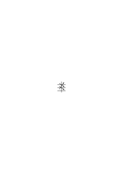

indicate? – “But _must_ the schema of the arrows itself then be given beforehand?” – Must the schema

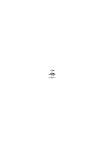

be given before the ordinary way of using it? “But isn’t at least a temporal regularity in the use of the table then required? Would it be acceptable for us to use a table once according to this schema and once according to that one? _How is one to know_ how the table is to be used?” – But do we know it _today_? Explanations of signs must come to an end somewhere. I would of course cause a misunderstanding if, without a special agreement, I showed someone the way by pointing my finger not in the direction in which he is to go, but in the opposite direction. It is in human nature to understand pointing with the finger _in this way_. (Just as it is in human nature to play board games & invent languages of signs consisting of written signs on a surface.)

### [Ms-114](/ms-114/#66r.2) [66r\[2\]](https://cdn.wittgensteinnachlass.com/2000px/webp/Ms-114/66r.webp)

The table does not guarantee the sameness of the transitions made in it. It does not compel me to use it in the same way every time. It is there like a field through which paths lead; but I can also go cross-country. – I make the transition in the table anew with each application. It is not, as it were, made in the table once and for all (it merely tempts me to make it). (What kind are these sentences? – Probably of the same kind as the remark that explanations of signs do come to an end at some point. And that is somewhat like saying: “What good does assuming a creator do you? It only defers the problem of the beginning of the world.” This remark brings out an aspect of my explanation that I may not have noticed. One might also say: “Look at your explanation _this_ way! – are you still satisfied with it now?”

### [Ms-114](/ms-114/#66v.1) [66v\[1\]](https://cdn.wittgensteinnachlass.com/2000px/webp/Ms-114/66v.webp)

53 Can one look for something red by going by the word “red”? does one need a memory-image for that?

### [Ms-114](/ms-114/#66v.2) [66v\[2\]](https://cdn.wittgensteinnachlass.com/2000px/webp/Ms-114/66v.webp)

Can one say that the word “red”, in order to be a usable sign, needs a supplement in memory? If I describe an experience with the words “there is a red book in front of me”, is the justification (of the use) of these words, besides the experience described, that I remember having always used the word “red” for this colour? _Must_ that be the justification?

### [Ms-114](/ms-114/#124r.2+124v.1) [124r\[2\]](https://cdn.wittgensteinnachlass.com/2000px/webp/Ms-114/124r.webp),[124v\[1\]](https://cdn.wittgensteinnachlass.com/2000px/webp/Ms-114/124v.webp)

Do we perhaps need a memory-image of what we did the last time we obeyed a spoken command in order to be able to obey one? Does it therefore really command us: “Do now what, according to your memory, you did then”? This command too could be given. But do I therefore need a memory-image of searching in memory in order to be able to obey it? The command “Do now what, according to your memory, you did then” tells me to look in a particular place for an image which will tell me what I have to do. The command is thus entirely analogous to: “Do what is written on the slip of paper in this drawer”. If nothing is written on the slip, the command is senseless.

### [Ms-114](/ms-114/#66v.3) [66v\[3\]](https://cdn.wittgensteinnachlass.com/2000px/webp/Ms-114/66v.webp)

⋎

If what matters in the use of the word “red” is the image that my memory automatically reproduces at the sound of this word, then I am just as much at the mercy of this reproduction as if I had resolved to determine the meaning by looking it up in a table, in which case I would be putting myself, as it were, entirely at the mercy of what I found in it.

### [Ms-114](/ms-114/#66v.4+67r.1) [66v\[4\]](https://cdn.wittgensteinnachlass.com/2000px/webp/Ms-114/66v.webp),[67r\[1\]](https://cdn.wittgensteinnachlass.com/2000px/webp/Ms-114/67r.webp)

If the colour sample by which I want to be guided seems darker to me than it was yesterday according to my memory, I need not give memory the benefit of the doubt & nor do I always do so. And I could quite well speak of my memory darkening.

### [Ms-114](/ms-114/#67r.2) [67r\[2\]](https://cdn.wittgensteinnachlass.com/2000px/webp/Ms-114/67r.webp)

54 If I tell someone “paint the colour of your room door from memory”, that determines what he is to do no more unambiguously than the order: “paint the green that you see on this board”. One could also imagine the first of these sentences being understood in the way one would normally understand, say, the sentence “paint a shade somewhat lighter than the one you remember having seen there”; and, on the other hand, the person given the order to paint the shade according to a sample will ordinarily have no doubt about the method of projection.

### [Ms-114](/ms-114/#67r.3+67v.1) [67r\[3\]](https://cdn.wittgensteinnachlass.com/2000px/webp/Ms-114/67r.webp),[67v\[1\]](https://cdn.wittgensteinnachlass.com/2000px/webp/Ms-114/67v.webp)

If I had been ordered: “find me a red flower in this meadow & bring it to me”, & I now found one, – would I compare it with my memory-image of the colour red? – And must I consult a further image to see whether the first one is still right? – And why should I then necessarily need the first one? – I see the colour of the flower & recognize _it_. (It would of course be _imaginable_ that someone hallucinated a sample of a colour & compared it with the object being sought as with a real one.)

Even if I say “no, this colour is not yet the right one, it is lighter than the one I saw there”, it does not follow that I see the latter in front of me & that the process is one of comparing two shades seen simultaneously. Nor is it as if somewhere in my mind a bell rang when the right shade had been found & as if I carried an image of this ringing around with me in order to be able to judge when it rang.

### [Ms-114](/ms-114/#67v.2) [67v\[2\]](https://cdn.wittgensteinnachlass.com/2000px/webp/Ms-114/67v.webp)

It is a different game to search with a sample, apply it to the objects & so check the sameness of the colours, and, on the other hand, to act according to words of a word-language without such a sample. Let us think of reading aloud from what is written (or writing down what one hears). We could of course imagine a kind of table that could guide us in doing this. But no table guides us; no act of memory, nothing, mediates between the written sign & the sound.

### [Ms-114](/ms-114/#67v.3+68r.1) [67v\[3\]](https://cdn.wittgensteinnachlass.com/2000px/webp/Ms-114/67v.webp),[68r\[1\]](https://cdn.wittgensteinnachlass.com/2000px/webp/Ms-114/68r.webp)

55 If I were now asked: “why do you choose _this_ colour in response to this order; how do you justify this choice?”, – then in the one case I can answer: “Because _this_ colour stands opposite the word ‘red’ in my table.” In the other case there would be no answer to this question & the question would make no sense. But in the first game the question has no sense: “Why do you call the colour ‘red’ that which stands opposite the word ‘red’ in the table?” A _reason_ can be given only _within_ a game. The chain of reasons comes to an end, namely at the boundary of the game. (Reason & cause.)

### [Ms-114](/ms-114/#68r.3) [68r\[3\]](https://cdn.wittgensteinnachlass.com/2000px/webp/Ms-114/68r.webp)

And if one recalls “that the table does not compel us” to use it in a particular way – nor to use it always in the same way – it becomes (quite) clear that our use of the word “rule” & “game” is wavering (blurring towards the edges).

### [Ms-114](/ms-114/#68v.2) [68v\[2\]](https://cdn.wittgensteinnachlass.com/2000px/webp/Ms-114/68v.webp)

The connection between “language & reality” is made by explanations of words, – which belong to grammar; so that language remains closed in on itself, autonomous.

### [Ms-114](/ms-114/#69v.2) [69v\[2\]](https://cdn.wittgensteinnachlass.com/2000px/webp/Ms-114/69v.webp)

56 Let us think of a sign language with which we make ourselves understood to people who have no word-language in common with us. Do we here too feel the need to step outside language in order to connect its signs with reality?

### [Ms-114](/ms-114/#69v.3+70r.1) [69v\[3\]](https://cdn.wittgensteinnachlass.com/2000px/webp/Ms-114/69v.webp),[70r\[1\]](https://cdn.wittgensteinnachlass.com/2000px/webp/Ms-114/70r.webp)

“The connection between word & thing is established by teaching the language.” What kind of connection is that? A mechanical, electrical, mental connection can function or fail to function. _Mechanism_ & _calculus_. The correlation of object & name is no different from that produced by a table, an ostensive gesture & simultaneous utterance of the name, and the like. It is part of the symbolism. Giving an object a name is essentially of the same kind as hanging a name-tag around it.

It is an expression of an incorrect conception to say that the connection between name & object is psychological.

### [Ms-114](/ms-114/#70r.2+70v.1) [70r\[2\]](https://cdn.wittgensteinnachlass.com/2000px/webp/Ms-114/70r.webp),[70v\[1\]](https://cdn.wittgensteinnachlass.com/2000px/webp/Ms-114/70v.webp)

57 Let us imagine that someone copies a figure to a scale of 1 : 10; is the understanding of the general rule of this mapping contained in the process of copying? – I held my pencil, as it were, quite without presuppositions & was guided (influenced) only by the length of the original. – I would say: if the original had been longer, I would have moved the pencil farther & if shorter, less far. But is, as it were, the mind that expresses itself in this already contained in tracing the line? I can resolve: “I will walk until I find N” – say, I want to meet someone in a street –; & now I walk along the street & meet him at a particular point, & stop. Was acting according to the general rule I had set myself contained in the process of walking, or in some other simultaneous process? Or was the process merely _in accordance_ with this rule, but therefore also in accordance with other rules? I give someone the order to draw a line parallel to a. A 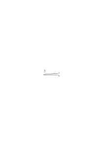 He tries (intends) to do it, but with the result that the line becomes parallel to b. Was the process of copying the same as if he had intended to draw a line parallel to b, & carried out his intention?

### [Ms-114](/ms-114/#70v.2) [70v\[2\]](https://cdn.wittgensteinnachlass.com/2000px/webp/Ms-114/70v.webp)

And if I have _succeeded_ in copying an original according to the prescribed rule, is it then possible to describe the process of copying as it took place also by another general rule? Or can I reject this description with the words: “no, I let myself be guided by _this_ rule – & not by the other one, which in this case would indeed have produced the same result”?

### [Ms-114](/ms-114/#70v.3) [70v\[3\]](https://cdn.wittgensteinnachlass.com/2000px/webp/Ms-114/70v.webp)

58 One would like to say: If I intentionally copy a shape, then the process of copying has this shape in common with the original. It is a facet of the process of copying; a facet that lies against the object copied & coincides with it there. Even if my pencil does not touch the original, the intention always does.

### [Ms-114](/ms-114/#70v.4+71r.1) [70v\[4\]](https://cdn.wittgensteinnachlass.com/2000px/webp/Ms-114/70v.webp),[71r\[1\]](https://cdn.wittgensteinnachlass.com/2000px/webp/Ms-114/71r.webp)

If I want to play from music on the piano, experience will show what sequence of notes I actually play; & the description of what was played need have nothing in common with the description of the notation. If, on the other hand, I want to describe my _intention_, I must say that I wanted to render _this_ notation in sounds. – And only this can express that the intention reaches as far as the original & contains a general rule.

### [Ms-114](/ms-114/#71r.2) [71r\[2\]](https://cdn.wittgensteinnachlass.com/2000px/webp/Ms-114/71r.webp)

The expression of the intention describes the original of the depiction; the description of the copy does not.

### [Ms-114](/ms-114/#71r.3) [71r\[3\]](https://cdn.wittgensteinnachlass.com/2000px/webp/Ms-114/71r.webp)

59 It can never be essential to our considerations that a symbolic phenomenon takes place in the mind & not on paper, visible to others. Again and again one is tempted to try to explain a symbolic process by a special mental process; as though the psyche “could do much more in this matter” than the signs. Here we are misled by the idea of a mechanism that works by special means and can therefore explain particular movements. As when we say: this movement cannot be explained by an arrangement of levers.

### [Ms-114](/ms-114/#71r.4+71v.1) [71r\[4\]](https://cdn.wittgensteinnachlass.com/2000px/webp/Ms-114/71r.webp),[71v\[1\]](https://cdn.wittgensteinnachlass.com/2000px/webp/Ms-114/71v.webp)

The _description_ of the mental must itself again be usable as a symbol. This belongs here: that it is an important insight into the nature of an explanation of signs that the sign can be replaced by its explanation. This brings the concept of this explanation into opposition to that of a causal explanation.

### [Ms-114](/ms-114/#71v.2) [71v\[2\]](https://cdn.wittgensteinnachlass.com/2000px/webp/Ms-114/71v.webp)

60 One can say that it cannot be decided by external observation whether I am _reading_ or merely producing sounds while a text passes before my eyes. But reading cannot essentially be an _inner_ matter. Deriving the translation from the original can also be a visible process. One must, for example, be able to take as the process for this the one that takes place on paper when the members of the series 100, 121, 144, 169 appear to be derived from the members of the series 10, 11, 12, 13 by the calculations

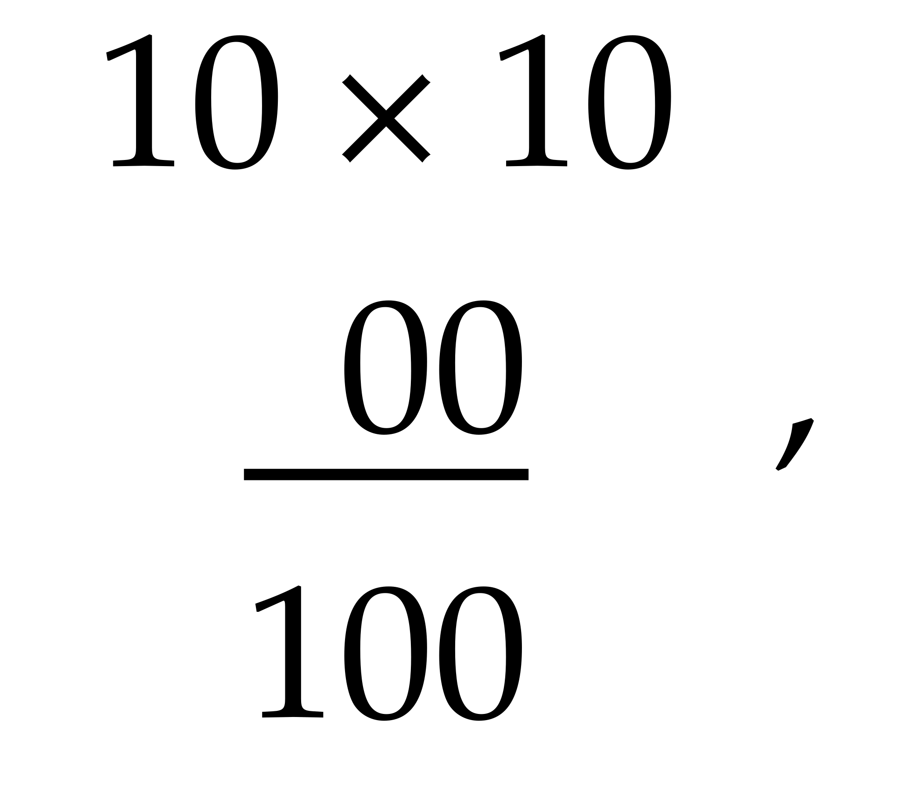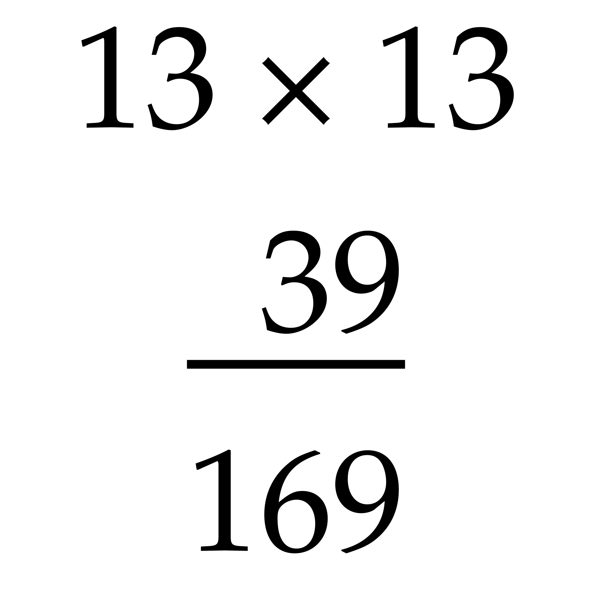

### [Ms-114](/ms-114/#71v.3) [71v\[3\]](https://cdn.wittgensteinnachlass.com/2000px/webp/Ms-114/71v.webp)

The feeling one has with any such – as it were behaviouristic – representation, that it is crude (clumsy), is misleading; we are tempted to look for a “better” representation; but there is no such thing. One is as good as another & each time it is the _system_ that is represented in which a sign is used (“Representation dynamic, not static”.)

### [Ms-114](/ms-114/#72r.2) [72r\[2\]](https://cdn.wittgensteinnachlass.com/2000px/webp/Ms-114/72r.webp)

(Even the mental process cannot leave anything ‘open’ in an essentially different sense from that in which an empty bracket leaves an argument-place open in the symbolism.)

### [Ms-114](/ms-114/#72r.3) [72r\[3\]](https://cdn.wittgensteinnachlass.com/2000px/webp/Ms-114/72r.webp)

One cannot ask: What kind of processes are mental processes, that they can be true & false when non-mental ones cannot? If, if the ‘mental’ ones can, the others must be able to as well; & conversely. – For if processes in the mind can do it, their description must be able to do it too. For it must show itself in their description how it is possible.

### [Ms-114](/ms-114/#72r.4) [72r\[4\]](https://cdn.wittgensteinnachlass.com/2000px/webp/Ms-114/72r.webp)

When one says that thought is a mental activity, or an activity of the mind, one thinks of the mind as a murky, gaseous entity in which things can happen that cannot happen outside this sphere. And of which one can expect things that are otherwise impossible. (The process of thinking in the human mind, & the process of digestion.)

### [Ms-114](/ms-114/#72v.1) [72v\[1\]](https://cdn.wittgensteinnachlass.com/2000px/webp/Ms-114/72v.webp)

61 Every mapping (acting _according to_ – not merely in accordance with – certain rules), _deriving_ an action from an order, justifying an action by an order, is of the same kind as deriving a result in writing from a specification, by referring to a table.

### [Ms-114](/ms-114/#73r.2) [73r\[2\]](https://cdn.wittgensteinnachlass.com/2000px/webp/Ms-114/73r.webp)

“I write the number ‘16’ here, 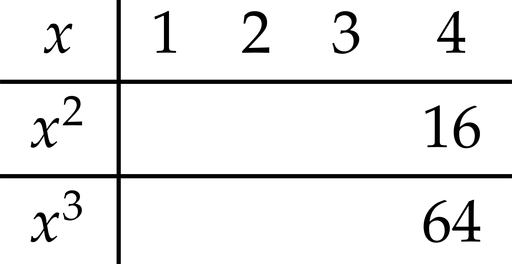 _because_ ‘x²’ stands there & ‘64’ here because ‘x³’ stands there.” This is what every justification looks like. In a certain sense that takes us no further. But it cannot, after all, take us _further_, that is, to the metalogical. (The difficulty here is not to try to justify what has no justification.)

### [Ms-114](/ms-114/#72v.2+73r.1) [72v\[2\]](https://cdn.wittgensteinnachlass.com/2000px/webp/Ms-114/72v.webp),[73r\[1\]](https://cdn.wittgensteinnachlass.com/2000px/webp/Ms-114/73r.webp)

If the task is to form the squares, cubes, etc., of the natural numbers, one can say: “I write the number 16 here,

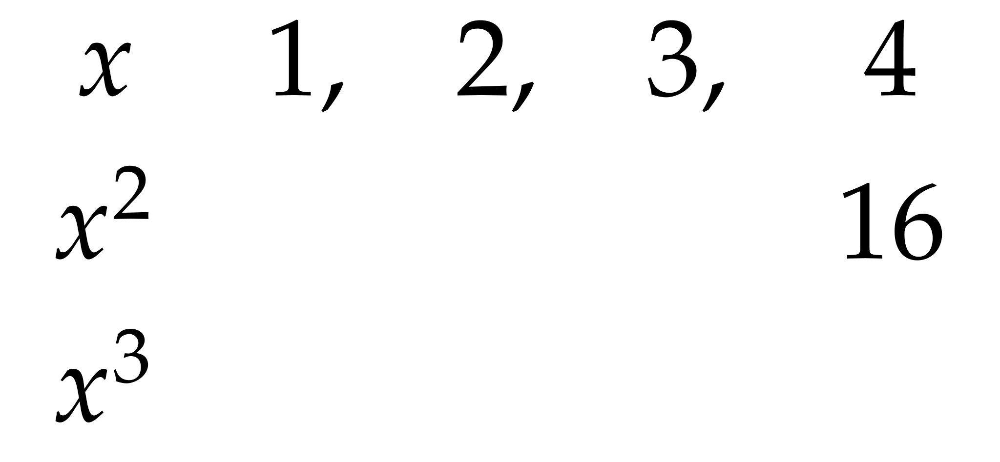

But what if I said: “I write a “ + ” here because x² stands there”? One would ask: “Do you write a “ + ” everywhere x² stands?” – – i.e., one would ask for a general rule; otherwise the “because” in my sentence would have no sense. Or one might ask: “How do you know that you wrote it _because of that_?” Here the “because” has been understood as introducing a statement of the cause, rather than of the reason.

### [Ms-114](/ms-114/#73r.3) [73r\[3\]](https://cdn.wittgensteinnachlass.com/2000px/webp/Ms-114/73r.webp)

If, following the rule, I write ‘16’ beneath ‘4’, it might seem as if a causal connection were at play here that was not hypothetical but immediately perceived (experienced). (Confusion of ‘reason’ & ‘cause’)

### [Ms-114](/ms-114/#73r.4+73v.1) [73r\[4\]](https://cdn.wittgensteinnachlass.com/2000px/webp/Ms-114/73r.webp),[73v\[1\]](https://cdn.wittgensteinnachlass.com/2000px/webp/Ms-114/73v.webp)

What kind of nexus is meant in the sentence: “I am going out _because_ he orders it”? And how does this sentence compare with: “I am going out _although_ he has ordered me to”? (Or: “I am going out, but not because he ordered it”, “I am going out because he ordered me not to”.)

### [Ms-114](/ms-114/#73v.2) [73v\[2\]](https://cdn.wittgensteinnachlass.com/2000px/webp/Ms-114/73v.webp)

62 “That is supposed to be _him_” (this picture represents _him_), there lies the whole problem of representation. What is the criterion for this, how is it to be verified that this picture is the portrait of that object – i.e., is supposed to represent _him_? Likeness does not make the picture a portrait (it could be deceptively like one person & at the same time be the portrait of another, whom it resembles less). How can I know that he means the picture as a portrait of N? – Well, for example, by his saying so, or writing it underneath. What connection does N’s portrait have with him? Perhaps the fact that the name by which he is addressed stands beneath it.

### [Ms-114](/ms-114/#73v.3) [73v\[3\]](https://cdn.wittgensteinnachlass.com/2000px/webp/Ms-114/73v.webp)

If I remember my friend, “see him before me”, what is the connection here between the memory-image and its object? The likeness? Well, the image _as a picture_ can only be like him.

### [Ms-114](/ms-114/#73v.4+74r.1) [73v\[4\]](https://cdn.wittgensteinnachlass.com/2000px/webp/Ms-114/73v.webp),[74r\[1\]](https://cdn.wittgensteinnachlass.com/2000px/webp/Ms-114/74r.webp)

The mental image of him is an unpainted portrait.

I also had to write his name beneath the picture in the mental image, in order for it to become the mental image of him.

### [Ms-114](/ms-114/#74r.2) [74r\[2\]](https://cdn.wittgensteinnachlass.com/2000px/webp/Ms-114/74r.webp)

I have resolved to carry out a particular action; I have a plan. The plan in my mind is supposed to consist in my seeing myself do such-and-such. But how do I know that _I_ am the one I see? Well, it is not me, but a picture, say. But why do I call it _my_ picture? “How do I know that _I_ am the one?”: the question makes sense when, for example, it is put this way: “How do I know that it is me I see there in the mirror?” And then the answer gives features by which I can be recognized. But that my mental image represents me is my own determination. And I could just as well ask: “How do I know that the word ‘I’ represents me?”, for my figure in the picture was merely another word “I”.

### [Ms-114](/ms-114/#74r.3+74v.1) [74r\[3\]](https://cdn.wittgensteinnachlass.com/2000px/webp/Ms-114/74r.webp),[74v\[1\]](https://cdn.wittgensteinnachlass.com/2000px/webp/Ms-114/74v.webp)

“I can imagine that you will go out through the door.” We are subject to a strange illusion that in the sentence, in the thought, the objects do what the sentence says of them. It is as if a shadow of the execution already lay in the order. But a shadow of just _this_ execution. _You_ go to such-and-such a place in the order. – But otherwise it would simply be a _different_ order. Of course this identity is the one that corresponds to the diversity of two different orders.

### [Ms-114](/ms-114/#74v.2+75r.1) [74v\[2\]](https://cdn.wittgensteinnachlass.com/2000px/webp/Ms-114/74v.webp),[75r\[1\]](https://cdn.wittgensteinnachlass.com/2000px/webp/Ms-114/75r.webp)

“I thought Napoleon had been crowned in 1805.” – What has your thought got to do with Napoleon? What connection is there between your thought & Napoleon? – It may, for example, consist in the occurrence of the word “Napoleon” in the expression of my thought, plus the connection this word had with its bearer; for instance, that he signed himself that way, was addressed that way, etc., etc. “But with the word ‘Napoleon’ you are surely designating this very person when you utter it”. – “How, in your opinion, does this act of designation take place, then? Instantaneously? Or does it take time?” – “Yes, but if one asks you: ‘did you just now mean the man who won the battle of Austerlitz?’, you will surely say: ‘yes’. So you meant this man _when you uttered the sentence_?” – Granted, but only in much the same sense in which I also knew at the time that 6 × 6 = 36. The answer “I meant the victor of Austerlitz” is a new step in our calculus. What is misleading about this answer is the past tense, which seems to give a description of what was going on “inside me” while the sentence was being uttered. (“But I meant _him_.” A strange process, this meaning! Can one mean someone (in Europe) even if he is in America? And even if he no longer exists at all?)

### [Ms-114](/ms-114/#75r.2) [75r\[2\]](https://cdn.wittgensteinnachlass.com/2000px/webp/Ms-114/75r.webp)

63 One is tempted (misled by our grammar) to ask: “_how does one think_ a sentence, _how_ does one expect that such-and-such will happen? (how does one do that?)” “How does thought work, how does it employ its expression?” – This question seems analogous to: “how does the Jacquard loom work, how does it employ the cards”.

But one could answer: “Don’t you really know? You can see it, after all, when you think.” Nothing is hidden, after all.

### [Ms-114](/ms-114/#75r.4+75v.1) [75r\[4\]](https://cdn.wittgensteinnachlass.com/2000px/webp/Ms-114/75r.webp),[75v\[1\]](https://cdn.wittgensteinnachlass.com/2000px/webp/Ms-114/75v.webp)

Our feeling then is that in the sentence “I believe that p is the case” something essential, the actual process of believing, is not represented, but merely indicated, and that this indication must be replaceable by a description of the mechanism of belief. A description in which the word-sequence “p” would occur, like the cards in the description of the Jacquard loom. And that this description would then be the full expression of belief. Let us compare believing with uttering the sentence; here too very complicated processes take place in our larynx, speech muscles, nerves, etc. These _accompany_ the sentence uttered. And it remains the only thing that interests us, not as a component of a mechanism, but of a calculus.

### [Ms-114](/ms-114/#75v.2) [75v\[2\]](https://cdn.wittgensteinnachlass.com/2000px/webp/Ms-114/75v.webp)

“How does thought manage to represent?” – The answer could be: “Don’t you really know? You can see it, after all, when you think.” Nothing is hidden, after all. How does the sentence do that? – Don’t you know? Nothing is concealed, after all.

### [Ms-114](/ms-114/#75r.3) [75r\[3\]](https://cdn.wittgensteinnachlass.com/2000px/webp/Ms-114/75r.webp)

But to the answer “You know how the sentence does it, after all, there’s nothing hidden”, one would like to say: “Yes, but it all flows past so quickly, & I’d like to see it, as it were, spread out more widely”.

### [Ms-114](/ms-114/#75v.3+76r.1) [75v\[3\]](https://cdn.wittgensteinnachlass.com/2000px/webp/Ms-114/75v.webp),[76r\[1\]](https://cdn.wittgensteinnachlass.com/2000px/webp/Ms-114/76r.webp)

It seems to us that we are in the same position with a thought as with a landscape we have seen & are to describe, but cannot remember accurately enough to describe it in all its connections. So we think that we cannot describe thinking afterwards because by then we have lost the many finer processes. We would like to see these delicate interlacings under a magnifying glass, so to speak. (Think of the sentence: “Everything flows”.)

### [Ms-114](/ms-114/#76r.3+76v.1) [76r\[3\]](https://cdn.wittgensteinnachlass.com/2000px/webp/Ms-114/76r.webp),[76v\[1\]](https://cdn.wittgensteinnachlass.com/2000px/webp/Ms-114/76v.webp)

We ask: “What is a thought; what kind of thing must something be to be able to perform the function of thought?” And this question is analogous to: what is, or how does, a sewing machine work? – But the answer analogous to ours would be: look at the stitch it is to sew; everything essential to the machine can be seen in it; everything else can be one way or another. What is the function, purpose, of thought? – If it is its _effect_, then it does not interest us. We are not in the domain of causal explanations & every such explanation sounds trivial to us.

### [Ms-114](/ms-114/#125r.1) [125r\[1\]](https://cdn.wittgensteinnachlass.com/2000px/webp/Ms-114/125r.webp)

64 If one thinks of thought as something specifically human and organic, one wants to ask: “Could there be a prosthesis for thought, an inorganic substitute for thought?” But if thinking consists in writing or speaking, why shouldn’t a machine do it? – “Yes, but the machine knows nothing!” – Of course, it makes no sense to speak of a prosthesis for seeing & hearing. One speaks of an artificial foot, to be sure, but not of artificial pains in the foot.

### [Ms-114](/ms-114/#76r.2) [76r\[2\]](https://cdn.wittgensteinnachlass.com/2000px/webp/Ms-114/76r.webp)

“But could a machine think?” – Could it be in pain? What matters here is what one understands by the expression “_being_ in pain”. I can regard the other person as a machine that is in pain, i.e. the other _body_. And likewise, of course, my body. In contrast, the phenomenon of pain, which I describe when I say, for example, “I have toothache”, does not presuppose a physical body. (I can have toothache without teeth.) And here there is no place for the machine at all. – It is clear that the machine can take the place only of a physical body. And in the sense in which one can say of such a body that it is in pain, one can say it of a machine too. Or again: the _bodies_ we say are in pain can be compared with machines, & we can also call them machines.

### [Ms-114](/ms-114/#76v.3+77r.1) [76v\[3\]](https://cdn.wittgensteinnachlass.com/2000px/webp/Ms-114/76v.webp),[77r\[1\]](https://cdn.wittgensteinnachlass.com/2000px/webp/Ms-114/77r.webp)

It is one of the most dangerous ideas for our investigations that we think _with the head_, or in the head. The idea of a process in the head, in that completely enclosed space, gives thinking something occult about it. “Thinking goes on in the head” really means nothing more than: the head has something to do with thinking. – To be sure, one also says “I think with my pen” & this specification of place is at least as good. To say that thinking is an activity of the mind, as writing is an activity of the hand, is a travesty of the truth. (Love in the heart. Head & heart as localities of the mind.)

### [Ms-114](/ms-114/#125r.2+125v.1) [125r\[2\]](https://cdn.wittgensteinnachlass.com/2000px/webp/Ms-114/125r.webp),[125v\[1\]](https://cdn.wittgensteinnachlass.com/2000px/webp/Ms-114/125v.webp)

65 We can say: thinking is operating with symbols. But ‘thinking’ is a fluid concept, & what kind of ‘operating with symbols’ it is must be considered separately in each particular case. I could also say: thinking is operating with language; but ‘language’ is a fluid concept.

### [Ms-114](/ms-114/#125v.2) [125v\[2\]](https://cdn.wittgensteinnachlass.com/2000px/webp/Ms-114/125v.webp)

If it is said: “Thinking is a mental process”, that is probably correct only insofar as one also calls seeing a written sentence or hearing a spoken one a mental process. That is, in the sense in which one calls pains a mental state. One then wants to distinguish with the word “mental process” the ‘experience’ from the ‘physical process’. – On the other hand, the expression “mental process” does of course suggest that these are misunderstood processes in a sphere inaccessible to us. Furthermore, psychology also speaks of ‘unconscious thoughts’ and here means by “thoughts” a process in a model of the mind. (‘Model’ in the sense in which one speaks of a mechanical model of electrical processes.) When, on the other hand, Frege speaks of the thought expressed by a sentence, the word “thought” here means roughly the same as the words “sense of the sentence”.

### [Ms-114](/ms-114/#126r.1) [126r\[1\]](https://cdn.wittgensteinnachlass.com/2000px/webp/Ms-114/126r.webp)

One could say: in all cases, when one speaks of a “thought”, one means the _living_ aspect of the sentence. That without which it is dead, a mere sequence of sounds or sequence of written figures. But if I were to speak in the same way of something which gives meaning to a configuration of chess pieces, i.e., distinguishes it from an arbitrary arrangement of wooden blocks, what could I not mean by it! The rules that make the chess configuration a situation in a game, the particular experiences that we associate with such game positions, the use of the game. Or if we were to speak of something which distinguishes paper money from mere printed slips of paper & gives it its meaning, its life!

### [Ms-114](/ms-114/#77r.3) [77r\[3\]](https://cdn.wittgensteinnachlass.com/2000px/webp/Ms-114/77r.webp)

When we speak of thought & its expression, thought is not a kind of mood brought on by the sentence as by a drug. And communication through language is not a process in which I use a poison to bring on in someone else the same pains as I have. (What process could one call “thought-transmission” & “thought-reading”?)

### [Ms-114](/ms-114/#77v.1) [77v\[1\]](https://cdn.wittgensteinnachlass.com/2000px/webp/Ms-114/77v.webp)

66 (No one would ask whether written multiplication of two numbers in the decimal system corresponds to the thought of multiplication.)

### [Ms-114](/ms-114/#77r.4+77v.1) [77r\[4\]](https://cdn.wittgensteinnachlass.com/2000px/webp/Ms-114/77r.webp),[77v\[1\]](https://cdn.wittgensteinnachlass.com/2000px/webp/Ms-114/77v.webp)

A French politician has said that the French language is distinguished by the fact that in it the words stand in the order in which one thinks. The idea that one language can have a word order corresponding to the order of thinking, in contrast to other languages, comes from the view that thinking goes on separately from the expression of thoughts; & is an essentially different process. “The grammatical possibilities of the negation sign do, of course, reveal themselves only little by little in the use of the sign, but I _think_ the negation all at once. The sign ‘not’ merely points to the thought ‘not’; it just gives me a nudge so that I think the right thing (it is only a signal).”

### [Ms-114](/ms-114/#78r.1) [78r\[1\]](https://cdn.wittgensteinnachlass.com/2000px/webp/Ms-114/78r.webp)

“I meant something specific by it when I said …”. – “Did you have something different in mind with each word, or the same thing throughout the entire sentence?” Incidentally, it is strange: if one means something by each German word, that a combination of such words can be nonsense! – “Were you thinking, when you said the sentence, that …” – “I only thought what I said.”

### [Ms-114](/ms-114/#78r.2) [78r\[2\]](https://cdn.wittgensteinnachlass.com/2000px/webp/Ms-114/78r.webp)

Does the child only learn to speak, or also to think? Does it learn the meaning of multiplication _before_–, or _after_ multiplying?

### [Ms-114](/ms-114/#78r.3+78v.1) [78r\[3\]](https://cdn.wittgensteinnachlass.com/2000px/webp/Ms-114/78r.webp),[78v\[1\]](https://cdn.wittgensteinnachlass.com/2000px/webp/Ms-114/78v.webp)

Is it, as it were, a contamination of the sense that we express it in a particular language, with its contingencies, & not, as it were, bodiless & pure? Is it that, after all, I am not really playing the game of chess itself, since the pieces could be different?! (Is a mathematical proof in the general theory of irrational numbers less general or rigorous for being conducted with reference to the decimal notation of these numbers? Does it also impair the rigour & purity of the sentence 25 × 25 = 625 that it is written down in a particular number system?)

### [Ms-114](/ms-114/#78v.2) [78v\[2\]](https://cdn.wittgensteinnachlass.com/2000px/webp/Ms-114/78v.webp)

Thought can only be something altogether commonplace, ordinary. (One is in the habit of thinking of it as something ethereal, unexplored; as if it were something of which we know only the outside, but whose essence is still unexplored – rather like our brain.) One would like to say: “Thought, this strange being”

Again we can only make explicit the grammar of the word “think”. (And likewise of the words “expect”, “believe”, etc.)

### [Ms-114](/ms-114/#126r.2+126v.1) [126r\[2\]](https://cdn.wittgensteinnachlass.com/2000px/webp/Ms-114/126r.webp),[126v\[1\]](https://cdn.wittgensteinnachlass.com/2000px/webp/Ms-114/126v.webp)

But when I say that thought is something quite homely, I mean that this concept is like, say, that of the number One for us. It seems mysterious because we misunderstand its grammar & miss a tangible thing corresponding to the thing-word. (That is almost similar to hearing a human voice from the space in front of us, but seeing no human being in front of us.)

### [Ms-114](/ms-114/#78v.3) [78v\[3\]](https://cdn.wittgensteinnachlass.com/2000px/webp/Ms-114/78v.webp)

67 Why does a person think? What is the use of it? Why _does_ he _calculate_ the wall thickness of a steam boiler & not let chance, or whim, determine it? It is, after all, merely an empirical fact that boilers calculated in this way do not explode as often. But just as he would do anything rather than put his hand in the fire that burned him before, so he will do anything rather than not calculate the boiler. Since we are now not interested in causes, we can say: people do indeed think; they proceed, for example, in this way when they build a steam boiler. – Can a boiler produced in this way not explode? It certainly can!

### [Ms-114](/ms-114/#78v.4+79r.1) [78v\[4\]](https://cdn.wittgensteinnachlass.com/2000px/webp/Ms-114/78v.webp),[79r\[1\]](https://cdn.wittgensteinnachlass.com/2000px/webp/Ms-114/79r.webp)

We think through actions before carrying them out. We make images of them; but why? There is no such thing as a “thought experiment”! We expect something, & act in accordance with the expectation; must the expectation come true? No. But why do we act according to the expectation? Because we are driven to do so, just as we are driven to get out of the way of a car, to sit down when we are tired, and to jump up when we have sat on a thorn.

### [Ms-114](/ms-114/#79r.2) [79r\[2\]](https://cdn.wittgensteinnachlass.com/2000px/webp/Ms-114/79r.webp)

What belief in the uniformity of what happens amounts to is perhaps clearest when we feel fear of the expected event. Nothing could induce me to put my hand in the flame, although I have been burnt _only in the past_. The belief that the fire will burn me is of the nature of the fear that it will burn me. Here I also see what “it is certain” means.

### [Ms-114](/ms-114/#79r.3) [79r\[3\]](https://cdn.wittgensteinnachlass.com/2000px/webp/Ms-114/79r.webp)

If one were to drag me into the fire, I would resist & would not go willingly; & likewise I would shout, “It will burn me!” & not: “Perhaps it will be quite pleasant!”

### [Ms-114](/ms-114/#79r.4+79v.1) [79r\[4\]](https://cdn.wittgensteinnachlass.com/2000px/webp/Ms-114/79r.webp),[79v\[1\]](https://cdn.wittgensteinnachlass.com/2000px/webp/Ms-114/79v.webp)

“But surely you also believe that there would be more steam-boiler explosions if the boilers were not calculated!” – Yes, I believe it; – but what does that mean? Does it follow that there will actually be fewer? – And what is the basis of this belief?

### [Ms-114](/ms-114/#79v.2+80r.1) [79v\[2\]](https://cdn.wittgensteinnachlass.com/2000px/webp/Ms-114/79v.webp),[80r\[1\]](https://cdn.wittgensteinnachlass.com/2000px/webp/Ms-114/80r.webp)

68 I assume that this house, in which I am writing, will not collapse in the course of the next half-hour. – When do I assume that; all the time? And what kind of activity is this assuming? It may mean a psychological disposition; but it may also mean the thinking, expressing, of a particular thought. In the second case I utter, for example, a sentence which is in turn an element of a consideration (calculation). Now one says: But you must have a reason for assuming that, otherwise the assumption is unsupported & worthless. – (Remember that although we stand on the earth, the earth in turn does not stand on anything; & children think it must fall if it is not supported.) Well, I do have reasons for my assumption. They go something like this: that the house has already stood for years, but not so long that it could already be dilapidated; etc., etc.. – _What_ counts as a reason for an assumption can be stated in advance, & determines a calculus; a system of transitions. But if a reason for this calculus is now asked for, we see that there is none. Is the calculus therefore arbitrarily assumed by us? No more so than fear of fire, or of an angry person approaching us. “Surely the rules of grammar by which we proceed & operate are not arbitrary!” – Very well, then, why does a person think as he does, why does he go through these acts of thinking? (The question here is, of course, about reasons, not causes.) Well, reasons can be given within the calculus, & at the end one is then tempted to say: “it is simply very likely that things will now behave as they have always behaved”, – or something of the sort. A phrase which conceals the beginning of the justification. (The Creator as an explanation at the beginning of the world.) What is so hard to see is roughly this: that, _as long as_ we remain within the domain of true-or-false games, a change of grammar can only take us from _one_ such game to another, but not from something true to something false. And if, on the other hand, we step outside the domain of these games, we no longer call it ‘language’ & ‘grammar’, & again we do not come into contradiction with reality.

### [Ms-114](/ms-114/#80r.2+80v.1) [80r\[2\]](https://cdn.wittgensteinnachlass.com/2000px/webp/Ms-114/80r.webp),[80v\[1\]](https://cdn.wittgensteinnachlass.com/2000px/webp/Ms-114/80v.webp)

69 What is a sentence? – What, then, do I distinguish a sentence from? Or what do I want to distinguish it from? From parts of a sentence within its grammatical system (as an equation is distinguished from its parts), or from everything we do not call a ‘sentence’, such as this armchair, my watch, etc., etc.?

### [Ms-114](/ms-114/#80v.2) [80v\[2\]](https://cdn.wittgensteinnachlass.com/2000px/webp/Ms-114/80v.webp)

If I ask: “how is the general concept of a sentence bounded?”, – then the counter-question must be asked: “But do we have _a_ general concept of a sentence?” “But I do have a particular concept of what I call a ‘sentence’.” – Well, how would I explain it to someone else, or to myself? For in this explanation it will become clear what my concept is (a feeling accompanying the word ‘sentence’ is of no concern to me). I would explain the concept by examples. – So my concept extends as far as the examples do. – But they are only examples, and the concept that encompasses only them is supposed to be capable of extension. – Good, then you must tell me what “capable of extension” means here. The grammar of this word must have definite limits.

### [Ms-114](/ms-114/#80v.3+81r.1) [80v\[3\]](https://cdn.wittgensteinnachlass.com/2000px/webp/Ms-114/80v.webp),[81r\[1\]](https://cdn.wittgensteinnachlass.com/2000px/webp/Ms-114/81r.webp)

“But I recognize a sentence when I see it, so I must also be able to draw the boundaries of the concept sharply.” But is doubt really impossible? – Let us imagine a language in which all sentences are commands to go in a particular direction. (It would perhaps be used exclusively in war by a kind of primitive people. Let us remember how limited the use of written language once was.) Well, we would still call commands “go here!”, “go there!” sentences; but what if the language consisted only in pointing with the finger in some direction? Would this sign still be a sentence? – And what about a language whose signs expressed only the desire for particular objects (like the first language of children) & which consisted merely of signs for these objects (as it were, of nouns)? Or let us think of a system consisting of two signs, one expressing acceptance, the other rejection, of objects presented. Is this a language; does it consist of sentences? And, on the other hand: does everything that has the sound of a sentence in German fall under our concept of a sentence? “I am tired”, “2 × 2 is 4”, “time passes”, “there is only one 0”?

### [Ms-114](/ms-114/#81r.2+81v.1) [81r\[2\]](https://cdn.wittgensteinnachlass.com/2000px/webp/Ms-114/81r.webp),[81v\[1\]](https://cdn.wittgensteinnachlass.com/2000px/webp/Ms-114/81v.webp)

The word “sentence” does not yet designate a sharply bounded concept. If we want to place a concept with sharp boundaries alongside our use of this word, we are free to define it, just as we are free to restrict the meaning of the primitive measure of length “one step” to the measure of 75 cm.

### [Ms-114](/ms-114/#81v.2) [81v\[2\]](https://cdn.wittgensteinnachlass.com/2000px/webp/Ms-114/81v.webp)

70 “What happens when a _new_ sentence is admitted into the language: what is the criterion for its being a _sentence_?” Let us imagine such a case. We learn of a new experience, say the braking sensation of an electric shock, & say that it is unpleasant. By what right do I call this newly formed statement a “sentence”? Well, by what right did I speak of a new “experience”, or of a new “muscular sensation”? Surely by analogy with my earlier use of these words. But, on the other hand, _did I have to_ use the word “experience” & the word “sentence” in the new case? Is anything already said about the braking sensation by my using the word experience for it? And what would it matter if I excluded the expression “the braking sensation is unpleasant” from the concept of sentence because I had already definitively drawn its boundaries?

### [Ms-114](/ms-114/#81v.3+82r.1) [81v\[3\]](https://cdn.wittgensteinnachlass.com/2000px/webp/Ms-114/81v.webp),[82r\[1\]](https://cdn.wittgensteinnachlass.com/2000px/webp/Ms-114/82r.webp)

Compare the concept of ‘number’ with the concept of sentence, & on the other hand the concept of cardinal number. We count cardinal numbers, rational numbers, irrational numbers, complex numbers as numbers; whether we call further constructions numbers, on account of their similarity to these, or want to draw the boundary definitively here or elsewhere, is up to us. The concept of number is analogous in this respect to the concept of sentence. On the other hand, one can call the concept of cardinal number [1, ξ, ξ + 1] a strictly circumscribed one, i.e. it is ‘concept’ in another sense of this word.

### [Ms-114](/ms-114/#82r.2) [82r\[2\]](https://cdn.wittgensteinnachlass.com/2000px/webp/Ms-114/82r.webp)

71 How did I come to the concept of ‘sentence’, or to the concept of ‘language’? Only through the languages that I have learned. – But they seem to have led me in a certain sense beyond themselves, because I am now able to construct a new language, e.g. to invent words. – So this construction still belongs to the concept of language. But only if I define it in this way. Again and again, the sense of my “etc.” is grammatically bounded.

### [Ms-114](/ms-114/#82v.4) [82v\[4\]](https://cdn.wittgensteinnachlass.com/2000px/webp/Ms-114/82v.webp)

This is also what I meant by saying “that there are surprises in reality, but not in grammar”.

### [Ms-114](/ms-114/#92v.1) [92v\[1\]](https://cdn.wittgensteinnachlass.com/2000px/webp/Ms-114/92v.webp)

“But language can expand, after all.” – Certainly; but if this word “expand” has a sense here, then I must already know _now_ what is meant by it, must be able to say how I imagine such an expansion. And what I cannot think now, I cannot express now, & cannot even hint at. And the word “now” means here: “in this calculus”, or: “when the words are used according to _these_ grammatical rules”. Here we also have this pressing problem: how it is possible even to think of the existence of things, when we always see only images – their copies. – copied out – We ask: “But how did I come by this concept at all?” The supplementary sentence should quite properly be thought along with this question: “I could not have transcended my own thinking”, “I could not have meaningfully transcended what has sense for me”. It is the feeling that I cannot arrive by roundabout ways (surreptitiously) at thinking something which I am forbidden to think by the direct route.

### [Ms-114](/ms-114/#82v.2) [82v\[2\]](https://cdn.wittgensteinnachlass.com/2000px/webp/Ms-114/82v.webp)

No sign leads us beyond itself, & no argument does either.

### [Ms-114](/ms-114/#82v.3) [82v\[3\]](https://cdn.wittgensteinnachlass.com/2000px/webp/Ms-114/82v.webp)

What does someone who constructs (invents) a new language do, and by what principle does he proceed? For this principle is the concept of ‘language’. – Does every newly constructed language extend (alter) the concept of language? – Consider what relation it has to the earlier concept. That depends on how this concept was defined. – Let us think of the relation of complex numbers to the older concept of number; & on the other hand, of the case when two particular (say very large) cardinal numbers are written down and multiplied together for the first time, & of the relation of this _new_ multiplication to the general concept of multiplication of cardinal numbers.

### [Ms-114](/ms-114/#126v.4) [126v\[4\]](https://cdn.wittgensteinnachlass.com/2000px/webp/Ms-114/126v.webp)

72 In logic one cannot be general at random. If I fix the grammar of my generality, there are no more logical surprises. And if I do not fix it, I am no longer in the realm of an exact grammar. That is: the indeterminacy of generality is not an indeterminacy of its grammar. Generality is freedom of movement, not indeterminacy of geometry.

### [Ms-114](/ms-114/#82v.5+83r.1) [82v\[5\]](https://cdn.wittgensteinnachlass.com/2000px/webp/Ms-114/82v.webp),[83r\[1\]](https://cdn.wittgensteinnachlass.com/2000px/webp/Ms-114/83r.webp)

But if the general concept of language thus dissolves, so to speak, doesn’t philosophy dissolve too? No, for the task of philosophy is not to create a new, ideal, language, but to clarify the linguistic usage of our language – the existing one. Its purpose is to eliminate particular misunderstandings; not, for example, to create genuine understanding in the first place.

### [Ms-114](/ms-114/#83r.2) [83r\[2\]](https://cdn.wittgensteinnachlass.com/2000px/webp/Ms-114/83r.webp)

Someone who points out that a word has been used in several different meanings, or that when an expression is used we have this misleading picture in mind, & who in general establishes (tabulates) rules according to which certain words are used, has not at all undertaken to give an explanation (definition) of the word “rule”, or “sentence”, or “word”, etc. I am permitted to use the word “rule” without first tabulating the rules for the use of this word. And these rules are not meta-rules.

### [Ms-114](/ms-114/#83r.3) [83r\[3\]](https://cdn.wittgensteinnachlass.com/2000px/webp/Ms-114/83r.webp)

And philosophy deals with calculi in the same sense in which it deals with thoughts, sentences & languages. But if it dealt essentially with the concept of a calculus, that is, with the concept of a calculus prior to all calculi, there would be a metaphilosophy. (But there is no such thing. One could present everything we have to say in such a way that this appeared as a guiding thought.)

### [Ms-114](/ms-114/#83v.1+84r.1) [83v\[1\]](https://cdn.wittgensteinnachlass.com/2000px/webp/Ms-114/83v.webp),[84r\[1\]](https://cdn.wittgensteinnachlass.com/2000px/webp/Ms-114/84r.webp)

73 How, then, do we use the word “rule” when, for instance, we talk about games? In contrast to what? – We say, for example, “that follows from this rule”, but then we could quote the relevant rule & so replace the word “rule”. Or we speak of “all the rules of the game” & have then either listed them (& then the first case arises again), or we speak of the rules as a group of expressions which are generated in a particular way from given basic rules, & then the word “rule” stands for the expression of _these_ basic rules & operations. Or we say: “_this_ is a rule, _that_ isn’t”, – when the second, say, is only a single word or an incomplete sentence in the sense of German grammar, or the illustration of a position of the game pieces. (Or: “no, under the new agreement that is also a rule”.) – If, for instance, we had to write out the list of rules of the game, something like this might be said & then it would mean: _this_ goes in, _that_ doesn’t. But not by virtue of a particular property (namely, that of being a rule); as when one wants to pack nothing but apples into a crate, & says: “no, that doesn’t go in, that’s a pear”. Yes, but surely we call some things “games”, & others not, & some things “rules”, & others not! – But drawing a boundary between everything we call a game and everything else is _never_ what matters. For us, games are _the_ games we have heard of, the ones we can list, & perhaps a few more newly devised by analogy; & if someone were to write a book about games, he would not really need to use the word “game” in the title of the book either; instead, the title could be a list of the names of the individual games. And if asked: But what is the _common_ feature of all these things, on account of which you group them together? – he could say: I don’t know how to specify it in one sentence, – but you can see plenty of analogies. Besides, the question seems idle to me, since I can also proceed by analogy, through imperceptible steps, to constructions that no one in ordinary life would still call a “game”. I therefore call “game” what is on this list, as well as whatever is similar to these games to a certain degree (which I have not specified more precisely). And I reserve the right to decide in each new case whether or not to count something among the games.

### [Ms-114](/ms-114/#84r.2+84v.1) [84r\[2\]](https://cdn.wittgensteinnachlass.com/2000px/webp/Ms-114/84r.webp),[84v\[1\]](https://cdn.wittgensteinnachlass.com/2000px/webp/Ms-114/84v.webp)

And the same applies to the concept of ‘rule’, ‘sentence’, ‘language’, etc. Only in particular cases (i.e. not every time we use the word “rule”) are we concerned with distinguishing rules from something that is not a rule, & in all these cases it is easy to give the distinguishing feature. We use the word “rule” in contrast to “word”, “depiction” & a few other things, & these boundaries can be clearly drawn. On the other hand, we generally draw no boundaries where we do not need them. (It is as when, for certain games, one draws only a line through the middle of the playing field to separate the parties, but does not otherwise delimit the field, because that is not necessary.) We can use the word “plant” in an unambiguous way, but innumerable borderline cases can be constructed for which it would still have to be decided whether something fell under the concept ‘plant’. But is the meaning of the word “plant” therefore attended by uncertainty in all other cases, so that one could say that we do not really understand the word? Indeed, would a definition that delimited this concept on several sides make the meaning of the word clearer to us in all sentences, so that we would therefore understand all the sentences in which it occurs better?

### [Ms-114](/ms-114/#127r.1+127v.1) [127r\[1\]](https://cdn.wittgensteinnachlass.com/2000px/webp/Ms-114/127r.webp),[127v\[1\]](https://cdn.wittgensteinnachlass.com/2000px/webp/Ms-114/127v.webp)

74 How did we learn to understand the word “Pflanze”? If I leave aside the fact that we may perhaps have learnt a definition of the concept, in botany say, which then plays a role only in botany, it is clear that we learnt the meaning of the word through examples. And if we now leave hypothetical dispositions aside, these examples stand only for themselves. Hypotheses about learning & using language & causal connections do not interest us. We therefore do not assume that the examples evoke something in the learner, call forth before his mind an essence, the meaning of the concept-word, the concept ‘plant’. If the examples should have an effect by producing, say, a particular visual image in the learner, the causal connection between the examples & this image is no concern of ours, & for us they stand _side by side_. And we can then leave the examples entirely aside & regard only the image as a symbol of the concept; or the image & examples together. When one says “we understand the word ‘chair’ because we know what all chairs have in common” –, what does it mean that we _know_ this? That we are ready to say it, perhaps (as in the case “we know that 6 × 6 is 36”)? And what, then, is the common element? Or do we say here that we know what they have in common only because we can apply the word “chair”? Aren’t we perhaps misled here by an analogy such as this: Suppose I explained the word “red” by pointing to a red wall, a red book, a red cloth & someone then made a sample of the colour red by making a little red tile. In this case one could say he had shown that he had grasped what all the examples I had given him had in common.

### [Ms-114](/ms-114/#127v.2) [127v\[2\]](https://cdn.wittgensteinnachlass.com/2000px/webp/Ms-114/127v.webp)

The grammatical place of the word “game”, “rule”, etc. is given by examples, rather as the place of a meeting is given by saying that it will take place _by_ this tree and that.

### [Ms-114](/ms-114/#127v.3+128r.1) [127v\[3\]](https://cdn.wittgensteinnachlass.com/2000px/webp/Ms-114/127v.webp),[128r\[1\]](https://cdn.wittgensteinnachlass.com/2000px/webp/Ms-114/128r.webp)

75 One thinks of meaning as something that _floats before one_ when one hears the word. What floats before one when one hears the word certainly characterizes the meaning. But what floats before me is an example, a case of application of the word. And what floats before one does not really consist in a particular image being present whenever I say or hear the word, but in applications of the word _occurring to me_ when I am asked about the meaning of the word.

### [Ms-114](/ms-114/#128r.2) [128r\[2\]](https://cdn.wittgensteinnachlass.com/2000px/webp/Ms-114/128r.webp)

Someone says to me: “Show the children a game!” I now teach them to play dice for money & the other person says to me: “I did not mean that kind of game”. When he gave me the command, did the exclusion of dice games have to be what he had in mind?

### [Ms-114](/ms-114/#128r.3) [128r\[3\]](https://cdn.wittgensteinnachlass.com/2000px/webp/Ms-114/128r.webp)

Suppose someone said: “No, I did not mean that kind of game; I used ‘game’ in the narrower meaning”. How does it show that he used the word in a narrower meaning?

### [Ms-114](/ms-114/#128r.4+128v.1) [128r\[4\]](https://cdn.wittgensteinnachlass.com/2000px/webp/Ms-114/128r.webp),[128v\[1\]](https://cdn.wittgensteinnachlass.com/2000px/webp/Ms-114/128v.webp)

But can one not also use the word “game” in its broadest meaning? But which is that? There are no boundaries unless we expressly lay them down. A sentence such as: “The Assyrians knew various games”, if we found it in a history book without any further qualification, would strike us as very strange; because we would not be sure that we could give an example that even approximately corresponded to the meaning of the word “game” in this case.

### [Ms-114](/ms-114/#128v.2) [128v\[2\]](https://cdn.wittgensteinnachlass.com/2000px/webp/Ms-114/128v.webp)

Someone may want to write in the rules of a game that the game was invented in such-and-such a year. I say: “(No,) that does not belong in the rules, that is not a rule”. So here I exclude sentences about the history of the game from the rules. And I would likewise exclude a sentence such as: “this game can only be learnt through long practice” from the rules as an empirical proposition. But it would easily mislead us to say that one had thereby drawn boundaries around the domain of rules.

### [Ms-114](/ms-114/#128v.3+129r.1) [128v\[3\]](https://cdn.wittgensteinnachlass.com/2000px/webp/Ms-114/128v.webp),[129r\[1\]](https://cdn.wittgensteinnachlass.com/2000px/webp/Ms-114/129r.webp)

76 When I try to make the use of a word, say the word “to wish”, clear to someone through characteristic examples, it is natural that the other person should, in the form of an objection to what I have put forward, give an example pointing to yet another way of using it. My answer is then that the new example may be useful for our consideration, but that it is not an objection to my examples. For I did not mean to say that these examples were a representation of the essence of what is called “wishing”. At most, representations of different essences which, because of certain affinities, are all designated by this word. The error is to assume that we wanted to illustrate the essence of wishing, say, through examples, & that the counter-examples now showed that this essence had not yet been properly grasped. That is as if our aim were to give a theory of wishing which would then have to explain all cases of wishing. But that is also why the examples adduced are useful only if they are clearly worked out, & not merely vaguely indicated.

### [Ms-114](/ms-114/#84v.2+85r.1) [84v\[2\]](https://cdn.wittgensteinnachlass.com/2000px/webp/Ms-114/84v.webp),[85r\[1\]](https://cdn.wittgensteinnachlass.com/2000px/webp/Ms-114/85r.webp)

The use of the words “sentence”, “language”, etc. has the vagueness of the normal use of all the concept-words of our language. To believe that they are therefore unusable, or at least not quite suited to their purpose, would be like saying: “the scent of this rose is useless because one does not know where it begins & where it ends”. If, for the sake of clarification & to avoid misunderstandings, I want to draw sharp boundaries in the domain of such linguistic usage, these will stand to the flowing boundaries in natural linguistic usage ([unreadable]) as sharp contours in a pen drawing stand to the gradual transitions of patches of colour in the reality depicted.

### [Ms-114](/ms-114/#85r.2) [85r\[2\]](https://cdn.wittgensteinnachlass.com/2000px/webp/Ms-114/85r.webp)

Socrates corrects the pupil who, when asked about the nature of knowledge, lists instances of knowledge. And he does not accept this even as a preliminary step towards answering the question. Whereas our answer is precisely such a list & the indication of some analogies. (In philosophy, in a certain sense, we always make things easier & easier for ourselves.)

### [Ms-114](/ms-114/#85r.3+85v.1) [85r\[3\]](https://cdn.wittgensteinnachlass.com/2000px/webp/Ms-114/85r.webp),[85v\[1\]](https://cdn.wittgensteinnachlass.com/2000px/webp/Ms-114/85v.webp)

77 The philosophy of logic speaks of sentences & words in no other sense than we do in everyday life, when we say “here a Chinese sentence is written down”, or “no, that only looks like a character, but is an ornament”, etc. etc. We speak of the spatial & temporal phenomenon of language, not of an aspatial & atemporal non-entity. But we speak of it as we do of the figures of a game of chess, by giving rules for their use, not by describing their physical properties. The question “what is a word” is analogous to: “what is a chess piece (say, the chess king)”.

### [Ms-114](/ms-114/#85v.2) [85v\[2\]](https://cdn.wittgensteinnachlass.com/2000px/webp/Ms-114/85v.webp)

When thinking about language & meaning, we can easily come to think that in philosophy we are not actually talking about words & sentences in the most ordinary sense, but in a sublimated, abstract sense. – As if a particular sentence were not actually what some human being utters, but an ideal entity (the “class of all sentences with the same meaning”, or something similar). But is the chess king, about which the rules of chess speak, also such an ideal thing, an abstract entity? [→ [“Here it is difficult to get one’s head …”]]

_[new line, not paragraph]_

### [Ms-114](/ms-114/#86r.2) [86r\[2\]](https://cdn.wittgensteinnachlass.com/2000px/webp/Ms-114/86r.webp)

(About our language no more concerns are justified than a chess player has about the game of chess, namely none.)

### [Ms-114](/ms-114/#85v.3) [85v\[3\]](https://cdn.wittgensteinnachlass.com/2000px/webp/Ms-114/85v.webp)

Nor can we attain any greater _generality_ in philosophy than in what we say in life & in science. Here too (as in mathematics) we leave everything as it is.

### [Ms-114](/ms-114/#85v.4+86r.1) [85v\[4\]](https://cdn.wittgensteinnachlass.com/2000px/webp/Ms-114/85v.webp),[86r\[1\]](https://cdn.wittgensteinnachlass.com/2000px/webp/Ms-114/86r.webp)

When I speak about language (word, sentence, etc.), I must speak the language of everyday life. Is this language perhaps too crude, too material, for what we want to say? And how is another one formed? – And how remarkable that we can then use our own language for anything at all! The fact that, in philosophical explanations of language, I already have to use the full language (not some preparatory, provisional one) shows already that I can only bring forward something external about language. “Yes, but how can these explanations then satisfy us?” – Well, your questions were already formulated in this language! – And your scruples are misunderstandings. – Your questions refer to words, so I must talk about words. One says: it is not the word that matters, but its meaning; & one thinks of the meaning as something of the same kind as the word, even if different from the word. Here the word, here the meaning. The money & the cow that one can buy with it. (On the other hand: the money, & its use.)

### [Ms-114](/ms-114/#86r.3+86v.1) [86r\[3\]](https://cdn.wittgensteinnachlass.com/2000px/webp/Ms-114/86r.webp),[86v\[1\]](https://cdn.wittgensteinnachlass.com/2000px/webp/Ms-114/86v.webp)

78 When we ask about the general form of the sentence –, let us bear in mind that ordinary language does indeed have a particular sentence-rhythm, sentence-sound, but that we do not call everything that has this sentence-sound a sentence. – Hence one also speaks of a “sentence” that has sense or nonsense. On the other hand, this sentence-sound is not essential to what we call a sentence in logic. The expression “good sugar” does not sound like a German sentence, but it can quite well replace the sentence “sugar tastes good”. And not in such a way that we would have to imagine something missing. (Rather, everything depends only on the system of expression to which the expression “good sugar” belongs.) The question is therefore whether, apart from this misleading sentence-sound, we have a general concept of a sentence.

### [Ms-114](/ms-114/#86v.2) [86v\[2\]](https://cdn.wittgensteinnachlass.com/2000px/webp/Ms-114/86v.webp)

Let us imagine the German language changed so that the order of the words in the sentence was the reverse of what is currently correct. The result would therefore be sequences of words that we obtain when we read the sentences of a German book from right to left. It is clear that the variety of possibilities of expression of this language must be exactly the same as that of German; but we would understand a longer sentence, if read in this way, only with extreme difficulty & perhaps would never learn to “think in this language”. (The example of such a language may clarify something about the nature of what we call “thoughts”.)

### [Ms-114](/ms-114/#86v.3+87r.1) [86v\[3\]](https://cdn.wittgensteinnachlass.com/2000px/webp/Ms-114/86v.webp),[87r\[1\]](https://cdn.wittgensteinnachlass.com/2000px/webp/Ms-114/87r.webp)

79 The explanation: “a sentence is anything that can be true or false” fixes the concept of a sentence in a particular language system as that which can be an argument of a truth-function in that system. And when we speak of what is essential to sentential form as such, we are inclined to mean the truth-functions. “A sentence is anything that can be true or false” means the same as: “a sentence is anything that can be negated”.

### [Ms-114](/ms-114/#87r.2) [87r\[2\]](https://cdn.wittgensteinnachlass.com/2000px/webp/Ms-114/87r.webp)

“p” is true = p  
“p” is false = ~p

One might say: the words “true” & “false” are merely members of a particular notation of the truth-functions.

What he says is true = Things are as he says.

### [Ms-114](/ms-114/#87r.3+87v.1) [87r\[3\]](https://cdn.wittgensteinnachlass.com/2000px/webp/Ms-114/87r.webp),[87v\[1\]](https://cdn.wittgensteinnachlass.com/2000px/webp/Ms-114/87v.webp)

Is it right to write ““p” is true”, “‘p’ is false”; must it not be “p is true” (or false)? Surely the stroke of ink is not _true_; it is black & crooked. Does “‘p’ is true” say anything about the sign ‘p’? – “Yes, it says that ‘p’ agrees with reality.” – Let us consider, instead of a sentence of word-language, a drawn picture which is to be compared with reality according to exact projection rules. Here it must surely show most clearly what “‘p’ is true” says about the picture ‘p’. One can therefore compare the sentence “‘p’ is true” with: “this object has the length of this metre rule”; & “p” with the sentence: “this object is 1 m long”. But the comparison is wrong, for “this metre rule” is a description, while “metre rule” is a concept-definition. By contrast, in “‘p’ is true” the standard enters directly into the sentence. Here ‘p’ represents simply the length & not the metre rule. For the representing drawing is not ‘true’ at all, except according to a particular method of projection which makes the standard a purely geometrical appendage to the measured line segment.

### [Ms-114](/ms-114/#87v.2) [87v\[2\]](https://cdn.wittgensteinnachlass.com/2000px/webp/Ms-114/87v.webp)

One can also put it this way: one can understand the sentence “‘p’ is true” only if one understands the grammar of the sign “‘p’” as a sentence-sign; not if “‘p’” is simply the name of the shape of a particular stroke of ink. And finally one can say that the quotation marks in the sentence “‘p’ is true” are simply superfluous.

### [Ms-114](/ms-114/#87v.3+88r.1) [87v\[3\]](https://cdn.wittgensteinnachlass.com/2000px/webp/Ms-114/87v.webp),[88r\[1\]](https://cdn.wittgensteinnachlass.com/2000px/webp/Ms-114/88r.webp)

If one explains: “(x) ∙ fx” is true when “f( )” produces true sentences for all substitutions, – let us bear in mind that the sentence “(x) ∙ fx” follows from the sentence “‘f( )’ produces true sentences for all substitutions”, & conversely the latter follows from the former. The two sentences therefore say the same thing. That explanation therefore does not first assemble the mechanism of generalization from its parts. –

### [Ms-114](/ms-114/#88r.2) [88r\[2\]](https://cdn.wittgensteinnachlass.com/2000px/webp/Ms-114/88r.webp)

Of course one cannot say that a sentence is what one can predicate “true” & “false” of, in the sense that one could try out which symbols the words “true” & “false” fitted and decide on that basis whether something is a sentence. For this attempt could determine something only if “true” & “false” already had particular meanings, & they can have them only if the context in which they may occur has already been fixed. (Think also of determining parts of speech by questions. “Who or what …?”)

### [Ms-114](/ms-114/#88v.4) [88v\[4\]](https://cdn.wittgensteinnachlass.com/2000px/webp/Ms-114/88v.webp)

80 In the schema “things are thus & so”, “things are” is actually the handle for the truth-functions. “Things are” is therefore an expression in a notation for the truth-functions. An expression that shows us which part of grammar comes into operation here.

### [Ms-114](/ms-114/#88v.3) [88v\[3\]](https://cdn.wittgensteinnachlass.com/2000px/webp/Ms-114/88v.webp)

If I accept “things are thus & so” as the general sentential form, then I must count “2 + 2 = 4” among the sentences. Further rules are needed to exclude the sentences of arithmetic.

### [Ms-114](/ms-114/#88r.3+88v.1) [88r\[3\]](https://cdn.wittgensteinnachlass.com/2000px/webp/Ms-114/88r.webp),[88v\[1\]](https://cdn.wittgensteinnachlass.com/2000px/webp/Ms-114/88v.webp)

Can one give the _general form of the sentence_? – Why not? Just as one could fix the concept of number, by means of the sign “[0, ξ, ξ + 1]”, for example. I am free to call only _that_ “number”, & so I can also give an analogous prescription for forming sentences or laws & use the word “sentence” or “law” as an equivalent of this prescription. – If one objects & says that clearly this has merely marked off certain laws from others, I reply: You cannot, of course, draw a boundary if you are resolved from the outset not to recognize one! The question then naturally remains: How do you use the word sentence? In contrast to what? –

### [Ms-114](/ms-114/#88v.2) [88v\[2\]](https://cdn.wittgensteinnachlass.com/2000px/webp/Ms-114/88v.webp)

(“Can a sentence deal with all sentences, or all sentence-functions?” – What does one mean by that? Is one thinking of a sentence of logic? – What does the proof of such a sentence look like?)

### [Ms-114](/ms-114/#88v.5) [88v\[5\]](https://cdn.wittgensteinnachlass.com/2000px/webp/Ms-114/88v.webp)

A general sentential form determines the sentence as a member of a calculus.

### [Ms-114](/ms-114/#88v.6+89r.1) [88v\[6\]](https://cdn.wittgensteinnachlass.com/2000px/webp/Ms-114/88v.webp),[89r\[1\]](https://cdn.wittgensteinnachlass.com/2000px/webp/Ms-114/89r.webp)

81 Are the rules which state that such and such combinations of words have no sense to be compared with the stipulations for chess, according to which, for example, it is not a position in chess if two pieces stand on the same square, or a piece stands on the boundary between two squares, etc.? These sentences in turn resemble certain actions; as when, for example, one cuts a chessboard out of a larger piece of squared paper. They draw a boundary.

What does it mean, then, to say: “this combination of words is senseless”? Of a word one can say: “I have given this name to no one”; & giving a name is a definite action (hanging a little sign round someone’s neck). Think of representing a researcher's journey by a line which we draw in the projections of the two hemispheres of the earth. We can now say: a segment of the line that leaves the boundary circles of these projections on the plane of the drawing is senseless in this representation. One could also put it like this: no agreement has been reached about it.

### [Ms-114](/ms-114/#89r.2+89v.1) [89r\[2\]](https://cdn.wittgensteinnachlass.com/2000px/webp/Ms-114/89r.webp),[89v\[1\]](https://cdn.wittgensteinnachlass.com/2000px/webp/Ms-114/89v.webp)

“How do I manage to use a word meaningfully every time; do I always look it up in the grammar? No, the fact that I mean something – what I mean stops me from talking nonsense.” – But what do I mean? – I should like to say: I talk about dividing an apple, but not about dividing the colour red, because with the words “dividing an apple” I can think of something, imagine something, want something, – but not with the expression “dividing the colour red”. It would be more accurate to say that with the words “dividing an apple” I think of something, imagine something, want something, but not with the expression “dividing the colour red”. The expression “I divide red” can nevertheless have a sense (e.g. that of the sentence “I divide something red”). – What if I asked: which word, which mistake, makes the expression nonsense? Here one sees that with this expression, despite its senselessness, we think of a quite particular grammatical system. That is why we also say “one cannot divide red”, and thus give an answer; whereas one would not answer anything to a combination of words like “is has good”. – But if one now thinks of a particular system, a language-game with its application, then saying that “I divide red” is nonsensical says above all that this expression does not belong to the particular game to which, by its appearance, it seems to belong.

### [Ms-114](/ms-114/#89v.2+90r.1) [89v\[2\]](https://cdn.wittgensteinnachlass.com/2000px/webp/Ms-114/89v.webp),[90r\[1\]](https://cdn.wittgensteinnachlass.com/2000px/webp/Ms-114/90r.webp)

What do we do now when we give the group of words “I divide red” a sense? – Why, we could make quite different things out of it: an empirical proposition, a sentence of arithmetic (such as 2 + 2 = 4), an unproved proposition of mathematics (such as Goldbach’s conjecture), an exclamation, and other things. So I have an arbitrary choice; & how is it limited? That is hard to say –: by all sorts of kinds of usefulness, & also by the formal similarity of the constructions to certain primitive sentential forms, & all these boundaries are vague.

### [Ms-114](/ms-114/#90r.2) [90r\[2\]](https://cdn.wittgensteinnachlass.com/2000px/webp/Ms-114/90r.webp)

“How do I know that one cannot divide red?” – That is itself not a question. I should like to say: “One must _begin_ with the distinction between sense & nonsense. Nothing is possible before it. I cannot justify it.”

### [Ms-114](/ms-114/#90r.3+90v.1) [90r\[3\]](https://cdn.wittgensteinnachlass.com/2000px/webp/Ms-114/90r.webp),[90v\[1\]](https://cdn.wittgensteinnachlass.com/2000px/webp/Ms-114/90v.webp)

82 Can one ask: “what must the grammatical rules for words be like in order for them to give a sentence a sense”? I say, for example: “There is no book lying here, but there could be one lying there; on the other hand, it is nonsensical to say that the colours green & red could be in the same place at the same time. But if the sentence acquires sense by being in accordance with the grammatical rules, then let us simply make the rule that permits the sentence ‘red & green are simultaneously at this spot’. Good; but that does not yet settle the grammar of this expression. Further stipulations first have to be made about how such a sentence is to be used; how it is to be verified, for example.

### [Ms-114](/ms-114/#90v.2) [90v\[2\]](https://cdn.wittgensteinnachlass.com/2000px/webp/Ms-114/90v.webp)

Even if one regards the sentence as a picture of the state of affairs described & says that the sentence shows just what it is like when it is true, and thus shows the possibility of the state of affairs asserted; the sentence can at best do what a painted or modelled picture does, & so in any case it cannot present what simply is not the case. So it depends entirely on our grammar what is called possible and what is not, namely precisely what it allows. But surely that is arbitrary! – Certainly; but grammatical constructions which we call empirical propositions, for example those which describe a visible distribution of bodies in space & could be replaced by a pictorial representation, have a particular application, a particular use. But not every construction which resembles such an empirical proposition in its external form & plays a somehow similar role in a calculus has an analogous use, & we shall then not be inclined to call this construction a sentence.

### [Ms-114](/ms-114/#90v.3+91r.1) [90v\[3\]](https://cdn.wittgensteinnachlass.com/2000px/webp/Ms-114/90v.webp),[91r\[1\]](https://cdn.wittgensteinnachlass.com/2000px/webp/Ms-114/91r.webp)

“Possible” means here something like “thinkable”; but “thinkable” can mean “drawable”, “modellable”, “imaginable”, that is: representable in a particular system. Now, it depends on the system. – One asks, for example: “is it thinkable that a row of trees continues in a straight direction without ever coming to an end?” – Why should that not be ‘thinkable’; it is at any rate expressible in a grammatical system. But what is the application of the sentence, how is it verified, what relation does its verification have to that of a sentence such as: “this row of trees ends with the 100th tree”? That will show us how much this thinkability is, so to speak, worth.

chemically possible: 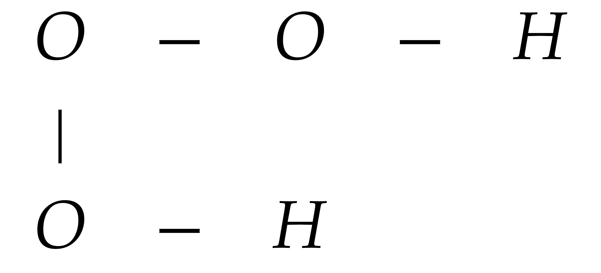

### [Ms-114](/ms-114/#91r.2+91v.1) [91r\[2\]](https://cdn.wittgensteinnachlass.com/2000px/webp/Ms-114/91r.webp),[91v\[1\]](https://cdn.wittgensteinnachlass.com/2000px/webp/Ms-114/91v.webp)

“I have in fact never seen a black line gradually becoming lighter and lighter until it is white, & then becoming increasingly reddish until it is red; but I know that it is possible, because I can imagine it.” – The form of expression “I know that it is possible because …” is taken from cases such as: “I know that it is possible to unlock this door with this key, because I have done it before”. Is it in _that_ sense, then, that I suppose that colour transition will be possible because I can imagine it? – Is it not rather the case that: “the colour transition is possible” means here the same as “I can imagine it”? – What about this: “The alphabet _can_ be recited aloud _because_ I can recite it to myself in my mind”? And “I can imagine the colour transition” is here not a statement about my particular powers of imagination, as “I can lift this stone” is a statement about my muscular strength. The sentence “I can imagine the transition”, just like “this state of affairs can be drawn”, connects the linguistic representation with another mode of representation; it is to be understood as a sentence of grammar.

### [Ms-114](/ms-114/#92r.2) [92r\[2\]](https://cdn.wittgensteinnachlass.com/2000px/webp/Ms-114/92r.webp)

83 It seems as if one could say: word-language allows nonsensical combinations of words, but the language of images does not allow nonsensical images. So the language of drawing does not allow nonsensical drawings either; – but that is not how it is: for a drawing can be nonsensical in the same way as a sentence. Let us think of a working drawing according to which the turner is to work; here it is very easy to imagine the exact analogue of a nonsensical pseudo-sentence. Let us also think of the example of plotting a route on the projections of the globe.

### [Ms-114](/ms-114/#91v.2+92r.1) [91v\[2\]](https://cdn.wittgensteinnachlass.com/2000px/webp/Ms-114/91v.webp),[92r\[1\]](https://cdn.wittgensteinnachlass.com/2000px/webp/Ms-114/92r.webp)

When one wants to demonstrate the senselessness of metaphysical ways of speaking, one often says: “I could not imagine the opposite of it”, or: “what would it be like if it were otherwise”. (If, for example, someone had said that my images were private, that only I alone can know when I feel pain, etc..) Now, if I cannot imagine what it would be like if it were otherwise, then I cannot imagine that it were _so_ either. For “I cannot imagine” does not here indicate a lack of powers of imagination. I cannot even _try_ to imagine it: it makes no sense to say, “I imagine it”. And that means that no connection has been made between this sentence & the mode of representation of imagination (or drawing). But why does one say precisely: “I cannot imagine what it would be like if it were _otherwise_” & not “I cannot imagine this”? One regards the nonsensical sentence (e.g. “this rod has a length” as a (kind of) tautology, in contrast to a contradiction. One says, as it were: “Yes, it has a length; but how could it be otherwise; so why say it!” We shall not reply to the sentence “this rod has a length” with “Nonsense!”, but with “Of course!”. We could also put it this way: When we hear the two sentences “this rod has a length” & its negation “this rod has no length”, we are biased & incline towards the first sentence; instead of declaring both nonsense. But the reason for this one-sidedness is a confusion: We see the first sentence as verified (& the second as falsified) by “the rod being 4 m long”. “And 4 m is surely a length”, – but one forgets that this is a sentence of grammar.

### [Ms-114](/ms-114/#93r.1) [93r\[1\]](https://cdn.wittgensteinnachlass.com/2000px/webp/Ms-114/93r.webp)

One can also show that a sentence is meant metaphysically by asking: “Is what you assert supposed to be an empirical fact? Can you conceive (imagine) that it might be otherwise?” – Do you want to say that substance has never been destroyed, or that it is _unthinkable_ that it should be destroyed? Do you want to say that experience teaches that human beings always prefer what is more pleasant to what is less pleasant?

### [Ms-114](/ms-114/#93r.2) [93r\[2\]](https://cdn.wittgensteinnachlass.com/2000px/webp/Ms-114/93r.webp)

Strange that one should be able to say that such & such a state of affairs is unthinkable! Even if we see thinking as essentially an accompaniment to expression, it follows that the words which indicate the unthinkable state of affairs in this statement must be unaccompanied. So what sense is it supposed to have? Unless it says that these words are senseless. But then it is not, as it were, that their sense is senseless; rather, they are excluded from our language, like any arbitrary noise, & the reason for their _express_ exclusion can only lie in _our being tempted_ to mistake them for a sentence of our language.

### [Ms-114](/ms-114/#93r.3+93v.1) [93r\[3\]](https://cdn.wittgensteinnachlass.com/2000px/webp/Ms-114/93r.webp),[93v\[1\]](https://cdn.wittgensteinnachlass.com/2000px/webp/Ms-114/93v.webp)

84 The role the sentence plays in the calculus is its sense. The _method_ of measurement (of measuring a length, for example) stands in exactly the same relation to a particular measurement as the sense of a sentence does to its truth or falsity.

### [Ms-114](/ms-114/#93v.2) [93v\[2\]](https://cdn.wittgensteinnachlass.com/2000px/webp/Ms-114/93v.webp)

What does it mean to “discover that a statement has no sense”? – And what does this mean: “if I mean something by it, it must have sense to say it”? – ‘If I mean something by it’ – if I mean _what_ by it?! –

One wants to say: the meaningful sentence is the one that one can not only say, but also think. That would be as if one said: the meaningful picture is the one that I can not only draw but also model. And saying this would make sense. But thinking the sentence is not an activity that one performs after the words (as, for example, singing after the notes). The following example shows this.

Does it make sense to say: “I have as many friends as one solution of x³ + 2x ‒ 3 = 0 gives”? Here, one might think, we have a notation whose grammar alone does not determine whether a sentence has sense or not. So that it would not be determined at all in advance. If the expression “the root of the equation …” were a description in Russell’s sense, then the sentence “I have n apples & 2 + n = 6” would have a different sense from the sentence “I have 4 apples”.

### [Ms-114](/ms-114/#93v.3) [93v\[3\]](https://cdn.wittgensteinnachlass.com/2000px/webp/Ms-114/93v.webp)

This gives a splendid example of what it means: to understand a sentence.

### [Ms-114](/ms-114/#93v.4+94r.1) [93v\[4\]](https://cdn.wittgensteinnachlass.com/2000px/webp/Ms-114/93v.webp),[94r\[1\]](https://cdn.wittgensteinnachlass.com/2000px/webp/Ms-114/94r.webp)

The sense of a sentence is not pneumatic (just as the thought is not), but is what comes in reply to the question about an explanation of the sense. Or: one sense differs from another as the explanation of the one differs from the explanation of the other. Thus also: the sense of one sentence differs from the sense of another as the one sentence differs from the other. The sense of the sentence is not a soul.

### [Ms-114](/ms-114/#94r.2) [94r\[2\]](https://cdn.wittgensteinnachlass.com/2000px/webp/Ms-114/94r.webp)

Something is a sentence only in a language. To understand a sentence means to understand a language. A sentence is a sign in a system of signs. It is _one_ combination of signs among several possible ones & in contrast to other possible ones. As it were, _one_ position of a pointer in contrast to other possible ones.

### [Ms-114](/ms-114/#94r.3) [94r\[3\]](https://cdn.wittgensteinnachlass.com/2000px/webp/Ms-114/94r.webp)

“Go in the direction in which the arrow points.” “Go 100 times as far as the arrow is long.” “Take as many steps as I draw arrows.” “Copy this arrow.” “Come at the time indicated by this arrow if it is the hour hand of a clock.” The same arrow can stand for each of these commands. ↑ in contrast to ↗ is a different sign from ↑ in contrast to ↑.

### [Ms-114](/ms-114/#94v.1) [94v\[1\]](https://cdn.wittgensteinnachlass.com/2000px/webp/Ms-114/94v.webp)

85 The symbol seems to be unsatisfied as such. The wish, the supposition, the belief, the command seem to be something unsatisfied, in need of completion. Thus I would like to describe my feeling of understanding in relation to the command as that of an innervation. But innervation in itself is not unsatisfied either, leaves nothing open, is not in need of completion. And I want to say: “the wish is unsatisfied because it is the wish _for Something_; the opinion unsatisfied because it is the opinion that something is the case, something real; something outside the process of opining.”

### [Ms-114](/ms-114/#94v.2) [94v\[2\]](https://cdn.wittgensteinnachlass.com/2000px/webp/Ms-114/94v.webp)

I would like to say: “My expectation is made in such a way that whatever comes must agree with it, or not.” The sentence seems to us to be set up as a judge & we feel responsible before it. – It seems to demand that reality compare itself with it.

### [Ms-114](/ms-114/#94v.3+95r.1) [94v\[3\]](https://cdn.wittgensteinnachlass.com/2000px/webp/Ms-114/94v.webp),[95r\[1\]](https://cdn.wittgensteinnachlass.com/2000px/webp/Ms-114/95r.webp)

I said that the sentence was like a yardstick applied to reality: this, like all the logical similes of the sentence, is itself a particular case of a sentence-sign. One now wants to say: “Apply the yardstick to a body; it does not say that the body is this long. Rather, it is as it were dead & does none of what the thought does.” It is as if we had imagined that the essential thing about a living being was the outward shape, & had now made a wooden block in this shape & were looking with disappointment at the dead block, which bears no likeness to life either.

### [Ms-114](/ms-114/#95r.2) [95r\[2\]](https://cdn.wittgensteinnachlass.com/2000px/webp/Ms-114/95r.webp)

86 I want to say: “If one could see the expectation, one would have to see what was expected.” – But that is how it is: whoever sees the expression of expectation sees what is expected. And how could one see it in another way, in another sense?

### [Ms-114](/ms-114/#95r.3+95v.1) [95r\[3\]](https://cdn.wittgensteinnachlass.com/2000px/webp/Ms-114/95r.webp),[95v\[1\]](https://cdn.wittgensteinnachlass.com/2000px/webp/Ms-114/95v.webp)

The command to square the numbers 1 to 4, if I express it, for example, by the table

→

seems to us incomplete in a certain sense; it is as if something were merely hinted at which is not expressed. (Namely, the following of the command.) It seems to us that, when we understand the command, we add something which fills the gap. So that we can reply to someone who said “but you understand it, so it is complete”: “Yes, but only because I add something: the interpretation, namely.” – But what prompts you to give precisely _this_ interpretation? If it is the command, then it was already unambiguous, since it commanded this interpretation. Or did you add the interpretation arbitrarily? – then you did not understand the command either, but only what you made of it, on your own initiative. We want to say that it is only hinted at, that the sign merely suggests indistinctly what we are to do. It is indistinct, for example, in the sense in which the arrow

→

_is less distinct than the arrow_

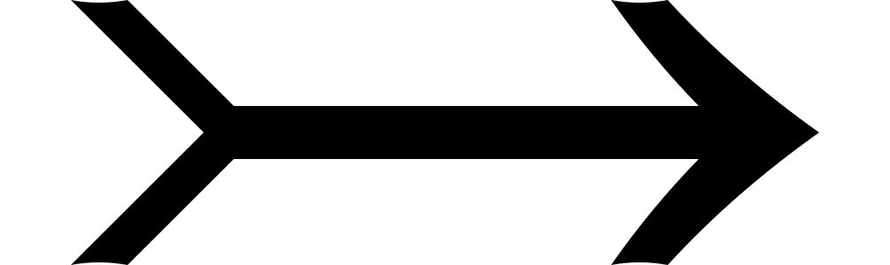

The appearance of clumsiness with which the sign, like a mute person, tries to make itself understood through all kinds of suggestive gestures, – disappears when we consider that the sign fulfils its function only in a grammatical system. For us the command is clear when it is unambiguous; & there is no clearer one (What is not needed in logic does not _help_ either.)

### [Ms-114](/ms-114/#129r.2+129v.1) [129r\[2\]](https://cdn.wittgensteinnachlass.com/2000px/webp/Ms-114/129r.webp),[129v\[1\]](https://cdn.wittgensteinnachlass.com/2000px/webp/Ms-114/129v.webp)

When we give a command, it might seem as though the last thing the command desires (after all) must remain unexpressed, since there always remains a gap between the command & its execution. I want someone to make a certain movement, say raise an arm. To make it quite clear, I demonstrate the movement to him. This picture seems unambiguous, except for the question: how does he know that _he should make this movement_? – How does he know at all how to use whatever signs I give him? I will now try to supplement the command with further signs, by thinking from myself to the other, making gestures of encouragement, etc. Here it seems as if the command begins to stammer. Suppose I wanted to prescribe to someone that he square the number 4 & did so with the schema:

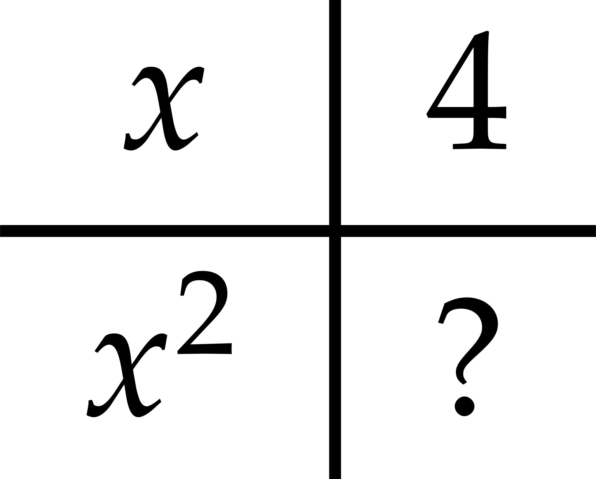

I am now tempted to say that the question mark indicates something but does not express it. As if the sign were trying to make itself intelligible to us. , in what signs do we do that?

### [Ms-114](/ms-114/#96r.1) [96r\[1\]](https://cdn.wittgensteinnachlass.com/2000px/webp/Ms-114/96r.webp)

87 In what sense can one call the wish as such, the belief, – ‘unsatisfied’? What is the model of unsatisfaction, that from which we take our concept? Is it an empty space? and would one say of such a space that it is unsatisfied; would that not also be a metaphor? Is it not a feeling that we call unsatisfaction; hunger, for example? We can describe an object in a particular system of expression by means of the words “satisfied” & “unsatisfied”. If we were to stipulate, for example, that the hollow cylinder be called the “unsatisfied cylinder” & the full cylinder that complements it, its “satisfaction”.

### [Ms-114](/ms-114/#96r.2) [96r\[2\]](https://cdn.wittgensteinnachlass.com/2000px/webp/Ms-114/96r.webp)

It seems: the expectation & the fact that satisfies the expectation somehow fit together. One is supposed to describe an expectation & a fact that fit together, so that one can see what this agreement consists in. One immediately thinks of the fitting of a solid form into a corresponding hollow form. But if one wants to describe these two, one sees that, insofar as they fit, _one_ description applies to both. (Compare, by contrast, what it means to say: “these trousers do not fit this skirt”.)

### [Ms-114](/ms-114/#97v.3) [97v\[3\]](https://cdn.wittgensteinnachlass.com/2000px/webp/Ms-114/97v.webp)

An expectation does not stand to its fulfilment as hunger does to its fulfilment. I can describe the hunger, & what satisfies it, & say that it satisfies it.

### [Ms-114](/ms-114/#98r.2) [98r\[2\]](https://cdn.wittgensteinnachlass.com/2000px/webp/Ms-114/98r.webp)

But it is not like this either: I feel like having an apple; so whatever satisfies this desire I will call an “apple”.

### [Ms-114](/ms-114/#96r.3+96v.1+97r.1) [96r\[3\]](https://cdn.wittgensteinnachlass.com/2000px/webp/Ms-114/96r.webp),[96v\[1\]](https://cdn.wittgensteinnachlass.com/2000px/webp/Ms-114/96v.webp),[97r\[1\]](https://cdn.wittgensteinnachlass.com/2000px/webp/Ms-114/97r.webp)

88 The paradox is expressed in this: when the event I expected occurs, it does not differ from the event I expected. So if one asks: “How does this person differ from the one you expected; for the real person was not present in your expectation, otherwise you could not have expected him”, the answer is nevertheless: this person _is_ the one I expected. I say: “That is exactly how I imagined it”; & someone replies, for example: “That is impossible, for one was an image and the other is not; & did you perhaps take your image for reality?”

I see someone aim the rifle & say: “I expect a shot.” The shot is fired. – How, that is what you expected; so was this noise somehow already in your expectation? Or does your expectation only correspond in another respect to what has occurred; was this noise not contained in your expectation & only came as an accident when the expectation was fulfilled? But no, if the noise had not occurred, my expectation would not have been fulfilled; the noise fulfilled it; it did not come as an addition to the fulfilment, like a second guest to the one I had expected. – Was what was not also in the expectation an accident, an addition to fate? – But what then was _not_ an addition, – did anything from before the shot already occur in my expectation? – And what was the addition, – for did I not expect the whole shot?

“The bang was quieter than I had expected.” – “So did it bang louder in your expectation?”

### [Ms-114](/ms-114/#97r.2) [97r\[2\]](https://cdn.wittgensteinnachlass.com/2000px/webp/Ms-114/97r.webp)

“The red that you imagine is surely not the same – the same thing – as what you see in front of you; – how then can you say ‘this is the same as what I imagined’?” – But is the relationship not analogous in the sentences “there is a red patch here” & “there is no red patch here”? In both, the word “red” occurs, so this word cannot indicate the presence of something red. The word “red” has its function only in the context of the sentence. And is the misunderstanding not that one takes the meaning of the word “red” for the sense of a sentence which says that something is red?

### [Ms-114](/ms-114/#100v.2) [100v\[2\]](https://cdn.wittgensteinnachlass.com/2000px/webp/Ms-114/100v.webp)

The possibility of this misunderstanding also lies in the double sense of the expression “the colour red as the constituent common to two states of affairs”. In the one case this means that something _is_ red both here and there, something has the colour red. In the other case it is not a matter of having a colour in common (which would of course be expressed by specifying a colour). What they have in common in the latter case is the harmony between reality & thought, which in truth corresponds to a form of our language.

### [Ms-114](/ms-114/#97r.3) [97r\[3\]](https://cdn.wittgensteinnachlass.com/2000px/webp/Ms-114/97r.webp)

89 _dann_

How strange it would be to say: “an event looks different when it occurs than when it does not occur”. Or: “A red patch looks different when it is there than when it is not there; but language abstracts from this _difference_, for it speaks of a red patch whether it is there or not.”

### [Ms-114](/ms-114/#100r.2+100v.1) [100r\[2\]](https://cdn.wittgensteinnachlass.com/2000px/webp/Ms-114/100r.webp),[100v\[1\]](https://cdn.wittgensteinnachlass.com/2000px/webp/Ms-114/100v.webp)

When we say to someone “imagine the colour red”, he is supposed to imagine, say, a red patch, but not a green one, because this one is _not red_.

(Could one point to something that is _not_ red in order to explain the word “red”? This would be similar to explaining the word “modest” to someone who does not speak German, and one points to an arrogant person as an explanation & says: “this person is _not_ modest”. It is not an argument against such a method of explanation that it is ambiguous. Every explanation can be misunderstood.

One could, for example, always point to the complementary colour in order to explain a colour-word; but without first agreeing that one will point to the complementary colour: just as one does not now agree that one will point to an object of the colour itself. Compare the signpost whose hand points in the opposite direction to the way.)

### [Ms-114](/ms-114/#129v.2+130r.1) [129v\[2\]](https://cdn.wittgensteinnachlass.com/2000px/webp/Ms-114/129v.webp),[130r\[1\]](https://cdn.wittgensteinnachlass.com/2000px/webp/Ms-114/130r.webp)

One could, however, ask: should we still call that an “explanation”? – Because it plays a different role in the calculus from what we usually call an ostensive explanation of the word “red”, even if it had the same practical consequence, the same _effect_ on the learner.

### [Ms-114](/ms-114/#97r.4+97v.1) [97r\[4\]](https://cdn.wittgensteinnachlass.com/2000px/webp/Ms-114/97r.webp),[97v\[1\]](https://cdn.wittgensteinnachlass.com/2000px/webp/Ms-114/97v.webp)

Reality is not a property that is still lacking in what is expected & that is now added when the expectation arrives. – Reality is also not like daylight, which first gives things colour when they are already, as it were colourless, present in the darkness.

### [Ms-114](/ms-114/#97v.2) [97v\[2\]](https://cdn.wittgensteinnachlass.com/2000px/webp/Ms-114/97v.webp)

“How do you know that you are expecting a _red_ patch; that is, how do you know that a red patch is the fulfilment of what you are expecting?” But I could just as well ask: “how do you know that that _is_ a red patch?” How do you know that what you did really was to recite the alphabet in your mind? – But how do you know that what you recite aloud really _is_ the alphabet? This is of course the same question as: “How do you know that what you call ‘red’ really is the same as what the other person calls it”. And one question, used as a metaphysical question, has just as little sense as the other.

### [Ms-114](/ms-114/#97v.4+98r.1) [97v\[4\]](https://cdn.wittgensteinnachlass.com/2000px/webp/Ms-114/97v.webp),[98r\[1\]](https://cdn.wittgensteinnachlass.com/2000px/webp/Ms-114/98r.webp)

So, I would like to say, you can see from these examples how the words are actually used.

### [Ms-114](/ms-114/#98r.3) [98r\[3\]](https://cdn.wittgensteinnachlass.com/2000px/webp/Ms-114/98r.webp)

90 One might think: What an extraordinary process wanting must be, for me to be able to want _that_ now which I will only do in five minutes! How can I expect the event; it is not there at all yet?

### [Ms-114](/ms-114/#98r.4+98v.1) [98r\[4\]](https://cdn.wittgensteinnachlass.com/2000px/webp/Ms-114/98r.webp),[98v\[1\]](https://cdn.wittgensteinnachlass.com/2000px/webp/Ms-114/98v.webp)

“Socrates: So, whoever imagines what is not; does he imagine nothing? – Theaetetus: So it seems. – Socrates: But whoever imagines nothing, will surely not imagine at all? – Th.: Apparently, as we can see.” Let us substitute in this argument for the word “imagine” the word “kill”, for example; then there is a rule for the use of this word; it makes no sense to say “I kill something that does not exist”. I can imagine a deer on this meadow which is not there, but I cannot kill one which is not there. And “to imagine a deer on this meadow” means: to imagine that a deer is there. To kill a deer, however, does not mean: to kill that etc.. But if someone says: “in order for me to imagine a deer, it must exist in some sense”, – then the answer is: no, it need not _exist_ in any sense for that. And if the reply were: “but the brown colour, for example, must surely exist in order for me to imagine it”, – then one must say: “the brown colour exists” means nothing at all; except perhaps that it appears here or there as the colour of an object, & that is not necessary for me to imagine a brown deer.

### [Ms-114](/ms-114/#98v.3+99r.1) [98v\[3\]](https://cdn.wittgensteinnachlass.com/2000px/webp/Ms-114/98v.webp),[99r\[1\]](https://cdn.wittgensteinnachlass.com/2000px/webp/Ms-114/99r.webp)

We say that the expression of expectation ‘describes’ the expected fact & think of it as an object or complex which appears as the fulfilment of the expectation. – But the expected one is not the fulfilment, but that he comes. The mistake is deeply embedded in our language: we say “I expect him” & “I expect his coming” & “I expect that he will come”. It is difficult for us to get free of the comparison: the person enters – the event occurs. As if the event had already been prefigured at the door of reality & were now entering into it (as into a room).

### [Ms-114](/ms-114/#99r.2) [99r\[2\]](https://cdn.wittgensteinnachlass.com/2000px/webp/Ms-114/99r.webp)

91 I can look for it when it is not there, but not point to it when it is not there. One might want to say: “it must also be there when I look for it”. – Then it must also be there when I do not find it, & also when it does not exist.

### [Ms-114](/ms-114/#99r.3+99v.1) [99r\[3\]](https://cdn.wittgensteinnachlass.com/2000px/webp/Ms-114/99r.webp),[99v\[1\]](https://cdn.wittgensteinnachlass.com/2000px/webp/Ms-114/99v.webp)

Looking for _it_ (say, my stick) is a kind of looking and differs from looking for something else through what one does (says, thinks) while looking, not through what one finds. And if I carry a picture or a mental image with me while looking, – well and good. And if I say that the picture is a picture of what I am looking for, that only says what place the picture occupies in the process of looking. And if I find it and say “there it is! _that’s_ what I was looking for”, these words are not an explanation of the words designating the object I was looking for (say, the words “my stick”), which could only now be given, once it has been found.

### [Ms-114](/ms-114/#99v.2) [99v\[2\]](https://cdn.wittgensteinnachlass.com/2000px/webp/Ms-114/99v.webp)

“_Him_ did you look for? You couldn’t even know if he was there!” Compare, on the other hand, the search for the trisection of the angle.)

### [Ms-114](/ms-114/#99v.3) [99v\[3\]](https://cdn.wittgensteinnachlass.com/2000px/webp/Ms-114/99v.webp)

One can say of the bearer of the name that he does not exist; & this is, of course, not an activity, although one could mistake it for one & say: he must also be there when he does not exist. (And this has certainly been written by a philosopher once before.)

### [Ms-114](/ms-114/#99v.4+100r.1) [99v\[4\]](https://cdn.wittgensteinnachlass.com/2000px/webp/Ms-114/99v.webp),[100r\[1\]](https://cdn.wittgensteinnachlass.com/2000px/webp/Ms-114/100r.webp)

92 The thought that it is only finding that shows us what we were looking for, only the fulfilment of the wish what we wished for, means judging the process in the same way as the symptoms of expectation or of searching in another person. I see him restlessly pacing up and down in his room; someone comes in at the door & he becomes calm & shows signs of satisfaction; & now I say: “he apparently expected this person”. The symptoms of expectation are not the expression of expectation.

### [Ms-114](/ms-114/#100v.4+101r.1+101v.1) [100v\[4\]](https://cdn.wittgensteinnachlass.com/2000px/webp/Ms-114/100v.webp),[101r\[1\]](https://cdn.wittgensteinnachlass.com/2000px/webp/Ms-114/101r.webp),[101v\[1\]](https://cdn.wittgensteinnachlass.com/2000px/webp/Ms-114/101v.webp)

One might have the feeling that in the sentence “I expect that he is coming” one uses the words “he is coming” in a different sense than in the assertion “he is coming”. But if that were so, how could I talk about my expectation being fulfilled?

But now I might say while walking up and down: “I expect him to come in”. – Now there is a similarity! But what kind is it?! Now, one could ask: what does it look like when he comes? – The door opens, a man enters, etc. What does it look like when I expect that he will come? – I walk up and down the room, occasionally look at the clock, etc. – but there is absolutely no similarity between these two processes! How can one then use the same words to describe them? Where is the hollow form and the filled form here? But I could also walk up and down my room without expecting him to come, and also look at the clock, etc. I would not describe these processes with the words “I expect that he is coming”. What would it consist in, for example, that I expect _him_? I said that the process of expectation was supposed to be such that I would have to be able to see from it what is expected. If one calls those expecting actions expectation, then it is a hunger and the fulfilment of the expectation is what satisfies the hunger. What interests us is expectation as thought, that is, as expression of expectation.

And the words “he is coming” mean the same in the expression of expectation and in the description of fulfilment, for if I wanted to explain the two words, say by ostensive explanations, the same explanations would apply to both sentences.

### [Ms-114](/ms-114/#130r.2+130v.1) [130r\[2\]](https://cdn.wittgensteinnachlass.com/2000px/webp/Ms-114/130r.webp),[130v\[1\]](https://cdn.wittgensteinnachlass.com/2000px/webp/Ms-114/130v.webp)

I can quite well say: pacing restlessly up & down in my room, looking towards the door, pricking up one's ears at a noise, means: expecting N. – That is simply a definition of the expression “expecting N”. Of course it is not a definition of the word “expecting”, for it does not, for example, explain what “expecting M” means. Well, we can provide for that; we say, for instance: expecting X means performing the specified actions & saying the name “X” while doing so. On this definition, the person I expect is the one who bears the name uttered. Or I define: expecting the person X means doing what I specified in the second example & making a drawing of a person. The person expected is then the one who bears the name X & corresponds to the drawing. – Of course that would not explain what it means to “expect N to _go_” & for that I would have to give either an independent definition, or a more general explanation covering going & coming. And that would, for instance, not explain what it means to “expect a storm”; etc. etc.

### [Ms-114](/ms-114/#130v.2) [130v\[2\]](https://cdn.wittgensteinnachlass.com/2000px/webp/Ms-114/130v.webp)

What characterizes all these cases is that what is expected can be read off from the expecting action by means of the definition. It is not later experience that decides _what_ we expect. And I can say: In language, expectation & fulfilment touch upon each other.

### [Ms-114](/ms-114/#130v.3) [130v\[3\]](https://cdn.wittgensteinnachlass.com/2000px/webp/Ms-114/130v.webp)

The action of the person expecting is thus one that I can translate, according to given rules, into the sentence “he expects that p will happen”. And so the simplest typical example of these cases is that the expectation of p’s arrival consists in the person expecting _saying_: “I expect that p will happen”. Hence in so many cases it clarifies the grammatical situation to say: Let us put the expression of the expectation in place of the expectation. The expression of the thought in place of the thought.

### [Ms-114](/ms-114/#130v.4+131r.1) [130v\[4\]](https://cdn.wittgensteinnachlass.com/2000px/webp/Ms-114/130v.webp),[131r\[1\]](https://cdn.wittgensteinnachlass.com/2000px/webp/Ms-114/131r.webp)

93 Expectation can be understood as an expectant, preparatory action. It stretches out its hands like a ball player and prepares them to receive the ball. And the ball player’s expectation may consist in his stretching out his hands in a particular position & looking at the ball.

### [Ms-114](/ms-114/#131r.2) [131r\[2\]](https://cdn.wittgensteinnachlass.com/2000px/webp/Ms-114/131r.webp)

Someone might perhaps want to say: “Expectation is a thought.” This clearly corresponds to a use of the word “to expect”. And we only want to remember that the process of thought can be _very diverse_. And if the expectation is the thought “I expect that p will happen”, then it is nonsensical to say that I may only later recognize _what_ I expected.

### [Ms-114](/ms-114/#131r.3) [131r\[3\]](https://cdn.wittgensteinnachlass.com/2000px/webp/Ms-114/131r.webp)

One could say something analogous about wishing, fear, hope. (Plato calls hope “a speech”.)

### [Ms-114](/ms-114/#131r.4+131v.1) [131r\[4\]](https://cdn.wittgensteinnachlass.com/2000px/webp/Ms-114/131r.webp),[131v\[1\]](https://cdn.wittgensteinnachlass.com/2000px/webp/Ms-114/131v.webp)

But it is different when one calls _hunger_ a “wish”, namely the wish for the food that will satisfy it. Then it is a hypothesis that precisely that will satisfy the wish & there is a supposition about it & a doubt. And it is the same when I call “expectation” a feeling, say one of restlessness, dissatisfaction. But of course these feelings are not thoughts in amorphous form.

### [Ms-114](/ms-114/#131v.2) [131v\[2\]](https://cdn.wittgensteinnachlass.com/2000px/webp/Ms-114/131v.webp)

The idea that thought is a strange process in the human mind makes it possible to imagine it transformed into an amorphous state of duration.

### [Ms-114](/ms-114/#131v.3) [131v\[3\]](https://cdn.wittgensteinnachlass.com/2000px/webp/Ms-114/131v.webp)

When I say “I expected him all day”, “expecting” does not mean a state of duration that contained the person expected & his coming as components, as dough contains flour, sugar, eggs evenly mixed together. Expectation consisted rather in a sequence of actions, thoughts (&) feelings.

### [Ms-114](/ms-114/#106r.1) [106r\[1\]](https://cdn.wittgensteinnachlass.com/2000px/webp/Ms-114/106r.webp)

94 When I expect someone, – what happens? – I find his name in my calendar under today’s date & the note “5 h ”. I say to someone else “I can’t come to you today because I am expecting N.” I make preparations as for receiving a guest. I consider: “does N. smoke?” I remember having seen him smoke & put out cigars. Near 5 h  I say to myself: “he will be here any minute”, & at the same time imagine a man who looks like N.; then I imagine him entering the room & my greeting him and calling him by name. Such a process & many more or less _similar_ ones is called “expecting N. to come”.

### [Ms-114](/ms-114/#131v.4) [131v\[4\]](https://cdn.wittgensteinnachlass.com/2000px/webp/Ms-114/131v.webp)

But I might perhaps also say “I expected N” when the only connection between my expecting activities and him is that I make preparations, say, for a meal for myself & another person on a particular day & that N has announced that he will come to me for this meal.

### [Ms-114](/ms-114/#131v.5+132r.1) [131v\[5\]](https://cdn.wittgensteinnachlass.com/2000px/webp/Ms-114/131v.webp),[132r\[1\]](https://cdn.wittgensteinnachlass.com/2000px/webp/Ms-114/132r.webp)

What does the process or state of wishing to eat an apple consist in? Perhaps I feel hungry or thirsty or both, & at the same time imagine an apple or remember that I enjoyed one yesterday; perhaps I say: “I would like to eat an apple”, perhaps I go & look in a cupboard where apples usually lie. Perhaps all these states & activities & others are combined.

### [Ms-114](/ms-114/#102r.2+102v.1) [102r\[2\]](https://cdn.wittgensteinnachlass.com/2000px/webp/Ms-114/102r.webp),[102v\[1\]](https://cdn.wittgensteinnachlass.com/2000px/webp/Ms-114/102v.webp)

95 , The same is to be said of intention. If a device is _supposed_ to act as a brake, but in fact, for whatever reasons, does not slow the machine down, then the intention which the device is supposed to serve is not immediately recognizable from it & its mode of operation. If one says “that is a brake, but it does not work”, one is speaking of the intention. – But if it were now the case that whenever the device did not work as a brake a particular person became annoyed, would the intention of the device not be expressed in this mode of operation? No, for one could then say that the lever actuates the brake on one occasion and the annoyance on another? For how is it expressed that that person is annoyed _about_ the lever’s not actuating the brake? “Being annoyed that the device does not work in that way” means, once again, something similar to “wishing that it worked in that way”. – And here we have the old problem which we would like to express as follows: “that the thought that p is the case does not presuppose that it is the case; but that, on the other hand, something in the fact must nevertheless be a presupposition for the thought itself (I cannot think that something is red if the colour red does not exist)”. It is the problem of the harmony between world & thought. – One can reply that thoughts are in the same as what is doubtful & adhere to it as the measure adheres to what is measured.

For what I really want to say is: that the wish ‘he should come’ is the wish that it should really be _he_ who should really _come_. And if one wanted a further explanation of this assurance, we would say: “& by ‘he’ I mean this person here, & by ‘come’ I mean this action …”. But these are precisely explanations of grammar, explanations which constitute the language.

The sentence “I could not think that something is red if red did not exist” really refers to the mental image of something red, or to the existence of a red sample, _as part of our language_. But of course one cannot say that our language _must_ contain such a sample either. If it does not contain one, it is simply a different language. But one can say & emphasize that it does contain one.

### [Ms-114](/ms-114/#102v.2) [102v\[2\]](https://cdn.wittgensteinnachlass.com/2000px/webp/Ms-114/102v.webp)

_In language_ everything is settled.

### [Ms-114](/ms-114/#132r.2+132v.1) [132r\[2\]](https://cdn.wittgensteinnachlass.com/2000px/webp/Ms-114/132r.webp),[132v\[1\]](https://cdn.wittgensteinnachlass.com/2000px/webp/Ms-114/132v.webp)

96 It somehow seems as if one would never recognize the intention as an _intention_ by viewing it from outside; as if one had to intend it oneself in order to understand it as an act of meaning. But that would mean not regarding it as a phenomenon, not as a fact in itself; but as something intended, – something to which a direction has been given. And what this direction is, we do not know. (It is something lacking from the appearance as such.) – This is of course the previous problem again. For the point is that one must be able to tell from the thought that it is the thought that such and such is the case. If one cannot tell this from it (any more than one can tell from stomach pains where they come from), then it is of no logical interest. My view seems nonsensical if one expresses it _like this_: One is supposed to be able to see what someone is thinking about by opening up his head; how is that possible? The objects he is thinking about are not in his head at all (any more than they are in his thoughts) (!)

One must understand thoughts, intentions, etc. “viewed from outside” as such, _without_ being told a _meaning_ of anything. For meaning then simply belongs to the phenomenon of the thought.

### [Ms-114](/ms-114/#132v.2) [132v\[2\]](https://cdn.wittgensteinnachlass.com/2000px/webp/Ms-114/132v.webp)

So when one looks at the thought, there can no longer be any question of understanding; for if one sees it, one must recognize it as the thought with this content; there is nothing to interpret. – But that is how it really is when we think; there is no interpreting. –

### [Ms-114](/ms-114/#132v.3) [132v\[3\]](https://cdn.wittgensteinnachlass.com/2000px/webp/Ms-114/132v.webp)

97 When I said: “that would mean not regarding the intention as a phenomenon”, intention here recalled the will in Schopenhauer’s conception. Every phenomenon seems dead to us in contrast with the living thought.

### [Ms-114](/ms-114/#132v.4+133r.1+133v.1) [132v\[4\]](https://cdn.wittgensteinnachlass.com/2000px/webp/Ms-114/132v.webp),[133r\[1\]](https://cdn.wittgensteinnachlass.com/2000px/webp/Ms-114/133r.webp),[133v\[1\]](https://cdn.wittgensteinnachlass.com/2000px/webp/Ms-114/133v.webp)

“The intention seen from outside”, that has to do with the question whether a machine could think.

“Whatever phenomenon one saw, it could never be the intention. For the intention must contain what is intended. And every phenomenon would be something complete in itself, unconcerned with anything outside it, lying there dead when one considered it on its own.” And it is analogous when we say: “The will cannot be a phenomenon, for every phenomenon merely _happens_, is taken as given by us, but is not something we _do_. The will is not something I see happening; rather, it consists, as it were, in our being in the action; in our being the action.” Look at your arm & move it & you will feel this very strongly: “You do not observe how it moves, you are not having an experience – or not merely an experience – but you are _doing_ something.” You can then tell yourself that you could quite well imagine a case where precisely the same thing happened with your hand, but was observed by you, not willed by you. – But close your eyes & move your arm; you are having an experience then too, after all, & now ask yourself whether you could again imagine having the same experience but without willing it.

### [Ms-114](/ms-114/#133v.2+134r.1) [133v\[2\]](https://cdn.wittgensteinnachlass.com/2000px/webp/Ms-114/133v.webp),[134r\[1\]](https://cdn.wittgensteinnachlass.com/2000px/webp/Ms-114/134r.webp)

If one wants to distinguish voluntary from involuntary movements & it is said, for example, that voluntary movements of the arm differ from involuntary ones through a feeling of innervation, one is driven to say: “But surely I am not _undergoing_ this experience, I am _doing_ it!” – But in the experience of innervation, can there still be any question of a distinction between undergoing & doing? I would like to say: “When I will, surely nothing happens to me, neither the movement nor a feeling, but I am the agent.” Good, but it is surely the case that you _also_ have experiences when you move your arm voluntarily; for you do _see_ (& feel) it moving, whether or not you adopt an _observing_ attitude towards it. So try distinguishing between _all the experiences_ of acting plus the doing (which is not an experience) & _all_ these experiences without the element of doing. Consider whether you still need this element, or whether it now seems obsolete to you. – And of course you can rightly say that when you do something nothing happens to you; for the phenomena of doing are simply different from those of observing, say, a reflex movement. This becomes clear only when one considers the very different cases of what we call willed actions and what we call unwilled or involuntary processes of our life. (More on this elsewhere.)

### [Ms-114](/ms-114/#134r.2+134v.1) [134r\[2\]](https://cdn.wittgensteinnachlass.com/2000px/webp/Ms-114/134r.webp),[134v\[1\]](https://cdn.wittgensteinnachlass.com/2000px/webp/Ms-114/134v.webp)

98 By “intention” I mean here what the sign is used for in thought. Intention seems to interpret, to give the final interpretation, but not another sign or picture, but something else, that which one cannot interpret again. But a psychological end is reached, not a logical one. Let us think of a sign language, an ‘abstract’ one, I mean one that is foreign to us, in which we do not feel at home, in which, as we would say, we do not _think_. (We mentioned such an example once before), & let us imagine this language interpreted through a translation into a, as we would like to say, unambiguous language of pictures, a language consisting of pictures painted in perspective of what is to be represented. It is quite clear that it is much easier to imagine different _interpretations_ of the written signs than of a picture painted in the usual way, representing, say, a room with ordinary furniture. Here we will also be inclined to say that there are no possibilities of interpretation left.

### [Ms-114](/ms-114/#134v.2) [134v\[2\]](https://cdn.wittgensteinnachlass.com/2000px/webp/Ms-114/134v.webp)

We could also say that we do not live in the sign language, but rather in the painted picture.

### [Ms-114](/ms-114/#134v.3) [134v\[3\]](https://cdn.wittgensteinnachlass.com/2000px/webp/Ms-114/134v.webp)

(This is also connected with the fact that what we call a ‘similar portrait’ is not a picture according to some arbitrarily fixed manner of projection. “Similarity” here means something similar to “confusability”.)

### [Ms-114](/ms-114/#134v.4+135r.1+135v.1) [134v\[4\]](https://cdn.wittgensteinnachlass.com/2000px/webp/Ms-114/134v.webp),[135r\[1\]](https://cdn.wittgensteinnachlass.com/2000px/webp/Ms-114/135r.webp),[135v\[1\]](https://cdn.wittgensteinnachlass.com/2000px/webp/Ms-114/135v.webp)

“Only the intended picture suffices as a standard in relation to reality. When viewed from the outside, it stands there, dead & isolated.” It is as if we first looked at a picture in such a way that we live in it & the objects in it surround us as real, & then stepped back & were now outside, seeing the frame & the picture as a painted surface. So, when we intend, the pictures of the intention surround us & we live among them. But when we step out of the intention, they are merely spots on a canvas, without life & without interest for us. (We could also say:) When we intend, we live in the space of the intention, among the shadows of the intention, together with the real things. Let us think that we are sitting in the darkened cinema & living in the film. Now let the hall be illuminated, but let the play of light on the screen continue. But now we suddenly see it “from outside” as movements of light & dark spots on a screen.

(In a dream, it sometimes happens that we first read a story, & suddenly act in it ourselves. And after waking up from a dream it is sometimes as if we have stepped back out of the dream & now see it as a foreign picture before us.) And it also means something to “live in the pages of a book”. This is connected with the fact that our body is entirely irrelevant to the existence of our experience. (Compare with this the remark: When we understand a sentence, it acquires depth for us.)

### [Ms-114](/ms-114/#135v.2) [135v\[2\]](https://cdn.wittgensteinnachlass.com/2000px/webp/Ms-114/135v.webp)

99 It is not the case that this symbol can no longer be interpreted, but rather: I do not interpret. I do not interpret because I feel natural in the present picture. When I interpret, I proceed on my path of thought from step to step.

### [Ms-114](/ms-114/#135v.3) [135v\[3\]](https://cdn.wittgensteinnachlass.com/2000px/webp/Ms-114/135v.webp)

If I look at the imagined symbol “from outside”, it becomes conscious to me that it _could_ be interpreted in this way or that; if it is a stage in my train of thought, then it is a place that is natural to me & its further interpretability does not occupy (and disturb) me. – As when I have the chart, the railway timetable, with me without it occupying me that a chart can be interpreted in different ways.

### [Ms-114](/ms-114/#135v.4+136r.1+136v.1) [135v\[4\]](https://cdn.wittgensteinnachlass.com/2000px/webp/Ms-114/135v.webp),[136r\[1\]](https://cdn.wittgensteinnachlass.com/2000px/webp/Ms-114/136r.webp),[136v\[1\]](https://cdn.wittgensteinnachlass.com/2000px/webp/Ms-114/136v.webp)

When I spoke of how my mental image must also bear the name of the person depicted if it is to be a portrait, I did not mean that I must imagine him together with his name. For if I say, for instance: “surely I do not merely see a picture before me that looks like N (but perhaps also like other people), but I know, after all, that it is him, that it depicts him”, then I could ask: _when_ do I know this, & what does it mean to know it? But nothing need take place during the imagining that I could call this “knowledge”. Such a thing might take place after the imagining, when I pass from the picture to the name; perhaps I say that I had imagined N, whereas at the time of the imagining nothing characterized it as the imagining of N except perhaps a likeness. Something could precede the imagining which constituted the reference to N. And so interpretation does not accompany the imagining, but lies in the path that leads over the imagining. All this appears clearer if, instead of imagining, one assumes the _drawing_ of a picture.

### [Ms-114](/ms-114/#72r.1) [72r\[1\]](https://cdn.wittgensteinnachlass.com/2000px/webp/Ms-114/72r.webp)

100 (The difference between ‘inside’ & ‘outside’ does not interest us.)

### [Ms-114](/ms-114/#136v.2+137r.1) [136v\[2\]](https://cdn.wittgensteinnachlass.com/2000px/webp/Ms-114/136v.webp),[137r\[1\]](https://cdn.wittgensteinnachlass.com/2000px/webp/Ms-114/137r.webp)

If I want to describe the process of intention, I feel above all that it can best achieve what it should when it contains an extremely faithful picture of what it intends. But further, that even this is not enough, because the picture, whatever it is, can be interpreted in different ways; so that this picture again stands isolated. As soon as one takes the picture in isolation, it is suddenly dead & it is as if something had been taken away from it that had enlivened it before. It is no thought, no intention & however we think of it as accompanied by articulated or unarticulated processes & by whatever sensations, it remains isolated, does not point from itself to a reality outside itself. Now one says: “Of course, the picture does not intend, but we must intend (something) with it.” But if this intending, meaning (again), is something that happens with the picture, I do not see why it should be bound to a human being. One can also study the process of digestion as a chemical process independently of whether it takes place in a living being. We want to say: “Intending is essentially a mental process, a process of conscious life, not of dead matter.” But what is such a process supposed to consist in other than the specific kind of what is happening–so long as we are talking about a process? And now it seems to us as if no process, whatever kind, can be the intending. – We are simply not satisfied here with the grammar of the _process_, & not with the specific kind of _a_ process. – One could say: we would call every process ‘dead’ in this sense!

### [Ms-114](/ms-114/#137r.2) [137r\[2\]](https://cdn.wittgensteinnachlass.com/2000px/webp/Ms-114/137r.webp)

Let us say that the wish that this table were a little higher is the act of my holding my hand above the table, as high as I wished it to be. Now the objection is: “The hand above the table cannot be the wish: it does not express that the table should be higher; it is where it is & the table is where it is. And it would be no use making _any other_ gesture either.” –

### [Ms-114](/ms-114/#137r.3+137v.1) [137r\[3\]](https://cdn.wittgensteinnachlass.com/2000px/webp/Ms-114/137r.webp),[137v\[1\]](https://cdn.wittgensteinnachlass.com/2000px/webp/Ms-114/137v.webp)

“The opinion has a _direction_ (a sense) that no mere process has.”

(One could almost say: “the opinion _moves_, while every process stands still”.)

### [Ms-114](/ms-114/#137v.2) [137v\[2\]](https://cdn.wittgensteinnachlass.com/2000px/webp/Ms-114/137v.webp)

101 But now: if I think of uttering the wish as the act of the wish, the problem appears solved to me; because in the system of language I seem to have the medium in which the sentence is not dead.

### [Ms-114](/ms-114/#137v.3) [137v\[3\]](https://cdn.wittgensteinnachlass.com/2000px/webp/Ms-114/137v.webp)

If we think of the expression of the wish as the wish, it is almost as if, for certain purposes, we imagined living beings that moved, perhaps, only along the lines of a certain network on the earth, or something of the sort.

### [Ms-114](/ms-114/#137v.4) [137v\[4\]](https://cdn.wittgensteinnachlass.com/2000px/webp/Ms-114/137v.webp)

But now one would say: Even if _uttering_ the wish is the wish, the whole language is nevertheless not present at this uttering, & is it then the wish! How does language help, then? Well, nothing needs to be _present_ apart from the expression.

### [Ms-114](/ms-114/#137v.5+138r.1) [137v\[5\]](https://cdn.wittgensteinnachlass.com/2000px/webp/Ms-114/137v.webp),[138r\[1\]](https://cdn.wittgensteinnachlass.com/2000px/webp/Ms-114/138r.webp)

102 One could, so to speak, find all the connections in the grammar of the language (look them up). The whole network to which the sentence belongs can be seen there.

### [Ms-114](/ms-114/#138r.2) [138r\[2\]](https://cdn.wittgensteinnachlass.com/2000px/webp/Ms-114/138r.webp)

If one asks: “why do we not take issue with the mere processes when we think, mean something, etc.?”, we must say to ourselves: we are not then thinking about whether the picture is the thought, the opinion, but rather we _use_, pass through, pictures, sentences, etc.

### [Ms-114](/ms-114/#138r.3) [138r\[3\]](https://cdn.wittgensteinnachlass.com/2000px/webp/Ms-114/138r.webp)

But of course, if you call the picture the wish (e.g. that the table were higher), what you are doing then is comparing the picture with an expression of _language_ & of course it does not correspond to that, unless it is part of a system that can be translated into our language.

### [Ms-114](/ms-114/#138r.4+138v.1) [138r\[4\]](https://cdn.wittgensteinnachlass.com/2000px/webp/Ms-114/138r.webp),[138v\[1\]](https://cdn.wittgensteinnachlass.com/2000px/webp/Ms-114/138v.webp)

One says: how can this posture of the hand, this picture, be the wish that this and that were the case; it is nothing more than a hand over a table & stands alone & without _sense_! Like a single stage set from a theatrical performance that has been left standing alone. It had life only in the play. A hand over a table is not the wish that the table should be higher either, unless it can be systematically translated into this expression.

### [Ms-114](/ms-114/#138v.2) [138v\[2\]](https://cdn.wittgensteinnachlass.com/2000px/webp/Ms-114/138v.webp)

We do not see in the gesture the actual shadow of fulfilment; the unambiguous one, or the one no longer open to interpretation.

### [Ms-114](/ms-114/#138v.3) [138v\[3\]](https://cdn.wittgensteinnachlass.com/2000px/webp/Ms-114/138v.webp)

We ask: “does a hand above a table wish?” And does anything we might add, whether mental or material, wish? Is what is wished for really there in any such situation or process? – And what is our model for this existence? Is it not our language? Where, then, is that which makes the wish into this wish given, although it is only a wish? Precisely in the expressed wish.

### [Ms-114](/ms-114/#138v.4) [138v\[4\]](https://cdn.wittgensteinnachlass.com/2000px/webp/Ms-114/138v.webp)

“The wishing must surely show _what_ is wished for; it must surely picture in the sphere of wishing what is wished for.” But what actual process do you have in mind as a model for this? (What is the mirror in which you imagine seeing what is wished for?)

### [Ms-114](/ms-114/#138v.5+139r.1) [138v\[5\]](https://cdn.wittgensteinnachlass.com/2000px/webp/Ms-114/138v.webp),[139r\[1\]](https://cdn.wittgensteinnachlass.com/2000px/webp/Ms-114/139r.webp)

“The gesture _tries_ to picture it in advance,” one might say, “but it cannot”.

### [Ms-114](/ms-114/#139r.2) [139r\[2\]](https://cdn.wittgensteinnachlass.com/2000px/webp/Ms-114/139r.webp)

103 Can one say that _when I wish_, my wish seems to picture the fulfilment in advance? It _seems_ to do nothing at all then; I notice nothing strange about it. It is only when we consider the linguistic expression of the wish that this appearance arises.

### [Ms-114](/ms-114/#139r.3) [139r\[3\]](https://cdn.wittgensteinnachlass.com/2000px/webp/Ms-114/139r.webp)

We consider a process which we would call the process of the wish that this table were higher. But in this process the fulfilment is _not even apparently_ contained. Now one says: “But this process is supposed to be a shadow of precisely the desired fact & these actions surely are not that.” But why do you say that the wish is supposed to be that?! “Well, because it is the wish that precisely that should be the case.” Yes, & that is the only answer you could give to that. And so that process is nevertheless the shadow, insofar as it corresponds systematically to the expression of the wish in the word-language. This shadow is in the wish-process of word-language. (In language wish & fulfilment meet.)

### [Ms-114](/ms-114/#139v.1) [139v\[1\]](https://cdn.wittgensteinnachlass.com/2000px/webp/Ms-114/139v.webp)

Bear in mind that the expression of the wish can be the wish & that this expression does not have its sense through the presence of a particular spirit!

### [Ms-114](/ms-114/#139v.2) [139v\[2\]](https://cdn.wittgensteinnachlass.com/2000px/webp/Ms-114/139v.webp)

Think also of the case quite analogous to ours: “this table is not 80 cm high”; must the fact that it is 90 cm high, and hence _not_ 80 cm high, contain the shadow of the fact that it is 80 cm high? Why does it give this impression? When I see the table that is 90 cm high, does it perhaps also give the shadowy impression that it has the height it does not have? That would be as if we misunderstood the assertion “⊢~p” to mean that it contained the assertion “⊢p”; rather as “⊢ p ∙ q” contains “⊢p” in one sense.

### [Ms-114](/ms-114/#139v.3+140r.1) [139v\[3\]](https://cdn.wittgensteinnachlass.com/2000px/webp/Ms-114/139v.webp),[140r\[1\]](https://cdn.wittgensteinnachlass.com/2000px/webp/Ms-114/140r.webp)

Someone describes to me what he did when, as he says, he wished the table were 10 cm higher. He says he held his hand 10 cm above the table. I reply: “But how do you know that you did not merely have the wish that the table should be higher, for in that case too you would have held your hand at _some_ height above the table.” Now he says: “Surely I know what I wished for.” I: “Good, but I want to know _what_ you remember when you remember your wish; _what_ the process of your wish was; & what makes you say that you wished for precisely that.” He: “I know that I _deliberately_ held my hand exactly 10 cm high.” I: “But what did _that_ particular intention consist in?” – I could also ask: “Did you surely wish on a scale of 1 : 1? & how do you know _that_?” If he had described the wish-process in this way: “I said, ‘I would like the table to be 10 cm higher’”, the question of how he could know what he wished for would not have arisen. (Unless one had gone on to ask: “Did you also _mean_ these words in the way they are ordinarily meant?”) And in the end it always comes down to his simply _calling_ this process, without any further _opinion_, the wish that this should happen. [Utterance, not description!]

### [Ms-114](/ms-114/#140r.2) [140r\[2\]](https://cdn.wittgensteinnachlass.com/2000px/webp/Ms-114/140r.webp)

“How do I know that I remember _him_ if the memory is a picture?” But in what sense do I _know_ it? (“How can I remember one particular person out of two people who look exactly alike?”)

### [Ms-114](/ms-114/#140r.3+140v.1) [140r\[3\]](https://cdn.wittgensteinnachlass.com/2000px/webp/Ms-114/140r.webp),[140v\[1\]](https://cdn.wittgensteinnachlass.com/2000px/webp/Ms-114/140v.webp)

104 We say “the sentence is not a mere series of sounds, it is more”; we remember that a Chinese sentence is for us a mere series of sounds, that this simply means that we do not understand it & we say that this is because we have no thought in the case of the Chinese sentence (e.g. the Chinese word for ‘red’ does not produce a red mental image in us). “So what distinguishes the sentence that has sense from mere sounds is the mental process it evokes.” The sentence is like the bit of a key whose individual teeth are so arranged as to move the levers of the mind in a certain way. The sentence, as it were, plays a theme (a thought) on the instrument of the mind. But why should I now assume, besides the systematic play of words, a parallel play of mental elements? It merely adds something of the same kind to language.

### [Ms-114](/ms-114/#140v.2+141r.1) [140v\[2\]](https://cdn.wittgensteinnachlass.com/2000px/webp/Ms-114/140v.webp),[141r\[1\]](https://cdn.wittgensteinnachlass.com/2000px/webp/Ms-114/141r.webp)

Let the sentence be: “N went to Senate House this afternoon”. The sentence is not a mere sound to me; it evokes in me an image, say of a man near Senate House. But the sentence & this image are not merely a sound & a faint image; rather, the sentence has it in it, so to speak, to evoke this image, but also other consequences, & _that_ is its sense. The image seems to be only a faint likeness of this sense, or, let us say, only _one_ view of this sense. – But what do I mean by this; am I not seeing the sentence as a member of a system of consequences?

### [Ms-114](/ms-114/#141r.2) [141r\[2\]](https://cdn.wittgensteinnachlass.com/2000px/webp/Ms-114/141r.webp)

Let us suppose that the above sentence evoked in me a very clear picture of N on the way to Senate House; in this picture the setting sun (‘evening’) could also be seen & a calendar page with today’s date.

If, instead of having this picture evoked by the sentence, I painted it & showed it to the other person as a communication instead of the sentence, he could again say that it expressed a thought, that one had to understand it; & as the act of understanding he would probably think of a translation into word-language.

### [Ms-114](/ms-114/#141r.3+141v.1) [141r\[3\]](https://cdn.wittgensteinnachlass.com/2000px/webp/Ms-114/141r.webp),[141v\[1\]](https://cdn.wittgensteinnachlass.com/2000px/webp/Ms-114/141v.webp)

“I arrive in Vienna on 24th December”, these are surely not mere words! Certainly not; when I read them, various things happen in me besides perceiving the words: I may feel joy, imagine something & so on. – But I do not merely mean that various more or less incidental phenomena take place along with the sentence; I mean that the sentence has a definite sense & I grasp it. But what is this definite sense? Well, that this particular person whom I know comes to such and such a place, etc.. Yes, & when you specify the sense, you move around within the grammatical surroundings of the sentence. You then see the various transformations & consequences of the sentence as preformed; & so they are, insofar as they are laid down in a grammar. (You are simply considering the sentence as a move in a given game.)

### [Ms-114](/ms-114/#141v.2) [141v\[2\]](https://cdn.wittgensteinnachlass.com/2000px/webp/Ms-114/141v.webp)

I said that it was the _system_ of language that makes the sentence a thought & makes it a thought _for us_. It does not mean: it is the system of language that makes the sentence a thought for us when we utter it, for the system is not present then & nothing needs to make the sentence come alive for us, since the question of liveliness does not arise at all. If, on the other hand, we ask: “why does the sentence not seem isolated & dead to us when we think about it, its sense, the thought, etc.”, one can say that we are then moving further within the system of language.

### [Ms-114](/ms-114/#141v.3+142r.1) [141v\[3\]](https://cdn.wittgensteinnachlass.com/2000px/webp/Ms-114/141v.webp),[142r\[1\]](https://cdn.wittgensteinnachlass.com/2000px/webp/Ms-114/142r.webp)

In keeping with the words “I grasp the sense” or “I think the thought of this sentence”, you assume a process which, unlike the mere sentence-sign, contains these consequences.

### [Ms-114](/ms-114/#142r.2) [142r\[2\]](https://cdn.wittgensteinnachlass.com/2000px/webp/Ms-114/142r.webp)

105 “The thought, this strange being”: but it does not seem strange to us when we think it. It seems strange to us when we say to ourselves that it assembles the objects in the mind, because it is precisely the thought that _this_ person _does that_; it is not a sign or picture, for then I would first have to know again how it is meant; the thought is not something dead, for _for me_ what I think then _really_ happens. Where does this strange way of looking at it come from? What makes one think that the thought, the sentence as thought, contains reality, is that one is ready to pass from it to reality & to feel this transition as something already potentially contained in it (when one thinks about it), for we say: “this word _meant him_”. We feel this transition to be legitimate, like the permitted move in a game.

### [Ms-114](/ms-114/#142r.3+142v.1) [142r\[3\]](https://cdn.wittgensteinnachlass.com/2000px/webp/Ms-114/142r.webp),[142v\[1\]](https://cdn.wittgensteinnachlass.com/2000px/webp/Ms-114/142v.webp)

The thought does not seem mysterious to us while we are thinking, but only when we say, as it were retrospectively: “how was that possible?” How was it possible that the thought was about this person _himself_? But here I am merely astonished at a linguistic expression which I now misunderstand.

### [Ms-114](/ms-114/#142v.2) [142v\[2\]](https://cdn.wittgensteinnachlass.com/2000px/webp/Ms-114/142v.webp)

The thought seems mysterious to us. But not while we are thinking. Nor do we mean psychologically remarkable; we do not see in it merely a particular way of making pictures & signs; rather, it seems to us as if we had captured reality with it.

### [Ms-114](/ms-114/#142v.3) [142v\[3\]](https://cdn.wittgensteinnachlass.com/2000px/webp/Ms-114/142v.webp)

It seems a strange process to us not when we _look at it_, but when we allow ourselves to be led by language, when we look at what we say about it. We transfer this mystery into the nature of the process. (We interpret the mysteriousness produced by our failure to understand our form of language as the mysteriousness of a process incomprehensible to us.)

### [Ms-114](/ms-114/#143r.1) [143r\[1\]](https://cdn.wittgensteinnachlass.com/2000px/webp/Ms-114/143r.webp)

106 “Thinking is a remarkable process, for when I think about what will happen tomorrow, I am in the future in my mind.” One must understand the grammar of the sentence “I am in the future in my mind” in order not to believe that here the future is grasped in some strange way in the sense of a sentence, in the meaning of the words. In the same way one thinks that the _infinite series of cardinal numbers_ is somehow before our mind’s eye if we can use that expression with sense.

### [Ms-114](/ms-114/#143r.2) [143r\[2\]](https://cdn.wittgensteinnachlass.com/2000px/webp/Ms-114/143r.webp)

What does “this picture is _him_ for me” mean? I have the same attitude towards the portrait as towards the person himself. For I do distinguish between him & his picture.

### [Ms-114](/ms-114/#143r.3) [143r\[3\]](https://cdn.wittgensteinnachlass.com/2000px/webp/Ms-114/143r.webp)

A thought experiment comes to the same thing as an experiment that one records, paints or describes instead of carrying out. And the result of the experiment is then the invented result of the invented experiment.

### [Ms-114](/ms-114/#143r.4) [143r\[4\]](https://cdn.wittgensteinnachlass.com/2000px/webp/Ms-114/143r.webp)

“The sense of this sentence was present to me”, what happened there?

### [Ms-114](/ms-114/#143v.1) [143v\[1\]](https://cdn.wittgensteinnachlass.com/2000px/webp/Ms-114/143v.webp)

“Only someone who is _convinced_ of it can say that.” How does the conviction help him when he says it? – Is it then present alongside the spoken expression? (Or is it covered up by it, like a quiet tone by a loud one, so that it can, as it were, no longer be heard when one expresses it aloud?) What if someone said: “in order to be able to sing a melody from memory, one must hear it in one’s mind & sing it along”?

### [Ms-114](/ms-114/#143v.2) [143v\[2\]](https://cdn.wittgensteinnachlass.com/2000px/webp/Ms-114/143v.webp)

Try the following: Say a sentence, say: “the weather is very fine today”; & now think the thought of this sentence, but without the sentence, just the pure thought.

### [Ms-114](/ms-114/#143v.3+144r.1) [143v\[3\]](https://cdn.wittgensteinnachlass.com/2000px/webp/Ms-114/143v.webp),[144r\[1\]](https://cdn.wittgensteinnachlass.com/2000px/webp/Ms-114/144r.webp)

107 “It seems as if, viewed from outside, one would never recognize the intention as intention; as if one would have to mean it oneself in order to understand it as meaning.” Can one understand stomach ache as such, viewed from outside? What is stomach ache viewed from outside? There is no outside & inside here at all! Of course, insofar as meaning something is a specific experience, one will not call any other experience “meaning”. But no particularity of the sensation explains the direction of meaning. And when we said “viewed from outside one cannot recognize the intention as intention etc.”, we did not at all mean that meaning was a particular experience, but that it was not something that happened or happened to us (for that would be dead), but something we do. (The subject here does not fall outside experience, but is so involved in it that the experience could not be described.)

### [Ms-114](/ms-114/#144r.2) [144r\[2\]](https://cdn.wittgensteinnachlass.com/2000px/webp/Ms-114/144r.webp)

It is almost as if one said: we cannot see ourselves walk over there because we ourselves are walking (and so cannot stand & watch). But here, as so often, we are struggling with an inadequate way of expressing ourselves which we want to shake off but at the same time use, & we put our protest against our own way of expressing ourselves into a sentence that belongs to it. For when one says, “we see ourselves walk over there”, what one means is that we see what one sees when one is walking oneself & not what one sees when someone else is walking. And one does have a particular visual experience when one is walking oneself.

### [Ms-114](/ms-114/#144v.1) [144v\[1\]](https://cdn.wittgensteinnachlass.com/2000px/webp/Ms-114/144v.webp)

I.e., one speaks of a case opposed to experience, in which the subject is bound like an element in a chemical compound. But where does one get this idea? The concept of living action as opposed to a dead phenomenon.

### [Ms-114](/ms-114/#144v.2) [144v\[2\]](https://cdn.wittgensteinnachlass.com/2000px/webp/Ms-114/144v.webp)

Let us imagine someone now saying: “walking oneself is not an experience”.

### [Ms-114](/ms-114/#144v.3) [144v\[3\]](https://cdn.wittgensteinnachlass.com/2000px/webp/Ms-114/144v.webp)

We want to say: “When we mean something, there is no dead picture (of whatever kind), but it is as if we were approaching someone. We are approaching what is meant.”

### [Ms-114](/ms-114/#144v.4) [144v\[4\]](https://cdn.wittgensteinnachlass.com/2000px/webp/Ms-114/144v.webp)

But here we wrongly construct a contrast between experience & something else, as if experience consisted in sitting quietly & letting the pictures pass before one.

### [Ms-114](/ms-114/#144v.5) [144v\[5\]](https://cdn.wittgensteinnachlass.com/2000px/webp/Ms-114/144v.webp)

“When one means, one is oneself meaning”; in this way one moves oneself. One storms forward oneself & therefore cannot also observe the storming. Certainly not.

### [Ms-114](/ms-114/#144v.6) [144v\[6\]](https://cdn.wittgensteinnachlass.com/2000px/webp/Ms-114/144v.webp)

Yes, meaning something is like approaching someone.

---

### [Ms-114](/ms-114/#103r.2+103v.1) [103r\[2\]](https://cdn.wittgensteinnachlass.com/2000px/webp/Ms-114/103r.webp),[103v\[1\]](https://cdn.wittgensteinnachlass.com/2000px/webp/Ms-114/103v.webp)

108 The fulfilment of an expectation does not consist in a third thing happening, which one could describe in some other way besides just as “the fulfilment of that expectation,” for example, as a feeling of satisfaction or joy, or whatever. The expectation that p will be the case is the same as the expectation of the fulfilment of that expectation. Could the justification of an action as the fulfilment of an order be phrased as follows: “You said ‘bring me a yellow flower’, & this one then gave me a feeling of satisfaction, so I brought it”? Wouldn’t one have to answer: “I didn’t manage to get you to bring me the flower that, in response to my words, would give me such a feeling!”

### [Ms-114](/ms-114/#103v.2) [103v\[2\]](https://cdn.wittgensteinnachlass.com/2000px/webp/Ms-114/103v.webp)

(I go looking for the yellow flower. Even if I have a picture in mind while looking, – do I need it when I see the yellow flower – or another one? – And if I say: “as soon as I see a yellow flower, something in my memory clicks into place, as it were”, – as, for example, in the striking mechanism of a clock a lever engages with the teeth of a wheel – can I foresee, expect, this clicking into place any more readily than the yellow flower? – Even if in a particular case it really is the case that I expect not what I am looking for but some other (indirect) criterion, this is in any case no explanation of expecting.)

### [Ms-114](/ms-114/#103v.3+104r.1) [103v\[3\]](https://cdn.wittgensteinnachlass.com/2000px/webp/Ms-114/103v.webp),[104r\[1\]](https://cdn.wittgensteinnachlass.com/2000px/webp/Ms-114/104r.webp)

But doesn’t a phenomenon of assent (or satisfaction) always accompany the occurrence of what is expected? – Is this phenomenon something other than the occurrence of what is expected? If so, then I don’t know whether such a phenomenon always accompanies fulfilment. If I say: the person whose expectation is fulfilled doesn’t have to exclaim “yes, that’s it”, or something of the sort, one may reply: “certainly, but surely he must _know_ that the expectation is fulfilled”. – Yes, insofar as this knowledge belongs to its _being_ fulfilled. – “True, but when someone’s expectation is fulfilled, surely there is always a release of tension!” – How do you know that?

### [Ms-114](/ms-114/#104r.2+104v.1) [104r\[2\]](https://cdn.wittgensteinnachlass.com/2000px/webp/Ms-114/104r.webp),[104v\[1\]](https://cdn.wittgensteinnachlass.com/2000px/webp/Ms-114/104v.webp)

109 The description of language must accomplish the same as language. “For then I can really see from the sentence, the description of reality, how things stand in reality.” – But that is precisely what one calls “description”, & that is precisely what one calls “seeing how things stand”! And it is nothing else that is ever said by this: that we see from the description how things stand in reality. “You get your knowledge of what you have to do from the command. And yet the command gives you only itself, & its effect is immaterial.” But here we are misled by the way our language expresses itself when it says “knowledge _of_”, or “knowledge of the action”. For it is as if this something, the action, were a thing that was to come into existence in the obeying of the command, & as if the command acquainted us with this very thing, showed it to us; so that it already called it into existence in some sense. (How can the command – the expectation – show us a man before he has entered our room?!)

### [Ms-114](/ms-114/#104v.2) [104v\[2\]](https://cdn.wittgensteinnachlass.com/2000px/webp/Ms-114/104v.webp)

If one says that the action which obeys the command is to be extracted from the command, the fact which makes the sentence true from the sentence, – what is to be extracted from the sentence except _itself_? Or how can one derive the action from the command before it happens? Unless one means another form of describing that action, as when I make a drawing of the action after the command, say. – But this further description too is only there once I have derived it & does not already lie shadow-like in the command itself.

### [Ms-114](/ms-114/#98v.2) [98v\[2\]](https://cdn.wittgensteinnachlass.com/2000px/webp/Ms-114/98v.webp)

Being able to do something appears like a shadow of the actual doing, just as the sense of the sentence is a shadow of a fact, or the understanding of the command a shadow of its execution. In the command the fact as it were “casts its shadow in advance”. But this shadow, whatever it might be, is not the event. The shadowy anticipation of the fact consists in our being able now to think that _that_ will occur which will only occur _later_. Or, as it is misleadingly put: that we can now think of _that_ (or, of that) which will only occur _later_.

### [Ms-114](/ms-114/#104v.3+105r.1) [104v\[3\]](https://cdn.wittgensteinnachlass.com/2000px/webp/Ms-114/104v.webp),[105r\[1\]](https://cdn.wittgensteinnachlass.com/2000px/webp/Ms-114/105r.webp)

110 Thinking with its application proceeds step by step as a calculus. – However many intermediate stages I put between the thought & the application, one intermediate stage always follows the next – & the application follows the last – without an intervening link. Here we have the same case as when we try to bridge the gap between decision & deed by inserting intermediate links.

### [Ms-114](/ms-114/#105r.2) [105r\[2\]](https://cdn.wittgensteinnachlass.com/2000px/webp/Ms-114/105r.webp)

The ambiguity of our way of speaking: If an order were given to us in a code & the key to translating it into German, then we could describe the process of formulating the German order with the words: “derive from the code what we have to do” or “derive what the fulfilment of the order is”. If, on the other hand, we act according to the order, obey it, then here too one can speak of deriving the fulfilment.

### [Ms-114](/ms-114/#105r.3) [105r\[3\]](https://cdn.wittgensteinnachlass.com/2000px/webp/Ms-114/105r.webp)

We cannot cross the bridge to fulfilment until we have arrived at it.

### [Ms-114](/ms-114/#145r.1) [145r\[1\]](https://cdn.wittgensteinnachlass.com/2000px/webp/Ms-114/145r.webp)

111 We are interested in thinking as calculus; not as an activity of the human imagination.

### [Ms-114](/ms-114/#105v.2) [105v\[2\]](https://cdn.wittgensteinnachlass.com/2000px/webp/Ms-114/105v.webp)

The _calculus_ of thought connects with reality outside thought.

From the command to its execution is one step of a calculation. Indeed, the calculation

stands to its result 625 in exactly the relation of the command to its execution. And to the extent – & only to the extent – that this calculation is a picture of the result, the command too is a picture of the execution (the expectation a picture of the fulfilment). And to the extent that the result is determined by the calculation, fulfilment is determined by the command.

### [Ms-114](/ms-114/#106v.1) [106v\[1\]](https://cdn.wittgensteinnachlass.com/2000px/webp/Ms-114/106v.webp)

112 If I think in language, then meanings do not float before me alongside the linguistic expression; rather, language itself is the vehicle of thoughts.

### [Ms-114](/ms-114/#106v.2) [106v\[2\]](https://cdn.wittgensteinnachlass.com/2000px/webp/Ms-114/106v.webp)

In what sense does the command anticipate the execution? – In that it commands _that_ now, which will be executed later? But it would have to say: “… what will be executed later, or not executed at all”. And that says nothing. “But even if my wish does not determine what will be the case, it does, as it were, determine the theme of a fact, whether or not that fact fulfils the wish.” We are – as it were – not surprised that someone knows the future, but that he can prophesy at all (correctly or incorrectly). As if the mere prophecy, whether correct or incorrect, already anticipated a shadow of the future. – While it knows nothing about the future; & can know less than nothing.

### [Ms-114](/ms-114/#106v.3+107r.1) [106v\[3\]](https://cdn.wittgensteinnachlass.com/2000px/webp/Ms-114/106v.webp),[107r\[1\]](https://cdn.wittgensteinnachlass.com/2000px/webp/Ms-114/107r.webp)

If one now asks: is the fact then determined by the expectation, yes or no, – i.e., is it determined in what sense the expectation will be answered by an event – whatever event may occur, – then one must answer: _Yes_! if the expression of the expectation is not indeterminate insofar as it is, for example, a disjunction of different possibilities.

### [Ms-114](/ms-114/#107r.3) [107r\[3\]](https://cdn.wittgensteinnachlass.com/2000px/webp/Ms-114/107r.webp)

“The proposition determines in advance what will make it true.” Certainly, the proposition ‘p’ determines that p must be the case in order to make it true; & that means: (the proposition p) = (the proposition that the fact p makes true)

And the statement that the wish that p should be the case is satisfied by the event p says nothing, except as a rule of signs:

(the wish that p should be the case) = (the wish which is satisfied by the fact p)

### [Ms-114](/ms-114/#107r.4) [107r\[4\]](https://cdn.wittgensteinnachlass.com/2000px/webp/Ms-114/107r.webp)

As with all metaphysics, the harmony between thought & reality is to be found in the grammar of language.

### [Ms-114](/ms-114/#107r.5+107v.1) [107r\[5\]](https://cdn.wittgensteinnachlass.com/2000px/webp/Ms-114/107r.webp),[107v\[1\]](https://cdn.wittgensteinnachlass.com/2000px/webp/Ms-114/107v.webp)

113 Instead of harmony, agreement between thought & reality, one could say here: pictoriality of thought. But is pictoriality an agreement? In the ‘Treatise’ I had said something like: it is an agreement of form. But that is misleading. Anything can be a picture of anything: if we extend the concept of a picture accordingly. Otherwise we must say what we call a picture of something, & hence also what we are still willing to call the agreement of pictoriality, the agreement of forms. For what I said really amounts to this: every projection, by whatever method, must have something in common with what is projected. But that says only that I am extending the concept of ‘having in common’ here & making it equivalent to the general concept of projecting. So I am only drawing attention to a possibility of generalization (which can of course be very important). The agreement between thought & reality consists in this: that if I falsely say that something is red, it is nevertheless not _red_. And if I want to explain the word “red” to someone in the sentence “That is not red”, I point to something red.

### [Ms-114](/ms-114/#107v.2+108r.1) [107v\[2\]](https://cdn.wittgensteinnachlass.com/2000px/webp/Ms-114/107v.webp),[108r\[1\]](https://cdn.wittgensteinnachlass.com/2000px/webp/Ms-114/108r.webp)

In what sense can I say that the sentence is a picture? When I think about it, I would like to say: it must be a picture in order to show me what I am to do; so that I can take it as my guide. But then what you want to say is merely that you take the sentence as your guide in the sense in which you take a picture as your guide. To say that the sentence is a picture brings out certain features in the grammar of the word “sentence”.

Thinking is wholly comparable to drawing pictures.

But one can also say that what appears as a comparison-object of the sentence is a special case of our more general concept. When I have compared the sentence with a measure, I have, strictly speaking, used a statement of length with the help of a measure as an example for all sentences.

### [Ms-114](/ms-114/#108r.2+108v.1) [108r\[2\]](https://cdn.wittgensteinnachlass.com/2000px/webp/Ms-114/108r.webp),[108v\[1\]](https://cdn.wittgensteinnachlass.com/2000px/webp/Ms-114/108v.webp)

114 The sense of a sentence, the sense of a picture. When we compare the sentence with a picture, we must consider whether it is a portrait (a historical depiction), or a genre painting. And both comparisons make sense.

(Sentences in poems correspond to genre paintings.) “If I look at a genre painting, it ‘tells me something’, even if I do not for a moment believe (imagine) that the people I see in it are real, or that there were real people in this situation. ‘It tells me something’ can here only mean that I have a certain attitude towards it, see it in a certain way. For how, if I asked: ‘_what_ did it tell me then?’

Consider the entirely different grammar of the expressions: “this picture depicts people in a village tavern”,

“this picture depicts the coronation of Napoleon”.

### [Ms-114](/ms-114/#108v.2) [108v\[2\]](https://cdn.wittgensteinnachlass.com/2000px/webp/Ms-114/108v.webp)

(Socrates: “And he who imagines, should he not imagine _something_?” – Theaetetus: “Necessarily.” – Socrates: “And he who imagines something, nothing real?” – Th.: “So it seems.”)

### [Ms-114](/ms-114/#145r.2+145r.3) [145r\[2\]](https://cdn.wittgensteinnachlass.com/2000px/webp/Ms-114/145r.webp),[145r\[3\]](https://cdn.wittgensteinnachlass.com/2000px/webp/Ms-114/145r.webp)

Does it tell me, for example, “two people are sitting in a tavern & drinking wine”? Only if this sentence occurs in some form _in addition to the picture_ in the process of understanding. If, for example, when looking at the picture I say to myself: “two people are sitting here etc.” If the picture tells me something in this sense, it tells me _words_. But in what sense does it _explain_ itself with these words? For reality, explaining itself through language is surely a detour. So the fact that the picture says something to me does not essentially consist in words coming to mind at the sight of it. For surely the picture was supposed to be the more direct language.

Here it is important to understand that instead of a picture one could also have looked at a section of bodily reality. For the relation we have to a painted table does indeed have its historical origin in our relation to real tables, but the latter does not enter into the former.

### [Ms-115](/ms-115/#1.1) [1\[1\]](https://cdn.wittgensteinnachlass.com/2000px/webp/Ms-115/1.webp)

115 14.12.1933

So the picture tells me itself. And that it tells me something will consist, for instance, in my recognizing objects in it in some characteristic grouping. (If I say: “I see a table in this picture”, then, as I said, that characterizes the picture in a way that has nothing to do with the existence of a ‘real’ table. “The picture shows me a cube” can, for example, mean: it contains the form 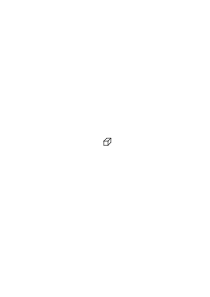.)

### [Ms-115](/ms-115/#2.2) [2\[2\]](https://cdn.wittgensteinnachlass.com/2000px/webp/Ms-115/2.webp)

<s> I do not of course deny that there are phenomena of recognition (when, for example, we say: “that is the same little box that I saw there years ago”), nor that among the phenomena we call “recognition” there is one consisting in comparing a mental image with reality. </s> If one asks me: “Did you recognize your desk when you entered your room this morning?” I would probably say “of course!” and yet it is misleading to call what happened there “recognition”. Certainly, the desk was not unfamiliar to me; I was not surprised to see it, as I would have been if someone else had been standing there or if there had been a strange object.

### [Ms-115](/ms-115/#5.1) [5\[1\]](https://cdn.wittgensteinnachlass.com/2000px/webp/Ms-115/5.webp)

“What is familiar is what I know what it is.”

### [Ms-115](/ms-115/#3.2) [3\[2\]](https://cdn.wittgensteinnachlass.com/2000px/webp/Ms-115/3.webp)

“What does it mean: ‘this object is familiar to me?’” – “Well, I know that it is a table.” But that can mean all sorts of things, among them: “I know how it is used”, “I know it looks like a table when one unfolds it”, “I know that one calls that a ‘table’”.

### [Ms-115](/ms-115/#3.3) [3\[3\]](https://cdn.wittgensteinnachlass.com/2000px/webp/Ms-115/3.webp)

What is the nature of ‘familiarity’? What does it consist in, that a sight is familiar to me? (This question is already peculiar; it does not sound like a grammatical question.) I would like to say: “I see what I see.” And the familiarity can only consist in my resting in the sight.

### [Ms-115](/ms-115/#3.4) [3\[4\]](https://cdn.wittgensteinnachlass.com/2000px/webp/Ms-115/3.webp)

116 “I see what I see”, I say this because I do not want to name what I see. I do not want to say, “I see a flower”, for that presupposes a linguistic convention & my way of expressing myself does not want to refer to the history of the impression.

### [Ms-115](/ms-115/#5.2) [5\[2\]](https://cdn.wittgensteinnachlass.com/2000px/webp/Ms-115/5.webp)

I want to eliminate everything ‘historical’ from my way of looking at familiarity. Impressions (experiences, reactions) then remain, & even where language enters into our experiences we do not regard it as an existing institution.

### [Ms-115](/ms-115/#4.2) [4\[2\]](https://cdn.wittgensteinnachlass.com/2000px/webp/Ms-115/4.webp)

Familiarity consists in my recognizing that what I see is a flower. I now say: uttering the words “that is a flower” is the reaction of recognition; but the criterion of recognition is not that I name the object correctly, but that I utter a sound-combination with a particular experience at its sight. For that the sound-combination is the correct German word, or a word of an existing language at all, is not contained in the experience of uttering it.

### [Ms-115](/ms-115/#5.3) [5\[3\]](https://cdn.wittgensteinnachlass.com/2000px/webp/Ms-115/5.webp)

The multiplicity of familiarity, as I understand it, is thus that of resting in a sight. It might consist in my gaze not wandering restlessly (searchingly) over the object, in my not changing the aspect of what is seen but settling into an aspect & remaining there.

### [Ms-115](/ms-115/#5.4) [5\[4\]](https://cdn.wittgensteinnachlass.com/2000px/webp/Ms-115/5.webp)

I see a picture of a thick coat & have a feeling of warmth & comfort; I see a picture of a wintry landscape & feel cold. These reactions, one might say, are justified by earlier experience. But we are not concerned now with the history of our experiences & hence not with such a justification either.

### [Ms-115](/ms-115/#6.1) [6\[1\]](https://cdn.wittgensteinnachlass.com/2000px/webp/Ms-115/6.webp)

No one will say that every time I come into my room, into the familiar surroundings, a recognition of everything I see, & have seen a hundred times, takes place.

### [Ms-115](/ms-115/#6.2) [6\[2\]](https://cdn.wittgensteinnachlass.com/2000px/webp/Ms-115/6.webp)

117 When we think of our understanding a picture, say, a genre painting, we are perhaps inclined to assume that there is a particular phenomenon of recognition there & that we recognize the painted people as people, the painted trees as trees, etc. But when I look at a genre painting do I compare the painted people with real ones, etc.? Am I then to say that I recognize the painted people as painted people? And therefore the real people too as real?

### [Ms-115](/ms-115/#6.3) [6\[3\]](https://cdn.wittgensteinnachlass.com/2000px/webp/Ms-115/6.webp)

Of course there is a phenomenon of recognition when we recognize, perhaps after a process of searching, a drawing as a representation of a person; but what takes place here does not take place when I see the drawing at once as a representation of a person.

### [Ms-115](/ms-115/#7.1) [7\[1\]](https://cdn.wittgensteinnachlass.com/2000px/webp/Ms-115/7.webp)

The picture of a human figure, as well as the human figure itself, are thoroughly familiar objects to us. But there is no question here of recognition.

### [Ms-115](/ms-115/#7.2) [7\[2\]](https://cdn.wittgensteinnachlass.com/2000px/webp/Ms-115/7.webp)

118 We easily form a false conception of the processes that one calls “recognition”; as if recognition always consisted in comparing two impressions with each other. It is as if I carried a picture of an object with me & recognized an object as the one represented by the picture. Our memory seems to mediate such a comparison for us, by preserving a picture of what was seen earlier or allowing us (as through a tube) to look into the past.

### [Ms-115](/ms-115/#7.3+8.1) [7\[3\]](https://cdn.wittgensteinnachlass.com/2000px/webp/Ms-115/7.webp),[8\[1\]](https://cdn.wittgensteinnachlass.com/2000px/webp/Ms-115/8.webp)

In most cases of recognition no such comparison takes place. Someone comes towards me in the street whose face attracts my gaze; perhaps I ask myself “who is that?”; suddenly the aspect of the face changes in a particular way, “it becomes familiar to me”; I smile, go up to him & greet him by name; now we talk about the past & in doing so I may also have a memory-image of him in mind, seeing him in a particular situation.

### [Ms-115](/ms-115/#8.2) [8\[2\]](https://cdn.wittgensteinnachlass.com/2000px/webp/Ms-115/8.webp)

One might say: if I had not preserved his picture in my memory, I could not recognize him. But here one is using a metaphor, or expressing a hypothesis.

### [Ms-115](/ms-115/#8.3) [8\[3\]](https://cdn.wittgensteinnachlass.com/2000px/webp/Ms-115/8.webp)

One might say: “the sight was memory-laden.”

### [Ms-115](/ms-115/#8.4) [8\[4\]](https://cdn.wittgensteinnachlass.com/2000px/webp/Ms-115/8.webp)

One also says: “we could not use words at all if we did not recognize them & the objects they designate.” If we did not recognize the colour green as such (presumably because of a lack of memory), we could not apply the word “green”. But do we have any check on this recognition, so that we know that it really is recognition? When we speak of recognition, we mean that we recognize something as what it really is, according to other criteria. “Recognizing” means: recognizing what _is_.

### [Ms-115](/ms-115/#8.5) [8\[5\]](https://cdn.wittgensteinnachlass.com/2000px/webp/Ms-115/8.webp)

119 Familiarity confirms the aspect without, however, comparing it with anything else. It stamps it, as it were.

### [Ms-115](/ms-115/#9.1) [9\[1\]](https://cdn.wittgensteinnachlass.com/2000px/webp/Ms-115/9.webp)

On the other hand I would like to say: “what I see before me here is surely not _some_ shape that I see in a particular way, but simply my shoes, which I know.” But here it is precisely two ways of expressing oneself that are at odds.

### [Ms-115](/ms-115/#9.2) [9\[2\]](https://cdn.wittgensteinnachlass.com/2000px/webp/Ms-115/9.webp)

This shape that I see – I would like to say – is not simply _one_ shape, but one of the shapes familiar to me; it is a shape that has been distinguished in advance. It is one of the shapes whose picture was already in me earlier & only because it corresponds to such a picture is it the familiar shape. (I carry, as it were, a catalogue of such shapes around with me & the objects depicted there are then the familiar ones.)

### [Ms-115](/ms-115/#9.3) [9\[3\]](https://cdn.wittgensteinnachlass.com/2000px/webp/Ms-115/9.webp)

But that I carried the picture with me earlier would only be a causal explanation of the present impression. It is as if one said: this movement goes so easily, as if it had been practised. And it is not so much that I compare the object with a picture standing beside it, but rather as if it _matched_ the picture. So I see only one & not two.

### [Ms-115](/ms-115/#10.1) [10\[1\]](https://cdn.wittgensteinnachlass.com/2000px/webp/Ms-115/10.webp)

120 One says: “this face has a quite _distinct_ expression”, & perhaps looks for words to characterize it.

### [Ms-115](/ms-115/#10.2) [10\[2\]](https://cdn.wittgensteinnachlass.com/2000px/webp/Ms-115/10.webp)

Here it is easy to get into that dead end of philosophizing where one believes that the difficulty of the task lies in the fact that elusive things, quickly vanishing present experience, or the like, should be described by us. Where ordinary language seems too crude to us; & it seems as if we are not dealing with the phenomena of which everyday life speaks, but “with the ones that quickly vanish, which, with their appearance & disappearance, approximately produce those former ones”.

### [Ms-115](/ms-115/#10.3) [10\[3\]](https://cdn.wittgensteinnachlass.com/2000px/webp/Ms-115/10.webp)

And here one must remember that all the phenomena that now seem so strange to us are quite ordinary ones which, when they occur, do not strike us in the least. They only seem strange to us in the strange light that we now cast upon them when we philosophize.

### [Ms-115](/ms-115/#10.4+11.1) [10\[4\]](https://cdn.wittgensteinnachlass.com/2000px/webp/Ms-115/10.webp),[11\[1\]](https://cdn.wittgensteinnachlass.com/2000px/webp/Ms-115/11.webp)

121 “The picture tells me itself”, I would like to say. That is, what it tells me consists in its own structure, in _its_ forms & colours. Such a case would be, for example, if “it tells me something” or “it is a picture” meant: it shows some combination of cubes & cylinders.

### [Ms-115](/ms-115/#11.2) [11\[2\]](https://cdn.wittgensteinnachlass.com/2000px/webp/Ms-115/11.webp)

“It tells me something” can mean: it tells me a story, it is a narrative.

### [Ms-115](/ms-115/#11.3) [11\[3\]](https://cdn.wittgensteinnachlass.com/2000px/webp/Ms-115/11.webp)

It tells itself to me, as a sentence, a narrative, tells itself to me.

### [Ms-115](/ms-115/#11.4) [11\[4\]](https://cdn.wittgensteinnachlass.com/2000px/webp/Ms-115/11.webp)

Isn’t the concept of a picture that tells a story similar to that of a genre painting (or battle picture)? And if I wanted to describe what a battle picture is, I would not need to refer to any reality outside the picture, but only speak of painted people, painted horses, painted cannons, etc.

### [Ms-115](/ms-115/#11.5) [11\[5\]](https://cdn.wittgensteinnachlass.com/2000px/webp/Ms-115/11.webp)

“The picture tells me something”: it uses, as it were, _words_; here there are eyes, mouth, nose, hands, etc. etc. I compare the picture with a combination of linguistic forms.

### [Ms-115](/ms-115/#11.6+12.1) [11\[6\]](https://cdn.wittgensteinnachlass.com/2000px/webp/Ms-115/11.webp),[12\[1\]](https://cdn.wittgensteinnachlass.com/2000px/webp/Ms-115/12.webp)

But the system of language is not of the category of an experience. The typical experience in the use of a system is not the system. (Compare: the meaning of the word “or” & the or-feeling.)

### [Ms-115](/ms-115/#12.2) [12\[2\]](https://cdn.wittgensteinnachlass.com/2000px/webp/Ms-115/12.webp)

“Now this sequence of signs says something to me; earlier, before I learnt the language, it said nothing to me.” Let us suppose that by this we meant that the sentence is now read with a particular experience. Certainly, before I learnt to understand the language, this sequence of signs did not produce this impression. The impression is of course quite independent of the system of language if we leave causal matters aside. – And now something in me resists saying that the sentence’s saying something consists in its making this impression on me. “Something is a sentence only in a language”, I want to say.

### [Ms-115](/ms-115/#12.3) [12\[3\]](https://cdn.wittgensteinnachlass.com/2000px/webp/Ms-115/12.webp)

122 ‘Language’, after all, is the languages. Including those that I invent by analogy with existing ones. Languages _are_ systems.

### [Ms-115](/ms-115/#12.4) [12\[4\]](https://cdn.wittgensteinnachlass.com/2000px/webp/Ms-115/12.webp)

“A sentence is a sentence of a language.” But that just means: “sentences” is what I call members of languages.

### [Ms-115](/ms-115/#12.5+13.1) [12\[5\]](https://cdn.wittgensteinnachlass.com/2000px/webp/Ms-115/12.webp),[13\[1\]](https://cdn.wittgensteinnachlass.com/2000px/webp/Ms-115/13.webp)

But let us pay attention to the _use_ of the word “German language”, otherwise we ask, for example: “What is language? all its sentences that have ever been spoken? the class of its rules & words? etc. etc..”. What is the system? Where is it? What is the game of chess? all the games? The list of rules?

### [Ms-115](/ms-115/#13.2) [13\[2\]](https://cdn.wittgensteinnachlass.com/2000px/webp/Ms-115/13.webp)

“_Sentence_ is a member of a language.” “It is evidently the combination of words that could also be combined differently that makes the sentence.” But that means: what makes it one for _me_. That is how I regard language.

### [Ms-115](/ms-115/#13.3) [13\[3\]](https://cdn.wittgensteinnachlass.com/2000px/webp/Ms-115/13.webp)

_We_ want to pay attention to the system of language.

### [Ms-115](/ms-115/#13.4) [13\[4\]](https://cdn.wittgensteinnachlass.com/2000px/webp/Ms-115/13.webp)

123 Certainly, I read a story & don’t give a damn about a system of language. I simply read, have impressions, see pictures before me, etc. I let the story pass before me like pictures, like a picture story. (Of course, I do not mean to say that every sentence evokes a visual picture, or several, in me, & that this is perhaps the purpose of a sentence.)

### [Ms-115](/ms-115/#13.5) [13\[5\]](https://cdn.wittgensteinnachlass.com/2000px/webp/Ms-115/13.webp)

Let us imagine a picture story in schematic pictures, thus more similar to a narrative in a language than to a sequence of realistic pictures. In such a picture language, one could, for example, record the course of battles. (Language-game.) And a sentence of our word-language comes much closer to a picture of this picture language than one might think.

### [Ms-115](/ms-115/#14.1) [14\[1\]](https://cdn.wittgensteinnachlass.com/2000px/webp/Ms-115/14.webp)

Let us also remember how we do not first have to transfer such pictures [

] into realistic ones in order to ‘understand’ them, just as little as we ever transfer photographs or the pictures of a film into coloured pictures, although black-and-white people or plants etc. in reality would seem unspeakably strange & terrible to us. What if we now said here: “a picture is something only in a picture language”?

### [Ms-115](/ms-115/#14.2) [14\[2\]](https://cdn.wittgensteinnachlass.com/2000px/webp/Ms-115/14.webp)

A sentence of a narrative gives us the same satisfaction as a picture.

### [Ms-115](/ms-115/#14.3+15.1) [14\[3\]](https://cdn.wittgensteinnachlass.com/2000px/webp/Ms-115/14.webp),[15\[1\]](https://cdn.wittgensteinnachlass.com/2000px/webp/Ms-115/15.webp)

124 We can (on the other hand) imagine a language in whose use the impression that a sign makes on us plays no role; in which there is no understanding in the sense of such an impression. The signs are perhaps transmitted to us in writing & we can now _memorize_ _them_. (That is, the only impression being discussed is the image of the sign.) If it is a command, we translate the sign into action according to rules, tables. There is no impression similar to that of a picture at all & one does not write stories in this language. But there is perhaps a kind of light entertainment consisting in translating certain sequences of signs into bodily movements that form a kind of dance. (Compare the remark about understanding & cipher.)

### [Ms-115](/ms-115/#15.4) [15\[4\]](https://cdn.wittgensteinnachlass.com/2000px/webp/Ms-115/15.webp)

In this case one could really say: “The sequence of signs is _dead_ without the system”.

### [Ms-115](/ms-115/#15.2) [15\[2\]](https://cdn.wittgensteinnachlass.com/2000px/webp/Ms-115/15.webp)

It would, of course, also be conceivable that, in order to receive an _impression_ from a sentence of word-language, we had to translate it according to rules into a drawn picture. (That only this picture would have a mind.)

### [Ms-115](/ms-115/#15.3) [15\[3\]](https://cdn.wittgensteinnachlass.com/2000px/webp/Ms-115/15.webp)

(I could say to my student: You will think differently when You have gone through these exercises.)

### [Ms-115](/ms-115/#15.5) [15\[5\]](https://cdn.wittgensteinnachlass.com/2000px/webp/Ms-115/15.webp)

But even in our ordinary language we can often disregard entirely the impression of the sentence & what matters is only how we operate with the sentence. (Frege’s conception of logic.)

### [Ms-115](/ms-115/#15.6) [15\[6\]](https://cdn.wittgensteinnachlass.com/2000px/webp/Ms-115/15.webp)

“There is no sentence standing alone.” For what I call a “sentence” is a game position in a language.

### [Ms-115](/ms-115/#16.1) [16\[1\]](https://cdn.wittgensteinnachlass.com/2000px/webp/Ms-115/16.webp)

Isn’t the confusing thing that I can look at a position in a game as closely as I like, without finding out in this way that it is a _position in a game_? Something in the grammar of the word “position in a game” confuses us here.

### [Ms-115](/ms-115/#16.2) [16\[2\]](https://cdn.wittgensteinnachlass.com/2000px/webp/Ms-115/16.webp)

Thinking is called an activity, like calculating. No one would call calculating a state, or playing chess a state.

### [Ms-115](/ms-115/#16.3) [16\[3\]](https://cdn.wittgensteinnachlass.com/2000px/webp/Ms-115/16.webp)

125 Let us imagine a kind of puzzle picture in which not _one_ particular object is to be found, but which appears to us at first glance as a jumble of meaningless lines & only after some searching as, say, a landscape picture. – What is the difference between the sight of the picture before & after the solution? That we see it differently on the two occasions is clear. In what way, however, can one say after the solution that the picture now tells us something, whereas before it told us nothing?

### [Ms-115](/ms-115/#16.4) [16\[4\]](https://cdn.wittgensteinnachlass.com/2000px/webp/Ms-115/16.webp)

We can also put this question as follows: What is the general characteristic of the solution having been found?

### [Ms-115](/ms-115/#18.2) [18\[2\]](https://cdn.wittgensteinnachlass.com/2000px/webp/Ms-115/18.webp)

(Anyone who does not understand why we are talking about these things must find what we say empty play.)

### [Ms-115](/ms-115/#18.3+19.1) [18\[3\]](https://cdn.wittgensteinnachlass.com/2000px/webp/Ms-115/18.webp),[19\[1\]](https://cdn.wittgensteinnachlass.com/2000px/webp/Ms-115/19.webp)

126 The impression is one thing, & the definiteness of the impression something else. What I call the impression of familiarity has the multiplicity of a definiteness.

### [Ms-115](/ms-115/#19.2) [19\[2\]](https://cdn.wittgensteinnachlass.com/2000px/webp/Ms-115/19.webp)

We can look into a human face that we know exactly without receiving any impression, quite blankly, as it were; & between that and a strong impression there are all degrees.

### [Ms-115](/ms-115/#19.3) [19\[3\]](https://cdn.wittgensteinnachlass.com/2000px/webp/Ms-115/19.webp)

Let us imagine that the sight of a face produces a strong impression on us, that it perhaps instils fear in us. Am I then to say: above all, there must be an impression of familiarity; the form of the human face as such must make the impression of familiarity on me; & to this impression is now added that of fear? – Is it not rather the case that what I call the impression of familiarity with the type is a characteristic of every strong impression that a face makes on me? Perhaps the characteristic of definiteness. I did say that the impression of familiarity consisted, for instance, in our resting in a sight, not changing the aspect, and so on.

### [Ms-115](/ms-115/#19.4+20.1) [19\[4\]](https://cdn.wittgensteinnachlass.com/2000px/webp/Ms-115/19.webp),[20\[1\]](https://cdn.wittgensteinnachlass.com/2000px/webp/Ms-115/20.webp)

127 Can I imagine away the impression of individual familiarity where it is, & imagine it in where it is not? And what does that mean? I look, for example, at the face of a friend & ask myself: what does this face look like if I see it as an unfamiliar face (as if I were seeing it for the first time now)? What, so to speak, remains of the sight of the face when I imagine away, subtract, the impression of familiarity? – Here I am inclined to say: “it is _very difficult_ to separate the familiarity from the impression of the face”. But I also feel that this is a misleading way of expressing oneself. For I do not know at all how I should even try to separate these two. The expression “to separate them” has no clear sense for me. I know what _it means_: “imagine this table, but black, although it is brown”, which means something like: “paint a picture of this table, but black instead of brown”; or analogously: “draw this person, but with longer legs than he has”.

### [Ms-115](/ms-115/#20.2) [20\[2\]](https://cdn.wittgensteinnachlass.com/2000px/webp/Ms-115/20.webp)

What if one said: “imagine this butterfly, exactly as it is, but ugly instead of beautiful”?!

### [Ms-115](/ms-115/#20.3+21.1) [20\[3\]](https://cdn.wittgensteinnachlass.com/2000px/webp/Ms-115/20.webp),[21\[1\]](https://cdn.wittgensteinnachlass.com/2000px/webp/Ms-115/21.webp)

“‘It is very difficult … to imagine away’: here it seems as if it were a psychological difficulty, a difficulty of introspection or the like. (This applies to a large area of philosophical problems: think of the problem of the _exact_ reproduction, description, of what is seen in the visual field; of the description of the ever-flowing phenomenon; also of this: “how many raindrops do you see when you look into the rain”.)

Compare: “It is difficult to _want_ to move this table from a distance”.

### [Ms-115](/ms-115/#21.2) [21\[2\]](https://cdn.wittgensteinnachlass.com/2000px/webp/Ms-115/21.webp)

_We_ have not _defined_ what it is supposed to mean to imagine away the familiarity.

It could mean, for example, remembering the impression I had when I saw the face for the first time. And here again one must know what it means to “_try_” to remember the impression. For that has various meanings. Let us ask ourselves: what activities do we call “trying to remember something”; what do we do when we want to remember what we ate yesterday at midday; is there also this method for an adult’s early childhood memories; can one _try_ to remember one’s own birth?

### [Ms-115](/ms-115/#21.3+22.1) [21\[3\]](https://cdn.wittgensteinnachlass.com/2000px/webp/Ms-115/21.webp),[22\[1\]](https://cdn.wittgensteinnachlass.com/2000px/webp/Ms-115/22.webp)

I say to myself: I shall try to look at a printed German word and see it as if I had not learnt to read & as if the black figures on the paper were strange drawings whose purpose I cannot imagine, or do not apprehend. What then happens is that I cannot look at the printed word without the sound-image of the word or of the letters I am looking at coming before my mind’s eye.

### [Ms-115](/ms-115/#22.2) [22\[2\]](https://cdn.wittgensteinnachlass.com/2000px/webp/Ms-115/22.webp)

A pictorial representation of the inside of a radio receiver will be a jumble of senseless lines for someone who has no knowledge of such things. But if he has become acquainted with the apparatus & its function, that drawing will be a meaningful picture for him. Now, given a particular physical shape that is currently senseless to me (for example, in a picture), can I imagine it meaningfully at will? That would be like asking: can I imagine an arbitrarily shaped object as an object for use? But for what use? Now, at least, one can methodically think of a class of physical forms as dwellings for animals or people. Another class as weapons. One, for example, as models of landscapes, etc. etc. And here I know how I can give meaning to a senseless form.

### [Ms-115](/ms-115/#27.2) [27\[2\]](https://cdn.wittgensteinnachlass.com/2000px/webp/Ms-115/27.webp)

This is connected with the contrast between _saying_ & _meaning_. “Every expression can (after all) lie”: But just think what you mean by “lying”. How do you imagine the lie? Do you not set one expression against another? Surely you set against the expression a process which could also be an expression.

### [Ms-115](/ms-115/#23.1) [23\[1\]](https://cdn.wittgensteinnachlass.com/2000px/webp/Ms-115/23.webp)

128 When I say that this face has the expression of mildness, goodness, cowardice, I seem not only to mean that we associate these and those feelings with the sight of the face, but I am tempted to say that the face is an aspect of cowardice, goodness, etc., itself. (Compare, for example, Weininger.) – One can say: I see the cowardice into this face (& could also see it into another), but in any case it seems not merely associated with the face, externally connected with it, but fear has the multiplicity of the facial features. And if, for example, the features change a little, we can speak of a corresponding change in the fear. If we were asked: “can you also think of this face as an expression of courage”, we would, as it were, not know how to accommodate courage in these features. I then say something like: “I do not know what it would mean if this face were a courageous face”. But what does the solution to such a question look like? One says, for example: “Yes, now I understand it; the face is, so to speak, indifferent to the external world”. So we have interpreted courage into it. Courage, one might say, now fits the face again. But _what_ fits _onto what_ here?

### [Ms-115](/ms-115/#24.1) [24\[1\]](https://cdn.wittgensteinnachlass.com/2000px/webp/Ms-115/24.webp)

It is a related case (although it may perhaps not seem so) when, for example, we are surprised that the French do not simply say “the man is good” but put an attributive adjective where a predicative one should stand; and when we then solve the problem by saying that they meant “the man is _a_ good one”.

### [Ms-115](/ms-115/#24.2+25.1) [24\[2\]](https://cdn.wittgensteinnachlass.com/2000px/webp/Ms-115/24.webp),[25\[1\]](https://cdn.wittgensteinnachlass.com/2000px/webp/Ms-115/25.webp)

Could different interpretations of a facial expression not consist in my imagining a different continuation for it each time? That is certainly often so. I see a picture depicting a smiling head. What do I do when I interpret the smile once as friendly and once as malicious? Do I not then imagine it in a spatial & temporal environment that I call friendly or malicious? Thus I could imagine, in connection with the picture, that the smiling person is smiling down at a child at play, or at the suffering of an enemy. Nothing is changed by the fact that I can also interpret the situation, amiable at first sight, differently through a further environment. If no particular circumstances alter my interpretation, I shall interpret a certain smile as friendly, call it friendly, and react accordingly.

### [Ms-115](/ms-115/#25.2) [25\[2\]](https://cdn.wittgensteinnachlass.com/2000px/webp/Ms-115/25.webp)

129 What does it mean: “to _read_ friendliness _into_ the smile”? Perhaps it means that I make a face coordinated in a particular way with the smiling face. I assign, for example, the other face to mine in such a way that it exaggerates one or other feature of the other.

### [Ms-115](/ms-115/#25.3+26.1) [25\[3\]](https://cdn.wittgensteinnachlass.com/2000px/webp/Ms-115/25.webp),[26\[1\]](https://cdn.wittgensteinnachlass.com/2000px/webp/Ms-115/26.webp)

A friendly mouth, a friendly eye. How does one imagine a friendly hand? – Probably open & not as a fist. – And could one imagine the person’s hair colour as an expression of friendliness, or of the opposite? But, put in this way, this seems to ask whether we shall _succeed_ in doing so. The question should be: do we want to call something a friendly, or unfriendly, hair colour? If we want to give such words sense, we might imagine a person whose hair becomes dark when he becomes evil. But reading the evil expression into the dark hair would be done by means of an already formed idea. One can say: the friendly eye, the friendly mouth, the wagging of the dog are, among other things, primary & independent symbols of friendliness; I mean by this: they are parts of the phenomena that one calls friendliness. If one wants to think of other phenomena as expressions of friendliness, one sees those symbols in them. We say “he makes a gloomy face”; perhaps because the eyes are more heavily shaded by the eyebrows; & now we transfer the idea of gloom to the colour of the hair. He makes gloomy hair. If one asked me whether I could imagine an armchair with a friendly expression, I would certainly want to imagine it above all with a friendly _facial expression_, reading a friendly _face_ into it.

### [Ms-115](/ms-115/#26.2+27.1) [26\[2\]](https://cdn.wittgensteinnachlass.com/2000px/webp/Ms-115/26.webp),[27\[1\]](https://cdn.wittgensteinnachlass.com/2000px/webp/Ms-115/27.webp)

I say: “I can also think of this face (which at first gives the impression of timidity) as a courageous one”. By this _we do not mean_ that I can imagine someone with this face, for example, saving another person’s life (one can of course imagine this in connection with any face). Rather, I am speaking of an aspect of the face itself. What I mean is also not that I can imagine this person changing his face into a courageous one, in the ordinary sense; but rather that it can pass into such a one in a quite particular way. The reinterpretation of a facial expression, however, is to be compared with the reinterpretation of a chord in music, when we ‘_hear_’ it once as a transition into this key and once into that. (Compare also the difference between mixed colour and intermediate colour.)

### [Ms-115](/ms-115/#27.3) [27\[3\]](https://cdn.wittgensteinnachlass.com/2000px/webp/Ms-115/27.webp)

When we ask ourselves “which person’s name would suit this person’s character” – reproduce it sonically – the method of projection by which we reproduce it is, as it were, fixed. (A poet might, for example, ask himself what name he wants to give a person.) But sometimes we project the character into the given name. Thus it seems to us that the great masters have the names that alone fit the character of their works.

### [Ms-115](/ms-115/#27.4+28.1) [27\[4\]](https://cdn.wittgensteinnachlass.com/2000px/webp/Ms-115/27.webp),[28\[1\]](https://cdn.wittgensteinnachlass.com/2000px/webp/Ms-115/28.webp)

Experience of true size. We would see a picture showing the shape of an armchair; we are told that it represents a construction the size of a house. Now we see it differently.

### [Ms-115](/ms-115/#28.2) [28\[2\]](https://cdn.wittgensteinnachlass.com/2000px/webp/Ms-115/28.webp)

What happens when we learn to feel the end of a church mode as an end?

### [Ms-115](/ms-115/#28.3) [28\[3\]](https://cdn.wittgensteinnachlass.com/2000px/webp/Ms-115/28.webp)

Think of the diversity of what we call “language”. Word-language, picture-language, sign-language, tone-language.

### [Ms-115](/ms-115/#28.5+29.1) [28\[5\]](https://cdn.wittgensteinnachlass.com/2000px/webp/Ms-115/28.webp),[29\[1\]](https://cdn.wittgensteinnachlass.com/2000px/webp/Ms-115/29.webp)

130 “‘I know this object well’, that is as if I said: ‘this object is depicted in my catalogue’”. So its being familiar would consist in such a picture’s being bound together with others in a particular wrapper; lying in _this_ drawer. – But if I really imagine this, & think I simply compared the object seen with pictures in my catalogue & found that it agreed with one of them, that would not be similar to the phenomenon of familiarity. For one assumes that the picture in our catalogue is familiar to us. If it were strange to us, the fact that it was in this wrapper, in this drawer, would mean nothing to us at all.

### [Ms-115](/ms-115/#29.2) [29\[2\]](https://cdn.wittgensteinnachlass.com/2000px/webp/Ms-115/29.webp)

When I now speak of the prototype in the catalogue of my mind, or of the case into which the object fits when it is familiar to me, I want the case to be in my mind, so to speak, as a “form of representation”, so that I cannot say that a prototype is in my mind which is (really) not there. – The prototype withdraws, so to speak, into my mind, and is therefore no longer an object for it. But that only means: there was no sense in speaking of a prototype at all. (The spatial spectacles which we cannot take off.)

### [Ms-115](/ms-115/#29.3+30.1) [29\[3\]](https://cdn.wittgensteinnachlass.com/2000px/webp/Ms-115/29.webp),[30\[1\]](https://cdn.wittgensteinnachlass.com/2000px/webp/Ms-115/30.webp)

When we speak of familiarity as the object’s fitting into a case, it is not quite as if we _compared_ what we saw with a likeness. What we really mean is the feeling when the object glides without resistance into the form of the case. But we could also have this feeling if there were no exactly fitting case at all. We can also imagine every object in an invisible case & that makes no difference at all to our experiences & is now an empty form of representation.

### [Ms-115](/ms-115/#30.5+31.1) [30\[5\]](https://cdn.wittgensteinnachlass.com/2000px/webp/Ms-115/30.webp),[31\[1\]](https://cdn.wittgensteinnachlass.com/2000px/webp/Ms-115/31.webp)

It should not really say: “yes, I recognise it, it is a face” but rather: “I recognise it, I see it as a face”. (The word face could here mean for me the mere ornament 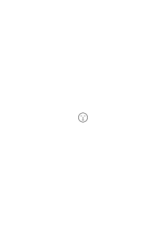 (without any relation to a human face), and would therefore be on the same level as any other figure familiar to us, for example a swastika.) For the question is: _What_ do I recognise _as what_? For “recognising a thing as itself” means nothing.

### [Ms-115](/ms-115/#31.2) [31\[2\]](https://cdn.wittgensteinnachlass.com/2000px/webp/Ms-115/31.webp)

131 Comparing memory with a notebook: on the one hand this comparison serves as a picture of what goes on consciously; on the other hand it provides a psychological model. (And the word “conscious” here refers to a section of grammar & is not one part of the psychological opposition “conscious” – “unconscious”.)

### [Ms-115](/ms-115/#31.3+32.1) [31\[3\]](https://cdn.wittgensteinnachlass.com/2000px/webp/Ms-115/31.webp),[32\[1\]](https://cdn.wittgensteinnachlass.com/2000px/webp/Ms-115/32.webp)

The processes of remembering are very varied. “Have you been in your room?” – “Yes.” – “Are you sure?” – “I would know if I had not been here yesterday!” In doing so I need not see myself in my room in memory for a moment. But suppose I saw myself, while saying this, standing at the window in my room; how does the picture show me that it was yesterday? Of course, the picture could show this too if, for example, I saw a wall calendar with yesterday’s date in it. But if that was not the case, how did I read from the memory-image or the memory that I stood at the window like that _yesterday_, how did I translate the experience of memory into words? – But did I translate an experience into words? Did I not simply utter the words; and in a particular tone of voice & with experiences of certainty of that kind? But was that not the experience of memory? (The experience of conviction is of the kind of the experience of tone of voice.) But what made you so certain when you uttered these words? Nothing; I _was_ certain. Of course, I can now check what I uttered in another way – as one would say. That is: I can now try to remember particular events of yesterday & summon images before my mind’s eye, etc. But that need not in any case have happened before I answered.

### [Ms-115](/ms-115/#32.2) [32\[2\]](https://cdn.wittgensteinnachlass.com/2000px/webp/Ms-115/32.webp)

When we recount an occurrence from memory, we probably sometimes see memory-images before us; but most of the time they are merely scattered through the memory like illustrations in a book of fairy tales.

### [Ms-115](/ms-115/#32.3+33.1) [32\[3\]](https://cdn.wittgensteinnachlass.com/2000px/webp/Ms-115/32.webp),[33\[1\]](https://cdn.wittgensteinnachlass.com/2000px/webp/Ms-115/33.webp)

Someone says to me: “imagine on this white wall a spot of the colour called ‘red’”. I do so; – am I now to say that I remembered what colour ‘red’ is called. When I talk about this table, do I remember that this object is called ‘table’.

### [Ms-115](/ms-115/#33.2) [33\[2\]](https://cdn.wittgensteinnachlass.com/2000px/webp/Ms-115/33.webp)

Could one not object: “So, can someone who has not learnt a language not have certain memories?” Of course, – he cannot have linguistic memories, linguistic wishes, etc. And linguistic memories, etc., are not merely flimsy schemata; is a linguistic experience not an experience? (Words are deeds.)

### [Ms-115](/ms-115/#33.3) [33\[3\]](https://cdn.wittgensteinnachlass.com/2000px/webp/Ms-115/33.webp)

Some people remember a musical theme in such a way that the musical notation appears before them & they read it down. It would be conceivable that what we call “remembering” in a person consisted in his seeing himself looking up a book in his mind & that what he reads in this book was precisely what was remembered. (How do I _react_ to a memory?)

### [Ms-115](/ms-115/#33.4+34.1) [33\[4\]](https://cdn.wittgensteinnachlass.com/2000px/webp/Ms-115/33.webp),[34\[1\]](https://cdn.wittgensteinnachlass.com/2000px/webp/Ms-115/34.webp)

Incidentally, when I treat the objects around me as familiar, do I think of this comparison? Of course not. I only do so when I subsequently consider the act of recognising (recognising again); & not so much by trying to see what actually happened in the process as by viewing it through a preconceived schema. (Flow of time.) (The problem of the nature of time & the flow of time is very similar to this.)

### [Ms-114](/ms-114/#108v.3) [108v\[3\]](https://cdn.wittgensteinnachlass.com/2000px/webp/Ms-114/108v.webp)

132 _and_

If one takes it for granted that human beings delight in their imagination, one should consider that this imagination is not like a painted picture or a sculpted model; but a complicated structure made up of heterogeneous components: words, pictures, etc. One will then no longer contrast operating with written – & spoken signs with operating with “mental images” of events.

### [Ms-114](/ms-114/#108v.4+109r.1) [108v\[4\]](https://cdn.wittgensteinnachlass.com/2000px/webp/Ms-114/108v.webp),[109r\[1\]](https://cdn.wittgensteinnachlass.com/2000px/webp/Ms-114/109r.webp)

The illustration in a book joins the word, as one related aid joins another. (The ugliness of a person can be repulsive in a picture, in a painting, as in reality, but also in a description, in words.)

### [Ms-114](/ms-114/#109r.2) [109r\[2\]](https://cdn.wittgensteinnachlass.com/2000px/webp/Ms-114/109r.webp)

Our attitude towards the picture (the thought) – how we experience the picture makes it real for us. That is, it connects it with reality; establishes a continuity with reality. (Fear connects the picture with the terror of reality.)

### [Ms-114](/ms-114/#109r.3) [109r\[3\]](https://cdn.wittgensteinnachlass.com/2000px/webp/Ms-114/109r.webp)

133 Can an ostensive explanation clash with the other rules for the application of a word? – For rules cannot clash unless they contradict one another. For otherwise they determine a meaning, & are not answerable to anything in such a way that they could contradict it.

### [Ms-114](/ms-114/#109r.4) [109r\[4\]](https://cdn.wittgensteinnachlass.com/2000px/webp/Ms-114/109r.webp)

Grammar is not answerable to any reality. It is the grammatical rules that determine meaning in the first place (constitute it), & so they are not answerable to any meaning & are to that extent arbitrary.

### [Ms-114](/ms-114/#109v.1) [109v\[1\]](https://cdn.wittgensteinnachlass.com/2000px/webp/Ms-114/109v.webp)

There can be no discussion about whether these rules or other rules are the correct ones for the word “not” (i.e. whether they are in accordance with its meaning).

For without these rules the word does not yet have a meaning, & if we change the rules, it now has a different meaning (or no meaning), & we could just as well change the word.

### [Ms-114](/ms-114/#109v.2) [109v\[2\]](https://cdn.wittgensteinnachlass.com/2000px/webp/Ms-114/109v.webp)

“The only correlate in language to a natural necessity is an arbitrary rule. It is the only thing that one can extract from this necessity into a sentence.”

### [Ms-114](/ms-114/#109v.3+110r.1) [109v\[3\]](https://cdn.wittgensteinnachlass.com/2000px/webp/Ms-114/109v.webp),[110r\[1\]](https://cdn.wittgensteinnachlass.com/2000px/webp/Ms-114/110r.webp)

Why do I not call the rules of cooking arbitrary; & why am I tempted to call the rules of grammar arbitrary? Because cooking is defined by its purpose, whereas language is not. Whoever follows rules other than the correct ones when cooking cooks badly; but whoever follows rules other than those of chess plays a different game; & whoever follows grammatical rules other than, say, the usual ones does not thereby speak something false, but speaks of something else.

### [Ms-114](/ms-114/#110r.2) [110r\[2\]](https://cdn.wittgensteinnachlass.com/2000px/webp/Ms-114/110r.webp)

If I want to give a block of wood a particular shape, then the right blow is the one that produces that shape. But I do not call the argument that has the desired consequences the right one. (Pragmatism.) On the contrary, I call the calculation wrong, although the actions arising from the result have led to the desired end. (Compare the joke: “I win the jackpot & he wants to teach me a lesson!”) This shows that the justifications in the two cases are different, and so “justification” means different things in the two cases. In one case one can say: “Just wait, you’ll see that it comes out right (i.e. as desired)”; in the other this is no justification.

### [Ms-114](/ms-114/#110r.4+110v.1) [110r\[4\]](https://cdn.wittgensteinnachlass.com/2000px/webp/Ms-114/110r.webp),[110v\[1\]](https://cdn.wittgensteinnachlass.com/2000px/webp/Ms-114/110v.webp)

The rules of cookery are related to the grammar of the word “cooking” in a different way from that in which the rules of chess are related to the grammar of the word “playing chess” & the rules of multiplication to the grammar of the word “multiply”.

### [Ms-114](/ms-114/#110v.2) [110v\[2\]](https://cdn.wittgensteinnachlass.com/2000px/webp/Ms-114/110v.webp)

The rules of grammar are arbitrary in the same sense as the choice of a unit of measurement. But surely this can only mean that they are independent of the length of the object being measured; and that the choice of one unit is not ‘true’ and that of another ‘false’ in the way that a statement of the length is true or false. This is of course only a remark about the grammar of the word “unit of length”.

### [Ms-114](/ms-114/#110v.3+111r.1) [110v\[3\]](https://cdn.wittgensteinnachlass.com/2000px/webp/Ms-114/110v.webp),[111r\[1\]](https://cdn.wittgensteinnachlass.com/2000px/webp/Ms-114/111r.webp)

134 One is tempted to justify the rules of grammar by saying, for example: “But there really are 4 primary colours.” And it is against the possibility of this justification that we direct ourselves when we say that the rules of grammar are arbitrary. But can one not nevertheless say that the grammar of colour words characterizes the world as it actually is? One would like to say: can I not really search in vain for a fifth primary colour? (And if one can search, then finding one is conceivable.) Do we not group the primary colours together because they have a kind of similarity? Or at least the colours, as opposed to shapes & tones? Or, when I present this division of the world as the correct one, do I already have a preconceived idea in my head as a paradigm? Of which I can then say: “that is the way we look at things”; or “we simply want to make such a picture of things”. For if I say: “the primary colours do have a certain similarity to one another”, – where do I get the concept of this similarity? From the 4 primary colours alone? Just as the concept ‘primary colour’ is nothing other than ‘blue or red or green or yellow’, is not the concept of that similarity likewise given only by the four colours? Indeed, are they not the same! (For here one can say: “What would it be like if these colours did not have this similarity?!”) (Think of grouping the four primary colours together with white & black, and visible colours with ultraviolet & infrared.)

### [Ms-115](/ms-115/#34.2) [34\[2\]](https://cdn.wittgensteinnachlass.com/2000px/webp/Ms-115/34.webp)

I do not call rules of representation conventions when they can be justified by the fact that the representation, when it conforms to them, agrees with reality. Thus the rule “paint the sky lighter than anything that receives its light from it” is not a convention. The rules of grammar cannot be justified by showing that their application leads to an agreement between the representation and reality. For this justification would have to describe what is represented itself.

### [Ms-114](/ms-114/#111r.2+111v.1) [111r\[2\]](https://cdn.wittgensteinnachlass.com/2000px/webp/Ms-114/111r.webp),[111v\[1\]](https://cdn.wittgensteinnachlass.com/2000px/webp/Ms-114/111v.webp)

I do not call rules of representation conventions when they can be justified by saying that the representation, if it accords with those rules, agrees with reality. The rules of grammar cannot be justified by a characterization of what is to be represented. For whatever the grammar of this characterization permits, why should the grammar that I am trying to justify not permit as well?

---

And whatever this justification can say, whatever its grammar permits, – why should the grammar that I am trying to justify not permit as well?

Why should both forms of expression not have the same freedom? And how can what one says restrict what the other may say?

### [Ms-115](/ms-115/#34.3+35.1) [34\[3\]](https://cdn.wittgensteinnachlass.com/2000px/webp/Ms-115/34.webp),[35\[1\]](https://cdn.wittgensteinnachlass.com/2000px/webp/Ms-115/35.webp)

But can the justification not simply _point_ to reality? In what respect, though, is this pointing a justification? Does it have the multiplicity of a justification? It may, of course, be the cause of our saying this sentence instead of that one. But is there a reason for it? Do we call _that_ “justification”?

### [Ms-114](/ms-114/#111v.2+112r.1) [111v\[2\]](https://cdn.wittgensteinnachlass.com/2000px/webp/Ms-114/111v.webp),[112r\[1\]](https://cdn.wittgensteinnachlass.com/2000px/webp/Ms-114/112r.webp)

No one will deny that studying the nature of the rules of a game must be useful for studying grammatical rules, since there is undoubtedly some similarity. – In general it is better to look at the rules of a game without a preconceived judgement or prejudice about the analogy between grammar & game, & guided only by the sure instinct that there is an affinity here. And here again one should simply report what one sees & not fear that one is thereby undermining a meaningful & correct view; or for that matter wasting one’s time on something superfluous.

### [Ms-114](/ms-114/#112r.2) [112r\[2\]](https://cdn.wittgensteinnachlass.com/2000px/webp/Ms-114/112r.webp)

135 One can of course regard language as part of a psychological mechanism. The simplest way is to restrict the concept of language to commands. One can then think of how a foreman directs the work of a group of people by calling out instructions.

### [Ms-114](/ms-114/#112r.3) [112r\[3\]](https://cdn.wittgensteinnachlass.com/2000px/webp/Ms-114/112r.webp)

One can imagine that a person invents language; that he makes the invention of getting other human beings to work for him, by training them through punishment & reward to perform certain actions in response to commands. This invention would be analogous to the invention of a machine.

### [Ms-114](/ms-114/#112v.2) [112v\[2\]](https://cdn.wittgensteinnachlass.com/2000px/webp/Ms-114/112v.webp)

Can one say that grammar describes language; language, that part of the psychological mechanism by means of which we make a human machine work for us by uttering words, as if by pressing the buttons of a keyboard? Grammar then describes that part of the whole machine. The language, then, would be the right one that brought about the desired activity, that thus functioned; a language that did not do this would be like a steam engine constructed according to false principles (so, strictly speaking, not a steam engine).

### [Ms-114](/ms-114/#112v.3+113r.1) [112v\[3\]](https://cdn.wittgensteinnachlass.com/2000px/webp/Ms-114/112v.webp),[113r\[1\]](https://cdn.wittgensteinnachlass.com/2000px/webp/Ms-114/113r.webp)

It is clear that I can determine through experience that a person (or animal) reacts to a sign in the way I want, and to another does not. That, for example, a person goes to the right when he sees the sign „→”, and to the left when he sees the sign „←”; but that he does not react to the sign „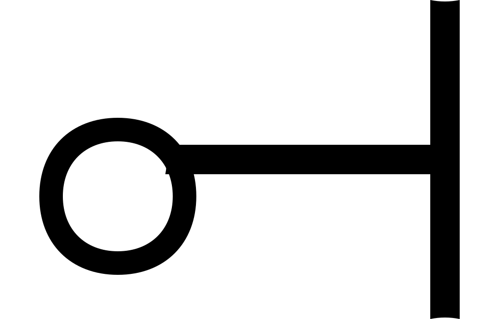” in the same way as to „→”, etc. Indeed, I do not even need to invent a case, but only consider the actual case: that I can guide a person who has only learned German only with the German language. (For I regard learning the German language merely as an adjustment of the mechanism to a certain kind of influence & it makes no fundamental difference here whether the other person has learned the language or was perhaps born by nature in such a way that he reacts to the sentences of the German language in the way a human being does when he has learned it.)

### [Ms-114](/ms-114/#113r.2+113v.1) [113r\[2\]](https://cdn.wittgensteinnachlass.com/2000px/webp/Ms-114/113r.webp),[113v\[1\]](https://cdn.wittgensteinnachlass.com/2000px/webp/Ms-114/113v.webp)

I would then have discovered that someone, in response to a signal combined with the call “Zu”, brings me sugar, and in response to the signal & call “Mi” brings me milk, & that he does not do this in response to other words. Can I then say that it appears that “Zu” is the correct (唯一 correct) sign for sugar, “Mi” the correct one for milk? Now, when I say this, I use the expression “sign for sugar” differently from the way it is ordinarily used & differently from the way I want to use it.

### [Ms-114](/ms-114/#113v.2) [113v\[2\]](https://cdn.wittgensteinnachlass.com/2000px/webp/Ms-114/113v.webp)

“This is the sign for sugar” does not state an effect of this sign but expresses an intention. That is, it connects the word “sugar” with another expression of the language. I do not use “This is the sign for sugar” analogously to the sentence: “if I press this button I get a piece of sugar”.

### [Ms-114](/ms-114/#113v.3+114r.1) [113v\[3\]](https://cdn.wittgensteinnachlass.com/2000px/webp/Ms-114/113v.webp),[114r\[1\]](https://cdn.wittgensteinnachlass.com/2000px/webp/Ms-114/114r.webp)

136 But let us nevertheless compare language with a system of such buttons, with a keyboard by means of which I can direct a person or a machine by pressing different combinations of keys. What corresponds in this case to the grammar of language? It is easy to assemble such a keyboard by means of which different ‘commands’ are to be given to the machine. Let us consider a very simple one: it consists of two keys; one says “go”, the other “come”. Now one might think that a rule of grammar would obviously have to be that the two keys must not be pressed at the same time (that would produce a contradiction). But what happens if we press both at once? Do I assume that this has an effect? Or none? – In either case I can designate the effect or the absence of an effect as the purpose & sense of pressing both buttons simultaneously.

### [Ms-114](/ms-114/#114r.2) [114r\[2\]](https://cdn.wittgensteinnachlass.com/2000px/webp/Ms-114/114r.webp)

Or: If I say that the command “bring me sugar” & “bring me milk” has sense but not the combination “sugar me milk”, this does not mean that uttering this combination of words has no effect. And if it now has the effect that the other person stares at me & opens his mouth, I do not for that reason call it the command to stare at me, etc., even if I had wanted precisely to bring about this effect.

### [Ms-114](/ms-114/#114r.3) [114r\[3\]](https://cdn.wittgensteinnachlass.com/2000px/webp/Ms-114/114r.webp)

“This combination of words has no sense” does not mean that it has no effect. Nor does it mean, “it does not have the desired effect”.

### [Ms-114](/ms-114/#114r.4+114v.1) [114r\[4\]](https://cdn.wittgensteinnachlass.com/2000px/webp/Ms-114/114r.webp),[114v\[1\]](https://cdn.wittgensteinnachlass.com/2000px/webp/Ms-114/114v.webp)

137 To say “this combination of words has no sense” excludes it from the realm of language & thereby delimits the area of language. But if one draws a boundary, this can have various reasons. If I enclose a place with a fence, a line, or something similar, this can have the purpose of preventing someone from going out or coming in; but it can also be part of a game & the boundary is perhaps meant to be jumped over by the players; or it can indicate where A’s property ends & B’s begins; etc. etc.. So, if I draw a boundary, this does not yet say why I draw it.

### [Ms-114](/ms-114/#114v.2) [114v\[2\]](https://cdn.wittgensteinnachlass.com/2000px/webp/Ms-114/114v.webp)

Language is not defined for us as an institution that fulfils a specific purpose. Rather, “language” is a collective term for me & I understand it to include the German language, the English language, etc. & also various systems of signs that have a greater or lesser kinship with these languages.

### [Ms-114](/ms-114/#114v.3) [114v\[3\]](https://cdn.wittgensteinnachlass.com/2000px/webp/Ms-114/114v.webp)

Language interests me as a phenomenon & not as the means to a specific purpose.

### [Ms-114](/ms-114/#114v.4+115r.1) [114v\[4\]](https://cdn.wittgensteinnachlass.com/2000px/webp/Ms-114/114v.webp),[115r\[1\]](https://cdn.wittgensteinnachlass.com/2000px/webp/Ms-114/115r.webp)

138 Grammar consists of agreements. Such an agreement is, for example, when it says: “the word ‘red’ means this colour”. Such an agreement can thus be contained, for instance, in a table. – Now how could the agreement find a place in a mechanism (one analogous to a pianola)? Well, it would certainly be possible for the mechanism to contain a part of the nature of a table, inserted between the analogue of a language & the rest of the mechanism.

### [Ms-114](/ms-114/#115r.3+115v.1) [115r\[3\]](https://cdn.wittgensteinnachlass.com/2000px/webp/Ms-114/115r.webp),[115v\[1\]](https://cdn.wittgensteinnachlass.com/2000px/webp/Ms-114/115v.webp)

To be sure, an ostensive explanation of a word establishes a connection between a word & ‘a thing’ & the purpose of this connection is, say, for the mechanism of which our language is a part to function in a certain way. The explanation can thus bring about proper functioning, like the connection between key & hammer in a piano; but the connection does not consist in the fact that hearing the word now has _the_ effect, even if it perhaps does have this effect because the connection was made (in this way). And it is the connection, not the effect, that determines the meaning.

### [Ms-114](/ms-114/#115v.3) [115v\[3\]](https://cdn.wittgensteinnachlass.com/2000px/webp/Ms-114/115v.webp)

When someone is taught a language, does he learn what has sense & what is nonsense? To what extent does he use grammar & in particular the distinction between sense & nonsense when he uses the language?

### [Ms-114](/ms-114/#115v.4+116r.1) [115v\[4\]](https://cdn.wittgensteinnachlass.com/2000px/webp/Ms-114/115v.webp),[116r\[1\]](https://cdn.wittgensteinnachlass.com/2000px/webp/Ms-114/116r.webp)

When he learns musical notation, he is taught a kind of grammar. It says: this note corresponds to this key on the piano, the sign # raises a tone, the sign ♮ cancels the effect of #, etc. etc.. If the student asked whether there was a difference between 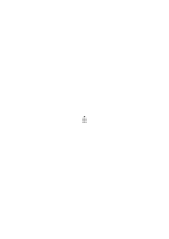 & 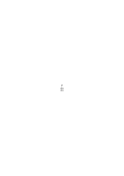 or what the sign  meant, we would tell him that the distance of the note head from the lines does not express anything, etc. These instructions can be understood as serving to turn the student into a game machine (pianola). And so what in the pianola corresponds to the grammar of the language of the tone-strip is embodied in the construction of the pianola. Insofar as one can read the purpose from the construction, grammar is expressed in the construction. The effect cannot be read from it.

### [Ms-114](/ms-114/#116r.2) [116r\[2\]](https://cdn.wittgensteinnachlass.com/2000px/webp/Ms-114/116r.webp)

Can one also speak of grammar insofar as a language is taught to people through pure training? It is clear that I can only use the word “grammar” in a “degenerate” sense if I want to use it: for how can I speak here of “explanation” or of “agreement”? A trained child or animal also does not yet know philosophy.

### [Ms-114](/ms-114/#115v.2) [115v\[2\]](https://cdn.wittgensteinnachlass.com/2000px/webp/Ms-114/115v.webp)

139 If I said that for us language was not what fulfilled a specific purpose, but that the concept determined certain systems that we call “languages” and those formed by analogy with them, – I could also express this by saying: I allow myself to _invent_ causal connections for the way language functions.

### [Ms-114](/ms-114/#116v.2) [116v\[2\]](https://cdn.wittgensteinnachlass.com/2000px/webp/Ms-114/116v.webp)

Let us imagine that someone explained: “Language is everything by means of which one can communicate.” But what does it consist in, communicating? – For the explanation we would have to describe a process of communication; and in this process certain causal connections, regularities based on experience, would appear. But those are precisely what would not interest me; I would not hesitate to invent such connections. So I would not call “key’s beard” what opens the door, but what has a certain form, structure.

### [Ms-115](/ms-115/#35.2) [35\[2\]](https://cdn.wittgensteinnachlass.com/2000px/webp/Ms-115/35.webp)

“Language” is a word like “keyboard”. There are machines which contain a keyboard. Now I might, for some reason or other, be interested in forms of keyboards (those in use & others merely invented by me). And inventing a keyboard could mean inventing something that has the desired effect; but it could also mean devising new forms analogous to the old ones in various ways.

### [Ms-114](/ms-114/#116v.3) [116v\[3\]](https://cdn.wittgensteinnachlass.com/2000px/webp/Ms-114/116v.webp)

“A sign is always there for a living being, after all, so that must be something essential to the sign.” Yes, but how is a “living” being defined? It seems that here I am prepared to define the living being by the ability to use a sign-language. And the concept of a living being really has an indeterminacy very similar to that of language.

### [Ms-114](/ms-114/#100v.3) [100v\[3\]](https://cdn.wittgensteinnachlass.com/2000px/webp/Ms-114/100v.webp)

140 In language, expectation & fulfilment touch upon each other.

### [Ms-114](/ms-114/#117r.1) [117r\[1\]](https://cdn.wittgensteinnachlass.com/2000px/webp/Ms-114/117r.webp)

To invent a language could mean to invent, on the basis of natural laws (or in accordance with them), a device for a specific purpose; but it also has the other sense, analogous to when we speak of the invention of a game. I am here saying something about the grammar of the word “language” by connecting it with the grammar of the word “invent”.

### [Ms-114](/ms-114/#117r.2) [117r\[2\]](https://cdn.wittgensteinnachlass.com/2000px/webp/Ms-114/117r.webp)

Are the rules of chess arbitrary? Let us imagine that it turned out that only chess amused & satisfied people. In that case these rules would not, after all, be arbitrary if the purpose of the game is to be fulfilled. In an analogous sense, the unit of measurement in which we express a length is arbitrary, while in another sense the choice of unit is restricted, or determined.

### [Ms-115](/ms-115/#35.3) [35\[3\]](https://cdn.wittgensteinnachlass.com/2000px/webp/Ms-115/35.webp)

“The rules of a game are arbitrary” means: the concept “game” is not defined by the effects which the game is supposed to have on us.

### [Ms-114](/ms-114/#117r.3+117v.1) [117r\[3\]](https://cdn.wittgensteinnachlass.com/2000px/webp/Ms-114/117r.webp),[117v\[1\]](https://cdn.wittgensteinnachlass.com/2000px/webp/Ms-114/117v.webp)

Language is for us a calculus; it is characterised by the _language-actions_.

### [Ms-114](/ms-114/#117v.3) [117v\[3\]](https://cdn.wittgensteinnachlass.com/2000px/webp/Ms-114/117v.webp)

Whence the meaning of language? Can one say: “Without language we could not communicate with one another”? No. The case is not analogous to: without the telephone we could not speak from Europe to America. But it is true that without language we could not move people to do our will; without language we could not build houses.

### [Ms-114](/ms-114/#117v.4) [117v\[4\]](https://cdn.wittgensteinnachlass.com/2000px/webp/Ms-114/117v.webp)

But one can say: “without the mouth people could not communicate with one another”. The concept of language, on the other hand, _lies_ in the concept of communication.

### [Ms-115](/ms-115/#35.4+36.1) [35\[4\]](https://cdn.wittgensteinnachlass.com/2000px/webp/Ms-115/35.webp),[36\[1\]](https://cdn.wittgensteinnachlass.com/2000px/webp/Ms-115/36.webp)

141 Is philosophy a creature of word-language? Is word-language a condition for the existence of philosophy? It would be more accurate to ask: is there anything analogous to philosophy outside the domain of our word-languages as well? For philosophy – (that) is the philosophical problems, i.e. the particular individual disquietudes that we call “philosophical problems”. What is _common_ to them extends as far as what is common between different domains of our language. Now consider a particular philosophical problem, say this one: “How is it possible to measure a period of time when (after all) past & future are not present and the present is only a point” –; what is characteristic of it is that a confusion is expressed here in the form of a question which does not acknowledge this confusion. That the questioner is _delivered_ from his problem by a particular change in his way of expressing himself.

### [Ms-114](/ms-114/#118v.2) [118v\[2\]](https://cdn.wittgensteinnachlass.com/2000px/webp/Ms-114/118v.webp)

I could imagine an organ whose stops were operated by keys which were exactly the same shape as the playing keys of the manual & were scattered among them. And a philosophical problem could then arise: “how are silent notes possible”. And the person who thought of replacing the stop keys by draw-stops which had no similarity to the playing keys would solve the problem.

### [Ms-115](/ms-115/#36.2) [36\[2\]](https://cdn.wittgensteinnachlass.com/2000px/webp/Ms-115/36.webp)

A problem _analogous_ to a philosophical one, or a disquietude, might arise, say, if someone _played_ on all the keys of the manual, the result did not sound like music, & yet he was tempted to believe that it had to be music. etc..

### [Ms-114](/ms-114/#118v.3+119r.1) [118v\[3\]](https://cdn.wittgensteinnachlass.com/2000px/webp/Ms-114/118v.webp),[119r\[1\]](https://cdn.wittgensteinnachlass.com/2000px/webp/Ms-114/119r.webp)

142 “Could a language consist entirely of independent signals?” Instead, one could ask: Do we still want to call a series of independent signals “language”? – If it were asked: Can such a language accomplish the same as one which consists of sentences, that is, combinations of signs, one would have to answer: _experience_ will teach us whether, for example, the effect of those signals on people is similar to that of sentences. But the effect does not interest us; we consider the phenomenon, the calculus of language. Let us imagine, for example, a diary kept with signals. One page is divided into sections for the hours of the day in the manner of a timetable. The sign “A” means: I am asleep; “B” means “I am working”; “C”, I am eating; etc., etc.. But now the question is: are these explanations given, so that they connect the signals with another language; are ostensive explanations of the signals given which complete the signal-language? Or is the language really to consist only of the signs A, B, C, etc.? What if someone asked: “how do you know that you are doing the same thing now as you did an hour ago”, & I replied: “I’ve written it down; there’s a ‘C’ here”. – Can one ask whether the sign “A” always has the same meaning; & under what circumstances can this question be answered yes or no? (One can imagine a language in which the words, the colour-names for instance, change their meaning with the days of the week; this colour is called “red” on Monday, “blue” on Tuesday. “A = A” can say that in the language in question there is no change in the meaning of the sign “A”.)

### [Ms-114](/ms-114/#119r.2+119v.1) [119r\[2\]](https://cdn.wittgensteinnachlass.com/2000px/webp/Ms-114/119r.webp),[119v\[1\]](https://cdn.wittgensteinnachlass.com/2000px/webp/Ms-114/119v.webp)

Let us again imagine a language consisting of commands. One is to be able to direct a person’s movements with it; the commands consist of an indication of length combined with the words “forwards”, “backwards”, “right”, “left” & the words “quickly” & “slowly”. One could of course replace all those commands that one will actually use by independent signs. Someone could first learn these signals as abbreviations of the sentences of that first language, also translate them back into it before obeying them, but later act directly on the signals. – One could then speak of two languages & call the first more pictorial than the second. For one would not say that from a series of such signals alone I can _derive_ a picture of the movement of the person who followed them, unless what one would call a general rule for translating into the drawing is added to the signals. We would not say: the figure

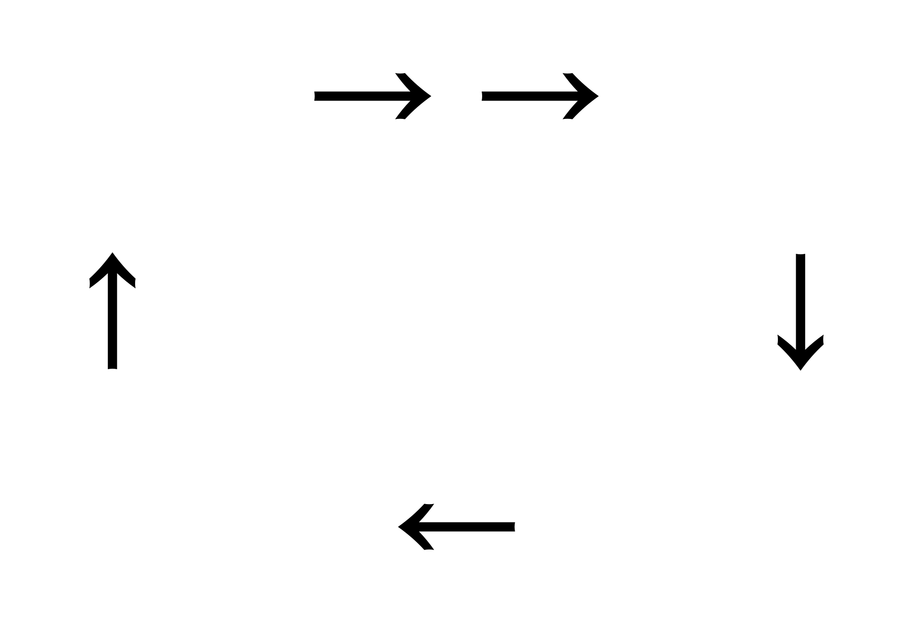

can be _derived_ from the sign abbcd; but rather from abbcd and the table

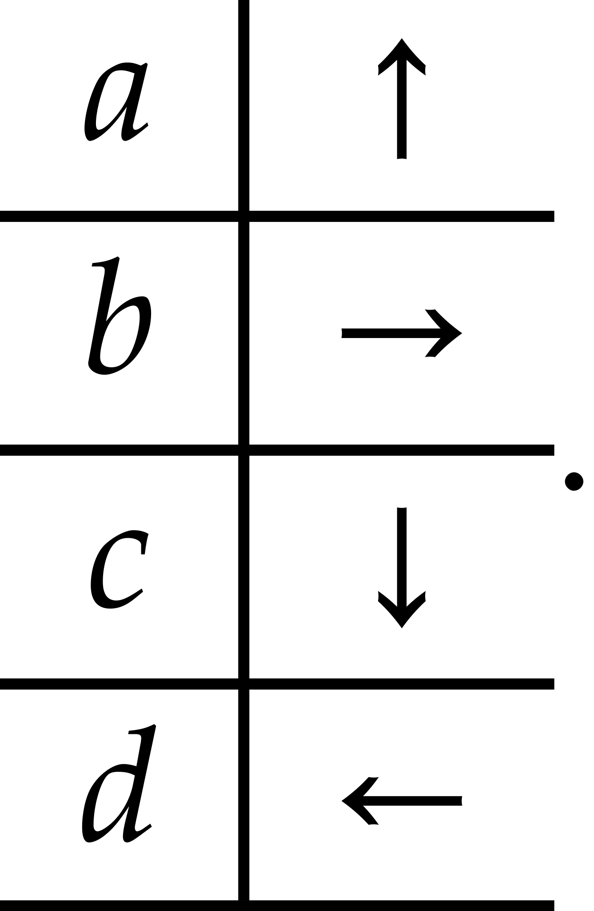

### [Ms-114](/ms-114/#120r.2+120v.1) [120r\[2\]](https://cdn.wittgensteinnachlass.com/2000px/webp/Ms-114/120r.webp),[120v\[1\]](https://cdn.wittgensteinnachlass.com/2000px/webp/Ms-114/120v.webp)

We speak rather of the possibility of this justification. And that bears a resemblance to the actual case when it occurs, like a train of thought in which I perform the calculation 12 × 12 = 144 to a reproduction of the train of thought in which this multiplication has actually been carried out on paper. We _compare_ the actual process in the use of the sign with one in which a justification is given. We supplement what is actually carried out to form a particular calculus, in order to view it from this particular point of view. This is comparable to the way in which ordinary grammar supplements an elliptical sentence, that is, regards this configuration as an abbreviated _sentence_.

### [Ms-114](/ms-114/#119v.2+120r.1) [119v\[2\]](https://cdn.wittgensteinnachlass.com/2000px/webp/Ms-114/119v.webp),[120r\[1\]](https://cdn.wittgensteinnachlass.com/2000px/webp/Ms-114/120r.webp)

One can now say: grammar _explains_ the meaning of the signs & thereby makes the language pictorial. I can justify the choice of a word by grammar. But that does not mean that I justify, or have to justify, by explanations the words that I use, say, in a description.
