# Philosophical Grammar – II

1931–1933, 795 remarks, Ms-112, Ts-213, Ms-113, Ts-211

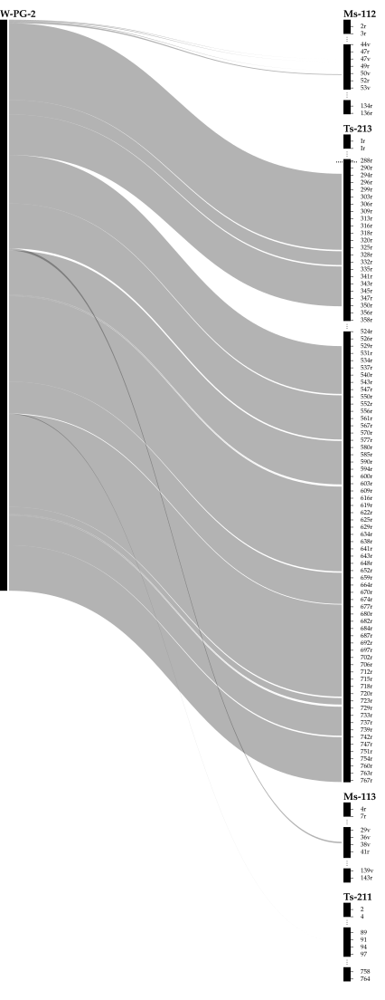

### [Ms-112](/ms-112/#47v.6+48r.1) [47v\[6\]](https://cdn.wittgensteinnachlass.com/2000px/webp/Ms-112/47v.webp),[48r\[1\]](https://cdn.wittgensteinnachlass.com/2000px/webp/Ms-112/48r.webp)

It is a very important observation that the c in A is not the same variable as the c in β & γ. So I have not written down the proof quite correctly, and in a respect that is very important for us. In A we could put n in place of c, whereas the c’s in β & γ are identical. But there is also this to ask: can I now derive from A that i + (k + c) = (i + k) + c? and, if so, why not straight from B? So are a & b in A not identical with a & b in α, β & γ either?

### [Ms-112](/ms-112/#48r.5+48v.1) [48r\[5\]](https://cdn.wittgensteinnachlass.com/2000px/webp/Ms-112/48r.webp),[48v\[1\]](https://cdn.wittgensteinnachlass.com/2000px/webp/Ms-112/48v.webp)

That the variable c in B is not identical with c in A is clear when one substitutes a number for it. B then reads, for example:

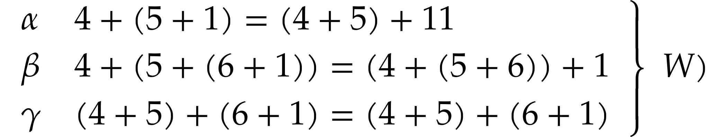

but it is not the equation AW: 4 + (5 + 6) = (4 + 5) + 6 that corresponds to this!

### [Ms-112](/ms-112/#49v.6+50r.1) [49v\[6\]](https://cdn.wittgensteinnachlass.com/2000px/webp/Ms-112/49v.webp),[50r\[1\]](https://cdn.wittgensteinnachlass.com/2000px/webp/Ms-112/50r.webp)

In the fact that the c in B is not identical with the c in A, or: in the fact that one can fill the two places with different letters, what distinguishes the proof by induction from a proof of A is, I think, expressed.

### [Ms-112](/ms-112/#50v.4) [50v\[4\]](https://cdn.wittgensteinnachlass.com/2000px/webp/Ms-112/50v.webp)

Does what I have written above mean anything other than that the appearance of an algebraic proof of A arises because we think we find the same variables a, b, c in the equations A as in α, β, γ, & therefore take A to be the result of a transformation of those equations? (Whereas in reality I give the written sign α β γ a quite new interpretation, which involves c in β & γ not being used as a variable in the same way as a & b. So the fact that c does not occur in A is an expression of this different interpretation of B.)

### [Ms-112](/ms-112/#50v.5+51r.1) [50v\[5\]](https://cdn.wittgensteinnachlass.com/2000px/webp/Ms-112/50v.webp),[51r\[1\]](https://cdn.wittgensteinnachlass.com/2000px/webp/Ms-112/51r.webp)

What I said about the change in how we understand α β γ I could now put this way: β & γ arise with the aid of α just as, for example, (a + b)² = a² + 2ab + b² arises with the aid of the basic algebraic equations. But once they have been derived in this way, we consider the complex α β γ in a new way, by giving the variable c a different function from a and b. (c becomes the hole through which the stream of numbers has to flow.)

### [Ts-213](/ts-213/#293r.1) [293r\[1\]](https://cdn.wittgensteinnachlass.com/2000px/webp/Ts-213/293r.webp)

1 _****Logical Inference**.**_

### [Ts-213](/ts-213/#294r.1) [294r\[1\]](https://cdn.wittgensteinnachlass.com/2000px/webp/Ts-213/294r.webp)

_Do we know that p follows from q because we understand the propositions? Does the following derive from a sense?_

### [Ts-213](/ts-213/#294r.2) [294r\[2\]](https://cdn.wittgensteinnachlass.com/2000px/webp/Ts-213/294r.webp)

p & q = p means “q follows from p”.

### [Ts-213](/ts-213/#294r.3) [294r\[3\]](https://cdn.wittgensteinnachlass.com/2000px/webp/Ts-213/294r.webp)

(∃x)․fx ⌵ fa = (∃x)․fx, (∃x)․fx & fa = fa How do I know this? (For I have, so to speak, proved the one above.) One might say, for instance: “I simply understand ‘(∃x)․fx’”. (A splendid example of what ‘understand’ means.) But I could just as well ask “How do I know that (∃x)․fx follows from fa?” and answer: “Because I understand ‘(∃x)․fx’”. But how do I actually know that it follows? – _Because that is how I calculate_.

### [Ts-213](/ts-213/#294r.4+295r.1) [294r\[4\]](https://cdn.wittgensteinnachlass.com/2000px/webp/Ts-213/294r.webp),[295r\[1\]](https://cdn.wittgensteinnachlass.com/2000px/webp/Ts-213/295r.webp)

How do I know that (∃x)․fx follows from fa? Do I see, as it were, behind the sign “(∃x)․fx”, and see the sense that stands behind it, and see from that that it follows from fa? Is _that_ understanding? No, that equation expresses part of the understanding (which thus lies spread out before me). Think of the conception of understanding as something originally _graspable at a stroke_ that can _only then_ be spread out in this way. If I say “I know that (∃x)․fx follows because I understand it”, that would mean that in understanding it I see something _other_ than the given sign, as it were a _definition_ of the sign from which its following emerges.

### [Ts-213](/ts-213/#295r.2) [295r\[2\]](https://cdn.wittgensteinnachlass.com/2000px/webp/Ts-213/295r.webp)

Isn’t the dependence, rather, established and laid down by the equation? For there simply is no hidden dependence.

### [Ts-213](/ts-213/#295r.3) [295r\[3\]](https://cdn.wittgensteinnachlass.com/2000px/webp/Ts-213/295r.webp)

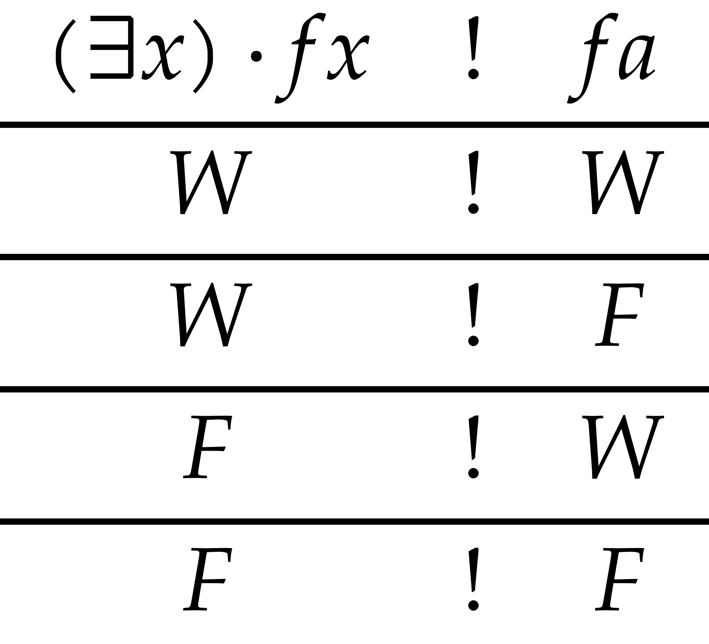

But, I thought, mustn’t (∃x)․fx be a truth-function of fa, then, for that to be possible? For this dependence to be possible?

### [Ts-213](/ts-213/#295r.4) [295r\[4\]](https://cdn.wittgensteinnachlass.com/2000px/webp/Ts-213/295r.webp)

But doesn’t (∃x)․fx ⌵ fa = (∃x)․fx say precisely that fa is already contained in (∃x)․fx? Doesn’t it show the dependence of fa on (∃x)․fx? No, unless (∃x)․fx is _defined_ as a logical sum (with fa as a summand). – If that is so, then (∃x)․fx is (_nothing but_) an abbreviation.

### [Ts-213](/ts-213/#295r.5) [295r\[5\]](https://cdn.wittgensteinnachlass.com/2000px/webp/Ts-213/295r.webp)

There is no hidden connection in logic.

### [Ts-213](/ts-213/#295r.6) [295r\[6\]](https://cdn.wittgensteinnachlass.com/2000px/webp/Ts-213/295r.webp)

One cannot get behind the rules, because there is no ‘behind’.

### [Ts-213](/ts-213/#295r.7+296r.1) [295r\[7\]](https://cdn.wittgensteinnachlass.com/2000px/webp/Ts-213/295r.webp),[296r\[1\]](https://cdn.wittgensteinnachlass.com/2000px/webp/Ts-213/296r.webp)

fE & fa = fa Can one say: this is possible only if fE follows from fa; or must one say: this stipulates that fE follows from fa?

### [Ts-213](/ts-213/#296r.2) [296r\[2\]](https://cdn.wittgensteinnachlass.com/2000px/webp/Ts-213/296r.webp)

If the former, then it must follow by virtue of the structure, for instance by fE being so determined by a definition that it has the _corresponding_ structure. But can its following really emerge, as it were, from the visible structure of the signs, as physical behaviour emerges from a physical property, or does it not rather always require such _stipulations_ as the equation fE & fa = fa? Can one tell by looking at p⌵q that it follows from p, or even by looking at the rules Russell gives for the truth-functions?

### [Ts-213](/ts-213/#296r.3) [296r\[3\]](https://cdn.wittgensteinnachlass.com/2000px/webp/Ts-213/296r.webp)

And why should the rule fE & fa = fa be derived from another rule rather than be the primary rule?

### [Ts-213](/ts-213/#296r.4) [296r\[4\]](https://cdn.wittgensteinnachlass.com/2000px/webp/Ts-213/296r.webp)

For what is “fE must surely contain fa in some way” supposed to mean? It simply does not contain it, in so far as we can work with fE without mentioning fa. It does, though, in so far as the rule fE & fa = fa holds.

### [Ts-213](/ts-213/#296r.5) [296r\[5\]](https://cdn.wittgensteinnachlass.com/2000px/webp/Ts-213/296r.webp)

For the _opinion_ is that fE & fa = fa can hold only by virtue of a definition of fE.

### [Ts-213](/ts-213/#296r.6) [296r\[6\]](https://cdn.wittgensteinnachlass.com/2000px/webp/Ts-213/296r.webp)

And that – I think – because otherwise it falsely appears as if a further stipulation about fE were being made after it _had_ already been introduced into the language. In fact, however, no stipulation is left to future experience.

### [Ts-213](/ts-213/#296r.7+297r.1) [296r\[7\]](https://cdn.wittgensteinnachlass.com/2000px/webp/Ts-213/296r.webp),[297r\[1\]](https://cdn.wittgensteinnachlass.com/2000px/webp/Ts-213/297r.webp)

And of course defining fE from ‘all the individual cases’ is _just as_ impossible as listing _all_ the rules of the form fE & fx = fx. Indeed, the individual equations fE & fx = fx are precisely an expression of this impossibility.

### [Ts-213](/ts-213/#297r.2) [297r\[2\]](https://cdn.wittgensteinnachlass.com/2000px/webp/Ts-213/297r.webp)

If one is asked “But is it certain, then, that no calculus other than this one is used?” one must say: If that means “Don’t we use other calculi in our _actual_ language as well?”, I can only answer “I don’t know of any others (at present)” (just as if someone asked “Are those all the calculi of (present-day) mathematics?”, I might say “I don’t recall any others, but I can perhaps check the books more carefully”). But the question cannot mean “Can no other calculus be used?” For how would I answer this question? A calculus exists in virtue of one’s describing it.

### [Ts-213](/ts-213/#297r.3) [297r\[3\]](https://cdn.wittgensteinnachlass.com/2000px/webp/Ts-213/297r.webp)

Can one say: ‘calculus’ is not a mathematical concept?

### [Ts-213](/ts-213/#297r.4+298r.1) [297r\[4\]](https://cdn.wittgensteinnachlass.com/2000px/webp/Ts-213/297r.webp),[298r\[1\]](https://cdn.wittgensteinnachlass.com/2000px/webp/Ts-213/298r.webp)

If I said: “Whether p follows from q must be evident from p and q alone”, what I would have to say is: that p follows from q is a stipulation that determines the sense of p and q; not something that is true when asserted of the sense of these two. Hence one (_certainly_) can state the rules of inference, but in doing so one states rules for the use of the written signs, rules which determine their sense in the first place; which means nothing other than that these rules are to be laid down arbitrarily; i.e. not read off from reality, as a description is. For when I say the rules are arbitrary, I mean that they are not determined by reality in the way a description of that reality is. And that means: it is nonsense to say of them that they accord with reality; that the rules for the words “blue” and “red”, say, accord with the facts concerning these colours, etc.

### [Ts-213](/ts-213/#298r.2) [298r\[2\]](https://cdn.wittgensteinnachlass.com/2000px/webp/Ts-213/298r.webp)

The equation p & q = p really shows the connection between following and the truth-functions.

### [Ts-213](/ts-213/#299r.1) [299r\[1\]](https://cdn.wittgensteinnachlass.com/2000px/webp/Ts-213/299r.webp)

2 _“If p follows from q, then in thinking q one must already be thinking p as well”._

### [Ts-213](/ts-213/#299r.2) [299r\[2\]](https://cdn.wittgensteinnachlass.com/2000px/webp/Ts-213/299r.webp)

Consider that a logical sum of, say, a hundred summands might follow from the general proposition, even though we certainly did not think of them when we uttered the general proposition. Can we _not_ nonetheless say that it follows from it?

### [Ts-213](/ts-213/#299r.3+300r.1) [299r\[3\]](https://cdn.wittgensteinnachlass.com/2000px/webp/Ts-213/299r.webp),[300r\[1\]](https://cdn.wittgensteinnachlass.com/2000px/webp/Ts-213/300r.webp)

“What follows from a thought must be thought along with it. For there is nothing about a thought that we do not know while we are thinking it. It is not a machine whose examination can bring unsuspected things to light, or a machine that can do something one does not _at first_ see it can do. That is, _logically_ it does not work as a machine at all. As a thought, it contains no more than would be put into it. As a machine, i.e. causally, it might be capable of anything; logically it yields only what we _meant by it_.” When I say that the quadrilateral is all white, I am not thinking of ten smaller rectangles within it that are white; and I cannot think of “_all_” the rectangles or patches within it. Likewise, in the sentence “he is in the room”, I am not thinking of a hundred possible positions he could occupy, and certainly not of _all_ of them.

### [Ts-213](/ts-213/#300r.2) [300r\[2\]](https://cdn.wittgensteinnachlass.com/2000px/webp/Ts-213/300r.webp)

“Wherever you hit the target, you’ve won. – You hit it at the top right, so …”

### [Ts-213](/ts-213/#300r.3+301r.1) [300r\[3\]](https://cdn.wittgensteinnachlass.com/2000px/webp/Ts-213/300r.webp),[301r\[1\]](https://cdn.wittgensteinnachlass.com/2000px/webp/Ts-213/301r.webp)

At first sight _there seem to be two kinds of deduction_: in one, what the conclusion is about is mentioned in the premise; in the other it is not. The inference from p & q to q is of the first kind. Of the other kind is the inference: the whole rod is white, so the middle third is white too. This conclusion speaks of boundaries that were not mentioned in the first sentence. (That is suspicious.) Or if I say, “wherever within this circle you hit the target, you will win the prize” and then “you hit it here, so …”, this spot was not foreseen in the first sentence. The target with the shot hole stands in a definite internal relation to the target as I saw it before, and the fact that the hole here falls under the general possibility that was foreseen _consists_ in this. But the hole itself was not foreseen and did not occur in the first picture. Or at any rate it did not have to occur in it. For even supposing I had thought of a thousand definite possibilities in doing so, it might at least have happened that the one that later came about was left out. And if foreseeing this possibility had been essential, overlooking this one possibility would have given the premise the wrong sense and the conclusion would now not follow from it. On the other hand, nothing is _added_ to the sentence “wherever within this circle you hit …” if one says: “wherever within this circle you hit, and if in particular you hit the black dot …”. But if the black dot was already there when one uttered the first sentence, then of course it too was meant; if it was not there, then its presence has changed the sense of the sentence.

### [Ts-213](/ts-213/#301r.2) [301r\[2\]](https://cdn.wittgensteinnachlass.com/2000px/webp/Ts-213/301r.webp)

But what is it supposed to mean, then, to say that if one sentence follows from another, the first must be thought along with the second, when in the sentence “I am 170 cm tall” one does not have to think along with it even a single one of the negative specifications of length that follow from it?

### [Ts-213](/ts-213/#301r.3) [301r\[3\]](https://cdn.wittgensteinnachlass.com/2000px/webp/Ts-213/301r.webp)

“The cross lies on the straight line _like this_: 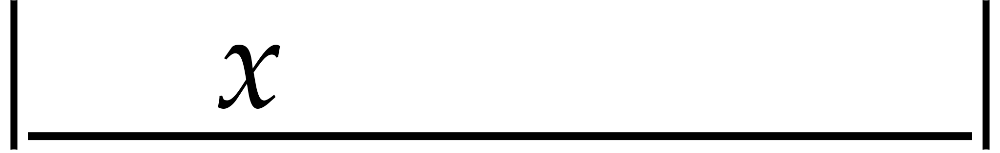” – “It _therefore_ lies between the marks …” “It is 16½˚ here”. – “So at any rate it is more than 15˚.” If, incidentally, one is surprised that this sentence follows from that one, although one was not thinking of this one at all when thinking of that one, one need only recall that p ⌵ q follows from p, and I certainly do not think of all sentences p ⌵ x when I think of p.

### [Ts-213](/ts-213/#301r.4) [301r\[4\]](https://cdn.wittgensteinnachlass.com/2000px/webp/Ts-213/301r.webp)

The whole idea that when one thinks a sentence from which another follows one must think the latter rests on a false, psychologizing conception. After all, we have only to attend to what lies in the signs and (_their_) rules.

### [Ts-213](/ts-213/#301r.5+302r.1) [301r\[5\]](https://cdn.wittgensteinnachlass.com/2000px/webp/Ts-213/301r.webp),[302r\[1\]](https://cdn.wittgensteinnachlass.com/2000px/webp/Ts-213/302r.webp)

If the criterion for p following from q consists in one’s “thinking p along with q when thinking q”, then presumably, when thinking the sentence “there are 10⁵ grains of sand in this box”, one thinks the 10⁵ sentences: “there is _one_ grain of sand in this box”, “…2 grains of sand”, etc., etc.? What is the criterion here for thinking one thing along with another! And what about a sentence: “a patch (F) lies between the boundaries AA”? Does it not follow from it that F also lies between BB and CC, and so on? Do infinitely many sentences follow here from _one_ sentence? and does it therefore say infinitely much? – From the sentence “a patch lies between the boundaries AA” there follows every sentence of the kind “a patch lies between the boundaries BB” that I write down – and as many as I write down. Just as there follow from p as many sentences of the form p ⌵ x as I write down (or utter, etc.). (The proof by induction proves as many sentences of the form … as I write down.)

### [Ts-213](/ts-213/#303r.1) [303r\[1\]](https://cdn.wittgensteinnachlass.com/2000px/webp/Ts-213/303r.webp)

3 _The case: infinitely many sentences follow from one._

### [Ts-213](/ts-213/#303r.2) [303r\[2\]](https://cdn.wittgensteinnachlass.com/2000px/webp/Ts-213/303r.webp)

Is it impossible for infinitely many sentences to follow from one sentence, – in the sense, that is, that new sentences could always be formed from the one according to a rule, ad infinitum?

### [Ts-213](/ts-213/#303r.3) [303r\[3\]](https://cdn.wittgensteinnachlass.com/2000px/webp/Ts-213/303r.webp)

Suppose we wrote out the first thousand sentences of this _series_ in conjunction. Would not the sense of this product have to come closer to the sense of the original sentence than that of the product of the first hundred sentences? Would one not get a closer and closer approximation to the first sentence the further one extended the product, and would that not show that infinitely many other sentences cannot follow from that sentence, since I am already unable to understand the product of 10¹⁰ terms and yet have understood the sentence to which the product of 10¹⁰⁰ terms comes even closer than that of 10¹⁰ terms?

### [Ts-213](/ts-213/#303r.4) [303r\[4\]](https://cdn.wittgensteinnachlass.com/2000px/webp/Ts-213/303r.webp)

Presumably one thinks of the general sentence as an abbreviated way of expressing the product. But what is there to abbreviate in the product? After all, it contains nothing superfluous.

### [Ts-213](/ts-213/#304r.1) [304r\[1\]](https://cdn.wittgensteinnachlass.com/2000px/webp/Ts-213/304r.webp)

If one needs an example of infinitely many sentences following from _one_, perhaps the simplest would be that from “a is red” there follows the negation of all sentences that ascribe a different colour to a. These negative sentences are certainly not thought along with the one sentence. One could of course say: after all, we do not distinguish infinitely many shades of colour; but the question is: does the number of shades we distinguish have anything at all to do with the _complexity_ of that _first_ sentence; is it more or less complex depending on whether we distinguish more or fewer shades? Would one not have to put it like this: A sentence follows from _it_ only once that sentence is there. Only when we have formed ten sentences that follow from the first do ten sentences follow from it.

### [Ts-213](/ts-213/#304r.2) [304r\[2\]](https://cdn.wittgensteinnachlass.com/2000px/webp/Ts-213/304r.webp)

I want to say that one sentence follows from another only when it is confronted with it. That “and so on ad infinitum” refers only to the possibility of forming sentences that follow from the first, but does not _yield_ any number of such sentences. Could I therefore simply say: The _reason_ infinitely many sentences do not follow from one sentence is that it is impossible to write down infinitely many sentences (i.e. it is nonsense to say that).

### [Ts-213](/ts-213/#304r.3) [304r\[3\]](https://cdn.wittgensteinnachlass.com/2000px/webp/Ts-213/304r.webp)

 Now what about the sentence: “the surface is white from A to B”? Surely it follows from it that it is also white from A' to B'. It need not be a matter of white that is seen; and in any case the inference from the first sentence to the second is _made_ again and again. Someone says to me, “I’ve coated the surface with it from A to B”, and I reply, “so at any rate it is coated from A' to B'”. One would have to be able to say a priori that F(A'B') _would_ follow from F(AB).

### [Ts-213](/ts-213/#305r.1) [305r\[1\]](https://cdn.wittgensteinnachlass.com/2000px/webp/Ts-213/305r.webp)

If the marks A' and B' are present, then that second sentence does indeed follow from the first (then the _compositeness_ is plainly already present in the first sentence); but then only as many sentences follow from the first as correspond to its _compositeness_ (hence never infinitely many).

### [Ts-213](/ts-213/#305r.2) [305r\[2\]](https://cdn.wittgensteinnachlass.com/2000px/webp/Ts-213/305r.webp)

“The whole is white; consequently a part characterized by such a boundary line is white too.” “The whole was white, so that part of it _was_ white too, even if I did not at the time perceive it as bounded within the whole.”

### [Ts-213](/ts-213/#305r.3) [305r\[3\]](https://cdn.wittgensteinnachlass.com/2000px/webp/Ts-213/305r.webp)

_“A surface seen as undivided has no parts”._

But let us imagine a graduated scale laid against the surface, so that, say, we had before us first the picture , then the picture  and then ; then from the fact that the first strip is white _throughout_ it does _not at all_ follow that in the second and third everything but the graduation marks is white.

### [Ts-213](/ts-213/#305r.4) [305r\[4\]](https://cdn.wittgensteinnachlass.com/2000px/webp/Ts-213/305r.webp)

“Wherever within this circle you hit the target, you’ve won”. “I think you will hit the target somewhere within this circle”. As for the first sentence, one might ask: how do you know? Have you tried _all_ the possible spots? And the answer would then have to be: this is not a proposition at all, but a general _stipulation_.

### [Ts-213](/ts-213/#305r.5+306r.1) [305r\[5\]](https://cdn.wittgensteinnachlass.com/2000px/webp/Ts-213/305r.webp),[306r\[1\]](https://cdn.wittgensteinnachlass.com/2000px/webp/Ts-213/306r.webp)

Nor does the inference go like this: “wherever the shot hits the target, you’ve won. You hit *there* on the target, so you’ve won the prize”. For where is this _there_? How is it marked apart from the shot, by a circle perhaps? And was the circle already on the target before? If not, the target has changed; but if it had already been there, it would have been provided for as a possible place to hit. Rather, it must go: “you hit the target, so …”.

### [Ts-213](/ts-213/#306r.2) [306r\[2\]](https://cdn.wittgensteinnachlass.com/2000px/webp/Ts-213/306r.webp)

The spot on the target need not be indicated by a mark, a circle, on the target. For there is in any case the description “nearer the centre”, “nearer the edge”, “at the top right” etc. However the target is hit, such a description _must_ always be possible. (But there are not “infinitely many” of these descriptions either.)

### [Ts-213](/ts-213/#306r.3) [306r\[3\]](https://cdn.wittgensteinnachlass.com/2000px/webp/Ts-213/306r.webp)

Does it make sense, then, to say: “but if one hits the target, one must hit it _somewhere_”? Or also: “wherever he hits the surface, it will not be a surprise of the kind that would make one say, for instance, ‘I didn’t expect that; I didn’t even know there was such a place’”. But that means, surely, that there can be no geometrical surprise.

### [Ts-213](/ts-213/#306r.4) [306r\[4\]](https://cdn.wittgensteinnachlass.com/2000px/webp/Ts-213/306r.webp)

What kind of sentence is: “On this strip one can see all the shades of grey between black and white”? At first sight it seems that what is spoken of here is infinitely many shades. Indeed, we apparently have the paradox here that, although we can distinguish only finitely many shades from one another and the difference between them is of course not infinitely small, we nevertheless see a continuous transition.

### [Ts-213](/ts-213/#307r.1) [307r\[1\]](https://cdn.wittgensteinnachlass.com/2000px/webp/Ts-213/307r.webp)

One can no more regard a particular grey as one of the infinitely many greys between black and white than one can regard a tangent t as one of the infinitely many stages in the transition from t' to t'' . If, say, I see a ruler roll along the circle from t' to t'', then – if it moves continuously – I see not a single one of the intermediate positions in the sense in which I see t when the tangent is at rest; or else I see only a finite number of intermediate positions. But if in such a case I appear to infer a special case from a general proposition, experience is never the source of this general proposition, and the proposition is not really a proposition at all. If, for example, I say: “I saw the ruler move from t' to t'', _so_ I must have seen it in t too”, we do not have a valid logical inference here. For if what I mean is that the ruler must have _appeared_ in position t too – if, that is, I am speaking of the position in visual space, then that does not follow from the premise at all. But if I am speaking of the physical ruler, it is of course possible that it skipped position t and that the phenomenon in visual space was nevertheless continuous.

### [Ts-213](/ts-213/#308r.1) [308r\[1\]](https://cdn.wittgensteinnachlass.com/2000px/webp/Ts-213/308r.webp)

4 _Can an experience teach us that this proposition follows from that one?_

### [Ts-213](/ts-213/#308r.2) [308r\[2\]](https://cdn.wittgensteinnachlass.com/2000px/webp/Ts-213/308r.webp)

All that matters is that we cannot say (here) that we found out through experience that there is also this case of grammar. For we would have to describe it in making this statement, and although it is only now that I see that the description is true, I could have understood it even before this experience.

### [Ts-213](/ts-213/#308r.3) [308r\[3\]](https://cdn.wittgensteinnachlass.com/2000px/webp/Ts-213/308r.webp)

It is the old question: to what extent can one speak now of an experience one is not having now? What I cannot foresee, I cannot foresee. And what I can speak of now, I can speak of now independently of what I can _not_ speak of now. Logic is always complete.

### [Ts-213](/ts-213/#308r.4) [308r\[4\]](https://cdn.wittgensteinnachlass.com/2000px/webp/Ts-213/308r.webp)

“How can I know all that will follow?” – What I can know then, I can know now too.

### [Ts-213](/ts-213/#308r.5+309r.1) [308r\[5\]](https://cdn.wittgensteinnachlass.com/2000px/webp/Ts-213/308r.webp),[309r\[1\]](https://cdn.wittgensteinnachlass.com/2000px/webp/Ts-213/309r.webp)

But are there actually general rules of grammar, rather than just rules about general signs? What, for instance, would be a general and a particular rule in chess (or in another game)? Every rule, after all, is general. Yet the rule that p ⌵ q follows from p has a different kind of generality from the rule that every sentence of the form p, non-non-p, … follows from p & q. But isn’t the generality of the rule for the knight’s move different from that of a rule for the beginning of a game?

### [Ts-213](/ts-213/#309r.2) [309r\[2\]](https://cdn.wittgensteinnachlass.com/2000px/webp/Ts-213/309r.webp)

Does the word “rule” have several senses at all? And are we therefore not to speak of rules in general, any more than of languages in general? But only of rules in particular cases.

### [Ts-213](/ts-213/#309r.3) [309r\[3\]](https://cdn.wittgensteinnachlass.com/2000px/webp/Ts-213/309r.webp)

“If from 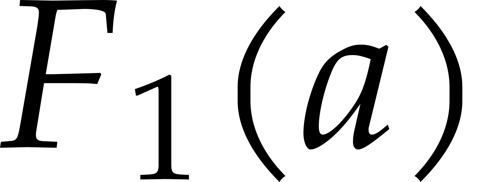 (a has the colour 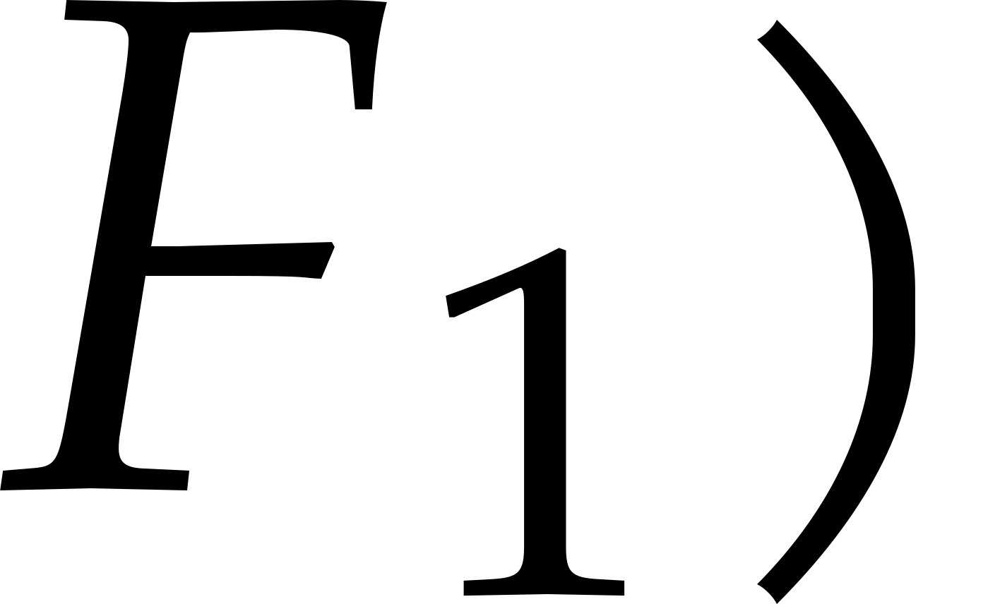 there follows 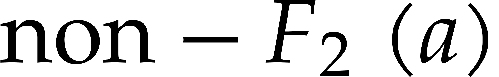, then the possibility of the second sentence must already have been foreseen in the grammar of the first (how else could we call  and  colours?).” “If the second sentence had, so to speak, come as a surprise to the first, it could never follow from it”. “The first sentence must acknowledge the other as its consequence. Or rather, _one_ grammar must then unite them both, and it must be the same as before the inference”. (It is very hard here not to tell fairy tales about what goes on in the symbolism, just as elsewhere it is hard not to tell fairy tales about what goes on psychologically. For everything is simple and familiar to everyone (and there is nothing new to invent). That is really what is outrageous about logic: that its extraordinary difficulty is due to there being nothing to construct, _but rather_ everything being already there and known.)

### [Ts-213](/ts-213/#309r.4) [309r\[4\]](https://cdn.wittgensteinnachlass.com/2000px/webp/Ts-213/309r.webp)

“Any sentence that p does not recognize as its consequence is not its consequence”.

### [Ts-213](/ts-213/#310r.1) [310r\[1\]](https://cdn.wittgensteinnachlass.com/2000px/webp/Ts-213/310r.webp)

It must _emerge_ from the grammar of the sentence – and from that alone – whether a sentence follows from it. No insight into a new sense can yield this; – only insight into the old sense can. – It is not possible to form a new sentence that follows from that sentence and that one could not have formed (albeit without knowing whether it was true or false) when that sentence was formed. If one discovered a new sense and this were to follow from that first sentence, then that sentence would not have changed its sense.

### [Ts-213](/ts-213/#311r.1) [311r\[1\]](https://cdn.wittgensteinnachlass.com/2000px/webp/Ts-213/311r.webp)

5 _****Generality**.**_

### [Ts-213](/ts-213/#312r.1) [312r\[1\]](https://cdn.wittgensteinnachlass.com/2000px/webp/Ts-213/312r.webp)

_The sentence “the circle is inside the square” in a certain sense independent of the specification of a particular position (it has, in a certain sense, nothing to do with it)._

### [Ts-213](/ts-213/#312r.2) [312r\[2\]](https://cdn.wittgensteinnachlass.com/2000px/webp/Ts-213/312r.webp)

I want to say: the general picture ❘ ⚬ ❘ has a different metric from the particular one.

### [Ts-213](/ts-213/#312r.3) [312r\[3\]](https://cdn.wittgensteinnachlass.com/2000px/webp/Ts-213/312r.webp)

In the general sign “❘ ⚬ ❘” distances play as little part as they do in the sign “aRb”.

### [Ts-213](/ts-213/#312r.4) [312r\[4\]](https://cdn.wittgensteinnachlass.com/2000px/webp/Ts-213/312r.webp)

How one can regard the drawing ❘ ⚬ ❘ as a representation of the “general case”. As it were, not in metric space, but in such a way that the distances from the circle to the straight lines _make no difference at all_. One then sees the picture as a _case_ belonging to a different system from the one it belongs to when one sees it as a representation of a particular position of the circle between the straight lines. Or rather: it is then part of a different calculus. Different rules hold for the variable than for its particular value.

### [Ts-213](/ts-213/#312r.5+313r.1) [312r\[5\]](https://cdn.wittgensteinnachlass.com/2000px/webp/Ts-213/312r.webp),[313r\[1\]](https://cdn.wittgensteinnachlass.com/2000px/webp/Ts-213/313r.webp)

“How do you know he is in the room?” – “Because I put him in there and there is nowhere he can get out.” – So your knowledge of the general fact that he is somewhere in the room is also of the same multiplicity as this ground.

### [Ts-213](/ts-213/#313r.2) [313r\[2\]](https://cdn.wittgensteinnachlass.com/2000px/webp/Ts-213/313r.webp)

Let us take the particular cases of the general state of affairs in which the cross is between the boundary marks:

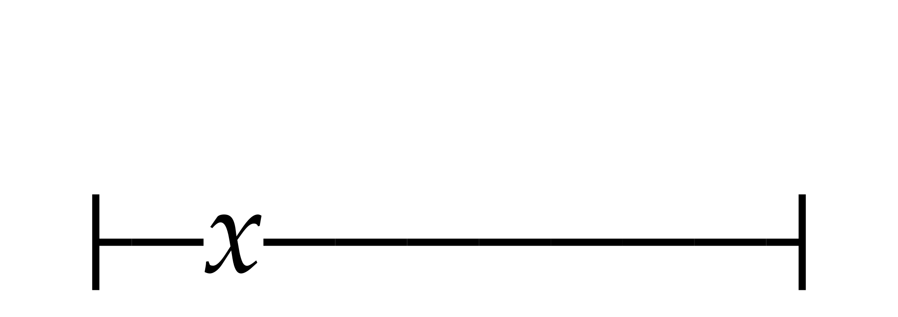  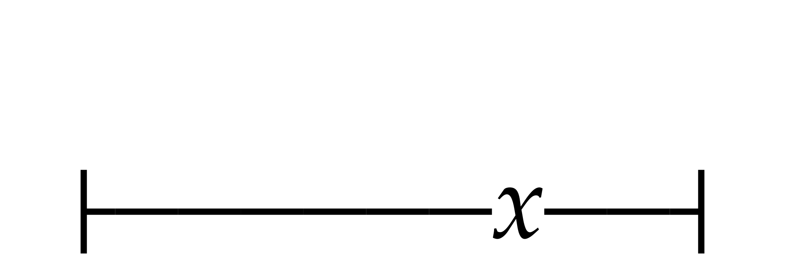. Each of these cases, for example, has a _particular_ individuality. Does this individuality enter in any way into the sense of the general sentence? Evidently not.

### [Ts-213](/ts-213/#313r.3) [313r\[3\]](https://cdn.wittgensteinnachlass.com/2000px/webp/Ts-213/313r.webp)

But ‘lying between the line segments, or walls’ seems to us to be something simple, of which the various positions (whether the visual appearances, or the positions established by measurement) are quite independent. That is, when we speak of the individual (seen) positions, we seem to be speaking of something quite different from what is spoken of in the general sentence.

### [Ts-213](/ts-213/#313r.4) [313r\[4\]](https://cdn.wittgensteinnachlass.com/2000px/webp/Ts-213/313r.webp)

Our designation of generality belongs to one calculus, and that disjunction exists in another. When we say that the cross lies between these marks, we have no disjunction ready to take the place of the general sentence.

### [Ts-213](/ts-213/#313r.5+314r.1) [313r\[5\]](https://cdn.wittgensteinnachlass.com/2000px/webp/Ts-213/313r.webp),[314r\[1\]](https://cdn.wittgensteinnachlass.com/2000px/webp/Ts-213/314r.webp)

When one considers general sentences of the kind “the circle is inside the square”, it keeps seeming as though giving the position within the square were _not a more precise specification_ of the statement that the circle lies _inside the square_ (at least as far as visual space is concerned), but rather as though “inside the square” were a complete specification which in itself could not be _described_ any more precisely. Just as specifying a material’s colour does not specify its hardness any more precisely. – Now that is of course not how the specifications concerning the circle are related, and yet there is a reason for the feeling.

### [Ts-213](/ts-213/#314r.2) [314r\[2\]](https://cdn.wittgensteinnachlass.com/2000px/webp/Ts-213/314r.webp)

What multiplicity of possible special cases the general sentence provides for must lie in the grammatical rules for its terms. What does not lie in the rules is not foreseen.

### [Ts-213](/ts-213/#314r.3) [314r\[3\]](https://cdn.wittgensteinnachlass.com/2000px/webp/Ts-213/314r.webp)

 All these distributions could be different distorted pictures of the same state of affairs. (One should imagine that the two white strips and the black strip in the middle can be stretched.)

### [Ts-213](/ts-213/#314r.4) [314r\[4\]](https://cdn.wittgensteinnachlass.com/2000px/webp/Ts-213/314r.webp)

Is a, then, spoken of in (x)․fx, since fa follows from (x)․fx? In the sense of the general sentence whose verification consists in an enumeration, yes.

### [Ts-213](/ts-213/#314r.5+315r.1) [314r\[5\]](https://cdn.wittgensteinnachlass.com/2000px/webp/Ts-213/314r.webp),[315r\[1\]](https://cdn.wittgensteinnachlass.com/2000px/webp/Ts-213/315r.webp)

When I say “there is a black circle in the square”, it always seems to me as if I again had something simple before me. As if I need not think of different possible positions or sizes of the circle. And yet one can say: if there is a circle in the square, it must be somewhere and of some size. But there can certainly be no question of my thinking in advance of _all_ the possible positions and sizes. – Rather, in the first sentence I seem to catch them, so to speak, through a sieve, so that “circle within the square” seems to correspond to _one_ impression for which the _where_ etc. does not yet come into consideration at all, as if it were (despite all appearances) something connected with that first _state of affairs_ only physically, not logically. The expression “sieve” comes from this: if, for instance, I look at a landscape through a glass that lets through only differences of darkness and brightness, but not differences of colour, one can call such a glass a sieve. Now if one imagines looking at the square through a glass that would let through only the difference “circle in the square, or not in the square”, but not a difference in the position or size of the circle, we could speak of a sieve here too.

### [Ts-213](/ts-213/#315r.2) [315r\[2\]](https://cdn.wittgensteinnachlass.com/2000px/webp/Ts-213/315r.webp)

I should like to say that in the sentence “a circle lies in the square” there is no question at all of the particular position. I do not then see the position in the picture; I disregard it. As if, say, the distances from the sides of the square could stretch and their lengths did not count. Indeed, can't the spot actually move about within the quadrilateral? Isn't that just a special case of _that_: being in the quadrilateral? Then it would not, after all, be the case that the spot must lie at a particular place in the quadrilateral if it is in it at all.

### [Ts-213](/ts-213/#315r.3) [315r\[3\]](https://cdn.wittgensteinnachlass.com/2000px/webp/Ts-213/315r.webp)

I want to say that there seems to be a relation of the spot to the boundary that is independent of the distance. – As if I were using a geometry in which there is no distance, but there is an inside and an outside. Seen in this way, the pictures  and  are indeed the same too.

### [Ts-213](/ts-213/#315r.4+316r.1) [315r\[4\]](https://cdn.wittgensteinnachlass.com/2000px/webp/Ts-213/315r.webp),[316r\[1\]](https://cdn.wittgensteinnachlass.com/2000px/webp/Ts-213/316r.webp)

The sentence “the spot is in the square” as it were _itself_ merely keeps the spot within the square, that is, it restricts the spot’s freedom only in this way and gives it full freedom within the square. The sentence then _forms_ a frame that restricts the spot’s freedom and leaves it free inside, that is, _has nothing_ _to do_ with its position. – But for this the sentence (as it were a box in which the spot is shut up) must have the logical nature of this frame, and it does, for I could explain the sentence to someone and then set out those possibilities, regardless of whether such a sentence is true or not, hence independently _of a fact_.

### [Ts-213](/ts-213/#316r.2) [316r\[2\]](https://cdn.wittgensteinnachlass.com/2000px/webp/Ts-213/316r.webp)

“Wherever the spot is in the quadrilateral …” means “if it is in the quadrilateral …” and here only the freedom (lack of constraint) within the quadrilateral is _meant_, not a multitude of positions.

### [Ts-213](/ts-213/#316r.3) [316r\[3\]](https://cdn.wittgensteinnachlass.com/2000px/webp/Ts-213/316r.webp)

There is, of course, a logical similarity (_formal analogy_) between this freedom and the totality of possibilities, which is why one often uses the same words in both cases (“all”, “every”, etc.).

### [Ts-213](/ts-213/#316r.4) [316r\[4\]](https://cdn.wittgensteinnachlass.com/2000px/webp/Ts-213/316r.webp)

“All levels of brightness below this one hurt my eyes”. Examine the kind of generality.

### [Ts-213](/ts-213/#316r.5) [316r\[5\]](https://cdn.wittgensteinnachlass.com/2000px/webp/Ts-213/316r.webp)

“All points on this surface are white”. How do you verify that? – then I shall know what it means.

### [Ts-213](/ts-213/#317r.1) [317r\[1\]](https://cdn.wittgensteinnachlass.com/2000px/webp/Ts-213/317r.webp)

6 _The sentence “the circle lies in the square” not a disjunction of cases._

### [Ts-213](/ts-213/#317r.2) [317r\[2\]](https://cdn.wittgensteinnachlass.com/2000px/webp/Ts-213/317r.webp)

When I say the spot lies in the square, I know – and must know – that there are different possible positions for it. But also that I could not give a definite number for all such positions. I do not know in advance how many positions “I could distinguish”. – And an experiment on this does not teach me what I want to know here either. The obscurity surrounding the possibilities of position etc. is the _present_ logical situation. Just as dim lighting is also a definite lighting condition.

### [Ts-213](/ts-213/#317r.3) [317r\[3\]](https://cdn.wittgensteinnachlass.com/2000px/webp/Ts-213/317r.webp)

It is always as if one could not fully survey a logical form, since one does not know how many, or which, possible positions there are for the spot in the quadrilateral. On the other hand, one does know, since none of them surprises one when it occurs.

### [Ts-213](/ts-213/#317r.4+318r.1) [317r\[4\]](https://cdn.wittgensteinnachlass.com/2000px/webp/Ts-213/317r.webp),[318r\[1\]](https://cdn.wittgensteinnachlass.com/2000px/webp/Ts-213/318r.webp)

Of course, “position of the circle in this square” is not a concept with the particular position an object falling under it. As though objects might be found which one ascertains are (also) positions of the circle in the square, but of which one previously knew nothing.

### [Ts-213](/ts-213/#318r.2) [318r\[2\]](https://cdn.wittgensteinnachlass.com/2000px/webp/Ts-213/318r.webp)

The central position of the circle and other distinguished positions are, incidentally, entirely analogous to the primary colours in the colour scale. (This simile could usefully be taken further.)

### [Ts-213](/ts-213/#318r.3) [318r\[3\]](https://cdn.wittgensteinnachlass.com/2000px/webp/Ts-213/318r.webp)

Space is, so to speak, _one_ possibility. It does not consist of several possibilities.

### [Ts-213](/ts-213/#318r.4) [318r\[4\]](https://cdn.wittgensteinnachlass.com/2000px/webp/Ts-213/318r.webp)

So if I hear that the book is lying – somewhere – on the table, and then find it in a particular position, I cannot be surprised and say “ah, I didn't know there was such a position”, and yet I had not foreseen this particular position, i.e. considered it in advance as a particular possibility. What surprises me is a physical possibility, not a logical one!

### [Ts-213](/ts-213/#318r.5) [318r\[5\]](https://cdn.wittgensteinnachlass.com/2000px/webp/Ts-213/318r.webp)

But what is the difference between the case “the book is lying somewhere on the table” and _the one_ “the event will occur sometime in the future”? Evidently this: in the one case we know a sure method of verifying whether the book is lying on the table; in the other there is no analogous method. If, say, a certain event were to occur at one of the infinitely many bisections of a line segment, or rather: if it were to occur when we cut the segment at _one_ point (with no further specification) and stay at that point for a minute, then this specification is just as senseless as the one about the infinite future.

### [Ts-213](/ts-213/#319r.1) [319r\[1\]](https://cdn.wittgensteinnachlass.com/2000px/webp/Ts-213/319r.webp)

Suppose I gave a disjunction of so many positions that it would be impossible for me to recognize a position as different from all those given; would the disjunction _now_ be the general proposition (∃x)․fx? Would it not be pedantic, so to speak, still not to recognize the disjunction as the general proposition? Or is there an essential difference, and might the disjunction bear no resemblance at all to the general proposition?

### [Ts-213](/ts-213/#319r.2) [319r\[2\]](https://cdn.wittgensteinnachlass.com/2000px/webp/Ts-213/319r.webp)

What strikes us is that one sentence is so complicated, the other so simple. Or is the simple one just a shorthand for the more complicated one?

### [Ts-213](/ts-213/#319r.3) [319r\[3\]](https://cdn.wittgensteinnachlass.com/2000px/webp/Ts-213/319r.webp)

What, then, is the criterion (for the general proposition) for the circle’s being in the square? Either nothing at all that has to do with a multiplicity of positions (or sizes, as the case may be), or else something that has to do with a finite number of such positions.

### [Ts-213](/ts-213/#319r.4+320r.1) [319r\[4\]](https://cdn.wittgensteinnachlass.com/2000px/webp/Ts-213/319r.webp),[320r\[1\]](https://cdn.wittgensteinnachlass.com/2000px/webp/Ts-213/320r.webp)

If one says that the spot A is somewhere between the bounds B and C, is it not evidently possible to describe or depict a number of positions of A between B and C so that I see the succession of all these positions as a continuous transition? And then is not the disjunction of all these N positions precisely the proposition that A is somewhere between B and C? But what about these N pictures? It is clear that a picture and the one immediately after it must not be visually distinguishable, otherwise the transition is visually discontinuous. The positions whose succession I see as a continuous transition are not positions in visual space.

### [Ts-213](/ts-213/#320r.2) [320r\[2\]](https://cdn.wittgensteinnachlass.com/2000px/webp/Ts-213/320r.webp)

How is the extension of the concept “lying between” determined? After all, which possibilities belong to this concept is supposed to be fixed in advance. It can be no surprise, as I say, that I call _that_ “lying between” too. Or: how can the rules for the expression “lying between” be given, seeing that I cannot enumerate the cases of lying between? Of course, that very point must be characteristic of the meaning of this expression.

### [Ts-213](/ts-213/#320r.3) [320r\[3\]](https://cdn.wittgensteinnachlass.com/2000px/webp/Ts-213/320r.webp)

After all, we would not try to explain the expression to someone by pointing to _all the particular cases_, but by pointing to one such case (or a few) and indicating somehow that the particular case does not matter.

### [Ts-213](/ts-213/#320r.4) [320r\[4\]](https://cdn.wittgensteinnachlass.com/2000px/webp/Ts-213/320r.webp)

Enumerating positions is not only unnecessary; here such _an enumeration_ is out of the question in principle.

### [Ts-213](/ts-213/#320r.5) [320r\[5\]](https://cdn.wittgensteinnachlass.com/2000px/webp/Ts-213/320r.webp)

To say “the circle lies either between the two straight lines or _here_” (where this ‘here’ is a place between the lines) evidently means only: “the circle lies between the two straight lines”, and the addition “or here” _appears_ superfluous. One will say: the ‘here’ is already included in the ‘somewhere’. But that is curious, because it is not mentioned (_in it_).

### [Ts-213](/ts-213/#320r.6+321r.1) [320r\[6\]](https://cdn.wittgensteinnachlass.com/2000px/webp/Ts-213/320r.webp),[321r\[1\]](https://cdn.wittgensteinnachlass.com/2000px/webp/Ts-213/321r.webp)

A particular difficulty lies in the words’ not seeming to say what the thought grasps, or: when the words do not say what the thought seems to grasp. As when we say “this proposition holds for all numbers” and believe that in the thought we have all the numbers contained as apples are in a box.

### [Ts-213](/ts-213/#321r.2) [321r\[2\]](https://cdn.wittgensteinnachlass.com/2000px/webp/Ts-213/321r.webp)

But now one could ask: How can I (now) know in advance from which propositions this general proposition follows? If I cannot specify those propositions.

### [Ts-213](/ts-213/#321r.3) [321r\[3\]](https://cdn.wittgensteinnachlass.com/2000px/webp/Ts-213/321r.webp)

But can one say: “one cannot say from which propositions this proposition follows”? That sounds like: one does not know. But of course it is not like that. And I can after all state propositions, and state them in advance, from which it follows. – “Only not _all_ of them”. – But that simply means nothing.

### [Ts-213](/ts-213/#321r.4) [321r\[4\]](https://cdn.wittgensteinnachlass.com/2000px/webp/Ts-213/321r.webp)

There are just the general proposition and particular propositions (not the particular propositions). But the general proposition does not enumerate particular propositions. But what, then, characterizes it as general, and what shows that it does not simply encompass those particular propositions of which we speak in _this_ particular case?

### [Ts-213](/ts-213/#321r.5) [321r\[5\]](https://cdn.wittgensteinnachlass.com/2000px/webp/Ts-213/321r.webp)

It cannot be characterized by its special cases; for however many one enumerates, it could always be confused with the product of the _cases_ cited. Its generality thus lies in a property (a grammatical property) of the variable.

### [Ts-213](/ts-213/#322r.1) [322r\[1\]](https://cdn.wittgensteinnachlass.com/2000px/webp/Ts-213/322r.webp)

7 _Inadequacy of Frege’s and Russell’s notation for generality._

### [Ts-213](/ts-213/#322r.2+323r.1) [322r\[2\]](https://cdn.wittgensteinnachlass.com/2000px/webp/Ts-213/322r.webp),[323r\[1\]](https://cdn.wittgensteinnachlass.com/2000px/webp/Ts-213/323r.webp)

The real difficulty, that is, lies in the concept of ‘(∃n) ’ and, generally, of ‘(∃x)’. Originally this notation comes from the expression in our word-language: “there is a … with such and such a property”. And what takes the place of the dots here is something like “book in my library”, or “thing (body) in this room”, “word in this letter”, etc. One is thinking here of objects one can go through _one by one_. By a process of sublimation so often _employed_, this form then became: “there is an object for which …”, and here too the objects of the world were originally conceived in strict analogy with the ‘objects’ in the room (namely the tables, chairs, books, etc.). Although it is quite clear that the grammar of this “(∃x). etc.” is in many cases quite different from what it is in the primitive case that serves as prototype. The discrepancy between the original picture and what the notation is now supposed to be applied to becomes particularly glaring when a sentence “there are only two circles in this quadrilateral” is rendered in the form “there is no object that has the property of being a circle in this quadrilateral but being neither circle a nor circle b”, or “there are not three objects that have the property of being a circle in this quadrilateral”. The sentence “there are only two things that are circles in this quadrilateral” (formed by analogy with the sentence “there are only two people who have climbed this mountain”) sounds crazy; and rightly so. That is, nothing is gained by forcing the sentence “there are two circles in this quadrilateral” into that form; rather, it merely helps us overlook the fact that we have not _clarified_ the grammar of this sentence. At the same time, however, Russell’s notation lends an appearance of exactness here which makes some people believe that the problems have been solved by putting the sentence into Russell’s form. (This is as dangerous as using the word “probable” without further investigation of how the word is used in this particular case. The word “probable” too is, for readily understandable reasons, associated with an idea of exactness.) In all the cases “one of the four legs of this table won’t hold”, “there are English people with black hair”, “there is a spot on this wall”, “the two pots weigh the same”, “there are equally many words on both sides” – Russell’s notation uses “(∃ …) …”; and each time with a different grammar. So what I mean is that not much is gained by translating such a sentence from word-language into Russell’s notation.

### [Ts-213](/ts-213/#323r.2+324r.1) [323r\[2\]](https://cdn.wittgensteinnachlass.com/2000px/webp/Ts-213/323r.webp),[324r\[1\]](https://cdn.wittgensteinnachlass.com/2000px/webp/Ts-213/324r.webp)

Inadequacy of Frege’s and Russell’s notation for generality. It makes sense to say “write down any cardinal number”, but it is nonsense to say: “write down all cardinal numbers”. “There is a circle in the quadrilateral” ((∃x)․fx) makes sense, but not non (∃x).non fx: “there are all circles in the quadrilateral”. “There is a red circle on a background of a different colour” makes sense, but not “there is no background colour other than red on which there is no red circle”. “There is a black circle in this quadrilateral”: If this sentence has the form “(∃x).x is a black circle in the quadrilateral”, what is such a thing x that has the property of being a black circle (and so can also have the property of _not_ being a black circle)? Is it perhaps a place in the square? But then there is no sentence “(x).x is a black …”. On the other hand, that sentence might mean “there is a spot in the square that is a black circle”. How does one verify this sentence? Well, one goes through the different spots in the square and examines them to see whether they are entirely black and circular. But what kind of sentence is “There is no spot in the square”? For if the ‘x’ in ‘(∃x)’ _meant_ ‘spot in the square’ in the previous case, then there can indeed be a sentence “(∃x)․fx”, but no “(∃x)” or “non (∃x)”. Or I could ask again: What sort of thing is it that has (or does not have) the property of being a spot in the square? And if one can say “a spot is in the square”, does it thereby also make sense to say “all spots are in the square”? Which _all_?

### [Ts-213](/ts-213/#324r.2+325r.1) [324r\[2\]](https://cdn.wittgensteinnachlass.com/2000px/webp/Ts-213/324r.webp),[325r\[1\]](https://cdn.wittgensteinnachlass.com/2000px/webp/Ts-213/325r.webp)

Ordinary language says “there is a red circle in this quadrilateral”; Russell’s notation says “there is an object that is a red circle in this quadrilateral”. This form of expression is _evidently_ formed on the model: “there is a substance that glows in the dark”, “there is a circle in this quadrilateral that is red”. – Perhaps the very expression “there is” is misleading. “There is” really means something like “there is to be found”, or “among these circles there is one …”. So if one comes as close as possible to Russell’s way of expressing it and says “there is a place in this quadrilateral where there is a red circle”, what that really means is that among these places there is one at which etc.

### [Ts-213](/ts-213/#325r.2) [325r\[2\]](https://cdn.wittgensteinnachlass.com/2000px/webp/Ts-213/325r.webp)

(The most difficult standpoint in logic is that of common sense. For it demands the whole truth in justification of its opinion and does not help us out with the slightest concession or construction.)

### [Ts-213](/ts-213/#325r.3) [325r\[3\]](https://cdn.wittgensteinnachlass.com/2000px/webp/Ts-213/325r.webp)

The _right_ expression of this kind of generality is thus the one in ordinary language, “there is a circle in the quadrilateral”, which simply leaves the position of the circle _open_ (leaves it _undecided_). (“Undecided” is an apt expression, because the decision is simply _missing_.)

### [Ts-213](/ts-213/#326r.1) [326r\[1\]](https://cdn.wittgensteinnachlass.com/2000px/webp/Ts-213/326r.webp)

8 _Critique of my earlier conception of generality._

### [Ts-213](/ts-213/#326r.2) [326r\[2\]](https://cdn.wittgensteinnachlass.com/2000px/webp/Ts-213/326r.webp)

My conception of the general proposition was that (∃x)․fx is a logical sum and that its summands are simply not enumerated _here_, though they could be enumerated (namely from the dictionary and grammar of the language). For if they could not be enumerated, it would not after all be a logical sum. (Perhaps a law for forming logical sums.)

### [Ts-213](/ts-213/#326r.3+327r.1) [326r\[3\]](https://cdn.wittgensteinnachlass.com/2000px/webp/Ts-213/326r.webp),[327r\[1\]](https://cdn.wittgensteinnachlass.com/2000px/webp/Ts-213/327r.webp)

The explanation of (∃x)․fx as a logical sum and of (x)․fx as a logical product cannot, of course, be maintained. It went together with a mistaken conception of logical analysis: I thought, for instance, that the logical product for a particular (x)․fx would turn up sooner or later. – It is of course right that (∃x)․fx somehow functions as a logical sum and (x)․fx as a product; indeed, in _one_ use of the words “all” and “some” my old explanation is right, namely – e.g. – in the case “all the primary colours are found in this picture” or “all the notes of the C major scale occur in this theme”. But in cases like “all human beings die before they reach the age of 200” my explanation does not hold. Now, that (∃x)․fx functions as a logical sum is expressed by its following from fa and from fa. ⌵.fb, hence in the rules: (∃x)․fx ․ & ․ fa = fa and (∃x)․fx : & : fa․⌵․fb = fa․⌵․fb. From these rules Russell’s fundamental laws fx ․⊃․ (∃z)․fz and fx․⌵․fy :⊃: (∃z)․fz then follow as tautologies.

### [Ts-213](/ts-213/#327r.2) [327r\[2\]](https://cdn.wittgensteinnachlass.com/2000px/webp/Ts-213/327r.webp)

For (∃x)․fx, etc. we also need the rules: (∃x). fx ⌵ Fx = (∃x)․fx ․⌵․ (∃x).Fx,

(∃x,y)․ fx & Fy ․⌵․ (∃x)․fx ․ & ․ Fx = (∃x)․fx ․ & ․ (∃x).Fx.

Every such rule is an expression of the analogy between (∃x)․fx and a logical sum.

### [Ts-213](/ts-213/#327r.3) [327r\[3\]](https://cdn.wittgensteinnachlass.com/2000px/webp/Ts-213/327r.webp)

Incidentally, one really could introduce a notation for (∃x)․fx in which one replaces it with a sign “fr ⌵ fs ⌵ ft ⌵ …” and would then be entitled to calculate with it as with a logical sum; but provision would have to be made for rules by which I can always convert this notation back into that of “(∃x)․fx”, and which thus distinguish the sign “fa ⌵ fb ⌵ fc ⌵ …” from that of a logical sum. The sole purpose of this notation would be to make it easier in certain cases to calculate with (∃x)․fx.

### [Ts-213](/ts-213/#327r.4+328r.1) [327r\[4\]](https://cdn.wittgensteinnachlass.com/2000px/webp/Ts-213/327r.webp),[328r\[1\]](https://cdn.wittgensteinnachlass.com/2000px/webp/Ts-213/328r.webp)

If I am right, there is no concept “pure colour”; the sentence “A has a pure colour” simply means “A is red, or yellow, or blue, or green”. “This hat belongs to either A or B or C” is not the same sentence as “this hat belongs to someone in this room”, even if in fact only A,B,C are in the room, for that has to be stated in addition. – There are two pure colours on this surface _means_: On this surface there are red and yellow, or red and blue, or red and green, or etc. Now if I cannot say “there are 4 pure colours”, the pure colours and the number 4 are nevertheless connected somehow and that too must find expression somehow. – E.g. when I say “on this surface I see 4 colours: yellow, blue, red, green”.

### [Ts-213](/ts-213/#328r.2) [328r\[2\]](https://cdn.wittgensteinnachlass.com/2000px/webp/Ts-213/328r.webp)

The notation for generality in our ordinary language captures the logical form much more superficially still than I formerly believed. In just this respect it is comparable to the subject–predicate form.

### [Ts-213](/ts-213/#328r.3) [328r\[3\]](https://cdn.wittgensteinnachlass.com/2000px/webp/Ts-213/328r.webp)

Generality is as ambiguous as the subject–predicate form.

### [Ts-213](/ts-213/#328r.4) [328r\[4\]](https://cdn.wittgensteinnachlass.com/2000px/webp/Ts-213/328r.webp)

There are as many different generalities as there are different *kinds* of number.

### [Ts-213](/ts-213/#328r.5) [328r\[5\]](https://cdn.wittgensteinnachlass.com/2000px/webp/Ts-213/328r.webp)

That is why it is no use employing the word “all” for clarification when one does not yet know its grammar in _this_ case.

### [Ts-213](/ts-213/#329r.1) [329r\[1\]](https://cdn.wittgensteinnachlass.com/2000px/webp/Ts-213/329r.webp)

9 _Explanation of generality by means of examples._

### [Ts-213](/ts-213/#329r.2+330r.1) [329r\[2\]](https://cdn.wittgensteinnachlass.com/2000px/webp/Ts-213/329r.webp),[330r\[1\]](https://cdn.wittgensteinnachlass.com/2000px/webp/Ts-213/330r.webp)

Let us imagine explaining the concept of a plant. We show someone several objects and say, these are plants. Then he in turn points to a further object and says “is that a plant too” and we reply “yes, that too”, and so on. I would once have said that he had now seen the concept ‘plant’ – that certain something in common – in what was shown, and that he would see the examples used in the explanation differently when he sees this very concept in them than when, say, he takes them to represent only this particular shape and colour. (Just as I also said that in the variable, if he understands it as such, he sees something that he does not see in the sign for the particular case.) But the idea of ‘seeing in it’ is taken from the case where, for example, I see the figure !!!!∣∣∣∣ ‘phrased’ in different ways. But then I really do see different figures, in a different sense, and what they have in common, apart from their similarity, is that they are caused by the same physical image. But this explanation cannot simply be applied to the case of understanding the variable or the examples of the concept ‘plant’. For supposing we really had seen something different in them than in plants shown merely for their own sake, the question is: can this _or any other_ image warrant our using them as variables? So I could have shown someone the plants by way of explanation and given him a potion to make him see the examples in the particular way. (Just as it might be possible for someone under the influence of alcohol always to see a group !!!!∣∣∣∣ as !!!∣∣∣ !∣.) And that would give an unambiguous explanation of the concept, and whoever understood it would have received _this_ image from the specimens shown and the accompanying gestures. But that is not how it is. – It is quite possible that someone who, for example, sees the sign !!!!!!∣∣∣∣∣∣ as a numeral for 6 sees it differently (sees something different in it) from someone who takes it only as a sign for “some”, because he will not direct his attention to the same thing; but what matters then is the system of rules that hold for these signs, and understanding will, in essence, not be a matter of seeing the sign in a certain way.

### [Ts-213](/ts-213/#330r.2) [330r\[2\]](https://cdn.wittgensteinnachlass.com/2000px/webp/Ts-213/330r.webp)

So it would be possible to say ‘now I no longer see this as a rose, but only as a plant’! Or: “Now I see it only as _this_ rose”. “I see the spot only as somewhere in the square, no longer in a particular position”.

### [Ts-213](/ts-213/#330r.3) [330r\[3\]](https://cdn.wittgensteinnachlass.com/2000px/webp/Ts-213/330r.webp)

It is precisely the mental process of understanding that does not interest us at all. (Any more than the mental process of intuition.)

### [Ts-213](/ts-213/#330r.4+331r.1) [330r\[4\]](https://cdn.wittgensteinnachlass.com/2000px/webp/Ts-213/330r.webp),[331r\[1\]](https://cdn.wittgensteinnachlass.com/2000px/webp/Ts-213/331r.webp)

“Surely there is no doubt at all that someone who understands the examples as arbitrary cases illustrating the concept understands something different from someone who takes them as a _definitely bounded_ enumeration”. Quite right, but then _what_ does the first understand that the second does not? Well, he sees only _examples_ in the things shown, which are meant only to _bring out_ certain features, but he does not think that I am otherwise showing him these things for their own sake. –

### [Ts-213](/ts-213/#331r.2) [331r\[2\]](https://cdn.wittgensteinnachlass.com/2000px/webp/Ts-213/331r.webp)

I should like to call one _enumeration_ ‘logically bounded’, the other ‘not logically bounded’.

### [Ts-213](/ts-213/#331r.3) [331r\[3\]](https://cdn.wittgensteinnachlass.com/2000px/webp/Ts-213/331r.webp)

Yes, but is it really the case that he now sees only these features in the things? In a leaf, say, only what all leaves have in common? It would be as if he saw everything else as “blank”. A blank form, as it were, with the essential features printed on it in advance. (But the function “f( …)” is just such a form.)

### [Ts-213](/ts-213/#331r.4) [331r\[4\]](https://cdn.wittgensteinnachlass.com/2000px/webp/Ts-213/331r.webp)

But what sort of process is it when someone shows me several different things as examples of a concept, to lead me to see what they have in common; and when I then look for it and really do see it? He can also _draw my attention_ to what they have in common. – But does he thereby bring it about that I _see_ the object differently? Perhaps he does, for I can in any case look _particularly_ at one of its parts, whereas otherwise I might have seen them all equally clearly. But this seeing is not understanding the concept. For we do not see something with an _empty_ argument place.

### [Ts-213](/ts-213/#332r.1) [332r\[1\]](https://cdn.wittgensteinnachlass.com/2000px/webp/Ts-213/332r.webp)

One might also ask: does someone who takes the sign “!!!∣∣∣ …” as a sign for the concept of number (as opposed to “!!!∣∣∣”, which is meant to designate 3) see that first group of strokes differently from the second? But even if he sees it differently – more blurred, as it were, perhaps – does he thereby _see_ what is essential to the concept of number? Would that not mean that he would then actually have to be unable to distinguish “!!!∣∣∣ …” from “!!!!∣∣∣∣ …”? (If I had given him (that is), say, the potion that makes him see the _concept_.)

### [Ts-213](/ts-213/#332r.2) [332r\[2\]](https://cdn.wittgensteinnachlass.com/2000px/webp/Ts-213/332r.webp)

For when I say: by showing us several examples he brings it about that we see what they have in common and disregard the rest, what this really means is that the rest recedes into the background, thus becoming paler, as it were (and why should it not then disappear altogether), and only “what they have in common”, say the egg shape, remains in the foreground. But that is not how it is. Besides, the several examples would be only a technical aid, and once I had seen what I was meant to see, I could see it in _one_ example as well. (Just as ‘(∃x)․fx’ too contains only _one_ example.)

### [Ts-213](/ts-213/#332r.3) [332r\[3\]](https://cdn.wittgensteinnachlass.com/2000px/webp/Ts-213/332r.webp)

So it is the rules that hold for the example that make it an example. –

### [Ts-213](/ts-213/#332r.4+333r.1) [332r\[4\]](https://cdn.wittgensteinnachlass.com/2000px/webp/Ts-213/332r.webp),[333r\[1\]](https://cdn.wittgensteinnachlass.com/2000px/webp/Ts-213/333r.webp)

But nowadays, at any rate, the mere word for the concept, without an illustration, is enough for someone to make himself understood by me (and the history of the understanding does not interest us), e.g. when someone says to me “shape an egg”; and surely I do not want to say that I see the concept of an egg before my mind’s eye when I understand this command (and the word “egg”). When we apply the concept ‘egg’ or ‘plant’, surely we do not first have a general image in mind, nor, on hearing the word “plant”, an image of the particular object I then call a plant. Rather, I make the application spontaneously, so to speak. Nevertheless there is an application of which I would say: no, that is not what I meant by ‘plant’; or on the other hand “yes, I meant that too”. But does that mean that I had these images in mind and expressly rejected and admitted them in my mind? – And yet it looks that way when I say: “yes, I meant all of that and that and that, but not _that_”. But one might ask: well, did you foresee all these cases? and the answer would then be “yes”, or “no, but I thought it should be something between this shape and that one”, or something of the sort. Most of the time, though, I drew no boundaries at all at that moment, and they emerge only by the indirect route of reflection. For example, I say “bring me another flower about this size” and he brings one and I say: yes, that is the sort I meant. I may then remember an image I had in mind, but it does not follow from this that the flower brought to me is also admissible. Rather, this is where I apply that very image. And this application had not been anticipated.

### [Ts-213](/ts-213/#333r.2) [333r\[2\]](https://cdn.wittgensteinnachlass.com/2000px/webp/Ts-213/333r.webp)

What interests us is only the _exact_ relation of the example to following

### [Ts-213](/ts-213/#333r.3) [333r\[3\]](https://cdn.wittgensteinnachlass.com/2000px/webp/Ts-213/333r.webp)

One calculates again from the example.

### [Ts-213](/ts-213/#333r.4) [333r\[4\]](https://cdn.wittgensteinnachlass.com/2000px/webp/Ts-213/333r.webp)

Examples are proper signs, not waste, not a means of influencing someone.

### [Ts-213](/ts-213/#334r.1) [334r\[1\]](https://cdn.wittgensteinnachlass.com/2000px/webp/Ts-213/334r.webp)

For all that interests us is the geometry of the mechanism. (That is to say, the grammar of its description.)

### [Ts-213](/ts-213/#334r.2) [334r\[2\]](https://cdn.wittgensteinnachlass.com/2000px/webp/Ts-213/334r.webp)

But how is it expressed in our rules that the cases fx dealt with are not an _essentially closed_ class? – Presumably only through the generality of the general rule. – That they do not have _the same_ meaning for the calculus as a closed group of primitive signs (say, the names of the 6 primary colours). How else than through the rules laid down for them? – If in a game, say, I am allowed to borrow pieces of a certain kind in any number, while others are present in a fixed number, or if the game is unlimited in time but limited in space, then we presumably have the same case. And the difference between the one kind of piece and the other must be laid down by the rules of the game. Of one kind it might say: you can take as many pieces of this kind as you like. – And I must not look for another, more exact expression of the rule.

### [Ts-213](/ts-213/#334r.3) [334r\[3\]](https://cdn.wittgensteinnachlass.com/2000px/webp/Ts-213/334r.webp)

That is, the expression for the unboundedness of the individual cases dealt with will (_of course_) be a general expression and cannot be any other kind of expression, not one in which the other individual cases, not dealt with, occur in a shadowy way.

### [Ts-213](/ts-213/#334r.4) [334r\[4\]](https://cdn.wittgensteinnachlass.com/2000px/webp/Ts-213/334r.webp)

It is clear that I do not recognize any logical sum as a definition of the sentence “the cross lies between the strokes”. And surely that says it all.

### [Ts-213](/ts-213/#335r.1+336r.1) [335r\[1\]](https://cdn.wittgensteinnachlass.com/2000px/webp/Ts-213/335r.webp),[336r\[1\]](https://cdn.wittgensteinnachlass.com/2000px/webp/Ts-213/336r.webp)

There is one thing I always want to say to explain the difference between the _cases_ adduced as examples of a concept and those that form a definite closed group in the grammar. If one first explains “a,b,c,d are books. – Now bring me a book” and he brings one different from all those shown, it may nevertheless be said that he has acted quite correctly according to the rule laid down. But if one had said “a,b,c,d are my books. – Bring me one of my books”, it would have been wrong to bring a _fifth_ at all, and the reply would have been: but I told you that a,b,c,d are my books. In the first case someone who brings an object other than those named in the rule does not act contrary to the rule; in the second case he would thereby be acting contrary to it. But if you named only a,b,c,d in the command, yet regarded the action f(e) as complying with it, does that not mean that by F(a,b,c,d …) you meant F(a,b,c,d,e) after all? Or how do these commands differ if the very same action complies with them? – Yes, but f(g) would also have accorded with the command, not only f(e). – Fine, then what you meant by the first command was: F(a,b,c,d,e,g) and so on. Whatever you bring me, I could have included it in a disjunction. So if we _construct_ a disjunction of all the _cases_ we actually _use_, how would it differ syntactically from the general proposition? For we must not now say: in that the general proposition is also _made true_ by r (which is not in the disjunction). For this does not distinguish the general proposition from a disjunction that contains r. (And so any other similar answer is impossible too.) It will, however, make sense to say: F(a,b,c,d,e) is the disjunction of all the cases we actually use, but _other cases_ too (none is mentioned, of course) make the general proposition “F(a,b,c,d, …)” true. Whereas of course one cannot substitute the general proposition for F(a,b,c,d,e) here.

### [Ts-213](/ts-213/#336r.2) [336r\[2\]](https://cdn.wittgensteinnachlass.com/2000px/webp/Ts-213/336r.webp)

Incidentally, what is important here is precisely that the parenthesis in the preceding remark, “and so any other similar answer is impossible too”, is nonsense, because one can indeed give different particular cases as examples of a generality, but not different variables, since the variables r,s,t do not differ in meaning.

### [Ts-213](/ts-213/#336r.3+337r.1) [336r\[3\]](https://cdn.wittgensteinnachlass.com/2000px/webp/Ts-213/336r.webp),[337r\[1\]](https://cdn.wittgensteinnachlass.com/2000px/webp/Ts-213/337r.webp)

One could not then, of course, say that in doing f(d) we obey F(∃) differently from the way we obey a disjunction in which f(d) occurs, for F(∃) = F(∃) ⌵ f(d). Someone given the command “fetch me any plant, or this one” (of which he is given a picture) will calmly put the picture aside and say to himself “since any plant will do, this picture is no concern of mine”. By contrast, we must not simply put the picture aside if it was given to us with five others and the command was to bring one of these six plants. (So what matters is _which_ disjunction the particular command occurs in.) And one will act differently on the command “f(a) ⌵ f(b) ⌵ f(c)” than on the command “f(∃)” ( = f(∃) ⌵ f(c)), even if one does f(c) each time. – The picture f(c) goes under in f(∃). (And it is no help to us to be sitting in a boat if we and the boat are both under water and sinking.) One would like to say (to us): if you do f(c) in response to the command “f(∃)”, then you could also have been expressly permitted to do f(c), and how would the general command then have differed from a disjunction? – But in the disjunction with the general proposition you could not have _relied_ on that permission at all. Is it then the case that the command “bring me a flower” can never be replaced by a command of the form “bring me a or b or c”, but must always be “bring me a or b or c, _or another flower_”? But why does the general proposition make itself out to be so indefinite when I could, after all, have described in advance every case that actually occurs?

### [Ts-213](/ts-213/#337r.2) [337r\[2\]](https://cdn.wittgensteinnachlass.com/2000px/webp/Ts-213/337r.webp)

But even this does not yet seem to me to get at the most important point in this _matter_. Because what matters, I believe, is not really the infinity of the possibilities but a kind of indefiniteness. Indeed, if asked how many possible ways there were for a circle in the visual field to lie within a particular quadrilateral, I could neither name a finite number nor say there were infinitely many (as in the Euclidean plane). Rather, though we never reach an end here, the series is not endless in the sense of [1, x, x + 1]. Rather, no end we reach is essentially the end. That is, I could always say: I do not see why these should be all the possibilities. – And presumably that means it is senseless to speak of “all the possibilities”. So the concepts ‘plant’ and ‘egg’ are _quite untouched_ by the enumeration.

### [Ts-213](/ts-213/#337r.3+338r.1) [337r\[3\]](https://cdn.wittgensteinnachlass.com/2000px/webp/Ts-213/337r.webp),[338r\[1\]](https://cdn.wittgensteinnachlass.com/2000px/webp/Ts-213/338r.webp)

Even if we say we could always have foreseen the particular way of obeying the command, fa, as a possibility, in reality we never did. – But even if I foresee the possibility fa and expressly include it in my command, it is lost beside the general proposition, precisely because it is from the general proposition that I see that this particular case is permitted, and not simply from the fact that it is laid down in the command as permitted. For if the general proposition is there, adding the particular case is of no further use to me (i.e. it does not make the command more explicit). For it is only from the general proposition that I derive the justification for putting this particular case beside it. One might think, you see, and this is the point my whole argument addresses, that adding the particular case does away with the – as it were blurred – generality of the proposition. One might say “now we no longer need it, since we have the definite case here”. Yes, but if I grant that I take the particular case and _put it here_ because it accords with the general proposition! Or that I recognize, after all, that fa is a particular case of f∃! For now I cannot say: that just proves that f∃ is a disjunction of which fa is one term. For if that is so, it must be possible to specify this disjunction. f∃ must then be defined as a disjunction. Such a definition could readily be given, but it would not correspond to the use of f∃ we have in mind. Not that the disjunction still leaves something out; rather, it does not touch what is essential to generality at all; indeed, if one adds it to that generality, it derives its justification from the general proposition in the first place.

### [Ts-213](/ts-213/#338r.2+339r.1+340r.1) [338r\[2\]](https://cdn.wittgensteinnachlass.com/2000px/webp/Ts-213/338r.webp),[339r\[1\]](https://cdn.wittgensteinnachlass.com/2000px/webp/Ts-213/339r.webp),[340r\[1\]](https://cdn.wittgensteinnachlass.com/2000px/webp/Ts-213/340r.webp)

First I give the command f∃; he obeys the command and does fa. Now I think I could have given him the command “f∃⌵ fa” straight away. (For I already knew that doing fa was obeying the command f∃, and commanding him to do f∃⌵ fa amounted to the same thing.) And in obeying he would then have acted on the disjunction “do one thing or fa”. And if he obeys the command by doing fa, is it not immaterial what stands in disjunction with fa? If he does fa in any case, the command has been obeyed, whatever the alternative. I should also like to say: in grammar nothing comes afterwards, there is no determination _after_ another, but everything is there at once. To that extent I cannot say (either) that I first gave the command f∃ and only then realized that fa is a case of f∃; in any case, though, my command was and remained f∃, and I add fa _knowing_ that fa accords with f∃. And this determination that fa accords with f∃ presupposes the sense of the proposition f∃, if it is retained as independent at all and not declared to be something that is to be replaced by a disjunction. And my remark “in any case, though, my command was and remained f∃ and so on” meant only that I had _not_ in fact _replaced_ the general command with a disjunction. Now one can imagine that I give a command p ⌵ fa and the other person does not clearly understand the first part, but does understand that the command runs “… ⌵ fa”. He could then do fa and say “I know for certain that I have obeyed the command, even if I did not understand the first part”. That is how I imagine it when I say that the other alternative does not matter. But then he has not obeyed the command _given_, but taken it as “fa∣”. One might ask: has someone who does fa in response to the command “f∃⌵ fa” obeyed the command because (i.e. insofar as) the command is of the form x ⌵ fa, or because f∃⌵ fa = f∃? Whoever understands f∃, and so knows that f∃⌵ fa = f∃, obeys f∃ by doing fa even if I write it as “f∃⌵ fa”, because he sees _all the same_ that fa is a case of f∃. – And now one can raise an objection to us: if he sees that fa is a case of f∃, that surely means that fa is contained disjunctively in f∃, and therefore that f∃ is defined _with the help_ of fa! And – he must now go on to say – the remaining parts of the disjunction are no concern of mine if the terms I see are all _I need just now_. “In explaining ‘that fa is a case of f∃’ you have said no more than that fa occurs in f∃, along with other terms.” – But that is precisely what we do not mean. And it is not as if by our determination we had _incompletely_ _defined_ f∃. For then a complete definition would be _possible_. And it would be the disjunction after which the appended “⌵ f∃” would be, as it were, ridiculous, since only the cases _mentioned_ would be of any account to us. But as we understand f∃, the determination that fa is a case of f∃ is not an imperfect definition, but no definition of f∃ at all. So I come no closer to the sense of f∃ by enlarging the disjunction of cases; the disjunction of cases ⌵ f∃ is indeed equal to f∃, but is never equal to the disjunction of cases; it is a quite different proposition.

### [Ts-213](/ts-213/#340r.2) [340r\[2\]](https://cdn.wittgensteinnachlass.com/2000px/webp/Ts-213/340r.webp)

There is no roundabout route by which what is said about an _enumeration_ of individual cases can yield the explanation of generality.

### [Ts-213](/ts-213/#340r.3) [340r\[3\]](https://cdn.wittgensteinnachlass.com/2000px/webp/Ts-213/340r.webp)

But can I specify the rules for what follows from what in this case? For how do I know that (∃x)․fx follows from fa in particular? after all, I cannot specify _all_ the propositions from which it follows. – But that is not necessary at all; if (∃x)․fx follows from fa, then _that_ at any rate could be known before any particular experience, and it was possible to specify it in the grammar.

### [Ts-213](/ts-213/#340r.4) [340r\[4\]](https://cdn.wittgensteinnachlass.com/2000px/webp/Ts-213/340r.webp)

I said “it was possible to know before any experience that (∃x)․fx follows from fa and to specify it in the grammar”. But it should have been: ‘(∃x)․fx follows from fa’ is not a sentence (empirical proposition) of the language to which ‘(∃x)․fx’ and ‘fa’ belong, but a rule laid down in its grammar.

### [Ts-213](/ts-213/#341r.1) [341r\[1\]](https://cdn.wittgensteinnachlass.com/2000px/webp/Ts-213/341r.webp)

10 _**Rule for forming a series.**_

_**“ **and so on**”**_

### [Ts-213](/ts-213/#341r.2) [341r\[2\]](https://cdn.wittgensteinnachlass.com/2000px/webp/Ts-213/341r.webp)

One can no doubt lay down a rule for the use of the variable, and it is no pleonasm that in doing so we use precisely this kind of variable. For if we did not use it, the variable would after all be defined by the rules. And we are not assuming that it can be defined, or: that it must be defined (for the definitions do come to an end somewhere).

### [Ts-213](/ts-213/#341r.3) [341r\[3\]](https://cdn.wittgensteinnachlass.com/2000px/webp/Ts-213/341r.webp)

That means (only) that – e.g. – the variable “x²” is not an abbreviation (say, for a logical sum), and that _in our thought_, too, there is only a sign of this multiplicity.

### [Ts-213](/ts-213/#341r.4+342r.1) [341r\[4\]](https://cdn.wittgensteinnachlass.com/2000px/webp/Ts-213/341r.webp),[342r\[1\]](https://cdn.wittgensteinnachlass.com/2000px/webp/Ts-213/342r.webp)

For suppose I had enumerated 7 cases and said “but their logical sum is not the general proposition”; that is not enough, and I want to say in addition that no other _number_ of cases yields the general proposition either. But in this addition I now seem once again to be _carrying out_ an enumeration, albeit not actually but in a shadowy sort of way. But that is not how it is, for the words that occur in the addition are quite different from the number words.

### [Ts-213](/ts-213/#342r.2) [342r\[2\]](https://cdn.wittgensteinnachlass.com/2000px/webp/Ts-213/342r.webp)

“But how am I to forbid _a_ number word from being substituted at such and such a place? After all, I cannot foresee which number word someone will want to substitute, _so as to forbid it_.” – You can forbid it when it comes up. – But then we are already speaking, generally, of the concept of number!

### [Ts-213](/ts-213/#342r.3) [342r\[3\]](https://cdn.wittgensteinnachlass.com/2000px/webp/Ts-213/342r.webp)

But what makes a sign an expression of infinity? What gives it the peculiar character of what we call infinite? I believe it is rather like the sign for an enormous number. For what is characteristic of the infinite, as it is conceived in this way?, is its enormous magnitude.

### [Ts-213](/ts-213/#342r.4) [342r\[4\]](https://cdn.wittgensteinnachlass.com/2000px/webp/Ts-213/342r.webp)

But there is no such thing as an enumeration that is nevertheless not an enumeration. A generality that enumerates in a hazy sort of way, but not actually and up to a definite _limit_.

### [Ts-213](/ts-213/#342r.5) [342r\[5\]](https://cdn.wittgensteinnachlass.com/2000px/webp/Ts-213/342r.webp)

The dots in “1 + 1 + 1 + 1 …” are likewise just the four little dots. A sign for which it must be possible to specify certain rules. (Namely the same ones as for the sign “etc. ad inf.”) This sign does imitate an enumeration in a certain way, but it is not an enumeration. And that presumably means that the rules that hold for it agree up to a point with those that hold for an enumeration, but do not agree entirely.

### [Ts-213](/ts-213/#342r.6) [342r\[6\]](https://cdn.wittgensteinnachlass.com/2000px/webp/Ts-213/342r.webp)

There is nothing midway between a definite enumeration and the variable.

### [Ts-213](/ts-213/#343r.1) [343r\[1\]](https://cdn.wittgensteinnachlass.com/2000px/webp/Ts-213/343r.webp)

Of course one has written down only the numbers up to a certain highest one – say 10¹⁰. Now what does the _possibility_ of writing down numbers one has not yet written down consist in? How strange this feeling, as if they were somehow all there already! (Frege said that in a certain sense a construction line is there even before it is drawn.)

### [Ts-213](/ts-213/#343r.2) [343r\[2\]](https://cdn.wittgensteinnachlass.com/2000px/webp/Ts-213/343r.webp)

Here the difficulty is to resist the thought that possibility is a kind of shadowy existence.

### [Ts-213](/ts-213/#343r.3) [343r\[3\]](https://cdn.wittgensteinnachlass.com/2000px/webp/Ts-213/343r.webp)

In the rules for the variable _a_ there can occur a variable _b_ as well as particular numerals; but no totality of numbers either.

### [Ts-213](/ts-213/#343r.4) [343r\[4\]](https://cdn.wittgensteinnachlass.com/2000px/webp/Ts-213/343r.webp)

But now it seems as if something were thereby being _denied away_ (_out of logic_). Perhaps precisely the generality; or what the dots indicate. The unfinished (loose, extensible) character of the series. And of course we must not and cannot deny anything away. So where does this indeterminacy find expression? Perhaps like this: when we list numbers that we may substitute for the variable _a_, we do not say of any of them that it is the last, or the highest.

### [Ts-213](/ts-213/#343r.5) [343r\[5\]](https://cdn.wittgensteinnachlass.com/2000px/webp/Ts-213/343r.webp)

But now if, after an explanation of a method of calculation, someone were to ask us “and is 103 the last sign I can use, then?” what should we answer? “No, it is not the last”, or “there is no last one”? – But must I not ask him in return: “And if it is not the last, what would come next?” And if he then says “104”, I should have to say: Quite right, you can continue the series yourself.

### [Ts-213](/ts-213/#343r.6+344r.1) [343r\[6\]](https://cdn.wittgensteinnachlass.com/2000px/webp/Ts-213/343r.webp),[344r\[1\]](https://cdn.wittgensteinnachlass.com/2000px/webp/Ts-213/344r.webp)

I cannot speak of an end to possibility at all. (It is only chatter that one must guard against in philosophy. But a rule that can be applied in practice is always in order.)

### [Ts-213](/ts-213/#344r.2) [344r\[2\]](https://cdn.wittgensteinnachlass.com/2000px/webp/Ts-213/344r.webp)

It is clear that one can follow a rule of the kind [a, x, x + 1]; I mean, without already being able to write down the series in advance, but by actually going by the formation rule. It is then just as if I began a series with, say, the number 1 and said: “now add 7 to it, multiply by 5 and take the square root, and apply this composite operation to the result over and over again”. (That would be the rule 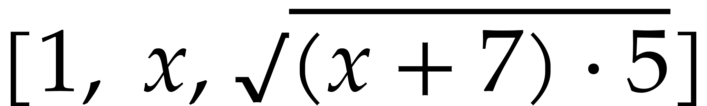.)

### [Ts-213](/ts-213/#344r.3) [344r\[3\]](https://cdn.wittgensteinnachlass.com/2000px/webp/Ts-213/344r.webp)

After all, the word “etc.” is nothing other than the _word_ “ _etc._” (i.e. again as a sign of the calculus, which can do no more than have meaning through the rules that _hold_ for it. Which can _say_ no more than it shows.) That is, there is no secret power in the word “etc.” by virtue of which the series is now continued without being continued.

### [Ts-213](/ts-213/#344r.4) [344r\[4\]](https://cdn.wittgensteinnachlass.com/2000px/webp/Ts-213/344r.webp)

Probably not, one will say, but it does have the meaning of _infinite continuation_.

### [Ts-213](/ts-213/#344r.5) [344r\[5\]](https://cdn.wittgensteinnachlass.com/2000px/webp/Ts-213/344r.webp)

But now one might ask: How is it that someone who now applies the general rule to a _further_ number is following only _this_ rule? That no further rule was needed to allow him to apply the general one to this case too; and yet this case was not mentioned in the (_general_) rule.

### [Ts-213](/ts-213/#344r.6+345r.1) [344r\[6\]](https://cdn.wittgensteinnachlass.com/2000px/webp/Ts-213/344r.webp),[345r\[1\]](https://cdn.wittgensteinnachlass.com/2000px/webp/Ts-213/345r.webp)

So what surprises us is that we cannot bridge this gulf between the individual numbers and the general proposition.

### [Ts-213](/ts-213/#345r.2) [345r\[2\]](https://cdn.wittgensteinnachlass.com/2000px/webp/Ts-213/345r.webp)

“Can one imagine an empty space?” (Curiously enough, this question belongs here.)

### [Ts-213](/ts-213/#345r.3) [345r\[3\]](https://cdn.wittgensteinnachlass.com/2000px/webp/Ts-213/345r.webp)

It is one of the most deeply rooted errors of philosophy: possibility as a shadow of reality. But on the other hand it cannot be an error. And it is not one if one calls the sentence this shadow.

### [Ts-213](/ts-213/#345r.4) [345r\[4\]](https://cdn.wittgensteinnachlass.com/2000px/webp/Ts-213/345r.webp)

The danger here, of course, is again that of falling into a _positivism_, namely one that deserves a name of its own and therefore _of course_ must be an error. For we must have no tendency at all, no particular conception of things, but must acknowledge everything anyone has ever said about them, except in so far as he himself had a particular conception or theory.

### [Ts-213](/ts-213/#345r.5) [345r\[5\]](https://cdn.wittgensteinnachlass.com/2000px/webp/Ts-213/345r.webp)

For the sign “etc.”, or a corresponding sign, is presumably essential for the designation of endlessness. Through the rules that hold for such a sign, of course. That is, we can no doubt distinguish the segment of a series “1, 1 + 1, 1 + 1 + 1” from the series “1, 1 + 1, 1 + 1 + 1, u.s.w.”. And the last sign and its use are just as essential to the calculus as _any one of the preceding signs_.

### [Ts-213](/ts-213/#345r.6) [345r\[6\]](https://cdn.wittgensteinnachlass.com/2000px/webp/Ts-213/345r.webp)

Now what troubles me is that “etc.” apparently has to occur in the rules for the sign “etc.” too. E.g. 1, 1 + 1, u.s.w. = 1, 1 + 1, 1 + 1 + 1, u.s.w. _etc._

### [Ts-213](/ts-213/#346r.1) [346r\[1\]](https://cdn.wittgensteinnachlass.com/2000px/webp/Ts-213/346r.webp)

But do we not have here the old insight that we can describe language only from the outside? That we must therefore not expect a description of language to take us to depths other _than those language itself reveals_: For we describe language by means of language.

### [Ts-213](/ts-213/#346r.2) [346r\[2\]](https://cdn.wittgensteinnachlass.com/2000px/webp/Ts-213/346r.webp)

We could say: There is really no reason to fear that we use the word “etc.” in a way that goes beyond the finite.

### [Ts-213](/ts-213/#346r.3) [346r\[3\]](https://cdn.wittgensteinnachlass.com/2000px/webp/Ts-213/346r.webp)

Besides, the part of the grammar of “etc.” that is characteristic of it cannot consist in rules for combining “etc.” with individual numerals (not: “_the_ individual numerals”) – for these rules in turn give an arbitrary segment of a series – but in rules for combining “etc.” with “etc.”.

### [Ts-213](/ts-213/#346r.4+347r.1) [346r\[4\]](https://cdn.wittgensteinnachlass.com/2000px/webp/Ts-213/346r.webp),[347r\[1\]](https://cdn.wittgensteinnachlass.com/2000px/webp/Ts-213/347r.webp)

The possibility of listing still further numbers. The difficulty seems to us to be that the numbers I have actually listed are by no means essential and nothing indicates that they are an _arbitrary_ collection _the ones among all the numbers that happen to have been written down_. (As if I had all the pieces of a game in a box and, on the table beside it, a chance selection from the box. Or as if some of the digits had been _traced over_ in ink, while all of them had, as it were, already been faintly drawn in.) But that apart from the ones we happen to have used, we have only the general form. Incidentally, do we not have here – odd as it sounds – the difference between numerals and numbers? If, for example, I say “I call everything that results from 1 by the continued addition of 1 ‘cardinal numbers’”, the word “continued” does not stand for a hazy continuation of 1, 1 + 1, 1 + 1 + 1; rather, the sign “1, 1 + 1, 1 + 1 + 1, …” too is to be taken quite exactly; as distinct from “1, 1 + 1, 1 + 1 + 1”, subject to other definite rules and not a substitute for a series “that cannot be written down”.

### [Ts-213](/ts-213/#347r.2) [347r\[2\]](https://cdn.wittgensteinnachlass.com/2000px/webp/Ts-213/347r.webp)

That is: One also _calculates_ with the sign “1, 1 + 1, 1 + 1 + 1, …” as with (the) numerals, only according to different rules.

### [Ts-213](/ts-213/#347r.3) [347r\[3\]](https://cdn.wittgensteinnachlass.com/2000px/webp/Ts-213/347r.webp)

But what is it, then, that one imagines? What mistake is one making? What does one take the sign “1, 1 + 1, …” for? That is: where does what one thinks one sees in this sign _actually_ occur? Perhaps when I say “he counted 1,2,3,4 and so on up to 1000”? where it would also be possible actually to write down all the numbers.

### [Ts-213](/ts-213/#347r.4) [347r\[4\]](https://cdn.wittgensteinnachlass.com/2000px/webp/Ts-213/347r.webp)

What does one _see_ “1, 1 + 1, 1 + 1 + 1, …” as, then? As an inexact form of expression. The little dots are like further numerals, only indistinct. As if one stopped writing down numerals because one cannot write them all down anyway, but as if they were indeed there, so to speak, in a box. Or again, as when I sing only the first notes of a tune distinctly and merely hint at the rest and let it trail off into nothing. (Or when, in writing a word, one writes only a few letters distinctly and ends with an unarticulated stroke.) _Where a ‘distinct’ would then correspond to the ‘indistinct’_.

### [Ts-213](/ts-213/#347r.5+348r.1) [347r\[5\]](https://cdn.wittgensteinnachlass.com/2000px/webp/Ts-213/347r.webp),[348r\[1\]](https://cdn.wittgensteinnachlass.com/2000px/webp/Ts-213/348r.webp)

I once said that there could not be numbers and the concept of number. And that is right if it means that the variable does not stand to a number as the concept apple stands to an apple (or the concept sword to Nothung). On the other hand, _the numerical variable is not a numeral_.

### [Ts-213](/ts-213/#348r.2) [348r\[2\]](https://cdn.wittgensteinnachlass.com/2000px/webp/Ts-213/348r.webp)

But I also wanted to say that the concept of number could not be (_given_) independently of the numbers, and that is not true. Rather, the numerical variable is independent of individual numbers in the sense that there is, no doubt, a calculus with a class of our numerals, which hold for ours, and without the general numerical variable. Of course, not all the rules that hold for our numerals then hold for these numerals, but they still correspond to ours as the pieces in draughts correspond to those in losing draughts.

### [Ts-213](/ts-213/#348r.3) [348r\[3\]](https://cdn.wittgensteinnachlass.com/2000px/webp/Ts-213/348r.webp)

What I resist is the view that an infinite series of numbers is something given to us, about which there are then particular numerical propositions and also general propositions about all the numbers in the series. So that the arithmetical calculus would not be complete if it did not also contain the general propositions about the cardinal numbers, namely general equations of the kind a + (b + c) = (a + b) + c. Whereas already 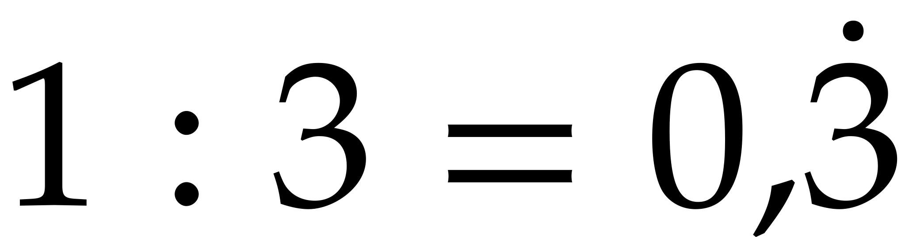 belongs to a different calculus from 1:3 = 0,3. And so a general rule for signs (e.g. a recursive definition) that holds for 1, (1) + 1, ((1) + 1) + 1, (((1) + 1) + 1) + 1, u.s.w. is something different from a particular definition. And the general rule adds something new to the numerical calculus, without which it would have been just as complete as the arithmetic of the number series 1, 2, 3, 4, 5.

### [Ts-213](/ts-213/#348r.4+349r.1) [348r\[4\]](https://cdn.wittgensteinnachlass.com/2000px/webp/Ts-213/348r.webp),[349r\[1\]](https://cdn.wittgensteinnachlass.com/2000px/webp/Ts-213/349r.webp)

There is also the question where exactly the concept of number (or the concept of cardinal number) is indispensable. Number, in contrast to what?

[1, x, x + 1] presumably in contrast to [5, x, √x] etc. – For if I actually introduce such a sign (as “[1, x, x + 1]”) – and do not just drag it around as a luxury, then I must also do something with it, i.e. use it in a calculus, and then it loses its supremacy and enters a system of signs on a par with it.

### [Ts-213](/ts-213/#349r.2) [349r\[2\]](https://cdn.wittgensteinnachlass.com/2000px/webp/Ts-213/349r.webp)

One might say: but surely ‘cardinal number’ contrasts with ‘rational number’, ‘real number’, etc. But this difference is a difference in the rules (in the rules of play that hold for them) – not one of position on the chessboard – not a difference for which one needs different words _on a par_ in the same calculus.

### [Ts-213](/ts-213/#349r.3) [349r\[3\]](https://cdn.wittgensteinnachlass.com/2000px/webp/Ts-213/349r.webp)

One says “this proposition has been proved for all cardinal numbers”. But let us just look at how the concept of cardinal number enters the proof. Only by way of the proof speaking of 1 and the operation x + 1 – but not in contrast to something that would correspond to the rational numbers. So if one describes the proof in prose with the aid of the concept-word ‘cardinal number’, we can presumably see that no _concept_ corresponds to this word.

### [Ts-213](/ts-213/#349r.4+350r.1) [349r\[4\]](https://cdn.wittgensteinnachlass.com/2000px/webp/Ts-213/349r.webp),[350r\[1\]](https://cdn.wittgensteinnachlass.com/2000px/webp/Ts-213/350r.webp)

The expressions “the cardinal numbers”, “the real numbers” are extraordinarily misleading, except where they are used as part of a specification, as in: “the cardinal numbers from 1 to 100”, etc. There are no “the cardinal numbers”, but only “cardinal numbers” and the concept, the form, ‘cardinal number’. Now one says: “the number of cardinal numbers is smaller than that of the real numbers” and imagines that one could, say, write the two series side by side (if we were not weak human beings) and that one would then end in the endless, while the other would run on beyond it into the truly infinite. But that is all nonsense. If there can be talk of a relation for which one can by analogy use the terms “greater” and “smaller”, it can only be between the forms ‘cardinal number’ and ‘real number’. I find out what a series is by having it explained to me, and only to the extent that it is explained. A finite series was explained to me by examples of the kind 1, 2, 3, 4, an endless one by signs of the kind “1, 2, 3, 4, u.s.w.” or “1, 2, 3, 4 …”.

### [Ts-213](/ts-213/#350r.2) [350r\[2\]](https://cdn.wittgensteinnachlass.com/2000px/webp/Ts-213/350r.webp)

It is important that I can understand (see) a rule of projection without having it before me in a general notation. I can gather a general rule from the series 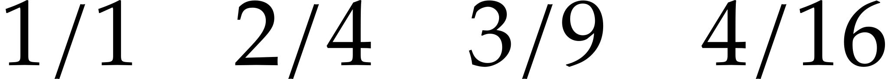 – of course any number of other ones too, _but still one definite rule as well_, and that means that for me this series was somehow the expression of this one rule.

### [Ts-213](/ts-213/#350r.3) [350r\[3\]](https://cdn.wittgensteinnachlass.com/2000px/webp/Ts-213/350r.webp)

If one has understood the law for forming a series “intuitively”, e.g. the series m, so that one is thus able to form any 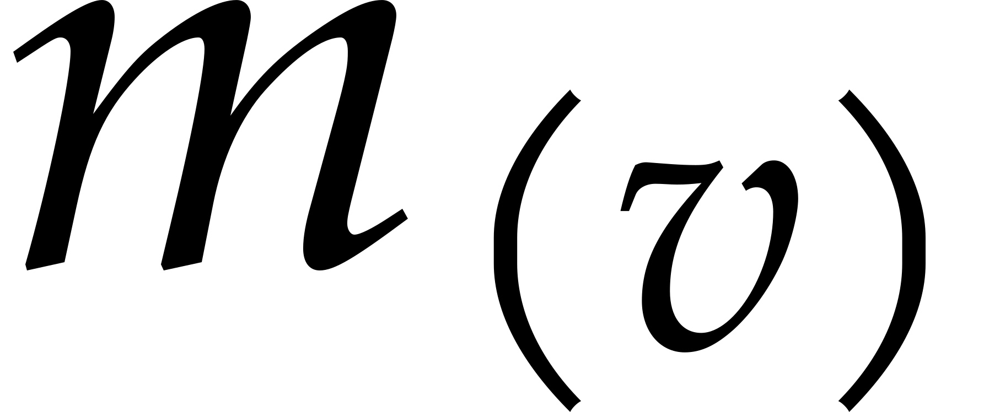, then one has understood the law of formation _completely_, that is, as well as an algebraic representation, say, could enable one to understand it. That is, one cannot come to understand it any better through such a representation. And so this representation is not any _more rigorous_ _in that respect_ either. Though of course it may be easier to remember.

### [Ts-213](/ts-213/#350r.4+351r.1) [350r\[4\]](https://cdn.wittgensteinnachlass.com/2000px/webp/Ts-213/350r.webp),[351r\[1\]](https://cdn.wittgensteinnachlass.com/2000px/webp/Ts-213/351r.webp)

One is inclined to believe that the notation that _represents_ a series by writing down a few terms with the sign “etc.” is essentially inexact. In contrast to specifying the general term. In saying this one forgets that the specification of the general term refers to a basic series that cannot in turn be described by a general term. Thus 2n + 1 is the general term of the odd numbers _if_ n runs through the cardinal numbers, but it would be nonsense to say that n was the general term of the series of cardinal numbers. If one wants to explain this series, one cannot do so by specifying the “general term n”, but of course only by an explanation of the kind 1, 1 + 1, 1 + 1 + 1, u.s.w.. And of course there is no essential difference between this series and the series: 1, 1 + 1 + 1, 1 + 1 + 1 + 1 + 1, u.s.w., which I could just as well have taken as the basic series (so that the general term of the series of cardinal numbers would then have _read_ ½ ∙ (n ‒ 1)).

### [Ts-213](/ts-213/#351r.2+352r.1) [351r\[2\]](https://cdn.wittgensteinnachlass.com/2000px/webp/Ts-213/351r.webp),[352r\[1\]](https://cdn.wittgensteinnachlass.com/2000px/webp/Ts-213/352r.webp)

(∃x)․fx & non (∃x,y)․fx & fy (∃x,y)․fx & fy․ & ․non (∃x,y,z)․fx & fy & fz (∃x,y,z)․fx & fy & fz․ & ․non (∃x,y,z,u)․fx & fy & fz & fu

““Now how would one go about writing the general form of such sentences? The question clearly makes good sense. For if I write down only a few such sentences as examples, one understands what is supposed to be _essential_ about them.”” Well then, the series of examples is already a notation; for understanding this series consists in using this symbol and in distinguishing it from others in the same system, e.g. from: (∃x)․fx (∃x,y,z)․fx & fy & fz (∃x,y,z,u,v)․fx & fy & fz & fu & fv.

But why should we not write the general term of the first series _like this_: 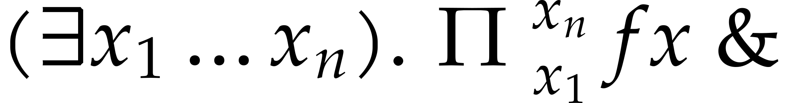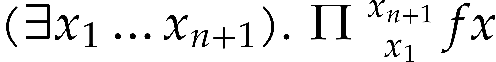? Is this notation inexact? The notation itself is not meant to picture anything; what matters is only the rules of its use, the system in which it is used. The scruples attaching to it stem from a line of thought concerned with the number of primitive signs in the calculus of ‘Principia Mathematica’.

### [Ts-213](/ts-213/#529r.1) [529r\[1\]](https://cdn.wittgensteinnachlass.com/2000px/webp/Ts-213/529r.webp)

11 _****Foundations of Mathematics**.**_

### [Ts-213](/ts-213/#530r.1) [530r\[1\]](https://cdn.wittgensteinnachlass.com/2000px/webp/Ts-213/530r.webp)

_**Mathematics Compared with a Game.**_

### [Ts-213](/ts-213/#530r.2) [530r\[2\]](https://cdn.wittgensteinnachlass.com/2000px/webp/Ts-213/530r.webp)

What is one denying mathematics when one says it is only a game (or: it is a game)?

### [Ts-213](/ts-213/#530r.3) [530r\[3\]](https://cdn.wittgensteinnachlass.com/2000px/webp/Ts-213/530r.webp)

A game, as opposed to what? – What is one attributing to mathematics when one says that its sentences have sense?

### [Ts-213](/ts-213/#530r.4) [530r\[4\]](https://cdn.wittgensteinnachlass.com/2000px/webp/Ts-213/530r.webp)

The sense outside the sentence. And what does that have to do with us? Where does it show itself and what can we do with it? (A sentence answers the question “what is the sense of this sentence?”) (“But surely the mathematical sentence expresses a thought” – What thought? –)

### [Ts-213](/ts-213/#530r.5+531r.1) [530r\[5\]](https://cdn.wittgensteinnachlass.com/2000px/webp/Ts-213/530r.webp),[531r\[1\]](https://cdn.wittgensteinnachlass.com/2000px/webp/Ts-213/531r.webp)

Can it be expressed by another sentence? or only by _this_ sentence? – Or not at all? In _this_ case it is no concern of ours. Does one perhaps want to distinguish mathematical sentences in this way from other formations, hypotheses, etc.? One is right to do so, and there is, of course, no doubt that this distinction exists.

### [Ts-213](/ts-213/#531r.2) [531r\[2\]](https://cdn.wittgensteinnachlass.com/2000px/webp/Ts-213/531r.webp)

If one means that mathematics is played like chess, or a game of patience, and that there is such a thing as winning or as the game coming out, then that is plainly incorrect.

### [Ts-213](/ts-213/#531r.3) [531r\[3\]](https://cdn.wittgensteinnachlass.com/2000px/webp/Ts-213/531r.webp)

If one says that the mental processes that accompany the use of mathematical symbols are different from those that accompany playing chess, I do not know what to say about that.

### [Ts-213](/ts-213/#531r.4) [531r\[4\]](https://cdn.wittgensteinnachlass.com/2000px/webp/Ts-213/531r.webp)

In chess, too, there are some configurations that are impossible even though each piece occupies a position permitted to it. (For example, when the pawns are still in their starting positions and a bishop is already out.) But one could imagine a game in which the number of moves from the start of the game was recorded, and then _there would be a case_ in which this configuration could not occur after n moves, and yet one cannot tell straight off by looking at the configuration whether it is possible as the nth or not.

### [Ts-213](/ts-213/#531r.5) [531r\[5\]](https://cdn.wittgensteinnachlass.com/2000px/webp/Ts-213/531r.webp)

The actions in the game must correspond to the actions in calculating. (I mean: this is what the correspondence must consist in, or, this is how the two must be matched with one another.)

### [Ts-213](/ts-213/#531r.6+532r.1) [531r\[6\]](https://cdn.wittgensteinnachlass.com/2000px/webp/Ts-213/531r.webp),[532r\[1\]](https://cdn.wittgensteinnachlass.com/2000px/webp/Ts-213/532r.webp)

Is mathematics about signs? No more than chess is about wooden pieces. When we talk about the sense of mathematical sentences, or about what they are about, we are using a false picture. For here too it is as though inessential, arbitrary signs had what is essential – namely the sense – in common. Because grammar is a calculus and hence is essentially not about anything, there is no metamathematics.

### [Ts-213](/ts-213/#532r.2) [532r\[2\]](https://cdn.wittgensteinnachlass.com/2000px/webp/Ts-213/532r.webp)

How is a chess exercise (a chess problem) related to a game of chess? – For it is clear that a chess exercise corresponds to an exercise in calculation, is an exercise in calculation.

### [Ts-213](/ts-213/#532r.3) [532r\[3\]](https://cdn.wittgensteinnachlass.com/2000px/webp/Ts-213/532r.webp)

An arithmetical game would be, for example, the following: We write down a four-digit number at random, say 7368; one is to get as close as possible to this number by multiplying the numbers 7, 3, 6 and 8 together in any order. The players calculate with pencil and paper, and whoever comes closest to the number 7368 in the fewest operations wins. (Incidentally, a great many mathematical puzzles can be turned into games of this sort.)

### [Ts-213](/ts-213/#532r.4) [532r\[4\]](https://cdn.wittgensteinnachlass.com/2000px/webp/Ts-213/532r.webp)

Suppose someone had been taught arithmetic only for use in an arithmetical game. Would he have learnt anything different from someone who learns arithmetic for normal use? And if he now multiplies 21 by 8 in the game and gets 168, is he doing something different from someone who wanted to find out what 21 × 8 is?

### [Ts-213](/ts-213/#532r.5) [532r\[5\]](https://cdn.wittgensteinnachlass.com/2000px/webp/Ts-213/532r.webp)

One will say: One of them wanted to find a truth, after all, whereas the other wanted nothing of the kind.

### [Ts-213](/ts-213/#532r.6+533r.1) [532r\[6\]](https://cdn.wittgensteinnachlass.com/2000px/webp/Ts-213/532r.webp),[533r\[1\]](https://cdn.wittgensteinnachlass.com/2000px/webp/Ts-213/533r.webp)

Now one might want to compare this case, say, with that of a game of tennis, in which the player makes a particular movement, the ball then travels in a particular way, and one can take this stroke as an experiment by which one has learnt a particular truth, or else as a move in the game with the sole aim of winning it. But this comparison would not be right, for we do not see the chess move as an experiment (though we could do that _too_), but as an action in a calculation.

### [Ts-213](/ts-213/#533r.2) [533r\[2\]](https://cdn.wittgensteinnachlass.com/2000px/webp/Ts-213/533r.webp)

Someone might perhaps say: In the arithmetical game we shall indeed multiply 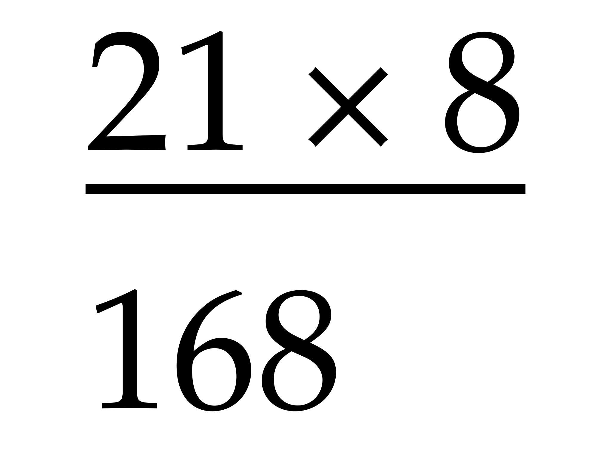, but the equation 21 × 8 = 168 will not occur in the game. But is that not a superficial difference? and why should we not also multiply (and certainly divide) in such a way that the equation is written down as such?

### [Ts-213](/ts-213/#533r.3) [533r\[3\]](https://cdn.wittgensteinnachlass.com/2000px/webp/Ts-213/533r.webp)

So one can only object that in the game the equation is not a proposition. But what does that mean? What, then, makes it a proposition? What still has to be added for it to become a proposition? – Is it not a question of the application of the equation (or of the multiplication)? – And presumably it is mathematics when it is used to pass from one proposition to another. And so the distinguishing feature between mathematics and a game would be tied to the concept of a proposition (not of a ‘mathematical proposition’), and hence loses its immediate relevance for us.

### [Ts-213](/ts-213/#533r.4+534r.1) [533r\[4\]](https://cdn.wittgensteinnachlass.com/2000px/webp/Ts-213/533r.webp),[534r\[1\]](https://cdn.wittgensteinnachlass.com/2000px/webp/Ts-213/534r.webp)

But one might say that the real difference is that there is no place for affirmation and negation in the game. One multiplies in it, for example, and 21 × 8 = 148 would be an incorrect move, but “non (21 × 8 = 148)”, which is a correct arithmetical proposition, would have no place in our game.

### [Ts-213](/ts-213/#534r.2) [534r\[2\]](https://cdn.wittgensteinnachlass.com/2000px/webp/Ts-213/534r.webp)

(Here one might recall that at primary school one never works with inequalities; the child is required only to carry out the multiplication correctly and never – or very rarely – to state an inequality.)

### [Ts-213](/ts-213/#534r.3) [534r\[3\]](https://cdn.wittgensteinnachlass.com/2000px/webp/Ts-213/534r.webp)

When I work out 21 × 8 in our game, and when I do so in order to solve a practical problem, at any rate the act of calculation is the same in both cases (and room could be made for inequalities in a game too). On the other hand, the rest of my behaviour with respect to the calculation is certainly different in the two cases. Now the question is: can one say of the person who has arrived at the position “21 × 8 = 168” in the game that he has found out that 21 × 8 is 168? And what is he lacking for that? I think nothing is lacking, unless it is an application of the calculation.

### [Ts-213](/ts-213/#534r.4) [534r\[4\]](https://cdn.wittgensteinnachlass.com/2000px/webp/Ts-213/534r.webp)

To call arithmetic a game is just as wrong as to call moving chess pieces about (in accordance with the rules of chess) a game; for that can also be a calculation.

### [Ts-213](/ts-213/#534r.5+535r.1) [534r\[5\]](https://cdn.wittgensteinnachlass.com/2000px/webp/Ts-213/534r.webp),[535r\[1\]](https://cdn.wittgensteinnachlass.com/2000px/webp/Ts-213/535r.webp)

So one would have to say: No, the word “arithmetic” is not the name of a game. (This is, of course, a triviality again.) – But the meaning of the word “arithmetic” can be explained by the relation of arithmetic to an arithmetical game, or also by the relation of a chess problem to the game of chess. Here, however, it is _essential_ to recognize that this relation is not that of a tennis problem to the game of tennis. By “tennis problem” I mean, for example, the task of returning a ball in a particular direction under given circumstances. (A clearer case, perhaps, would be a billiards problem.) The billiards problem is not a mathematical problem (though mathematics can be applied in solving it). The billiards problem is a problem in physics and hence a “problem” in the sense of physics; the chess problem is a mathematical problem and hence a “problem” in a different (the mathematical) sense.

### [Ts-213](/ts-213/#535r.2) [535r\[2\]](https://cdn.wittgensteinnachlass.com/2000px/webp/Ts-213/535r.webp)

In the struggle between “formalism” and “contentual mathematics”, – what does each side actually assert? This dispute is so like the one between realism and idealism! In this, for example: that it will soon be (have become) obsolete and that both sides, contrary to their daily practice, make unjust assertions.

### [Ts-213](/ts-213/#535r.3) [535r\[3\]](https://cdn.wittgensteinnachlass.com/2000px/webp/Ts-213/535r.webp)

Arithmetic _is_ not a game; it would never have occurred to anyone to list arithmetic among the games people play.

### [Ts-213](/ts-213/#535r.4) [535r\[4\]](https://cdn.wittgensteinnachlass.com/2000px/webp/Ts-213/535r.webp)

What, then, does winning and losing a game consist in (or a game of patience coming out)? Obviously not in the configuration that produces a win, for example. Who wins has to be determined by a separate rule. (“Draughts” and “losing draughts” differ only in this rule.)

### [Ts-213](/ts-213/#536r.1) [536r\[1\]](https://cdn.wittgensteinnachlass.com/2000px/webp/Ts-213/536r.webp)

Does the rule that says “whoever gets his pieces into the other player’s territory first has won” state anything? How could that be verified? How do I know whether someone has won? By the fact that he is pleased, perhaps? Presumably this rule says: You must try to get your pieces as quickly as possible etc. In this form the rule already connects the game with life. And one could imagine that in a primary school where playing chess was a compulsory subject, the teacher’s reaction to a pupil’s playing badly would be the same as to an exercise in calculation done incorrectly.

### [Ts-213](/ts-213/#536r.2) [536r\[2\]](https://cdn.wittgensteinnachlass.com/2000px/webp/Ts-213/536r.webp)

I am almost inclined to say: In a game there is (_admittedly_) no “true” and “false”, but then in arithmetic there is no “winning” and “losing”.

### [Ts-213](/ts-213/#536r.3) [536r\[3\]](https://cdn.wittgensteinnachlass.com/2000px/webp/Ts-213/536r.webp)

I once said that it was conceivable for wars to be fought out on a sort of large chessboard according to the rules of chess. But: if it really did go solely by the rules of chess, then one would not need a battlefield for this war; it could be played on an ordinary board. And then it would (of course) not be a war in the _ordinary_ sense. But one could also imagine a battle governed by the rules of chess. In such a way, for example, that the “bishop” would be allowed to fight the “queen” only if his position relative to her would allow him to “take” her in chess.

### [Ts-213](/ts-213/#536r.4+537r.1) [536r\[4\]](https://cdn.wittgensteinnachlass.com/2000px/webp/Ts-213/536r.webp),[537r\[1\]](https://cdn.wittgensteinnachlass.com/2000px/webp/Ts-213/537r.webp)

Could one imagine a game of chess being played, i.e. imagine all the moves in the game being carried out, but _in a different setting_, so that we would not call this proceeding an instance of playing a game? Certainly, it could, after all, be a _problem_ that the two of them are solving together. (And it is easy, in light of the foregoing, to construct a case in which such a problem would be useful.)

### [Ts-213](/ts-213/#537r.2) [537r\[2\]](https://cdn.wittgensteinnachlass.com/2000px/webp/Ts-213/537r.webp)

The rule about winning and losing really only distinguishes two poles. What (then) becomes of the person who wins (or loses) is really no concern of the rule’s. Whether, for example, the loser then has to pay something. (And it seems to us, after all, that the situation is similar with “correct” and “incorrect” in calculation.)

### [Ts-213](/ts-213/#537r.3+538r.1) [537r\[3\]](https://cdn.wittgensteinnachlass.com/2000px/webp/Ts-213/537r.webp),[538r\[1\]](https://cdn.wittgensteinnachlass.com/2000px/webp/Ts-213/538r.webp)

What happened in the dispute over the nature of definition happens time and again in logic. If one says that definition has to do only with signs and merely replaces a complicated sign with a simpler one, people object and say that definition does not _only_ do that, or that there are, after all, different kinds of definition and the interesting and important one is not the (_pure_) “verbal definition”. For they believe that one deprives definition of its meaning, its importance, if one presents it as a mere rule of substitution that deals with signs. Whereas the _meaning_ of definition lies in its application, in its importance in life, as it were. And that is just what is going on (_today_) in the dispute between formalism, intuitionism, etc. People find it impossible to distinguish the importance of a _thing_, its consequences, its application, from the thing itself; the description of a thing from the description of its importance. Time and again we hear (in this way) that the mathematician works by instinct (_or, say_, that he does not _proceed_ mechanically in the manner of a chess player), but we do not learn what this is supposed to have to do with the nature of mathematics. And if such a mental phenomenon plays a role in mathematics, how far we can speak exactly about mathematics at all, and how far we can do so only with the kind of indeterminacy with which we have to speak about instincts, etc.

### [Ts-213](/ts-213/#538r.2) [538r\[2\]](https://cdn.wittgensteinnachlass.com/2000px/webp/Ts-213/538r.webp)

Time and again I want to say: _I_ check the mathematicians’ _ledgers_; the mental processes of the proprietors, important though they are, do not concern me.

### [Ts-213](/ts-213/#539r.1) [539r\[1\]](https://cdn.wittgensteinnachlass.com/2000px/webp/Ts-213/539r.webp)

12 _There Is No Metamathematics._

### [Ts-213](/ts-213/#539r.2) [539r\[2\]](https://cdn.wittgensteinnachlass.com/2000px/webp/Ts-213/539r.webp)

No calculus can settle a philosophical problem. A calculus cannot give us any fundamental insights into mathematics.

### [Ts-213](/ts-213/#539r.3) [539r\[3\]](https://cdn.wittgensteinnachlass.com/2000px/webp/Ts-213/539r.webp)

So there can be no “leading problems” of mathematical logic either, for these would be problems whose solution would at last entitle us to do arithmetic as we do.

### [Ts-213](/ts-213/#539r.4) [539r\[4\]](https://cdn.wittgensteinnachlass.com/2000px/webp/Ts-213/539r.webp)

And for that we cannot wait for the stroke of luck of a mathematical problem being solved.

### [Ts-213](/ts-213/#539r.5+540r.1) [539r\[5\]](https://cdn.wittgensteinnachlass.com/2000px/webp/Ts-213/539r.webp),[540r\[1\]](https://cdn.wittgensteinnachlass.com/2000px/webp/Ts-213/540r.webp)

I said above “calculus is not a mathematical concept”; that is, the word ‘calculus’ is not a _chess piece_ of mathematics. It need not occur in mathematics. – And if it is used in a calculus all the same, that calculus is not thereby a metacalculus. Rather, _this word_ is then once again only a chess piece like all the others. Logic, too, is not metamathematics, i.e. even operations of the logical calculus cannot bring to light essential truths _about_ mathematics. See in this connection the “decision problem” and the like in modern mathematical logic.

### [Ts-213](/ts-213/#540r.2) [540r\[2\]](https://cdn.wittgensteinnachlass.com/2000px/webp/Ts-213/540r.webp)

Through Russell, but especially through Whitehead, a pseudo-exactness has entered philosophy, and that pseudo-exactness is the worst enemy of real exactness. At the root of this lies the mistake of thinking that a calculus can be the metamathematical foundation of mathematics.

### [Ts-213](/ts-213/#540r.3) [540r\[3\]](https://cdn.wittgensteinnachlass.com/2000px/webp/Ts-213/540r.webp)

Number is by no means a “fundamental mathematical concept”. There are so many calculi in which there is no mention of numbers. And as far as arithmetic is concerned, what we are still willing to call numbers is more or less arbitrary. Beyond that, the calculus of, for example, cardinal numbers is to be described, i.e. its rules are to be stated, and with that the foundations of arithmetic are given.

### [Ts-213](/ts-213/#540r.4) [540r\[4\]](https://cdn.wittgensteinnachlass.com/2000px/webp/Ts-213/540r.webp)

Teach it to us, and you have laid its foundations.

### [Ts-213](/ts-213/#540r.5) [540r\[5\]](https://cdn.wittgensteinnachlass.com/2000px/webp/Ts-213/540r.webp)

Hilbert puts forward the rules of a particular calculus as rules of a metamathematics.

### [Ts-213](/ts-213/#540r.6+541r.1) [540r\[6\]](https://cdn.wittgensteinnachlass.com/2000px/webp/Ts-213/540r.webp),[541r\[1\]](https://cdn.wittgensteinnachlass.com/2000px/webp/Ts-213/541r.webp)

There is a difference between a system _resting_ on first principles and its merely being developed from them as a starting point. There is a difference between its resting on its lowest walls like a house and its _floating_ freely in space like, say, a celestial body, with our merely having started building at the bottom, though we could have done so somewhere else.

### [Ts-213](/ts-213/#541r.2) [541r\[2\]](https://cdn.wittgensteinnachlass.com/2000px/webp/Ts-213/541r.webp)

Logic and mathematics do not _rest_ on axioms, any more than a group rests on the elements and operations that define it. _Here lies the mistake_ in taking the obviousness, the self-evidence, of the fundamental laws as a criterion of correctness in logic. A foundation that stands on nothing is a poor foundation.

### [Ts-213](/ts-213/#541r.3) [541r\[3\]](https://cdn.wittgensteinnachlass.com/2000px/webp/Ts-213/541r.webp)

(p & q) ⌵ (p & ~q) ⌵ (~p & q) ⌵ (~p & ~q): This becomes my tautology, and then I would say only that every “proposition of logic” can be brought into this form according to certain rules. But that amounts to saying that it can be derived from it; and here we would have arrived at Russell’s manner of demonstration, and all we add is that this initial form is not itself an independent proposition and that this and all other “laws of logic” have the property p & Log = p, p ⌵ Log = Log.

### [Ts-213](/ts-213/#541r.4) [541r\[4\]](https://cdn.wittgensteinnachlass.com/2000px/webp/Ts-213/541r.webp)

The essence of a “logical law” is, after all, that its product with any proposition yields that proposition. And one could also begin Russell’s calculus with explanations of the sort:

p⊃p : q = q

p : p⌵q = p etc.

### [Ts-213](/ts-213/#542r.1) [542r\[1\]](https://cdn.wittgensteinnachlass.com/2000px/webp/Ts-213/542r.webp)

13 _**Proof of Relevance**_

### [Ts-213](/ts-213/#542r.2) [542r\[2\]](https://cdn.wittgensteinnachlass.com/2000px/webp/Ts-213/542r.webp)

When one proves solvability, the concept ‘solution’ must be present somehow in the proof. (Something in the mechanism of the proof must correspond to this concept.) But this concept is not to be represented by an external description; it must now actually be exhibited.

### [Ts-213](/ts-213/#542r.3) [542r\[3\]](https://cdn.wittgensteinnachlass.com/2000px/webp/Ts-213/542r.webp)

The proof of the provability of a proposition would be the proof of the proposition itself. There is, on the other hand, something we might call the proof of relevance. That would be, for example, the proof that convinces me that I _can_ check the equation 17 × 38 = 456 even before I have done so. Now how do I recognize that I can check 17 × 38 = 456, whereas when I see an integral expression I may not know whether I can check it? Apparently I recognize that it is constructed according to a certain rule, and also how the rule for solving the problem _attaches_ to this way of constructing the sentence. The proof of relevance might then be a representation of the general form of the method of solution, say for multiplication problems, which makes it possible to recognize the general form of the sentences that the method enables us to check. I can then say that I recognize that this method checks this equation too, though I have not yet carried out the check.

### [Ts-213](/ts-213/#542r.4+543r.1) [542r\[4\]](https://cdn.wittgensteinnachlass.com/2000px/webp/Ts-213/542r.webp),[543r\[1\]](https://cdn.wittgensteinnachlass.com/2000px/webp/Ts-213/543r.webp)

When proofs of relevance (and similar things in mathematics) are spoken of, it is always as though, apart from the individual series of operations we call proofs of relevance, we also had a perfectly sharp, comprehensive concept of such a proof, or indeed of a mathematical proof at all. Whereas in reality this word, in turn, is used in many more or less related meanings. (Like the words “people”, “king”, “religion”, etc.; see Spengler.) Let us just think of the part an example plays in the explanation of such a word. For if I want to explain what I understand by “proof”, I shall have to point to examples of proofs, just as in explaining the word “apple” I shall point to apples. Now the explanation of the word “proof” is like that of the word “number”: I can explain the word “cardinal number” by pointing to examples of cardinal numbers; indeed, I can actually use the sign “1, 2, 3, u.s.w. ad inf.” for this word. On the other hand, I can explain the word “number” by pointing to different kinds of number; but in doing so I shall not define the concept “number” as sharply as I did that of cardinal number, unless I mean to say that only those constructions we now designate as numbers constitute the concept “number”. But then one cannot say of any new construction that it is the construction of a kind of number. Yet we want to use the word “proof” in such a way that it is not simply defined by a disjunction of proofs customary just now, but to use it in cases of which today we “cannot yet form any idea at all”. In so far as the concept of proof is _sharply_ defined, it is defined by individual proofs or by series of proofs (analogous to series of numbers), and we must bear that in mind when we set out to speak with complete exactness about proofs of relevance, of consistency, etc. etc.

### [Ts-213](/ts-213/#543r.2+544r.1) [543r\[2\]](https://cdn.wittgensteinnachlass.com/2000px/webp/Ts-213/543r.webp),[544r\[1\]](https://cdn.wittgensteinnachlass.com/2000px/webp/Ts-213/544r.webp)

One can say: A proof of relevance will _alter_ the calculus of the proposition to which it refers. It cannot _justify_ a calculus with this proposition; in the sense in which carrying out the multiplication 17 × 23 justifies writing down the equation 17 × 23 = 391. We would simply have to give the word “justify” that meaning explicitly. But then one must not believe that, without this justification, mathematics is inadmissible or tainted with fraud in some more general and generally established sense. (It would be as though someone were to say: “the use of the word ‘heap of stones’ is really inadmissible until we have officially laid down how many stones make a heap”. Such a stipulation would modify the use of the word “heap”, but would not ‘justify’ it in any generally recognized sense. And if such an official definition were given, it would not thereby mark the use one had previously made of the word as _incorrect_.)

### [Ts-213](/ts-213/#544r.2) [544r\[2\]](https://cdn.wittgensteinnachlass.com/2000px/webp/Ts-213/544r.webp)

The proof that 17 × 23 = 391 can be checked is a ‘proof’ in a different sense of the word from the proof of the equation itself. (The miller mills, the painter paints: both …) We _see_ from the proof of the equation that it can be checked, in much the same way as we see from the figure that the sentence “the points A and B are not separated by a turn of the spiral” can be checked.

And one can already see that the sentence which states the checkability is a ‘sentence’ in a different sense from the sentence whose checkability is asserted. And here again all one can say is: Look at the proof, and then you will see _what_ is proved here, what is called “the sentence proved”.

### [Ts-213](/ts-213/#544r.3+545r.1) [544r\[3\]](https://cdn.wittgensteinnachlass.com/2000px/webp/Ts-213/544r.webp),[545r\[1\]](https://cdn.wittgensteinnachlass.com/2000px/webp/Ts-213/545r.webp)

Can one say that we need a fresh intuition for every step of a proof? (Individuality of numbers.) It would be something like this: If I am given a general (variable) rule, I must recognize afresh each time that this rule can be applied _here_ too (that it holds in _this_ case too). No act of foresight can spare me this act of _insight_. For in fact at each new step the form to which the rule is applied is a new one. – But what is at issue here is not an act of _insight_, but an act of _decision_.

### [Ts-213](/ts-213/#545r.2) [545r\[2\]](https://cdn.wittgensteinnachlass.com/2000px/webp/Ts-213/545r.webp)

The so-called proof of relevance does not climb the ladder to _its_ proposition, for to do that one _must_ take every step; it shows only that the ladder leads in the direction of that proposition. (In logic there is no substitute.) Nor is the arrow that points in the direction a substitute for going through all the steps to the specified goal.

### [Ts-213](/ts-213/#546r.1) [546r\[1\]](https://cdn.wittgensteinnachlass.com/2000px/webp/Ts-213/546r.webp)

14 _**Proof of Consistency**_

### [Ts-213](/ts-213/#546r.2) [546r\[2\]](https://cdn.wittgensteinnachlass.com/2000px/webp/Ts-213/546r.webp)

Something tells me: really, a contradiction in the axioms of a system should do no harm until it comes to light. One imagines a hidden contradiction as a hidden illness that does harm although (and perhaps precisely because) it does not show itself clearly to us. But two rules of a game that contradict one another in a particular case are perfectly in order until that case arises, and only then does a further rule become necessary to decide between them.

### [Ts-213](/ts-213/#546r.3) [546r\[3\]](https://cdn.wittgensteinnachlass.com/2000px/webp/Ts-213/546r.webp)

The proof of the consistency of the axioms, about which mathematicians make such a fuss today. I have the feeling: if there were a contradiction in the axioms of a system, it would not be such a great disaster at all. Nothing easier than to remove it.

### [Ts-213](/ts-213/#546r.4+547r.1) [546r\[4\]](https://cdn.wittgensteinnachlass.com/2000px/webp/Ts-213/546r.webp),[547r\[1\]](https://cdn.wittgensteinnachlass.com/2000px/webp/Ts-213/547r.webp)

“One must not use a system of axioms before its consistency has been demonstrated.” “There must be no contradictions in the rules of a game”. Why not? “Because then one would not know how to play”? But how does it come about that one reacts to the contradiction with doubt? One does not react to the contradiction at all. One could only say: If that is really what is meant (if the contradiction is _meant_ to be here), then I don’t understand it. _Or_: I haven’t learnt it. I don’t understand the signs. I haven’t learnt what I am to do in response, whether it is an order at all; etc..

### [Ts-213](/ts-213/#547r.2) [547r\[2\]](https://cdn.wittgensteinnachlass.com/2000px/webp/Ts-213/547r.webp)

What if, for example, one wanted to add the equation 2 × 2 = 5 to the usual _axioms_ of arithmetic? That would of course mean that the equals sign had now changed its meaning, i.e., that different rules now held for the equals sign.

### [Ts-213](/ts-213/#547r.3) [547r\[3\]](https://cdn.wittgensteinnachlass.com/2000px/webp/Ts-213/547r.webp)

Now if I said: “so I cannot use it as a substitution sign”; that would mean that _its_ grammar no longer accords with that of the word “substitute” (“substitution sign”, etc.). For the word “can” in this sentence does not indicate a physical (physiological) or _psychological_ possibility.

### [Ts-213](/ts-213/#547r.4) [547r\[4\]](https://cdn.wittgensteinnachlass.com/2000px/webp/Ts-213/547r.webp)

“The rules must not contradict one another”, that is like: “negation must not yield a negation when doubled”. For it is part of the grammar of the word “rule” that “p & non-p” (if “p” is a rule) is not a rule.

### [Ts-213](/ts-213/#547r.5+548r.1) [547r\[5\]](https://cdn.wittgensteinnachlass.com/2000px/webp/Ts-213/547r.webp),[548r\[1\]](https://cdn.wittgensteinnachlass.com/2000px/webp/Ts-213/548r.webp)

That is, one could _also_ say: the rules can contradict one another if different rules hold for the word “rule” – if the word “rule” has a different meaning.

### [Ts-213](/ts-213/#548r.2) [548r\[2\]](https://cdn.wittgensteinnachlass.com/2000px/webp/Ts-213/548r.webp)

Here too we cannot give a justification (except (_say_) biologically or historically) and (_can_) only describe how the word “rule” is used.

### [Ts-213](/ts-213/#548r.3) [548r\[3\]](https://cdn.wittgensteinnachlass.com/2000px/webp/Ts-213/548r.webp)

It cannot be shown, proved, that one _can_ use certain rules as rules of this action. Except by showing that the grammar of the _designation_ of the action accords with that of those rules.

### [Ts-213](/ts-213/#548r.4) [548r\[4\]](https://cdn.wittgensteinnachlass.com/2000px/webp/Ts-213/548r.webp)

“There _must_ be no contradiction in the rules” sounds like a prescription: “in a clock the hand must not sit loose on its shaft”. One then expects a justification: because otherwise … In the first case, however, the only justification would be: because otherwise it is not a list of rules. Once again, it is a case of grammatical _structure_, which cannot be justified logically.

### [Ts-213](/ts-213/#548r.5+549r.1) [548r\[5\]](https://cdn.wittgensteinnachlass.com/2000px/webp/Ts-213/548r.webp),[549r\[1\]](https://cdn.wittgensteinnachlass.com/2000px/webp/Ts-213/549r.webp)

On the indirect proof that a straight line has only _one_ continuation beyond a point: We assumed that a straight line could have two continuations. – If we assume this, the assumption must have a sense –. But what does it mean to assume this? It does not mean making an assumption that is false as a matter of natural history, such as that a lion has two tails. – It does not mean assuming something that _runs counter_ to the statement of a fact. Rather, it means adopting a rule; and there is nothing further to be said against it, except perhaps that it contradicts another and that I therefore drop it. Now if a straight line that forks is drawn in the proof, that must not be absurd in and of itself, and all I can say is: I don’t call that a straight line.

### [Ts-213](/ts-213/#549r.2) [549r\[2\]](https://cdn.wittgensteinnachlass.com/2000px/webp/Ts-213/549r.webp)

If a contradiction is found later, then the rules were not yet clear and unambiguous before. So the contradiction does no harm, for it can then be removed by stating a rule.

### [Ts-213](/ts-213/#549r.3) [549r\[3\]](https://cdn.wittgensteinnachlass.com/2000px/webp/Ts-213/549r.webp)

In a completely clarified system with a clear grammar there is no hidden contradiction, for there the rule by which a contradiction is to be found must be given. The contradiction can be hidden only in the sense that it is concealed, as it were, in the “jumble” of the rules, in the disordered part of the grammar; but that does no harm, since it can be removed by putting the grammar in order.

### [Ts-213](/ts-213/#549r.4) [549r\[4\]](https://cdn.wittgensteinnachlass.com/2000px/webp/Ts-213/549r.webp)

Why must rules not contradict one another? Because otherwise they would not be rules.

### [Ts-213](/ts-213/#550r.1) [550r\[1\]](https://cdn.wittgensteinnachlass.com/2000px/webp/Ts-213/550r.webp)

15 _The Justification of Arithmetic, in the Course of Which Arithmetic Is Prepared for Its Applications. (Russell, Ramsey.)_

### [Ts-213](/ts-213/#550r.2) [550r\[2\]](https://cdn.wittgensteinnachlass.com/2000px/webp/Ts-213/550r.webp)

One always feels reluctant to justify arithmetic by saying something about its application. It seems to be firmly enough grounded in itself. And this is, of course, because arithmetic is its own application.

### [Ts-213](/ts-213/#550r.3) [550r\[3\]](https://cdn.wittgensteinnachlass.com/2000px/webp/Ts-213/550r.webp)

One could say: Why restrict the application of arithmetic? It takes care of itself. (I can make a knife without regard to the class of materials I shall have someone cut with it; that will become clear in due course.) For what tells against delimiting the field of application is the feeling that we can understand arithmetic without having such a field in view. Or let us put it this way: instinct balks at anything that is not simply an analysis of the thoughts already there.

### [Ts-213](/ts-213/#550r.4+551r.1) [550r\[4\]](https://cdn.wittgensteinnachlass.com/2000px/webp/Ts-213/550r.webp),[551r\[1\]](https://cdn.wittgensteinnachlass.com/2000px/webp/Ts-213/551r.webp)

One could say: Arithmetic is a kind of geometry; i.e., what constructions on paper are in geometry, calculations (on paper) are in arithmetic. – One could say it is a more general geometry.

### [Ts-213](/ts-213/#551r.2) [551r\[2\]](https://cdn.wittgensteinnachlass.com/2000px/webp/Ts-213/551r.webp)

The question is always whether and how it is possible to represent the most general form of the application of arithmetic. And the strange thing here is precisely that in a certain sense this does not seem necessary. And if it really is not necessary, then it is also impossible.

### [Ts-213](/ts-213/#551r.3) [551r\[3\]](https://cdn.wittgensteinnachlass.com/2000px/webp/Ts-213/551r.webp)

For it seems that the general form of its application is represented by saying _nothing_ about it. (And if that is a possible representation, then it is also the _only_ correct one.)

### [Ts-213](/ts-213/#551r.4) [551r\[4\]](https://cdn.wittgensteinnachlass.com/2000px/webp/Ts-213/551r.webp)

The sense of the remark that arithmetic is a kind of geometry is precisely that arithmetical constructions are autonomous, like geometrical constructions, and hence, so to speak, guarantee their own applicability. For it must be possible to say of geometry too that it is its own application.

### [Ts-213](/ts-213/#551r.5) [551r\[5\]](https://cdn.wittgensteinnachlass.com/2000px/webp/Ts-213/551r.webp)

(In the sense in which we speak of possible and actually drawn straight lines, we could also speak of possible and actually represented numbers.)

### [Ts-213](/ts-213/#551r.6) [551r\[6\]](https://cdn.wittgensteinnachlass.com/2000px/webp/Ts-213/551r.webp)

 This is an arithmetical construction and, in a _somewhat_ wider sense, a geometrical one too.

### [Ts-213](/ts-213/#551r.7+552r.1) [551r\[7\]](https://cdn.wittgensteinnachlass.com/2000px/webp/Ts-213/551r.webp),[552r\[1\]](https://cdn.wittgensteinnachlass.com/2000px/webp/Ts-213/552r.webp)

Suppose I wanted to solve the following problem with this calculation: If I have 11 apples and want to give people 3 apples each, how many people can I give apples to? The calculation gives me the solution 3. Now suppose I went through all the actions of handing them out, and in the end 4 people each had 3 apples in their hands. Would I then say that working it out had yielded a wrong result? Of course not. And that just means that working it out was not an experiment. It might seem as though working it out mathematically entitled us to make a prediction, say that I would be able to give apples to 3 people and have 2 apples left over. But that is not how it is. What entitles us to make this prediction is a physical hypothesis that lies outside the calculation. The calculation is only a consideration of the logical forms, the structures, and can in itself yield nothing new.

### [Ts-213](/ts-213/#552r.2) [552r\[2\]](https://cdn.wittgensteinnachlass.com/2000px/webp/Ts-213/552r.webp)

If 3 strokes on paper are the sign for 3, then one can say that in our language 3 is to be applied in the way that 3 strokes can be applied.

### [Ts-213](/ts-213/#552r.3) [552r\[3\]](https://cdn.wittgensteinnachlass.com/2000px/webp/Ts-213/552r.webp)

I said: “One difficulty with Frege’s theory is the generality of the words ‘concept’ and ‘object’. For since one can count tables, tones, vibrations and thoughts, it is difficult to bring them all under one heading”. – But what does it mean to say: “one _can_ count them”? Surely, that it _makes sense_ to count them. But if we know that, if we know _this_ grammatical rule, why do we need to rack our brains over the other grammatical rules if all we are concerned with is a justification of the application of cardinal arithmetic? It is not difficult “to bring them all under one heading”; rather, they have already been brought under one heading in so far as that is necessary _for this purpose_.

### [Ts-213](/ts-213/#552r.4) [552r\[4\]](https://cdn.wittgensteinnachlass.com/2000px/webp/Ts-213/552r.webp)

But arithmetic (as we all know very well) pays no attention at all to this application. Its applicability takes care of itself.

### [Ts-213](/ts-213/#553r.1) [553r\[1\]](https://cdn.wittgensteinnachlass.com/2000px/webp/Ts-213/553r.webp)

So all the anxious searching for differences between subject–predicate forms, but also the construction of functions ‘in extension’ (Ramsey), is a waste of time if undertaken to justify arithmetic.

### [Ts-213](/ts-213/#553r.2) [553r\[2\]](https://cdn.wittgensteinnachlass.com/2000px/webp/Ts-213/553r.webp)

The equation 4 apples + 4 apples = 8 apples is a substitution rule that I use when I replace not the sign “4 + 4” by “8” but the sign “4 apples + 4 apples” by “8 apples”. But one must guard against thinking that “4 apples + 4 apples = 8 apples” is the concrete equation, whereas 4 + 4 = 8 is the abstract proposition, of which the first equation _is_ only a special application. So that the arithmetic of apples would indeed be much less general than general arithmetic proper, but would hold in its own limited domain (for apples). – But there is no “arithmetic of apples”, because the equation with the denominate numbers is not a proposition about apples. One can say that in this equation the word “apples” has no meaning. (As one can generally say of a sign in a rule for signs that helps determine its meaning.)

### [Ts-213](/ts-213/#553r.3) [553r\[3\]](https://cdn.wittgensteinnachlass.com/2000px/webp/Ts-213/553r.webp)

How can one make preparations to receive something that may exist, – in the sense in which Russell and Ramsey (_always_) wanted to do so? One prepares logic, for instance, for the existence of many-place relations, or for the existence of an infinite number of objects. –

### [Ts-213](/ts-213/#553r.4+554r.1) [553r\[4\]](https://cdn.wittgensteinnachlass.com/2000px/webp/Ts-213/553r.webp),[554r\[1\]](https://cdn.wittgensteinnachlass.com/2000px/webp/Ts-213/554r.webp)

Now one can indeed make provision for the existence of a thing: I make a little box, for example, to put jewellery in that may be made one day. – But here I can say what must be the case, – what case it is that I am making provision for. I can describe this case just as well now as after it has already arisen; and even if it never arises. (Solution of mathematical problems.) Russell and Ramsey, on the other hand, are making provision for a possible grammar.

### [Ts-213](/ts-213/#554r.2+555r.1) [554r\[2\]](https://cdn.wittgensteinnachlass.com/2000px/webp/Ts-213/554r.webp),[555r\[1\]](https://cdn.wittgensteinnachlass.com/2000px/webp/Ts-213/555r.webp)

On the one hand one thinks that mathematics has to do with the kinds of functions and their _objects_, and that it deals with how many such objects there are. But one does not want to be bound by the functions now known to us, and one does not know whether a function with 100 argument places will ever be found; so one must make provision and construct a function that gets everything ready for the 100-place relation, should one turn up. – But what does it mean at all to say: “a 100-place relation turns up (or: there is a 100-place relation)”? What concept do we have of such a relation? Or even of a 2-place one? – As an example of a 2-place relation, one might give the relation between father and son. But what significance does this example have for the further logical treatment of 2-place relations? Are we now to imagine “a is the father of b” in place of every “aRb”? – But if not, is the example, or indeed any example, essential? Does this example not play the same part as an example in arithmetic when I explain 3 × 6 = 18 to someone by means of 3 rows of 6 apples each? What is at issue here is our concept of _application_. – One might picture a motor that first idles and then drives a machine.

### [Ts-213](/ts-213/#555r.2) [555r\[2\]](https://cdn.wittgensteinnachlass.com/2000px/webp/Ts-213/555r.webp)

But what does the application give to the calculation? Does it add a new calculus to it? Then it is now a _different_ calculation. Or does it give it substance in some sense essential to mathematics (logic)? How, then, can one disregard the application at all, even for a time?

### [Ts-213](/ts-213/#555r.3) [555r\[3\]](https://cdn.wittgensteinnachlass.com/2000px/webp/Ts-213/555r.webp)

No, calculation with apples is essentially the same as calculation with strokes or digits. The machine is a continuation of the motor, but the application (in this sense) is not a continuation of the calculation.

### [Ts-213](/ts-213/#555r.4) [555r\[4\]](https://cdn.wittgensteinnachlass.com/2000px/webp/Ts-213/555r.webp)

Now if I say: “love is an example of a 2-place relation”, – am I saying anything about love here? Of course not. I am giving a rule for the use of the word “love”, and what I mean to say is something like this: we use _this_ word in this way, for example.

### [Ts-213](/ts-213/#556r.1) [556r\[1\]](https://cdn.wittgensteinnachlass.com/2000px/webp/Ts-213/556r.webp)

And yet one does have the feeling that in pointing to the 2-place relation ‘love’ one has put sense into the casing of the calculus of relations. – Let us imagine a geometrical demonstration carried out on a lamp chimney instead of on a drawing or by means of analytical symbols. In what respect has an application of geometry been made here? Does the use of the glass cylinder as a lamp chimney enter into the geometrical consideration? And does the use of the word “love” in a declaration of love enter into my considerations about 2-place relations?

### [Ts-213](/ts-213/#556r.2) [556r\[2\]](https://cdn.wittgensteinnachlass.com/2000px/webp/Ts-213/556r.webp)

We are dealing with different uses, meanings, of the word “application”. “Multiplication is applied in division”; “the glass cylinder is applied in the lamp”; “the calculation has been applied to these apples”.

### [Ts-213](/ts-213/#556r.3) [556r\[3\]](https://cdn.wittgensteinnachlass.com/2000px/webp/Ts-213/556r.webp)

Here one can now say: Arithmetic is its own application. The calculus is its own application. We cannot make provision in arithmetic for a grammatical application. For if arithmetic is only a game, then for arithmetic its application too is only a game, and either the same game (in which case it takes us no further), or a different one – and in that case we could already play it in _pure_ arithmetic.

### [Ts-213](/ts-213/#556r.4+557r.1) [556r\[4\]](https://cdn.wittgensteinnachlass.com/2000px/webp/Ts-213/556r.webp),[557r\[1\]](https://cdn.wittgensteinnachlass.com/2000px/webp/Ts-213/557r.webp)

So when the logician says that he has made provision in arithmetic for any 6-place relations there might be, we can ask: What, then, will be added to what you have prepared when it finds its application? A new calculus? – but that is precisely what you have not prepared. Or something that does not affect the calculus? – in that case it does not interest us, and the calculus you have shown us is application enough for us.

### [Ts-213](/ts-213/#557r.2) [557r\[2\]](https://cdn.wittgensteinnachlass.com/2000px/webp/Ts-213/557r.webp)

The mistaken idea is that the application of a calculus in the grammar of actual language assigns it a reality, gives it a reality it did not have before.

### [Ts-213](/ts-213/#557r.3) [557r\[3\]](https://cdn.wittgensteinnachlass.com/2000px/webp/Ts-213/557r.webp)

But, as usual in our field, the mistake here lies not in believing something false, but in fixing one's attention on a misleading analogy.

### [Ts-213](/ts-213/#557r.4) [557r\[4\]](https://cdn.wittgensteinnachlass.com/2000px/webp/Ts-213/557r.webp)

What happens, then, when the 6-place relation is found? Is it as though a metal were found that has the desired (previously described) properties (the right specific gravity, strength, etc.)? No; a _word_ is found that we actually use in our language as we used, say, the letter R. “Yes, but this word has a meaning, and ‘R’ had none! So now we see that something can correspond to ‘R’.” But the meaning of the word does not consist in something corresponding to it. Except perhaps where it is a matter of a name and the object named, but there the bearer of the name merely continues the calculus, and hence the language. And it is _not_ like saying: “this story actually happened; it was not mere fiction”.

### [Ts-213](/ts-213/#557r.5+558r.1) [557r\[5\]](https://cdn.wittgensteinnachlass.com/2000px/webp/Ts-213/557r.webp),[558r\[1\]](https://cdn.wittgensteinnachlass.com/2000px/webp/Ts-213/558r.webp)

All this is also connected with the mistaken conception of logical analysis that Russell, Ramsey and I had. So that one waits for a finite logical analysis of the facts as one waits for a chemical analysis of compounds. An analysis through which one then actually finds, say, a 7-place relation, like an element that really does have a specific gravity of 7.

### [Ts-213](/ts-213/#558r.2) [558r\[2\]](https://cdn.wittgensteinnachlass.com/2000px/webp/Ts-213/558r.webp)

Grammar is for us a pure calculus. (Not the application of one to reality.)

### [Ts-213](/ts-213/#558r.3+559r.1+560r.1+561r.1) [558r\[3\]](https://cdn.wittgensteinnachlass.com/2000px/webp/Ts-213/558r.webp),[559r\[1\]](https://cdn.wittgensteinnachlass.com/2000px/webp/Ts-213/559r.webp),[560r\[1\]](https://cdn.wittgensteinnachlass.com/2000px/webp/Ts-213/560r.webp),[561r\[1\]](https://cdn.wittgensteinnachlass.com/2000px/webp/Ts-213/561r.webp)

“How can one make preparations for something that might exist?” means: How can one build arithmetic on a logic in which one still expects, in particular, results from an analysis of sentences, and at the same time want to provide for every possible result by means of an a priori construction? – One wants to say: “For all we know, it may turn out that there are no functions with 4 argument places, or that there are only 100 arguments that can be meaningfully inserted into functions of _one_ variable. Suppose, for example (the assumption does seem possible), that there is only _one_ such function F and there are 4 arguments a, b, c, d: does it make sense in this case to say ‘2 + 2 = 4’, since there are no functions to effect the division into 2 and 2?” And now, one says to oneself, we shall make provision for every eventuality. But of course that means nothing: for on the one hand the calculus does not make provision for something that might exist; rather, it constructs for itself whatever existence it needs at all. On the other hand the apparently hypothetical assumptions about the logical elements (the logical structure) of the world are nothing but specifications of the elements of a calculus; and of course these can be specified in such a way that there is no 2 + 2 _in it_. Suppose we make preparations for the existence of 100 objects by introducing 100 names and a calculus with them. And suppose now that 100 objects really are found. But what happens if objects not previously assigned to the names are now assigned to them? Does the calculus now change? – what does this assignment have to do with it at all? Does it gain more reality through it? Or did it previously belong only to mathematics, but now to logic? – What sort of question is “are there 3-place relations”, “are there 1000 objects”? How is that to be decided? – But it is surely a fact that we can specify a 2-place relation, say love, and a 3-place one, say jealousy, but perhaps not a 27-place one! – But what does it mean to “specify a 2-place relation”? It sounds (after all) as if we were to point to a thing and say “you see, that is a thing of that sort” (namely, as we described it before). But nothing of the sort takes place (the comparison with pointing is altogether wrong). “The relation of jealousy cannot be resolved into 2-place relations”: this sounds rather like “Alcohol cannot be broken down into water and a solid substance”. Does this lie in the nature of jealousy, then? (Let us not forget: the sentence “A is jealous of C on account of B” can no more be broken down than the sentence “A is not jealous of C on account of B”.) What one points to is, say, the group of people A, B and C. – “But what if living beings suddenly came to know 3-dimensional space after having known only the plane up to then, though they had developed a 3-dimensional geometry in it?!” Would this geometry _now_ be changed, would it be richer in content? – “Yes, but isn't it as though, for example, I had once laid down arbitrary rules for myself forbidding me to take certain paths in my room that, as far as physical obstacles are concerned, I could take quite easily, – and as though the physical conditions were then to arise – as though, say, furniture were put in the room and now forced me to move according to the rules I had at first given myself arbitrarily? So when the 3-dimensional calculus was still a game, there weren't really any 3 dimensions yet; for x, y, z obeyed the rules only because I wanted them to; now that we have coupled them with the actual 3 dimensions, they _cannot_ move any other way.” But that is mere fiction. For what is at issue here is not a connection with reality that now keeps grammar on its course! The “connection of language with reality”, for example through ostensive definitions, does not make grammar a matter of necessity (does not justify grammar). For grammar always remains merely a calculus floating freely in space, which can be extended but not supported. The “connection with reality” merely extends language, but does not compel it to do anything. We speak of finding a 27-place relation: but on the one hand no discovery can compel me to use (the _sign and_) the calculus of the 27-place relation; on the other hand I can describe _this calculus_ itself by means of this notation.

### [Ts-213](/ts-213/#561r.2) [561r\[2\]](https://cdn.wittgensteinnachlass.com/2000px/webp/Ts-213/561r.webp)

When in logic one appears to consider several different universes (as Ramsey does), one is in fact considering different games. The explanation of a “universe” would, for example, in Ramsey’s case simply be the definition (∃x)․fx ≝ fa ⌵ fb ⌵ fc ⌵ fd.

### [Ts-213](/ts-213/#562r.1) [562r\[1\]](https://cdn.wittgensteinnachlass.com/2000px/webp/Ts-213/562r.webp)

16 _**Ramsey’s Theory of Identity.**_

### [Ts-213](/ts-213/#562r.2) [562r\[2\]](https://cdn.wittgensteinnachlass.com/2000px/webp/Ts-213/562r.webp)

Ramsey’s theory of identity makes the mistake one would make if one said that a painted picture could also be used as a mirror, even if only for a single position. What is then overlooked is that the essential thing about a mirror is precisely that one can infer from it the position of the body in front of the mirror, whereas in the case of the painted picture one must first know that the positions agree before one can take the picture as a mirror image.

### [Ts-213](/ts-213/#562r.3) [562r\[3\]](https://cdn.wittgensteinnachlass.com/2000px/webp/Ts-213/562r.webp)

If Dirichlet’s conception of a function has a rigorous sense, it must be expressed in a _definition_ that declares the function sign and the table to have the same meaning.

### [Ts-213](/ts-213/#562r.4+563r.1+564r.1+565r.1) [562r\[4\]](https://cdn.wittgensteinnachlass.com/2000px/webp/Ts-213/562r.webp),[563r\[1\]](https://cdn.wittgensteinnachlass.com/2000px/webp/Ts-213/563r.webp),[564r\[1\]](https://cdn.wittgensteinnachlass.com/2000px/webp/Ts-213/564r.webp),[565r\[1\]](https://cdn.wittgensteinnachlass.com/2000px/webp/Ts-213/565r.webp)

Ramsey defines x = y as 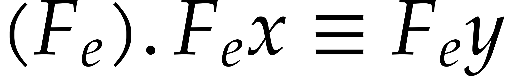.

But according to the explanations he gives of his function signs “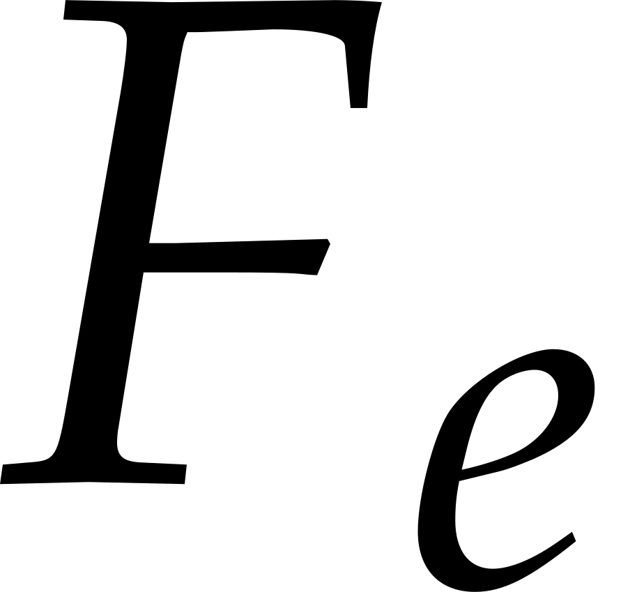”, 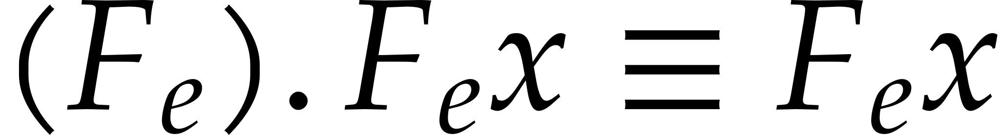 is the statement “every proposition is equivalent to itself” and  the statement “every proposition is equivalent to every proposition”.

So his explanation has achieved nothing beyond what is laid down by the two definitions

x = x ≝ Tautologie

x = y ≝ Kontradiktion

(The word “Tautologie” can here be replaced by any tautology whatever, and the same applies to “Kontradiktion”.) So far nothing has been done except to give explanations of the two different sign forms x = x and x = y. These explanations can of course be replaced by two classes of explanations, e.g.:

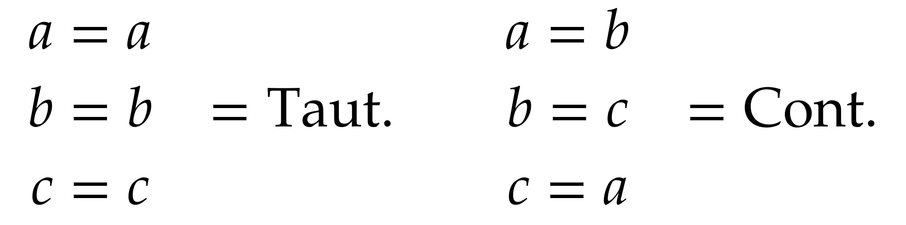

But now Ramsey writes:

“(∃x,y)․ x ≠ y”, i.e. “(∃x,y)․ non (x = y)”, –

but he has no right at all to do so: for what does “x = y” mean in this sign? It is neither the sign “x = y” which I used in the definition above, nor, of course, the “x = x” in the preceding definition. So it is a sign still, still unexplained. Incidentally, to see how idle those definitions are, let one read them (as an unprejudiced reader would) as follows: I permit the sign “a = a” or “b = b”, etc. to be put in place of the sign “Taut.”, whose use we know; and the signs “a = b”, “a = c”, etc. in place of the sign “Cont.” (“non-Taut.”). From which it follows, incidentally, that

(a = b) = (c = d) = (a ≠ a) = etc.!

It presumably goes without saying that an equality sign defined in this way has nothing to do with the one we need to express a substitution rule. Now of course I can in turn explain “(∃x,y)․ x ≠ y”; say, as a ≠ a ․⌵․ a ≠ b ․⌵․ b ≠ c ․⌵․ a ≠ c; but this explanation is really humbug and I ought to write straight away (∃x,y)․ x ≠ y≝Taut.. (I.e. the sign on the left-hand side would be given to me as a new – unnecessary – sign for “Taut.”.) For we must not forget that on _that_ explanation “a = a”, “a = b”, etc. are independent signs and are connected only to the extent that the signs “Taut.” and “Cont.” are. The question here is that of the usefulness of “extensional” functions, for Ramsey’s explanation of the equality sign is just such a specification by extension. What sort of thing is the extensional specification of a function? It is evidently a group of definitions, e.g. the following: 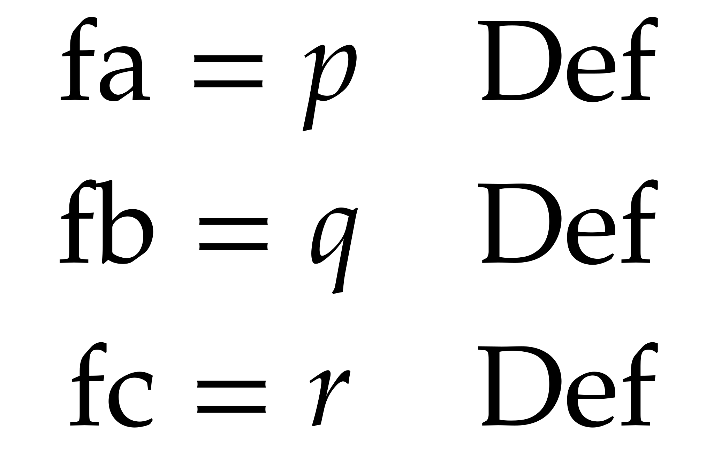 These definitions give us permission to put the signs “fa”, “fb”, “fc” in place of the familiar sentences “p”, “q”, “r”. To say that these three definitions specify the function f(x) says nothing at all, or says the same thing as the three definitions. For the signs “fa”, “fb”, “fc” are function and argument only in so far as the words “Ko(rb)”, “Ko(pf)” and “Ko(hl)” are too. (It makes no difference here whether or not the “arguments” “rb”, “pf”, “hl” are also used as words elsewhere.) (So it is hard to see what purpose the definitions can serve other than to mislead us.) The sign “(∃x). fx” means nothing at all to begin with; for the rules for functions in the old sense of the word do not apply here. For those functions a definition fa = … would be nonsense. Unless an explicit explanation of the sign “(∃x). fx” is given, it can only be understood as a rebus, in which the signs likewise have a kind of non-literal meaning. Each of the signs “a = a”, “a = c”, etc. in the definitions (a = a)≝Taut., etc. is a _word_. The ultimate purpose of introducing extensional functions, incidentally, was to analyse propositions about infinite extensions, and this purpose is defeated, since an extensional function is introduced by a list of definitions.

### [Ts-213](/ts-213/#565r.2) [565r\[2\]](https://cdn.wittgensteinnachlass.com/2000px/webp/Ts-213/565r.webp)

There is a temptation to take the form of an equation for the form of tautologies and contradictions, namely because it seems as though one could say that x = x is obviously true (and) x = y obviously false. Of course, one can more readily say that x = x plays the role of a tautology than that x = y plays that of a contradiction, since all the correct (and “meaningful” equations of mathematics are of the form x = y. One might call x = x a degenerate equation (Ramsey quite rightly called tautologies and contradictions degenerate propositions), and specifically a genuine degenerate equation (the limiting case of an equation). For we use expressions of the form x = x like genuine equations, while being fully conscious that they are degenerate equations. Sentences in geometrical proofs are in the same position, such as: “the angle  is equal to the angle , the angle is equal to itself …”. One might now object that correct equations of the form x = y would have to be tautologies too, and incorrect ones, by contrast, contradictions, since it must be possible to prove the correct equation, and to do so by transforming the two sides of the equation until an identity x = x emerges. But although by this process the original equation is proved correct, and to that extent the identity x = x was the ultimate goal of the transformations, it is not the ultimate goal in the sense that one had aimed to give the equation its proper form through the transformations, as one straightens a crooked object, and that the equation had now (_finally_) attained this perfect form in the identity. So one cannot say: the correct equation is _really_ an identity. It is _not_ an identity.

### [Ts-213](/ts-213/#566r.1) [566r\[1\]](https://cdn.wittgensteinnachlass.com/2000px/webp/Ts-213/566r.webp)

17 _The Concept of the Application of Arithmetic (Mathematics)._

### [Ts-213](/ts-213/#566r.2) [566r\[2\]](https://cdn.wittgensteinnachlass.com/2000px/webp/Ts-213/566r.webp)

When one says “it must be essential to mathematics that it can be applied”, one means that this _applicability_ is not that of a piece of wood of which I say “I shall be able to use that for such and such”.

### [Ts-213](/ts-213/#566r.3+567r.1) [566r\[3\]](https://cdn.wittgensteinnachlass.com/2000px/webp/Ts-213/566r.webp),[567r\[1\]](https://cdn.wittgensteinnachlass.com/2000px/webp/Ts-213/567r.webp)

Geometry is not the science (natural science) of geometrical planes, geometrical straight lines and geometrical points, as opposed, say, to another science that deals with coarse, physical straight lines, strokes, surfaces, etc., and specifies _their_ properties. The connection between geometry and sentences of practical life that deal with strokes, colour boundaries, edges and corners, etc., is not that it speaks about things similar to those these sentences speak about, albeit about _ideal_ edges, corners, etc.; it is, rather, the connection between these sentences and their grammar. Applied geometry is the grammar of statements about spatial objects. The so-called geometrical straight line stands to a colour boundary not as something fine to something coarse, but as possibility to reality. (Think of the conception of possibility as the shadow of reality.)

### [Ts-213](/ts-213/#567r.2) [567r\[2\]](https://cdn.wittgensteinnachlass.com/2000px/webp/Ts-213/567r.webp)

One can describe a circular region divided by diameters into 8 congruent parts, but it is senseless to say this of an elliptical region. And that is what geometry says _in this respect_ about the circular and elliptical regions.

### [Ts-213](/ts-213/#567r.3) [567r\[3\]](https://cdn.wittgensteinnachlass.com/2000px/webp/Ts-213/567r.webp)

A sentence based on an incorrect calculation (such as “he divided the 3 m long board into 4 parts of 1 m each”) has no sense, and this sheds light on the sense of the expressions “to have sense” and “to mean something by the sentence”.

### [Ts-213](/ts-213/#567r.4) [567r\[4\]](https://cdn.wittgensteinnachlass.com/2000px/webp/Ts-213/567r.webp)

What about the sentence “the sum of the angles of a triangle is 180 degrees”? In any case one cannot tell by looking at it that it is a sentence of syntax. The sentence “Vertically opposite angles are equal” means that if they do not turn out to be equal when measured, I shall declare the measurement incorrect, and “the sum of the angles of a triangle is 180 degrees” means that if the sum does not turn out to be 180 degrees when measured, I shall assume an error of measurement. So the sentence is a postulate about the way the facts are described. Hence a sentence of syntax.

### [Ts-213](/ts-213/#568r.1) [568r\[1\]](https://cdn.wittgensteinnachlass.com/2000px/webp/Ts-213/568r.webp)

18 _****On Cardinal Numbers**.**_

### [Ts-213](/ts-213/#569r.1) [569r\[1\]](https://cdn.wittgensteinnachlass.com/2000px/webp/Ts-213/569r.webp)

_**Kinds of Cardinal Numbers.**_

### [Ts-213](/ts-213/#569r.2) [569r\[2\]](https://cdn.wittgensteinnachlass.com/2000px/webp/Ts-213/569r.webp)

What are numbers? – The meanings of numeral signs; and the investigation of this meaning is the investigation of the grammar of numeral signs.

### [Ts-213](/ts-213/#569r.3) [569r\[3\]](https://cdn.wittgensteinnachlass.com/2000px/webp/Ts-213/569r.webp)

We are not looking for a definition of the concept of number, but for a clarification of the grammar of the word “number” and of number words.

### [Ts-213](/ts-213/#569r.4) [569r\[4\]](https://cdn.wittgensteinnachlass.com/2000px/webp/Ts-213/569r.webp)

There are infinitely many cardinal numbers because _we_ construct this infinite system and call it the system of cardinal numbers. There is also a number system “1, 2, 3, 4, 5, many” and another: “1, 2, 3, 4, 5,”. And why shouldn't I call that a system of cardinal numbers too? (and hence a finite one).

### [Ts-213](/ts-213/#569r.5+570r.1) [569r\[5\]](https://cdn.wittgensteinnachlass.com/2000px/webp/Ts-213/569r.webp),[570r\[1\]](https://cdn.wittgensteinnachlass.com/2000px/webp/Ts-213/570r.webp)

It is clear that the axiom of infinity is not what Russell took it to be, that it is neither a proposition of logic nor – as it stands – a proposition of physics. Whether the calculus with this axiom, transposed into a quite different setting (with a quite different “interpretation”), might find a practical application somewhere, I do not know. One might say of logical concepts, e.g. of the (or: a) concept of infinity, that their essence proves their existence.

### [Ts-213](/ts-213/#570r.2) [570r\[2\]](https://cdn.wittgensteinnachlass.com/2000px/webp/Ts-213/570r.webp)

(Frege would have gone on to say: “there may be peoples whose knowledge of the series of cardinal numbers has not gone beyond 5 (and who see the rest of the series only in some indeterminate form, say), but this series exists independently of us”. Does the game of chess exist independently of us, or not? –)

### [Ts-213](/ts-213/#570r.3) [570r\[3\]](https://cdn.wittgensteinnachlass.com/2000px/webp/Ts-213/570r.webp)

A very interesting consideration about the place of the concept of number in logic is this: What about the concept of number if a people have no number words but _always_ use an abacus instead, say, a Russian counting frame? (Nothing would be more interesting than to investigate these people’s arithmetic, and one would really understand that there is no difference here between 20 and 21.)

### [Ts-213](/ts-213/#570r.4+571r.1) [570r\[4\]](https://cdn.wittgensteinnachlass.com/2000px/webp/Ts-213/570r.webp),[571r\[1\]](https://cdn.wittgensteinnachlass.com/2000px/webp/Ts-213/571r.webp)

Could one also set against the cardinal numbers a kind of number whose series would correspond to that of the cardinal numbers without the 5? Oh yes: only this kind of number would be of _no_ use for anything the cardinal numbers are useful for. And the 5 is not missing from these numbers like an apple that one has taken out of a box full of apples and can put back in; rather, the 5 is missing from the essence of these numbers; they do not _know_ the 5 (just as the cardinal numbers do not know the number ½). Thus these numbers (if one wants to call them that) would be applied in a case in which the cardinal numbers (with the 5) could not be applied with sense. (Doesn't this show how nonsensical the talk of “basic intuition” is?)

### [Ts-213](/ts-213/#571r.2) [571r\[2\]](https://cdn.wittgensteinnachlass.com/2000px/webp/Ts-213/571r.webp)

When the intuitionists speak of “basic intuition”, – is this a psychological process? And how does it get into mathematics, then? Or is what they mean not, after all, merely a primitive sign (in Frege’s sense); a component of a calculus?

### [Ts-213](/ts-213/#571r.3) [571r\[3\]](https://cdn.wittgensteinnachlass.com/2000px/webp/Ts-213/571r.webp)

Strange as it sounds, it is possible to know the prime numbers up to – say – 7 and thus to possess a finite system of prime numbers. And what we call the recognition that there are infinitely many prime numbers is in truth the recognition of a new system, on an equal footing with the other.

### [Ts-213](/ts-213/#571r.4) [571r\[4\]](https://cdn.wittgensteinnachlass.com/2000px/webp/Ts-213/571r.webp)

If one sees a flickering with one’s eyes closed, countless points of light that appear and disappear – as one might describe it – it makes no sense here to speak of a ‘number’ of points seen at the same time. And one cannot say “there is always a definite number of points of light there, we just do not know what it is”; this would correspond to a rule applied where one can speak of checking that number.

### [Ts-213](/ts-213/#571r.5+572r.1) [571r\[5\]](https://cdn.wittgensteinnachlass.com/2000px/webp/Ts-213/571r.webp),[572r\[1\]](https://cdn.wittgensteinnachlass.com/2000px/webp/Ts-213/572r.webp)

It makes sense to say: I distribute many among many. But the sentence “I could not distribute the many nuts among the many people” cannot mean that it was logically impossible. Nor can one say: “in some cases it is possible to distribute many among many and in some it is not”: for then I ask: in _which_ cases is this possible and in which impossible? and that could no longer be answered in the many-system.

### [Ts-213](/ts-213/#572r.2) [572r\[2\]](https://cdn.wittgensteinnachlass.com/2000px/webp/Ts-213/572r.webp)

To say of a part of my visual field that it has no colour is nonsense; and so, of course, is saying that it has colour (or, a colour). It does, however, make sense to say that it has only _one_ colour (is monochrome, or _uniformly coloured_), that it has at least two colours, only two colours, etc. So in the sentence “this quadrilateral in my visual field has at least two colours” I cannot substitute “one” for “two”. Or again: “the quadrilateral has only one colour” does not mean – by analogy with (∃x)․fx & non (∃x,y)․fx & fy – “the quadrilateral has a colour, but not two colours”.

### [Ts-213](/ts-213/#573r.1+574r.1+575r.1) [573r\[1\]](https://cdn.wittgensteinnachlass.com/2000px/webp/Ts-213/573r.webp),[574r\[1\]](https://cdn.wittgensteinnachlass.com/2000px/webp/Ts-213/574r.webp),[575r\[1\]](https://cdn.wittgensteinnachlass.com/2000px/webp/Ts-213/575r.webp)

I am speaking here of the case in which it is senseless to say that “the part of space has no colour”. Incidentally, if I count the uniformly coloured (monochrome) patches in the quadrilateral, it makes sense to say that there are none if the colour of the quadrilateral varies continuously. It then of course also makes sense to say that there is “one uniformly coloured patch or more” in the quadrilateral, and also that the quadrilateral has one colour but not two colours. – But I am now leaving aside this use of the sentence “the quadrilateral has no colour” and speaking of a system in which it goes without saying that a _surface_ has a colour, that is, properly put, in which this sentence is nonsense. When one says that the sentence goes without saying, what one really means is what is expressed by a grammatical rule describing the form of sentences about visual space, for example. Now if one starts giving the number of colours in the quadrilateral with the sentence “there is one colour in the quadrilateral”, then of course this must not be the sentence of grammar about the “colouredness” of space. What does one mean when one says “space is coloured”? (And, a very interesting question: what kind of question is this?) Well, one might look round for confirmation and look at the various colours around one and be inclined to say: wherever I look, there is a colour. _Or_: Everything is coloured, after all, everything has been painted, so to speak. Here one thinks of colours in contrast to a kind (of) colourlessness, which on closer inspection turns out to be colour again. Incidentally, when one looks round for confirmation, one looks above all at still, monochrome parts of space, and would rather not look at moving, indistinctly coloured ones (flowing water, shadows, etc.). If one then has to admit to oneself that one simply calls everything one sees colour, one now wants to say that being coloured is a property of space in and of itself (no longer of its parts). But this amounts to saying of the game of chess that it is the game of chess, and it can now only come down to a description of the game. And now we come to a description of sentences about space; but without (a) justification, and as though one had to bring them into agreement with another reality. To confirm the sentence “visual space is coloured” one looks round (_say_) and says: this here is black, and black is a colour; that is white, and white is a colour; etc. But one takes “black is a colour” in the same way as “iron is a metal” (or perhaps better “gypsum is a sulphur compound”). If I make it senseless to say that a part of visual space has no colour, then the (_question of the_) analysis of the statement of the number of colours in a part of visual space becomes very similar to that of the statement of the number of parts of, say, a quadrilateral which I divide by strokes into bounded areas. Here too I can regard it as senseless to say that the quadrilateral “consists of 0 parts”. One therefore cannot say that it consists “of one or more parts”, or that it “has at least _one_ part”. Let us imagine the special case of a quadrilateral divided by parallel strokes. That this case _is_ very _special_ does not bother (_us_), for we do not think a game any less remarkable because it has only a very limited application. Here I can either count the parts  in the usual way, in which case it means nothing to say that there are 0 parts. But I could also imagine a way of counting that takes the first part for granted, so to speak, and does not count it, or counts it as 0, and counts only the additional parts produced by division. On the other hand, one could imagine a custom according to which, say, soldiers drawn up in ranks are always counted by the number _of soldiers_ present over and above _one_ soldier (say, if the number of possible combinations of the flank man and another soldier in the rank is to be given). But there could also be a custom according to which the number of soldiers is always given as 1 more than the actual number. This might originally have been done to deceive a particular superior about the actual number, but then have become established as a way of counting soldiers. (The academic quarter-hour.) The number of different colours in a surface might also be given by the number of possible combinations in pairs. And then the only numbers that would come into consideration for this count would be the numbers 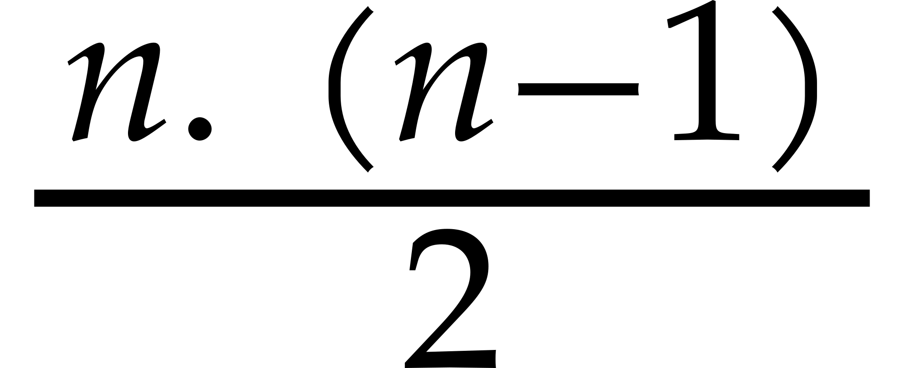, and it would then be as senseless to speak of 2 or 4 colours in a surface as it is now to speak of √2 or i colours. What I mean is that it is not the case that the cardinal numbers are essentially primary and the – let us call them – combination numbers 1, 3, 6, 10, etc. secondary. One could also construct an arithmetic of combination numbers, and it would be as self-contained as the arithmetic of cardinal numbers. But of course there can just as well be an arithmetic of the even numbers or of the numbers 1, 3, 4, 5, 6, 7 … Of course the decimal system is unsuited to writing these kinds of numbers.

### [Ts-213](/ts-213/#575r.2+576r.1) [575r\[2\]](https://cdn.wittgensteinnachlass.com/2000px/webp/Ts-213/575r.webp),[576r\[1\]](https://cdn.wittgensteinnachlass.com/2000px/webp/Ts-213/576r.webp)

Let us imagine a calculating machine that calculates with colours in a strip instead of beads. And whereas we now count the colours in a strip with beads on our abacus, or with our fingers, we would then count the beads on a rod, or the fingers on our hand, with colours in a strip. But how would this colour-calculating machine have to be constructed in order to work? We would need a sign for there being no beads on the rod. One must think of the abacus as a tool for practical use and as a means of language. And, just as one can represent 5, say, by the five fingers of one hand (one should think of a sign language), one would represent it by the strip with 5 colours. But for 0 I need a sign, otherwise I do not have the requisite multiplicity. Well, I can either stipulate that the colour black is to designate 0 (this is of course arbitrary and a monochrome red surface would do just as well); or the monochrome surface is to _designate_ 0, the two-coloured one 1, etc. It makes no difference which mode of designation I choose. And here one sees how the manifold of beads is projected onto the manifold of colours in a surface.

### [Ts-213](/ts-213/#576r.2) [576r\[2\]](https://cdn.wittgensteinnachlass.com/2000px/webp/Ts-213/576r.webp)

It makes no sense to speak of a black digon in a white circle; and this case is analogous to the following: it is senseless to say that the quadrilateral consists of 0 parts (no part). Here we have something like a lower limit to counting, before we even reach one.

### [Ts-213](/ts-213/#576r.3+577r.1) [576r\[3\]](https://cdn.wittgensteinnachlass.com/2000px/webp/Ts-213/576r.webp),[577r\[1\]](https://cdn.wittgensteinnachlass.com/2000px/webp/Ts-213/577r.webp)

 Is counting parts in I the same as counting points in IV? And what does the difference consist in? One can take counting parts in I to be counting quadrilaterals. But then one can also say “there is _no_ quadrilateral in this row”; and then one is not counting _parts_. What troubles us is the analogy between counting points and counting parts, and the breakdown of that analogy. There is something strange about counting the undivided surface as “one”; yet we find no difficulty in seeing the surface divided once as a picture of 2. One would much rather count “0, 2, 3, etc.” here. And this corresponds to the series of sentences: “the quadrilateral is undivided”, “the quadrilateral is divided into 2 parts”, etc.

### [Ms-113](/ms-113/#37v.2) [37v\[2\]](https://cdn.wittgensteinnachlass.com/2000px/webp/Ms-113/37v.webp)

When different colours are involved, one can imagine the standpoint from which one does not say, we have two colours here, but rather, there is a difference of colour here; the way of looking that does not see 3 at all in red, green, yellow. And which nevertheless recognizes a series, say: red; blue, green; yellow, black, white; etc., as such, but does not connect it with the series ∣; ∣∣; ∣∣∣; etc., or not in such a way that it assigns ∣ to the item red.

### [Ms-113](/ms-113/#37v.3+38r.1) [37v\[3\]](https://cdn.wittgensteinnachlass.com/2000px/webp/Ms-113/37v.webp),[38r\[1\]](https://cdn.wittgensteinnachlass.com/2000px/webp/Ms-113/38r.webp)

From the standpoint from which it is ‘odd’ to count the undivided surface as 1, it is also unnatural to count the once-divided one as 2. For one does that when one takes it as two quadrilaterals, that is, from the standpoint from which one could quite properly count the undivided one as a quadrilateral. But if one takes the first quadrilateral in I as the undivided surface, the second appears as a whole with a division (a difference); and division here does not necessarily mean a dividing line. Rather, what I direct my attention to are the differences, and here there is a series from fewer to more differences, or transitions. I shall then number the quadrilaterals in I ‘0, 1, 2, etc.’.

### [Ms-113](/ms-113/#38r.2+38v.1) [38r\[2\]](https://cdn.wittgensteinnachlass.com/2000px/webp/Ms-113/38r.webp),[38v\[1\]](https://cdn.wittgensteinnachlass.com/2000px/webp/Ms-113/38v.webp)

This works when the colours in a strip border one another, as, for example, in the schema

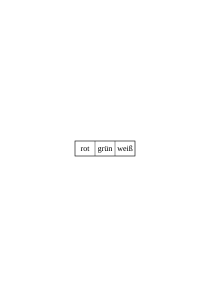.

But it is different when the arrangement  is; or

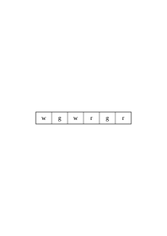.

Of course I could also assign each of these two schemata to a schema

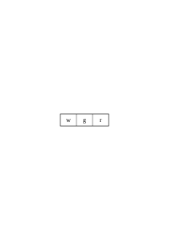

schemata such as 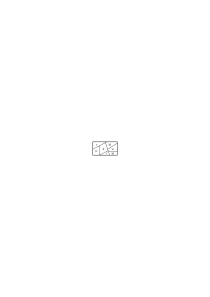 to a schema

.

etc.; and that is a correct way of looking at it, but nevertheless an artificial one. The most natural thing is to take the series of schemata ⋎ as

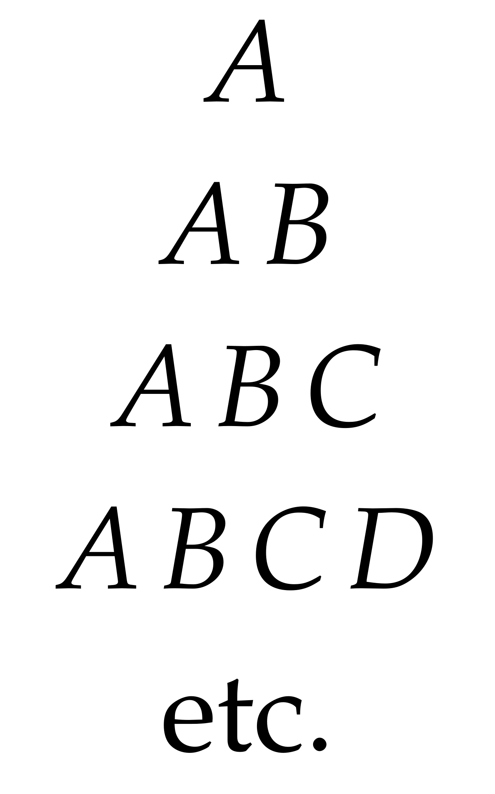.

And here one can designate the first schema by ‘0’, the second by ‘1’, but the third by 3, say, if one is thinking of all the possible differences, and the fourth then by 6. Or one calls the third schema 2 (if one is concerned with only one arrangement) and the fourth 3.

### [Ts-213](/ts-213/#577r.3) [577r\[3\]](https://cdn.wittgensteinnachlass.com/2000px/webp/Ts-213/577r.webp)

One can describe the _division into parts_ of the quadrilateral  by saying: it is divided into five parts, or: 4 parts have been cut off from it, or: it has the division schema ABCDE, or: one gets through all the parts by crossing 4 boundaries, or: the quadrilateral is divided (i.e. into 2 parts), one part is divided again and both parts of _this_ division are divided, – etc. I want to show that there is not just _one_ method of describing its _division into parts_.

### [Ts-213](/ts-213/#578r.1) [578r\[1\]](https://cdn.wittgensteinnachlass.com/2000px/webp/Ts-213/578r.webp)

But perhaps one will refrain from designating the difference by a number at all, and stick entirely to the schemata A, AB, ABC, etc. Or describe it this way too:

1, 12, 123, etc., or, what comes to the same thing: 0, 01, 012, etc. These too can quite properly be called number signs.

### [Ts-213](/ts-213/#578r.2) [578r\[2\]](https://cdn.wittgensteinnachlass.com/2000px/webp/Ts-213/578r.webp)

The schemata: A, AB, ABC, etc.: 1, 12, 123, etc.; !∣, !!∣∣, !!!∣∣∣, etc.; !∣.!∣, !∣..!∣, !∣...!∣, etc.; 0, 1, 2, 3, etc.; 1, 2, 3, etc.; 1, 12, 121323, etc.; etc. – are all equally fundamental.

### [Ts-213](/ts-213/#578r.3) [578r\[3\]](https://cdn.wittgensteinnachlass.com/2000px/webp/Ts-213/578r.webp)

One is now surprised that the number schema with which one counts soldiers in a barracks should not also apply to the parts of a quadrilateral. But the schema for the soldiers in the barracks is , that for the parts of the quadrilateral . Neither is primary in comparison with the other.

### [Ts-213](/ts-213/#578r.4) [578r\[4\]](https://cdn.wittgensteinnachlass.com/2000px/webp/Ts-213/578r.webp)

I can compare the series of division schemata both with the series 1, 2, 3, etc. and with the series 0, 1, 2, 3, etc. If I count the parts, there is no 0 in my number series, for the series

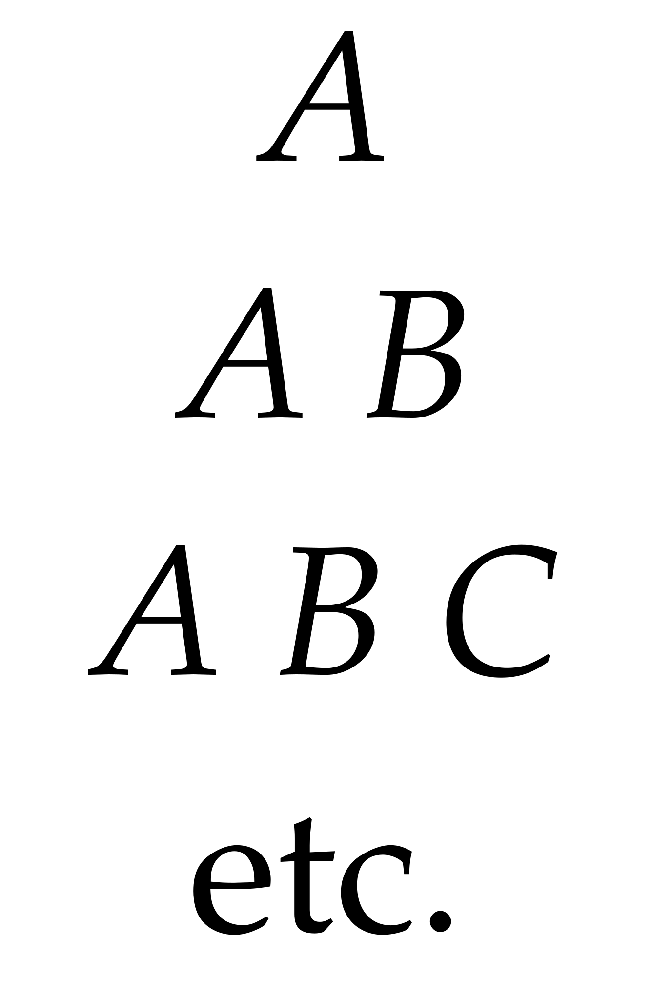

begins with _one_ letter, whereas the series !∣

!∣, !∣.!∣, !∣..!∣, etc. does not begin with _one_ dot. On the other hand, I can represent all the facts of the division with this series too, only “I am not counting the parts then”.

### [Ts-213](/ts-213/#578r.5+579r.1) [578r\[5\]](https://cdn.wittgensteinnachlass.com/2000px/webp/Ts-213/578r.webp),[579r\[1\]](https://cdn.wittgensteinnachlass.com/2000px/webp/Ts-213/579r.webp)

Put incorrectly, but as one would put it at first, the problem runs: “why can one say ‘there are 2 colours on this surface’ and not ‘there is _one_ colour on this surface’?” Or: how must I express the grammatical rule so that I am no longer tempted to say something nonsensical, and it goes without saying for me? Where is the false thought, the false analogy, that leads me into using language incorrectly? How must I represent the grammar so that this temptation disappears? I believe that the representation by means of the series

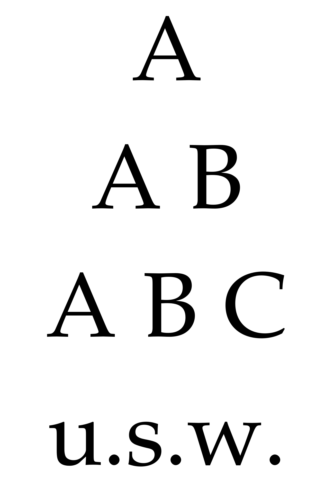

and

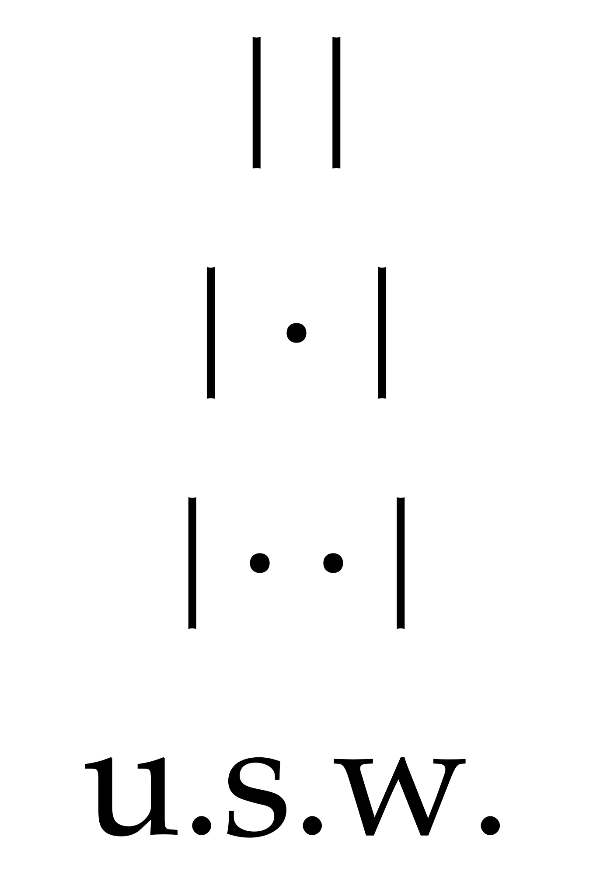

clears up the confusion. Everything depends on whether I count with a number series that starts with 0 or with one that starts with 1. It is the same when I count the lengths of rods or the sizes of hats. If I count with tally strokes, I could _then_ write them like this: , to show that what matters is the *difference* in direction and that the single stroke corresponds to 0 (i.e. is the beginning).

### [Ts-213](/ts-213/#579r.2) [579r\[2\]](https://cdn.wittgensteinnachlass.com/2000px/webp/Ts-213/579r.webp)

Incidentally, there is a certain difficulty here with the number signs (1), ((1) + 1), etc.: namely that beyond a certain length we can no longer distinguish them without counting the strokes, that is, without translating the signs into _other_ signs. One cannot distinguish “!!!!!!!!!!∣∣∣∣∣∣∣∣∣∣” and “!!!!!!!!!!!∣∣∣∣∣∣∣∣∣∣∣” in the same sense – so they are not different signs in the same sense – as “10” and “11”. Incidentally, of course the same thing would also happen in the decimal system (think of the numbers 1111111111 and 11111111111), but that is not without significance. –

### [Ts-213](/ts-213/#579r.3+580r.1) [579r\[3\]](https://cdn.wittgensteinnachlass.com/2000px/webp/Ts-213/579r.webp),[580r\[1\]](https://cdn.wittgensteinnachlass.com/2000px/webp/Ts-213/580r.webp)

Let us imagine that someone gave us a calculation to do in stroke notation, say: !!!!!!!!!!!∣∣∣∣∣∣∣∣∣∣∣

\+ !!!!!!!!!!∣∣∣∣∣∣∣∣∣∣ and while we were calculating he amused himself by rubbing out and adding strokes without our noticing. He would then keep telling us “the calculation is wrong, you see” and we would go through it again and again, being made fools of all the while. – Indeed, strictly speaking, without the concept of a criterion of the correctness of the calculation. – Here one might raise questions such as: Is it then only _very probable_ that 464 + 272 = 736? And is 2 + 3 = 5 therefore not also only very probable? And what is the objective truth that this probability approaches? I.e., how do we get a concept of 2 + 3 really _being_ a certain number, apart from what it _seems_ to us to be? –

### [Ts-213](/ts-213/#580r.2) [580r\[2\]](https://cdn.wittgensteinnachlass.com/2000px/webp/Ts-213/580r.webp)

For if one were to ask: what is the criterion, in stroke notation, for our having the same number sign before us twice? – The answer might be: “if it looks the same both times”, or “if it contains the same number of strokes both times.” Or should it be: if a one-to-one correspondence etc. is possible?

### [Ts-213](/ts-213/#580r.3) [580r\[3\]](https://cdn.wittgensteinnachlass.com/2000px/webp/Ts-213/580r.webp)

How can I know that !!!!!!!!∣∣∣∣∣∣∣∣ and !!!!!!!!∣∣∣∣∣∣∣∣ are _the same_ sign? Surely it is not enough that they look _similar_. For it is not the approximate sameness of shape that may constitute the identity of the signs, but precisely the equality in number.

### [Ts-213](/ts-213/#580r.4) [580r\[4\]](https://cdn.wittgensteinnachlass.com/2000px/webp/Ts-213/580r.webp)

The problem of distinguishing 1 + 1 + 1 + 1 + 1 + 1 + 1 and 1 + 1 + 1 + 1 + 1 + 1 + 1 + 1 is much more important than it seems at first sight. What is at issue is the difference between physical and visual number.

### [Ts-213](/ts-213/#581r.1) [581r\[1\]](https://cdn.wittgensteinnachlass.com/2000px/webp/Ts-213/581r.webp)

19 _2 + 2 = 4._

### [Ts-213](/ts-213/#581r.2) [581r\[2\]](https://cdn.wittgensteinnachlass.com/2000px/webp/Ts-213/581r.webp)

The cardinal number is an internal property of a list.

### [Ts-213](/ts-213/#581r.3+582r.1) [581r\[3\]](https://cdn.wittgensteinnachlass.com/2000px/webp/Ts-213/581r.webp),[582r\[1\]](https://cdn.wittgensteinnachlass.com/2000px/webp/Ts-213/582r.webp)

Does number have anything essentially to do with a concept? I think this comes down to asking whether it makes sense to speak of a number of objects that have not been brought under a concept. Does it make sense, for example, to say “a, b and c are three objects”? – There is, to be sure, a feeling that tells us: Why talk of concepts? The number depends only on the _extension_ of the concept, after all, and once that has been determined the concept can leave the stage, so to speak. The concept is _only a method_ for determining an extension, but the extension stands on its own and is in its nature independent of the concept; for it does not matter which concept we used to determine the extension. That is the argument for the extensional view. Against this one can first say: If the concept is really only an aid to arriving at the extension, then the concept has no place in arithmetic; one must then simply separate the class entirely from the concept contingently associated with it. In the opposite case, however, the extension independent of the concept is a mere chimera, and then it is better not to speak of it at all, but only of the concept. The sign for the extension of a concept is a list. One could say – in passing – that number is the external property of a concept and the internal property of its extension (the list of objects that fall under it). Number is the schema of the extension of a concept. I.e.: the statement of number is, as Frege said, the statement about a concept (a predicate). It does not refer to the extension of a concept, i.e. to a list that may be the extension of a concept. But the statement of number about a concept is similar to the sentence stating that a particular list is the extension of this concept. Use is made of such a list when I say: “a, b, c, d fall under the concept F(x)”. “a, b, c, d” is the list. Of course the sentence says nothing other than Fa & Fb & Fc & Fd; but written with the help of the list it shows its affinity with “(∃x,y,z,u)․ Fx & Fy & Fz & Fu”, which we can write for short as “(E∃

!!!!∣∣∣∣ ∣∣∣∣x).F(x)”. Arithmetic is concerned with the schema !!!!∣∣∣∣. – But does arithmetic speak of strokes I make with a pencil on paper? – Arithmetic does not speak of the strokes, it _operates_ with them.

### [Ts-213](/ts-213/#582r.2) [582r\[2\]](https://cdn.wittgensteinnachlass.com/2000px/webp/Ts-213/582r.webp)

The statement of number does not always contain a generalization or indeterminacy: “The line segment A B is divided into two (3, 4, etc.) equal parts”.

### [Ts-213](/ts-213/#583r.1) [583r\[1\]](https://cdn.wittgensteinnachlass.com/2000px/webp/Ts-213/583r.webp)

If one wants to know what “2 + 2 = 4” means, one must ask how we (_obtain_) it, how we work it out. We then regard the process of calculation as what is essential, and this is the way of looking at it in ordinary life, at least as far as the numbers we need to work out are concerned. We must not be ashamed to take numbers and calculations in the way every shopkeeper’s everyday arithmetic takes them. Then we do not work out 2 + 2 = 4 at all, or indeed the rules of the elementary multiplication tables in general; instead we accept them – as axioms, so to speak – and calculate only _with their help_. But of course we could also work out 2 + 2 = 4, and children do in fact do so by counting off. Given the sequence of digits 1 2 3 4 5 6, the calculation is: 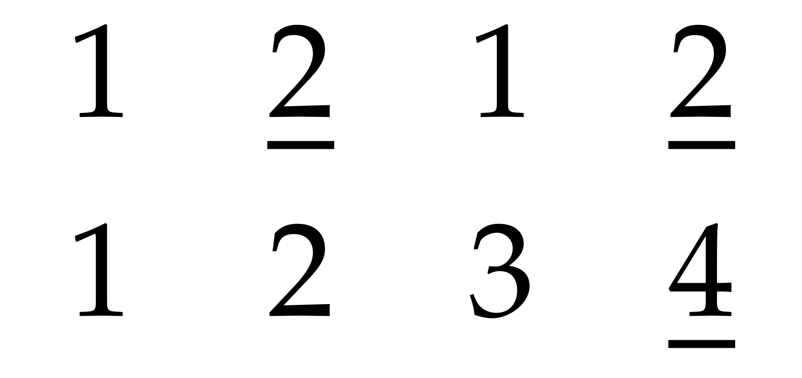.

### [Ts-213](/ts-213/#583r.2+584r.1) [583r\[2\]](https://cdn.wittgensteinnachlass.com/2000px/webp/Ts-213/583r.webp),[584r\[1\]](https://cdn.wittgensteinnachlass.com/2000px/webp/Ts-213/584r.webp)

_Definitions for abbreviation:_

(∃x). fx ․ & ․ non (∃x,y)․ fx & fy ≝ (εx). fx

(∃x,y)․ fx & fy ․ & ․ non (∃x,y,z)․ fx & fy & fz ≝ (εx,y)․ fx & fy and so on.

(εx). fx ≝ (ε 1x)fx

(εx,y)․ fx & fy ≝ (ε ∣∣x)fx ≝ (ε 2x)fx and so on.

_One can show that_

(Е∣∣x)fx & (Е∣∣∣x)Fx & [non-( E ∃ x).

fx

& Fx Ind.] :⊃: (Е∣∣∣∣∣x)․fx ⌵ Fx is a tautology. Has one thereby demonstrated the arithmetical proposition 2 + 3 = 5? Of course not. Nor has one shown that

(éЕ!!∣∣x)fx & (éЕ!!!∣∣∣x)Fx &

Ind. :C⊃:

(éЕ

!!∣∣ + !!!∣∣∣x) fx & Fx

(éЕ∣∣x)․fx & (éЕ

∣∣∣x)Fx.Ind..:C⊃:․(éЕ

∣∣ + ∣∣∣x)․fx & ⌵

Fx is tautological, for our definitions have not _yet_ said anything at all about a sum “!!∣∣ + !!!∣∣∣ ∣∣ + ∣∣∣”. (For brevity I shall write the tautology in the form “éЕ!!∣∣ & éЕ!!!∣∣∣

C⊃ C

éЕ!!!!!∣∣∣∣∣ éЕ∣∣.éЕ∣∣∣

․C⊃․éЕ∣∣∣∣∣”.) Now if the question is how many strokes to the right of “⊃” will make the whole a tautology, given the left-hand side, one can find this number; one can also find that in the preceding case it is !!∣∣ + !!!∣∣∣ ∣∣ + ∣∣∣, but just as well that it is !∣ + !!!!∣∣∣∣ ∣ + ∣∣∣∣ or !∣ + !!!∣∣∣ +

!∣ ∣ + ∣∣∣ + ∣, for it is all of these. But one can also find an induction which shows that – expressed algebraically – Еn & Еm․⊃․Е(n + m) comes out tautological. Then I am entitled, for example, to regard ε17.ε28․⊃․ ε(17 + 28) as a tautology. But does that now give me the equation 17 + 28 = 45? Not at all! Rather, I still have to work this out for myself. It now also makes sense to write down Е2 & Е3 ⊃ Е5 as a tautology in accordance with this general rule if I do not, (_so to speak_), yet know what 2 + 3 will come to; for 2 + 3 has sense only in so far as it still has to be worked out. Hence the equation !!∣∣ + !!!∣∣∣ =

!!!!!∣∣∣∣∣ ∣∣ + ∣∣∣ =

∣∣∣∣∣ has a point only if the sign “!!!!!∣∣∣∣∣ ∣∣∣∣∣” is recognized in the same way as the sign “5”; that is, independently of the equation.

### [Ts-213](/ts-213/#584r.2+585r.1) [584r\[2\]](https://cdn.wittgensteinnachlass.com/2000px/webp/Ts-213/584r.webp),[585r\[1\]](https://cdn.wittgensteinnachlass.com/2000px/webp/Ts-213/585r.webp)

My standpoint differs from that of those who write today on the foundations of arithmetic in that I have no need to despise any particular calculus, for example that of the decimal system. For me one is as good as another. To think little of a particular calculus is like wanting to play chess without actual pieces on the grounds that playing with pieces would not be abstract enough, would be too particular. In so far as the pieces do _not_ matter, one set is simply as good as another. And in so far as one game does differ from another, one game is simply as good, _i.e. as interesting_, as another. But none is more sublime than any other.

### [Ts-213](/ts-213/#585r.2) [585r\[2\]](https://cdn.wittgensteinnachlass.com/2000px/webp/Ts-213/585r.webp)

What is the proof of éЕ!!∣∣ & éЕ!!!∣∣∣

C⊃ éЕ!!!!!∣∣∣∣∣ éЕ∣∣.éЕ∣∣∣ ․C⊃․

éЕ∣∣∣∣∣ that is the expression of our knowledge that this is a correct logical proposition? It evidently makes use of the fact that one can treat (∃x) … as a logical sum. We might translate from the symbolism (“if there is a star in each square, there are two in the whole rectangle”)  into Russell’s. And it is not as if, with the tautology in this notation, we were expressing an opinion that seems plausible to us and (that) the proof then confirms; rather, what seems plausible to us is that this expression is a tautology (a law of logic).

### [Ts-213](/ts-213/#585r.3+586r.1+587r.1) [585r\[3\]](https://cdn.wittgensteinnachlass.com/2000px/webp/Ts-213/585r.webp),[586r\[1\]](https://cdn.wittgensteinnachlass.com/2000px/webp/Ts-213/586r.webp),[587r\[1\]](https://cdn.wittgensteinnachlass.com/2000px/webp/Ts-213/587r.webp)

_The series of sentences_

(∃x):aRx & xRb (∃x,y):aRx & xRy & yRb (∃x,y,z):aRx & xRy & yRz & zRb and so forth can quite well be expressed as follows: “there is one link between a and b” “there are two links between a and b” and so on, and one can write this, for example, as (∃1x).aRxRb, (∃2x). aRxRb, etc. But it is clear that the explanation above is needed in order to understand these expressions, since otherwise one might think, by analogy with (∃2x). fx = (∃x,y)fx & fy, that (∃2x). aRxRb has the same meaning as an expression (∃x,y)․aRxRb & aRyRb. I could of course also write “(∃2x,y)․F(x,y)” instead of “(∃x,y)․F(x,y)”. But the question would now be: what am I then to understand by “(∃3x,y)․F(x,y)”? But here a rule can be given; and what we need is one that takes us as far as we like in the number series. E.g. the rule (∃3 x,y)․F(x,y) = (∃x,y,z): F(x,y) & F(x,z) & F(y,z) (∃4 x,y)․F(x,y) = (∃x,y,z,u): F(x,y) & F(x,z) & … the combinations of two elements follow. And so on. But one could also define it thus: (∃3 x,y)․F(x,y) = (∃x,y,z)․F(x,y) & F(y,x) & F(x,z) & F(z,x) & F(y,z) & F(z,y) and so forth. “(∃3x).F(x,y)” would correspond, say, to the sentence in word-language “F(x,y) is satisfied by 3 things”, and this sentence too would need an explanation to make it unambiguous. Am I to say that the sign “3” has a different meaning in the different cases? Does the sign “3” not rather express what the different interpretations have in common? Why else would I have chosen it? After all, the same rules apply to the sign “3” in this use as in that. It is still to be replaced by 2 + 1; etc. Admittedly, however, a sentence modelled on éЕ!!∣∣ & éЕ!!!∣∣∣

C⊃ éЕ!!!!!∣∣∣∣∣

éЕ∣∣ &

éЕ∣∣∣ C⊃ éЕ∣∣∣∣ is now not a tautology. Two people who live at peace with one another and three more people who live at peace with one another do not make five people who live at peace with one another. But that does not mean that 2 + 3 is now not 5. It is just that addition cannot be applied in this way. For one could say: 2 people who … and 3 people who … and each of whom lives at peace with each member of the first group = 5 people who … In other words the signs of the form (∃1 x,y)․F(x,y), (∃2 x,y)․F(x,y), etc. have the multiplicity of the cardinal numbers, as do the signs (∃lx)․fx, (∃2x). fx, etc. and also the signs (Е1x)․fx, (Е2x)․fx, etc.

### [Ts-213](/ts-213/#587r.2) [587r\[2\]](https://cdn.wittgensteinnachlass.com/2000px/webp/Ts-213/587r.webp)

“There are only 4 red things, but they do not consist of 2 and 2, because there is no function that brings them under one heading in pairs”. That would mean understanding the proposition 2 + 2 = 4 as follows: If 4 circles are visible on a surface, then they always have some particular  feature in common two at a time; say, a sign inside each circle. (Then of course the circles are also to have a sign in common three at a time, etc.) For if I assume anything at all about reality, why not _that_? The “axiom of reducibility” is essentially no different in kind. In this sense one might say that although 2 and 2 always make 4, 4 does not always consist of 2 and 2. (It is only the utter vagueness and generality of the axiom of reducibility that mislead us into thinking that what we have here – if it is a sentence with sense at all – is more than an arbitrary assumption for which there are no grounds. That is why in this and all similar cases it is extremely clarifying to drop this generality altogether, since it does not make the matter any more mathematical, and to make quite specific assumptions instead.)

### [Ts-213](/ts-213/#587r.3+588r.1) [587r\[3\]](https://cdn.wittgensteinnachlass.com/2000px/webp/Ts-213/587r.webp),[588r\[1\]](https://cdn.wittgensteinnachlass.com/2000px/webp/Ts-213/588r.webp)

One would like to say: 4 need not always consist of 2 and 2, but if it really does consist of groups, it can consist of 2 and 2 or of 3 and 1, etc.; but not of 2 and 1, or 3 and 2, etc.; and so we get everything ready for the case where 4 can be split into groups. But then arithmetic has nothing to do with the actual splitting, only with that possibility of splitting. The assertion might equally be that the points of a group of 4 points on paper are always joined in pairs by a stroke. Or that in the world a circle is always drawn around every two such groups of 2 points.

### [Ts-213](/ts-213/#588r.2) [588r\[2\]](https://cdn.wittgensteinnachlass.com/2000px/webp/Ts-213/588r.webp)

What is more, the statement, for example, that 2 black circles are visible in a white quadrilateral does not have the form “(∃x,y)․ etc.”. For if I give the circles names, then those names refer precisely to the locations of the circles, and I cannot say of them that they are in either one quadrilateral or the other. I can say, to be sure: “in the two quadrilaterals together there are 4 circles”, but that does not mean that I can say of each individually that it is in one quadrilateral or the other. For the sentence “this circle is in this quadrilateral” is senseless in the case supposed.

### [Ts-213](/ts-213/#588r.3+589r.1) [588r\[3\]](https://cdn.wittgensteinnachlass.com/2000px/webp/Ts-213/588r.webp),[589r\[1\]](https://cdn.wittgensteinnachlass.com/2000px/webp/Ts-213/589r.webp)

Now what does the sentence “in the 2 quadrilaterals _together_ there are 4 circles” mean? How do I ascertain this? By adding the numbers in the two quadrilaterals? So the number of circles in the two quadrilaterals together then _means_ the result of adding the two numbers. – Or is it perhaps the result of a _separate_ count that goes through both quadrilaterals; or the number of strokes I get when I assign a stroke to a circle, whether it is in one quadrilateral _or_ the other? For one can say: “each stroke is assigned either to a circle  in one quadrilateral or to a circle in the other”; but not: “this circle is either in this quadrilateral or in the other”, if “this circle” is characterized precisely by its position. _This_ can be _here_ only if “this” and “here” do not mean the same thing. By contrast, _this_ stroke can be assigned to a circle in this quadrilateral, for it remains this stroke even if it is assigned to a circle in the other quadrilateral.

### [Ts-213](/ts-213/#589r.2) [589r\[2\]](https://cdn.wittgensteinnachlass.com/2000px/webp/Ts-213/589r.webp)

 Are there 9 points or 7 in these two circles together? As one ordinarily understands it, 7. But must I understand it that way? Why should I not count the points that belong to both circles twice: 

### [Ts-213](/ts-213/#589r.3) [589r\[3\]](https://cdn.wittgensteinnachlass.com/2000px/webp/Ts-213/589r.webp)

It is different if one asks: “how many points are inside the boundary drawn in a heavy line?” For here I can say: there are 7, in the sense in which there are 5 and 4 in the circles.

### [Ts-213](/ts-213/#589r.4+590r.1) [589r\[4\]](https://cdn.wittgensteinnachlass.com/2000px/webp/Ts-213/589r.webp),[590r\[1\]](https://cdn.wittgensteinnachlass.com/2000px/webp/Ts-213/590r.webp)

One could now say: I call the sum of 4 and 5 the number that the objects falling under the concept fx ⌵ Fx have when 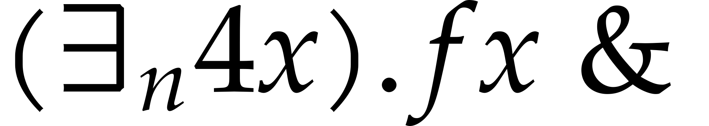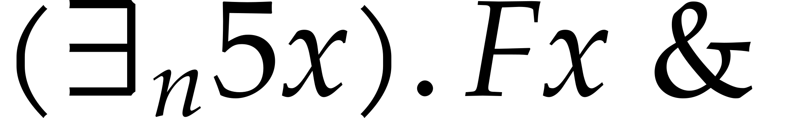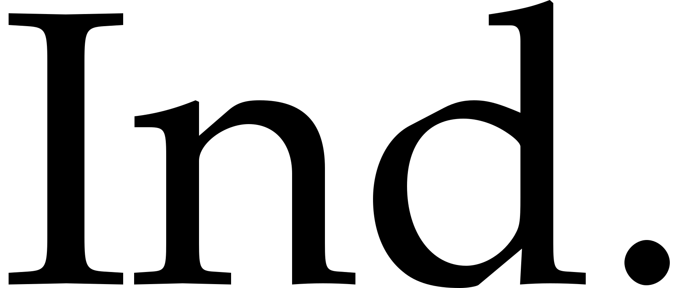 is the case. This does not (now) mean that the sum of 4 and 5 may be used only in connection with sentences of the kind (∃4x)․fx etc., but it means: If you want to form the sum of n and m, insert the numbers into the form to the left of “․⊃․”, (∃nx)․fx & (∃mx).Fx etc., and the number that must stand on the right to make the whole sentence a tautology is the sum of m and n. So this is a method of addition, and an extremely cumbersome one at that.

### [Ts-213](/ts-213/#590r.2) [590r\[2\]](https://cdn.wittgensteinnachlass.com/2000px/webp/Ts-213/590r.webp)

Compare: “Hydrogen and oxygen together make water” – “2 points and 3 points together make 5 points”.

### [Ts-213](/ts-213/#590r.3) [590r\[3\]](https://cdn.wittgensteinnachlass.com/2000px/webp/Ts-213/590r.webp)

Do, for example, 4 points in my visual field that I see “as 4”, not “as 2 and 2”, consist of 2 and 2? Well, what does that mean? Is the question whether they were in some sense divided into groups of 2 points each? Certainly not. (For then presumably they would have to be divided in every other conceivable way as well.) Does it mean that it is _possible_ to divide them into groups of 2 and 2? that is, that it _makes sense_ to speak of such groups in the four? – In any case, what corresponds to the proposition “2 + 2 = 4” is surely that I cannot say that the group of 4 points I saw consisted of separate groups of 2 and 3 points. Everyone will say: that is impossible, _for_ 3 + 2 = 5. (And “impossible” here means “nonsensical”.)

### [Ts-213](/ts-213/#590r.4) [590r\[4\]](https://cdn.wittgensteinnachlass.com/2000px/webp/Ts-213/590r.webp)

“Do 4 points consist of 2 and 2” can be a question about a physical or _optical_ fact; then it is not the question of arithmetic. But the arithmetical question could indeed be put in the form: “_Can_ a group of 4 points consist of separate groups of 2 points each”.

### [Ts-213](/ts-213/#590r.5+591r.1) [590r\[5\]](https://cdn.wittgensteinnachlass.com/2000px/webp/Ts-213/590r.webp),[591r\[1\]](https://cdn.wittgensteinnachlass.com/2000px/webp/Ts-213/591r.webp)

“Suppose I believed that all there was was one function and the 4 objects that satisfy it. Later I find that it is also satisfied by a fifth thing; has the sign ‘4’ now become senseless?” – Yes, if 4 does not exist _in the calculus_, then ‘4’ is senseless.

### [Ts-213](/ts-213/#591r.2) [591r\[2\]](https://cdn.wittgensteinnachlass.com/2000px/webp/Ts-213/591r.webp)

If one says it would be possible to add with the help of the tautology

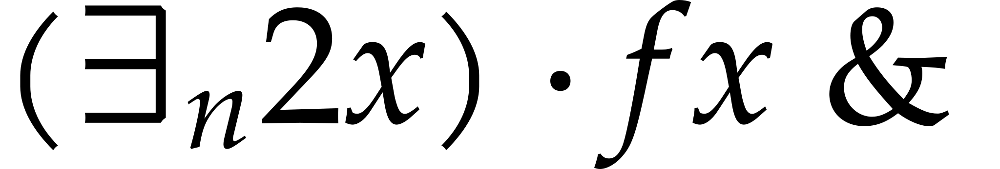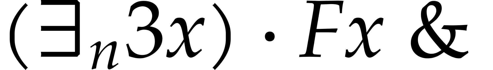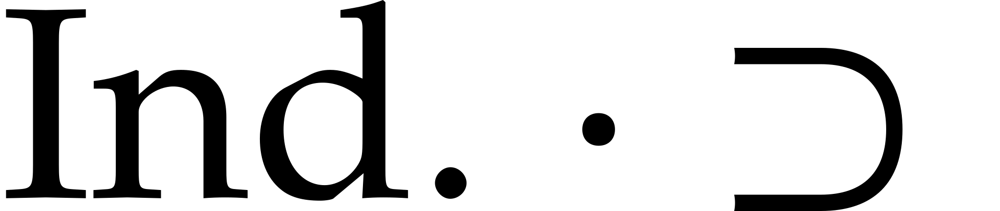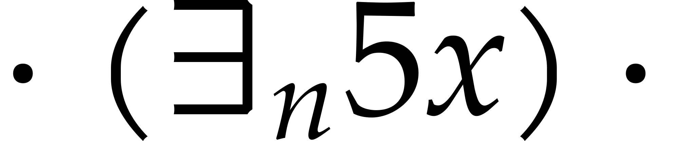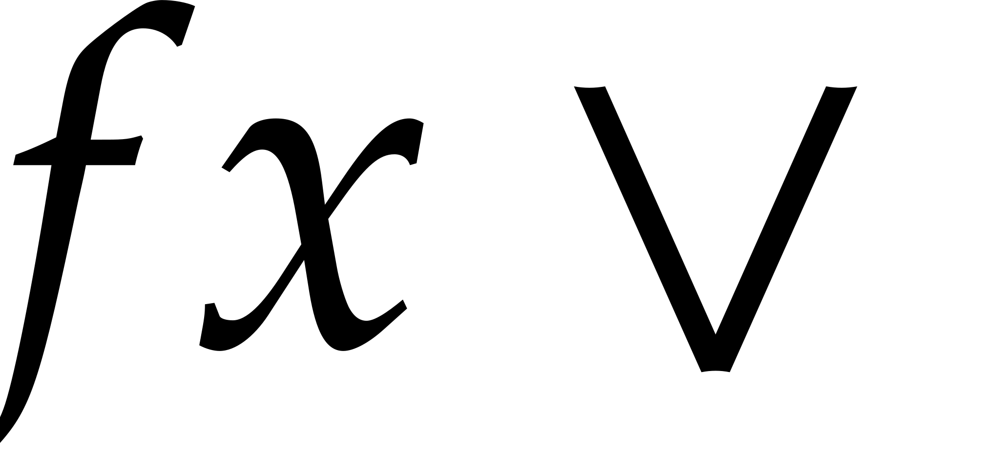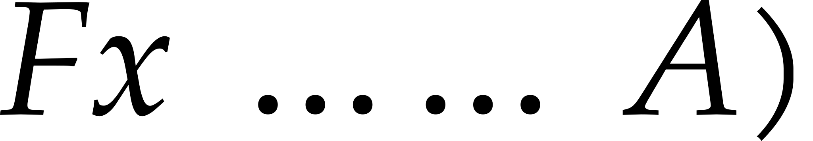, this would be understood as follows: First it is possible to find out by certain rules that

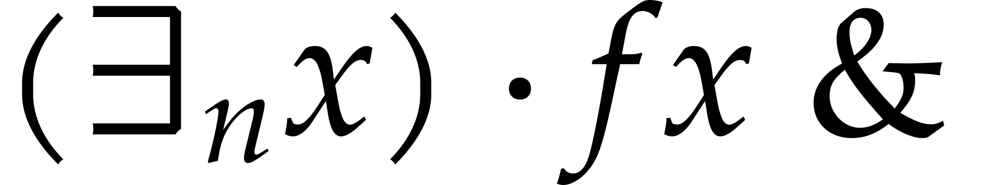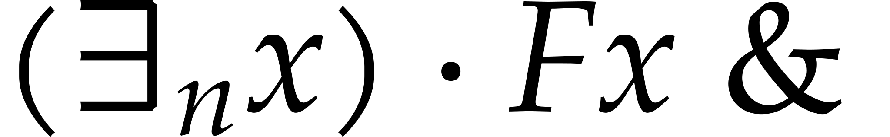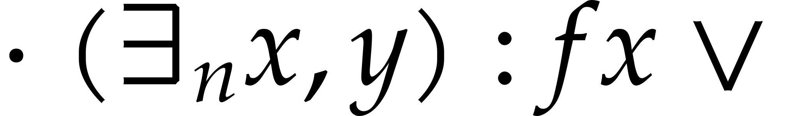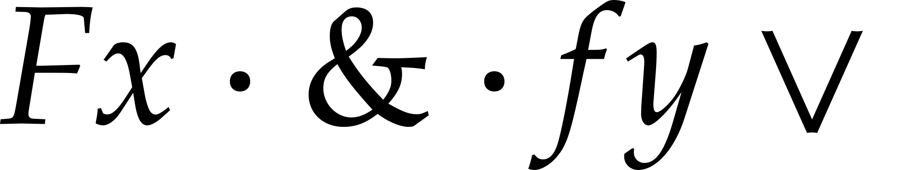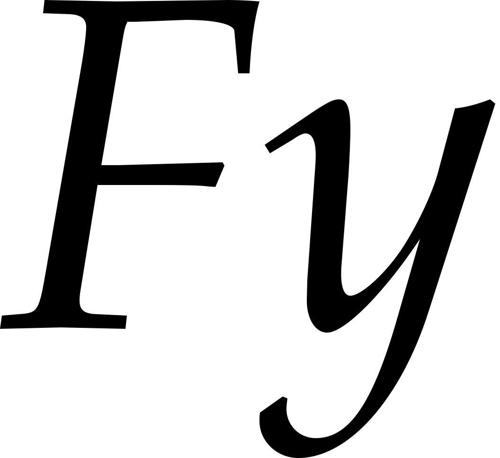

is tautological. 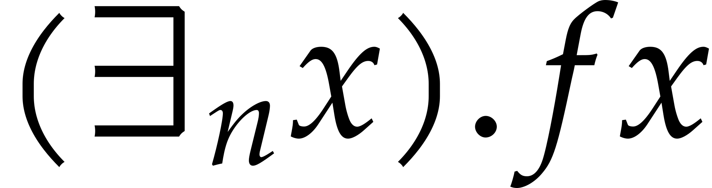 is an abbreviation for (∃x)․fx & non (∃x,y)․ fx & fy. Further, I shall abbreviate tautologies of kind A by writing them thus: (Е) & (Е) ⊃ (Е) So it follows from the rules that (Еx) & (Еx) ⊃ (Еx,y), (Еx,y) & (Еx) ⊃ (Еx,y,z) and others are tautologies. I write “and others” and not “etc. ad inf.”, because with this concept one still

### [Ts-213](/ts-213/#591r.3) [591r\[3\]](https://cdn.wittgensteinnachlass.com/2000px/webp/Ts-213/591r.webp)

When the numbers were written in the decimal system, there were rules, namely those for adding any two numbers from 0 to 9, and these, suitably applied, were enough for me to add any numbers. Now what rule corresponds to these elementary rules? Obviously, in a calculation like t we need to remember fewer rules than in 17 + 28. Indeed, probably only _one_ general rule and none at all of the kind 3 + 2 = 5. On the contrary, we now seem to be able to _derive_, to calculate, how much 3 + 2 is.

### [Ts-213](/ts-213/#591r.4) [591r\[4\]](https://cdn.wittgensteinnachlass.com/2000px/webp/Ts-213/591r.webp)

The problem is 2 + 3 = ? and one writes 1,2,3,4,5,6,7 1,2;1,2,3

This is how children actually calculate when they “count out”. (And this calculus must be as good as any other.)

### [Ts-213](/ts-213/#592r.1) [592r\[1\]](https://cdn.wittgensteinnachlass.com/2000px/webp/Ts-213/592r.webp)

It is clear, incidentally, that the problem whether 5 + (4 + 3) = (5 + 4) + 3 can be solved _like this_:

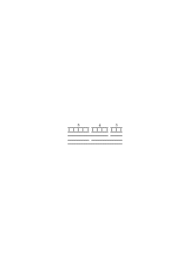

for this construction has exactly the multiplicity of any other proof of this proposition.

### [Ts-213](/ts-213/#592r.2) [592r\[2\]](https://cdn.wittgensteinnachlass.com/2000px/webp/Ts-213/592r.webp)

If I use its last letter as the name of the number, this proves that (E + D) + C = E + (D + C) = L. This form of proof is good because it clearly shows that the result has actually been calculated, and because one can nevertheless also read the general proof off it.

### [Ts-213](/ts-213/#592r.3) [592r\[3\]](https://cdn.wittgensteinnachlass.com/2000px/webp/Ts-213/592r.webp)

A good admonition here – strange as it sounds – is: do not do philosophy here, but mathematics.

### [Ts-213](/ts-213/#593r.1+594r.1) [593r\[1\]](https://cdn.wittgensteinnachlass.com/2000px/webp/Ts-213/593r.webp),[594r\[1\]](https://cdn.wittgensteinnachlass.com/2000px/webp/Ts-213/594r.webp)

Our calculus need not yet know anything at all about forming a series ‘(Еx)’, ‘(Еx,y)’, ‘(Еx,y,z)’, _etc._, but can simply introduce a few, say 3, of these signs, without the “and so on”. Now we can introduce a calculus with a finite series of signs by stipulating an order for certain signs, say that of the letters of the alphabet, and writing:

(Еa) & (Еa) ⊃ (Еa,b)

(Еa,b) & (Еa) ⊃ (Еa,b,c)

(Еa,b) & (Еa,b) ⊃ (Еa,b,c,d)

and so on up to z.

One can then find the right-hand side (to the right of “⊃”) from the left by means of a calculus of the form:

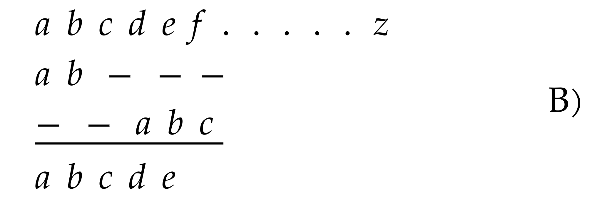

This calculus would result from the rules for forming tautologies, as a simplification. – Given this law for forming one segment of a series from two others, I can now introduce the designation “sum of the two others” for the first and thus define: a + a≝ab

a + ab≝abc

and so on up to z.

If one had explained the rule of calculus B by a few examples, one could also regard these definitions as special cases of a general rule and now set problems of the kind: “abc + ab = ?”. It is easy now to confuse the tautology s) (Еa,b) & (Еa,b) ⊃ (Еa,b,c,d) with the equation t) ab + ab = abcd. – But the latter is a rule of substitution; the former is not a rule, but simply a tautology. The sign “⊃” in s in no way corresponds to the “ = ” in t. One forgets that the sign “⊃” in s does not say that the two signs to its right and left yield a tautology. On the other hand, one could construct a calculus in which the equation x + y = z is obtained as a transformation (of) the equation: u) (Еx) & (Еy) ⊃ (Еz) = Taut..

So that I obtain, so to speak, z = x + y when I solve equation u for z.

### [Ts-213](/ts-213/#594r.2) [594r\[2\]](https://cdn.wittgensteinnachlass.com/2000px/webp/Ts-213/594r.webp)

How does the concept of a sum enter into these considerations? – In the original calculus, which establishes (_say_) that the form (Еx) & (Еy) ⊃ (Еz)

_v)_

(for example) comes out tautological for x = ij, y = i and z = ijk, there is no talk of summation. – Then we bring a number system into the calculus (say, the system a b c d … z). And finally we define the sum of two numbers as the number z that solves equation u.

### [Ts-213](/ts-213/#594r.3+595r.1) [594r\[3\]](https://cdn.wittgensteinnachlass.com/2000px/webp/Ts-213/594r.webp),[595r\[1\]](https://cdn.wittgensteinnachlass.com/2000px/webp/Ts-213/595r.webp)

(If instead of “(Еx) & (Еx) ⊃ (Еx,y)” we wrote “(Еx) & (Еx) ⊃ (Еx + x)”, that would have no sense; unless the notation from the outset reads not I) “(Еx) etc.”, “(Еx,y) etc.”, “(Еx,y,z) etc.”, but:

K) “(Еx) etc.”, “(E x + x) etc.”, “(E x + x + x) etc.”. For why should we suddenly write “(Еx,y) & (Еx) ⊃ (Еxy + x)” instead of “(Еx,y) & (Еx) ⊃ (Еx,y,z)”? That would only confuse the notation. – Now one says: Surely it makes writing down the tautology much simpler if one can put the expressions from the two left-hand brackets straight into the right-hand bracket. But this notation has not yet been explained at all; I do not know what (Еxy + z) means, namely that (Еxy + x) = (Еx,y,z). But if from the outset we used the notation “(Еx)”, “(Еx + x)”, “(Еx + x + x)”, then to begin with only the expression “(Еx + x + x + x)” would have sense, but not “(Е(x + x) + (x + x))”. Notation K is _on a level with_ I. One can establish by a quick calculation, say by drawing connecting lines, that a tautology results in form v, thus

(Еx,y) & (Еx,y) ⊃ (Еx,y,z,u) and analogously

(Еx + x) & (Еx + x) ⊃ (Еx + x + x + x).

The arcs correspond _only_ to the rule that must be given in each case for checking the tautology. There is no talk of addition here yet. That comes in only when I decide – for example – to write “xy + xy” instead of “x, y, z, u”, and to do so in conjunction with a calculus whose rules allow one to derive a rule of substitution “xy + xy = xyzu”. Nor is there addition when I write “(Еx) & (Еx) ⊃ (Еx + x)” in notation K, but only when I distinguish between “x + x” and “(x) + (x)” and write: (x) + (x) = (x + x).

### [Ts-213](/ts-213/#595r.2) [595r\[2\]](https://cdn.wittgensteinnachlass.com/2000px/webp/Ts-213/595r.webp)

I can define “the sum of x and y” (“x + y”) as the number z (or: “the expression” – if we are reluctant to use the _word_ number) – I can define “x + y” as the number z that makes the expression v tautological; – but one can also define “x + y”, e.g., by means of calculus B (independently of the calculus of tautologies) and then _prove_ the equation (Еx) & (Еy) ⊃ (Еx + y) = Taut.

### [Ts-213](/ts-213/#595r.3+596r.1) [595r\[3\]](https://cdn.wittgensteinnachlass.com/2000px/webp/Ts-213/595r.webp),[596r\[1\]](https://cdn.wittgensteinnachlass.com/2000px/webp/Ts-213/596r.webp)

A question that readily arises is this: must we introduce the cardinal numbers in connection with the notation (∃x,y,…)․ fx & fy & …? Is the calculus of cardinal numbers in any way tied to the calculus with the signs “(∃x,y…)․ fx & fy …”? Is the latter perhaps the only, and perhaps essentially the only, application of the cardinal numbers? As for the “application of cardinal arithmetic to grammar”, one can refer to what we said about the concept of the application of a calculus. – One could now put our question like this: Do the cardinal numbers always occur after the sign “∃” in the sentences of our language: that is, if we imagine the language translated into Russell’s notation? This question is directly connected with the following one: Is the numeral always used in language to characterize a concept – a function? The answer is that our language always uses numerals _in connection with_ concept-words – but that these concept-words belong to quite different grammatical systems (as one can see from the fact that one has meaning in combinations in which another is _senseless_), so that the norm that makes them concept-words ceases to be of interest to us. But the notation “(∃x,y,…) etc.” is just such a norm; it is the direct translation of a norm of our word-languages, namely the expression “there is …”, a linguistic schema into which countless logical forms are pressed.

### [Ts-213](/ts-213/#596r.2) [596r\[2\]](https://cdn.wittgensteinnachlass.com/2000px/webp/Ts-213/596r.webp)

Incidentally, the numeral, now in a different sense, is not connected with “∃”: namely, inasmuch as “(∃3x)…” is not contained in “(∃2 + 3 x)…”.

### [Ts-213](/ts-213/#596r.3+597r.1+598r.1) [596r\[3\]](https://cdn.wittgensteinnachlass.com/2000px/webp/Ts-213/596r.webp),[597r\[1\]](https://cdn.wittgensteinnachlass.com/2000px/webp/Ts-213/597r.webp),[598r\[1\]](https://cdn.wittgensteinnachlass.com/2000px/webp/Ts-213/598r.webp)

If we set aside the functions constructed by means of “ = ” (x = a ⌵ x = b etc.), then on Russell’s theory 5 = 1 if there is no function satisfied by only _one_ argument, or by only 5 arguments. At first sight this sentence naturally seems nonsensical; for how can one then say with sense that there are no such functions? Russell would have to say that one can make the two statements that there are functions satisfied by exactly five arguments and functions satisfied by exactly one argument _separately_ only if we have a class of five and a class of one in our symbolism. He might say, for instance, that his view is correct because, without the paradigm of the class of 5 in the symbolism, I cannot say at all that a function is satisfied by 5 arguments. – I.e., the very existence of the sentence “(∃f): (Е1x)․fx” entails its truth. – Thus one seems able to say: look at this sentence and you will see that it is true. And in a sense irrelevant to us this is indeed possible: imagine, for instance, the following written in red paint on the wall of a room: “there is something red in this room”. This problem is connected with the fact that in an ostensive definition I do not state anything about the paradigm (sample), but only make statements with its help; that it belongs to the symbolism and is not one of the objects to which I apply it. If, e.g., “1 foot” is defined as the length of a certain rod in my room, and I were to say, say, instead of “this door is 6 feet high”: “this door is six times _this_ length (pointing to the unit rod)”, – then one could not say (_for instance_): “the sentence ‘there is an object 1 foot long’ proves itself, for I could not utter this sentence at all if there were no object of this length”; for I cannot state of the unit rod that it is 1 foot long. (If I introduce the sign “_this_ length” in place of “1 foot”, then the statement that the unit rod is 1 foot long would read: “this rod is this length (pointing both times to the same rod)”.) Likewise, one cannot say of the group of strokes that serves, say, as a paradigm for 3 that it consists of 3 strokes. “If that sentence is not true, then this sentence does not exist at all” – that means: “if this sentence does not exist, then it does not exist”. And one sentence can never describe the paradigm in another, for then it is not a paradigm. If the length of the unit rod can be described by _the_ specification of length “_1 foot_”, then the rod is not the paradigm of the unit of length, for otherwise every specification of length would have to be made with its help.

### [Ts-213](/ts-213/#598r.2) [598r\[2\]](https://cdn.wittgensteinnachlass.com/2000px/webp/Ts-213/598r.webp)

A sentence, “non (∃f):(Еx)․fx”, if we give it any sense at all, must be of the same kind as _this_ one: “there is no circle on this surface that contains only _one_ black spot”. (I mean: it must have a similarly _definite_ sense; and not remain vague, as it would in Russell’s logic and in mine in the treatise.) If it now follows from the sentences “non (∃f):(Еx)․fx” …R)

and “non (∃f) :(Еx,y)․ fx & fy … S)

that 1 = 2, then what is meant here by “1” and “2” is not what we usually mean by them, for in word-language the sentences R and S would read: “there is no function that is satisfied by only one thing” and “there is no function that is satisfied by only 2 things”. And by the rules of our language these are sentences with different senses.

### [Ts-213](/ts-213/#598r.3+599r.1) [598r\[3\]](https://cdn.wittgensteinnachlass.com/2000px/webp/Ts-213/598r.webp),[599r\[1\]](https://cdn.wittgensteinnachlass.com/2000px/webp/Ts-213/599r.webp)

One is tempted to say: “To be able to express ‘(∃x,y)․fx & fy’, we need 2 signs ‘x’ and ‘y’.” But that says nothing. What we _need_ for it is perhaps pen and paper; and the sentence says as little as: “to express ‘p’, we need ‘p’”.

### [Ts-213](/ts-213/#599r.2) [599r\[2\]](https://cdn.wittgensteinnachlass.com/2000px/webp/Ts-213/599r.webp)

If one asks: “what then does ‘5 + 7 = 12’ mean – what sense or purpose is left for this expression once one has eliminated tautologies etc. from the arithmetical calculus”, – the answer is: This equation is a substitution rule based on certain general substitution rules, the rules of addition. The content of 5 + 7 = 12 is (if one did not know it) exactly what gives children trouble when they learn this sentence in arithmetic lessons.

### [Ts-213](/ts-213/#599r.3) [599r\[3\]](https://cdn.wittgensteinnachlass.com/2000px/webp/Ts-213/599r.webp)

No investigation of concepts, only insight into the calculus of numbers, can convey that 3 + 2 = 5. That is what resists in us the thought that “(Е3x)․fx & (Е2x).gx & Ind. ․⊃․ (Е5x)․fx ⌵ gx”

could be the sentence 3 + 2 = 5. For what enables us to recognize this expression as a tautology cannot itself emerge from a consideration of concepts either, but must be evident from the calculus. For grammar is a calculus. I.e., whatever else _is there_ in the calculus of tautologies besides the calculus of numbers does not justify the latter and, if that is what interests us, is merely incidental.

### [Ts-213](/ts-213/#599r.4) [599r\[4\]](https://cdn.wittgensteinnachlass.com/2000px/webp/Ts-213/599r.webp)

Children presumably learn 2 × 2 = 4 at school, but not 2 = 2.

### [Ts-213](/ts-213/#600r.1) [600r\[1\]](https://cdn.wittgensteinnachlass.com/2000px/webp/Ts-213/600r.webp)

20 _**Statements of number within mathematics.**_

### [Ts-213](/ts-213/#600r.2) [600r\[2\]](https://cdn.wittgensteinnachlass.com/2000px/webp/Ts-213/600r.webp)

What is the difference between a statement of number about a concept and a statement of number that relates to a variable? The first is a sentence about the concept, the second a grammatical rule concerning the variable. But can I not determine a variable by saying that its values are to be all the objects that satisfy a certain function? – I do not thereby _determine_ the variable unless I _know_ which objects satisfy the function, i.e. unless these objects are also given to me in some other way (say, by a list); in which case specifying the function becomes superfluous. If we do not know whether an object satisfies the function, we do not know whether it is to be a value of the variable, and in this respect the grammar of the variable is simply not determined.

### [Ts-213](/ts-213/#600r.3+601r.1) [600r\[3\]](https://cdn.wittgensteinnachlass.com/2000px/webp/Ts-213/600r.webp),[601r\[1\]](https://cdn.wittgensteinnachlass.com/2000px/webp/Ts-213/601r.webp)

Statements of number _in_ mathematics (e.g. “the equation x² = 1 has 2 roots”) are therefore of quite a different kind from statements of number outside mathematics (“there are 2 apples on the table”.)

### [Ts-213](/ts-213/#601r.2+602r.1) [601r\[2\]](https://cdn.wittgensteinnachlass.com/2000px/webp/Ts-213/601r.webp),[602r\[1\]](https://cdn.wittgensteinnachlass.com/2000px/webp/Ts-213/602r.webp)

When one says that A B admits of 2 permutations, it sounds as if one were making a _general_ statement, analogous to “there are 2 people in the room”, where nothing further is said or need be known about the people. But it is not like that in the case of A B. I cannot describe A B, B A more generally, and so the proposition that 2 permutations are possible cannot say less than that the permutations A B and B A are possible. To say that 6 permutations of 3 elements are possible cannot say less, i.e. say something more general, than the schema shows:

ABC

ACB

BAC

BCA

CAB

CBA

For it is _impossible_ to know the number of possible permutations without knowing the permutations themselves. And if that were not so, combinatorics could not arrive at its general formulas. The law we recognize in the formation of the permutations is represented by the equation p = n!. In the same sense, I believe, in which a circle is represented by the equation of a circle. – I can of course assign the number 2 to the permutations A B, B A, and likewise 6 to the permutations of A, B, C that have been worked out, but that does not give me the proposition of combinatorics. – What I see in A B, B A is an internal relation, which therefore cannot be described. I.e. _that_ which makes this class of permutations complete cannot be described. – I can only count what is actually there, not the possibilities. But I can, e.g., calculate how many lines a person has to write if they put a permutation of 3 elements on each line and go on permuting until they cannot go any further without repetition. And that means they need 6 lines to write down the permutations A B C, A C B etc. in this way, for these are precisely “_the_ permutations of A, B, C”. But it makes no sense to say that these are all the permutations of A B C.

### [Ts-213](/ts-213/#602r.2) [602r\[2\]](https://cdn.wittgensteinnachlass.com/2000px/webp/Ts-213/602r.webp)

A calculating machine for combinatorics is conceivable, quite analogous to the Russian one.

### [Ts-213](/ts-213/#602r.3) [602r\[3\]](https://cdn.wittgensteinnachlass.com/2000px/webp/Ts-213/602r.webp)

It is clear that there is a mathematical question: “how many permutations of – e.g. – 4 elements are there”, a question of exactly the same kind as “what is 25 × 18”. For there is a general method for solving each. But the question exists only in relation to this method.

### [Ts-213](/ts-213/#602r.4) [602r\[4\]](https://cdn.wittgensteinnachlass.com/2000px/webp/Ts-213/602r.webp)

The sentence that there are 6 permutations of 3 elements is identical with the permutation schema, and that is why there is no sentence here “there are 7 permutations of 3 elements”, for no such schema corresponds to it.

### [Ts-213](/ts-213/#602r.5) [602r\[5\]](https://cdn.wittgensteinnachlass.com/2000px/webp/Ts-213/602r.webp)

In this case one could also take the number 6 to be a different kind of count, the permutation number of A, B, C. Permuting as a different kind of counting.

### [Ts-213](/ts-213/#602r.6) [602r\[6\]](https://cdn.wittgensteinnachlass.com/2000px/webp/Ts-213/602r.webp)

If one wants to know what a sentence means, one can always ask “how do I know that”. Do I know that there are 6 permutations of 3 elements in the same way as I know that there are 6 people in the room? No. That is why the former sentence is of a different _kind_ from the latter.

### [Ts-213](/ts-213/#602r.7) [602r\[7\]](https://cdn.wittgensteinnachlass.com/2000px/webp/Ts-213/602r.webp)

One can also say that the sentence “there are 6 permutations of 3 elements” stands in exactly the same relation to the sentence “there are 6 people in the room” as does the sentence 3 + 3 = 6, which one could also express in the form “there are 6 units in 3 + 3”. And just as in the one case I count the rows in the permutation schema, so in the other I can count the strokes in 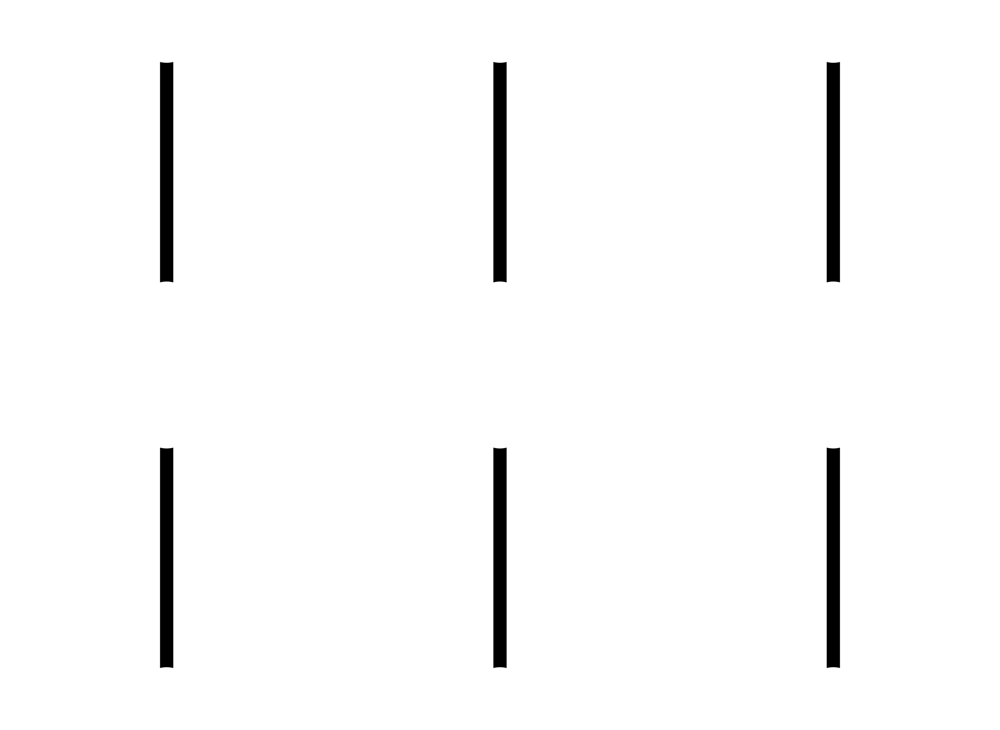.

### [Ts-213](/ts-213/#603r.1) [603r\[1\]](https://cdn.wittgensteinnachlass.com/2000px/webp/Ts-213/603r.webp)

Just as I can prove 4 × 3 = 12 by means of the schema: 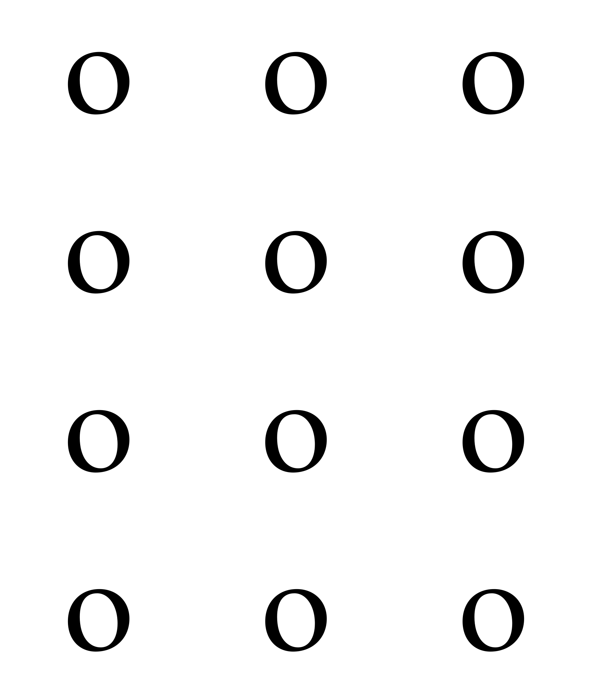, so I can prove 3! = 6 by means of the permutation schema.

### [Ts-213](/ts-213/#603r.2) [603r\[2\]](https://cdn.wittgensteinnachlass.com/2000px/webp/Ts-213/603r.webp)

The sentence “the relation R connects two objects with one another”, if this is meant to say as much as “R is a two-place relation”, is a sentence of grammar.

### [Ts-213](/ts-213/#604r.2+605r.1+606r.1) [604r\[2\]](https://cdn.wittgensteinnachlass.com/2000px/webp/Ts-213/604r.webp),[605r\[1\]](https://cdn.wittgensteinnachlass.com/2000px/webp/Ts-213/605r.webp),[606r\[1\]](https://cdn.wittgensteinnachlass.com/2000px/webp/Ts-213/606r.webp)

21 How then is one to understand the sentence “these hats are the same size”, or “these rods are the same length”, or “these spots are the same colour”? Should one write these in the form “(∃L)․ La & Lb”? But if that is meant in the usual way, hence used with the usual rules, then it would surely make sense to write “(∃L)․ La”, that is, “spot a has a colour”, “the rod has a length”. I can of course write “(∃L)․ La & Lb” for “a and b are the same length”, so long as I know and bear in mind that “(∃L)․ La” is senseless; but then the notation becomes misleading and confusing. (“to have a length”, “to have a father”.) – Here we have the case that we often express in ordinary language like this: “If a has length L, then b also has L”; but here the sentence “a has length L” would have no sense at all, or at any rate not as a statement about a; and the sentence is more correctly put “if we call the length of a ‘L’, then the length of b is also L”, and ‘L’ here is essentially a variable. The sentence, incidentally, has the form of an example, of a sentence that can serve as an example of the general sentence, and one might go on: “if, e.g., a is 5 m long, then b is also 5 m long, and so on”. – For saying “the rods a and b have the same length” says nothing at all about the length of either rod; for it does not say either “that each of them has a length”. The case therefore bears no resemblance at all to “A and B have the same father” and “the name of the father of A and B is ‘N’”, where I simply substitute the proper name for the general designation. But ‘5 m’ is not the name of the length _in question_, about which all that was said at first was that a and b both had it. When it is a matter of lengths in the visual field, we can indeed say that the two lengths are equal, but we cannot in general “name” them with a number. – The sentence “if L is the length of a, then b too has length L” merely sets down its form as one derived from the form of an example. And one could actually express the general sentence by _giving_ examples followed by an “and so on”. And it is a repetition of the same sentence when I say: “a and b are the same length; if the length of a is L, then the length of b is also L; if a is 5 m long, then b is also 5 m long; if a is 7 m, then b is 7 m, and so on”. The third version already shows that the “and” in the sentence does not stand between two forms, as in “(∃x). fx & Fx”, where one would also be entitled to write “(∃x). fx” and “(∃x). Fx”. Let us _also_ take as an example the sentence “there are as many apples in one box as in the other”. If one writes this sentence in the form “there is a number that is the number of apples in both boxes”, here too one cannot construct the form: “there is a number that is the number of apples in this box”, or “the apples in this box have a number”. If I write:

 etc., then one could write the sentence “the number of apples in the two boxes is the same” as:

“(∃n)․ fn & Fn”. But “(∃n)․ fn” would not be a sentence.

### [Ts-213](/ts-213/#604r.1) [604r\[1\]](https://cdn.wittgensteinnachlass.com/2000px/webp/Ts-213/604r.webp)

_**Equality of number.**_

_**Equality of length.**_

### [Ts-213](/ts-213/#606r.2+607r.1) [606r\[2\]](https://cdn.wittgensteinnachlass.com/2000px/webp/Ts-213/606r.webp),[607r\[1\]](https://cdn.wittgensteinnachlass.com/2000px/webp/Ts-213/607r.webp)

If one wants to write the sentence “as many objects fall under f as under F” in a surveyable notation, one is above all tempted _to write_ it in the form “fn & Fn”. And further, one does not feel this to be a logical product of fn and Fn such that it would also make sense to write fn & F5 – rather, it is essential that the same letter follow ‘f’ and ‘F’, and fn & Fn is an abstraction from the logical products f4 & F4, f5 & F5 etc., not itself a logical product. (Thus fn would not follow from fn & Fn either. Rather, ‘fn & Fn’ stands in much the same relation to a logical product as the differential quotient does to a quotient.) It is no more a logical product than a photograph of a family group is a group of photographs. So the form “fn & Fn” can mislead us, and perhaps a notation of the kind “” would be preferable; but so would “(∃n)․ fn & Fn”, if the grammar of this sign is laid down. One can then stipulate: (∃n)․ fn = Taut., which amounts to (∃n)․ fn & p = p. Thus (∃n)․ fn ⌵ Fn = Taut., (∃n)․ fn ⊃ Fn = Taut., (∃n)․ fn ∣ Fn = Cont., etc. f1 & F1 & (∃n)․ fn & Fn = f1 & (∃n)․ fn & Fn f2 & F2 & (∃n)․ fn & Fn = f2 & (∃n)․ fn & Fn etc. ad inf..

And in general the rules for calculating with (∃n)․ fn & Fn are to be derived from the fact that one can write: (∃n)․ fn & Fn = f0 & F0 ․⌵․ f1 & F1 ․⌵․ f2 & F2 and so on ad inf.. It is clear that this is not a logical sum, since “and so on ad inf.” is not a sentence. But the notation (∃n) fn & Fn is not unambiguous either; for one might wonder why one could not put Φn here instead of fn & Fn, and then “(∃n)․ Φn” ought after all to say nothing. This naturally becomes clear when one goes back to the notation non (∃x). fx for f0, (∃x). fx & non (∃x,y)․ fx & fy for f1, etc., or to  for f0 (∃n1x). fx for f1, etc.. For then one must distinguish between  and . And if one goes over to (∃n)․ fn & Fn, this means  (which does not say nothing) and not , which says nothing.

### [Ts-213](/ts-213/#608r.1) [608r\[1\]](https://cdn.wittgensteinnachlass.com/2000px/webp/Ts-213/608r.webp)

The words “equal in number”, “equal in length”, “the same colour”, etc. have similar but different grammars. – In all these cases it is natural to understand the sentence as an endless logical sum whose terms have the form fn & Fn. Moreover, each of these expressions has several different meanings, i.e., could itself in turn be replaced by several words with different grammars. For “equal in number” means something different when applied to strokes that are in visual space at the same time than when it refers to the apples in two boxes; and “the same length” as applied to visual space is different from “the same length” in Euclidean space; and the meaning of “the same colour” depends on the criterion we adopt for sameness of colour.

### [Ts-213](/ts-213/#608r.2) [608r\[2\]](https://cdn.wittgensteinnachlass.com/2000px/webp/Ts-213/608r.webp)

When it is a matter of spots in visual space that we see at the same time, the expression “the same length” has different meanings depending on whether the segments are immediately adjacent or some distance apart. In word-language one often gets round this by using the expression “it seems”.

### [Ts-213](/ts-213/#608r.3) [608r\[3\]](https://cdn.wittgensteinnachlass.com/2000px/webp/Ts-213/608r.webp)

Equinumerosity, when it is a matter of a number of strokes “that one can take in at a glance”, is different from equinumerosity that can be established only by counting the strokes.  Different criteria of equinumerosity: I and II the number one recognizes immediately; III the criterion of correlation; IV here one has to count both classes; V one recognizes the same pattern. (These are of course not the only cases.)

### [Ts-213](/ts-213/#609r.1) [609r\[1\]](https://cdn.wittgensteinnachlass.com/2000px/webp/Ts-213/609r.webp)

In the case of equality of length in Euclidean space one might say that it consists in both segments measuring the same number of cm, both 5 cm, both 10 cm, etc. But when it is a matter of equality of length between two segments in visual space, there is no one length L that they both have.

### [Ts-213](/ts-213/#609r.2) [609r\[2\]](https://cdn.wittgensteinnachlass.com/2000px/webp/Ts-213/609r.webp)

One would like to say: two rods must always be either of equal length or of different lengths. But what does that mean? It is of course a rule for the way we express ourselves. “In the two boxes there must be either the same number of apples or different numbers.” Laying a yardstick along each of two segments is supposed to be the method by which I find out whether the two segments are of equal length: but are they of equal length when the two yardsticks are not in place? In this case we would say that we do not know whether the two are of equal or different lengths during that time. But one could also say that during that time they have no lengths, or perhaps no numerical lengths.

### [Ts-213](/ts-213/#609r.3) [609r\[3\]](https://cdn.wittgensteinnachlass.com/2000px/webp/Ts-213/609r.webp)

Something similar, though not the same, applies to equality of number.

### [Ts-213](/ts-213/#609r.4) [609r\[4\]](https://cdn.wittgensteinnachlass.com/2000px/webp/Ts-213/609r.webp)

Here we have the experience of seeing a number of points whose number we cannot see immediately, but which we can keep in view while counting them, so that it makes sense to say that they did not change during the count. On the other hand, there is also the case of a group of bodies or patches which we cannot keep in view while counting them, so that here the earlier criterion for the group’s not changing during the count is absent.

### [Ts-213](/ts-213/#610r.1+611r.1+612r.1) [610r\[1\]](https://cdn.wittgensteinnachlass.com/2000px/webp/Ts-213/610r.webp),[611r\[1\]](https://cdn.wittgensteinnachlass.com/2000px/webp/Ts-213/611r.webp),[612r\[1\]](https://cdn.wittgensteinnachlass.com/2000px/webp/Ts-213/612r.webp)

Russell’s explanation of equinumerosity is inadequate for various reasons. But the truth is that in mathematics one does not need any such explanation of equinumerosity. Here everything is back to front. What tempts us to accept Russell’s, or Frege’s, explanation is the thought that two classes of objects (apples in two boxes) are equinumerous if one _could_ correlate them with one another 1 to 1. One thinks of the correlation as a check on equinumerosity. And here in one’s thinking one presumably makes a further distinction between correlation and connection by a relation; correlation then stands to connection as the “geometrical straight line” to a real one, a kind of ideal connection; a connection traced in advance, as it were, by logic, which reality can then trace over. It is possibility conceived as a shadowy reality. This in turn is connected with the conception of “(∃x). fx” as an expression of the possibility of fx. After all, “f and F are equinumerous” (I shall write this “S(f,F)”, or simply “S”) is supposed to follow from “f5 & F5”; but it does not follow from f5 & F5 that f and F are connected by a 1–1 relation R (I shall write this “P(f,F)” or “P”). One gets round this by saying that a relation of the kind “x = a & y = b ․⌵․ x = c & y = d ․⌵․ etc.” then holds.

But, first, why not define S straight away as the holding of _such_ a relation? And if the answer is that this definition would not cover equinumerosity in the case of infinite numbers, then what must be said is that this comes down to a question of “elegance”, since in the end I would still have to resort to “extensive” relations for finite numbers. But these get us nowhere either; for to say that a relation – e.g. – of the form x = a & y = b ․⌵․ x = c & y = d holds between f and F says nothing other than (∃x,y)․ fx & fy ․ & ․ non (∃x,y,z)․ fx & fy & fz : & : : & : (∃x,y)․ Fx & Fy ․ & ․ non (∃x,y,z)․ Fx & Fy & Fz.

(Which I write in the form

.

And to say that _one_ of the relations

x = a & y = b ; x = a & y = d ․⌵․ x = c & y = d ; etc. etc., holds between f and F means nothing other than that one of the facts f1 & F1 ; f2 & F2; etc. etc. obtains. Now one resorts to greater generality by saying that some 1–1 relation or other holds between f and F, and forgets that, to express this generality, one still has to lay down the rule by which “some relation or other” also includes relations of the form x = a & y = b etc. By saying more one does not get out of saying the _narrower_ thing that is supposed to be contained in what is more. (Logic cannot be cheated.) So in the sense of S in which S follows from f5 & F5, it is not explained by Russell’s explanation. What one needs here, rather, is a series of explanations

φ0 ∙ S = φ0 ∙ ψ0 = ψ0 ∙ S

φ1 ∙ S = φ1 ∙ ψ1 = ψ1 ∙ S

} – – – α

etc. ad inf.

P, on the other hand, is used as a criterion of equinumerosity and can of course, _in a different sense of_ S, also be equated with S. (And then one can only say: If in your notation S = P, then S means nothing other than P.) It is not that P follows from f5 & F5, but f5 & F5 does follow from P & f5.

P & f5 = P & f5 & F5 = P & F5

_etc._

So one can write:

π ∙ φ0 = π ∙ φ0 ∙ ψ0 = π ∙ φ0 ∙ S

π ∙ φ1 = π ∙ φ1 ∙ ψ1 = π ∙ φ1 ∙ S

} – – – β

π ∙ φ2 = π ∙ φ2 ∙ ψ2 = π ∙ φ2 ∙ S

etc. ad inf. .

And this can be expressed by saying that equinumerosity follows from Π. And one can also give the rule Π & S = Π, which accords with the rules, or _the_ rule, B and rule A.

### [Ts-213](/ts-213/#612r.2) [612r\[2\]](https://cdn.wittgensteinnachlass.com/2000px/webp/Ts-213/612r.webp)

One could just as well omit the rule “S follows from Π”, that is, Π & S = Π: rule B does the same job. If one writes S in the form f0 & F0 ․⌵․ f1 & F1 . ⌵. f2 & F2 ․⌵․ ․⌵․ … ad inf., one can easily derive Π & S = Π by means of grammatical rules that correspond to ordinary language. For (f0 & F0 ․⌵․ f1 & F1 etc. ad inf.) & Π = f0 & F0 & Π ․⌵․ f1 & F1 & Π ․⌵․ ․⌵․ etc. ad inf. = f0 & P ․⌵․ f1 & P ․⌵․ f2 & P ․⌵․ etc. ad inf. = = Π & (f0 ⌵ f1 ⌵ f2 ⌵ etc. ad inf.) = P. The sentence

“f0 ⌵ f1 ⌵ f2 ⌵ etc. ad inf.” must be treated as a tautology.

### [Ts-213](/ts-213/#612r.3+613r.1) [612r\[3\]](https://cdn.wittgensteinnachlass.com/2000px/webp/Ts-213/612r.webp),[613r\[1\]](https://cdn.wittgensteinnachlass.com/2000px/webp/Ts-213/613r.webp)

 One can understand the concept of equinumerosity in such a way that it makes no sense to say of two groups of points that they are equinumerous or that they are not, unless they are two series, one of which is correlated 1–1 with at least part of the other. Between such series it is then possible to speak only of one-sided or mutual inclusion. And this really has as little to do with particular numbers as equality or inequality of length in visual space has to do with numerical measures. The connection with numbers _can_ be made, but need not be made. If the connection with the number series is made, the relation of mutual inclusion or equality of length between the series becomes the relation of equality of number. But now not only does F5 follow from Π & f5, but Π also follows from f5 & F5. That is, here S = P.

### [Ts-213](/ts-213/#614r.1) [614r\[1\]](https://cdn.wittgensteinnachlass.com/2000px/webp/Ts-213/614r.webp)

22 _****Mathematical proof**.**_

### [Ts-213](/ts-213/#615r.1) [615r\[1\]](https://cdn.wittgensteinnachlass.com/2000px/webp/Ts-213/615r.webp)

_When I look for something in other cases, I can describe finding it even if it has not happened; it is different when I look for the solution to a mathematical problem._

_**Mathematical expedition and polar expedition.**_

### [Ts-213](/ts-213/#615r.2) [615r\[2\]](https://cdn.wittgensteinnachlass.com/2000px/webp/Ts-213/615r.webp)

How can there be conjectures in mathematics? Or rather: What is the nature of what looks like a conjecture in mathematics? If, for instance, I make conjectures about the distribution of the prime numbers. I could imagine, for example, that someone wrote down prime numbers in order in my presence, that I did not know they were the prime numbers – I might think, for example, that they were numbers written down as they occurred to him – and that I then tried to find some law in them. I could now go so far as to put forward a hypothesis about this sequence of numbers, as about any other sequence yielded by a physical experiment. In what sense have I thereby put forward a hypothesis about the distribution of the prime numbers?

### [Ts-213](/ts-213/#616r.1) [616r\[1\]](https://cdn.wittgensteinnachlass.com/2000px/webp/Ts-213/616r.webp)

One might say that the value of a hypothesis in mathematics is that it fixes one’s thoughts on a particular object – I mean a particular domain – and one might say “we shall certainly find out something interesting about these things”.

### [Ts-213](/ts-213/#616r.2) [616r\[2\]](https://cdn.wittgensteinnachlass.com/2000px/webp/Ts-213/616r.webp)

The trouble is that our language designates such fundamentally different things by each of the words “question”, “problem”, “investigation”, “discovery”. Likewise with the words “inference”, “proposition”, “proof”.

### [Ts-213](/ts-213/#616r.3) [616r\[3\]](https://cdn.wittgensteinnachlass.com/2000px/webp/Ts-213/616r.webp)

The question again is: what kind of verification do I accept for my hypothesis? Or can I provisionally – faute de mieux – accept empirical verification as long as I have no “rigorous proof”? No. As long as there is no such proof, there is no connection at all between my hypothesis and the “concept” of a prime number.

### [Ts-213](/ts-213/#616r.4) [616r\[4\]](https://cdn.wittgensteinnachlass.com/2000px/webp/Ts-213/616r.webp)

It is only the so-called proof that connects the hypothesis with the prime numbers _as such_ at all. And this is evident from the fact that – as I said – until then the hypothesis can be understood as purely physical. – If, on the other hand, the proof has been given, it does not prove what was conjectured at all, for I cannot conjecture into infinity. I can only conjecture what can be confirmed, but only a finite number of conjectures can be confirmed by experience, and one cannot conjecture the proof as long as one does not have it, nor can one do so then.

### [Ts-213](/ts-213/#616r.5+617r.1) [616r\[5\]](https://cdn.wittgensteinnachlass.com/2000px/webp/Ts-213/616r.webp),[617r\[1\]](https://cdn.wittgensteinnachlass.com/2000px/webp/Ts-213/617r.webp)

Suppose someone had not actually proved Pythagoras’s theorem but had been led to the “conjecture” of that theorem by measuring the legs and hypotenuses of right-angled triangles. And now he finds the proof and says that he has now proved what he conjectured before: at least this one question is surely curious: At what point in the proof does what he previously found confirmed by the individual experiments actually emerge? for the proof is quite different in nature from the earlier method. – Where do these methods meet, given that they are supposed to yield the same thing in some sense? That is: If the proof and the experiments are only different views of the same thing (the same generality). (I said “from the same source only one thing flows” and one might say it would be too _strange_ for the same thing to flow from _such_ different sources. The thought that the same thing can flow from different sources is so familiar to us from physics, i.e. from hypotheses. There we always infer diseases from symptoms and know that the most diverse symptoms can be symptoms of the same thing.)

### [Ts-213](/ts-213/#617r.2) [617r\[2\]](https://cdn.wittgensteinnachlass.com/2000px/webp/Ts-213/617r.webp)

How could one conjecture, on the basis of the statistics, _what_ the proof then showed?

### [Ts-213](/ts-213/#617r.3) [617r\[3\]](https://cdn.wittgensteinnachlass.com/2000px/webp/Ts-213/617r.webp)

Where in the proof is the very generality that the earlier experiments made probable supposed to emerge?

### [Ts-213](/ts-213/#617r.4) [617r\[4\]](https://cdn.wittgensteinnachlass.com/2000px/webp/Ts-213/617r.webp)

I had conjectured the generality without conjecturing the proof (I assume), and now the proof proves _precisely_ the generality I conjectured!?

### [Ts-213](/ts-213/#617r.5+618r.1) [617r\[5\]](https://cdn.wittgensteinnachlass.com/2000px/webp/Ts-213/617r.webp),[618r\[1\]](https://cdn.wittgensteinnachlass.com/2000px/webp/Ts-213/618r.webp)

Suppose someone were examining even numbers to see whether Goldbach’s theorem holds for them. He would now express the conjecture – and it can be expressed – that if he continues with this investigation he will not, as long as he lives, come across a contradicting case. Suppose a proof of the theorem were now found – does it then prove the man’s conjecture too? How is that possible?

### [Ts-213](/ts-213/#618r.2) [618r\[2\]](https://cdn.wittgensteinnachlass.com/2000px/webp/Ts-213/618r.webp)

Nothing is more fatal to _philosophical_ understanding than the conception of proof and experience as two different, and hence comparable after all, methods of verification.

### [Ts-213](/ts-213/#618r.3) [618r\[3\]](https://cdn.wittgensteinnachlass.com/2000px/webp/Ts-213/618r.webp)

What kind of discovery was Scheffer’s discovery that p ․⌵․ q and non-p can be expressed by means of p ❘ q? – One had no method for looking for p ❘ q, and if one found one today, that could make no difference. What was it that we did not know before the discovery? (It was not something we did not know, but something we were not acquainted with.) One sees this very clearly if one imagines the objection being raised that p ❘ p is not at all what non-p says. The answer, of course, is that all that matters is that the system p ❘ q etc. has the requisite multiplicity. So Scheffer found a symbolic system that has the requisite multiplicity. Is it a search if I am not acquainted with Scheffer’s system and say that I would like to construct a system with only _one_ logical constant? No! The systems are not after all in _one_ space, so that I could say: There are systems with 3 and 2 logical constants and now I am trying to reduce the number of constants _in the same way_. Here there is no _same way_.

### [Ts-213](/ts-213/#618r.4+619r.1) [618r\[4\]](https://cdn.wittgensteinnachlass.com/2000px/webp/Ts-213/618r.webp),[619r\[1\]](https://cdn.wittgensteinnachlass.com/2000px/webp/Ts-213/619r.webp)

If prizes are offered for solving – say – Fermat’s problem, then _one might object to me_: How can you maintain that there is no such problem? If prizes are offered for the solution, then presumably the problem must exist. I would have to say: Certainly; it is just that those who talk about it misunderstand the grammar of the expression “mathematical problem” and of the word “solution”. The prize is really offered for the solution to a task in natural science; (_as it were_) for the _outward aspect_ of the solution (that is why one speaks, for example, of a Riemann _hypothesis_). The conditions of the task are external; and when the task is solved, what has happened corresponds to the task as set in the way that the solution to a task in physics corresponds to that task.

### [Ts-213](/ts-213/#619r.2) [619r\[2\]](https://cdn.wittgensteinnachlass.com/2000px/webp/Ts-213/619r.webp)

If the task were to find a construction of the regular pentagon, the construction as specified in this task is characterized by the physical feature that it is actually to yield _a_ regular pentagon _defined by measurement_. For we do not yet have the concept of _constructive division into five_ (or of the _constructive pentagon_) at all.

### [Ts-213](/ts-213/#619r.3) [619r\[3\]](https://cdn.wittgensteinnachlass.com/2000px/webp/Ts-213/619r.webp)

Likewise in Fermat’s theorem we have an empirical formation that we interpret as a _hypothesis_, and hence – of course – not as the end of a construction. So the task in a certain sense asks for something other than what the solution gives.

### [Ts-213](/ts-213/#619r.4) [619r\[4\]](https://cdn.wittgensteinnachlass.com/2000px/webp/Ts-213/619r.webp)

Of course the proof of the contrary of Fermat’s theorem, for example, also stands – in the same relation to the task as the proof of the theorem. (Proof of the impossibility of a construction.)

### [Ts-213](/ts-213/#620r.1) [620r\[1\]](https://cdn.wittgensteinnachlass.com/2000px/webp/Ts-213/620r.webp)

Insofar as one can represent the impossibility of trisection as a physical impossibility by saying, for example, “Don’t try to divide the angle into 3 equal parts, it’s hopeless!”, to that extent the “proof of impossibility” does _not_ prove it. That it is _hopeless_ to try to make the division has to do with physical facts.

### [Ts-213](/ts-213/#620r.2) [620r\[2\]](https://cdn.wittgensteinnachlass.com/2000px/webp/Ts-213/620r.webp)

Let us imagine someone setting himself the _following_ problem: A game is to be invented: the game is to be played on a chessboard; each player is to have 8 pieces; of the white pieces, 2 (the “consuls”), which stand at the ends of the starting formation, are to be singled out in some way by the rules; they are to have greater freedom of movement than the others; of the black pieces, one (the “commander”) is to be singled out; a white piece takes a black one (and vice versa) by taking its place; the whole game is to have a certain analogy with the Punic Wars. These are the conditions the game has to satisfy. – That is certainly a task, and a task of quite a different kind from finding out how White could win in chess under certain conditions. – But now let us imagine the question: “How can White win in 20 moves in our war game, whose rules we do not yet know exactly?” – This problem would be quite analogous to the problems of mathematics (not to its calculation exercises).

### [Ts-213](/ts-213/#620r.3) [620r\[3\]](https://cdn.wittgensteinnachlass.com/2000px/webp/Ts-213/620r.webp)

What is hidden must be capable of being found. (Hidden contradiction.)

### [Ts-213](/ts-213/#621r.1) [621r\[1\]](https://cdn.wittgensteinnachlass.com/2000px/webp/Ts-213/621r.webp)

What is hidden must be capable of being described in full even before it has been found, as though it had (already) been found.

### [Ts-213](/ts-213/#621r.2) [621r\[2\]](https://cdn.wittgensteinnachlass.com/2000px/webp/Ts-213/621r.webp)

If one says that the object is so well hidden that it is impossible to find it, that makes good sense, and the impossibility here is of course not logical; i.e. it makes _sense_ to speak of finding the object and also to describe the finding; and we are denying only that _that_ will happen.

### [Ts-213](/ts-213/#621r.3+622r.1) [621r\[3\]](https://cdn.wittgensteinnachlass.com/2000px/webp/Ts-213/621r.webp),[622r\[1\]](https://cdn.wittgensteinnachlass.com/2000px/webp/Ts-213/622r.webp)

One could put it like this: If I am looking for something – I mean, the North Pole, or a house in London – I can describe what I am looking for _completely_ before I have found it (or found that it is not there), and this description will in any case be logically impeccable. Whereas in the case of “_looking_” in mathematics, where it does not take place _within_ a system, I cannot describe what I am looking for, or can do so only in appearance; for if I could describe it in every detail, I would already _have_ it, and before it is _completely_ described I cannot be sure whether _what_ I am looking for is logically impeccable, and hence can be described at all; that is, this imperfect description leaves out precisely what would be necessary for something to be looked for. So it is only a sham description of “what is being looked for”. Here one is easily misled by the legitimacy of an imperfect description when one is looking for an actual object, and here again a lack of clarity about the concepts ‘description’ and ‘object’ comes into play. If one says ‘I am going to the North Pole and expect to find a flag there’, on Russell’s view that would mean: I expect to find something (an X) that is a flag – say, of such-and-such a colour and size. And it then seems as if the expectation (the search) here too concerns only a _description_ and not the object itself, which I know directly (knowledge by acquaintance) only when I have it before me (whereas previously I am acquainted with it only indirectly). But that is nonsense. Whatever I can perceive there – insofar as it is a confirmation of my expectation – I can describe beforehand. And “describe” here does not mean stating something about it, but expressing it; i.e.: I must _be able_ to describe what I am looking for _completely_.

### [Ts-213](/ts-213/#622r.2) [622r\[2\]](https://cdn.wittgensteinnachlass.com/2000px/webp/Ts-213/622r.webp)

The question is: Can one say that mathematics today has, as it were, jagged – or frayed – edges and that it will therefore be possible to round it out? I believe one can no more say the former than one can say that reality is _shaggy_ because there are 4 primary colours, seven notes in an octave, three dimensions in visual space, etc.

### [Ts-213](/ts-213/#622r.3) [622r\[3\]](https://cdn.wittgensteinnachlass.com/2000px/webp/Ts-213/622r.webp)

One can no more “round out” mathematics than one can say “let us round out the four primary colours to five or ten”, or “let us round out the eight notes of an octave to ten”.

### [Ts-213](/ts-213/#622r.4) [622r\[4\]](https://cdn.wittgensteinnachlass.com/2000px/webp/Ts-213/622r.webp)

Comparison between a mathematical expedition and a polar expedition. Making this comparison makes sense and is very useful.

### [Ts-213](/ts-213/#622r.5+623r.1) [622r\[5\]](https://cdn.wittgensteinnachlass.com/2000px/webp/Ts-213/622r.webp),[623r\[1\]](https://cdn.wittgensteinnachlass.com/2000px/webp/Ts-213/623r.webp)

How strange it would be if a geographical expedition did not know for certain whether it had a destination, and hence whether it had a route at all. We cannot imagine that; it yields nonsense. But that is exactly how things stand with the mathematical expedition. So perhaps it will be best to drop the comparison altogether. It would be like an expedition that was not quite sure _of space_!

### [Ts-213](/ts-213/#623r.2) [623r\[2\]](https://cdn.wittgensteinnachlass.com/2000px/webp/Ts-213/623r.webp)

Could one say that arithmetical or geometrical problems always look as though they concerned objects in space, or can mistakenly be understood that way, whereas they concern space itself?

### [Ts-213](/ts-213/#623r.3) [623r\[3\]](https://cdn.wittgensteinnachlass.com/2000px/webp/Ts-213/623r.webp)

I call space what one can be _certain_ of while looking for something.

### [Ts-213](/ts-213/#624r.1) [624r\[1\]](https://cdn.wittgensteinnachlass.com/2000px/webp/Ts-213/624r.webp)

23 _Proof, and the truth and falsity of a mathematical proposition._

### [Ts-213](/ts-213/#624r.2) [624r\[2\]](https://cdn.wittgensteinnachlass.com/2000px/webp/Ts-213/624r.webp)

The grammar of a proved mathematical proposition is weighted in favour of truth. To understand the proposition that 25 × 25 = 625, I can ask: how is this proposition proved? But I cannot ask: how is its opposite proved – or how would it be proved? For it makes no sense to talk of a proof of the opposite of 25 × 25 = 625. So if I want to _ask a question_ that is independent of the truth of the proposition, I must speak of _checking_ its truth, not of proving or _disproving_ it. The method of checking corresponds to what one may call the sense of the mathematical proposition. The description of this method is general and relates to a system of propositions, say those of the form a × b = c.

### [Ts-213](/ts-213/#624r.3) [624r\[3\]](https://cdn.wittgensteinnachlass.com/2000px/webp/Ts-213/624r.webp)

One cannot say ‘I shall work out _that_ it is so’, but only ‘_whether_ it is so’. That is, whether it is _this_ way or another.

### [Ts-213](/ts-213/#624r.4+625r.1) [624r\[4\]](https://cdn.wittgensteinnachlass.com/2000px/webp/Ts-213/624r.webp),[625r\[1\]](https://cdn.wittgensteinnachlass.com/2000px/webp/Ts-213/625r.webp)

The method of checking for truth corresponds to the sense of the mathematical proposition. If there can be no question of such a check, the analogy between ‘mathematical propositions’ and what we otherwise call a proposition breaks down. Thus there is a check for propositions of the forms ‘’ and ‘’ that refer to intervals.

### [Ts-213](/ts-213/#625r.2) [625r\[2\]](https://cdn.wittgensteinnachlass.com/2000px/webp/Ts-213/625r.webp)

Now consider the question: ‘Does the equation x² + ax + b = 0 have a real solution?’ Here again there is a check, and the check distinguishes between the cases (∃…) etc. and non (∃…) etc. But can I also ask and check in the same sense ‘whether the equation has a solution’? Unless I again bring this case together with others into a system.

### [Ts-213](/ts-213/#625r.3) [625r\[3\]](https://cdn.wittgensteinnachlass.com/2000px/webp/Ts-213/625r.webp)

(In reality the ‘proof of the fundamental theorem of algebra’ constructs a new kind of number.)

### [Ts-213](/ts-213/#625r.4) [625r\[4\]](https://cdn.wittgensteinnachlass.com/2000px/webp/Ts-213/625r.webp)

Equations are a kind of number. (I.e. they can be treated in much the same way as numbers.)

### [Ts-213](/ts-213/#625r.5+626r.1) [625r\[5\]](https://cdn.wittgensteinnachlass.com/2000px/webp/Ts-213/625r.webp),[626r\[1\]](https://cdn.wittgensteinnachlass.com/2000px/webp/Ts-213/626r.webp)

A ‘proposition of mathematics’ proved by induction – but in such a way that one cannot search for this induction within a system of checks – is not a ‘proposition’ in the sense in which an answer to a mathematical question is one. ‘Every equation G has a root’. And what if it has none? Can we describe this case as we can the case in which it has no rational solution? What is the criterion for an equation’s having no solution? For this criterion must be given if the mathematical _question_ is to have a sense and if what has the form of an existential proposition is to be a ‘proposition’ in the sense of an answer to a question. (What does the description of the opposite consist in? What does it rest on? On what examples, and how are these examples related to a particular case of the proved opposite? These questions are not incidental; they are absolutely essential.) (The philosophy of mathematics consists in a _close_ examination of mathematical proofs – not in surrounding mathematics with a haze.)

### [Ts-213](/ts-213/#626r.2+627r.1) [626r\[2\]](https://cdn.wittgensteinnachlass.com/2000px/webp/Ts-213/626r.webp),[627r\[1\]](https://cdn.wittgensteinnachlass.com/2000px/webp/Ts-213/627r.webp)

When it is said in discussions about the provability of mathematical propositions that there are, in the very nature of things, propositions of mathematics whose truth or falsity must remain undecided, those who say this do not consider that such propositions, _if_ we can use them and want to call them ‘propositions’, are quite different constructions from what is otherwise called a ‘proposition’: for the proof changes the grammar of the proposition. One can no doubt use one and the same board as a weather vane on one occasion and as a signpost on another; but not the fixed board as a weather vane or the movable one as a signpost. If someone were to say ‘there are movable signposts too’, I would reply: ‘What you presumably mean is “there are movable _boards_ too”; and I am not saying that the movable board cannot possibly be used in some way, – only not as a signpost’. The word ‘proposition’, if it is to have any meaning here at all, is equivalent to a calculus, and in any case to the one in which p․⌵․ non-p = Taut. holds (the ‘law of excluded middle’ holds). If it is not to hold, then we have changed the concept of a proposition. But in doing so we have not made a discovery (found something that is a proposition and does not obey such and such a law); rather, we have made a new stipulation, specified a new game.

### [Ts-213](/ts-213/#628r.1) [628r\[1\]](https://cdn.wittgensteinnachlass.com/2000px/webp/Ts-213/628r.webp)

24 _If you want to know **what** was proved, look at the proof._

### [Ts-213](/ts-213/#628r.2) [628r\[2\]](https://cdn.wittgensteinnachlass.com/2000px/webp/Ts-213/628r.webp)

Mathematicians go astray only when they want to speak about calculi in general; and that is because they then forget the particular stipulations on which each particular calculus is based.

### [Ts-213](/ts-213/#628r.3) [628r\[3\]](https://cdn.wittgensteinnachlass.com/2000px/webp/Ts-213/628r.webp)

The reason why all philosophers of mathematics go wrong is that in logic one cannot justify general dicta by examples, as one can in natural history. Instead, each particular case has the greatest possible significance, and on the other hand it exhausts everything, and one cannot draw a general conclusion from it (hence _no_ conclusion).

### [Ts-213](/ts-213/#628r.4) [628r\[4\]](https://cdn.wittgensteinnachlass.com/2000px/webp/Ts-213/628r.webp)

There is no such thing as a logical fiction and that is why one cannot work with logical fictions and must work out every example in full.

### [Ts-213](/ts-213/#629r.1) [629r\[1\]](https://cdn.wittgensteinnachlass.com/2000px/webp/Ts-213/629r.webp)

In mathematics there can be only mathematical difficulties, not philosophical ones.

### [Ts-213](/ts-213/#629r.2) [629r\[2\]](https://cdn.wittgensteinnachlass.com/2000px/webp/Ts-213/629r.webp)

The philosopher really only notes down what the mathematician says in passing now and then about his _activity_.

### [Ts-213](/ts-213/#629r.3) [629r\[3\]](https://cdn.wittgensteinnachlass.com/2000px/webp/Ts-213/629r.webp)

The philosopher easily finds himself in the position of an inept manager who, instead of doing _his own_ work and simply seeing to it that his employees do theirs properly, takes their work off their hands and so one day finds himself overburdened with other people’s work, while the employees look on and criticize him. He is especially inclined to saddle himself with the mathematician’s work.

### [Ts-213](/ts-213/#629r.4) [629r\[4\]](https://cdn.wittgensteinnachlass.com/2000px/webp/Ts-213/629r.webp)

If you want to know what the expression ‘continuity of a function’ means, look at the proof of continuity; it will show what it proves. But do not look at the result as it is written down in prose, nor at how it reads in Russell’s notation, which is merely a translation of the prose expression; look instead at where calculation is still going on in the proof. For the verbal expression of the proposition supposedly proved is usually misleading, because it obscures the real aim of the proof, which can be seen quite clearly in the proof itself.

### [Ts-213](/ts-213/#629r.5+630r.1) [629r\[5\]](https://cdn.wittgensteinnachlass.com/2000px/webp/Ts-213/629r.webp),[630r\[1\]](https://cdn.wittgensteinnachlass.com/2000px/webp/Ts-213/630r.webp)

‘Is the equation satisfied by any numbers?’; ‘it is satisfied by numbers’; ‘it is satisfied by all numbers (by no number)’. Does your calculus have proofs? And which ones? Only from this will one be able to gather the sense of these propositions and questions.

### [Ts-213](/ts-213/#630r.2) [630r\[2\]](https://cdn.wittgensteinnachlass.com/2000px/webp/Ts-213/630r.webp)

Tell me _how_ you search and I will tell you _what_ you are looking for.

### [Ts-213](/ts-213/#630r.3+631r.1) [630r\[3\]](https://cdn.wittgensteinnachlass.com/2000px/webp/Ts-213/630r.webp),[631r\[1\]](https://cdn.wittgensteinnachlass.com/2000px/webp/Ts-213/631r.webp)

We shall first have to ask ourselves: Has the mathematical proposition been proved? And how? For the proof belongs to the grammar of the proposition! – The reason this so often goes unrecognized is that here again our thinking follows the track of a misleading analogy. As usual in such cases, the analogy comes from the way we think in the natural sciences. We say, for example, ‘this man died 2 hours ago’, and if we are asked ‘how can this be established?’, we can give a series of indications (symptoms) of it. But we also leave open the possibility that, say, medicine may discover hitherto unknown methods of establishing _the time_ of death, and this means: we can describe such possible methods even now, for it is not their description that is discovered; all that is established experimentally is whether the description corresponds to the facts. So I can say, for example: one method consists in determining the quantity of haemoglobin in the blood, since this quantity is supposed to decrease with time after death according to such and such a law. Of course this is not true, but if it were, that would change nothing in the description I made up. Now if one calls the medical discovery ‘the discovery of a proof that the man died 2 hours ago’, one must say that this discovery changes nothing in the grammar of the sentence ‘the man died 2 hours ago’. The discovery is the discovery that a certain hypothesis is true (or: agrees with the facts). Now we are so accustomed to this way of thinking that we take it for granted that the discovery of a proof in mathematics is the same or similar. Wrongly: for, to put it briefly, one could not describe the mathematical proof before it was found. The ‘medical proof’ did not incorporate the hypothesis it proved into a new calculus and _thus_ did not give it a new sense; the mathematical proof incorporates the mathematical proposition into a new calculus; it changes its position in mathematics. The proposition with its proof belongs to a different category from the proposition without the proof. (The unproved mathematical proposition – a signpost for mathematical research, a stimulus to mathematical constructions.)

### [Ts-213](/ts-213/#631r.2) [631r\[2\]](https://cdn.wittgensteinnachlass.com/2000px/webp/Ts-213/631r.webp)

Are the variables of _the same_ kind in the equations: x² + y² + 2xy = (x + y)² x² + 3x + 2 = 0 x² + ax + b = 0 x² + xy + z = 0?

That depends on the use of these equations. – But the difference between № 1 and № 2 (as they are ordinarily used) is not a difference in the extension of the values that satisfy them. How do you prove the proposition ‘№ 1 holds for all values of x and y’, and how do you prove the proposition ‘there are values of x that satisfy № 2’? There is as much analogy in the sense of the two propositions as there is in these proofs.

### [Ts-213](/ts-213/#631r.3+632.1) [631r\[3\]](https://cdn.wittgensteinnachlass.com/2000px/webp/Ts-213/631r.webp),[632\[1\]](https://cdn.wittgensteinnachlass.com/2000px/webp/Ts-213/632r.webp)

But can I not say of an equation: ‘I know it does not hold for some substitutions – I do not remember for _which_ ones –; but whether it fails to hold for every substitution, I do not know’? – But what do you mean when you say you know that? How do you know it? After all, there is no particular state of mind behind the words ‘I know …’ that would be the sense of these words. What can you do with this knowledge? For that will show what the knowledge consists in. Do you know a method of establishing that the equation fails to hold for every substitution? Do you remember that the equation does not hold for some values of x between 0 and 1000? Has someone merely shown you the equation and said that he found values for x that do not satisfy it, and perhaps you yourself do not know how one ascertains this for a given value? etc. etc.

### [Ts-213](/ts-213/#632r.2) [632r\[2\]](https://cdn.wittgensteinnachlass.com/2000px/webp/Ts-213/632r.webp)

‘I have worked out that there is no number which …’. – In what system of calculation does this calculation occur? – This will show us what system of propositions the proposition obtained by calculation belongs to. (One also asks: ‘how does one work out _something like that_?’)

### [Ts-213](/ts-213/#632r.3+633r.1+634r.1) [632r\[3\]](https://cdn.wittgensteinnachlass.com/2000px/webp/Ts-213/632r.webp),[633r\[1\]](https://cdn.wittgensteinnachlass.com/2000px/webp/Ts-213/633r.webp),[634r\[1\]](https://cdn.wittgensteinnachlass.com/2000px/webp/Ts-213/634r.webp)

‘I have found that there is such a number’. ‘I have worked out that there is no such number’. In the first sentence I may not substitute ‘no’ for ‘a’. – And what if in the second I put ‘a’ in place of ‘no’? Let us suppose the calculation yields not the proposition ‘non (∃n) etc.’ but ‘(∃n) etc.’. Does it then make sense to say: ‘take heart! now you must come across such a number _eventually_, if only you try long enough’? _That_ makes sense only if the proof has not yielded ‘(∃n) etc.’ but has set limits to the trial process, and so has accomplished something quite different. I.e., what we call the existential proposition that teaches us to look for a number has as its opposite not the proposition ‘(n)․ etc.’, but a proposition saying that in such and such an interval there is no number that …. What is the opposite of what has been proved? – To answer that one must look at the proof. One can say: the opposite of the proved proposition is what would have been proved instead of it if a particular error of calculation had been made in the proof. Now if, for example, the proof that non (∃n)․ etc. is the case is an induction showing that however far I go, no such number can occur, then the opposite of this proof (let me use this expression for once) is not the existence proof in our sense. – Things here are not as they are in the case of a proof that none or one of the numbers a, b, c, d has the property P; and it is this case that one always has in mind as a model. Here I might make the mistake of believing that c had the property and, once I had recognized the mistake, I would know that _none_ of the numbers had the property. This is just where the analogy breaks down. (This is connected with the fact that I may not eo ipso use negations of equations in every calculus in which I may use equations. For 2 × 3 = 7 does not mean that the equation ‘2 × 3 = 7’ is not to occur, like, say, the equation ‘2 × 3 = Sinus’; rather, the negation is an exclusion within a system determined from the outset. I cannot negate a definition as I can an equation derived according to rules.) If one says that the interval in the existence proof is not essential, because another interval would have done just as well, that of course does not mean that it would have done just as well to specify no interval at all. – The proof of non-existence does not stand to the proof of existence as a proof of p stands to the proof of its opposite. One would think that a negation ought to be able to slip into the proof of the opposite of ‘(∃n)․ etc.’, so that ‘non (∃n) etc.’ is proved by mistake. Let us, for once, go the other way and start from the proofs, and suppose we had originally been shown them and then asked: what do these calculations prove? Look at the proofs and _then_ decide what they prove.

### [Ts-213](/ts-213/#634r.2) [634r\[2\]](https://cdn.wittgensteinnachlass.com/2000px/webp/Ts-213/634r.webp)

I do not need to _assert_ that one must be able to construct the n roots of an equation of the nth degree; I say only that the proposition ‘this equation has n roots’ _means something different_ when I have proved it by counting the constructed roots and when I have proved it in some other way. But if I find a formula for the roots of an equation, I have constructed a new calculus, not filled a gap in an old one.

### [Ts-213](/ts-213/#634r.3) [634r\[3\]](https://cdn.wittgensteinnachlass.com/2000px/webp/Ts-213/634r.webp)

It is therefore nonsense to say that the proposition is not proved until one exhibits such a construction. For then we have constructed something new, and what we now understand by the fundamental theorem of algebra is just what the present ‘proof’ shows us.

### [Ts-213](/ts-213/#634r.4+635r.1) [634r\[4\]](https://cdn.wittgensteinnachlass.com/2000px/webp/Ts-213/634r.webp),[635r\[1\]](https://cdn.wittgensteinnachlass.com/2000px/webp/Ts-213/635r.webp)

‘Every existence proof must contain a construction of what it proves to exist’. One can only say ‘I call only a proof that contains such a construction an “existence proof”’. The mistake is to think one has a clear _concept_ of an existence proof. One thinks one can prove a certain something, existence, so that one is then convinced of it _independently of the proof_. (The idea of proofs independent of one another – and therefore presumably also of what is proved!) In reality, existence is what one proves by _what_ one calls an ‘existence proof’. When the intuitionists and others talk about it, _they say_: ‘This state of affairs, existence, can only be proved this way, not that way’. And they do not see that they have thereby simply defined what _they_ call existence. For it is not at all like saying: ‘one can prove that there is a man in the room only by looking in, not by listening at the door’.

### [Ts-213](/ts-213/#635r.2) [635r\[2\]](https://cdn.wittgensteinnachlass.com/2000px/webp/Ts-213/635r.webp)

We have no concept of existence independent of our concept of an existence proof.

### [Ts-213](/ts-213/#635r.3) [635r\[3\]](https://cdn.wittgensteinnachlass.com/2000px/webp/Ts-213/635r.webp)

Why do I say that we do not find a proposition like the fundamental theorem of algebra, but construct it? – Because in proving it we give it a new sense that it did not have at all before. Before the so-called proof there was only an incidental model for this sense in word-language.

### [Ts-213](/ts-213/#635r.4) [635r\[4\]](https://cdn.wittgensteinnachlass.com/2000px/webp/Ts-213/635r.webp)

Imagine someone saying: chess only had to be _discovered_; it was always there! Or: _pure_ chess was always there; we made only the material game, contaminated by matter.

### [Ts-213](/ts-213/#635r.5) [635r\[5\]](https://cdn.wittgensteinnachlass.com/2000px/webp/Ts-213/635r.webp)

If discoveries change a mathematical calculus, – can we not keep (preserve) the old calculus? (I.e., must we throw it away?) This is a very interesting aspect. After the discovery of the North Pole we do not have two Earths: one with and one without the North Pole. But after the discovery of the law governing the distribution of prime numbers, two kinds of prime number.

### [Ts-213](/ts-213/#635r.6+636r.1) [635r\[6\]](https://cdn.wittgensteinnachlass.com/2000px/webp/Ts-213/635r.webp),[636r\[1\]](https://cdn.wittgensteinnachlass.com/2000px/webp/Ts-213/636r.webp)

The mathematical question must be as exact as the mathematical proposition. One sees how misleadingly the forms of expression of word-language represent the sense of mathematical propositions if one keeps in view the multiplicity of a mathematical proof and considers that the proof belongs to the _sense_ of the proved proposition, i.e. determines its sense. So it is not something that makes us believe a particular proposition, but something that shows us _what_ we believe, – if there can be any question of belief here. Concept-words in mathematics: prime number, cardinal number, etc. That is why the question ‘How many prime numbers are there?’ seems to make sense straight away. (‘Man believes, if only he hears words, …’.) In reality this combination of words is for the time being nonsense; until a special syntax has been given for it. Look at the proof ‘that there are infinitely many prime numbers’ and then at the question it seems to answer. The result of an intricate proof can have a simple verbal expression only insofar as the system of expressions to which this expression belongs corresponds in its multiplicity to a system of such proofs. – The confusions in these matters are entirely due to treating mathematics as a kind of natural science. And that in turn is connected with the fact that mathematics has split off from natural science. For as long as it is practised in direct connection with physics, it is clear that _it_ is not a natural science. (Rather as one cannot take a broom for a piece of furniture in a room as long as one uses it to clean the furnishings.)

### [Ts-213](/ts-213/#636r.2) [636r\[2\]](https://cdn.wittgensteinnachlass.com/2000px/webp/Ts-213/636r.webp)

Is not the chief danger that the prose expression of the result of a mathematical _operation_ makes us think there is a calculus where there is none? By seeming, in its outward form, to belong to a system that simply does not exist here.

### [Ts-213](/ts-213/#636r.3+637r.1) [636r\[3\]](https://cdn.wittgensteinnachlass.com/2000px/webp/Ts-213/636r.webp),[637r\[1\]](https://cdn.wittgensteinnachlass.com/2000px/webp/Ts-213/637r.webp)

A proof is a proof of a (particular) proposition if it is so according to a rule by which this proposition is assigned to this proof. I.e., the proposition must belong to a system of propositions and the proof to a system of proofs. And every proposition of mathematics must belong to a calculus of mathematics. (And cannot sit enthroned in solitude, as it were not mingling with other propositions.) So the proposition ‘every equation of the nth degree has n solutions’ is a proposition of mathematics only insofar as it corresponds to a system of propositions and its proof to a corresponding system of proofs. For what good reason have I to assign _this_ prose sentence to this chain of equations etc. (the so-called proof)? It must after all follow from the proof – according to a rule – which proposition it proves.

### [Ts-213](/ts-213/#637r.2) [637r\[2\]](https://cdn.wittgensteinnachlass.com/2000px/webp/Ts-213/637r.webp)

But now it is of the nature of _what we call a proposition_ that it must be possible to negate it. And the negation of the proved proposition must also be connected with the proof, in such a way that it can be shown under what other, opposite conditions it would have resulted.

### [Ts-213](/ts-213/#638r.1) [638r\[1\]](https://cdn.wittgensteinnachlass.com/2000px/webp/Ts-213/638r.webp)

25 _**The Mathematical Problem.**_

_**Kinds of Problems.**_

_**Searching.**_

_**‘Tasks’ in Mathematics.**_

### [Ts-213](/ts-213/#638r.2) [638r\[2\]](https://cdn.wittgensteinnachlass.com/2000px/webp/Ts-213/638r.webp)

Where one can ask, one can also search, and where one cannot search, one cannot ask either. Nor can one answer.

### [Ts-213](/ts-213/#638r.3) [638r\[3\]](https://cdn.wittgensteinnachlass.com/2000px/webp/Ts-213/638r.webp)

Where there is no method of searching, the question cannot have a sense either. – Only where there is a method of solution is there a question (which of course does not mean: ‘only where the solution has been found is there a question’). – I.e.: where the solution of the problem can be expected only from a kind of revelation, there is no question either. No question corresponds to a revelation. –

### [Ts-213](/ts-213/#638r.4+639r.1) [638r\[4\]](https://cdn.wittgensteinnachlass.com/2000px/webp/Ts-213/638r.webp),[639r\[1\]](https://cdn.wittgensteinnachlass.com/2000px/webp/Ts-213/639r.webp)

The assumption of undecidability presupposes that there is, so to speak, an underground connection between the two sides of an equation; that the bridge cannot be built in symbols. But that it exists all the same; for otherwise the equation would be senseless. – But the connection exists only if _we_ have made it by means of _symbols_. The passage is not established by some obscure speculation, of a different kind from what it connects. (Like a dark passage between two brightly lit places.)

### [Ts-213](/ts-213/#639r.2) [639r\[2\]](https://cdn.wittgensteinnachlass.com/2000px/webp/Ts-213/639r.webp)

I cannot apply the expression “the equation G yields the solution L” _unambiguously_ as long as I have no method of solution; because “yields” signifies a structure that I cannot designate without knowing it. For that is to use the word “yields” without knowing its grammar. But I could also say: The word “yields” has one meaning when I use it so that it refers to a method of solution, and another when this is not the case. The situation with “yields” here is much as it is with the word “win” (or “lose”), depending on whether the criterion of “winning” is that the game takes a certain course (here I must know the rules of the game in order to say whether someone has won), or whether by “win” I mean something that might be expressed by “having to pay”. If we apply “yields” in the first sense, then “the equation yields L” means: if I transform the equation according to certain rules, I obtain L. Just as the equation 25 × 25 = 620 says that I obtain 620 if I apply the rules of multiplication to 25 × 25. But _now_ I must already have been given these rules before the word “yields” has a meaning, and before the question whether the equation yields L has a sense.

### [Ts-213](/ts-213/#639r.3+640r.1) [639r\[3\]](https://cdn.wittgensteinnachlass.com/2000px/webp/Ts-213/639r.webp),[640r\[1\]](https://cdn.wittgensteinnachlass.com/2000px/webp/Ts-213/640r.webp)

So it is not enough to say “p is provable”; rather, it must be: provable according to a particular system. And the sentence does not assert that p is provable according to the system S, but according to _its_ system, the system of p. That p belongs to the system S cannot be asserted (it must show itself). – One cannot say that p belongs to the system S; one cannot ask which system p belongs to; one cannot look for the system of p. “To understand p” means to know its system. If p seems to pass from one system to another, then in reality p has changed its sense.

### [Ts-213](/ts-213/#640r.2) [640r\[2\]](https://cdn.wittgensteinnachlass.com/2000px/webp/Ts-213/640r.webp)

It is impossible to discover rules of a new kind that hold for a form we know (say, the sine of an angle). If the rules are new, it is not the old form.

### [Ts-213](/ts-213/#640r.3) [640r\[3\]](https://cdn.wittgensteinnachlass.com/2000px/webp/Ts-213/640r.webp)

If I know the rules of elementary trigonometry, I can check the proposition sin 2x = 2 sin x.cos x, but not the proposition . But that means that the sine of elementary trigonometry and the sine of higher trigonometry are different concepts. The two propositions are, as it were, on two different levels. On the first I can go as far as I like; I will never reach the proposition on the higher level. A pupil who had the tools of elementary trigonometry at his disposal and was asked to verify the equation  would simply not find there what he needs to tackle this problem. Not only can he not answer the question, he cannot even understand it. (It would be like the task the prince in the fairy tale sets the blacksmith: to bring him a “Klamank”. Busch, Volksmärchen.)

### [Ts-213](/ts-213/#640r.4+641r.1) [640r\[4\]](https://cdn.wittgensteinnachlass.com/2000px/webp/Ts-213/640r.webp),[641r\[1\]](https://cdn.wittgensteinnachlass.com/2000px/webp/Ts-213/641r.webp)

One calls it a problem when one is asked “how much is 25 × 16”, but one also calls this a problem: what is ∫ sin²x dx? One takes the first to be much easier than the second, to be sure, but does not see that they are ‘problems’ in different senses. The difference is _of course_ not psychological; and the question is not whether the pupil can solve the problem, but whether the calculus can solve it, or which calculus can solve it.

### [Ts-213](/ts-213/#641r.2) [641r\[2\]](https://cdn.wittgensteinnachlass.com/2000px/webp/Ts-213/641r.webp)

The differences I can draw attention to are just the sort that every schoolboy no doubt knows. But later one looks down on these differences, as one does on the Russian abacus (and on proof by drawing in geometry), and regards them as inessential, rather than as essential and fundamental.

### [Ts-213](/ts-213/#641r.3) [641r\[3\]](https://cdn.wittgensteinnachlass.com/2000px/webp/Ts-213/641r.webp)

Whether _one knows a rule_ by which one can certainly solve ∫ sin²x.dx is of no interest, but whether the _calculus_ we have before us (which he happens to be using) contains such a rule is. What interests us is not whether the pupil can do it, but whether the calculus can, and _how it_ does it.

### [Ts-213](/ts-213/#641r.4) [641r\[4\]](https://cdn.wittgensteinnachlass.com/2000px/webp/Ts-213/641r.webp)

Now in the case of 25 × 16 = 370, the calculus we use prescribes every step for checking this equation.

### [Ts-213](/ts-213/#641r.5) [641r\[5\]](https://cdn.wittgensteinnachlass.com/2000px/webp/Ts-213/641r.webp)

A curious expression: “I _managed_ to prove that”. (That is what no one would say in the case of 25 × 16 = 400.)

### [Ts-213](/ts-213/#641r.6+642r.1) [641r\[6\]](https://cdn.wittgensteinnachlass.com/2000px/webp/Ts-213/641r.webp),[642r\[1\]](https://cdn.wittgensteinnachlass.com/2000px/webp/Ts-213/642r.webp)

One might explain: “What one can get hold of is a problem. – Only where there can be a problem can anything be asserted.” But would not the paradox follow from all this: that there are no difficult problems in mathematics, because what is difficult is not a problem? What follows is that the “difficult mathematical problem”, i.e. the problem of mathematical research, does not stand to the exercise “25 × 25 = ?” as, say, an acrobatic feat stands to a simple somersault (that is, simply in the relation: very easy to very difficult), but that they are ‘problems’ in different meanings of the word.

### [Ts-213](/ts-213/#642r.2) [642r\[2\]](https://cdn.wittgensteinnachlass.com/2000px/webp/Ts-213/642r.webp)

“You say ‘where there is a question, there is also a way of answering it’, but surely there are questions in mathematics that we see no way of answering”. – Quite right, and all that follows is that in this case we use the word ‘question’ in a different sense from the case above. And perhaps I should have said “there are two different forms here and I would like to use the word ‘question’ only for the first”. But this last point is incidental. What matters is that we are dealing with two different forms here. (And that you have lost your bearings in the grammar of the word ‘kind’ if you now want to say that they are simply two different _kinds_ of questions.)

### [Ts-213](/ts-213/#642r.3) [642r\[3\]](https://cdn.wittgensteinnachlass.com/2000px/webp/Ts-213/642r.webp)

“I know that there is a solution to this problem, although I do not yet have the solution”. – In what symbolism do I _know_ it?

### [Ts-213](/ts-213/#642r.4) [642r\[4\]](https://cdn.wittgensteinnachlass.com/2000px/webp/Ts-213/642r.webp)

“I know that there must be a law here”. Is this knowledge a  shapeless feeling accompanying the utterance of the sentence? Then it does not interest us. And if it is a symbolic process – well, then the task is to _express_ it in a _clear_ symbolism.

### [Ts-213](/ts-213/#643r.1) [643r\[1\]](https://cdn.wittgensteinnachlass.com/2000px/webp/Ts-213/643r.webp)

What does it mean to _believe_ Goldbach’s sentence? What does this belief consist of? In a feeling of certainty when we state the sentence, or hear it? That does not interest us. I also do not know how much this feeling may be caused by the sentence itself. How does belief intervene in this sentence? Let us look at what consequences it has, what it leads us to. “It leads me to search for a proof of this sentence”. – Good, now let us also look at what your searching actually consists of; then we will know where things stand with your belief in the sentence.

### [Ts-213](/ts-213/#643r.2) [643r\[2\]](https://cdn.wittgensteinnachlass.com/2000px/webp/Ts-213/643r.webp)

One must not pass over a difference in forms – as one might well pass over a difference between suits if, say, it is very slight. In a certain sense there are no ‘slight differences’ for us – that is, in grammar. And in any case the word difference means something quite different from what it means where the difference is between two things.

### [Ts-213](/ts-213/#643r.3) [643r\[3\]](https://cdn.wittgensteinnachlass.com/2000px/webp/Ts-213/643r.webp)

The philosopher senses changes in the style of a derivation that the mathematician of today, with his blank expression, calmly passes by. – It is really a greater sensitivity that will distinguish the mathematicians of the future from the mathematician of today; and _that_ will, as it were, prune mathematics, because one will then be more concerned with absolute clarity than with _some_ invention of new games.

### [Ts-213](/ts-213/#643r.4) [643r\[4\]](https://cdn.wittgensteinnachlass.com/2000px/webp/Ts-213/643r.webp)

Philosophical clarity will have the same effect on the growth of mathematics as sunlight has on the growth of potato shoots. (In a dark cellar they grow metres long.)

### [Ts-213](/ts-213/#644r.1) [644r\[1\]](https://cdn.wittgensteinnachlass.com/2000px/webp/Ts-213/644r.webp)

The mathematician must shudder at my mathematical discussions, for his training has always steered him away from giving himself over to thoughts and doubts such as the ones I bring to light. He has learnt to regard them as something contemptible and, to use an analogy from psychoanalysis (this paragraph recalls Freud), has acquired a disgust for these things, as for something infantile. That is, I bring to light all those problems that, say, a boy feels as difficulties when learning arithmetic, etc., and that instruction suppresses without solving them. So I say to these suppressed doubts: you are quite right, go ahead and ask, and demand clarification!

### [Ts-213](/ts-213/#645r.1) [645r\[1\]](https://cdn.wittgensteinnachlass.com/2000px/webp/Ts-213/645r.webp)

26 _**Euler’s Proof.**_

### [Ts-213](/ts-213/#645r.2) [645r\[2\]](https://cdn.wittgensteinnachlass.com/2000px/webp/Ts-213/645r.webp)

Can one derive from the inequality: 

a number n that is in any case still missing from the combinations on the right-hand side? Euler’s proof that “there are infinitely many primes” is supposed to be an existence proof, after all, and how is that possible without construction?

### [Ts-213](/ts-213/#645r.3+646r.1+647r.1) [645r\[3\]](https://cdn.wittgensteinnachlass.com/2000px/webp/Ts-213/645r.webp),[646r\[1\]](https://cdn.wittgensteinnachlass.com/2000px/webp/Ts-213/646r.webp),[647r\[1\]](https://cdn.wittgensteinnachlass.com/2000px/webp/Ts-213/647r.webp)

the argument runs as follows: The product on the right is a series of fractions , in whose denominators all the combinations  occur; if those were all the numbers, this series would have to be the same as 1 + ½ + ⅓ … and then the sums too would have to be equal. But the one on the left is infinite and the one on the right only a finite number , so infinitely many fractions are missing from the series on the right, i.e. _there are_ fractions in the series on the right that do not occur in the one on the left. And now the question is: is this argument correct? If we were dealing with finite series here, everything would be _clear_. For then one could find out from the method of summation just which terms of the series on the left are missing from the series on the right. One might now ask: how is it that the series on the right yields infinity, what must it contain besides the terms of the one on the left for this to happen? Indeed, the question is: does an equation like the one above, 1 + ½ + ⅓ + … = 3, make any sense at all? After all, I cannot find out from it _which_ terms on the left are extra. How do we know that all the terms on the right also occur on the left-hand side? In the case of finite series, I can say so only when I have checked this term by term; – and then I see at the same time which ones are left over. – What we lack here is the connection between the result of the summation and the terms, the only connection that could _provide_ the proof. – Everything becomes clearest if one imagines working it out with a finite equation:

1 + ½ + ⅓ + ¼ + ⅕ + ⅙ ≠ (1 + ½) × (1 + ⅓) = 1 + ½ + ⅓ + ⅙. Here again we have the curious thing that one might call a proof by circumstantial evidence in mathematics – which is never admissible. Or, a proof by _symptoms_. The result of the summation is a symptom of there being terms on the right that are missing on the left (or it is taken as one). The connection between the symptom and what one wants to prove is _loose_. That is, a bridge has not been built, but one is content to _see_ the other shore. All the terms on the right-hand side occur on the left-hand side, but the sum on the left yields infinity and the one on the right only a finite value – _so there must be_ … but in mathematics nothing _must_ be, except what _is_. The bridge must be built. In mathematics there is no symptom; there can be one only in the psychological sense for the mathematician. One might also put it this way: in mathematics nothing can be inferred that cannot be _seen_.

### [Ts-213](/ts-213/#647r.2) [647r\[2\]](https://cdn.wittgensteinnachlass.com/2000px/webp/Ts-213/647r.webp)

The whole looseness of that argument is presumably due to confusing the sum with the limit of the sum. One can see this clearly: _however far_ one extends the series on the right, one can always extend the one on the left far enough to include all the terms on the right. (It still remains _open_ whether it then contains any other terms as well.)

### [Ts-213](/ts-213/#647r.3) [647r\[3\]](https://cdn.wittgensteinnachlass.com/2000px/webp/Ts-213/647r.webp)

One might also ask: If you had only this proof, what could you venture on the strength of it? Suppose we had found the primes up to N: could we now, on the strength of it, go on searching indefinitely for another prime – since the proof guarantees that we shall find one? That is surely nonsense. – For “if only we search long enough” means nothing at all. (This applies to existence proofs in general.)

### [Ts-213](/ts-213/#647r.4+648r.1) [647r\[4\]](https://cdn.wittgensteinnachlass.com/2000px/webp/Ts-213/647r.webp),[648r\[1\]](https://cdn.wittgensteinnachlass.com/2000px/webp/Ts-213/648r.webp)

Could I add further primes on the left on the strength of this proof? Certainly not, for I have no idea how to find any, and that means: I have no concept of a prime at all; the proof has given me none. I could only add arbitrary numbers (or series, as the case may be).

### [Ts-213](/ts-213/#648r.2) [648r\[2\]](https://cdn.wittgensteinnachlass.com/2000px/webp/Ts-213/648r.webp)

(Mathematics is dressed in false interpretations.)

### [Ts-213](/ts-213/#648r.3) [648r\[3\]](https://cdn.wittgensteinnachlass.com/2000px/webp/Ts-213/648r.webp)

(“There _must_ be another _prime_ to come” means nothing in mathematics. This is directly connected with there being “nothing more general or more specific in logic”.)

### [Ts-213](/ts-213/#648r.4) [648r\[4\]](https://cdn.wittgensteinnachlass.com/2000px/webp/Ts-213/648r.webp)

If the numbers were all combinations of 2 and 3, then  would have to yield lim(m = inf) r = mΣr = 1 , – but it does not … What follows from this? (Law of excluded middle.) Nothing follows from this except that the limits of the sums are different; hence nothing (_new_). But one could now investigate why this is so. In doing so one may come across numbers that cannot be represented by , hence larger primes, but one will never see that _no_ number of such fundamental numbers suffices to represent all numbers.

### [Ts-213](/ts-213/#648r.5+649r.1) [648r\[5\]](https://cdn.wittgensteinnachlass.com/2000px/webp/Ts-213/648r.webp),[649r\[1\]](https://cdn.wittgensteinnachlass.com/2000px/webp/Ts-213/649r.webp)

 However many terms of the form  I may take together, they never yield more than 2, whereas the first four terms of the series on the left already yield more than 2. (So the proof must already lie _in this_.) And this is indeed where it lies, along with the construction of a number that is not a power of 2, for the rule now is: find the segment of the series that in any case exceeds 2; it must contain a number that is not a power of 2. . If I now extend the sum 1 + ½ + ⅓ + … until it exceeds n, then this portion must contain a term that cannot be found in the series on the right, for if the series on the right contained all these terms, then it would have to yield a greater sum, not a smaller one.

### [Ts-213](/ts-213/#649r.2) [649r\[2\]](https://cdn.wittgensteinnachlass.com/2000px/webp/Ts-213/649r.webp)

The condition under which a part of the series 1 + ½ + ⅓ + …, say , becomes equal to or greater than 1 is as follows:

We want:

.

Let us transform the left-hand side into:

[ ( 1

\+ n (n + 1) +

n (n + 2) +

… +

n (n + r) )

n] =

= [( 1 +

(1 ‒ 1 n + 1 ) +

(1 ‒ 2 n + 2 ) + …

(1 ‒ n ‒ 1 n + (n ‒ 1) ) +

n 2n +

n 2n + 1 +

+

n 2n + 2

+

… + n n + r )

n] ⇒ [( n ‒

1 2 n ∙ (n ‒ 1) ∙ 1 n + 1 + (r ‒ n + 1) n n + r

)

n] =

= 1 ‒  +  equal to or greater than 1

Hence: 2nr + 2r ‒ 2n² ‒ 2n + 2n + 2 ‒ n² ‒ nr + n + r = or greater than 0

nr + 3r ‒ 3n² + 2 + n = or greater than 0

r = or greater than  | less than 3n ‒ 1.

### [Ts-213](/ts-213/#650r.1) [650r\[1\]](https://cdn.wittgensteinnachlass.com/2000px/webp/Ts-213/650r.webp)

27 _**Trisection of the Angle.**_

_etc._

### [Ts-213](/ts-213/#650r.2) [650r\[2\]](https://cdn.wittgensteinnachlass.com/2000px/webp/Ts-213/650r.webp)

One might say: In the geometry of the Euclidean plane one cannot look for the trisection of the angle, because there is no such thing – or for its bisection, because there is.

### [Ts-213](/ts-213/#650r.3) [650r\[3\]](https://cdn.wittgensteinnachlass.com/2000px/webp/Ts-213/650r.webp)

In the world of Euclid’s Elements I can no more ask about the trisection of the angle than I can look for it. It is simply not spoken of.

### [Ts-213](/ts-213/#650r.4+651r.1) [650r\[4\]](https://cdn.wittgensteinnachlass.com/2000px/webp/Ts-213/650r.webp),[651r\[1\]](https://cdn.wittgensteinnachlass.com/2000px/webp/Ts-213/651r.webp)

(I can determine the place of the problem of trisecting the angle in a larger system, but I cannot ask about the possibility of trisection in the system of Euclidean geometry. In what _language_ would I ask about it? in the Euclidean one? – And just as little can I ask in the Euclidean language about the possibility of bisecting the angle in the Euclidean system. For in this language that would amount to asking about possibility as such, which is always nonsense.)

### [Ts-213](/ts-213/#651r.2) [651r\[2\]](https://cdn.wittgensteinnachlass.com/2000px/webp/Ts-213/651r.webp)

Here, incidentally, we must distinguish between certain kinds of questions, a distinction which again shows that what we call a “question” in mathematics differs from what we call a question in _everyday life_. We must distinguish between a question like “how does one divide the angle into 2 equal parts” and the question “is _this_ construction the bisection of the angle”. The question has sense only in a calculus that gives us a method for solving it; now a calculus may very well give us a method for answering one question but not for answering the other. Euclid, for example, does not teach us to look for the solutions to his problems, but gives them to us and proves that they are the solutions. But this is not a psychological or pedagogical matter, but a mathematical one. That is, the _calculus_ (that he gives us) does not enable us to look for the construction. And a calculus that does enable us to do so is simply a _different_ one. (Compare also methods of integration with those of differentiation; etc.)

### [Ts-213](/ts-213/#651r.3) [651r\[3\]](https://cdn.wittgensteinnachlass.com/2000px/webp/Ts-213/651r.webp)

In mathematics there are, after all, very different things that are all called proofs, and these differences are _logical_. So the things called ‘proof’ have no more to do with one another than the things called ‘_number_’.

### [Ts-213](/ts-213/#651r.4+652r.1) [651r\[4\]](https://cdn.wittgensteinnachlass.com/2000px/webp/Ts-213/651r.webp),[652r\[1\]](https://cdn.wittgensteinnachlass.com/2000px/webp/Ts-213/652r.webp)

What kind of _sentence_ is “trisecting the angle with compasses and straightedge is impossible”? Presumably of the same kind as: “no F(3) occurs in the series of angle divisions F(n), just as no 4 occurs in the series of numbers of combinations ”. But what kind of sentence is _this_? The same kind as the sentence: “½ does not occur in the series of cardinal numbers”. This is evidently a (superfluous) rule of a game, rather like this one: in draughts there is no piece called a “king”. And then the question whether trisection is possible is the question whether there is a trisection in the game, whether there is a piece in draughts called a “king” that plays, say, a role similar to that of the king in chess. This question could of course be answered simply by a stipulation, but it would not pose a problem, a calculation to be carried out. So it would have a different sense from a question to which the answer would be: I shall work out whether there is such a thing. (For instance: “I shall work out whether there is a number among 5, 7, 18, 25, that is divisible by 3”.) Now is the question of the possibility of trisecting the angle of this kind? Yes, – if one has in the calculus a general system for working out, say, whether division into n parts is possible. Why does one call _this_ proof the proof of _this_ sentence? After all, the sentence is not a name, but belongs (_as a sentence_) to a system of language: if I can say “there is no trisection”, then it makes sense to say “there is no quadrisection”, etc. etc. And if _this_ is a proof of the first sentence (a part of its syntax), then there must be corresponding proofs (or disproofs) for the other sentences in the system, for otherwise they do not belong to the same system.

### [Ts-213](/ts-213/#652r.2+653r.1) [652r\[2\]](https://cdn.wittgensteinnachlass.com/2000px/webp/Ts-213/652r.webp),[653r\[1\]](https://cdn.wittgensteinnachlass.com/2000px/webp/Ts-213/653r.webp)

I cannot ask whether 4 occurs among the numbers of combinations if this is my number system. Nor can I ask whether ½ occurs among the cardinal numbers, or show that it is not one of them, unless I call part of a system that also contains ½ “the cardinal numbers”. (But neither can I say or prove that 3 is one of the cardinal numbers.) Rather, the question _reads_ something like this: “Does the division 1:2 give a whole number”, and this can only be asked in a system in which a division can give a whole number or fail to do so. (The _calculation_ must have sense.) If by “cardinal numbers” we do not designate a part of the rational numbers, then what we can work out is not whether 81:3 is a cardinal number, but whether the division 81:3 gives a whole number or not.

### [Ts-213](/ts-213/#653r.2) [653r\[2\]](https://cdn.wittgensteinnachlass.com/2000px/webp/Ts-213/653r.webp)

Now instead of the problem of trisecting the angle with straightedge and compasses, we can investigate a quite analogous but much more surveyable problem. After all, we are free to restrict further the possibilities of construction with straightedge and compasses. Thus we can, for example, impose the condition that the opening of the compasses cannot be altered. And we can stipulate that the only construction we know – or rather: that our calculus knows – is the one that one uses to bisect a line segment AB, namely:

### [Ts-213](/ts-213/#654r.1+655r.1+656r.1) [654r\[1\]](https://cdn.wittgensteinnachlass.com/2000px/webp/Ts-213/654r.webp),[655r\[1\]](https://cdn.wittgensteinnachlass.com/2000px/webp/Ts-213/655r.webp),[656r\[1\]](https://cdn.wittgensteinnachlass.com/2000px/webp/Ts-213/656r.webp)

(This could, for example, actually be the primitive geometry of a people. And what I said about the series of numbers “1, 2, 3, 4, 5, many” having equal standing with the series of cardinal numbers would hold for it. In general it is a good _trick_ in our investigations to _picture to oneself_ the arithmetic or geometry of a primitive people.) I shall call this geometry system T and ask: “is trisection of the line segment possible in system T?” What trisection is meant in this question? – for the sense of the question evidently depends on this. Is physical trisection meant, for example? That is, trisection by trial and checking by measurement. In this case the question might be answered in the affirmative. Or optical trisection? That is, division resulting in three parts that look equal in length? If we look through a distorting medium, for example, it is quite easy to imagine that the parts a, b, and c appear to us to be of equal length.  Now one could represent the results of the divisions in system T by the numbers 2, 2², 2³, and so on, according to the number of parts produced; and the question whether trisection is possible could mean: is one of the numbers in this series = 3. This question can of course only be asked if 2, 2², 2³, etc. are embedded in another system (say, that of the cardinal numbers); not if they themselves are our number system; for then we – or our system – simply do not know the number 3. – But if our question is: is one of the numbers 2, 2², etc. equal to 3, then what is at issue here is not really the _division_ of the line segment into three. Still, the question of the possibility of trisection can be understood in this way. – Now we arrive at a different conception if we add to system T a system V in which there is division of a line segment after the manner of this figure . One can now ask: is the division V into 108 parts a division of type T? And this question might in turn amount to: is 108 a power of 2? but it might also point to a different way of deciding (have a different sense) if we combine the systems T and V into a system of geometrical construction, in such a way that it can now be proved in this system that the two constructions “must yield” the same division points B, C, D. Now imagine someone had divided a line segment AB into 8 parts in  system T, then grouped them into the segments a, b, c and asked: is this a trisection.  (We could, incidentally, imagine the case more easily with a larger number of initial parts, making it possible to form 3 _groups_ of parts, with the groups looking equal in length.) The answer to this question would be the proof that 2³ is not divisible by 3; or pointing out that the parts a, b, c are in the ratio 1:3:4. And now one might ask: so do I not after all have a concept of trisection in system T, namely that of a division that produces the parts a, b, c in the ratio 1:1:1? Certainly, I have now introduced a new concept, ‘trisection of a line segment’; after all, we could very well say that by dividing the line segment AB into 8 parts we have divided the line segment CB into 3 equal parts, if that is just to  _mean_: we have produced a line segment consisting of 3 equal parts. The _perplexity_ we found ourselves in over the problem of trisection was something like this: if the trisection of the angle is impossible – logically impossible – how can one ask about it at all? How can one describe what is logically impossible and ask with sense whether it is possible? That is, how can one put together concepts that do not _logically_ fit together (against the grammar, and hence nonsensically) and ask with sense whether they can be put together in this way? – But this paradox would recur if one asks: “is 25 × 25 = 620?” – since it is, after all, _logically_ impossible for this equation to be correct; I cannot describe what it would be like if –. Yes, the doubt whether 25 × 25 = 620 (or whether it is = 625) has just the sense the method of checking gives it. And the question of the possibility of trisection has the sense the method of checking gives it. It is quite true: here we do not imagine or describe what it is like if 25 × 25 = 620, and this simply means that we are dealing here with a different (logical) kind of question from, say: “is this road 620 or 625 m long?”

### [Ts-213](/ts-213/#656r.2) [656r\[2\]](https://cdn.wittgensteinnachlass.com/2000px/webp/Ts-213/656r.webp)

(We speak of “_dividing the circle_ into 7 parts” and of dividing the cake into 7 parts.)

### [Ts-213](/ts-213/#657r.1) [657r\[1\]](https://cdn.wittgensteinnachlass.com/2000px/webp/Ts-213/657r.webp)

28 _**Looking and Trying.**_

### [Ts-213](/ts-213/#657r.2) [657r\[2\]](https://cdn.wittgensteinnachlass.com/2000px/webp/Ts-213/657r.webp)

If one says to someone who has not yet tried it “try to move your ears”, he will first move something near his ears that he has moved before, and then either his ears will suddenly move or they will not. Now one could say of this process: he is trying to move his ears. But if this can be called an attempt, it is one in quite a different sense from the attempt to move our ears (or hands) when we “do know how it is done” but someone is holding them, so that we can move them only with difficulty or not at all. An attempt in the first sense corresponds to an attempt “to solve a mathematical problem” for which there is a method of solution. One can always make an effort to deal with the apparent problem. If one says to me “try to move the jug there at the other end of the room by sheer will”, I shall look at it and perhaps make some odd movements with my facial muscles; so even in this case there seems to be an attempt.

### [Ts-213](/ts-213/#658r.1) [658r\[1\]](https://cdn.wittgensteinnachlass.com/2000px/webp/Ts-213/658r.webp)

Let us think of what it means to _look_ for something in one’s memory. Here there is certainly _something like_ looking in the proper sense.

### [Ts-213](/ts-213/#658r.2) [658r\[2\]](https://cdn.wittgensteinnachlass.com/2000px/webp/Ts-213/658r.webp)

But trying to produce a phenomenon does not mean _looking_ for it. Suppose I feel my hand for a painful spot: then presumably I am looking in tactile space, but not in pain-space. That is, what I may find is really a spot and not the pain. That is, even if experience has shown that pressing produces a pain, pressing is still not looking for a pain. Any more than turning an electrostatic machine is looking for a spark.

### [Ts-213](/ts-213/#658r.3) [658r\[3\]](https://cdn.wittgensteinnachlass.com/2000px/webp/Ts-213/658r.webp)

Can one try to beat the wrong time to a tune? Or: how does trying in this case compare with trying to lift a weight that is too heavy for us?

### [Ts-213](/ts-213/#658r.4) [658r\[4\]](https://cdn.wittgensteinnachlass.com/2000px/webp/Ts-213/658r.webp)

It is not only highly significant that one can see the group !!!!!∣∣∣∣∣ ∣∣∣∣∣ in a variety of ways (in a variety of groupings), but (still) much more _remarkable_ that one can do so at will. That is, that there is a quite definite process of _getting_ a particular “conception” on command; and that – correspondingly – there is also a quite definite process of trying in vain. Thus on command one can see the figure  in such a way that one vertical stroke or another becomes the nose, this or that stroke the mouth, and in certain circumstances one can try one or the other in vain.

### [Ts-213](/ts-213/#659r.1) [659r\[1\]](https://cdn.wittgensteinnachlass.com/2000px/webp/Ts-213/659r.webp)

The essential point here is that this attempt has the character of an attempt to lift a weight by hand; not the character of an attempt in which one does various things, tries out various means, in order (for example) to lift a weight. In the two cases the word “attempt” has quite different meanings. (A grammatical fact with extraordinarily far-reaching consequences.)

### [Ts-213](/ts-213/#660r.1) [660r\[1\]](https://cdn.wittgensteinnachlass.com/2000px/webp/Ts-213/660r.webp)

29 _****Proof by Induction**.**_

_****Periodicity**.**_

### [Ts-213](/ts-213/#661r.1) [661r\[1\]](https://cdn.wittgensteinnachlass.com/2000px/webp/Ts-213/661r.webp)

_In what sense does a proof by induction prove a **proposition**?_

### [Ts-213](/ts-213/#661r.2) [661r\[2\]](https://cdn.wittgensteinnachlass.com/2000px/webp/Ts-213/661r.webp)

If the proof by induction is a proof of a + (b + c) = (a + b) + c, then one must be able to say: the _calculation yields_ the result that a + (b + c) = (a + b) + c (_and no other result_). For then the method of calculation must first be known (in general), and just as we can work out _on that basis_ 25 × 16, so too can we work out a + (b + c). _So first_ a general rule for working out all such problems is taught, and then the particular calculation is carried out. – But what is the general method of calculation here? It must rest on general rules for signs (– such as the associative law, for example –).

### [Ts-213](/ts-213/#661r.3+662r.1) [661r\[3\]](https://cdn.wittgensteinnachlass.com/2000px/webp/Ts-213/661r.webp),[662r\[1\]](https://cdn.wittgensteinnachlass.com/2000px/webp/Ts-213/662r.webp)

If I negate a + (b + c) = (a + b) + c, this has sense only if, for example, I mean to say: it is not a + (b + c) = (a + b) + c, but rather = (a + 2b) + c. For the question is: what is the space in which I negate the proposition? if I delimit it, exclude it, – from what? The check on 25 × 25 = 625 is working out 25 × 25, calculating the right-hand side; – can I now arrive at a + (b + c) = (a + b) + c by calculation, work out the result (a + b) + c? Depending on whether one regards it as calculable or incalculable, it is provable or not. For if the proposition is a rule that every calculation must follow, a paradigm, then it makes no sense to speak of working out the equation; any more than to speak of working out a definition.

### [Ts-213](/ts-213/#662r.2) [662r\[2\]](https://cdn.wittgensteinnachlass.com/2000px/webp/Ts-213/662r.webp)

What makes the calculation possible is the system to which the proposition belongs, which also determines the errors that can be made in carrying out the calculation. For example, (a + b)² = a² + 2ab + b² and not = a² + ab + b²; but (a + b)² = ‒ 4 is not a possible error in calculation in this system.

### [Ts-213](/ts-213/#662r.3) [662r\[3\]](https://cdn.wittgensteinnachlass.com/2000px/webp/Ts-213/662r.webp)

After all, I could also say quite in passing (see other remarks): “25 × 64 = 160, 64 × 25 = 160 this proves that a × b = b × a” (and this way of speaking is not, as one might think, ridiculous and wrong; one need only interpret it correctly). And one can draw correct conclusions from it; thus “a.b = b.a” can be calculated in _one_ sense. And what I want to say is: _Only_ in the sense in which working out such an example can be called a proof of the algebraic proposition is the proof by induction a proof of this proposition. Only to that extent does it check the algebraic proposition. (It checks _its structure_, not its generality.)

### [Ts-213](/ts-213/#662r.4) [662r\[4\]](https://cdn.wittgensteinnachlass.com/2000px/webp/Ts-213/662r.webp)

(Philosophy does not examine the calculi of mathematics, but only what mathematicians say about these calculi.)

### [Ts-213](/ts-213/#663r.1) [663r\[1\]](https://cdn.wittgensteinnachlass.com/2000px/webp/Ts-213/663r.webp)

30 _Recursive proof and the concept of a proposition. Has the proof shown one proposition to be true and another to be false?_

### [Ts-213](/ts-213/#663r.2) [663r\[2\]](https://cdn.wittgensteinnachlass.com/2000px/webp/Ts-213/663r.webp)

Has the recursive proof of a + (b + c) = (a + b) + c …A) answered a question? and which one? Has it shown an assertion to be true and thus its opposite to be false?

### [Ts-213](/ts-213/#664r.1+665r.1) [664r\[1\]](https://cdn.wittgensteinnachlass.com/2000px/webp/Ts-213/664r.webp),[665r\[1\]](https://cdn.wittgensteinnachlass.com/2000px/webp/Ts-213/665r.webp)

What Skolem calls the recursive proof of A can be written like this:

a + (b + 1) = (a + b) + 1

a + (b + (c + 1)) = a + ((b + c) + 1) = (a + (b + c)) + 1B

(a + b) + (c + 1) = ((a + b) + c) + 1

Evidently the sentence proved does not occur in this proof at all. – One would only have to make a general stipulation permitting the transition to it. This stipulation could be expressed like this:

uf(1) = g(1)D

vf(c + 1) = F(f(c)) f(c) = g(c)

wg(c + 1) = F(g(c))

If 3 equations of the form u, v, w have been proved, then we say that “the equation D has been proved for all cardinal numbers”. This is an explanation of this form of expression by means of the first. It shows that we use the word “prove” differently in the second case from the way we use it in the first. At any rate it is misleading to say that we have proved the equation D or A, and perhaps better to say that we have proved its general validity, though this in turn is misleading in another respect. Now has proof B answered a question, shown an assertion to be true? Well, which is proof B: is it the group of 3 equations of the form u, v, w, or the _class_ of proofs of these equations? These equations do _assert_ something (and prove nothing in the sense in which _they_ are proved). But the proofs of u, v, w answer the question whether these 3 equations are correct, and show that the assertion that they are correct is true. Now I can explain that the question whether A holds for all cardinal numbers is to mean: “do equations u, v and w hold for the functions

f(x) = a + (b + x), g(x) = (a + b) + x

?” And then this question is answered by the recursive proof of A, if _by this_ we mean the proofs of u, v, w (or, more precisely, the stipulation of u and the proofs of v and w by means of u). Thus I can say that the recursive proof establishes by calculation that equation A satisfies a certain condition; but it is not a condition of the kind that, say, the equation (a + b)² = a² + 2ab + b² must satisfy in order to be called “correct”. If I call A “correct” because equations of the form u, v, w can be proved for it, then I am using the word “correct” differently now from the way I use it in the case of the equations u, v, w, or (a + b)² = a² + 2ab + b².

### [Ts-213](/ts-213/#665r.2+666r.1) [665r\[2\]](https://cdn.wittgensteinnachlass.com/2000px/webp/Ts-213/665r.webp),[666r\[1\]](https://cdn.wittgensteinnachlass.com/2000px/webp/Ts-213/666r.webp)

What does “” mean? does it mean the same as “”? – Or is this division the proof of the first proposition? I.e.: does it stand to it in the relation of the calculation to what is proved? “” is not of the same kind as

“1 : 2 = 0,5”; rather,

“” corresponds to “” (but not to “”.)

Suppose I use, in place of the notation “1 : 4 = 0,25”, the following:

“” and thus, e.g., “”

then I can say: what corresponds to this sentence is not , but, e.g., “”.  is not the result (quotient) of the division in the same sense as 0,375. For the number 0,375 was known to us before the division 3:8; but what does “” mean apart from the periodic division? – The assertion that the division a:b yields  as its quotient is the same as this: the first digit of the quotient is c and the first remainder is equal to the dividend. Now B stands to the assertion that A holds for all cardinal numbers in the same relation as  to .

### [Ts-213](/ts-213/#666r.2) [666r\[2\]](https://cdn.wittgensteinnachlass.com/2000px/webp/Ts-213/666r.webp)

Now the contrary of the assertion “A holds for all cardinal numbers” is this: one of the equations u, v, w is false. And the corresponding question does not seek a decision between an (x)․fx and an (∃x).non-fx.

### [Ts-213](/ts-213/#666r.3) [666r\[3\]](https://cdn.wittgensteinnachlass.com/2000px/webp/Ts-213/666r.webp)

The construction of the induction is not _one_ proof, but a particular arrangement (a pattern in the sense of an ornament) of proofs. After all, one cannot say: I prove one equation when I prove three. Just as the movements of a suite do not add up to _one_ movement.

### [Ts-213](/ts-213/#666r.4) [666r\[4\]](https://cdn.wittgensteinnachlass.com/2000px/webp/Ts-213/666r.webp)

One can also put it this way: insofar as one takes the rule for forming decimal fractions consisting solely of the digit 3 in some game or other – insofar as one takes _this rule_ to be a kind of number, a division cannot have it as its result, but only _what_ one may call periodic division and what has the form .

### [Ts-213](/ts-213/#667r.1) [667r\[1\]](https://cdn.wittgensteinnachlass.com/2000px/webp/Ts-213/667r.webp)

31 _Induction, (x)․Fx and (∃x)․Fx. In what sense does induction establish that the general proposition is true and that an existential proposition is false?_

### [Ts-213](/ts-213/#667r.2+668r.1) [667r\[2\]](https://cdn.wittgensteinnachlass.com/2000px/webp/Ts-213/667r.webp),[668r\[1\]](https://cdn.wittgensteinnachlass.com/2000px/webp/Ts-213/668r.webp)

3 × 2 = 5 + 1

3 × (a + 1) = 3 + (3 × a) = (5 + b) + 3 = 5 + (b + 3)

Why, then, do you call this induction the proof that (n): n ≧ 2 ․⊃․ ․⊃․ 3 × n ≠ 5?! – Well, don’t you see that if the proposition holds for n = 2, it holds for n = 3 too, and then for n = 4 as well, and that it always goes on like this? (What am I explaining, then, when I explain how the inductive proof works?) So you call it a proof of “f(2) & f(3) & f(4) & etc.”, but isn’t it rather the form of the proofs of “f(2)” and “f(3)” and “f(4)” etc.? Or does that amount to _one_ and the same thing? Now, if I call the induction the proof of _one_ proposition, I may do so only if that is to mean nothing more than that it proves every proposition of a certain form. (And my expression makes use of the analogy with the relation between the propositions “all acids turn litmus paper red”, “sulphuric acid turns litmus paper red”.) Now suppose someone said “let’s check whether f(n) holds for all n” and now he starts writing out the series:

3 × 2 = 5 + 1

3 × (2 + 1) = (3 × 2) + 3 = (5 + 1) + 3 = 5 + (1 + 3) 3 × (2 + 2) = (3 × (2 + 1)) + 3 = (5 + (1 + 3)) + 3 = 5 + (1 + 3 + 3) and then breaks off and says: “I can already see that it holds for all n”. – So he has seen an _induction_! But had he _looked_ for an induction? After all, he had no method at all for looking for it. And if he had not discovered one, would he thereby have found a number that does not satisfy the condition? – _The rule_ for checking cannot, after all, be: let’s see whether we can find an induction, or a case for which the law does not hold. – If the law of excluded middle does not hold, that only means that our expression cannot be compared to a proposition. When we say that the induction proves the general proposition, we think: it proves that this proposition is true and not its contrary. But what would be the contrary of what is proved? Well, that (∃n) nonfn is the case. Here we combine two concepts: one that I derive from my present concept of the proof of (n)․fn, and another taken from the analogy with (∃x)․fx. (After all, we must bear in mind that “(n)․fn” is not a proposition as long as I have no criterion of its truth; and that then it has only the sense this criterion gives it. To be sure, even before I _had_ the criterion, I could have been on the lookout for, say, an analogy with (x)․fx.) Now what is the contrary of what the induction proves? The proof of (a + b)² = a² + 2ab + b² works out this equation, as opposed to, say, (a + b)² = a² + 3ab + b². What does the inductive proof work out?

### [Ts-213](/ts-213/#668r.2+669r.1) [668r\[2\]](https://cdn.wittgensteinnachlass.com/2000px/webp/Ts-213/668r.webp),[669r\[1\]](https://cdn.wittgensteinnachlass.com/2000px/webp/Ts-213/669r.webp)

The equations: 3 + 2 = 5 + 1, 3 × (a + 1) = (3 × a) + 3, (5 + b) + 3 = 5 + (b + 3) as opposed, then, to, say, 3 + 2 = 5 + 6, 3 × (a + 1) = (4 × a) + 2, etc.. But this contrary does not, after all, correspond to the proposition (∃x)․ fx. – Further, every proposition of the form non- f(n) stands opposed to that induction, namely the proposition “non-f(2)”, “non-f(3)”, etc.; i.e. the induction is _what is common_ to the calculations of f(2), f(3), etc.; but it is not the calculation of “all propositions of the form f(n)”, since there is no class of propositions in the proof that I call “all propositions of the form f(n)”. Now each of these calculations checks a proposition of the form f(n). I could ask whether this proposition was correct and apply a method of checking it which the induction had merely reduced to a simple form. But if I call the induction “the proof of a general proposition”, then I cannot ask whether this proposition is correct (any more than I can ask whether the form of cardinal numbers is correct). For what I call an inductive proof gives me no method of _testing_ whether the general proposition is correct or incorrect; this method would have to teach me, rather, to work out (to check) whether or not an induction can be formed for a particular case of a system of propositions. (What is tested in this way is whether all n have such and such a property, if I may put it that way; but not whether all have it or whether there are some that do not. For example, we work out that the equation x² + 3x + 1 = 0 has no rational solutions (that there is no rational number that …) and not the equation x² + 2x + ½ –, whereas the equation x² + 2x + 1 = 0, etc..)

### [Ts-213](/ts-213/#669r.2+670r.1) [669r\[2\]](https://cdn.wittgensteinnachlass.com/2000px/webp/Ts-213/669r.webp),[670r\[1\]](https://cdn.wittgensteinnachlass.com/2000px/webp/Ts-213/670r.webp)

Hence we find it strange when we are told that induction proves the general proposition; for we rightly feel that in the language of induction we could not have asked the general question at all. Since we were not presented with an alternative to begin with (but only seemed to be so long as we had in mind a calculus with finite classes). The question of generality would not yet have had any sense before the proof, so it is not a question either, for the question would have had sense only if a general method of deciding it was known _before_ the particular proof was known. For the inductive proof decides nothing.

### [Ts-213](/ts-213/#670r.2) [670r\[2\]](https://cdn.wittgensteinnachlass.com/2000px/webp/Ts-213/670r.webp)

If one says that “the proposition ‘(n)․fn’ follows from the induction” means only that every proposition of the form f(n) follows from the induction; – that “the proposition ‘(∃n)․ non-f(n)’ contradicts the induction” means only that every proposition of the form non-f(n) is refuted by the induction, – then one can be content with that, but if we now ask: how do we use the expression “the proposition (n)․f(n)” correctly? What is its grammar. (For it does not follow from my using it in certain contexts that I use it everywhere by analogy with the expression “the proposition (x)․fx”.)

### [Ts-213](/ts-213/#670r.3+671r.1) [670r\[3\]](https://cdn.wittgensteinnachlass.com/2000px/webp/Ts-213/670r.webp),[671r\[1\]](https://cdn.wittgensteinnachlass.com/2000px/webp/Ts-213/671r.webp)

Suppose some people were arguing about whether the division 1:3 must yield nothing but threes in the quotient; but they had no method of deciding this. Now one of them notices the inductive property of  and says: now I know, there must be nothing but 3s in the quotient. The others had not thought of _this_ kind of decision. I assume they had some vague idea of deciding it by checking step by step, and that of course they could not arrive at a decision that way. Now if they hold to their extensional conception, then the induction does indeed bring about a decision, for it shows, for each extension of the quotient, that it consists of nothing but 3s. But if they drop the extensional conception, then the induction decides nothing. Or only what the calculation of  decides: namely, that it leaves a remainder equal to the dividend. But no more than that. And now there can indeed be a genuine question, namely: is the remainder left by this division equal to the dividend? and this question has now taken the place of the old extensional one, and of course I can retain the old wording, but it is now extraordinarily misleading, for it keeps making it look as if recognizing the induction were merely a vehicle that could carry us to infinity. (This is also connected with the fact that the sign “etc.” refers to an internal property of the segment of the series that precedes it and not to its extension.) The question “is there a rational number that is the root of

x² + 3x + 1 = 0” is indeed decided by an induction, – but here I have actually _constructed_ a method for _forming_ inductions; and the question is worded as it is only because what is at issue is the construction of inductions. I.e. the question is decided by an induction if I could ask about this induction. If, that is, its sign was determined for me from the outset with respect to yes and no, so that I could decide between them by calculation, as, e.g., whether the remainder in 5 : 7 will be equal or unequal to the dividend. (The use of the expressions “all …” and “there is …” in these cases has a certain similarity to the use of the word “infinite” in the sentence “today I bought a ruler with an infinite radius of curvature”.)

### [Ts-213](/ts-213/#671r.2+672r.1) [671r\[2\]](https://cdn.wittgensteinnachlass.com/2000px/webp/Ts-213/671r.webp),[672r\[1\]](https://cdn.wittgensteinnachlass.com/2000px/webp/Ts-213/672r.webp)

by its periodicity decides nothing that had previously been left open. If, before the discovery of the periodicity, someone had looked in vain for a 4 in the expansion of 1:3, he still could not have asked the question “is there a 4 in the expansion of 1:3” with any sense, i.e., _apart from the fact_ that he had not actually come upon a 4, we can convince him that he has no method for deciding his question. Or we might also say: apart from the result of his activity, we could enlighten him about the grammar of his question and the nature of his search (as we might enlighten a present-day mathematician about analogous problems). “But surely he does stop looking for a 4 as a result of discovering the periodicity! So it convinces him that he will never find one”. – No. The discovery of the periodicity makes him give up the search _if_ he now changes his outlook. One could ask him: “Well, do you still want to look for a 4?” (Or has the periodicity, so to speak, given you other ideas.) And the discovery of the periodicity is in reality the construction of a new sign and calculus. For it is misleading to say that it consists in our being _struck_ by the fact that the first remainder is equal to the dividend. For if someone unfamiliar with periodic division had been asked, is the first remainder in this division equal to the dividend, he would of course have said “yes”; so he would have been struck by it. But he need not thereby have been struck by the periodicity; i.e.: he would not thereby have found the calculus with signs of the form . Isn’t what I am saying here always the same as what Kant meant when he said that 5 + 7 = 12 was not analytic but synthetic a priori?

### [Ts-213](/ts-213/#673r.1) [673r\[1\]](https://cdn.wittgensteinnachlass.com/2000px/webp/Ts-213/673r.webp)

32 _Is **a further inference** to generality drawn from writing down the recursive proof; doesn’t the recursion schema already say everything that was to be said?_

### [Ts-213](/ts-213/#673r.2) [673r\[2\]](https://cdn.wittgensteinnachlass.com/2000px/webp/Ts-213/673r.webp)

One _usually_ says that recursive proofs _prove_ that algebraic equations hold for all cardinal numbers; but what matters here _for the moment_ is not whether this expression is well or ill chosen, but only whether it has the same meaning in all cases.

### [Ts-213](/ts-213/#673r.3) [673r\[3\]](https://cdn.wittgensteinnachlass.com/2000px/webp/Ts-213/673r.webp)

And isn’t it clear, then, that recursive proofs do in fact show _the same thing_ for all the equations “proved”?

### [Ts-213](/ts-213/#673r.4) [673r\[4\]](https://cdn.wittgensteinnachlass.com/2000px/webp/Ts-213/673r.webp)

And that surely means that the same (internal) relation always obtains between the recursive proof and the proposition it proves?

### [Ts-213](/ts-213/#673r.5+674r.1) [673r\[5\]](https://cdn.wittgensteinnachlass.com/2000px/webp/Ts-213/673r.webp),[674r\[1\]](https://cdn.wittgensteinnachlass.com/2000px/webp/Ts-213/674r.webp)

It is quite clear, incidentally, that there must be such a recursive, or rather iterative, “proof”. (One that enables us to see that “it must go like this with all numbers”.) I.e. it seems clear to _me_, and that I could make the correctness of these propositions for the cardinal numbers intelligible to someone else by a process of iteration.

### [Ts-213](/ts-213/#674r.2) [674r\[2\]](https://cdn.wittgensteinnachlass.com/2000px/webp/Ts-213/674r.webp)

But how do I know that 28 + (45 + 17) = (28 + 45) + 17 without having proved it? How can a general proof give me a particular proof? For I could give the particular proof, after all, and how do the two proofs meet, and what if they don’t agree?

### [Ts-213](/ts-213/#674r.3) [674r\[3\]](https://cdn.wittgensteinnachlass.com/2000px/webp/Ts-213/674r.webp)

I.e.: I want to show someone that the distributive law really lies in the nature of number and does not just happen to hold in this particular case; won’t I then try to show by a process of iteration that the law holds and must go on holding? Yes, – from this we see what we mean here by saying that a law must hold for all numbers.

### [Ts-213](/ts-213/#674r.4) [674r\[4\]](https://cdn.wittgensteinnachlass.com/2000px/webp/Ts-213/674r.webp)

And in what sense can one not call _this_ procedure the proof of the (_distributive_) law?

### [Ts-213](/ts-213/#674r.5) [674r\[5\]](https://cdn.wittgensteinnachlass.com/2000px/webp/Ts-213/674r.webp)

And this concept of ‘making intelligible’ can really help us here. For one could say: the criterion of whether something is a proof of a proposition is whether one can make it intelligible by that means. (Of course, this is again only a matter of extending our grammatical considerations about the word “proof”; not of taking a psychological interest in the process of making intelligible.)

### [Ts-213](/ts-213/#675r.1) [675r\[1\]](https://cdn.wittgensteinnachlass.com/2000px/webp/Ts-213/675r.webp)

“This proposition is proved for all numbers by the recursive procedure”. That is the expression that is so thoroughly misleading. It sounds as though a proposition stating that such and such holds for all cardinal numbers were here established as true by some route, and _as though_ this route were one in a space of conceivable routes. Whereas in _reality_ the recursion shows only itself, as does the periodicity.

### [Ts-213](/ts-213/#675r.2) [675r\[2\]](https://cdn.wittgensteinnachlass.com/2000px/webp/Ts-213/675r.webp)

We do not say that if f(l) holds and f(c + 1) follows from f(c), the proposition f(x) is _therefore_ true for all cardinal numbers; rather: “the proposition f(x) holds for all cardinal numbers” _means_ “it holds for x = 1 and f(c + 1) follows from f(c)”. And here the connection with generality in finite domains is quite clear, for in a finite domain that very thing would indeed be the proof that f(x) holds for all values of x, and _that very thing_ is why we say in the arithmetical case too that f(x) holds for all numbers.

### [Ts-213](/ts-213/#675r.3+676r.1) [675r\[3\]](https://cdn.wittgensteinnachlass.com/2000px/webp/Ts-213/675r.webp),[676r\[1\]](https://cdn.wittgensteinnachlass.com/2000px/webp/Ts-213/676r.webp)

At the very least I must say that whatever objection applies to proof B applies also, e.g., to the proof of the formula . Here too, I would then have to say, I am only adopting an algebraic rule in agreement with the inductions of arithmetic.

f(n) × (a + b) = f(n + 1) f(1) = a + b thus: f(1) × (a + b) = (a + b)² = f(2) thus: f(2) × (a + b) = (a + b)³ = f(3) etc. So far it is clear. But now: “_thus_ ”! Has a further inference been drawn here? Is there still something to state here?

### [Ts-213](/ts-213/#676r.2) [676r\[2\]](https://cdn.wittgensteinnachlass.com/2000px/webp/Ts-213/676r.webp)

But if someone showed me the formula , I would ask: how did one arrive at it? And the answer would surely be the group f(n) × (a + b) = f(n + 1) f(1) = a + b. So isn’t it a proof of the algebraic proposition? – Or doesn’t it rather answer the question “what does the algebraic proposition mean”?

### [Ts-213](/ts-213/#676r.3) [676r\[3\]](https://cdn.wittgensteinnachlass.com/2000px/webp/Ts-213/676r.webp)

What I want to say is: here everything has already been dealt with by the induction.

### [Ts-213](/ts-213/#676r.4) [676r\[4\]](https://cdn.wittgensteinnachlass.com/2000px/webp/Ts-213/676r.webp)

The proposition that A holds for all cardinal numbers is really the complex B. And its proof, the proof of v and w. But this also shows that this proposition is a proposition in a different sense from an equation, and its proof is the proof of a proposition in a different sense. Do not forget here that we do not first have the concept of a proposition, then know that equations are mathematical propositions, and then discover that there are other kinds of mathematical proposition!

### [Ts-211](/ts-211/#92.2) [92\[2\]](https://cdn.wittgensteinnachlass.com/2000px/webp/Ts-211/92.webp)

33 A step-by-step examination of these proofs would be very instructive. The first transition in I a + (b + (c + 1)) = a + ((b + c) + 1), if it is to proceed according to R, shows that the variables in R are meant differently from those in the equations of I, for otherwise R would allow only a + (b + 1) to be replaced by (a + b) + 1, but not b + (c + 1) by (b + c) + 1. The other transitions in this proof show the same thing. Now if I said that the two lines of the proof entitle me to infer the rule a + (b + c) = (a + b) + c, that would mean nothing at all unless I had drawn the inference according to a previously established rule. But this rule could presumably only be:

But this rule is vague with respect to F1, F2 and f.

### [Ts-213](/ts-213/#677r.1) [677r\[1\]](https://cdn.wittgensteinnachlass.com/2000px/webp/Ts-213/677r.webp)

_In what respect does the proof by recursion deserve the name ‘proof’. In what respect is the transition according to paradigm A justified by the proof of B?_

### [Ts-213](/ts-213/#677r.2) [677r\[2\]](https://cdn.wittgensteinnachlass.com/2000px/webp/Ts-213/677r.webp)

One cannot specify a calculation as the proof of a proposition.

### [Ts-213](/ts-213/#677r.3) [677r\[3\]](https://cdn.wittgensteinnachlass.com/2000px/webp/Ts-213/677r.webp)

I want to say: _Must_ one call this calculation the proof of proposition I? I.e., will no other relation do?

### [Ts-213](/ts-213/#677r.4) [677r\[4\]](https://cdn.wittgensteinnachlass.com/2000px/webp/Ts-213/677r.webp)

(The infinite difficulty is the “consideration from all sides” of the calculus.)

### [Ts-213](/ts-213/#678r.1) [678r\[1\]](https://cdn.wittgensteinnachlass.com/2000px/webp/Ts-213/678r.webp)

“The transition is justified” means in one case that it can be carried out according to certain given forms. In the other case the justification would be that the transition proceeds according to paradigms that themselves satisfy a certain condition.

### [Ts-213](/ts-213/#678r.2) [678r\[2\]](https://cdn.wittgensteinnachlass.com/2000px/webp/Ts-213/678r.webp)

One is to imagine that a board game were given rules that consisted entirely of words without “r”, and that I were to call a rule justified if it contains no “r”. Now suppose someone said that he had laid down just _one_ rule for such-and-such a game, namely that the moves must correspond to rules that contain no “r”. – Is that a rule of the game (in the first sense)? Is not the game still played according to those rules, which merely all have to correspond to that first rule?

### [Ts-213](/ts-213/#678r.3) [678r\[3\]](https://cdn.wittgensteinnachlass.com/2000px/webp/Ts-213/678r.webp)

Someone carries out the construction of B before me and then says that A has been proved. I ask: “How so? – all I see is that you have made a construction around A with the help of ρ”. Now he says: “Yes, but if that is possible, then I simply say that A has been proved”. I reply: “All you have shown me by that is what new sense you attach to the word ‘prove’”.

### [Ts-213](/ts-213/#678r.4) [678r\[4\]](https://cdn.wittgensteinnachlass.com/2000px/webp/Ts-213/678r.webp)

In one sense it means that you have constructed the paradigm by means of α in such-and-such a way, in the other, as before, that an equation corresponds to the paradigm.

### [Ts-213](/ts-213/#678r.5+679r.1) [678r\[5\]](https://cdn.wittgensteinnachlass.com/2000px/webp/Ts-213/678r.webp),[679r\[1\]](https://cdn.wittgensteinnachlass.com/2000px/webp/Ts-213/679r.webp)

When we ask “is this a proof or not?”, we are moving within the forms of word-language. Now of course there is nothing to object to if someone says: If the terms of the transition stand in a construction of such-and-such a kind, then I say that the legitimacy of the transition has been proved.

### [Ts-213](/ts-213/#679r.2) [679r\[2\]](https://cdn.wittgensteinnachlass.com/2000px/webp/Ts-213/679r.webp)

What is it in me that resists conceiving of B as a proof of A? First I discover that nowhere in my calculation do I need the proposition about “all cardinal numbers”. I constructed the complex B with the help of r and then went over to equation A; there was no talk of “all cardinal numbers” in the process. (This sentence accompanies the calculation in word-language, and this can only confuse me _here_.) But not only does this general proposition drop out altogether; no other takes its place.

### [Ts-213](/ts-213/#679r.3) [679r\[3\]](https://cdn.wittgensteinnachlass.com/2000px/webp/Ts-213/679r.webp)

So the proposition asserting generality drops out, “nothing is _proved_”, “nothing _follows_”. “Yes, but equation A follows; it now takes the place of the general proposition”. – Yes, but how does it follow? Evidently I am using “follows” here in a sense quite different from the normal one, since that from which A follows is not a proposition. That is also why we feel that the word “follow” is not being applied correctly.

### [Ts-213](/ts-213/#679r.4) [679r\[4\]](https://cdn.wittgensteinnachlass.com/2000px/webp/Ts-213/679r.webp)

When one says “it follows from the complex B that a + (b + c) = (a + b) + c”, one feels dizzy. One feels that one has somehow talked nonsense, even though on the face of it what one says sounds right.

### [Ts-213](/ts-213/#679r.5) [679r\[5\]](https://cdn.wittgensteinnachlass.com/2000px/webp/Ts-213/679r.webp)

To say that an equation follows already means something (has its own definite grammar).

### [Ts-213](/ts-213/#680r.1) [680r\[1\]](https://cdn.wittgensteinnachlass.com/2000px/webp/Ts-213/680r.webp)

But when I hear “A follows from B”, I want to ask: “_what_ follows?” That a + (b + c) equals (a + b) + c is, after all, a stipulation if it does not follow from an equation in the _normal_ way.

### [Ts-213](/ts-213/#680r.2) [680r\[2\]](https://cdn.wittgensteinnachlass.com/2000px/webp/Ts-213/680r.webp)

We cannot get our concept of following to fit A and B.

### [Ts-213](/ts-213/#680r.3) [680r\[3\]](https://cdn.wittgensteinnachlass.com/2000px/webp/Ts-213/680r.webp)

“I shall prove to you that a + (b + n) = (a + b) + n”. No one now expects to see the complex B. One expects to hear another rule about the a, b and n, which mediates the transition from one side to the other. If I am given B and the schema _R_ instead, I cannot call that a proof, precisely because I understand something different by proof. Indeed, I might then say: “Oh, so that is what you call ‘proof’; I had imagined …”.

### [Ts-213](/ts-213/#680r.4) [680r\[4\]](https://cdn.wittgensteinnachlass.com/2000px/webp/Ts-213/680r.webp)

The proof of 17 + (18 + 5) = (17 + 18) + 5 is indeed carried out according to the schema B and this numerical proposition is of the form A. Or again: B is the proof of the numerical proposition; but for that very reason not of A.

### [Ts-213](/ts-213/#680r.5+681r.1) [680r\[5\]](https://cdn.wittgensteinnachlass.com/2000px/webp/Ts-213/680r.webp),[681r\[1\]](https://cdn.wittgensteinnachlass.com/2000px/webp/Ts-213/681r.webp)

“I shall derive  for you from the _one_ proposition”. – Naturally one thinks here of a derivation of the kind carried out _with the help_ of these propositions. – One thinks that some sort of smaller chain links will be provided, with which we can replace all these large ones. And there we do have a definite picture; and we are offered something quite different. The equation is put together by the inductive proof, as it were, crosswise rather than lengthwise.

### [Ts-213](/ts-213/#681r.2) [681r\[2\]](https://cdn.wittgensteinnachlass.com/2000px/webp/Ts-213/681r.webp)

Now when we carry out the derivation, we finally reach the point where the construction of B is complete. But here it now says “so this equation holds”. Yet here these words mean something different from what they mean when we ordinarily infer an equation from equations. The words “the equation follows from it” already have a meaning. And here an equation is indeed constructed, but according to a different principle.

### [Ts-213](/ts-213/#681r.3) [681r\[3\]](https://cdn.wittgensteinnachlass.com/2000px/webp/Ts-213/681r.webp)

When I say “the equation follows from the complex”, an equation here ‘follows’ from something that is not an equation at all.

### [Ts-213](/ts-213/#681r.4) [681r\[4\]](https://cdn.wittgensteinnachlass.com/2000px/webp/Ts-213/681r.webp)

One cannot say: if the equation follows from B, then it still follows from a proposition, namely from & v & w; for what matters is _how_ I obtain A from this proposition; whether by a rule of following. What the affinity of the equation to the proposition u & v & w is. (The rule that leads to A in this case makes, as it were, a cross-section through u & v & w; it takes the proposition differently from a rule of following.)

### [Ts-213](/ts-213/#681r.5) [681r\[5\]](https://cdn.wittgensteinnachlass.com/2000px/webp/Ts-213/681r.webp)

If we were promised a derivation of A from u and now see the transition from B to A, we want to say: “oh, that is not what was meant”. As if someone had promised to give me something as a present and now says: there, now I give you my time.

### [Ts-213](/ts-213/#682r.1) [682r\[1\]](https://cdn.wittgensteinnachlass.com/2000px/webp/Ts-213/682r.webp)

The fact that the transition from B to A is not a case of following also contains what I meant when I said that it is not the logical product u & v & w that expresses generality.

### [Ts-213](/ts-213/#682r.2) [682r\[2\]](https://cdn.wittgensteinnachlass.com/2000px/webp/Ts-213/682r.webp)

I say that (a + b)² = etc. is proved with the help of , etc. because the transitions from (a + b)² to a² + 2ab + b² are all of the form , or , etc. In this sense, in III the transition from (b + 1) + a to (b + a) + 1 is also made according to , but not the transition from a + n to n + a!

### [Ts-213](/ts-213/#682r.3) [682r\[3\]](https://cdn.wittgensteinnachlass.com/2000px/webp/Ts-213/682r.webp)

The fact that one says “_the correctness_ of the equation has been proved” already shows that not every derivation is a proof.

### [Ts-213](/ts-213/#682r.4) [682r\[4\]](https://cdn.wittgensteinnachlass.com/2000px/webp/Ts-213/682r.webp)

Someone shows me the complexes B and I say “those are not proofs of the equations A”. Now he says: “But you do not yet see the system according to which these complexes are formed”, and shows it to me. How could that make the Bs into proofs?

### [Ts-213](/ts-213/#682r.5) [682r\[5\]](https://cdn.wittgensteinnachlass.com/2000px/webp/Ts-213/682r.webp)

Through this insight I ascend to a different, so to speak higher, level; whereas the _proof_ would have had to be carried out on the lower one.

### [Ts-213](/ts-213/#682r.6) [682r\[6\]](https://cdn.wittgensteinnachlass.com/2000px/webp/Ts-213/682r.webp)

Only a particular transition from equations to an equation is a proof of the _latter_. This transition has not been made here, and nothing else can have any influence on language (any more).

### [Ts-213](/ts-213/#682r.7+683r.1) [682r\[7\]](https://cdn.wittgensteinnachlass.com/2000px/webp/Ts-213/682r.webp),[683r\[1\]](https://cdn.wittgensteinnachlass.com/2000px/webp/Ts-213/683r.webp)

But can I not say that, if I have proved this about A, I have thereby proved A? And where then did the illusion that I had thereby proved it come from in the first place? for this illusion must have a deeper ground.

### [Ts-213](/ts-213/#683r.2) [683r\[2\]](https://cdn.wittgensteinnachlass.com/2000px/webp/Ts-213/683r.webp)

Well, if it is an illusion, then at any rate it came from our way of putting it in word-language: “this proposition holds for _all_ numbers”; for on _this conception_ the algebraic proposition was after all just another way of writing this sentence (_of word-language_). And this way of putting it led one to confuse the case of _all_ numbers with the case of ‘all the people in this room’. (Whereas, to distinguish the cases, we ask: How does one verify the one and how the other.)

### [Ts-213](/ts-213/#683r.3) [683r\[3\]](https://cdn.wittgensteinnachlass.com/2000px/webp/Ts-213/683r.webp)

If I imagine the functions  to be exactly _defined_ and now write down the schema of the proof by induction, –

even then I cannot say that the transition from  to  was made on the basis of r (if the transition in u, v, w was made according to r – in special cases r = u). It is still made in accordance with equation A, and I could say that it corresponds to the complex B only if I took that complex as another sign in place of equation A.

### [Ts-213](/ts-213/#683r.4) [683r\[4\]](https://cdn.wittgensteinnachlass.com/2000px/webp/Ts-213/683r.webp)

For the schema of the transition had to contain u, v and w.

### [Ts-213](/ts-213/#684r.1) [684r\[1\]](https://cdn.wittgensteinnachlass.com/2000px/webp/Ts-213/684r.webp)

In fact R is not the schema of the proof by induction ; that schema is much more complicated, since it must contain the schema .

### [Ts-213](/ts-213/#684r.2) [684r\[2\]](https://cdn.wittgensteinnachlass.com/2000px/webp/Ts-213/684r.webp)

It is inadvisable to call something ‘proof’ only when the usual grammar of the word ‘proof’ does not accord with the grammar of the object under consideration.

### [Ts-213](/ts-213/#684r.3) [684r\[3\]](https://cdn.wittgensteinnachlass.com/2000px/webp/Ts-213/684r.webp)

In the end, the deep disquiet stems from a small but plainly visible feature of the inherited expression.

### [Ts-213](/ts-213/#684r.4+685r.1) [684r\[4\]](https://cdn.wittgensteinnachlass.com/2000px/webp/Ts-213/684r.webp),[685r\[1\]](https://cdn.wittgensteinnachlass.com/2000px/webp/Ts-213/685r.webp)

What does it mean to say that R justifies the transition A? Presumably it means that I have decided to admit into my calculus only those transitions to which a schema B corresponds, whose propositions u, v, w are in turn to be derivable according to r. (And of course that would mean nothing other than that I admitted only the transitions , etc. and that schemata B corresponded to them.) It would be more correct to write “and schemata of the form R correspond to them”. What I meant by the final clause in parentheses was that the appearance of generality – I mean, the generality of the concept of the method of induction – is _un_ _necessary_, for in the end it comes down simply to the fact that the particular _constructions_ , etc. were _constructed_ around the sides of the equations , etc. Or: it is a luxury to go on to recognize what these constructions have in common; all that matters is _these_ constructions (_themselves_). For all that is there are _these_ proofs. And the concept under which the proofs fall is superfluous, for we have never done anything with it. Just as the concept of a chair is superfluous if I only want to say – pointing at the objects – “put this and this and this in my room” (although the three objects are chairs). (And if these objects are not suitable for sitting on, pointing out a similarity between them will not change that.) But that means nothing other than that the individual proof needs us to recognize it as such (if ‘proof’ is to mean what it means); if it lacks this recognition, no discovery of an analogy with other such formations can _give_ it that recognition. And the appearance of proof arises from the fact that u, v, w and A are equations, and that a general rule can be given according to which one can form A from B (and in this sense derive it). One can become aware of this _general rule_ _afterwards_. (But does this make one aware _that_ the Bs are in fact proofs of the As after all?) One becomes aware of a rule with which one could have begun and by means of which, together with u, one could have constructed  etc. But no one would have called it a proof in this _game_.

### [Ts-213](/ts-213/#685r.2) [685r\[2\]](https://cdn.wittgensteinnachlass.com/2000px/webp/Ts-213/685r.webp)

Where does this conflict come from: “That’s no proof!” – “But that is a proof!”?

### [Ts-213](/ts-213/#686r.1) [686r\[1\]](https://cdn.wittgensteinnachlass.com/2000px/webp/Ts-213/686r.webp)

One could say: It is no doubt true that in the proof of B I trace the outlines of the equation of the As by means of u, but not in the way that I call “proving A by means of u”.

### [Ts-213](/ts-213/#686r.2) [686r\[2\]](https://cdn.wittgensteinnachlass.com/2000px/webp/Ts-213/686r.webp)

The difficulty to be overcome in this consideration is that of regarding the proof by induction _naively_, so to speak, as something new.

### [Ts-213](/ts-213/#686r.3) [686r\[3\]](https://cdn.wittgensteinnachlass.com/2000px/webp/Ts-213/686r.webp)

So if we said above that we can begin with R, then beginning with R in this way is in a certain sense _humbug_. It is not like beginning a calculation by working out 526 × 718. For here this formulation of the problem is the starting point of a path. Whereas there I leave R behind at once and have to begin somewhere else. And once I have constructed a complex of the form R, it again makes no difference whether I set myself that aim _externally_ beforehand, because this intention was no help to me mathematically (_speaking_), i.e. in the calculus. So what remains is the fact that I now have a complex of the form R before me.

### [Ts-213](/ts-213/#686r.4+687r.1) [686r\[4\]](https://cdn.wittgensteinnachlass.com/2000px/webp/Ts-213/686r.webp),[687r\[1\]](https://cdn.wittgensteinnachlass.com/2000px/webp/Ts-213/687r.webp)

We could imagine knowing only the proof  and then saying: All we have is this construction. There is no talk at all of an analogy between this construction and others, or of a general principle for carrying out these constructions. – Now when I see B and A like this, I have to ask: but why do you call that a proof of  in particular? (I am not yet asking: why do you call it a _proof_ of A). What has this complex to do with ? In reply he has to draw my attention to the relation between A and B that is expressed in V.

### [Ts-213](/ts-213/#687r.2) [687r\[2\]](https://cdn.wittgensteinnachlass.com/2000px/webp/Ts-213/687r.webp)

Someone shows us  and explains to us the connection with , i.e., that the right-hand side of A was obtained in such-and-such a way, etc. etc. We understand him; and he asks us (now): is that, then, a proof of A? We would answer: certainly _not_! Had we then understood everything there was to understand about this proof? Yes. Had we also seen the general form of the connection between B and A? Yes! And we can also conclude from this that in this way one can construct a B from any A _and hence also, conversely, A from B_.

### [Ts-213](/ts-213/#687r.3) [687r\[3\]](https://cdn.wittgensteinnachlass.com/2000px/webp/Ts-213/687r.webp)

This proof is built according to a definite plan (according to which other proofs are also built). But this plan cannot make the proof a proof. For here and now we have only the one embodiment of this plan, and can disregard the plan as a general concept (altogether). The proof must speak for itself and the plan is only embodied in it, not itself a constituent of the proof. (That is what I wanted to say all along.) So it is no use to me if someone draws my attention to the similarities between proofs in order to convince me that they are proofs.

### [Ts-213](/ts-213/#687r.4+688r.1) [687r\[4\]](https://cdn.wittgensteinnachlass.com/2000px/webp/Ts-213/687r.webp),[688r\[1\]](https://cdn.wittgensteinnachlass.com/2000px/webp/Ts-213/688r.webp)

Is not our principle to use no _concept_ where none is needed? – I.e. to show the cases in which the concept-word in fact stands for a list.

### [Ts-213](/ts-213/#688r.2+689r.1) [688r\[2\]](https://cdn.wittgensteinnachlass.com/2000px/webp/Ts-213/688r.webp),[689r\[1\]](https://cdn.wittgensteinnachlass.com/2000px/webp/Ts-213/689r.webp)

Now when I said earlier “that’s no proof”, I meant ‘proof’ in a sense already fixed, in which it can be seen from A and B alone. For in this sense I can say: I understand perfectly well what B does and how it is related to A. Any further instruction is superfluous and _that_ is not a proof. In this sense I am dealing with B and A alone; I see nothing apart from them and nothing else concerns me. In doing so I see the relation according to rule V perfectly well, but for me it is quite out of the question as an _aid to construction_. If someone told me, while I was considering B and A, that one could also have constructed B from A (or conversely) according to a rule, I could only tell him “don’t bother me with inessentials”. For that is self-evident, and I see at once that it does not make B a proof of A. For the existence of such a general rule could only show that B is the proof _of A and of no other proposition_, if it were a proof at all. I.e., the fact that the connection between B and A accords with a rule cannot show that B is a _proof_ of A. And any such connection could be used to construct B from A (and conversely).

### [Ts-213](/ts-213/#689r.2) [689r\[2\]](https://cdn.wittgensteinnachlass.com/2000px/webp/Ts-213/689r.webp)

So if I said “R isn’t used in the construction at all, so we have nothing to do with it”, what I should have said was: I am dealing with A and B alone. It is enough for me to set A and B against each other and then ask “is B a proof of A”; and so I do not need to construct A from B according to a rule fixed beforehand, but need only set the individual As – however many there are – alongside the individual Bs. I do not need a rule of construction; and that is true. I do not need a rule of construction set up beforehand (from which I would only then have obtained the As).

### [Ts-213](/ts-213/#689r.3) [689r\[3\]](https://cdn.wittgensteinnachlass.com/2000px/webp/Ts-213/689r.webp)

I mean: In Skolem’s calculus we do not _need_ this concept, the list _is enough_. We lose nothing if, instead of saying “we have proved the fundamental laws A”, we merely show that constructions – analogous in a certain respect – can be assigned to them.

### [Ts-213](/ts-213/#689r.4) [689r\[4\]](https://cdn.wittgensteinnachlass.com/2000px/webp/Ts-213/689r.webp)

The concept of generality (_and of recursion_) used in these proofs is no more general than it can be seen to be directly from the proofs themselves.

### [Ts-213](/ts-213/#689r.5+690r.1) [689r\[5\]](https://cdn.wittgensteinnachlass.com/2000px/webp/Ts-213/689r.webp),[690r\[1\]](https://cdn.wittgensteinnachlass.com/2000px/webp/Ts-213/690r.webp)

The brace } in R, which holds u, v, and w together, can mean nothing more than that we regard the transition in A (or one of the form A) as warranted when the terms (sides) of the transition stand in a relation to one another characterized by the schema B. B then takes the place of A. And just as we said before: the transition is permitted in my calculus if it corresponds to one of the A, so we can now say: it is permitted if it corresponds to one of the B. But we would not yet have gained any simplification, any reduction, by this.

### [Ts-213](/ts-213/#690r.2) [690r\[2\]](https://cdn.wittgensteinnachlass.com/2000px/webp/Ts-213/690r.webp)

The calculus of equations is given. In this calculus ‘proof’ has a fixed meaning. If I now call the inductive _calculation_ a proof too, this proof still does not spare me the task of checking whether the transitions in the chain of equations have been made according to _these_ particular rules (or paradigms). If they have, I say that the last equation in the chain has been proved; or again, that the chain of equations is correct.

### [Ts-213](/ts-213/#691r.1) [691r\[1\]](https://cdn.wittgensteinnachlass.com/2000px/webp/Ts-213/691r.webp)

Let us imagine that we check the calculation (a + b)³ = … in the first way, and at the first transition he says: “Yes, this transition is made (_presumably_) according to a․(b + c) = ab + ac, but is that actually correct?” And suppose we then showed him the derivation of this equation in the inductive sense. –

### [Ts-213](/ts-213/#691r.2) [691r\[2\]](https://cdn.wittgensteinnachlass.com/2000px/webp/Ts-213/691r.webp)

In one sense, the question “is the equation G correct?” means: can it be derived according to the paradigms? – In the other case it means: can the equations u, v, w be derived according to the paradigm (or paradigms)? – And here we have put the two meanings of the question (or of the word ‘proof’) on _one_ level (expressed them in _one_ system) and can now compare them (and see that they are not one and the same).

### [Ts-213](/ts-213/#691r.3) [691r\[3\]](https://cdn.wittgensteinnachlass.com/2000px/webp/Ts-213/691r.webp)

More precisely, this new proof does not do what one might suppose it does, namely, put the calculus on a _smaller_ basis – as happens, for example, when we replace p⌵q and non-p with p ❘ q, or reduce the number of axioms. For if one now says that one has derived all the fundamental equations A from r alone, the word “derived” here means something (_quite_) different. (What this promise leads one to expect is the replacement of the large links by smaller ones, not by two half-links.) And in one sense these derivations have left everything as it was. For a link of the old calculus essentially remains a link in the new one. The old structure is _not_ dismantled. So that one must say that the old course of the proof remains intact. And irreducibility in the _old_ sense remains too.

### [Ts-213](/ts-213/#692r.1) [692r\[1\]](https://cdn.wittgensteinnachlass.com/2000px/webp/Ts-213/692r.webp)

Nor can one therefore say that Skolem put the algebraic system on a smaller basis, for he ‘gave it a foundation’ in a sense other than _the algebraic one_.

### [Ts-213](/ts-213/#692r.2) [692r\[2\]](https://cdn.wittgensteinnachlass.com/2000px/webp/Ts-213/692r.webp)

Do the inductive proofs show a connection among the A by means of u, and is this not a sign that we are after all dealing with proofs here? – What is shown is not _the_ connection that breaking down the transitions A into transitions r would establish. And _a_ connection among the A is visible even before any proof.

### [Ts-213](/ts-213/#692r.3+693r.1+694r.1+695r.1) [692r\[3\]](https://cdn.wittgensteinnachlass.com/2000px/webp/Ts-213/692r.webp),[693r\[1\]](https://cdn.wittgensteinnachlass.com/2000px/webp/Ts-213/693r.webp),[694r\[1\]](https://cdn.wittgensteinnachlass.com/2000px/webp/Ts-213/694r.webp),[695r\[1\]](https://cdn.wittgensteinnachlass.com/2000px/webp/Ts-213/695r.webp)

I can also write the rule R _this way_:

or this way too: a + (b + 1) = (a + b) + 1, if I take R or S as an explanation of or a substitute for this form. If I now say that in

the transitions are justified by the rule R, – one can reply to me: “If you call that a justification, then you have justified the transitions. But you would have told us just as much if you had merely drawn our attention to the rule R and its formal relation to u (or to u, v and w).” So I could equally have said: I take the rule R in such and such a way as a paradigm for my transitions. Now if, for example, Skolem, after his proof of the associative law, goes on to:

and says that the first and third transitions in the third line are justified in accordance with the associative law that has been proved, – then he tells us no more than if he said that the transitions were made according to the paradigm a + (b + c) = (a + b) + c (i.e. they correspond to the paradigm) and that a schema u, v, w had been derived with transitions according to the paradigm u. – “But does B justify these transitions or not?” – What do you mean by the word “justify”? – “Well, the transition is justified if a proposition that holds for all numbers really has been proved.” – But in what case would that have happened? What do you call a proof that a proposition holds for all cardinal numbers? How do you know whether the proposition (_really_) holds for all cardinal numbers, since you cannot try it out. After all, your _only_ criterion is the proof. So presumably you _specify_ a form and call it the form of a proof that a proposition holds for all cardinal numbers. Then we really gain nothing at all by first being shown the general form of these proofs; for that does not show that it is only the particular proof that really does what we require of it; I mean: it does not warrant or establish that the particular proof is one that proves a proposition for all cardinal numbers. Rather, the recursive proof must be its own justification. If we really want to justify our proof procedure as the proof of such generality, we do something else instead: we go through examples from a series, and these examples and the law we recognize in them now satisfy us, and we say: yes, our proof really does what we wanted. But we must now bear in mind that in giving this series of examples we have only translated the notation B and C into another (_notation_). (For the series of examples is not an incomplete application of the general form, but another expression of this form.) And since word-language, when it explains the proof, explains what it proves, merely translates the proof into another form of expression, we can also leave out this explanation altogether. And if we do, the mathematical relations become much clearer, no longer blurred by the ambiguous expressions of word-language. If, for example, I put B directly beside A, without the word “all” intervening, no false appearance of a proof of A by B can arise. We then see quite plainly how far the relations of B to A and to a + b = b + a extend _and where they end_. Only then does one come to know the actual structure of this relation and what is involved in it, undistracted by the form of word-language that makes everything look alike. Above all, one sees here that we are interested _in_ the tree of structures B, C, etc., and that the form

f(1) = g(1)

f(n + 1) = F(fn)

g(n + 1) = F(gn)

is indeed to be seen throughout it, like a particular kind of fork in the branches, – but that these formations occur in different arrangements and combinations with one another, and that they do not _constitute_ elements of construction in the same sense as the paradigms in the proof of a + (b + (c + 1)) = (a + (b + c)) + 1 or (a + b)² = a² + 2ab + b². The purpose of the “recursive proofs” is, after all, to bring the algebraic calculus into connection with the calculus of numbers. And the tree of recursive proofs “justifies” the algebraic calculus only if that is to mean that it brings it into connection with the arithmetical calculus. But not in the sense in which the list of paradigms justifies the algebraic calculus, i.e. the transitions in it. So if one tabulates the paradigms for the transitions, this makes sense where the point is to show that such and such transformations were all carried out with no more than those – otherwise arbitrarily chosen – forms of transition. But not where the calculation is supposed to justify itself in another sense, where looking at the calculation – quite _apart_ from comparing it with a table of previously fixed standards – must teach us whether to allow it or not. So Skolem need not have promised us a proof of the associative and commutative laws, but could simply have said that he would show us a connection between the paradigms of algebra and the rules of calculation in arithmetic. But isn’t that quibbling over words? Didn’t he reduce the number of paradigms and give us, for instance, one law instead of those two, namely a + (b + 1) = (a + b) + 1? No. If, for example, we prove (a + b)⁴ = etc. (r), we could make use of the previously proved proposition (a + b)² = etc. (s). But in this case the transitions in r that were justified by s can also be justified by the rules with which s was proved. And s then stands to those original rules as a sign introduced by definition stands to the primary signs with whose help it was defined. One can always eliminate the definition and go back to the primary signs. But if we make a transition in C that is justified by B, we cannot then make this transition with u alone as well. With what is called proof here, we have not broken a step down into stages, but have done something quite different.

### [Ts-213](/ts-213/#696r.1) [696r\[1\]](https://cdn.wittgensteinnachlass.com/2000px/webp/Ts-213/696r.webp)

34 _Recursive proof does not reduce the number of fundamental laws._

### [Ts-213](/ts-213/#696r.2) [696r\[2\]](https://cdn.wittgensteinnachlass.com/2000px/webp/Ts-213/696r.webp)

So what we have here is not a case in which a _group_ of fundamental laws is proved from one with fewer members, while everything further on in the proofs remains the same. (Just as in a system of fundamental concepts nothing in the subsequent development is changed by reducing the number of fundamental concepts by means of definitions.) (Incidentally, what a suspicious analogy between “fundamental laws” and “fundamental concepts”!)

### [Ts-213](/ts-213/#696r.3) [696r\[3\]](https://cdn.wittgensteinnachlass.com/2000px/webp/Ts-213/696r.webp)

It is as if things stood like this: ordinarily the proof of an _old_ fundamental law (_simply_) extends the system of proofs backwards. But proofs by recursion do not extend the system of algebraic proofs (with the old fundamental laws) backwards; they are a new system which only seems to run parallel to the first.

### [Ts-213](/ts-213/#696r.4+697r.1) [696r\[4\]](https://cdn.wittgensteinnachlass.com/2000px/webp/Ts-213/696r.webp),[697r\[1\]](https://cdn.wittgensteinnachlass.com/2000px/webp/Ts-213/697r.webp)

It is a curious remark that the inductive proofs of the fundamental rules must still display their irreducibility (independence). What if one said that in the case of ordinary proofs (or definition), that is, in the case where the fundamental rules are reduced further, where a new affinity between them is found (or constructed).

### [Ts-213](/ts-213/#697r.2) [697r\[2\]](https://cdn.wittgensteinnachlass.com/2000px/webp/Ts-213/697r.webp)

If I am right that proofs by recursion leave irreducibility intact, then that is (presumably) all I wanted to say against the concept of a recursive “proof”.

### [Ts-213](/ts-213/#697r.3) [697r\[3\]](https://cdn.wittgensteinnachlass.com/2000px/webp/Ts-213/697r.webp)

The inductive proof does not break down the transition in A. Isn’t that what makes me resist calling it a proof? Why I am tempted to say that in no case – that is, even if one constructs A by means of R and u – can it do more than _show_ something _about_ the transition.

### [Ts-213](/ts-213/#697r.4) [697r\[4\]](https://cdn.wittgensteinnachlass.com/2000px/webp/Ts-213/697r.webp)

If one imagines a mechanism composed of cogwheels, and the cogwheels themselves composed entirely of identical wedge-shaped pieces and a ring apiece to hold them together as a wheel, then in a certain sense the cogwheels would still be the units of the mechanism.

### [Ts-213](/ts-213/#697r.5) [697r\[5\]](https://cdn.wittgensteinnachlass.com/2000px/webp/Ts-213/697r.webp)

It is like this: If a barrel consists of staves and heads, it is still only all these together in this (_particular_) combination (as a complex) that hold the liquid and form new units as containers.

### [Ts-213](/ts-213/#697r.6+698r.1) [697r\[6\]](https://cdn.wittgensteinnachlass.com/2000px/webp/Ts-213/697r.webp),[698r\[1\]](https://cdn.wittgensteinnachlass.com/2000px/webp/Ts-213/698r.webp)

Let us imagine a chain: it consists of links, and it is possible to replace (each) such link with two smaller ones. The connection the chain makes can then be made entirely by the smaller links instead of the large ones. But one could also imagine that each link in the chain consisted of – say – two half-ring-shaped parts that would together form the link but could not be used individually as links. There would then be quite a difference in sense between saying, on the one hand: the connection made by the large links can be made entirely by small links; – and on the other: this connection can be made entirely by halves of large links. What is the difference?

### [Ts-213](/ts-213/#698r.2) [698r\[2\]](https://cdn.wittgensteinnachlass.com/2000px/webp/Ts-213/698r.webp)

One proof replaces a chain with large links by a chain with small links; the other shows how the (_old_) large links can be put together out of several components.

### [Ts-213](/ts-213/#698r.3) [698r\[3\]](https://cdn.wittgensteinnachlass.com/2000px/webp/Ts-213/698r.webp)

The similarity as well as the difference between the two cases is plain to see.

### [Ts-213](/ts-213/#698r.4) [698r\[4\]](https://cdn.wittgensteinnachlass.com/2000px/webp/Ts-213/698r.webp)

The comparison of the proof with the chain is of course a _logical_ comparison and thus a perfectly exact expression of what it illustrates.

### [Ts-213](/ts-213/#699r.1) [699r\[1\]](https://cdn.wittgensteinnachlass.com/2000px/webp/Ts-213/699r.webp)

35 _**Periodicity**_

_1 : 3 = 0.3._

### [Ts-213](/ts-213/#699r.2+700r.1) [699r\[2\]](https://cdn.wittgensteinnachlass.com/2000px/webp/Ts-213/699r.webp),[700r\[1\]](https://cdn.wittgensteinnachlass.com/2000px/webp/Ts-213/700r.webp)

One takes the periodicity of a fraction, e.g. ⅓, as though it _consisted_ in the fact that something called the extension of the infinite decimal fraction consists solely of threes, and as though the equality of the remainder of this division with the dividend were only an _indication_ of this property of the infinite extension. Or else one corrects this opinion by saying that it is not an infinite extension that has this property, but an infinite series of finite extensions; and that the property of the division is again an indication of this. One can now say: the extension with _one_ term is 0˙3, the one with 2 terms is 0˙33, the one with three is 0˙333, etc. This is a _rule_, and the “etc.” refers to the regularity, and the rule could also be written “[0˙3, 0˙x, 0˙x3]”. But what is proved by the division

is _this_ regularity as opposed to another, not regularity as opposed to irregularity. The periodic division, then,

(as opposed to ) proves _a_ periodicity of the quotients, i.e. it _determines_ the rule (the period), fixes it, but is not an indication that a regularity “is present”. _Where_ is it present, then? Perhaps in the particular expansions I have produced on this sheet of paper. But these are not “the expansions”. (Here we are misled by the idea of unwritten, ideal extensions, which are an absurdity akin to ideal, undrawn geometrical straight lines, which, as it were, we merely trace over in reality when we draw them.) When I said “the ‘etc.’ refers to the regularity”, I was distinguishing it from the ‘etc.’ in “he read all the letters: a, b, c, etc.”. When I say: “the extensions of 1:3 are 0˙3, 0˙33, 0˙333, etc.”, I give _three_ extensions and – a rule. Only the rule is infinite, and in no other way than the division

.

### [Ts-213](/ts-213/#700r.2) [700r\[2\]](https://cdn.wittgensteinnachlass.com/2000px/webp/Ts-213/700r.webp)

Of the sign “” one can say: _it is not an abbreviation_.

### [Ts-213](/ts-213/#700r.3+701r.1) [700r\[3\]](https://cdn.wittgensteinnachlass.com/2000px/webp/Ts-213/700r.webp),[701r\[1\]](https://cdn.wittgensteinnachlass.com/2000px/webp/Ts-213/701r.webp)

And the sign “[0˙3, 0˙x, 0˙x3]” is not a substitute for an extension, but the full-fledged sign itself; and “” is just as good. It should give us pause that a sign of the kind “” _is enough_ for us to do what we need with it. It is not a substitute, and there are no substitutes in the calculus. If one thinks that the particular property of the division

is an indication of the periodicity of the infinite decimal fraction, or of _the_ decimal fractions in the expansion, then this means that something _is_ regular; but what? The extensions I have produced? But there aren’t any others. This way of speaking would be most absurd if one said: the property of the division is an indication that the result has the form [0,a, 0˙x, 0˙xa]; that would be like saying: a division is an indication that a number comes out. The sign “” does not express its meaning from any greater distance than “0˙333…”, for this latter sign gives an extension of three terms and a rule; the extension 0˙333 is incidental to our purposes, so all that remains is the rule, which “[0˙3, 0˙x, 0˙x3]” gives just as well. The sentence “the division becomes periodic after the first place” _means the same as_ “the first remainder equals the dividend”. Or again: the sentence “from the first place onwards the division will produce the same digit ad infinitum” _means_ “the first remainder equals the dividend”; just as the sentence “this ruler has an infinite radius” means that it is straight.

### [Ts-213](/ts-213/#701r.2) [701r\[2\]](https://cdn.wittgensteinnachlass.com/2000px/webp/Ts-213/701r.webp)

One could now say: the digits of the quotient of 1:3 are _necessarily all_ 3, and this would again mean only that the first remainder equals the dividend and that the first digit of the quotient is 3. The negation of the first sentence is therefore the same as the negation of the second. So there is nothing opposed to “necessarily all” that one could call “contingently all”; “necessarily all” is, so to speak, _one_ word. I need only ask: What is the criterion for necessary generality, and what would be the criterion for contingent generality (the criterion, that is, for all numbers happening to have the property P)?

### [Ts-213](/ts-213/#702r.1) [702r\[1\]](https://cdn.wittgensteinnachlass.com/2000px/webp/Ts-213/702r.webp)

36 _**Recursive proof as a series of proofs.**_

### [Ts-213](/ts-213/#702r.2) [702r\[2\]](https://cdn.wittgensteinnachlass.com/2000px/webp/Ts-213/702r.webp)

The “recursive proof” is the general term of a series of proofs. It is thus a law according to which one can construct proofs. If it is asked how it is possible for this general form to spare me the proof of a particular proposition, e.g. 7 + (8 + 9) = (7 + 8) + 9, the answer is that it has only prepared everything for proving this proposition but does not prove it (after all, the proposition does not occur in it). Rather, the proof consists of the general form together with the proposition.

### [Ts-213](/ts-213/#702r.3+703r.1) [702r\[3\]](https://cdn.wittgensteinnachlass.com/2000px/webp/Ts-213/702r.webp),[703r\[1\]](https://cdn.wittgensteinnachlass.com/2000px/webp/Ts-213/703r.webp)

Our ordinary way of speaking carries the seed of confusion into its _foundations_, in that it uses the word “series” sometimes in the sense of ‘extension’ and sometimes in the sense of ‘law’. One can clarify the relation between the two by considering the machine that makes coil springs. Here a wire is pushed through a _helically_ coiled  channel, and the wire then forms as many turns of the helix as one wants to produce. What one calls the infinite helix is not, as one might suppose, something of the same kind as the finite pieces of wire, or something they approach as they get longer, but the law of the helix as embodied in the short section of channel. The expression “infinite helix” or “infinite series” is therefore misleading.

### [Ts-213](/ts-213/#703r.2) [703r\[2\]](https://cdn.wittgensteinnachlass.com/2000px/webp/Ts-213/703r.webp)

So we can always also write out the recursive proof as a segment of a series with the “etc.”, and it loses none of its rigour thereby. At the same time this notation shows its relation to the equation A more clearly. For the recursive proof now loses all semblance of being a justification of A in the sense of an algebraic proof – say, of (a + b)² = a² + 2ab + b². This proof by means of the rules of algebraic calculation is, rather, quite analogous to a calculation with numerals.

### [Ts-213](/ts-213/#703r.3) [703r\[3\]](https://cdn.wittgensteinnachlass.com/2000px/webp/Ts-213/703r.webp)

5 + (4 + 3) = 5 + (4 + (2 + 1)) = 5 + ((4 + 2) + 1) = (5 + (4 + 2)) + 1 = (5 + (4 + (1 + 1))) + 1 = ((5 + 4) + 2) + 1 = (5 + 4) + 3 … (L) On the one hand this is the proof of 5 + (4 + 3) = (5 + 4) + 3; on the other hand one can _let it count_ as a proof of 5 + (4 + 4) = (5 + 4) + 4 etc. etc., i.e. _use_ it as one. If I now say: L is the proof of the proposition a + (b + c) = (a + b) + c, then what is peculiar about the transition from proof to proposition would stand out much more clearly.

### [Ts-213](/ts-213/#703r.4) [703r\[4\]](https://cdn.wittgensteinnachlass.com/2000px/webp/Ts-213/703r.webp)

Definitions merely introduce convenient abbreviations, but we could manage without them too. But what about recursive definitions?

### [Ts-213](/ts-213/#703r.5) [703r\[5\]](https://cdn.wittgensteinnachlass.com/2000px/webp/Ts-213/703r.webp)

One can call two different things an application of the rule a + (b + 1) = (a + b) + 1: 4 + (2 + 1) = (4 + 2) + 1 is an application in one sense, in the other: 4 + (2 + 1) = ((4 + 1) + 1) + 1 = (4 + 2) + 1.

### [Ts-213](/ts-213/#704r.1) [704r\[1\]](https://cdn.wittgensteinnachlass.com/2000px/webp/Ts-213/704r.webp)

The recursive definition is a rule for forming rules of substitution. Or again, the general term of a series of series of definitions. It is a signpost that directs all expressions of a certain form down _one_ path.

### [Ts-213](/ts-213/#704r.2+705r.1) [704r\[2\]](https://cdn.wittgensteinnachlass.com/2000px/webp/Ts-213/704r.webp),[705r\[1\]](https://cdn.wittgensteinnachlass.com/2000px/webp/Ts-213/705r.webp)

One could – as I said – write out the inductive proof without using letters at all (with full rigour). The recursive definition a + (b + 1) = (a + b) + 1 would then have to be written as a series of definitions. For this series lies hidden in the explanation of _its_ use. One can of course also retain the letters in the definition for convenience, but then in the explanation one must refer to a sign of the form “1, (1) + 1, ((1) + 1) + 1, etc.”; or, what comes to the same thing, “[1, x, x + 1]”. But here one must not suppose that what this sign should really say is “(x)․[ 1, x, x + 1]”! – For the point of our representation is that the concept “all numbers” is given only by a structure of the form “[1, x, x + 1]”. The generality is _represented_ in the symbolism by this structure and cannot be _described_ by an (x)․fx. Of course the so-called “recursive definition” is not a definition in the traditional sense of the word, since it is not an equation. For the equation “a + (b + 1) = (a + b) + 1” is only a component of it. Nor is it the logical product of equations. Rather, it is a law according to which equations are formed; just as [1, x, x + 1] is not a number but a law, etc. (What is surprising about the proof of a + (b + c) = (a + b) + c is that it is supposed to follow from a definition alone. But u is not a definition; it is a general rule of addition.) On the other hand the generality of this rule is no different from that of the division with a recurring quotient . I.e. there is nothing left open in the rule, nothing in need of supplementation or the like. And let us not forget: the sign “[1, x, x + 1]” …N interests us not as a suggestive expression of the general term of the series of cardinal numbers, but only insofar as it contrasts with signs constructed in a similar way: N _in contrast to_, say, [2, x, x + 3]; in short, as a sign, as an instrument, in a calculus. And the same naturally applies to . (All that the rule leaves open is its application.)

### [Ts-213](/ts-213/#705r.2+706r.1) [705r\[2\]](https://cdn.wittgensteinnachlass.com/2000px/webp/Ts-213/705r.webp),[706r\[1\]](https://cdn.wittgensteinnachlass.com/2000px/webp/Ts-213/706r.webp)

1 + (1 + 1) = (1 + 1) + 1, 2 + (1 + 1) = (2 + 1) + 1, 3 + (1 + 1) = (3 + 1) + 1 … etc. 1 + (2 + 1) = (1 + 2) + 1, 2 + (2 + 1) = (2 + 2) + 1, 3 + (2 + 1) = (3 + 2) + 1 … etc. 1 + (3 + 1) = (1 + 3) + 1, 2 + (3 + 1) = (2 + 3) + 1, 3 + (3 + 1) = (3 + 3) + 1 … etc. _etc._

One could write the rule “a + (b + 1) = (a + b) + 1” like this.

In the application of the rule R, where the description of the application belongs to the rule itself as part of its sign, a runs through the series [1, x, x + 1], and this could of course be indicated by an added sign, say “a N”. (One could call the second and third lines of the rule R together the operation, just like the second and third terms of the sign N.) Thus the explanation of how to use the recursive definition u is also part of that rule itself; or again, a repetition of the very same rule in a different form: just as “1, 1 + 1, 1 + 1 + 1, etc.” means the _same_ as (i.e. can be translated into) “[1, x, x + 1]”. The translation into word-language _explains_ the calculus with the new signs, since we already have command of the calculus with the signs of word-language. The sign for a rule is a sign in a calculus like any other; its function is not to work by suggestion (pointing towards an application), but to be used in the calculus according to a system. Hence the outward form, such as that of an arrow, is incidental; what is essential is the system in which the rule-sign is used. The system of contrasts – so to speak – _from which_ the sign is distinguished, etc. What I am calling the description of the application itself contains an “etc.”, after all, and thus can only be a supplement to or a substitute for the rule-sign itself.

### [Ts-213](/ts-213/#706r.2+707r.1+708r.1) [706r\[2\]](https://cdn.wittgensteinnachlass.com/2000px/webp/Ts-213/706r.webp),[707r\[1\]](https://cdn.wittgensteinnachlass.com/2000px/webp/Ts-213/707r.webp),[708r\[1\]](https://cdn.wittgensteinnachlass.com/2000px/webp/Ts-213/708r.webp)

Now what is the opposite of a general proposition such as a + (b + (1 + 1)) = a + ((b + 1) + 1)? What is the system of propositions within which this rule is negated? Or again: how, in what form, can this proposition come into contradiction with others? Or: what question can it answer, between what alternatives can it decide? – Not between an “(n)․fn” and an “(∃n)․ non fn”; for the proposition gets its generality from the rule R. That generality can no more be called into question than the system of cardinal numbers can. The generality of a rule cannot eo ipso be called into question. Now imagine the general proposition written as a series

and negated. If we construe it as (x). f(x), it is a logical product and its opposite is the logical sum of the negations of , etc. This disjunction (now) is compatible with any product . (To be sure, if one compares the proposition with a logical product, it comes to say infinitely much and its opposite to say nothing.) (But bear in mind: the “etc.” comes after a comma in the proposition, not after an “and” (“&”). The “etc.” is not a sign of its _incompleteness_.) Does the rule R then say infinitely much? like an immensely long logical product? Running the series of numbers through the rule is a given form; nothing is asserted about it and nothing can be negated about it. Passing the stream of numbers through is not something I can say I can prove. I can only prove something about the form, the die through which I pass the stream of numbers. Now can one not say that the general numerical rule a + (b + c) = (a + b) + c …A) has just the same generality as a + (1 + 1) = (a + 1) + 1 (in that the latter holds for every cardinal number and the former for every triple of cardinal numbers); and that the recursive proof of A _justifies_ the rule A? So that we may give the rule A because the proof shows that it is always correct? Does  justify the rule  A is a perfectly intelligible rule; just like the substitution rule P. But I cannot give such a rule on the grounds that I can already calculate the individual cases of A by another rule, just as I cannot give P as a rule if I have given a rule by which I can _calculate_ , etc.

### [Ts-213](/ts-213/#708r.2+709r.1) [708r\[2\]](https://cdn.wittgensteinnachlass.com/2000px/webp/Ts-213/708r.webp),[709r\[1\]](https://cdn.wittgensteinnachlass.com/2000px/webp/Ts-213/709r.webp)

What if, in addition to the rules of multiplication, one wanted to lay down “25 × 25 = 625” as a rule? (I am not saying “25 × 25 = 624”!) – 25 × 25 = 625 has sense only if the kind of calculation that goes with this equation is known, and has sense only in relation to that calculation. A has sense only in relation to the way A is calculated. For the first question here would be: is this a stipulation, or a proposition arrived at by calculation? For if 25 × 25 = 625 is a stipulation (basic rule), then the multiplication sign means something other than what, for example, it actually means. (I.e. we are dealing with a different kind of calculation.) And if A is a stipulation, that defines addition differently from the way it is defined if A is a proposition arrived at by calculation. For in that case the stipulation is one explanation of the addition sign, and the rules of calculation that enable one to calculate A are another explanation of the same sign. I must not forget here that u, v, w is not the proof of A, but only the form of the proof, or of what is proved; so u, v, w defines A. That is why I can say “25 × 25 = 625 is proved” only if the method of proof is fixed independently of the particular proof. For it is this method that _determines in the first place_ the meaning of “x,y”, and hence _what_ is proved. Thus in this respect the form  belongs to the method of proof that explains the sense of ċ. Whether I have calculated correctly is then a different question. – And in the same way u, v, w belongs to the method of proof that explains the sense of the proposition A. Arithmetic is complete without a rule A; it lacks nothing. The proposition A is (now) introduced into arithmetic with the discovery of a periodicity, with the construction of a _new_ calculus. Before this discovery (or construction), the question of the correctness of this proposition would have had as little sense as the question of the correctness of , … ad inf.”. Now the stipulation P differs from the proposition “”, and in this sense “” differs from a rule (stipulation) A. The two belong to different calculi. The recursive proof is the proof, the justification, of a substitution rule A _only_ insofar as it is the general form of proofs of arithmetical propositions of the form A.

### [Ts-213](/ts-213/#709r.2) [709r\[2\]](https://cdn.wittgensteinnachlass.com/2000px/webp/Ts-213/709r.webp)

The periodicity is not an indication (symptom) that it goes on like this, but the expression “it keeps going on like this” is merely a translation of the periodicity of the sign into another way of speaking. (If, apart from the periodic sign, there were something else of which the periodicity was merely a symptom, that something would have to have a specific expression, which would be nothing other than the complete expression of that something.)

### [Ts-213](/ts-213/#710r.1) [710r\[1\]](https://cdn.wittgensteinnachlass.com/2000px/webp/Ts-213/710r.webp)

37 _Seeing, construing a sign in a particular way._

_Discovering an aspect of a mathematical expression._

_“**Seeing** the expression in a particular way”._

_**Highlighting.**_

### [Ts-213](/ts-213/#710r.2+711r.1) [710r\[2\]](https://cdn.wittgensteinnachlass.com/2000px/webp/Ts-213/710r.webp),[711r\[1\]](https://cdn.wittgensteinnachlass.com/2000px/webp/Ts-213/711r.webp)

I spoke earlier of connecting lines, underlinings, etc. to show the corresponding, homologous parts of the equations in a recursive proof. In the proof

for example, the 1 marked i corresponds not to the m but to the c of the next equation; m, however, corresponds not to k but to p; and h not to k but to c + k, etc. Or in:

m corresponds not to h but to v, and n corresponds not to i but to k; and not k to p, but p to u and v to r and k to q and q to s, but not to u, etc. What about a calculation like:

(5 + 3)² = (5 + 3)(5 + 3) = 5(5 + 3) + 3(5 + 3) = 5 × 5 + 5 × 3 + 3 × 5 + 3 × 3 = 5² + 2 × 5 × 3 + 3² …R) from which we can also read off a general rule for squaring a binomial? We can construe this calculation arithmetically and algebraically, so to speak. And this difference in construal would come to light if, for example, the example had been  – on the algebraic construal we would have to distinguish the 2 in the k positions from the 2 in position i, whereas on the arithmetical construal there would be no such distinction to make. We are simply – I think – working with a different calculus in each case.

### [Ts-213](/ts-213/#711r.2) [711r\[2\]](https://cdn.wittgensteinnachlass.com/2000px/webp/Ts-213/711r.webp)

On the one construal, for instance, the calculation _above_ would be a proof of (7 + 8)² = 7² + 2 × 7 × 8 + 8²; on the other it would not.

### [Ts-213](/ts-213/#711r.3) [711r\[3\]](https://cdn.wittgensteinnachlass.com/2000px/webp/Ts-213/711r.webp)

We could work through an example to make sure that (a + b)² is equal to a² + b² + 2ab and not to a² + b² + 3ab – if, say, we had forgotten; but we could not check in this sense whether the formula holds _generally_. Of course one can make _that_ check too, and I could look in the calculation

(5 + 3)² = … = 5² + 2 × 5 × 3 + 3² to see whether the 2 in the second term is a general feature of the equation or one that depends on the particular numbers in the example.

### [Ts-213](/ts-213/#712r.1) [712r\[1\]](https://cdn.wittgensteinnachlass.com/2000px/webp/Ts-213/712r.webp)

I make (5 + 2)² = 5² + 2 × 2 × 5 + 2² into a different sign by writing:

and thereby “indicating which features of the right-hand side derive from the particular numbers on the left”, etc.

### [Ts-213](/ts-213/#712r.2) [712r\[2\]](https://cdn.wittgensteinnachlass.com/2000px/webp/Ts-213/712r.webp)

(I now recognize the importance of this process of establishing correspondences. It is the expression of a new way of looking at the calculation and hence _the_ way of looking at a new calculation.)

### [Ts-213](/ts-213/#712r.3) [712r\[3\]](https://cdn.wittgensteinnachlass.com/2000px/webp/Ts-213/712r.webp)

In order to ‘prove A’ I must first – as one would say – direct my attention to something quite specific. (As in the division )

### [Ts-213](/ts-213/#712r.4) [712r\[4\]](https://cdn.wittgensteinnachlass.com/2000px/webp/Ts-213/712r.webp)

(And u, so to speak, had as yet no inkling at all of what I then see.)

### [Ts-213](/ts-213/#712r.5) [712r\[5\]](https://cdn.wittgensteinnachlass.com/2000px/webp/Ts-213/712r.webp)

The relation here between generality and proof of generality is like that between existence and proof of existence.

### [Ts-213](/ts-213/#712r.6) [712r\[6\]](https://cdn.wittgensteinnachlass.com/2000px/webp/Ts-213/712r.webp)

Once u, v, w have been proved, the general calculus must still be invented.

### [Ts-213](/ts-213/#712r.7+713r.1) [712r\[7\]](https://cdn.wittgensteinnachlass.com/2000px/webp/Ts-213/712r.webp),[713r\[1\]](https://cdn.wittgensteinnachlass.com/2000px/webp/Ts-213/713r.webp)

It seems perfectly natural to us to write “a + (b + c) = (a + b) + c” on the strength of the inductive series; because we do not see that in doing so we are beginning a wholly new calculus. (A child just learning to calculate would see more clearly than we do in this respect.)

### [Ts-213](/ts-213/#713r.2) [713r\[2\]](https://cdn.wittgensteinnachlass.com/2000px/webp/Ts-213/713r.webp)

The highlighting is done by means of the schema R and could look like this:

[f1 (1)a + (b + 1)] = [f2 (1)(a + b) + 1]

[f1 (c + 1)a + (b + (c + 1))] = [f1 (c) + 1[a + (b + c)] + 1]

[f2 (c + 1)(a + b) + (c + 1)] = [f2 (c) + 1[(a + b) + c] + 1]

But of course it would also have sufficed (i.e. it would have been a symbol of the same multiplicity) to write B and alongside it:

, . (And here again one must _bear in mind_ that _every_ symbol – however explicit – _can_ be misunderstood. –)

### [Ts-213](/ts-213/#713r.3) [713r\[3\]](https://cdn.wittgensteinnachlass.com/2000px/webp/Ts-213/713r.webp)

The first person, say, to draw attention to the fact that B can be seen this way introduces a new sign; whether he combines the highlighting with B or instead writes the schema R beside it. For _then_ it is R that is the new sign. Or, if one likes, B together with R. The way he drew attention to it gives the new sign.

### [Ts-213](/ts-213/#713r.4+714r.1) [713r\[4\]](https://cdn.wittgensteinnachlass.com/2000px/webp/Ts-213/713r.webp),[714r\[1\]](https://cdn.wittgensteinnachlass.com/2000px/webp/Ts-213/714r.webp)

One might say, for instance: here the lower equation was used as a + b = b + a; and analogously: here B was used as A, but B was read, as it were, crosswise. Or: B was used as A, but the new equation is put together from u & v& w in such a way that, in now reading A out of B, one does not read u & v& w in that kind of abbreviated form in which one has the premiss before one in the conclusion.

### [Ts-213](/ts-213/#714r.2) [714r\[2\]](https://cdn.wittgensteinnachlass.com/2000px/webp/Ts-213/714r.webp)

Now what does it mean to say: “I draw your attention to the fact that the same argument occurs here in both function signs (perhaps you did not notice it)”? Does this mean that he had not understood the sentence? – And yet there was something he did not notice that belonged essentially to the sentence; not (as) if he had failed to notice an external property of the sentence. (Here one sees again what kind of thing it is that one calls “understanding a sentence”.)

### [Ts-213](/ts-213/#714r.3) [714r\[3\]](https://cdn.wittgensteinnachlass.com/2000px/webp/Ts-213/714r.webp)

The picture of going through lengthways and crossways is of course again a _logical_ picture and therefore a quite exact expression of a grammatical relation. So one cannot say of it: “this is a mere simile; who knows how things stand in reality”.

### [Ts-213](/ts-213/#714r.4+715r.1) [714r\[4\]](https://cdn.wittgensteinnachlass.com/2000px/webp/Ts-213/714r.webp),[715r\[1\]](https://cdn.wittgensteinnachlass.com/2000px/webp/Ts-213/715r.webp)

_If I said_ that the new sign with the emphases must after all be derived from the old one without the emphases, that does not mean it had to be derived in that way, since I can consider the sign with the emphases apart from how it came about. It then presents itself to me (Frege) as three equations, i.e. as the figure of three equations with certain underlinings etc. That this figure is quite analogous to that of the three equations without the underlinings is indeed significant, just as it is significant that the cardinal number 1 and the rational number 1 are subject to analogous rules, but it does not prevent us from having a different sign here. I am now doing something quite new with this sign.

### [Ts-213](/ts-213/#715r.2) [715r\[2\]](https://cdn.wittgensteinnachlass.com/2000px/webp/Ts-213/715r.webp)

Is it not here as in the case I once supposed, in which Frege and Russell’s calculus of truth-functions had been _carried on_ with the combination non-p & non-q of the signs “non” and “ & ” without anyone noticing, and Scheffer, instead of giving a new definition, had now merely drawn attention to a peculiarity of the signs already in use?

### [Ts-213](/ts-213/#715r.3) [715r\[3\]](https://cdn.wittgensteinnachlass.com/2000px/webp/Ts-213/715r.webp)

One could have gone on dividing without ever noticing the periodicity. Once one has seen it, one has seen something new.

### [Ts-213](/ts-213/#715r.4+716r.1) [715r\[4\]](https://cdn.wittgensteinnachlass.com/2000px/webp/Ts-213/715r.webp),[716r\[1\]](https://cdn.wittgensteinnachlass.com/2000px/webp/Ts-213/716r.webp)

But could one not then extend this and say: “I could have multiplied numbers by one another without ever noticing the special case in which I multiply a number by itself, and so x² is not simply x.x”. One could call the creation of the sign “x²” the expression of having noticed this special case. Or, one could (always) have multiplied a by b and divided by c without noticing that one can also write “” as “” and that this is analogous to a.b. And further: this is surely the case of the savage who does not yet see the analogy between !!!!!∣∣∣∣∣ and !!!!!!∣∣∣∣∣∣, or the one between !!∣∣ and !!!!!∣∣∣∣∣.  and in general:

.

### [Ts-213](/ts-213/#716r.2) [716r\[2\]](https://cdn.wittgensteinnachlass.com/2000px/webp/Ts-213/716r.webp)

One could see the definition U without knowing _why_ I _define_ it this way. One could _see_ the definition without understanding its point. – But this point is precisely something new, something not yet contained in it as a special replacement rule.

### [Ts-213](/ts-213/#716r.3) [716r\[3\]](https://cdn.wittgensteinnachlass.com/2000px/webp/Ts-213/716r.webp)

Nor, of course, is “‘I’” an equality sign in the sense in which such signs occur in u, v and w. But one can easily show that I has certain formal properties in common with =.

### [Ts-213](/ts-213/#716r.4+717r.1) [716r\[4\]](https://cdn.wittgensteinnachlass.com/2000px/webp/Ts-213/716r.webp),[717r\[1\]](https://cdn.wittgensteinnachlass.com/2000px/webp/Ts-213/717r.webp)

It would be wrong – according to the rules assumed – to use the equality sign _like this_:

D… [(a + b)² = a․(a + b) + b․(a + b) = … = a² + 2ab + b²]. = .[(a + b)² = a² + 2ab + b²] if this is meant to say that the left-hand side is the proof of the right-hand side. But could one not imagine this equation being taken as a definition? If, e.g., it had always been the practice to write down the whole chain instead of the right-hand side, and one now introduced the abbreviation.

### [Ts-213](/ts-213/#717r.2) [717r\[2\]](https://cdn.wittgensteinnachlass.com/2000px/webp/Ts-213/717r.webp)

Of course D _can_ be taken as a definition! For the sign on the left is actually used, and why should one not abbreviate it according to this convention? It is just that one then uses this or that differently from the way it is now used.

### [Ts-213](/ts-213/#717r.3) [717r\[3\]](https://cdn.wittgensteinnachlass.com/2000px/webp/Ts-213/717r.webp)

It has never been sufficiently emphasized that _quite different_ kinds of rules for signs are written in the form of an equation.

### [Ts-213](/ts-213/#717r.4) [717r\[4\]](https://cdn.wittgensteinnachlass.com/2000px/webp/Ts-213/717r.webp)

The ‘definition’ x.x = x² can be taken as merely permitting one to put the sign “x²” in place of the sign “x.x”, and thus as analogous to the definition 1 + 1 = 2; but it can also be taken (and this is how it actually is taken) as permitting one to put a² in place of a.a, and (a + b)² in place of (a + b)․(a + b); and also in such a way that any number at all can take the place of x.

### [Ts-213](/ts-213/#717r.5) [717r\[5\]](https://cdn.wittgensteinnachlass.com/2000px/webp/Ts-213/717r.webp)

Whoever discovers that a proposition p follows from one of the form q⊃p & q constructs a new sign, the sign of this rule. (I am assuming here that a calculus with p, q, ⊃, & , had already been used before, and that this rule is now added, thereby creating a new calculus.)

### [Ts-213](/ts-213/#718r.1) [718r\[1\]](https://cdn.wittgensteinnachlass.com/2000px/webp/Ts-213/718r.webp)

In the notation “x²” the possibility of replacing one of the x’s with another number really does disappear. Indeed, two stages in the discovery (or construction) of x² would be conceivable. One might, for instance, first put “” instead of “x²”, before being struck by the existence of the system x.x, x.x.x, etc., and only then hit upon it. Something similar has happened countless times in mathematics. (Liebig did not yet represent an oxide in such a way that the oxygen _in it_ appeared as an element on an equal footing with the oxidized element. And, strange as it sounds, even with all the data known to us today, one could give oxygen such an exceptional position by means of a tremendously artificial interpretation – i.e. a grammatical construction; of course only in the _form of representation_.)

### [Ts-213](/ts-213/#718r.2) [718r\[2\]](https://cdn.wittgensteinnachlass.com/2000px/webp/Ts-213/718r.webp)

With the definitions x.x = x², x.x.x = x³ only the signs “x²” and “x³” come into the world (and thus far it was not yet necessary to write numerals as exponents.)

### [Ts-213](/ts-213/#718r.3) [718r\[3\]](https://cdn.wittgensteinnachlass.com/2000px/webp/Ts-213/718r.webp)

The process of generalization creates a new system of signs.

### [Ts-213](/ts-213/#718r.4+719r.1) [718r\[4\]](https://cdn.wittgensteinnachlass.com/2000px/webp/Ts-213/718r.webp),[719r\[1\]](https://cdn.wittgensteinnachlass.com/2000px/webp/Ts-213/719r.webp)

Scheffer’s discovery is of course not the discovery of the definition non-p & non-q = p ❘ q. Russell could very well have had this definition without thereby possessing Scheffer’s system, and on the other hand Scheffer could have _established_ his system even without this definition. His system is wholly contained in the sign “non-p & non-p” for “non-p” and “non (non-p & non-q) & non (non-p & non-q)” for “p⌵q”, and “p ❘ q” merely permits an _abbreviation_. Indeed, one can say that someone could very well have known the sign “non (non-p & non-q) & non (non-p & non-q)” for “p⌵q” without recognizing the system p ❘ q . ❘ . p ❘ q in it.

### [Ts-213](/ts-213/#719r.2) [719r\[2\]](https://cdn.wittgensteinnachlass.com/2000px/webp/Ts-213/719r.webp)

If we make the matter clearer still by assuming Frege’s two primitive signs “non” and “ & ”, the discovery still stands even if the definitions are written non-p & non-p = non-p and non (non-p & non-p) & non (non-q & non-q) = p & q. Here apparently nothing at all has changed in the primitive signs.

### [Ts-213](/ts-213/#719r.3) [719r\[3\]](https://cdn.wittgensteinnachlass.com/2000px/webp/Ts-213/719r.webp)

One could also imagine that someone had already written out the whole of Frege’s or Russell’s logic in this system and yet, like Frege, called “non” and “ & ” his primitive signs because he did not see the other system in his sentences.

### [Ts-213](/ts-213/#719r.4) [719r\[4\]](https://cdn.wittgensteinnachlass.com/2000px/webp/Ts-213/719r.webp)

It is clear that the discovery of Scheffer’s system in non-p & non-p = non-p and non.neg(non-p & non-p) & non (non-q & non-q) = = p & q corresponds to the discovery that  is a special case of a² + 2ab + b².

### [Ts-213](/ts-213/#719r.5) [719r\[5\]](https://cdn.wittgensteinnachlass.com/2000px/webp/Ts-213/719r.webp)

One sees that something can be viewed in this way only once it is viewed in this way. One sees that an aspect is possible only once it is there.

### [Ts-213](/ts-213/#719r.6+720r.1) [719r\[6\]](https://cdn.wittgensteinnachlass.com/2000px/webp/Ts-213/719r.webp),[720r\[1\]](https://cdn.wittgensteinnachlass.com/2000px/webp/Ts-213/720r.webp)

That sounds as if Scheffer’s discovery could not be represented in signs at all (periodic division). But that is because one cannot anticipate the _application_ of the sign in introducing it (the rule is and remains a sign and is separate from its application).

### [Ts-213](/ts-213/#720r.2) [720r\[2\]](https://cdn.wittgensteinnachlass.com/2000px/webp/Ts-213/720r.webp)

Of course I can apply the general rule for proof by induction only if I discover the substitution that makes it applicable. So it would be possible for someone to see the equations

(a + 1) + 1 = (a + 1) + 1

1 + (a + 1) = (1 + a) + 1 without the substitution

occurring to him.

### [Ts-213](/ts-213/#720r.3) [720r\[3\]](https://cdn.wittgensteinnachlass.com/2000px/webp/Ts-213/720r.webp)

Incidentally, if I say that I _understand_ the equations as a special case of that rule, the understanding must surely be what shows itself in the explanation of the relation between the rule and the equations, i.e. what we express by the substitutions. If I do not regard these as an expression of what I understand, then there is none; but then there is no sense in speaking of understanding either, in saying that I understand something definite. For it makes sense to speak of understanding only where we understand _one thing_ as opposed to another. And it is precisely _this_ that signs express. Indeed, seeing the internal relation can itself only be seeing something that can be described, of which one can say “I see that this is how things stand”, and thus really something of the nature of signs of correlation (such as connecting lines, brackets, substitutions, etc.). And everything else can lie only in the application of the sign of the general rule in a particular case.

### [Ts-213](/ts-213/#721r.1) [721r\[1\]](https://cdn.wittgensteinnachlass.com/2000px/webp/Ts-213/721r.webp)

It is as if we were to discover, on certain solids lying in front of us, faces _by_ which they can be joined in a row. Or rather, as if we were to discover that they can be joined in a row by such-and-such faces, which we already knew before. This is the way many games or riddles are solved.

### [Ts-213](/ts-213/#721r.2) [721r\[2\]](https://cdn.wittgensteinnachlass.com/2000px/webp/Ts-213/721r.webp)

Whoever discovers periodicity invents a new calculus. The question is, how does the calculus with periodic division differ from the calculus that knows nothing of periodicity?

### [Ts-213](/ts-213/#721r.3) [721r\[3\]](https://cdn.wittgensteinnachlass.com/2000px/webp/Ts-213/721r.webp)

(We could have _carried on_ a calculus with cubes without ever thinking of joining them one after another to form prisms.)

### [Ts-213](/ts-213/#722r.1) [722r\[1\]](https://cdn.wittgensteinnachlass.com/2000px/webp/Ts-213/722r.webp)

38 _**Proof by Induction, Arithmetic and Algebra.**_

### [Ts-213](/ts-213/#722r.2) [722r\[2\]](https://cdn.wittgensteinnachlass.com/2000px/webp/Ts-213/722r.webp)

What, then, do we need the commutative law for? Surely not in order to be able to write down the equation 4 + 6 = 6 + 4, for _this equation_ is justified by its own particular proof. And of course the proof of the commutative law can also be used as its proof, but in that case it is (here) a particular (_arithmetical_) proof. So I need the law in order to operate with letters in accordance with it. And proof by induction cannot give me that entitlement.

### [Ts-213](/ts-213/#722r.3) [722r\[3\]](https://cdn.wittgensteinnachlass.com/2000px/webp/Ts-213/722r.webp)

But one thing is clear: if proof by recursion gives us the right to calculate algebraically, so does the arithmetical proof L.

### [Ts-213](/ts-213/#722r.4+723r.1) [722r\[4\]](https://cdn.wittgensteinnachlass.com/2000px/webp/Ts-213/722r.webp),[723r\[1\]](https://cdn.wittgensteinnachlass.com/2000px/webp/Ts-213/723r.webp)

Or again: proof by recursion is – evidently – essentially concerned with numbers. But what have they to do with me if I want to operate purely algebraically? Or: proof by recursion is of use only if I want to use it to justify a transition in a numerical calculation. But one could now ask: So do we need (_**both**:) not only_ proof by induction _but also_ the associative law, since the latter cannot justify transitions in numerical calculation, and the former cannot justify transformations in algebra?

### [Ts-213](/ts-213/#723r.2) [723r\[2\]](https://cdn.wittgensteinnachlass.com/2000px/webp/Ts-213/723r.webp)

Well, did one (then) accept the associative law – for example – before Skolem’s proofs, without being able to _justify_ the corresponding transition in a numerical calculation by calculation? I.e.: was one previously unable to work out 5 + (4 + 3) = (5 + 4) + 3, and did one instead _regard it as an axiom_?

### [Ts-213](/ts-213/#723r.3) [723r\[3\]](https://cdn.wittgensteinnachlass.com/2000px/webp/Ts-213/723r.webp)

If I say that periodic numerical calculation proves the proposition that entitles me to make those transitions, how would that proposition have gone if one had assumed it as an axiom and not proved it? How would the proposition have gone in accordance with which I would have set down 5 + (7 + 9) = (5 + 7) + 9 without being able to prove it? Surely it is evident that there never was such a proposition.

### [Ts-213](/ts-213/#723r.4) [723r\[4\]](https://cdn.wittgensteinnachlass.com/2000px/webp/Ts-213/723r.webp)

Could one also put it like this: in arithmetic the associative law is not used at all; there we work (only) with particular numerical calculations. And algebra, even if it makes use of arithmetical _notation_, is a quite different calculus and cannot be derived from the arithmetical one.

### [Ts-213](/ts-213/#723r.5+724r.1) [723r\[5\]](https://cdn.wittgensteinnachlass.com/2000px/webp/Ts-213/723r.webp),[724r\[1\]](https://cdn.wittgensteinnachlass.com/2000px/webp/Ts-213/724r.webp)

To the question “is 5 × 4 = 20?” one could reply: “let us see whether it agrees with the basic rules of arithmetic”; and correspondingly I could say: let us see whether A agrees with the basic rules. But with which ones? Well, presumably with alpha.

### [Ts-213](/ts-213/#724r.2) [724r\[2\]](https://cdn.wittgensteinnachlass.com/2000px/webp/Ts-213/724r.webp)

But between u and A lies precisely the need to stipulate what we are to call “agreement” here.

### [Ts-213](/ts-213/#724r.3) [724r\[3\]](https://cdn.wittgensteinnachlass.com/2000px/webp/Ts-213/724r.webp)

I.e. between u and A lies the gulf between arithmetic and algebra, and if B is to count as a proof of A, this (gulf) must be bridged by a stipulation.

### [Ts-213](/ts-213/#724r.4) [724r\[4\]](https://cdn.wittgensteinnachlass.com/2000px/webp/Ts-213/724r.webp)

Now it is quite clear that we make use of such an idea of agreement if, for example, we simply work out a numerical example quickly to check the correctness of an algebraic proposition. And in this sense I could, for example, calculate

and say: “yes, yes, it’s right, a × b equals b × a” – if I imagine that I had forgotten it.

### [Ts-213](/ts-213/#724r.5+725r.1) [724r\[5\]](https://cdn.wittgensteinnachlass.com/2000px/webp/Ts-213/724r.webp),[725r\[1\]](https://cdn.wittgensteinnachlass.com/2000px/webp/Ts-213/725r.webp)

A, as a rule for algebraic calculation, cannot be proved recursively; one would see this especially clearly if one wrote out the “recursive proof” as a series of arithmetical expressions. If one imagines the series written out (i.e. a segment of the series with the “etc.”), but without the intention of “proving” anything, and someone were now to ask: “does this prove a + (b + c) = (a + b) + c?”, we would ask in return, in astonishment: “how can it prove such a thing? After all, only numerals occur in the series, and no letters!” – But one could now say: if I introduce rule A for calculation with letters, then in a certain sense this brings that calculus into accord with the calculus of cardinal numbers as I have laid it down by means of the law of the rules of addition (recursive definition a + (b + 1) = (a + b) + 1).

### [Ts-213](/ts-213/#727r.1) [727r\[1\]](https://cdn.wittgensteinnachlass.com/2000px/webp/Ts-213/727r.webp)

39 _**Generality in Arithmetic**_

### [Ts-213](/ts-213/#726r.1) [726r\[1\]](https://cdn.wittgensteinnachlass.com/2000px/webp/Ts-213/726r.webp)

_****The Infinite in Mathematics** **Extensive Conception****_

### [Ts-213](/ts-213/#727r.2+728r.1) [727r\[2\]](https://cdn.wittgensteinnachlass.com/2000px/webp/Ts-213/727r.webp),[728r\[1\]](https://cdn.wittgensteinnachlass.com/2000px/webp/Ts-213/728r.webp)

“What sense does a sentence of the kind ‘(∃n)․3 + n = 7’ have?” Here one is in a curious difficulty: on the one hand one feels it to be a problem that the sentence has a choice between infinitely many values of n; on the other hand the sense of the sentence seems to us secure in itself, and it is only for us that it still (_perhaps_) needs to be investigated, since we do after all “know what ‘(∃x)․fx’ means”. If someone said he did not know _what “(∃n)․ 3 + n = 7” meant,_ one would reply: “but you do know what this sentence says: 3 + 0 = 7 ․⌵․ 3 + 1 = 7 ․⌵․ 3 + 2 = 7 and so on!” But to that one can reply: “Quite right – so the sentence is not a logical sum, for a logical sum does not end with ‘and so on’, and what I am not clear about is precisely this sentential form ‘f(0) ⌵ f(1) ⌵ f(2) ⌵ u.s.w.’ – and all you have done is give me a second unintelligible sentential form in place of the first, making it look as if you were giving me something long familiar, namely a disjunction.” For when we think that we surely understand “(∃n) etc.”, we think, by way of justification, of other cases of the use of the notation “(∃…)…”, or of the form of expression “there is …” in our word-language. But to that one can only say: so you are _comparing_ the sentence “(∃n)…” with the sentence “there is a house in this town which …”, or “there are two foreign words on this page”. But the occurrence of “there is” or “there are” in these sentences does not yet determine the grammar of this generality. And this occurrence points to nothing other than a certain analogy in the rules. So we can go ahead and examine these rules from the beginning without letting ourselves be distracted by the meaning of “(∃…)…” in other cases.

### [Ts-213](/ts-213/#728r.2+729r.1) [728r\[2\]](https://cdn.wittgensteinnachlass.com/2000px/webp/Ts-213/728r.webp),[729r\[1\]](https://cdn.wittgensteinnachlass.com/2000px/webp/Ts-213/729r.webp)

“Perhaps all numbers have the property P”. Again the question is: what is the grammar of this general sentence? For it does not help us to know the use of the expression “all …” in other grammatical systems. If one says: “But you know what it means! It means: P(0) & P(1) & P(2) etc.”, then again nothing has been explained, except that the sentence is _not_ a logical product. And to learn to understand the grammar of the sentence one will ask: how does one use this sentence? What does one regard as the criterion of its truth? What is its verification? – If no method is provided for deciding whether the sentence is true or false, it is surely pointless, i.e. senseless. But here we now come to the illusion that such a method of verification is indeed provided and that it is only owing to a human weakness that it cannot be carried out. This verification consists in checking all the (infinitely many) terms of the product P(O) & P(1) & P(2) … for correctness. Here logical possibility is confused with physical possibility. For one thinks one has given a sense to the expression “checking all the terms of the infinite product for correctness” because one takes the words “infinitely many” to designate an immensely large number. And when we speak of the “impossibility of checking the infinite number of sentences”, what we have in mind is the impossibility of checking a very large number of sentences if, say, we do not have the time we need. Remember that in the sense in which it is impossible to check an infinite number of sentences, it is also impossible to try to do so. – If, by saying “but you know what ‘all …’ means”, we appeal to the cases in which this way of speaking is used, then surely it cannot be a matter of indifference to us if we see a difference between those cases and the case for which the use of the words was to be justified. – (_Certainly_), we know what it means to “check a number of sentences for correctness”, and it is precisely this understanding that we appeal to when we demand that one now also understand the expression “infinitely many sentences …”. But is the sense of the first expression independent of the experience connected with it? And it is precisely these experiences that are absent from the use (the calculus) of the second expression; unless experiences are assigned to it that differ fundamentally from the first ones.

### [Ts-213](/ts-213/#729r.2+730r.1) [729r\[2\]](https://cdn.wittgensteinnachlass.com/2000px/webp/Ts-213/729r.webp),[730r\[1\]](https://cdn.wittgensteinnachlass.com/2000px/webp/Ts-213/730r.webp)

Ramsey once proposed expressing the proposition that infinitely many objects satisfy a function f(x) by negating all the propositions

non (∃x)․fx

(∃x)․fx & non (∃x,y)․fx & fy

(∃x,y)․fx & fy ․ & ․ non (∃x,y,z)․fx & fy & fz

and so on. – But this negation would yield the series

(∃x)․fx

(∃x,y)․fx & fy

(∃x,y,z) etc. etc..

But this series in turn is quite superfluous: first, because the last proposition written down contains all those that precede it, and second, because that one is no use to us either, since it does not deal with an infinite number of objects. So the series really comes down to one sentence:

“(∃x,y,z… ad inf.)․fx & fz… ad inf.”. And we can do nothing at all with this sign if we do not know its grammar. But one thing is clear: what we have here is not a sign of the form “(∃x,y,z)․fx & fy & fz”; rather, it is a sign whose resemblance to _that_ one seems _designed_ to mislead us.

### [Ts-213](/ts-213/#730r.2+731r.1) [730r\[2\]](https://cdn.wittgensteinnachlass.com/2000px/webp/Ts-213/730r.webp),[731r\[1\]](https://cdn.wittgensteinnachlass.com/2000px/webp/Ts-213/731r.webp)

I can of course define “m greater than n” as (∃x)․ m ‒ n = x, but in doing so I have in no way analysed it. One thinks, that is, that by using the symbolism “(∃…)…” one has established a connection between “m greater than n” and other sentences of the form “there is …”, but forgets that this does indeed stress a certain analogy, and nothing more; for the sign “(∃…)…” is used in countless different ‘games’. (Just as there is a ‘Dame’ in both chess and draughts.) So we must first know the rules for how it is used _here_. And then it is immediately clear that the rules here are connected with the rules for subtraction. For if we ask – as we usually do – “How do I know – i.e. what shows – that there is a number x that satisfies the condition m ‒ n = x?”, the rules for subtraction are what we get in answer. And now we see that we have not gained much by our definition. Indeed, to explain ‘m greater than n’, we could have given straight away the rules by which one verifies such a sentence – e.g. in the case of ‘32 greater than 17’.

### [Ts-213](/ts-213/#731r.2) [731r\[2\]](https://cdn.wittgensteinnachlass.com/2000px/webp/Ts-213/731r.webp)

If I say: “For every n there is a d that makes the function less than n”, I must be referring to a general arithmetical criterion that indicates when F(d) is less than n.

### [Ts-213](/ts-213/#731r.3) [731r\[3\]](https://cdn.wittgensteinnachlass.com/2000px/webp/Ts-213/731r.webp)

If I cannot, in principle, write down a number without a number system, this must be reflected in the general treatment of number as well. The number system is not something inferior – like a Russian abacus – of interest only to primary school pupils, while a higher, general treatment can disregard it.

### [Ts-213](/ts-213/#731r.4) [731r\[4\]](https://cdn.wittgensteinnachlass.com/2000px/webp/Ts-213/731r.webp)

Nor does our treatment lose any of its generality if I give the rules that determine the correctness and falsity of ‘m greater than n’ (and thus its sense) in, say, the decimal system. I need _a_ system in any case, and generality is preserved by giving the rules for translating from one system into another.

### [Ts-213](/ts-213/#731r.5) [731r\[5\]](https://cdn.wittgensteinnachlass.com/2000px/webp/Ts-213/731r.webp)

A proof in mathematics is general if it is generally applicable. No other generality can be demanded in the name of rigour. _Every_ proof relies on _particular_ signs, on a particular notation. It is only that one kind _of generality_ may appear more elegant than another. ((Cf. the use of the decimal system in proofs about δ and η.))

### [Ts-213](/ts-213/#732r.1) [732r\[1\]](https://cdn.wittgensteinnachlass.com/2000px/webp/Ts-213/732r.webp)

“Rigorous” means: clear.

### [Ts-213](/ts-213/#732r.2+733r.1) [732r\[2\]](https://cdn.wittgensteinnachlass.com/2000px/webp/Ts-213/732r.webp),[733r\[1\]](https://cdn.wittgensteinnachlass.com/2000px/webp/Ts-213/733r.webp)

“One can imagine the mathematical proposition as a living being that itself knows whether it is true or false. (In contrast to empirical propositions. The mathematical proposition itself knows that it is true, or that it is false. If it deals with all numbers, then it must already survey all numbers. Its truth or falsity, like its sense, must lie within it.”

### [Ts-213](/ts-213/#733r.2) [733r\[2\]](https://cdn.wittgensteinnachlass.com/2000px/webp/Ts-213/733r.webp)

“It is as if the generality of a sentence ‘(n)․P(n)’ were only a pointer to the proper, actual, mathematical generality of a sentence. As it were, only a description of the generality, not the generality itself. As if the sentence formed a sign in a purely external way, and that sign still had to be given sense from within.”

### [Ts-213](/ts-213/#733r.3) [733r\[3\]](https://cdn.wittgensteinnachlass.com/2000px/webp/Ts-213/733r.webp)

“We feel that the generality the mathematical assertion has is different from the generality of the proposition that has been proved.”

### [Ts-213](/ts-213/#733r.4) [733r\[4\]](https://cdn.wittgensteinnachlass.com/2000px/webp/Ts-213/733r.webp)

“One might say: a mathematical proposition is a pointer to a proof.”

### [Ts-213](/ts-213/#733r.5) [733r\[5\]](https://cdn.wittgensteinnachlass.com/2000px/webp/Ts-213/733r.webp)

What if a sentence itself did not quite grasp its own sense? If it were, so to speak, over its own head? – And that is really what the logicians assume.

### [Ts-213](/ts-213/#733r.6+734r.1) [733r\[6\]](https://cdn.wittgensteinnachlass.com/2000px/webp/Ts-213/733r.webp),[734r\[1\]](https://cdn.wittgensteinnachlass.com/2000px/webp/Ts-213/734r.webp)

One cannot think of the proposition that deals with all numbers as verified by going on taking steps without end, for if the stepping is endless, it precisely does not lead to a goal. Let us imagine an infinitely long row of trees, and a path alongside it so that we can inspect it. Very well, then the path must be endless. But if it is endless, that means one cannot go all the way to the end of it. I.e. it does _not_ enable me to survey the row. For the endless path does not have an “infinitely distant” end, but no end at all.

### [Ts-213](/ts-213/#734r.2) [734r\[2\]](https://cdn.wittgensteinnachlass.com/2000px/webp/Ts-213/734r.webp)

Nor can one say: “The sentence cannot grasp all the numbers in succession, so it must grasp them by means of the concept”, – as if this were so faute de mieux: “Because it cannot do it _this_ way, it must do it another way”. But grasping them in succession is indeed possible; it just does not lead to the totality. The totality lies: _not_ on the path we take step by step, – and not: at the infinitely distant end of that path. (All this means only – “P(0) & P(1) & P(2) & u.s.w.” is not the sign of a logical product.)

### [Ts-213](/ts-213/#734r.3+735r.1) [734r\[3\]](https://cdn.wittgensteinnachlass.com/2000px/webp/Ts-213/734r.webp),[735r\[1\]](https://cdn.wittgensteinnachlass.com/2000px/webp/Ts-213/735r.webp)

“It cannot be _by chance_ that all numbers have a property P; they can have it only by virtue of their nature _(as numbers)_.” – The sentence “people who have red noses are good-natured” does not have the same sense as the sentence “people who drink wine are good-natured”, even if the people who have red noses are precisely those who drink wine. By contrast: if the numbers m, n, o are the extension of a mathematical concept, so that fm & fn & fo is the case, then the sentence saying that the numbers that satisfy f have the property P has the same sense as “P(m) & P(n) & P(o)”. For the two sentences “f(m) & f(n) & f(o)” and “P(m) & P(n) & P(o)” can be transformed into one another without our leaving the domain of grammar. Let us now look at the sentence: “All n numbers that satisfy the condition F(x) happen to have the property P.” It depends on whether the condition F(x) is mathematical. If it is, well then I can derive P(x) from F(x), even if by way of the disjunction of the n values of F(x). (For here there is indeed a disjunction.) So here I will not speak of chance. – If the condition is non-mathematical, on the other hand, one can speak of chance. E.g. if I say: all the numbers I read on buses today happened to be prime numbers. (By contrast, one cannot of course say: “the numbers 17, 3, 5, 31 happen to be prime numbers”, any more than: “the number 3 happens to be prime”.) “By chance” is presumably the opposite of “generally derivable”; but one can say: the proposition “17, 3, 5, 31 are prime numbers” is generally derivable – strange as that sounds –, as is the proposition 2 + 3 = 5. If we now look back at our first sentence, we ask again: How, then, is the sentence “all numbers have the property P” to be meant? How is one supposed to be able to know it? For settling this is part of settling its sense! The expression “by chance” points to verification by successive trials, and the fact that we are not talking about a finite number series is at odds with that.

### [Ts-213](/ts-213/#735r.2) [735r\[2\]](https://cdn.wittgensteinnachlass.com/2000px/webp/Ts-213/735r.webp)

In mathematics description and object are equivalent. “The fifth number in the number series has these properties” says _the same thing_ as “5 has these properties”. The properties of a house do not _follow_ from its position in a row of houses; the properties of a number, by contrast, are the properties of a position.

### [Ts-213](/ts-213/#735r.3+736r.1) [735r\[3\]](https://cdn.wittgensteinnachlass.com/2000px/webp/Ts-213/735r.webp),[736r\[1\]](https://cdn.wittgensteinnachlass.com/2000px/webp/Ts-213/736r.webp)

One can say that the properties of a particular number cannot be foreseen. One sees them only on reaching it. What is general is the repetition of an operation. Each stage of this repetition has its individuality. Now it is not as though the operation took me from one individuality to the next. As though the operation were the means of getting from one to the next. As it were, the vehicle that stops at each number so that one can look at it. Rather, performing the operation +1 three times generates and _is_ the number three. (In the calculus, process and result are equivalent to one another.) But before I set out to speak of “all these individualities”, or “the totality of these individualities”, I would have to consider _carefully_ what stipulations I will accept in this case for the use of the words “all” and “totality”.

### [Ts-213](/ts-213/#736r.2) [736r\[2\]](https://cdn.wittgensteinnachlass.com/2000px/webp/Ts-213/736r.webp)

It is hard to free oneself entirely from the extensional conception. One thinks: “Yes, but there must be an internal relation between x³ + y³ and z³, since (_at least_) the extensions of these expressions, if only I knew them, would have to represent the result of such a relation”. Something like: “Surely it must be the case that either _essentially all_ numbers have the property P, or not; since _all_ numbers do have the properties, or not; even if I cannot know which is the case.”

### [Ts-213](/ts-213/#736r.3) [736r\[3\]](https://cdn.wittgensteinnachlass.com/2000px/webp/Ts-213/736r.webp)

“If I go through the number series, then either I will at some point come to a number with the property P, or I never will.” The expression “go through the number series” is nonsense; unless it is _given_ a sense, but one that does away with the supposed analogy with “going through the numbers from 1 to 100”.

### [Ts-213](/ts-213/#736r.4+737r.1) [736r\[4\]](https://cdn.wittgensteinnachlass.com/2000px/webp/Ts-213/736r.webp),[737r\[1\]](https://cdn.wittgensteinnachlass.com/2000px/webp/Ts-213/737r.webp)

When Brouwer opposes the application of the law of excluded middle in mathematics, he is right in so far as he is opposing a _procedure_ analogous to the proofs of empirical propositions. One can never prove anything in mathematics in _this_ way: I saw 2 apples lying on the table; now there is only _one_ there; so A has eaten an apple. – For one cannot, by ruling out certain possibilities, prove a new one that is not already contained, by virtue of the rules we have given, in the ruling out of those possibilities. To that extent there are no genuine alternatives in mathematics. If mathematics were the investigation of empirically given aggregates, one could describe what was not excluded by excluding a part, and here the part not excluded would not be equivalent to the exclusion of the other part.

### [Ts-213](/ts-213/#737r.2) [737r\[2\]](https://cdn.wittgensteinnachlass.com/2000px/webp/Ts-213/737r.webp)

The view that a logical law, because it holds for one domain of mathematics, need not necessarily hold for another has no place at all in mathematics; it is quite contrary to its nature. Although some authors regard just this as particularly subtle, and as going against prejudice.

### [Ts-213](/ts-213/#737r.3) [737r\[3\]](https://cdn.wittgensteinnachlass.com/2000px/webp/Ts-213/737r.webp)

As for the kind of generality in mathematics where the propositions deal not with “all cardinal numbers” but, e.g., with “all real numbers”, one can see what is going on only by examining these propositions and their proofs.

### [Ts-213](/ts-213/#737r.4) [737r\[4\]](https://cdn.wittgensteinnachlass.com/2000px/webp/Ts-213/737r.webp)

A sentence says how it is verified. Compare generality in arithmetic with the generality of non-arithmetical sentences. It is verified differently and is therefore a different generality. Verification is not _merely_ an indication of truth; it determines the sense of the sentence. (Einstein: how a magnitude is measured is what it is.)

### [Ts-213](/ts-213/#738r.1) [738r\[1\]](https://cdn.wittgensteinnachlass.com/2000px/webp/Ts-213/738r.webp)

40 _**On Set Theory**_

### [Ts-213](/ts-213/#738r.2) [738r\[2\]](https://cdn.wittgensteinnachlass.com/2000px/webp/Ts-213/738r.webp)

“The rational points lie close together on the number line”: a misleading picture.

### [Ts-213](/ts-213/#738r.3) [738r\[3\]](https://cdn.wittgensteinnachlass.com/2000px/webp/Ts-213/738r.webp)

Is a space conceivable that contains only the rational points, all of them, but not the irrational ones? Would this structure perhaps be too imprecise for our space? Because we could then (_always_) reach the irrational points only approximately? So our net would not be fine enough? No. What we would lack is the laws, not the extensions.

### [Ts-213](/ts-213/#738r.4) [738r\[4\]](https://cdn.wittgensteinnachlass.com/2000px/webp/Ts-213/738r.webp)

Is a space conceivable that contains only the rational points, all of them, but not the irrational ones? And that means only: are the irrational numbers not predetermined by the rational ones? No more so than chess is predetermined by draughts. The irrational numbers do not fill a gap left open by the rational ones.

### [Ts-213](/ts-213/#739r.1) [739r\[1\]](https://cdn.wittgensteinnachlass.com/2000px/webp/Ts-213/739r.webp)

One is surprised that there is still room for the irrational points “between the everywhere densely situated rational points”. (What muddled thinking!) What does a construction like that of the point √2 show? Does it show how this point finds room after all between the rational points? It shows that the point _generated_ by the construction, that is, as a point of _this_ construction, is _not rational_. – And what corresponds to this construction in arithmetic? Perhaps a number that _does_ manage to squeeze in between the rational numbers after all? A law that is not of the nature of a rational number.

### [Ts-213](/ts-213/#739r.2) [739r\[2\]](https://cdn.wittgensteinnachlass.com/2000px/webp/Ts-213/739r.webp)

The explanation of the Dedekind cut puts on a show of being intuitive when _it says_: there are 3 cases: either the class R has a first member and L has no last member, etc.. In fact 2 of these 3 cases cannot be imagined at all. Unless the words “class”, “first member”, “last member” completely change the everyday meanings they _seem_ to have retained. For if one says – dumbfounded that someone should speak of a class of points that lies to the right of a given point and has no beginning – give us an example of such a class, then he brings out the example of the rational numbers! But here there is no class of points in the _everyday_ sense at all!

### [Ts-213](/ts-213/#739r.3) [739r\[3\]](https://cdn.wittgensteinnachlass.com/2000px/webp/Ts-213/739r.webp)

The point of intersection of two curves is not the common member of two classes of points, but the intersection of two laws. Unless one defines the first way of speaking, quite misleadingly, by means of the second.

### [Ts-213](/ts-213/#739r.4+740r.1) [739r\[4\]](https://cdn.wittgensteinnachlass.com/2000px/webp/Ts-213/739r.webp),[740r\[1\]](https://cdn.wittgensteinnachlass.com/2000px/webp/Ts-213/740r.webp)

Given all I have already said about it, it may sound trivial if I now say that the flaw in the set-theoretic approach lies, time and again, in treating laws and enumerations (lists) as essentially one and in stringing them together; where one does not suffice, the other fills the gap.

### [Ts-213](/ts-213/#740r.2) [740r\[2\]](https://cdn.wittgensteinnachlass.com/2000px/webp/Ts-213/740r.webp)

The symbol for a class is a list.

### [Ts-213](/ts-213/#740r.3) [740r\[3\]](https://cdn.wittgensteinnachlass.com/2000px/webp/Ts-213/740r.webp)

Here again the difficulty lies in the formation of mathematical pseudo-concepts. If one says, e.g.: one can arrange the cardinal numbers in a sequence in order of magnitude, but not the rational numbers, this contains the unconscious presupposition that the concept of arranging in order of magnitude does after all have a sense for _the rational numbers_, and that, when tried, this way of arranging them proves impossible (which presupposes that the _attempt_ is conceivable). – So one thinks it is possible to try to arrange _the real numbers_ (as if this were a concept like, say, ‘apples on this table’) in a sequence, and that it would then prove impossible to do.

### [Ts-213](/ts-213/#740r.4) [740r\[4\]](https://cdn.wittgensteinnachlass.com/2000px/webp/Ts-213/740r.webp)

When the calculus of sets models its way of speaking as closely as possible on that of the calculus of cardinal numbers, that is no doubt instructive _in some respects_, because it points to certain formal similarities, but it is also misleading if, as it were, the calculus still calls something a knife when it no longer has either handle or blade. (Lichtenberg.)

### [Ts-213](/ts-213/#740r.5) [740r\[5\]](https://cdn.wittgensteinnachlass.com/2000px/webp/Ts-213/740r.webp)

(The elegance of a mathematical proof can have only this one point: to make certain analogies stand out particularly strongly when that is what is wanted; otherwise it springs from dull-wittedness and has only one effect: to conceal what should be clear and evident. The dull-witted pursuit of elegance is a chief reason why mathematicians do not understand their own operations, or this lack of understanding and that pursuit spring from a common source.)

### [Ts-213](/ts-213/#741r.1) [741r\[1\]](https://cdn.wittgensteinnachlass.com/2000px/webp/Ts-213/741r.webp)

People are caught in the net of language and do not know it.

### [Ts-213](/ts-213/#741r.2) [741r\[2\]](https://cdn.wittgensteinnachlass.com/2000px/webp/Ts-213/741r.webp)

“There is a point at which the two curves intersect.” How do you know? If you tell me that, I will know what sense the sentence “there is …” has.

### [Ts-213](/ts-213/#741r.3) [741r\[3\]](https://cdn.wittgensteinnachlass.com/2000px/webp/Ts-213/741r.webp)

If one wants to know what the expression “the maximum of a curve” means, one should ask oneself: how does one find it? – What is found differently is something different. One defines it as the point on the curve that lies higher than all the others, and again has the idea that it is only our human weakness that prevents us from going through all the points on the curve one by one and picking out the highest among them. And this leads to the opinion that the highest point among a finite number of points is essentially the same thing as the highest point on a curve, and that here one finds the same thing by two different methods, just as one can establish in different ways that someone is in the next room: in one way, say, if the door is closed and we are too weak to open it, and in another if we can go in. But, as I said, there is no question of human weakness where the apparent description of the action “that we cannot carry out” is senseless. It would, of course, do no harm, and would indeed be very interesting, to see the analogy between the maximum of a curve and the maximum (in a different sense) of a class of points, so long as the analogy does not prejudice us into thinking that at bottom we are dealing with the same thing in both cases.

### [Ts-213](/ts-213/#742r.1) [742r\[1\]](https://cdn.wittgensteinnachlass.com/2000px/webp/Ts-213/742r.webp)

It is the same defect in our syntax that makes the geometrical sentence “the line segment can be divided into two parts by a point” appear to have the same form as the sentence “the line segment is indefinitely divisible”; so that one can apparently say in both cases: “Let us suppose the possible division has been carried out”. “Divisible into two parts” and “indefinitely divisible” have entirely different grammars. One wrongly operates with the word “infinite” as with a number word, because in everyday speech both are given in answer to the question “how many …”.

### [Ts-213](/ts-213/#742r.2) [742r\[2\]](https://cdn.wittgensteinnachlass.com/2000px/webp/Ts-213/742r.webp)

“But surely the maximum is higher than any other point on the curve.” But the curve does not consist of points; it is a law that points obey. Or again: a law according to which points can be constructed. If one now asks: “which points?”, – I can only say: “well, e.g., the points P, Q, R, etc.”. On the one hand no number of points can be given of which one could say that they are all the points lying on the curve, and on the other hand one cannot speak of a totality of points that we human beings alone are unable to enumerate, but that can be described and could be called the totality of all the points on the curve, – a totality that would be too large for us human beings. There is a law on the one hand and there are points on the curve on the other – but not “_all_ the points on the curve”. The maximum lies higher than any points on the curve one may construct, but not higher than a totality of points; unless the criterion for this, and hence the sense of this statement, is again just construction from the law of the curve.

### [Ts-213](/ts-213/#742r.3+743r.1) [742r\[3\]](https://cdn.wittgensteinnachlass.com/2000px/webp/Ts-213/742r.webp),[743r\[1\]](https://cdn.wittgensteinnachlass.com/2000px/webp/Ts-213/743r.webp)

The web of errors in this area is of course a very complicated one. There is, for example, the further confusion of two different meanings of the word “kind”. One grants, namely, that infinite numbers are a different _kind_ of number from finite ones, but then misunderstands what the difference in kind consists in here. For what is at issue here is not a distinction between objects according to their properties, as when one distinguishes red apples from yellow ones, but a distinction between different logical forms. – Thus Dedekind tries to _describe_ an infinite class by saying that it is one that is similar to a proper subclass of itself. In this way he seems to have specified a property that the class must have in order to fall under the concept ‘infinite class’. (Frege.) Now let us imagine applying this definition. I am to investigate in a particular case whether a class is finite or not, say, whether a particular row of trees is finite or endless. So, following the definition, I take a subclass of this row of trees and investigate whether it is similar to the whole class (i.e. can be put into 1–1 correspondence with it)! (Here everything, as it were, already begins to laugh.) But that means nothing at all: for if I take a “finite class” as a subclass, then the attempt to put it into 1 to 1 correspondence with the whole class must eo ipso fail; and if I make the attempt with an infinite subclass, – – – but that makes even less sense, for if it is infinite I cannot even attempt to establish this correspondence. – What one calls ‘putting all its members into correspondence with others’ in the case of a finite class is something quite different from what one calls, for example, putting all cardinal numbers into correspondence with all rational numbers. The two correspondences, or what one designates by this word in the two cases, belong to different logical _categories_. And the “infinite class” is not a class that contains more members, in the ordinary sense of the word “more”, than finite classes. And if one says that an infinite number is greater than a finite one, that does not make the two comparable, because in this statement the word “greater” _has a different meaning_ from the one it has, say, in the sentence “5 greater than 4”.

### [Ts-213](/ts-213/#744r.1) [744r\[1\]](https://cdn.wittgensteinnachlass.com/2000px/webp/Ts-213/744r.webp)

The definition purports to say that the success or failure of the attempt to put a proper subclass into correspondence with the whole class shows that the latter is infinite or finite respectively. Whereas there is no such decisive test at all. – ‘Infinite class’ and ‘finite class’ are different logical categories; what can be said with sense of the one category cannot be said with sense of the other.

### [Ts-213](/ts-213/#744r.2) [744r\[2\]](https://cdn.wittgensteinnachlass.com/2000px/webp/Ts-213/744r.webp)

The proposition that a class is not similar to one of its subclasses is not true of finite classes, but is a tautology. The grammatical rules governing the generality of the general implication in the sentence “k is a subclass of K” contain what the sentence saying that K is a finite class says.

### [Ts-213](/ts-213/#744r.3) [744r\[3\]](https://cdn.wittgensteinnachlass.com/2000px/webp/Ts-213/744r.webp)

A sentence (like) “there is no last cardinal number” _offends_ against the naive – and correct – sense. What if I ask “who was the last man in the procession” and the answer is “there is no last man”? Well, if the question had been “who was the standard-bearer”, I would have understood the answer “there is no standard-bearer”. And it is on the model of such an answer that the _senseless_ one is formed. For we rightly feel that where one can speak of a last one, there cannot be ‘no last one’. But this of course means that the sentence “there is no last one” ought properly to read: it makes no sense to speak of a “last cardinal number”, this expression is illicitly formed.

### [Ts-213](/ts-213/#744r.4+745r.1) [744r\[4\]](https://cdn.wittgensteinnachlass.com/2000px/webp/Ts-213/744r.webp),[745r\[1\]](https://cdn.wittgensteinnachlass.com/2000px/webp/Ts-213/745r.webp)

“Does the procession have an end” could also mean: does it form a closed loop? And now one might say “there, you see that you can perfectly well imagine such a case, where something has no end; why then should there not be other such cases possible?” – But the answer is: The “cases” in this sense of the word are grammatical cases, and it is they that determine the sense of the question in the first place. The question “why should it not be possible for there to be other cases as well” is formed on the analogy of _this_ one: “Why should it not be possible for there to be further cases of minerals that glow in the dark”, but here it is a matter of cases in which a statement is true, there of cases that determine the sense of a sentence.

### [Ts-213](/ts-213/#745r.2) [745r\[2\]](https://cdn.wittgensteinnachlass.com/2000px/webp/Ts-213/745r.webp)

_The way of putting it_ – that m = 2n puts a class into correspondence with one of its proper subclasses – clothes a _simple_ sense in a paradoxical form by bringing in a misleading analogy. (And instead of being ashamed of this paradoxical form as something ridiculous, one boasts of a victory over all the prejudices of the understanding.) It is just as if one overturned the rules of chess and said that it had turned out that chess could also be played quite differently. Thus one first confuses the word “number” with a concept-word like “apples”, then speaks of a “number of numbers” and fails to see that one ought not to use the same word “number” both times in this expression; and finally one takes it to be a discovery that the number of even numbers is the same as that of even and odd numbers together.

### [Ts-213](/ts-213/#745r.3) [745r\[3\]](https://cdn.wittgensteinnachlass.com/2000px/webp/Ts-213/745r.webp)

It is less misleading to say “m = 2n gives the possibility of putting each number into correspondence with another” than “m = 2n puts all numbers into correspondence with others”. But here too it is grammar that must first teach the meaning of the expression “possibility of correspondence”.

### [Ts-213](/ts-213/#746r.1) [746r\[1\]](https://cdn.wittgensteinnachlass.com/2000px/webp/Ts-213/746r.webp)

(It is almost unbelievable how a problem is completely blocked off, for miles around, by the misleading ways of putting things that generation after generation sets up around it, so that it becomes almost impossible to get to it.)

### [Ts-213](/ts-213/#746r.2+747r.1) [746r\[2\]](https://cdn.wittgensteinnachlass.com/2000px/webp/Ts-213/746r.webp),[747r\[1\]](https://cdn.wittgensteinnachlass.com/2000px/webp/Ts-213/747r.webp)

If 2 arrows point in the same direction, is it not absurd to call these directions “equally _long_” because whatever lies in the direction of one arrow also lies in that of the other? – The generality of m = 2n is an arrow pointing along the series of operations. And one can indeed say that the arrow points into infinity; but does that mean that there is a something, infinity, which it points to – as it points to a thing? – The arrow as it were designates the possibility of things lying in its direction. The word “possibility”, however, is misleading, for what is possible, one will say, is then to become actual. One also invariably thinks here of processes in time and infers _from the fact_ that mathematics has nothing to do with time that in mathematics possibility is already reality. The “infinite series of cardinal numbers” or “the concept of cardinal number” is only a possibility of this sort, – as is clear from the symbol “[0, x, x + 1]”. This symbol itself is an arrow whose feather is “0” and whose point is “x + 1”. It is possible to speak of things that lie in the direction of the arrow, but misleading or absurd to speak of all the possible positions of things in the direction of the arrow as an equivalent of that direction itself. When a searchlight casts light into infinite space, it does indeed illuminate everything that lies in the direction of its rays, but one ought not to say that it illuminates infinity.

### [Ts-213](/ts-213/#747r.2) [747r\[2\]](https://cdn.wittgensteinnachlass.com/2000px/webp/Ts-213/747r.webp)

It is always, and rightly, highly suspicious when proofs in mathematics are carried out more generally than their known application warrants. Here one invariably encounters the error of seeing general concepts and particular cases in mathematics. In set theory we encounter this suspicious generality at every turn. One is always tempted to say: “Let us get to the point!” Those general considerations only ever have sense if one has a particular field of application in view. There is, after all, no generality in mathematics whose application to particular cases cannot already be foreseen. One therefore always feels that the general considerations of set theory (if one does not regard them as a calculus) are idle talk, and is quite astonished when shown an application of these considerations. One feels that something here is not quite above board.

### [Ts-213](/ts-213/#747r.3) [747r\[3\]](https://cdn.wittgensteinnachlass.com/2000px/webp/Ts-213/747r.webp)

The distinction between something general that one could know and the particular that one does not, however, know; or between the description of an object, which one knows, and the object, which one has not seen, is also something carried over from the physical description of the world into logic. The idea that our reason can recognize questions but not their answers belongs here too.

### [Ts-213](/ts-213/#747r.4+748r.1) [747r\[4\]](https://cdn.wittgensteinnachlass.com/2000px/webp/Ts-213/747r.webp),[748r\[1\]](https://cdn.wittgensteinnachlass.com/2000px/webp/Ts-213/748r.webp)

Set theory seeks to grasp the infinite in a more general way than an investigation of the laws of real numbers can. It says that the actual infinite cannot be grasped at all by mathematical symbolism, and hence that it can only be described, not represented. A description would grasp it rather as one carries a number of things that one cannot hold all at once in one’s hand by packing them in a box. They are then invisible, and yet we know that we are carrying them (indirectly, as it were). One might say of this theory that it buys a pig in a poke. Let the infinite make itself at home in its box however it likes. The idea that one can _describe_ logical forms rests on this too. In such a description the structures and, say, the relations of correspondence are presented in their packaging, and it thus looks as though one could speak of a structure without reproducing it in language itself. We may of course use concepts packaged in this way, but our signs then get their meaning by way of definitions that have thus concealed the _concepts_; and if we trace those definitions, the structures are uncovered again. (Cf. Russell’s definition of “”.)

### [Ts-213](/ts-213/#748r.2) [748r\[2\]](https://cdn.wittgensteinnachlass.com/2000px/webp/Ts-213/748r.webp)

It is, so to speak, no concern of logic how many apples there are when one talks of “all apples”; but things are different with numbers: logic is responsible for them individually.

### [Ts-213](/ts-213/#748r.3) [748r\[3\]](https://cdn.wittgensteinnachlass.com/2000px/webp/Ts-213/748r.webp)

Mathematics consists of calculations.

### [Ts-213](/ts-213/#748r.4+749r.1) [748r\[4\]](https://cdn.wittgensteinnachlass.com/2000px/webp/Ts-213/748r.webp),[749r\[1\]](https://cdn.wittgensteinnachlass.com/2000px/webp/Ts-213/749r.webp)

In mathematics _everything_ is algorithm, _nothing_ meaning; even where it seems _otherwise_ because we seem to be speaking _in words about_ mathematical things. Rather, what we do in that case is form an algorithm with those words.

### [Ts-213](/ts-213/#749r.2) [749r\[2\]](https://cdn.wittgensteinnachlass.com/2000px/webp/Ts-213/749r.webp)

In set theory one ought to distinguish what is calculus from what aspires to be _doctrine_ (and of course cannot be). So one must separate the rules of the game from inessential statements about the chess pieces.

### [Ts-213](/ts-213/#749r.3) [749r\[3\]](https://cdn.wittgensteinnachlass.com/2000px/webp/Ts-213/749r.webp)

Just as Frege substituted new words for the signs “greater”, “less”, “ + ”, “ ‒ ”, etc. in Cantor’s purported definition in order to show that there was no real definition, so throughout mathematics one could substitute entirely new, hitherto meaningless expressions for the familiar words, especially for the word “infinite” and its relatives, to see what the calculus actually accomplishes with these signs and what it does not. If the opinion were widespread that chess tells us something about kings and towers, I would propose giving the pieces new shapes and different names, to make it easier to see that everything belonging to the game of chess must lie in _its_ rules.

### [Ts-213](/ts-213/#749r.4) [749r\[4\]](https://cdn.wittgensteinnachlass.com/2000px/webp/Ts-213/749r.webp)

What a geometrical sentence means, what generality it has, must all become apparent when we see how it is applied. For even if there were something incomprehensible that someone _meant by it_, that would not help him, since he can apply it only quite openly and in a way anyone can understand. If, say, someone also imagines something mystical in connection with the king in chess, that does not concern us, for he can move it only on the 8 × 8 squares of the chessboard.

### [Ts-213](/ts-213/#750r.1) [750r\[1\]](https://cdn.wittgensteinnachlass.com/2000px/webp/Ts-213/750r.webp)

There is a feeling: “In mathematics there cannot be reality and possibility. Everything is on _one_ level. And in a certain sense _actual_.” – And that is right. For mathematics is a calculus; and the calculus does not say of any sign that it is merely _possible_, but deals only with the signs with which it _actually_ operates. (Compare the justification of set theory by the assumption of a possible calculus with infinite signs.)

### [Ts-213](/ts-213/#750r.2) [750r\[2\]](https://cdn.wittgensteinnachlass.com/2000px/webp/Ts-213/750r.webp)

When set theory appeals to the human impossibility of a direct symbolism of the infinite, it thereby introduces the grossest conceivable misinterpretation of its own calculus. To be sure, it is this very misinterpretation that is responsible for the invention of this calculus. But of course that does not show the calculus itself to be false (at most uninteresting), and it is odd to believe that this part of mathematics is threatened by any philosophical (or mathematical) investigations. (Chess might just as well be threatened by the discovery that wars between two armies do not unfold like the battle on the chessboard.) What set theory must lose, rather, is the atmosphere of _fogs of thought_ that surrounds the bare calculus. That is, the allusions to a fictitious symbolism underlying set theory, which is not used in its calculus and whose apparent description is in reality nonsense. (In mathematics we can make up anything, except a part of our calculus.)

### [Ts-213](/ts-213/#751r.1) [751r\[1\]](https://cdn.wittgensteinnachlass.com/2000px/webp/Ts-213/751r.webp)

41 _**Extensional conception of the real numbers.**_

### [Ts-213](/ts-213/#751r.2) [751r\[2\]](https://cdn.wittgensteinnachlass.com/2000px/webp/Ts-213/751r.webp)

What is puzzling about the continuum, like what was puzzling about time for Augustine, is due to the fact that language misleads us into applying to it a picture that does not fit. Set theory retains the ill-fitting picture of the discontinuous, but says things that contradict this picture _while taking it as its starting point, with the idea_ of breaking with prejudices. Whereas in _reality_ one ought to point out that this picture simply does not fit, and that though one cannot stretch it without breaking it, one can use a new one that is in a certain sense similar to the old one.

### [Ts-213](/ts-213/#751r.3) [751r\[3\]](https://cdn.wittgensteinnachlass.com/2000px/webp/Ts-213/751r.webp)

The confusion _in the conception_ of the “actual infinite” comes from the unclear concept of an irrational number. That is, it comes from calling the most logically diverse constructions “irrational number” without clearly delimiting the concept. The illusion that one has a fixed concept arises from believing that in signs of the kind “0, abc …ad inf.” one has a _standard_ to which they (the irrational numbers) must in any case correspond.

### [Ts-213](/ts-213/#752r.1) [752r\[1\]](https://cdn.wittgensteinnachlass.com/2000px/webp/Ts-213/752r.webp)

“Suppose I cut a line segment where there is no rational point (no rational number)”. But can one do that? What kind of line segments are you talking about? – “But if my measuring instruments were fine enough, surely I could get indefinitely closer to a certain point by successive bisections.” – No, for I could never find out whether my point was such a point. My experience will only ever be that I have not reached it so far. “But if I had constructed √2 with absolutely exact drawing instruments and now approach the resulting point by bisection, then surely I _know_ that this process will never reach the constructed point.” – But it would be strange if one construction could in this way dictate something to the other, so to speak! And that is not how it is. It is quite possible that in the ‘exact’ construction of √2 I arrive at a point that the bisection reaches, say after 100 steps; – but then we shall say: our space is not Euclidean. –

### [Ts-213](/ts-213/#752r.2) [752r\[2\]](https://cdn.wittgensteinnachlass.com/2000px/webp/Ts-213/752r.webp)

The “cut at an irrational point” is a picture, and a misleading picture.

### [Ts-213](/ts-213/#752r.3) [752r\[3\]](https://cdn.wittgensteinnachlass.com/2000px/webp/Ts-213/752r.webp)

A cut is a _principle_ of division into greater and less.

### [Ts-213](/ts-213/#752r.4) [752r\[4\]](https://cdn.wittgensteinnachlass.com/2000px/webp/Ts-213/752r.webp)

Does cutting a line segment predetermine the results of all the bisections that are to approach the point of the cut? No.

### [Ts-213](/ts-213/#752r.5+753r.1) [752r\[5\]](https://cdn.wittgensteinnachlass.com/2000px/webp/Ts-213/752r.webp),[753r\[1\]](https://cdn.wittgensteinnachlass.com/2000px/webp/Ts-213/753r.webp)

In the previous example, in which I let the results of throwing dice guide me in successively narrowing an interval by bisecting a line segment, I could just as well have used dice to guide the writing down of a decimal fraction. Likewise the description “endless process of choosing between 1 and 0” in writing down a decimal fraction does not determine a law. One might say, for instance: the prescription for choosing endlessly between 0 and 1 in this case could be represented by a symbol “”. But if I indicate a law like this: “0,001001001…ad inf.”, what I want to show is not the finite stretch of the series as a specimen of the infinite series, but the regularity one can discern in it. From “…ad inf.” I discern _no_ law, but precisely the lack of a law.

### [Ts-213](/ts-213/#753r.2) [753r\[2\]](https://cdn.wittgensteinnachlass.com/2000px/webp/Ts-213/753r.webp)

“What criterion is there for the irrational numbers being complete? Let us look at an irrational number: it runs along a series of rational approximations. When does it leave this series? Never. But of course it never comes to an end either. Suppose we had the totality of all irrational numbers except one. How would we miss that one? And how, if it were added, would it then fill the gap? – Suppose it were π. If the irrational number is given by the totality of its approximations, then up to _any_ point one chooses there would be a series that agrees with that of π. Of course, for every such series there comes a point of divergence. But that point can lie as far ‘out’ as one likes, so that for every series that accompanies π I can find one that accompanies it further. So if I have the totality of the irrational numbers except π, and now insert π, I cannot specify any point at which π is really needed: at _every_ point it has a companion that accompanies it from the beginning. To the question ‘how would we miss π’, one would have to answer: π, if it were an extension, would never be missed. That is, we could never notice a gap that it fills. If one asked us: ‘but do you also have an infinite decimal fraction with the digit m in the rth place and n in the sth, etc.?’ – we could always supply it.)

### [Ts-213](/ts-213/#754r.1) [754r\[1\]](https://cdn.wittgensteinnachlass.com/2000px/webp/Ts-213/754r.webp)

“The infinite decimal fractions that proceed according to a law still need to be supplemented by an infinite set of unordered infinite decimal fractions that would ‘fall by the wayside’ if we _restricted ourselves to those generated according to a law_.” Where is such an infinite decimal fraction not generated according to a law? And how can we miss it? Where is the gap it would have to fill?

### [Ts-213](/ts-213/#754r.2) [754r\[2\]](https://cdn.wittgensteinnachlass.com/2000px/webp/Ts-213/754r.webp)

What if one checks the various laws for forming binary fractions, so to speak, against the set of finite combinations of the digits 0 and 1? – The results of a law run through the finite combinations, and the laws are therefore complete, as far as their extensions are concerned, if _all_ the finite combinations are run through.

### [Ts-213](/ts-213/#754r.3) [754r\[3\]](https://cdn.wittgensteinnachlass.com/2000px/webp/Ts-213/754r.webp)

When one says: Two laws are identical if they yield the same result at every step, this strikes us as a wholly general rule. In reality, though, this sentence has a different sense depending on what the criterion is for their yielding the same result at every step. (For there is no such thing as the supposed generally applicable method of testing without end! So we cover the most diverse meanings with a way of speaking drawn from an analogy, and now believe that we have united the most diverse cases in _one_ system.

### [Ts-213](/ts-213/#754r.4+755r.1) [754r\[4\]](https://cdn.wittgensteinnachlass.com/2000px/webp/Ts-213/754r.webp),[755r\[1\]](https://cdn.wittgensteinnachlass.com/2000px/webp/Ts-213/755r.webp)

(The instructions corresponding to the irrational numbers all belong to the same type in so far as they must all ultimately be instructions for generating decimal fractions successively. In a certain sense the common decimal notation requires a common type.) One could also put it this way: in approximating by repeated bisection one can approach _any_ point of the segment by means of _rational_ numbers. There is no point that one could approach only by irrational steps of a particular type. Of course this is only the explanation, put in other words, that by an irrational number we mean an infinite decimal fraction. And this explanation in turn is nothing more than a passing explanation of decimal notation, perhaps with a hint that we distinguish laws that yield recurring decimal fractions from other laws.

### [Ts-213](/ts-213/#755r.2) [755r\[2\]](https://cdn.wittgensteinnachlass.com/2000px/webp/Ts-213/755r.webp)

A mistaken conception of the word “infinite” and of the role of “infinite expansion” in the arithmetic of the real numbers misleads one into forming the opinion that there is a uniform notation for irrational numbers (namely that of infinite extension, e.g. of infinite decimal fractions). But proving that for every pair of cardinal numbers x and y,  does not put √2 into _one_ kind of number – called “the irrational numbers”. I would first have to construct this kind of number; or: I know no more about the new kind of number than _I_ make known.

### [Ts-213](/ts-213/#756r.1) [756r\[1\]](https://cdn.wittgensteinnachlass.com/2000px/webp/Ts-213/756r.webp)

42 _**Kinds of irrational numbers.**_

_(π', P, F)_

### [Ts-213](/ts-213/#756r.2) [756r\[2\]](https://cdn.wittgensteinnachlass.com/2000px/webp/Ts-213/756r.webp)

π' is a rule for generating decimal fractions: the expansion of π' is the same as that of π, except when a group 777 occurs in the expansion of π; in that case the group 000 takes its place. Our calculus has no method for finding where in the expansion of π we will come across such a group. P is a rule for generating binary fractions. The digit in the nth place of the expansion is 1 or 0, according as n is prime or not. F is a rule for generating binary fractions. In the nth place there is a 0, except when a triple of numbers x, y, z from among the first 100 cardinal numbers satisfies the equation .

### [Ts-213](/ts-213/#756r.3) [756r\[3\]](https://cdn.wittgensteinnachlass.com/2000px/webp/Ts-213/756r.webp)

One would like to say that the individual digits of the expansion (of π, for example) are always only the results, the bark of the fully grown tree. What matters, or what something new can still grow from, is inside the trunk, where the forces that drive the growth are. A change to the outside does not change the tree at all. To change it one must go into the still living trunk.

### [Ts-213](/ts-213/#757r.1+758r.1) [757r\[1\]](https://cdn.wittgensteinnachlass.com/2000px/webp/Ts-213/757r.webp),[758r\[1\]](https://cdn.wittgensteinnachlass.com/2000px/webp/Ts-213/758r.webp)

I call the expansion of π to the nth place “”. Then I can say: I understand what number  is; but not π', since π has no places at all, so I cannot replace any with others. It would be different if, for example, I explained the division  as a rule for generating decimal fractions by dividing and replacing every 5 in the quotient with a 3. Here I know, for example, the number . – And if our calculus _contains_ a method for calculating a law governing the positions of 777 in the expansion of π, then 777 is now mentioned in the law for π, and the law can be changed by substituting 000 for 777. But then π' is something different from what I defined above; its grammar is different from the one I supposed. In our calculus there is no question whether π is equal to or greater than π' and no such equation or inequality. π' cannot be compared with π. And one cannot say “cannot _yet_ be compared”, for if I were one day to construct something like π' that could be compared with π, for that very reason it would no longer be π'. For π' and π are each a designation for a game, and I cannot say that draughts is _still_ played with fewer pieces than chess on the grounds that it might one day develop into a game with 16 pieces. It will then no longer be what we call “draughts”. (Unless by this word I designate not a game at all but, say, a characteristic of several games; and this qualification too can be applied to π' and π.) Now since a chief characteristic of a number is that it can be compared with other numbers, the question is whether one should call π' a number, and whether a real number; but whatever one _calls_ it, the essential thing is that π' is a number in a different sense from π. – After all, I can call an interval a point too; indeed it may sometimes be practical to do so; but does it become more like a point if I forget that I have used the word “point” here with a _double_ meaning? It is clear here that the possibility of decimal expansion does not make π' a number in the sense in which π is one. The rule for this expansion is of course unambiguous, as unambiguous as the one for π or √2, but that is no argument for π' being a real number; if one _takes_ comparability with other real numbers _to be_ an essential feature of a real number. One can of course also abstract from the difference between rational and irrational numbers, but the difference does not thereby disappear. That π' is an unambiguous rule for expanding decimal fractions does of course _mean_ that there is a similarity between π' and π or √2; but an interval too bears a similarity to a point, etc. The errors made in this chapter of the philosophy of mathematics all rest on the same confusion between internal properties of a form (the rule as part of the list of rules) and what in ordinary life one calls a “property” (red as a property of this book). One could also say: the contradictions and obscurities arise because _mathematicians_ sometimes mean by a word, e.g. “number”, a fixed list of rules and sometimes a variable list of rules; as if by “chess” I meant sometimes the particular game as we play it today, and sometimes the substratum of a particular historical development.

### [Ts-213](/ts-213/#758r.2+759r.1) [758r\[2\]](https://cdn.wittgensteinnachlass.com/2000px/webp/Ts-213/758r.webp),[759r\[1\]](https://cdn.wittgensteinnachlass.com/2000px/webp/Ts-213/759r.webp)

“How far must I expand π to know it at least to some extent?” – Of course that means nothing. So we already know it without expanding it at all. And in this sense, one could say, I do not know π' at all. What emerges quite clearly here is simply that π' belongs to a different system from π, and one recognizes this if, instead of comparing the “expansions” of the two, one _looks_ only at the kind of laws involved.

### [Ts-213](/ts-213/#759r.2+760r.1) [759r\[2\]](https://cdn.wittgensteinnachlass.com/2000px/webp/Ts-213/759r.webp),[760r\[1\]](https://cdn.wittgensteinnachlass.com/2000px/webp/Ts-213/760r.webp)

Two mathematical constructs, one of which I can compare with every rational number in my calculus and the other not, – are not numbers in the same sense of the word. The comparison of a number with a point on the number line holds good only if one can say for any two numbers a and b whether a lies to the right of b or b to the right of a. It is not enough for one – supposedly – to determine the point more and more precisely by narrowing down the region where it lies; one has to construct _it_. Repeated throws of the die narrow down without limit the region where the point could lie, but they do not determine a point. After _every_ throw (or every choice) the point is still infinitely indeterminate – or rather: after every throw it is infinitely indeterminate. I think we are misled here by the _absolute_ size of objects in our visual space; and, on the other hand, by the ambiguity of the expression “approaching a point”. One can say of a segment in the visual field that as it shrinks it approaches a point more and more closely; i.e. that it becomes more and more like a point. A Euclidean segment, by contrast, does _not_ become more like a point as it shrinks, but remains _just as_ unlike it, because its length, so to speak, is no concern of the point’s. If one says that a Euclidean segment approaches a point as it shrinks, this makes sense only in so far as a point has already been designated for its ends to approach, and cannot mean that it _generates_ a point by shrinking. Approaching a point has two meanings: in one it means coming spatially closer to it, and in this case it must already be there, for in this sense I cannot approach a person who is not there. In the other it means “becoming more like a point”, as when one says that in their development the apes approached the human stage, that development produced man.

### [Ts-213](/ts-213/#760r.2) [760r\[2\]](https://cdn.wittgensteinnachlass.com/2000px/webp/Ts-213/760r.webp)

To say “two real numbers are identical if they agree in _all_ the places of their expansions” makes sense only if I have _given_ the expression “agree in all places” a sense by providing a method of establishing this agreement. And of course the same holds for the sentence “they do not agree if there is _any_ place in which they do not agree”.

### [Ts-213](/ts-213/#760r.3) [760r\[3\]](https://cdn.wittgensteinnachlass.com/2000px/webp/Ts-213/760r.webp)

But could one not, conversely, regard π' as the original, and thus as the point assumed first, and then doubt the warrant for π? – As far as their extensions go, of course, they have equal standing; but what prompts us to call π a point on the number line is its comparability with the rational numbers.

### [Ts-213](/ts-213/#760r.4+761r.1) [760r\[4\]](https://cdn.wittgensteinnachlass.com/2000px/webp/Ts-213/760r.webp),[761r\[1\]](https://cdn.wittgensteinnachlass.com/2000px/webp/Ts-213/761r.webp)

If I regard π, or say √2, as a rule for generating decimal fractions, I can of course generate a modification of this rule by saying that every 7 in the expansion of √2 is to be replaced by a 5; but this modification is of quite a different _kind_ from one generated, say, by changing the radicand or the index of the root. For example, I introduce into the modified law a relation to the number system of the expansion that was not present in the original law √2. The change in the law is of a much more fundamental kind than might at first appear. Indeed, if we have the mistaken picture of infinite extension before us, it can certainly seem as though by adding the substitution rule 7→5 to √2 I had changed it much less than, say, by changing √2 to √2,1, since the expansions of  read very much like those of √2, whereas the expansion of √2,1 diverges completely from that of √2 after just the second place.

### [Ts-213](/ts-213/#761r.2) [761r\[2\]](https://cdn.wittgensteinnachlass.com/2000px/webp/Ts-213/761r.webp)

If I give a rule R for forming extensions, but in such a way that my calculus has no means of predicting the maximum number of times an apparent period of the extension can recur, then R differs from a real number in that in certain cases I cannot compare R ‒ a with a rational number, so that the expression R ‒ a = b becomes nonsensical. If, for example, the expansion of R as far as I knew it were for the time being 3,141111…, one could not say of the difference  that it was greater or less than 0; so in this sense it cannot be compared with 0, hence not with a point on the number line, and neither it nor R can be called a number in the same sense as one of these points.

### [Ts-213](/ts-213/#761r.3) [761r\[3\]](https://cdn.wittgensteinnachlass.com/2000px/webp/Ts-213/761r.webp)

Extending a concept of number, the concept ‘all’, etc., strikes us as (_quite_) harmless; but it is not if we forget that we have actually changed our concept.

### [Ts-213](/ts-213/#761r.4+762r.1) [761r\[4\]](https://cdn.wittgensteinnachlass.com/2000px/webp/Ts-213/761r.webp),[762r\[1\]](https://cdn.wittgensteinnachlass.com/2000px/webp/Ts-213/762r.webp)

As for the irrational numbers, my investigation says only that it is wrong (or misleading) to speak of irrational numbers in such a way as to contrast them, as a kind of number, with the cardinal and rational numbers, because what one actually calls “irrational numbers” are different kinds of number, – as different from one another as the rational numbers are from each of these kinds.

### [Ts-213](/ts-213/#762r.2) [762r\[2\]](https://cdn.wittgensteinnachlass.com/2000px/webp/Ts-213/762r.webp)

It would have been a good question for the Scholastics: “Can God know all the digits of π?”

### [Ts-213](/ts-213/#762r.3) [762r\[3\]](https://cdn.wittgensteinnachlass.com/2000px/webp/Ts-213/762r.webp)

In these reflections we keep coming up against something one would like to call an “arithmetical experiment”. What comes out is determined by what is given, but I cannot see _how_ it is determined by it. This is how it is with the occurrence of 7 in the expansion of π; and it is in this way too that the prime numbers emerge as results of an experiment. I can satisfy myself that 31 is a prime number, but I do not see the connection between it (its position in the series of cardinal numbers) and the condition it satisfies. – But this _perplexity_ is only the consequence of a mistaken expression. The connection I think I do not see does not exist at all. There is no such thing as the – so to speak irregular – occurrence of 7 in the expansion of π, since there is no series called “_the_ expansion of π”. There are expansions of π, namely those that one has worked out (perhaps 1000), and in these 7 does not occur “without rules”, for its occurrence in them can be described. – (The same goes for the “distribution of the primes”. Whoever gives us a law of this distribution gives us a _new_ series of numbers, _new_ numbers.) (A law of the calculus that I do not know is not a law.) (Only what I _see_ is a law; not what I _describe_. That alone prevents me from expressing more in my signs than I can understand.)

### [Ts-213](/ts-213/#762r.4+763r.1) [762r\[4\]](https://cdn.wittgensteinnachlass.com/2000px/webp/Ts-213/762r.webp),[763r\[1\]](https://cdn.wittgensteinnachlass.com/2000px/webp/Ts-213/763r.webp)

Does it make no sense to say F = 0,11 – even when Fermat’s theorem has been proved? (If, say, I read about it in the newspaper.) Well, I will then say: “So now we can write ‘F = 0,11’”. That is, it is natural to carry the sign “F” over from the earlier calculus, in which it did not designate a rational number, into the new one and now use it to designate 0,11.

### [Ts-213](/ts-213/#763r.2) [763r\[2\]](https://cdn.wittgensteinnachlass.com/2000px/webp/Ts-213/763r.webp)

F would be a number of which we did not know whether it was rational or irrational. Let us imagine a number of which we did not know whether it was a cardinal number or a rational number. – A description in the calculus counts only as this particular wording and has nothing to do with an object _of the description_ that might one day be found.

### [Ts-213](/ts-213/#763r.3) [763r\[3\]](https://cdn.wittgensteinnachlass.com/2000px/webp/Ts-213/763r.webp)

One could also express what I mean in these words: one cannot discover a connection between parts of mathematics or logic that was already there unbeknown to one.

### [Ts-213](/ts-213/#763r.4) [763r\[4\]](https://cdn.wittgensteinnachlass.com/2000px/webp/Ts-213/763r.webp)

In mathematics there is no “not yet” and no “for the time being” (except in the sense in which one can say that one has not yet multiplied 1000-digit numbers by one another).

### [Ts-213](/ts-213/#763r.5) [763r\[5\]](https://cdn.wittgensteinnachlass.com/2000px/webp/Ts-213/763r.webp)

“Does the operation yield, for example, a rational number?” – how can this be asked if one has no method for deciding the question? For the operation _yields_ only within the stipulated calculus. I mean: “yields” is essentially in the present tense. It does not mean “yields in due course”! – but: yields according to the present rule.

### [Ts-213](/ts-213/#763r.6+764r.1+765r.1) [763r\[6\]](https://cdn.wittgensteinnachlass.com/2000px/webp/Ts-213/763r.webp),[764r\[1\]](https://cdn.wittgensteinnachlass.com/2000px/webp/Ts-213/764r.webp),[765r\[1\]](https://cdn.wittgensteinnachlass.com/2000px/webp/Ts-213/765r.webp)

“The positions of all the primes must somehow be determined in advance. We only calculate them one after another, but they are all already determined. God knows them all, so to speak. And yet it seems possible that they are not determined by a law. –” The same picture again and again: the meaning of a word as a full crate whose contents are brought to us along with it, packed inside, and all we have to do is examine them. – But what do we know about prime numbers? How is this concept given to us in the first place? Do we not make the stipulations about it ourselves? And how strange that we then suppose that stipulations must have been made about it that we did not make. But the mistake is understandable. For we use the term “prime numbers”, which sounds like “cardinal numbers”, “square numbers”, “even numbers”, etc. So we think it can be used in a similar way, but forget that we have given quite different rules – rules _of a different kind_ – for the term “prime number”, and now come into a strange conflict with ourselves. – But how is this possible? The prime numbers are, after all, the cardinal numbers we know so well, – so how can one say that the concept of a prime number is a concept of number in a different sense from that of a cardinal number? But here again the image of an “infinite extension” as an analogue of the familiar “finite” extensions plays a trick on us. The concept ‘prime number’ is indeed explained with the aid of the concept ‘cardinal number’, but “the prime numbers” are not explained with the aid of the “cardinal numbers”; and _we have_ derived the concept ‘prime number’ from the concept ‘cardinal number’ in an essentially different way from, say, the concept ‘square number’. (So we cannot be surprised if it behaves differently.) One could quite well imagine an arithmetic that does not, so to speak, stop at the concept ‘cardinal number’, but goes straight on to that of a square number (this arithmetic would of course not be applicable in the same way as ours). But the concept ‘square number’ would then not have the _character_ it has in our arithmetic: namely, of being essentially a subconcept, with the square numbers essentially a subset of the cardinal numbers; rather, they would constitute a complete series with a complete arithmetic. And now let us imagine the same thing done for the prime numbers! Then it would be clear that these were now “numbers” in a different sense from, for example, the square numbers; and from the cardinal numbers.

### [Ts-213](/ts-213/#765r.2) [765r\[2\]](https://cdn.wittgensteinnachlass.com/2000px/webp/Ts-213/765r.webp)

Could an engineer’s calculations show that the strength of a machine part would have to progress through the series of prime numbers as the load increases uniformly?

### [Ts-213](/ts-213/#766r.1) [766r\[1\]](https://cdn.wittgensteinnachlass.com/2000px/webp/Ts-213/766r.webp)

43 _**Infinite decimal number without rules.**_

### [Ts-213](/ts-213/#766r.2) [766r\[2\]](https://cdn.wittgensteinnachlass.com/2000px/webp/Ts-213/766r.webp)

“Infinite decimal number without rules”. The conception is always that we only have to put words from our ordinary language together and the combination thereby has a sense which we now just have to investigate – if it is not immediately quite clear to us. It is as if the words were the ingredients of a chemical compound: we pour them together, let them combine with one another, and now we simply have to investigate the properties of the (_resulting_) compound. If someone said he did not understand the expression “infinite decimal number without rules”, the reply would be: “That’s not true, you understand it very well! Don’t you know what the words ‘without rules’, ‘infinite’ and ‘decimal number’ mean?! – Well then, you understand their combination too”. And what is meant here by ‘understanding’ is that he knows how to apply these words in certain cases and perhaps _associates an image with them_. In reality, someone who puts these words together and asks “What does this mean?” is doing much the same as little children who scribble lines without any rule on a piece of paper, show it to a grown-up and ask: “What is this?”

### [Ts-213](/ts-213/#767r.1) [767r\[1\]](https://cdn.wittgensteinnachlass.com/2000px/webp/Ts-213/767r.webp)

“Infinitely complicated law”, “infinitely complicated construction”. (“Man believes that if he so much as hears words, it must also be possible to think something in connection with them”.)

### [Ts-213](/ts-213/#767r.2) [767r\[2\]](https://cdn.wittgensteinnachlass.com/2000px/webp/Ts-213/767r.webp)

How does an infinitely complicated law differ from the absence of a law?

### [Ts-213](/ts-213/#767r.3) [767r\[3\]](https://cdn.wittgensteinnachlass.com/2000px/webp/Ts-213/767r.webp)

(Let us not forget: mathematicians’ reflections on the infinite are all finite reflections. By which I mean only that they come to an end.)

### [Ts-213](/ts-213/#767r.4) [767r\[4\]](https://cdn.wittgensteinnachlass.com/2000px/webp/Ts-213/767r.webp)

“One can imagine an infinite decimal number without rules being generated, for example, by throwing a die endlessly and taking the number that comes up each time as a decimal digit”. But if the die is thrown endlessly, no final result comes out.

### [Ts-213](/ts-213/#767r.5) [767r\[5\]](https://cdn.wittgensteinnachlass.com/2000px/webp/Ts-213/767r.webp)

“It is only the human intellect that cannot grasp this; a higher one could!” All right, then describe to me the grammar of the expression “higher intellect”; what can such an intellect grasp and what can it not, and under what circumstances do I say that an intellect grasps something? You will then see that the description of the grasping is the grasping itself. (Compare: the solution of a mathematical problem.)

### [Ts-213](/ts-213/#767r.6+768r.1) [767r\[6\]](https://cdn.wittgensteinnachlass.com/2000px/webp/Ts-213/767r.webp),[768r\[1\]](https://cdn.wittgensteinnachlass.com/2000px/webp/Ts-213/768r.webp)

Suppose we toss a coin for “heads or tails” and now divide a segment AB according to the following rule: “Heads” says:  take the left half and divide it as the next toss directs. “Tails” says: take the right half, etc. By repeatedly tossing I then generate points of division that move within a smaller and smaller interval. Now does it describe the position of a point if I say that it is to be the one that the points of division approach without limit as the tossing continues? Here one might think one has determined a point corresponding to an infinite decimal number without rules. But what the description determines is _explicitly: no_ point; unless one says that the words “point on this segment” also “determine a point”. Here we confuse the instruction to toss the coin with the mathematical instruction to generate, say, the decimal digits of √2. These mathematical instructions _are_ the points. That is, one can _find_ relations between these instructions that are analogous in their grammar to the relations “greater” and “less” between two segments and are therefore designated by these words. The instruction to calculate digits of √2 is the numeral for the irrational number itself; and I speak here of a “number” because I can calculate with these signs (certain instructions for forming rational numbers) much as I can with the rational numbers themselves. So if I want to say, by analogy, that the instruction to go on halving endlessly according to heads or tails determines a point, a number, this would have to mean that this instruction can be used as a numeral, i.e. in a way analogous to other numerals. But of course this is not the case. If this instruction corresponds to a numeral at all, it corresponds at most (very remotely) to the indefinite number word “some”, for it does nothing but leave a number open. In a word, nothing other than the original interval AB corresponds to it.
