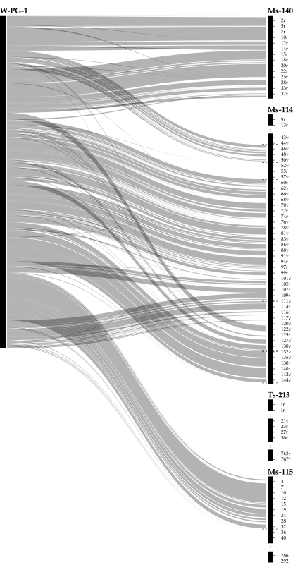
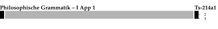
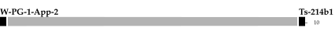
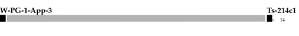
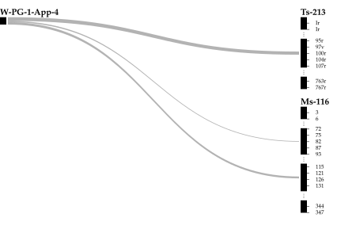
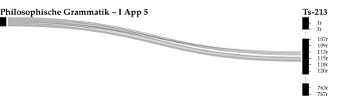
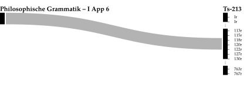
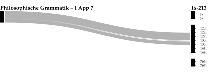
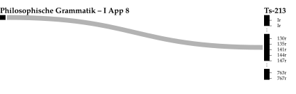
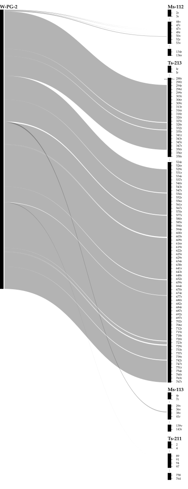

# Philosophical Grammar

1931–1938, 1528 remarks, Ms-140, Ms-114, Ts-213, Ms-115, and 7 more

- [Philosophical Grammar – I](/en/w-pg-1/)
- [Philosophical Grammar – I App 1](/en/w-pg-1-app-1/)
- [Philosophical Grammar – I App 2](/en/w-pg-1-app-2/)
- [Philosophical Grammar – I App 3](/en/w-pg-1-app-3/)
- [Philosophical Grammar – I App 4](/en/w-pg-1-app-4/)
- [Philosophical Grammar – I App 5](/en/w-pg-1-app-5/)
- [Philosophical Grammar – I App 6](/en/w-pg-1-app-6/)
- [Philosophical Grammar – I App 7](/en/w-pg-1-app-7/)
- [Philosophical Grammar – I App 8](/en/w-pg-1-app-8/)
- [Philosophical Grammar – II](/en/w-pg-2/)