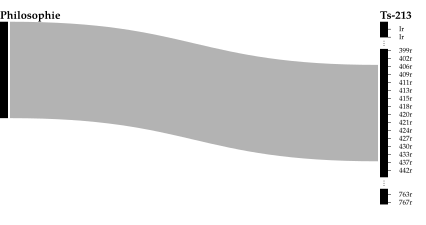

# Philosophy

1933, 121 remarks, Ts-213

### [Ts-213](/ts-213/#405r.1) [405r\[1\]](https://cdn.wittgensteinnachlass.com/2000px/webp/Ts-213/405r.webp)

_****Philosophy**.**_

### [Ts-213](/ts-213/#406r.1) [406r\[1\]](https://cdn.wittgensteinnachlass.com/2000px/webp/Ts-213/406r.webp)

86 _The difficulty of philosophy: not the intellectual difficulty of the sciences, but the difficulty of reorienting oneself. Resistances of the **will** have to be overcome._

### [Ts-213](/ts-213/#406r.2) [406r\[2\]](https://cdn.wittgensteinnachlass.com/2000px/webp/Ts-213/406r.webp)

As I have often said, philosophy does not lead me to renounce anything, since I do not refrain from saying something, but give up a certain combination of words as senseless. In another sense, however, philosophy does require resignation, but of feeling, not of the intellect. And perhaps that is what makes it so difficult for many. It can be hard not to use an expression, just as it is hard to hold back tears or an outburst of anger.

### [Ts-213](/ts-213/#406r.3+407r.1) [406r\[3\]](https://cdn.wittgensteinnachlass.com/2000px/webp/Ts-213/406r.webp),[407r\[1\]](https://cdn.wittgensteinnachlass.com/2000px/webp/Ts-213/407r.webp)

(Tolstoy: the meaning (significance) of a subject lies in its being intelligible to everyone. – That is true and false. What makes the subject hard to understand – if it is significant, important – is not that understanding it would require some special instruction in abstruse matters, but the opposition between understanding the subject and what most people _want_ to see. This can make the very thing that lies closest to hand the hardest of all to understand. What has to be overcome is not a difficulty of the intellect, but of the will.)

### [Ts-213](/ts-213/#407r.2) [407r\[2\]](https://cdn.wittgensteinnachlass.com/2000px/webp/Ts-213/407r.webp)

Work in philosophy is – as work in architecture often is – really more a matter of working on oneself. On one’s own conception. On how one sees things. (And on what one demands of them.)

### [Ts-213](/ts-213/#407r.3) [407r\[3\]](https://cdn.wittgensteinnachlass.com/2000px/webp/Ts-213/407r.webp)

Speaking in passing, in the old conception – say, that of the (great) Western philosophers – there were two kinds of problem in the scientific sense: essential, great, universal problems, and inessential, as it were accidental ones. Our conception, by contrast, is that there is no _great_, essential problem in the scientific sense.

### [Ts-213](/ts-213/#408r.1) [408r\[1\]](https://cdn.wittgensteinnachlass.com/2000px/webp/Ts-213/408r.webp)

87 _Philosophy points out the misleading analogies in the use of our language._

### [Ts-213](/ts-213/#408r.2) [408r\[2\]](https://cdn.wittgensteinnachlass.com/2000px/webp/Ts-213/408r.webp)

Is grammar, _as I use the word_, merely a description of how language is actually handled? So that its sentences could really be understood as sentences of a natural science? One could call that the descriptive science of speaking, as opposed to that of thinking.

### [Ts-213](/ts-213/#408r.3) [408r\[3\]](https://cdn.wittgensteinnachlass.com/2000px/webp/Ts-213/408r.webp)

After all, the rules _of chess_ could also be understood as sentences from the natural history of human beings. (Just as the games of animals are described in books of natural history.)

### [Ts-213](/ts-213/#408r.4+409r.1) [408r\[4\]](https://cdn.wittgensteinnachlass.com/2000px/webp/Ts-213/408r.webp),[409r\[1\]](https://cdn.wittgensteinnachlass.com/2000px/webp/Ts-213/409r.webp)

When I rectify a philosophical error and say that one has always imagined it this way, but it is not like that, I always point to an analogy that one has been guided by, and show that this analogy does not _fit_.

### [Ts-213](/ts-213/#409r.2) [409r\[2\]](https://cdn.wittgensteinnachlass.com/2000px/webp/Ts-213/409r.webp)

The effect of a false analogy taken into language: it _means_ constant struggle and disquiet (a constant irritation, as it were). It is as if from a distance a thing seems to be a person because we do not then perceive _certain things_, and up close we see that it is a tree stump. As soon as we go a little way off and lose sight of the explanation, _one_ shape appears to us; if we then look more closely, we see another; now we go off again, etc. etc.

### [Ts-213](/ts-213/#409r.3) [409r\[3\]](https://cdn.wittgensteinnachlass.com/2000px/webp/Ts-213/409r.webp)

(The unsettling character of grammatical unclarity.)

### [Ts-213](/ts-213/#409r.4) [409r\[4\]](https://cdn.wittgensteinnachlass.com/2000px/webp/Ts-213/409r.webp)

To philosophize is to reject false arguments.

### [Ts-213](/ts-213/#409r.5) [409r\[5\]](https://cdn.wittgensteinnachlass.com/2000px/webp/Ts-213/409r.webp)

The philosopher strives to find the redeeming word, that is, the word that finally allows us to grasp what has all along weighed on our consciousness without our being able to grasp it. (It is as if one had a hair on one’s tongue; one feels it but cannot grasp it and therefore cannot get rid of it.)

### [Ts-213](/ts-213/#409r.6) [409r\[6\]](https://cdn.wittgensteinnachlass.com/2000px/webp/Ts-213/409r.webp)

The philosopher gives us the word with which one can express the matter and render it harmless.

### [Ts-213](/ts-213/#410r.1) [410r\[1\]](https://cdn.wittgensteinnachlass.com/2000px/webp/Ts-213/410r.webp)

(The choice of our words is so important because what matters is to capture the physiognomy of the thing _exactly_, because only a thought aimed with precision can lead onto the right track. The carriage must be set on the rail _with hair’s-breadth precision_ if it is to roll on properly.)

### [Ts-213](/ts-213/#410r.2) [410r\[2\]](https://cdn.wittgensteinnachlass.com/2000px/webp/Ts-213/410r.webp)

One of the most important tasks is to express every false line of thought in such a characteristic way that the reader says “Yes, that is exactly what I meant”. To trace the physiognomy of every error.

### [Ts-213](/ts-213/#410r.3) [410r\[3\]](https://cdn.wittgensteinnachlass.com/2000px/webp/Ts-213/410r.webp)

And after all, we can only show someone else his error if he recognizes that this really is the expression of his feeling.

### [Ts-213](/ts-213/#410r.4) [410r\[4\]](https://cdn.wittgensteinnachlass.com/2000px/webp/Ts-213/410r.webp)

That is, only if he recognizes it as such _is_ it the right expression. (Psychoanalysis.)

### [Ts-213](/ts-213/#410r.5) [410r\[5\]](https://cdn.wittgensteinnachlass.com/2000px/webp/Ts-213/410r.webp)

What the other person recognizes as the source of his thought is the analogy I offer him.

### [Ts-213](/ts-213/#411r.1) [411r\[1\]](https://cdn.wittgensteinnachlass.com/2000px/webp/Ts-213/411r.webp)

88 _Whence the feeling that our grammatical investigations are fundamental?_

### [Ts-213](/ts-213/#411r.2) [411r\[2\]](https://cdn.wittgensteinnachlass.com/2000px/webp/Ts-213/411r.webp)

(We are occupied with questions of various kinds, such as “What is the specific gravity of this body”, “Will it stay fine today”, “Who will come in through the door next”, etc. But among our questions there are some of a special kind. Here we have a different experience. The questions seem more fundamental than the others. And now I say: when we have this experience, we have reached the boundary of language.)

### [Ts-213](/ts-213/#411r.3) [411r\[3\]](https://cdn.wittgensteinnachlass.com/2000px/webp/Ts-213/411r.webp)

Where does the examination derive its importance from, since it seems only to destroy everything interesting, i.e. everything great and important? (All buildings, as it were; leaving only chunks of stone and rubble.)

### [Ts-213](/ts-213/#411r.4+412r.1) [411r\[4\]](https://cdn.wittgensteinnachlass.com/2000px/webp/Ts-213/411r.webp),[412r\[1\]](https://cdn.wittgensteinnachlass.com/2000px/webp/Ts-213/412r.webp)

Where does the examination derive its importance from: the examination that draws our attention to the fact that one can use a table in more than _one_ way, that one can _devise_ a table as a guide to the use of a table, that one can also take an arrow as pointing in the direction from its tip to its tail, that I can use a model as a model in all sorts of ways?

### [Ts-213](/ts-213/#412r.2) [412r\[2\]](https://cdn.wittgensteinnachlass.com/2000px/webp/Ts-213/412r.webp)

We bring words back from their metaphysical use to their proper use in language. (The man who said that one cannot step twice into the same river said something false; one _can_ step twice into the same river.) And this is what the solution to all philosophical difficulties looks like. The answers to them, if they are right, must be _homely_ and _ordinary_. But one must look at them in the right spirit; _then it doesn’t matter_.

### [Ts-213](/ts-213/#412r.3) [412r\[3\]](https://cdn.wittgensteinnachlass.com/2000px/webp/Ts-213/412r.webp)

Where do the old philosophical problems get their significance from?

### [Ts-213](/ts-213/#412r.4) [412r\[4\]](https://cdn.wittgensteinnachlass.com/2000px/webp/Ts-213/412r.webp)

The proposition of identity, for example, seemed to have a fundamental significance. But the proposition that this “proposition” is nonsense has taken over that significance.

### [Ts-213](/ts-213/#412r.5) [412r\[5\]](https://cdn.wittgensteinnachlass.com/2000px/webp/Ts-213/412r.webp)

I might ask: Why do I find a grammatical joke in a certain sense deep? (And that is of course philosophical depth.)

### [Ts-213](/ts-213/#412r.6) [412r\[6\]](https://cdn.wittgensteinnachlass.com/2000px/webp/Ts-213/412r.webp)

Why do we feel that the investigation of grammar is fundamental?

### [Ts-213](/ts-213/#412r.7) [412r\[7\]](https://cdn.wittgensteinnachlass.com/2000px/webp/Ts-213/412r.webp)

(The word “fundamental” cannot mean anything metalogical or philosophical either, where it has any meaning at all.)

### [Ts-213](/ts-213/#412r.8+413r.1) [412r\[8\]](https://cdn.wittgensteinnachlass.com/2000px/webp/Ts-213/412r.webp),[413r\[1\]](https://cdn.wittgensteinnachlass.com/2000px/webp/Ts-213/413r.webp)

The investigation of grammar is fundamental in the same sense in which we can call language fundamental – call it, say, its own foundation.

### [Ts-213](/ts-213/#413r.2) [413r\[2\]](https://cdn.wittgensteinnachlass.com/2000px/webp/Ts-213/413r.webp)

After all, our grammatical investigation differs from that of a philologist, etc.: we are interested, for example, in translation from one language into other languages of our own invention. More generally, we are interested in rules that the philologist does not consider at all. So we can no doubt draw attention to this difference.

### [Ts-213](/ts-213/#413r.3) [413r\[3\]](https://cdn.wittgensteinnachlass.com/2000px/webp/Ts-213/413r.webp)

On the other hand, it would be misleading to say that we deal with what is essential in grammar (and he, with what is accidental).

### [Ts-213](/ts-213/#413r.4) [413r\[4\]](https://cdn.wittgensteinnachlass.com/2000px/webp/Ts-213/413r.webp)

“But that is only an outward distinction”. I think there is no other.

### [Ts-213](/ts-213/#413r.5) [413r\[5\]](https://cdn.wittgensteinnachlass.com/2000px/webp/Ts-213/413r.webp)

We might rather say that what we call grammar is something different from what he calls grammar. Just as we distinguish parts of speech where for him there is no distinction (_to be found_).

### [Ts-213](/ts-213/#413r.6) [413r\[6\]](https://cdn.wittgensteinnachlass.com/2000px/webp/Ts-213/413r.webp)

The importance of grammar is the importance of language.

### [Ts-213](/ts-213/#413r.7) [413r\[7\]](https://cdn.wittgensteinnachlass.com/2000px/webp/Ts-213/413r.webp)

One might also call a word, e.g. ‘red’, important in so far as it is used often and for important purposes, in contrast to, say, the word ‘pipe-lid’. And the grammar of the word ‘red’ is then important because it describes the meaning of the word ‘red’.

### [Ts-213](/ts-213/#413r.8) [413r\[8\]](https://cdn.wittgensteinnachlass.com/2000px/webp/Ts-213/413r.webp)

(All philosophy can do is destroy idols. And that means not creating a new one – say, in the “absence of an idol”.)

### [Ts-213](/ts-213/#414r.1) [414r\[1\]](https://cdn.wittgensteinnachlass.com/2000px/webp/Ts-213/414r.webp)

89 _Method of philosophy: the surveyable representation of grammatical facts._

_The aim: transparency of arguments. Justice._

### [Ts-213](/ts-213/#414r.3+415r.1) [414r\[3\]](https://cdn.wittgensteinnachlass.com/2000px/webp/Ts-213/414r.webp),[415r\[1\]](https://cdn.wittgensteinnachlass.com/2000px/webp/Ts-213/415r.webp)

Someone has heard that a ship’s anchor is raised by a steam engine. He thinks only of the one that drives the ship (and after which it is called a steamship) and cannot make sense of what he has heard. (Perhaps the difficulty only occurs to him later.) Now we tell him: No, it is not _this_ steam engine; besides it there are several others on board, and one of them raises the anchor. – Was his problem philosophical? Was it philosophical if he had heard of the existence of other steam engines on the ship and only needed to be reminded of them? – I think his lack of clarity has two parts: what the person explaining communicates to him as a fact, the questioner might quite well have thought up for himself as a possibility, and he might have put his question in a definite form instead of merely admitting that he was unclear. He could have dispelled this part of the doubt himself, whereas reflection could not have acquainted him with the facts. Or: the uneasiness that arose from his not knowing the truth could not be removed by any arranging of his concepts. The other uneasiness and lack of clarity are marked by the words “something here doesn’t seem right to me”, and the solution by (_the words_): “Oh, I see, you don’t mean _that_ steam engine” or – in another case – “… by steam engine you don’t just mean a reciprocating engine”.

### [Ts-213](/ts-213/#415r.2) [415r\[2\]](https://cdn.wittgensteinnachlass.com/2000px/webp/Ts-213/415r.webp)

The work of the philosopher is a gathering of memories for a specific purpose.

### [Ts-213](/ts-213/#415r.3) [415r\[3\]](https://cdn.wittgensteinnachlass.com/2000px/webp/Ts-213/415r.webp)

A philosophical question is like a question about the constitution of a particular society. – It would be rather as if a society were to meet without clearly written rules, but with a need for them: indeed, with an instinct by which they observe certain rules at their meetings: only this is made harder by the fact that nothing _about this_ is clearly stated and no arrangements are made to make the rules plain. Thus they actually regard one of their number as president, but he does not sit at the head of the table, there is nothing to distinguish him, and this makes the proceedings more difficult. So we come along and establish a clear order: we seat the president in an easily recognizable place and his secretary beside him at a separate little table, and the remaining members, who have equal rights, in two rows on either side of the table, etc., etc.

### [Ts-213](/ts-213/#415r.4+416r.1) [415r\[4\]](https://cdn.wittgensteinnachlass.com/2000px/webp/Ts-213/415r.webp),[416r\[1\]](https://cdn.wittgensteinnachlass.com/2000px/webp/Ts-213/416r.webp)

When one asks philosophy: “_what is_ – for example – substance?” one is asking for a rule. A general rule that _holds_ for the word “substance”, i.e. one by which I am resolved to play. – What I mean is: the question “what is …” does not relate to a particular – practical – case; we ask it from our desks. Just recall the case of the law of identity to see that settling a philosophical difficulty is not a matter of stating new truths about the object of the investigation (identity). The difficulty is only to understand how laying down a rule helps us. Why it puts us at ease after we have been so _deeply_ troubled. What puts us at ease is evidently that we see a system that (_systematically_) excludes those constructions that have always troubled us, that we didn’t know what to do with and yet thought we had to respect. In this respect, isn’t laying down such a grammatical rule like discovering an explanation in physics? e.g. the Copernican system? There is a similarity. – The strange thing about philosophical uneasiness and its resolution, _it might seem_, is that it is like the _torment_ of the ascetic who stood there groaning as he held up a heavy ball, and whom a man released by saying to him: “let it drop”. One asks oneself: If these sentences trouble you and you didn’t know what to do with them, why didn’t you let them drop earlier, what stopped you? Well, I think it was the false system he thought he had to conform to, etc. Hen & chalk line

### [Ts-213](/ts-213/#416r.2) [416r\[2\]](https://cdn.wittgensteinnachlass.com/2000px/webp/Ts-213/416r.webp)

(The peculiar relief that comes when we can set other, similar cases alongside a case we thought unique comes again and again in our investigations when we show that a word does not have just _one_ meaning (or just two), but is used in five or six different (_meanings_).)

### [Ts-213](/ts-213/#417r.1) [417r\[1\]](https://cdn.wittgensteinnachlass.com/2000px/webp/Ts-213/417r.webp)

One can compare philosophical problems to safe locks which are opened by setting a particular word or number, so that no force can open the door until precisely that word has been hit upon, and once it has been hit upon any child can open it.

### [Ts-213](/ts-213/#417r.2) [417r\[2\]](https://cdn.wittgensteinnachlass.com/2000px/webp/Ts-213/417r.webp)

The concept of a surveyable representation is of fundamental importance to us. It designates our form of representation, the way we see things. (A kind of ‘world-view’, such as apparently typifies our time, Spengler.)

### [Ts-213](/ts-213/#417r.3) [417r\[3\]](https://cdn.wittgensteinnachlass.com/2000px/webp/Ts-213/417r.webp)

This surveyable representation conveys the understanding that consists precisely in our “seeing the connections”. Hence the importance of the _intermediate links_.

### [Ts-213](/ts-213/#417r.4) [417r\[4\]](https://cdn.wittgensteinnachlass.com/2000px/webp/Ts-213/417r.webp)

A sentence whose grammar has been made completely clear has been completely analysed logically. It may be written down or uttered in whatever form of expression.

### [Ts-213](/ts-213/#417r.5) [417r\[5\]](https://cdn.wittgensteinnachlass.com/2000px/webp/Ts-213/417r.webp)

What our grammar lacks above all is _surveyability_.

### [Ts-213](/ts-213/#417r.6) [417r\[6\]](https://cdn.wittgensteinnachlass.com/2000px/webp/Ts-213/417r.webp)

Philosophy must not interfere with the actual use of language in any way; in the end, then, it can only describe it.

### [Ts-213](/ts-213/#417r.7+418r.1) [417r\[7\]](https://cdn.wittgensteinnachlass.com/2000px/webp/Ts-213/417r.webp),[418r\[1\]](https://cdn.wittgensteinnachlass.com/2000px/webp/Ts-213/418r.webp)

For it cannot justify it either. It leaves everything as it is. It also leaves mathematics as it is (as it is now) and no mathematical discovery can advance it. A “leading problem of mathematical logic” (Ramsey) is a problem of mathematics _like any other_.

### [Ts-213](/ts-213/#418r.2) [418r\[2\]](https://cdn.wittgensteinnachlass.com/2000px/webp/Ts-213/418r.webp)

(A simile belongs to our _structure_; but we cannot draw any consequences from it either; it does not lead us beyond itself, but must stand as a simile. We cannot draw any inferences from it. So, when we compare a sentence with a picture (where, of course, what we understand by ‘picture’ must already be fixed in us) or when I compare the application of language with that of, say, the calculus of multiplication. Philosophy simply lays everything out and explains nothing and infers nothing.)

### [Ts-213](/ts-213/#418r.3) [418r\[3\]](https://cdn.wittgensteinnachlass.com/2000px/webp/Ts-213/418r.webp)

Since everything lies open to view, there is nothing to explain either. For whatever may not lie open to view does not interest us. The answer to the question _asking for an explanation_ of negation really is: don’t you understand it? Well, if you understand it, _what is there still to explain_, what is there left for an explanation to do?

### [Ts-213](/ts-213/#418r.4) [418r\[4\]](https://cdn.wittgensteinnachlass.com/2000px/webp/Ts-213/418r.webp)

We must know what _explanation_ means. There is a constant danger of wanting to use this word in logic in a sense taken from physics.

### [Ts-213](/ts-213/#418r.5+419r.1) [418r\[5\]](https://cdn.wittgensteinnachlass.com/2000px/webp/Ts-213/418r.webp),[419r\[1\]](https://cdn.wittgensteinnachlass.com/2000px/webp/Ts-213/419r.webp)

[→ ] When methodology speaks of _measurement_, it does not tell us, say, what material would be most advantageous for making the yardstick in order to obtain such and such a result; even though that too belongs to the method of measuring. Rather, this investigation is concerned only with the circumstances under which we say that a length, a current strength, (etc.) has been measured. It seeks to tabulate the familiar methods we already use, in order thereby to fix the meaning of the words “length”, “current strength”, etc.)

### [Ts-213](/ts-213/#419r.2) [419r\[2\]](https://cdn.wittgensteinnachlass.com/2000px/webp/Ts-213/419r.webp)

If one wanted to put forward _theses_ in philosophy, it would never come up for discussion, because everyone would agree with them.

### [Ts-213](/ts-213/#419r.3) [419r\[3\]](https://cdn.wittgensteinnachlass.com/2000px/webp/Ts-213/419r.webp)

[→ ] Learning philosophy _really_ is a recollection. We recall that we really have used the words in this way.

### [Ts-213](/ts-213/#419r.4) [419r\[4\]](https://cdn.wittgensteinnachlass.com/2000px/webp/Ts-213/419r.webp)

The philosophically most important aspects of things are hidden by their simplicity and everyday character. (One cannot notice it because it is always (_plainly_) before one’s eyes.)

### [Ts-213](/ts-213/#419r.5) [419r\[5\]](https://cdn.wittgensteinnachlass.com/2000px/webp/Ts-213/419r.webp)

The very foundations of a person’s inquiry do not strike him at all. Unless _this_ has struck him at some point. (Frazer, etc., etc.) And that means: the most striking (strongest) thing does not strike him.

### [Ts-213](/ts-213/#419r.6) [419r\[6\]](https://cdn.wittgensteinnachlass.com/2000px/webp/Ts-213/419r.webp)

(One of the greatest obstacles to philosophy is the expectation of new, deep insights.)

### [Ts-213](/ts-213/#419r.7) [419r\[7\]](https://cdn.wittgensteinnachlass.com/2000px/webp/Ts-213/419r.webp)

One could also call what is possible _before_ all new discoveries and inventions philosophy.

### [Ts-213](/ts-213/#420r.1) [420r\[1\]](https://cdn.wittgensteinnachlass.com/2000px/webp/Ts-213/420r.webp)

This must also have to do with the fact that I cannot give any explanations of the variable “sentence”. It is clear that this logical concept, this variable, must be of the same order as the concept “reality” or “world”.

### [Ts-213](/ts-213/#420r.2) [420r\[2\]](https://cdn.wittgensteinnachlass.com/2000px/webp/Ts-213/420r.webp)

If someone believes he has found the solution to the ‘problem of life’ and wanted to say to himself that now everything is quite easy, to refute himself he need only remember that there was a time when this ‘solution’ had not been found; but even at _that_ time one had to be able to live, and in the light of that time the solution he has found seems like a mere accident. And so it is with us in logic. If there were a ‘solution’ to the logical (philosophical) problems, we would only have to remind ourselves that they were once unsolved (and even then one had to be able to live and think). – – –

### [Ts-213](/ts-213/#420r.3) [420r\[3\]](https://cdn.wittgensteinnachlass.com/2000px/webp/Ts-213/420r.webp)

All considerations can be pursued in a much more homely way than I pursued them in the past. And that is why no new words need be used in philosophy either; the old, ordinary words of the language suffice.

### [Ts-213](/ts-213/#420r.4) [420r\[4\]](https://cdn.wittgensteinnachlass.com/2000px/webp/Ts-213/420r.webp)

(Our task is only to be just. I.e., we have only to point out and resolve the injustices of philosophy, not to set up new parties – and creeds.)

### [Ts-213](/ts-213/#420r.5) [420r\[5\]](https://cdn.wittgensteinnachlass.com/2000px/webp/Ts-213/420r.webp)

(It is hard not to exaggerate in philosophy.)

### [Ts-213](/ts-213/#420r.6+421r.1) [420r\[6\]](https://cdn.wittgensteinnachlass.com/2000px/webp/Ts-213/420r.webp),[421r\[1\]](https://cdn.wittgensteinnachlass.com/2000px/webp/Ts-213/421r.webp)

(The philosopher exaggerates, cries out, as it were, in his helplessness, as long as he has not yet discovered the core of the confusion.)

### [Ts-213](/ts-213/#421r.2) [421r\[2\]](https://cdn.wittgensteinnachlass.com/2000px/webp/Ts-213/421r.webp)

The philosophical problem is a consciousness of the disorder in our concepts, and is to be removed by putting them in order.

### [Ts-213](/ts-213/#421r.3) [421r\[3\]](https://cdn.wittgensteinnachlass.com/2000px/webp/Ts-213/421r.webp)

A philosophical problem is always of the form: “I simply don’t know my way around”.

### [Ts-213](/ts-213/#421r.4) [421r\[4\]](https://cdn.wittgensteinnachlass.com/2000px/webp/Ts-213/421r.webp)

As I practise philosophy, its whole task is to shape the expression so that certain uneasinesses disappear. ((Hertz.))

### [Ts-213](/ts-213/#421r.5) [421r\[5\]](https://cdn.wittgensteinnachlass.com/2000px/webp/Ts-213/421r.webp)

If I am right, then philosophical problems, unlike all others, really must admit of solutions that leave nothing over.

### [Ts-213](/ts-213/#421r.6) [421r\[6\]](https://cdn.wittgensteinnachlass.com/2000px/webp/Ts-213/421r.webp)

When I say: Here we are at the limit of language, it always seems as though resignation were called for here, whereas on the contrary one is fully satisfied, since _no_ question remains.

### [Ts-213](/ts-213/#421r.7) [421r\[7\]](https://cdn.wittgensteinnachlass.com/2000px/webp/Ts-213/421r.webp)

The problems are dissolved in the literal sense – like a lump of sugar in water.

### [Ts-213](/ts-213/#421r.8) [421r\[8\]](https://cdn.wittgensteinnachlass.com/2000px/webp/Ts-213/421r.webp)

People who feel no need for transparency in their argumentation are lost to philosophy.

### [Ts-213](/ts-213/#422r.1) [422r\[1\]](https://cdn.wittgensteinnachlass.com/2000px/webp/Ts-213/422r.webp)

90 _Philosophy._

_The clarification of linguistic usage. Traps of language._

### [Ts-213](/ts-213/#422r.2) [422r\[2\]](https://cdn.wittgensteinnachlass.com/2000px/webp/Ts-213/422r.webp)

How does it come about that philosophy is such a complicated structure. Surely it should be completely simple, if it is that ultimate thing, independent of all experience, that you make it out to be. – Philosophy untangles the knots in our thinking; therefore its result must be simple, but its activity as complicated as the knots it untangles.

### [Ts-213](/ts-213/#422r.3) [422r\[3\]](https://cdn.wittgensteinnachlass.com/2000px/webp/Ts-213/422r.webp)

Lichtenberg: “All our philosophy is a correction of linguistic usage, hence the correction of a philosophy, and the most general one at that.”

### [Ts-213](/ts-213/#422r.4) [422r\[4\]](https://cdn.wittgensteinnachlass.com/2000px/webp/Ts-213/422r.webp)

[→ ] (The capacity for philosophy consists in the _capacity_ to receive a strong _and_ lasting impression from a fact of grammar.)

### [Ts-213](/ts-213/#422r.5+423r.1) [422r\[5\]](https://cdn.wittgensteinnachlass.com/2000px/webp/Ts-213/422r.webp),[423r\[1\]](https://cdn.wittgensteinnachlass.com/2000px/webp/Ts-213/423r.webp)

Why grammatical problems are so stubborn and apparently impossible to root out – because they are _connected_ with the oldest habits of thought, i.e. with the oldest pictures imprinted in our language itself. ((Lichtenberg.))

### [Ts-213](/ts-213/#423r.2) [423r\[2\]](https://cdn.wittgensteinnachlass.com/2000px/webp/Ts-213/423r.webp)

Teaching philosophy presents the same enormous difficulty that teaching geography would present if the pupil came with a host of false and far too simple ideas about the course and _interconnections_ of rivers and mountain ranges.

### [Ts-213](/ts-213/#423r.3) [423r\[3\]](https://cdn.wittgensteinnachlass.com/2000px/webp/Ts-213/423r.webp)

People are deeply embedded in philosophical, i.e. grammatical, confusions. And freeing them from these _presupposes_ tearing them out of the immensely varied connections in which they are caught. One has, so to speak, to regroup their entire language. – But this language arose as it did precisely because people had – and have – a tendency to think _this way_. So they can be torn out only if they live in instinctive revolt against language. Not if their every instinct is to live in _the_ herd that created this language as its _proper_ expression.

### [Ts-213](/ts-213/#423r.4) [423r\[4\]](https://cdn.wittgensteinnachlass.com/2000px/webp/Ts-213/423r.webp)

Language has the same traps ready for everyone; the vast network of well-maintained false paths. And so we see one person after another take the same paths, and already know where he will turn off now, where he will go straight on without noticing the turning, etc., etc. So I ought to put up signs wherever false paths branch off, to help people past the dangerous points.

### [Ts-213](/ts-213/#424r.1) [424r\[1\]](https://cdn.wittgensteinnachlass.com/2000px/webp/Ts-213/424r.webp)

One hears the _remark_ again and again that philosophy makes no real progress, that the same philosophical problems that already occupied the Greeks still occupy us. But those who _say_ this don’t understand why it is so. The reason is that our language has stayed the same and keeps seducing us into asking the same questions. As long as there is a verb ‘to be’ that seems to function like ‘to eat’ and ‘to drink’, as long as there are adjectives ‘identical’, ‘true’, ‘false’, ‘possible’, as long as there is talk of a flow of time and an extension of space, etc., etc., people will keep coming up against the same _enigmatic difficulties_ and staring at something that no explanation seems able to remove. And this, incidentally, satisfies a longing for the otherworldly, for in believing that they see the “limit of human understanding”, they naturally believe they can see beyond it.

### [Ts-213](/ts-213/#424r.2) [424r\[2\]](https://cdn.wittgensteinnachlass.com/2000px/webp/Ts-213/424r.webp)

I read “‥‥ philosophers are no nearer to the meaning of ‘Reality’ than Plato got ‥‥․”. What a strange situation. How odd, then, that Plato could get as far as he did at all! Or that we could then get no further! Was it because Plato was _so_ clever?

### [Ts-213](/ts-213/#424r.3+425.1) [424r\[3\]](https://cdn.wittgensteinnachlass.com/2000px/webp/Ts-213/424r.webp),[425\[1\]](https://cdn.wittgensteinnachlass.com/2000px/webp/Ts-213/425r.webp)

The conflict in which we repeatedly find ourselves in logical investigations is like the conflict between two people who have concluded a contract with each other, whose final formulations are set down in _words_ easily misinterpreted, whereas the elucidations of those formulations explain everything unambiguously. Now one of the two has a short memory, keeps forgetting the elucidations, misinterprets the terms of the contract and is continually getting into difficulties. The other must keep reminding the first person of the elucidations in the contract and clearing up the difficulty.

### [Ts-213](/ts-213/#425r.2) [425r\[2\]](https://cdn.wittgensteinnachlass.com/2000px/webp/Ts-213/425r.webp)

Remember how hard it is for children to believe (_or to see_) that a word really has two quite different meanings.

### [Ts-213](/ts-213/#425r.3) [425r\[3\]](https://cdn.wittgensteinnachlass.com/2000px/webp/Ts-213/425r.webp)

The aim of philosophy is to put up a wall where language stops anyway.

### [Ts-213](/ts-213/#425r.4) [425r\[4\]](https://cdn.wittgensteinnachlass.com/2000px/webp/Ts-213/425r.webp)

The results of philosophy are the discovery of some simple nonsense, and the bumps that the intellect has acquired while running up against the limits of language. They, the bumps, let us _understand_ the value of that discovery.

### [Ts-213](/ts-213/#425r.5) [425r\[5\]](https://cdn.wittgensteinnachlass.com/2000px/webp/Ts-213/425r.webp)

What kind of investigation is ours? Do I examine the cases I cite as examples to see how probable they are? or whether they are _actual_? No, I cite only what is possible, so I give grammatical examples.

### [Ts-213](/ts-213/#425r.6) [425r\[6\]](https://cdn.wittgensteinnachlass.com/2000px/webp/Ts-213/425r.webp)

Philosophy is set down not in sentences but in a language.

### [Ts-213](/ts-213/#425r.7) [425r\[7\]](https://cdn.wittgensteinnachlass.com/2000px/webp/Ts-213/425r.webp)

Just as laws become interesting only when there is a tendency to break them, so _certain_ grammatical rules become interesting only when philosophers would like to break them.

### [Ts-213](/ts-213/#426r.1) [426r\[1\]](https://cdn.wittgensteinnachlass.com/2000px/webp/Ts-213/426r.webp)

The savages have games (or that at least is what we call them) for which they have no written rules, no list of rules. Now let us imagine _an investigator_ at work, travelling through these peoples’ countries and drawing up lists of rules for their games. That is the whole analogue of what the philosopher does. ((But why don’t I say: “The savages have languages (or we …), … have no written grammar …”?))

### [Ts-213](/ts-213/#427r.1) [427r\[1\]](https://cdn.wittgensteinnachlass.com/2000px/webp/Ts-213/427r.webp)

91 _Philosophical problems do not confront us in practical life at all (as problems in physics, for instance, do), but only when we let ourselves be guided in forming our sentences not by a practical purpose but by certain analogies in language._

### [Ts-213](/ts-213/#427r.2) [427r\[2\]](https://cdn.wittgensteinnachlass.com/2000px/webp/Ts-213/427r.webp)

Language cannot express what belongs to the essence of the world. So it cannot _say_ that everything flows. Language can say only what we could also imagine otherwise. That everything flows must lie in the nature of language’s contact with reality. Or better: that everything flows must lie in the nature of language. And let us remember: in ordinary life this does not strike us – any more than the blurred edges of our visual field do (“because we are so used to it”, some will say). How, on what occasion, do we think we become aware of it, then? Isn’t it when we want to form sentences that go against the grammar of time?

### [Ts-213](/ts-213/#427r.3+428r.1) [427r\[3\]](https://cdn.wittgensteinnachlass.com/2000px/webp/Ts-213/427r.webp),[428r\[1\]](https://cdn.wittgensteinnachlass.com/2000px/webp/Ts-213/428r.webp)

When one says that ‘everything flows’, we feel that we are prevented from holding on to what is real, to reality proper. The process on the screen slips away from us precisely because it is a process. But we do describe something; and is that another process? Clearly, the description is connected with the very picture on the screen. There must be a false picture underlying our feeling of helplessness. For whatever we want to be able to describe, we can describe.

### [Ts-213](/ts-213/#428r.2) [428r\[2\]](https://cdn.wittgensteinnachlass.com/2000px/webp/Ts-213/428r.webp)

Isn’t this false picture that of a strip of pictures running past so fast that we have no time to take in a picture?

### [Ts-213](/ts-213/#428r.3) [428r\[3\]](https://cdn.wittgensteinnachlass.com/2000px/webp/Ts-213/428r.webp)

For in that case we would be inclined to run after the picture. But there is nothing analogous to that in the course of a process.

### [Ts-213](/ts-213/#428r.4) [428r\[4\]](https://cdn.wittgensteinnachlass.com/2000px/webp/Ts-213/428r.webp)

It is curious that in ordinary life we never have the feeling that the phenomenon is slipping away from us, the feeling of the constant flow of appearances, but have it only when we philosophize. This suggests that what we have here is a thought suggested to us by a mistaken use of our language.

### [Ts-213](/ts-213/#428r.5) [428r\[5\]](https://cdn.wittgensteinnachlass.com/2000px/webp/Ts-213/428r.webp)

The feeling, that is, is that the present recedes into the past without our being able to stop it. And here we are clearly making use of the picture of a strip that moves past us incessantly and that we cannot stop. But of course it is equally clear that the picture is being misused. That one cannot say “time flows” if by “time” one means the possibility of change.

### [Ts-213](/ts-213/#428r.6+429r.1) [428r\[6\]](https://cdn.wittgensteinnachlass.com/2000px/webp/Ts-213/428r.webp),[429r\[1\]](https://cdn.wittgensteinnachlass.com/2000px/webp/Ts-213/429r.webp)

That nothing strikes us when we look about, look around in space, feel our own body, etc. etc., shows how natural these very things are to us. We do not perceive that we see space in perspective or that the visual image is in some sense blurred towards the edge. It never strikes us and can never strike us, because it is _the_ way we perceive. We never think about it, and it is impossible to do so, because there is no contrast to the form of our world.

### [Ts-213](/ts-213/#429r.2) [429r\[2\]](https://cdn.wittgensteinnachlass.com/2000px/webp/Ts-213/429r.webp)

I wanted to say that it is curious that those who ascribe reality only to things, not to our mental images, move about in the world of the imagination as a matter of course and never long to get out of it. I.e., how much we take the given for granted. Things would have to be devilishly strange if that were the little picture taken from a skewed angle. What we take for granted, _life_, is supposed to be something accidental, incidental; whereas something I normally never rack my brains over is supposed to be what is real! I.e., what one cannot and does not want to go beyond would not be the world. Again and again it is the attempt to delimit the world in language and single it out – but that cannot be done. The fact that the world is taken for granted finds expression precisely in the fact that language means only the world and can mean only the world. For since language gets its way of meaning only from its meaning, from the world, no language is conceivable that does not represent this world.

### [Ts-213](/ts-213/#429r.3) [429r\[3\]](https://cdn.wittgensteinnachlass.com/2000px/webp/Ts-213/429r.webp)

In the theories and disputes of philosophy we find words whose meanings are well known to us from everyday life applied in an ultraphysical sense.

### [Ts-213](/ts-213/#430r.1) [430r\[1\]](https://cdn.wittgensteinnachlass.com/2000px/webp/Ts-213/430r.webp)

When philosophers use a word and inquire into its meaning, one must always ask oneself: is this word ever actually used in that way in the language that created it? One will usually find that it is not, and that the word is being used contrary to its normal grammar. (“knowledge”, “being”, “thing”.)

### [Ts-213](/ts-213/#430r.2) [430r\[2\]](https://cdn.wittgensteinnachlass.com/2000px/webp/Ts-213/430r.webp)

(Philosophers are often like little children who first scribble some _arbitrary_ lines on a piece of paper with their pencil and then ask the grown-up “what is that?” – What happened was this: the grown-up had often drawn something for the child and said: “that is a man”, “that is a house”, etc. And now the child draws lines too and asks: what, then, is _that_?)

### [Ts-213](/ts-213/#431r.1) [431r\[1\]](https://cdn.wittgensteinnachlass.com/2000px/webp/Ts-213/431r.webp)

92 _Method in philosophy. Possibility of making calm progress._

### [Ts-213](/ts-213/#431r.2) [431r\[2\]](https://cdn.wittgensteinnachlass.com/2000px/webp/Ts-213/431r.webp)

The real discovery is the one that makes me capable of stopping philosophizing whenever I want. The one that brings philosophy to rest, so that it is no longer tormented by questions that call _philosophy itself_ into question. Instead, a method is now demonstrated through examples, & one can stop the series of these examples

### [Ts-213](/ts-213/#431r.3) [431r\[3\]](https://cdn.wittgensteinnachlass.com/2000px/webp/Ts-213/431r.webp)

But it would be more correct to say: problems are solved (disquiet dispelled), not _one_ problem.

### [Ts-213](/ts-213/#431r.4+432r.1) [431r\[4\]](https://cdn.wittgensteinnachlass.com/2000px/webp/Ts-213/431r.webp),[432r\[1\]](https://cdn.wittgensteinnachlass.com/2000px/webp/Ts-213/432r.webp)

The unrest in philosophy comes from the fact that philosophers look at philosophy the wrong way, that they see it the wrong way, namely as if it were divided into (infinite) longitudinal strips, instead of (finite) transverse strips. This change in perspective is the _greatest_ difficulty. They want, then, as it were, to grasp the infinite strip, and complain that it is not possible piece by piece. Of course not, if one understands a piece as an endless longitudinal strip. But it would be possible if one saw a transverse strip as a piece. – But then we will never be finished with our work! Of course not, because it has no end, after all.

### [Ts-213](/ts-213/#432r.2) [432r\[2\]](https://cdn.wittgensteinnachlass.com/2000px/webp/Ts-213/432r.webp)

(Instead of turbulent conjectures and explanations, we want to give calm _accounts_ of linguistic facts.)

### [Ts-213](/ts-213/#432r.3) [432r\[3\]](https://cdn.wittgensteinnachlass.com/2000px/webp/Ts-213/432r.webp)

We must plough through the whole of language.

### [Ts-213](/ts-213/#432r.4) [432r\[4\]](https://cdn.wittgensteinnachlass.com/2000px/webp/Ts-213/432r.webp)

(Most people, when they want to undertake a philosophical investigation, go about it like someone looking extremely nervously for an object in a drawer. He throws papers out of the drawer – what he is looking for may be among them – and leafs hastily and carelessly through the rest. Throws some back into the drawer, mixes them up with the others, etc. All one can say to him then is: Stop, if you search _like that_, I can’t help you look. First you must start going through things methodically, one after the other, quite calmly; then I am ready to look with you and to follow your lead _in the method_ too.)

### [Ts-213](/ts-213/#433r.1) [433r\[1\]](https://cdn.wittgensteinnachlass.com/2000px/webp/Ts-213/433r.webp)

93 _The mythology in the forms of our language. ((Paul Ernst.))_

### [Ts-213](/ts-213/#433r.2) [433r\[2\]](https://cdn.wittgensteinnachlass.com/2000px/webp/Ts-213/433r.webp)

In the old rites we have the use of a highly developed language of gestures. And when I read Frazer, at every turn I want to say: all these processes, these changes of meaning, are still there before us in our word-language. If what is hiding in the last sheaf is called the ‘corn-wolf’, but so are the sheaf itself and the man who binds it, then we recognize in this a linguistic process well known to us.

### [Ts-213](/ts-213/#433r.3) [433r\[3\]](https://cdn.wittgensteinnachlass.com/2000px/webp/Ts-213/433r.webp)

The scapegoat, on which one lays one’s sin and which runs off into the wilderness with it, – a false picture, like those that cause philosophical errors.

### [Ts-213](/ts-213/#433r.4) [433r\[4\]](https://cdn.wittgensteinnachlass.com/2000px/webp/Ts-213/433r.webp)

I want to say: nothing shows our kinship with those savages better than the fact that Frazer has ready to hand a word as familiar to him and to us as “ghost” or “shade” to describe the views of these people.

### [Ts-213](/ts-213/#434r.1) [434r\[1\]](https://cdn.wittgensteinnachlass.com/2000px/webp/Ts-213/434r.webp)

(That is quite different from his describing the savages, say, as imagining that their heads fall off when they have slain an enemy. Here there would be nothing superstitious or magical about _our description_.)

### [Ts-213](/ts-213/#434r.2) [434r\[2\]](https://cdn.wittgensteinnachlass.com/2000px/webp/Ts-213/434r.webp)

Indeed, this peculiarity does not concern just the expressions “ghost” and “shade”, and far too little is made of the fact that we count the words “soul” and “mind” (“spirit”) as part of our own cultivated vocabulary. _By contrast_ it is a _trifle_ that we do not believe our soul eats and drinks.

### [Ts-213](/ts-213/#434r.3) [434r\[3\]](https://cdn.wittgensteinnachlass.com/2000px/webp/Ts-213/434r.webp)

A whole mythology is laid down in our language.

### [Ts-213](/ts-213/#434r.4) [434r\[4\]](https://cdn.wittgensteinnachlass.com/2000px/webp/Ts-213/434r.webp)

Driving out death or killing death; but on the other hand death is represented as a skeleton, and so is itself in a certain sense dead. “As dead as death”. ‘Nothing is as dead as death; nothing as beautiful as beauty itself!’ The picture in terms of which one imagines reality here is that beauty, death, etc. are the pure (concentrated) substance, whereas in a beautiful object the substance is present as an admixture. – And don’t I recognize here my own reflections on ‘object’ and ‘complex’? (Plato.)

### [Ts-213](/ts-213/#434r.5) [434r\[5\]](https://cdn.wittgensteinnachlass.com/2000px/webp/Ts-213/434r.webp)

The primitive forms of our language: noun, adjective and verb show the simple picture _to_ whose form _it_ seeks to make everything conform.

### [Ts-213](/ts-213/#434r.6+435r.1) [434r\[6\]](https://cdn.wittgensteinnachlass.com/2000px/webp/Ts-213/434r.webp),[435r\[1\]](https://cdn.wittgensteinnachlass.com/2000px/webp/Ts-213/435r.webp)

So long as one pictures the soul as a _thing_, a _body_ that is in our head, this hypothesis is _not_ dangerous. The danger lies not in the imperfection and crudeness of our models but in their lack of clarity (indistinctness). The danger begins when we notice that the old model is inadequate but do not change it, merely sublimating it, as it were. As long as I say that the thought is in my head, everything is all right; it becomes dangerous when we say that the thought is not in my head but in my mind.
