# Philosophical Remarks

1930–1933, 1161 remarks, Ts-209, Ts-214a1, Ts-215a, Ts-215b, Ms-109

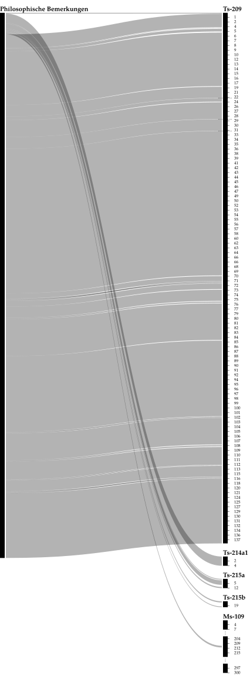

### [Ts-209](/ts-209/#TP.1) [TP\[1\]](https://cdn.wittgensteinnachlass.com/2000px/webp/Ts-209/TP.webp)

## Philosophical Remarks

### [Ts-209](/ts-209/#TP.2) [TP\[2\]](https://cdn.wittgensteinnachlass.com/2000px/webp/Ts-209/TP.webp)

Et multi ante nos vitam istam agentes, praestruxerant aerumnosas vias, per quas transire cogebamur multiplicato labore et dolore filiis Adam. (Augustinus)

### [Ts-214a1](/ts-214a1/#1.1) [1\[1\]](https://cdn.wittgensteinnachlass.com/2000px/webp/Ts-214a1/1.webp)

## Komplex und Tatsache.

### [Ts-214a1](/ts-214a1/#1.2) [1\[2\]](https://cdn.wittgensteinnachlass.com/2000px/webp/Ts-214a1/1.webp)

Der Gebrauch des Wortes “Tatsache” und “Tat”. – “Das war eine edle Tat”. – “Aber das ist ja nie geschehen.” – Es liegt nahe, das Wort “Tat” so gebrauchen zu wollen, daß es nur dem _wahren_ Satz entspricht. Man redet dann also nicht von einer Tat, die nie getan wurde. Aber der Satz “das war eine edle Tat” muß doch seinen Sinn behalten, auch wenn ich mich darin irre, daß geschehen ist, was ich die Tat nenne. Und darin liegt bereits alles Wichtige und ich kann nur die Bestimmung treffen, daß ich die Wörter “Tat”, “Tatsache”, (etwa auch “Ereignis”) nur in einem Satz verwenden werde, der komplett, das Bestehen dieser behauptet.

### [Ts-214a1](/ts-214a1/#1.3) [1\[3\]](https://cdn.wittgensteinnachlass.com/2000px/webp/Ts-214a1/1.webp)

Es wäre besser, die Einschränkung in dem Gebrauch dieser Wörter fallen zu lassen, da sie nur irreführend wirkt, und ruhig zu sagen “diese Tat ist nicht begangen worden”, “diese Tatsache besteht nicht”, “dieses Ereignis ist nicht eingetreten”.

### [Ts-214a1](/ts-214a1/#1.4) [1\[4\]](https://cdn.wittgensteinnachlass.com/2000px/webp/Ts-214a1/1.webp)

Komplex ist nicht gleich Tatsache. Denn von einem Komplex sage ich z.B., er bewege sich von einem Ort zum andern, aber nicht von einer Tatsache. Daß aber dieser Komplex sich jetzt dort befindet, ist eine Tatsache.

### [Ts-214a1](/ts-214a1/#2.1) [2\[1\]](https://cdn.wittgensteinnachlass.com/2000px/webp/Ts-214a1/2.webp)

“Dieser Gebäudekomplex wird eingerissen” heißt so viel wie “die Gebäude, die so beisammenstehen, werden eingerissen”

### [Ts-214a1](/ts-214a1/#2.2) [2\[2\]](https://cdn.wittgensteinnachlass.com/2000px/webp/Ts-214a1/2.webp)

Die Blume, das Haus, das Sternbild nenne ich Komplexe, und zwar, von Ziegeln, von Blättern, von Sternen, etc.. Daß dieses Sternbild hier steht, kann allerdings durch einen Satz beschrieben werden, worin nur von seinen Sternen die Rede ist und das Wort ‘Sternbild’, oder sein Name, nicht vorkommen.

### [Ts-214a1](/ts-214a1/#2.3) [2\[3\]](https://cdn.wittgensteinnachlass.com/2000px/webp/Ts-214a1/2.webp)

Aber das ist auch alles, was man von der Beziehung zwischen Komplex und Tatsache sagen kann. Und Komplex ist ein räumlicher Gegenstand, bestehend aus räumlichen Gegenständen. (Wobei der Begriff ‘räumlich’ einiger Ausdehnung fähig ist.)

### [Ts-214a1](/ts-214a1/#2.4) [2\[4\]](https://cdn.wittgensteinnachlass.com/2000px/webp/Ts-214a1/2.webp)

Ein Komplex besteht aus seinen Teilen, den gleichartigen Dingen, die ihn bilden. (Dies ist natürlich ein Satz der Grammatik über die Wörter ‘Komplex’, ‘Teil’ und ‘bestehen’.)

### [Ts-214a1](/ts-214a1/#2.5) [2\[5\]](https://cdn.wittgensteinnachlass.com/2000px/webp/Ts-214a1/2.webp)

Zu sagen, ein roter Kreis _bestehe aus_ Röte und Kreisförmigkeit, oder sei ein Komplex aus diesen Bestandteilen, ist ein Mißbrauch dieser Wörter und irreführend (Frege wüßte dies und sagte es mir). Ebenso irreführend, zu sagen, die Tatsache, daß dieser Kreis rot ist (daß ich müde bin), sei ein Komplex aus den Bestandteilen Kreis und Röte aus mir und der Müdigkeit).

### [Ts-214a1](/ts-214a1/#2.6) [2\[6\]](https://cdn.wittgensteinnachlass.com/2000px/webp/Ts-214a1/2.webp)

Auch ist das Haus nicht ein Komplex aus den Ziegeln und ihren räumlichen Beziehungen. D.h., auch das ist gegen den richtigen Gebrauch der Worte.

### [Ts-214a1](/ts-214a1/#2.7+3.1) [2\[7\]](https://cdn.wittgensteinnachlass.com/2000px/webp/Ts-214a1/2.webp),[3\[1\]](https://cdn.wittgensteinnachlass.com/2000px/webp/Ts-214a1/3.webp)

Man kann nun zwar auf eine Konstellation zeigen und sagen: diese Konstellation besteht ganz aus _Gegenständen_, die ich schon kenne; aber man kann nicht ‘auf eine falsche Tatsache zeigen’ und dies sagen.

### [Ts-214a1](/ts-214a1/#3.2) [3\[2\]](https://cdn.wittgensteinnachlass.com/2000px/webp/Ts-214a1/3.webp)

Der Ausdruck “eine Tatsache beschreiben” oder “die Beschreibung einer Tatsache” für die Aussage, die das Bestehen der Tatsache behauptet, ist auch _irreführend_, weil es so klingt, wie “das Tier beschreiben, das ich gesehen habe”.

### [Ts-214a1](/ts-214a1/#3.3) [3\[3\]](https://cdn.wittgensteinnachlass.com/2000px/webp/Ts-214a1/3.webp)

Man sagt freilich auch “auf die Tatsache hinweisen”, aber das heißt immer “auf die Tatsache hinweisen, daß …”. Dagegen heißt “auf eine Blume zeigen” (oder “hinweisen”) nicht, darauf hinweisen, daß diese Blüte auf diesem Stengel sitzt; denn von dieser Blüte und diesem Stengel braucht da gar nicht die Rede zu sein.

### [Ts-214a1](/ts-214a1/#3.4) [3\[4\]](https://cdn.wittgensteinnachlass.com/2000px/webp/Ts-214a1/3.webp)

Ebensowenig kann es heißen, auf die Tatsache hinweisen, daß dort diese Blume steht.

### [Ts-214a1](/ts-214a1/#3.5) [3\[5\]](https://cdn.wittgensteinnachlass.com/2000px/webp/Ts-214a1/3.webp)

Auf eine Tatsache hinweisen heißt, etwas behaupten, aussagen. ‘Auf eine Blume hinweisen’ heißt das nicht.

### [Ts-214a1](/ts-214a1/#3.6) [3\[6\]](https://cdn.wittgensteinnachlass.com/2000px/webp/Ts-214a1/3.webp)

Auch die Kette besteht (nur) aus ihren Gliedern, nicht aus ihnen und ihren räumlichen Beziehungen.

### [Ts-214a1](/ts-214a1/#3.7) [3\[7\]](https://cdn.wittgensteinnachlass.com/2000px/webp/Ts-214a1/3.webp)

Die Tatsache, daß diese Glieder so zusammenhängen, ‘_besteht_’ aus gar nichts.

### [Ts-214a1](/ts-214a1/#3.8) [3\[8\]](https://cdn.wittgensteinnachlass.com/2000px/webp/Ts-214a1/3.webp)

Die Wurzel dieser Verwechslung ist der verwirrende Gebrauch des Wortes “Gegenstand”.

### [Ts-214a1](/ts-214a1/#4.1) [4\[1\]](https://cdn.wittgensteinnachlass.com/2000px/webp/Ts-214a1/4.webp)

Der Teil kleiner als der Ganze. Das gäbe auf Tatsache und Konstituent angewandt eine Absurdität.

### [Ts-214a1](/ts-214a1/#4.2) [4\[2\]](https://cdn.wittgensteinnachlass.com/2000px/webp/Ts-214a1/4.webp)

Das Schema: Ding-Eigenschaft. Man sagt: eine Handlung habe eine Eigenschaft! etwa die der Schnelligkeit; oder die der Güte.

### [Ts-215a](/ts-215a/#1.1) [1\[1\]](https://cdn.wittgensteinnachlass.com/2000px/webp/Ts-215a/1.webp)

## Infinitely long.

### [Ts-215a](/ts-215a/#1.2) [1\[2\]](https://cdn.wittgensteinnachlass.com/2000px/webp/Ts-215a/1.webp)

When one speaks of the concept ‘infinity’, one must remember that this word has many different meanings, and remember which of them we are speaking of just now. Whether, for example, it is the infinity of a series of numbers, and of the cardinal numbers in particular. If, for example, I say that ‘infinite’ is a characteristic of a rule, I am referring to _one_ particular meaning of the word. But we could quite well say that a continuous transition in colour is a transition “through infinitely many stages”, provided we do not forget that here we are defining the meaning of the expression “infinitely many stages” _anew_ through the experience of the transition in colour. (Albeit by analogy with other uses of the word “infinite”.)

### [Ts-215a](/ts-215a/#1.4+2.1) [1\[4\]](https://cdn.wittgensteinnachlass.com/2000px/webp/Ts-215a/1.webp),[2\[1\]](https://cdn.wittgensteinnachlass.com/2000px/webp/Ts-215a/2.webp)

(If one says that this area of our subject is extraordinarily difficult, that is not true in the sense that we are dealing with things that are extraordinarily difficult to imagine or extraordinarily complicated, but only in the sense that it is extraordinarily difficult to get past the countless traps laid for us here in language.)

### [Ts-215a](/ts-215a/#2.2) [2\[2\]](https://cdn.wittgensteinnachlass.com/2000px/webp/Ts-215a/2.webp)

““I once said that there was no extensive infinity. Ramsey replied: “Can one not imagine a person living for ever, i.e. simply never dying, and is that not extensive infinity?” – Surely I can imagine a wheel turning and _never_ stopping.”” What a strange argument: “I can imagine it”! Let us consider (for ourselves) what experience we would regard as confirmation or proof that the wheel will never stop turning. Let us compare this experience with the one that teaches us that the wheel turns for a day, a year, 10 years, and we will simply recognize the difference in grammar between the statements “…never stops” and “…stops in 100 years”. Think of the kind of evidence one might adduce for the assertion that two heavenly bodies revolve around one another without stopping. Think of the law of inertia, and of how it is confirmed.

### [Ts-215a](/ts-215a/#2.3+3.1) [2\[3\]](https://cdn.wittgensteinnachlass.com/2000px/webp/Ts-215a/2.webp),[3\[1\]](https://cdn.wittgensteinnachlass.com/2000px/webp/Ts-215a/3.webp)

““Suppose we walked out into Euclidean space along a straight line and encountered an iron sphere every 10 m ad inf..”” Again: What sort of experience would I regard as confirmation of this, and what sort, on the other hand, as confirmation that there are 10000 spheres in a row? – A confirmation of the first kind might be as follows: I observe the oscillating movement of a body. Experiments have taught me that this body is attracted by iron spheres according to a particular law; the assumption of 100 such spheres in a row in a particular position relative to the test body, given the assumption of that law of attraction, accounts approximately for the observed (or assumed) behaviour; but the more spheres we assume there are in the row, the more closely the calculated result corresponds to the observed one. It then makes sense to say that the experience confirms the assumption of an infinite row of spheres. But the sense of specifying a number differs from that of specifying an “infinite number” just as much as this experience differs from seeing a number of spheres.

### [Ts-215a](/ts-215a/#3.2) [3\[2\]](https://cdn.wittgensteinnachlass.com/2000px/webp/Ts-215a/3.webp)

““The merely negative description of _not coming to an end_ cannot yield a positive infinity.”” In using the expression “positive infinity”, I was of course thinking of a countable ( = finite) collection of things (chairs in this room), and wanted to say that the presence of that colossal number of such things could not be inferred from what the not coming to an end indicates to us. So here I make the strange mistake, in the form of my statement, of denying a fact instead of denying that a particular sentence has sense, or, more correctly, of showing that two statements that sound alike have different grammars.

### [Ts-215a](/ts-215a/#3.3+4.1) [3\[3\]](https://cdn.wittgensteinnachlass.com/2000px/webp/Ts-215a/3.webp),[4\[1\]](https://cdn.wittgensteinnachlass.com/2000px/webp/Ts-215a/4.webp)

What a strange question: “can one imagine an endless row of trees?”! When one speaks of an ‘endless row of trees’, what one means will surely be connected with the experiences one calls “seeing a row of trees”, “counting a row of trees”, “measuring a row of trees”, etc. “Can we imagine an infinite row of trees”! Certainly, once we have settled what is to be understood by it; i.e.: once we have brought this concept into connection with all that, with the experiences that determine for us the concept of a row of trees. What is the criterion in experience for a row of trees being infinite? for from that I will see how this statement is to be understood. Or do you give me no such criterion, – what am I then to do with the concept “infinite row of trees”? What has this concept to do with what I ordinarily call a row of trees? Or did you mean after all only: an immensely long row of trees?!

### [Ts-215a](/ts-215a/#4.2+5.1) [4\[2\]](https://cdn.wittgensteinnachlass.com/2000px/webp/Ts-215a/4.webp),[5\[1\]](https://cdn.wittgensteinnachlass.com/2000px/webp/Ts-215a/5.webp)

“But surely, when we walk along a row of trees, we know an experience that we can call the row coming to an end. Now, an endless row of trees is one along which we never _have_ this experience”. – But what does “never” mean here? I know an experience that I describe in the words: “he never coughed during this hour”, or “he never laughed in his life”. One cannot speak of a _corresponding_ experience if the “never” does not refer to an interval of time. So here again the analogy lets us down, and I must investigate afresh how the word “never” can be used with sense in this case. – Now, such uses can indeed be found, but their rules have to be investigated separately. For example, the sentence that a row of trees is infinitely long (or the one that we will _never_ come to an end) can be a law of nature of the same kind as the law of inertia, which says that under certain circumstances a body moves at constant speed in a straight line; and here too one could say that under these circumstances the movement will _never_ end. If one asks about the verification of such a sentence, the first thing one can say is that it is falsified if the movement (the row of trees) comes to an end. There can be no question of verification here, and that means that we are dealing with a fundamentally different kind of sentence (or with a sentence in a different sense of that word). Of course I do not want to say that this is the only use with sense of the expression “infinite row of trees”, or of the word “never” (for all eternity). But each of these uses must be described separately and has its own laws. It does us no good to find a form of speech ready-made in our ordinary language, because this language uses each of its words in a great variety of meanings, and the fact that we understand the use of a word in _one_ case does not spare us the investigation of its grammar in another. So we might think: “surely it is possible to imagine an infinitely long life, for someone who simply never dies lives for an infinitely long time”. But the use of the word “never” is not so simple _at all_.

### [Ts-215a](/ts-215a/#5.2+6.1) [5\[2\]](https://cdn.wittgensteinnachlass.com/2000px/webp/Ts-215a/5.webp),[6\[1\]](https://cdn.wittgensteinnachlass.com/2000px/webp/Ts-215a/6.webp)

Let us now speak of an endless life in the sense of a hypothesis (cf. the law of inertia), and let the person living it choose any one fraction from each interval in turn – between 1 and 2, between 2 and 3, between 3 and 4, etc. ad inf. – and write it down. Do we thereby obtain a “selection from all those intervals”? No, for his choosing has no end. It makes no sense ever to say of him that he has completed the selection. But can I not say that all the intervals must surely be reached, since I cannot name one that would not be reached? But from the fact that he will at some point reach each interval, it does not follow that at some point he will have reached them all. For if we use the word “reach” as in “he reaches something at a particular time” (i.e. in this grammatical context), then saying that he “reaches each interval at some point” means roughly: that he reaches the first after the first second, the second after the second, the third after the third, and so on ad inf.. Thus a law is given here by means of the expression and so on ad inf. But then to say that he reaches all the intervals would mean that he reaches them at a particular time, that the process thus comes to an end, – which contradicts the first assumption. So if one infers from his reaching each interval that he reaches them all, one uses the word “reaches” in quite a different way the second time! “But now imagine a man who becomes more and more practised at choosing from the intervals, so that he needs an hour for the first choice, half an hour for the second, a quarter for the third, and so on ad inf.. Then surely he would finish the whole job in two hours!” Let us picture the process. Choosing might consist in writing down the fraction, that is, in a movement of the hand. This movement would now become faster and faster; but however fast it becomes, there is always a last interval that it deals with in a given time. The reasoning behind our objection rested on forming the sum 1 + ½ + ¼ + …, but this is a _limit_ of sums and not a sum in the sense of the word in which, for example, 1 + ½ + ¼ is a sum. If I say “he needs an hour for the first choice, half an hour for the second, a quarter for the third, and so on ad inf.”, this statement has sense only so long as I do _not_ ask how fast he is choosing at time t = 2, for our calculation yields _no_ value for that time (for that value does not exist for us here, since we have not correlated any experience with it). For every point _before_ t = 2 my law gives me a speed, and so to that extent it is usable and in order. So the fallacy arises only in the sentence “then he would finish the job in two hours”. (Insofar as one may call this a fallacy, since the sentence is senseless in this case.)

### [Ts-215a](/ts-215a/#6.2+7.1) [6\[2\]](https://cdn.wittgensteinnachlass.com/2000px/webp/Ts-215a/6.webp),[7\[1\]](https://cdn.wittgensteinnachlass.com/2000px/webp/Ts-215a/7.webp)

Let us now imagine the hypothesis that under certain circumstances someone will roll the digits of the number π (in base six, say) with a die. This hypothesis, then, is a law by means of which I can calculate the number of spots rolled on each throw. But what if we modified the hypothesis to say that under certain circumstances someone will _not_ roll the digits of π! Should that not have sense too? But how can one ever know that this hypothesis is correct, since at any given time he may have been rolling in accordance with π and the hypothesis is still not refuted by this. But that is precisely to say that we are dealing here with a different _kind_ of hypothesis; with a kind of sentence whose grammar makes no _provision_ for falsification. And I am free to call this a “sentence”, or a “hypothesis”, or something else altogether, if I want. (π is not a _decimal fraction_, but a _law_ according to which fractions are formed.)

### [Ts-215a](/ts-215a/#7.2) [7\[2\]](https://cdn.wittgensteinnachlass.com/2000px/webp/Ts-215a/7.webp)

The infinity of time is not an extension.

### [Ts-215a](/ts-215a/#7.3+8.1) [7\[3\]](https://cdn.wittgensteinnachlass.com/2000px/webp/Ts-215a/7.webp),[8\[1\]](https://cdn.wittgensteinnachlass.com/2000px/webp/Ts-215a/8.webp)

If we ask: “what does the infinity of time consist in”, one will tell us: “in the fact that no day is the last, that each day is followed by another day”. But here again we are led by an analogy to see the matter wrongly. For we compare, say, the succession of days with the succession of events (_in time_), e.g. the strokes of a clock. We then sometimes have the experience that 4 strokes are followed by a 5th. Does it also make sense to speak of the experience of four days being followed by a fifth? And can one say: “you see, I predicted it: another one will follow the fourth”? One might as well say that it is an experience that the fourth is followed by precisely the fifth and no other.) But we are not speaking here of the prediction that the sun will move after the fourth day as it has up to now; _that_ is a genuine prediction. No, in our case there is no question of a prediction, no event is prophesied; rather, we are saying something like this: that it makes sense to speak, with reference to any sunrise or sunset, of a next one. For the meaning of the designation of a measure of time is tied to an event: the revolution of a hand, the movement of the earth, etc. etc.; but if we say “each hour is followed by another”, and have defined the hour, say, by the revolution of a particular hand (as a paradigm), we still do not (after all) mean by each statement to prophesy that this hand will go on turning in this way for all eternity; – but we do want to say that it “_can_ always go on turning in this way”; and that is precisely a statement about the grammar of our specifications of time.

### [Ts-215a](/ts-215a/#9.3+10.1+11.1) [9\[3\]](https://cdn.wittgensteinnachlass.com/2000px/webp/Ts-215a/9.webp),[10\[1\]](https://cdn.wittgensteinnachlass.com/2000px/webp/Ts-215a/10.webp),[11\[1\]](https://cdn.wittgensteinnachlass.com/2000px/webp/Ts-215a/11.webp)

Let us compare the sentences: “I adjust my way of acting on the assumption that this state will last another 2 years” and “I adjust my way of acting on the assumption that this state will last for ever”. – Does the sentence have sense: “I believe (or expect, or hope) that it will stay like this throughout infinite time”? – One can say: “I am making preparations for the next 3 days”, or 10 years, etc., and also “I am making preparations for an indefinite time”; – but also: “for an infinite time”? If I “make preparations for an indefinite time”, then surely one can specify a period of time for which, in any case, I am no longer making any preparations. I.e., not every sentence of the form “I am making preparations for n years” follows from the sentence “I am making preparations for an indefinite time”. Just think of the sentence: “I _surmise_ that this state will _last_ without end”! Or of the odd sound of the refutation: “You said this clockwork would always keep going like this, – well, it has already stopped _now_”. We feel that any finite prediction that gave too long a _running time_ would of course also be refuted by the fact, and that the refutation is therefore in some sense incommensurable with the assertion. – For it is nonsense to say: “the clockwork did not go on running infinitely, but stopped after 10 years” (or, still more oddly: “…, but stopped after only 10 years”). How strange it would be if one said: “It takes great daring to make a prediction for the next 100 years; – but what daring it must take to predict something for infinite time, as Newton did in the law of inertia!” I believe it will always go on like this”. – “Is it not enough (for all practical purposes) if you say you believe it will go on like this for another 10000 years?” – For we must ask: can there be grounds for this belief? What are they? What are the grounds for assuming that the clock will keep going for another 1000 years; what are the grounds for assuming that it will go for another 10000 years; – and now what are the grounds for the infinite assumption?! – That is just what makes the sentence “I surmise that it will go on like this without end” sound so odd; we want to ask: why do you surmise that? For what we want to say is that it is senseless to say that one surmises this, – because it is senseless to speak of grounds for such a surmise. Think of the sentence: “this comet will move in a parabola with the equation …”. How is this sentence used? It cannot be verified; i.e.: _we_ have made no provision for its verification in its grammar (of course that does not mean that one cannot say it is true; for “p is true” says the same as “p”). Now, the sentence may lead us to make certain observations. But a finite prediction would always have done for those as well. It will also determine certain actions. For instance, it might keep us from looking for the comet at such and such a place. But a finite statement would have sufficed for that too. The infinity of the hypothesis consists not in its _size_, but in its open-endedness.

### [Ts-215a](/ts-215a/#12.1) [12\[1\]](https://cdn.wittgensteinnachlass.com/2000px/webp/Ts-215a/12.webp)

“One day the world will come to an end”: an infinite hypothesis.

### [Ts-215a](/ts-215a/#12.2) [12\[2\]](https://cdn.wittgensteinnachlass.com/2000px/webp/Ts-215a/12.webp)

The sentence that at some point – in the infinite future – an event (e.g. the end of the world) will occur has a certain formal similarity to what we call a tautology.

### [Ts-215b](/ts-215b/#13.1) [13\[1\]](https://cdn.wittgensteinnachlass.com/2000px/webp/Ts-215b/13.webp)

## Infinite Possibility.

### [Ts-215b](/ts-215b/#14.1+15.1+16.1) [14\[1\]](https://cdn.wittgensteinnachlass.com/2000px/webp/Ts-215b/14.webp),[15\[1\]](https://cdn.wittgensteinnachlass.com/2000px/webp/Ts-215b/15.webp),[16\[1\]](https://cdn.wittgensteinnachlass.com/2000px/webp/Ts-215b/16.webp)

Different uses of the word “can” in the sentences: “3 things can lie in this direction” and “infinitely many things can lie in this direction”. Now what sense, i.e. what grammar, could such a way of speaking have? One could say, for example: “in the natural number series 1, 2, 3, 4, … infinitely many numerals can follow the ‘1’”; that means the same as: “the operation + 1 may be used again and again (or: without end)”. So if, for example, someone writes the numeral 100 + 1 after the numeral 100, then under that rule he is entitled to do so. On the other hand, it makes no sense here to say: “if it is permissible to write down infinitely many numerals, then let us write down infinitely many numerals (or try to)!” – I would point out to anyone who says this that “infinitely many” is not used as a number word; that it may not be substituted for n in the form “I write down n numerals”. So what I permit is not the writing down of _one_ definite number of numerals (namely a number that might be called “infinitely many”, for I have not given any of the numerals that name), but rather that one may go as far as one wants in writing down numerals according to the given rule, however far that may be. Of course, I may not then say either: “I can go as far as I want in writing down the numerals, but not as far as the number Infinity”, since _there is no question at all of_ such a numeral as “infinite” (for I have not introduced one). “Infinitely many numerals can follow …” might therefore be better put: “Numerals can follow … infinitely”. “Infinitely” (“unendlich”) is thus used adverbially here. Similarly, if I say that a division produces an infinite decimal fraction, there is not _one_ result of the division called “an infinite decimal fraction”, in the sense in which the number 0,142 is a result of 1 : 7. The division does not yield _one_ decimal number, or a number of decimal numbers, as its final result – rather, one cannot speak of “its final result”; and it yields decimal fractions endlessly, not “an endless decimal fraction”. “Endlessly” (“endlos”) _is_ used adverbially. Now let us imagine the following case: suppose I had constructed a special kind of die and were now to predict: “with this die I shall throw the digits of π”. This statement is of a different form from the apparently analogous one: “with this die I shall throw the first 10 digits of π”. For in the second case there is a sentence “in an hour I shall have thrown the first 10 digits of π”, whereas this sentence becomes nonsensical (not false) if I put “the digits” in it instead of “the first 10 digits”. Now if I were to say: “it is possible to throw a die infinitely many times”, this could mean “any number of throws whatsoever is possible, conceivable”, and not that there is a conceivable definite number of throws called “infinite”. “Infinitely many times” would mean “as many times as you like”, and to say: “if you can throw the die infinitely many times, then do so”, would mean: “if you can throw it as many times as you like, then do so”. (Servant: “And when does the Baron usually dine?” Nouveau riche: “I dine when gentlemen of distinction dine”. – Servant: “Gentlemen of distinction dine at different times”. – Nouveau riche: “Then I shall dine at different times too”.) In the sentence “any number of throws whatsoever is possible”, “possible” can mean as much as “logically possible” (“conceivable”), and then the sentence is a rule, not an empirical proposition, and is analogous to the rule: “numerals can follow 1 endlessly”. But we could also take it as a kind of hypothesis for which no verification is provided, but a falsification is, and so it would be a sentence of a different kind (‘sentence’ in a different sense) from the empirical proposition: “3 throws are possible with this die”. The latter – in contrast to the _rule_ “3 throws are conceivable” – would say something like: “the die will still be usable after 3 throws”; the hypothesis “infinitely many throws are possible with this die” would say: “however often one throws it, this die will not wear out”. One sees very clearly that these are sentences of different kinds if one thinks of the nonsensical command “throw the die infinitely many times” or “throw the die ad infinitum”, in contrast to the command that makes sense: “throw the die 3 times”. For what is essential to a command is checking its execution.

### [Ts-215b](/ts-215b/#16.2+17.1+18.1) [16\[2\]](https://cdn.wittgensteinnachlass.com/2000px/webp/Ts-215b/16.webp),[17\[1\]](https://cdn.wittgensteinnachlass.com/2000px/webp/Ts-215b/17.webp),[18\[1\]](https://cdn.wittgensteinnachlass.com/2000px/webp/Ts-215b/18.webp)

If we want to say that infinity is a property of possibility, not of reality, or that the word “infinite” always goes with the word “possible”, and the like, – this amounts to saying that the word “infinite” is always part of a _rule_. We resist the conception of the infinite as an enormous magnitude. (Which, curiously, we grasp without difficulty, whereas a large finite number may be too large for us to write down. As though we could not work our way through the series of finite numbers, but could get to the infinite by going round the outside.) Let us imagine telling someone: “yesterday I bought myself a ruler with an infinite radius of curvature”. But here the word “infinite” does occur in a description of reality. – But I can never have the experience that would entitle me to say that the ruler really has an infinite radius, since a radius of 100¹⁰⁰km will surely do just as well. – No doubt, but then I cannot have the experience that entitles me to say that the ruler is _straight_ either. And the words “straight” (or, on another occasion, “parallel”) and “infinite” are in the _same_ position. I mean: if the word “straight”, or “parallel”, or “equal in length”, etc. etc. may occur in an empirical proposition, then so may the word “infinite”. “Only possibility is infinite” means “‘infinite’ is an addition to ‘etc.’”. And in so far as it is this, it belongs in a rule, a law. Only in so far as one means by “experience that accords with a law” an endless series of experiences does it not belong in the description of experience. – The saying “only possibility is infinite, not reality” is misleading. One can say: “_here_ only possibility is infinite”. – And one rightly asks: what then is infinite about this hypothesis (about the comet’s course, for example)? is there anything enormously large about this assumption, this thought?! Let us imagine the fairy in the fairy tale saying: “You will get as many gold pieces as you wish for, but you may wish only once”. – Is her promise not fulfilled if I get what I wish for? And was my choice not unrestricted? Would the case not have been different if she had set a limit to the amount, – however high she had set it? Can I not now say: the freedom the fairy left me was infinite? And does that describe a reality? – If someone now says: “No, freedom of choice is only a possibility”, he confuses the statement that the fairy left me infinite freedom – which is not a rule of grammar – with the rule that allows me, in accordance with the fairy’s promise, to name any number of gold pieces. One could also put it like this: when the concept of infinity is applied in the description of reality, such descriptions speak not of ‘infinite rulers’ but, for example, of rulers with an infinite radius of curvature; and not of ‘infinitely many gold pieces’ but, for example, of the infinite freedom someone leaves me to wish for gold pieces. When we say: “the possibility of forming decimal places in the division 1 : 3 is infinite”, we are not establishing a natural fact but giving a rule of the calculus. But if I say: “I leave you infinite freedom to form as many places as you like; I shall not stop you”, I am not laying down a rule of a calculus but making a prediction. “Yes, but only as a description of a possibility”. – No, of a reality! but _of course_ not that of “infinitely many places”; that would be precisely the grammatical mistake we must avoid. And of course in these empirical propositions “infinite” remains a property of a rule, if one wants to put it that way, and that means nothing other than that here too it can be rendered by “etc. ad inf.”; and at the same time that is all that is meant when one says that infinity is a predicate of possibility.

### [Ts-215b](/ts-215b/#19.6) [19\[6\]](https://cdn.wittgensteinnachlass.com/2000px/webp/Ts-215b/19.webp)

Grammar is not infinitely complicated because it allows the endless formation of numerals.

### [Ts-215b](/ts-215b/#20.1) [20\[1\]](https://cdn.wittgensteinnachlass.com/2000px/webp/Ts-215b/20.webp)

To _explain_ the infinite possibility, it must be enough to point to the features of the sign that lead us to the _assumption_ of this infinite possibility, or rather: from which we discern this infinite possibility. That is (_only_) to say that what is actually there in the sign must suffice, and that the possibilities of the sign, which could in turn show themselves only in a description of signs, must not come into consideration. So everything must already be contained in the sign “[1, x, x + 1]” – the expression of the formation rule. I must not use the infinite possibility to introduce a mythical element into _logic_ again. If one describes the process of division

,

which yields the quotient 0,3 and the remainder 1, then the infinite possibility of continuing with the same result every time must already lie in this description, for nothing else is given to us when we see “that it must always go on like this”. And when we “see the infinite possibility of continuing”, we surely cannot see anything that is not described when we describe the very sign we see.

### [Ms-109](/ms-109/#211.2) [211\[2\]](https://cdn.wittgensteinnachlass.com/2000px/webp/Ms-109/211.webp)

This book is written for those who are sympathetic to the spirit in which it is written. This spirit is different from that of the great current of European & American civilization. The latter expresses itself in progress, in building ever larger & more complicated structures, the former in striving for clarity & transparency of every possible structure. The latter wants to grasp the periphery of the sphere, the former its centre. Hence the latter puts one stone next to another or climbs from one step to the next, while the former stays where it is & seeks again and again to grasp the same thing.

### [Ms-109](/ms-109/#211.3) [211\[3\]](https://cdn.wittgensteinnachlass.com/2000px/webp/Ms-109/211.webp)

This book is written for those who are sympathetic to its spirit. This spirit is different from that of the great current of European & American civilization in which we all stand.

### [Ms-109](/ms-109/#211.4+212.1) [211\[4\]](https://cdn.wittgensteinnachlass.com/2000px/webp/Ms-109/211.webp),[212\[1\]](https://cdn.wittgensteinnachlass.com/2000px/webp/Ms-109/212.webp)

The latter wants to grasp the world by its periphery – in its multiplicity – the former at its centre – its essence. Hence the latter puts one structure next to another, climbs ever further, as it were, from step to step, while the former stays where it is & always wants to grasp the same thing.

### [Ms-109](/ms-109/#212.2) [212\[2\]](https://cdn.wittgensteinnachlass.com/2000px/webp/Ms-109/212.webp)

I should like to say “this book is written to the glory of God”, but today that would be an affectation, i.e. it would not be rightly understood. It means that it is written with good will & to the extent that it is not written with good will, that is, that it is written out of vanity etc., the author would wish it to be condemned. He cannot cleanse it of these ingredients any further than he is himself free of them.

### [Ts-209](/ts-209/#1.1) [1\[1\]](https://cdn.wittgensteinnachlass.com/2000px/webp/Ts-209/1.webp)

1 A sentence whose grammar has been made completely clear has been completely analysed logically. It may be written down or uttered in whatever form of expression.

### [Ts-209](/ts-209/#1.2) [1\[2\]](https://cdn.wittgensteinnachlass.com/2000px/webp/Ts-209/1.webp)

Phenomenological language, or “primary language”, as I called it, is not now a goal I have in mind; I no longer consider it necessary. All that is possible and necessary is to separate what is essential in _our_ language from what is inessential in it. I.e., if one describes, as it were, the class of languages that fulfil their purpose, one has thereby shown what is essential in them and thus represented immediate experience immediately. Every time I say that one could replace such-and-such a representation with this other one, we take a step further towards the goal of grasping the essence of what is represented.

### [Ts-209](/ts-209/#1.3) [1\[3\]](https://cdn.wittgensteinnachlass.com/2000px/webp/Ts-209/1.webp)

Knowing what is essential to our language and what is inessential to it for purposes of representation, knowing which parts of our language are wheels that turn idly, amounts to constructing a phenomenological language.

### [Ts-209](/ts-209/#1.4) [1\[4\]](https://cdn.wittgensteinnachlass.com/2000px/webp/Ts-209/1.webp)

Physics differs from phenomenology in that it seeks to establish laws. Phenomenology only establishes the possibilities. So phenomenology would be the grammar of the description of those facts on which physics builds its theories.

### [Ts-209](/ts-209/#1.5) [1\[5\]](https://cdn.wittgensteinnachlass.com/2000px/webp/Ts-209/1.webp)

To explain is more than to describe. But every explanation contains a description.

### [Ts-209](/ts-209/#1.6) [1\[6\]](https://cdn.wittgensteinnachlass.com/2000px/webp/Ts-209/1.webp)

Colour space is represented, for example, _approximately_ by the octahedron, with the pure colours at the vertices, and this representation is grammatical, not psychological. To say that under such-and-such circumstances, say, a red after-image becomes visible, on the other hand, is psychology (_that_ may or may not be so, the other is a priori, the one can be established by experiments, the other cannot.)

### [Ts-209](/ts-209/#1.7) [1\[7\]](https://cdn.wittgensteinnachlass.com/2000px/webp/Ts-209/1.webp)

The octahedral representation is a _surveyable_ representation of the grammatical rules.

### [Ts-209](/ts-209/#1.8) [1\[8\]](https://cdn.wittgensteinnachlass.com/2000px/webp/Ts-209/1.webp)

What our grammar lacks above all is _surveyability_.

### [Ts-209](/ts-209/#1.9) [1\[9\]](https://cdn.wittgensteinnachlass.com/2000px/webp/Ts-209/1.webp)

What Mach calls a thought experiment is of course no experiment at all. At bottom it is a grammatical consideration.

### [Ts-209](/ts-209/#1.10) [1\[10\]](https://cdn.wittgensteinnachlass.com/2000px/webp/Ts-209/1.webp)

2 Why is philosophy so complicated? Surely it ought to be _quite_ simple. – Philosophy unties the knots in our thinking that we have nonsensically put there; but to do so it must make movements as complicated as those knots. So although the _result_ of philosophy is simple, its method of arriving at it cannot be. The complexity of philosophy is not that of its subject matter but that of our knotted understanding.

### [Ts-209](/ts-209/#2.1) [2\[1\]](https://cdn.wittgensteinnachlass.com/2000px/webp/Ts-209/2.webp)

3 How strange it would be if logic were concerned with an “ideal” language and not with _ours_. For what would this ideal language express? Presumably what we now express in our ordinary language; then it is this language that logic must investigate. Or something else: but then how am I to know at all what that is. – Logical analysis is the analysis of something we have, not of something we do not have. So it is the analysis of sentences _as they are_. (It would be strange if human society had spoken up to now without managing to put together a proper sentence).

### [Ts-209](/ts-209/#2.2) [2\[2\]](https://cdn.wittgensteinnachlass.com/2000px/webp/Ts-209/2.webp)

When the child learns “Blue is a colour, red is a colour, green, yellow, these are all colours”, it learns nothing new about the colours but learns the meaning of a variable in sentences such as “the picture has beautiful colours” etc. etc. That sentence gives it the values of a variable.

### [Ts-209](/ts-209/#2.3) [2\[3\]](https://cdn.wittgensteinnachlass.com/2000px/webp/Ts-209/2.webp)

The words “colour”, “tone”, “number”, etc. can appear in the chapter headings of our grammar. They need not occur in the chapters; rather, that is where the structure is given.

### [Ts-209](/ts-209/#2.4) [2\[4\]](https://cdn.wittgensteinnachlass.com/2000px/webp/Ts-209/2.webp)

4 Isn’t the theory of harmony at least partly phenomenology, and so grammar? The theory of harmony is not a matter of taste.

### [Ts-209](/ts-209/#2.5) [2\[5\]](https://cdn.wittgensteinnachlass.com/2000px/webp/Ts-209/2.webp)

If I could describe the purpose of the grammatical conventions by saying that I had to make them because, say, colours have certain properties, that would make these conventions superfluous, for then I could say precisely what the conventions exclude. Conversely, if the conventions were necessary, so that certain combinations of words had to be ruled out as nonsensical, then for that very reason I cannot specify a property of colours that made the conventions necessary, for then it would be conceivable that the colours did not have this property, and that could only be expressed in violation of the conventions.

### [Ts-209](/ts-209/#2.6) [2\[6\]](https://cdn.wittgensteinnachlass.com/2000px/webp/Ts-209/2.webp)

It cannot be proved that it is nonsensical to say of one colour that it is a third higher than another. I can only say “anyone who uses these words with the meaning I give them cannot attach any sense to this combination; if it has a sense for him, he understands something different by the words from what I do.”

### [Ts-209](/ts-209/#2.7) [2\[7\]](https://cdn.wittgensteinnachlass.com/2000px/webp/Ts-209/2.webp)

5 Arbitrariness of linguistic expression: Could one say: The child certainly has to learn to speak a particular language, but not to think, i.e. it would think of its own accord even without learning a language? But what I mean is that when the child thinks, it makes pictures for itself, and these are arbitrary in a certain sense, namely in that other pictures would have done just as well. And on the other hand language also arose naturally, i.e. there must presumably have been a first person who expressed a particular thought in spoken words for the first time. And in any case none of this matters, because any child learning the language learns it only by beginning to think in it. Begins suddenly; I mean: There is no preliminary stage in which the child already uses the language, uses it, as it were, for communication, but does not yet think in it.

### [Ts-209](/ts-209/#2.8) [2\[8\]](https://cdn.wittgensteinnachlass.com/2000px/webp/Ts-209/2.webp)

Certainly ordinary people think in a mixture of symbols in which the strictly linguistic ones perhaps form only a small part.

### [Ts-209](/ts-209/#3.1) [3\[1\]](https://cdn.wittgensteinnachlass.com/2000px/webp/Ts-209/3.webp)

6 If I explain to someone the meaning of a word “A” by saying “this is A” and pointing to something, this expression can be meant in two ways. Either it is itself already a sentence, in which case it can be understood only if the meaning of A is already known. I.e., I can only leave it to fate whether the other person takes the sentence as I mean it or not. Or the sentence is a definition. Suppose I had said to someone, for example, “A is ill”, but he did not know whom I meant by A, and I now pointed to someone and said “this is A”. Now the expression is a definition, but it can be understood only if the kind of object was already known from a grammatical understanding of the sentence “A is ill”. But this means that every way of making a language intelligible already presupposes a language. And that the use of language in a certain sense cannot be taught. I.e. it cannot be taught through language, in the way that one might learn to play the piano through language. – Which is just to say: I cannot use language to get outside language.

### [Ts-209](/ts-209/#3.2) [3\[2\]](https://cdn.wittgensteinnachlass.com/2000px/webp/Ts-209/3.webp)

7 Grammar is a “theory of logical types”.

### [Ts-209](/ts-209/#3.3) [3\[3\]](https://cdn.wittgensteinnachlass.com/2000px/webp/Ts-209/3.webp)

By a rule of representation I do not mean a convention that can be justified by sentences, sentences which describe what is represented and show that the representation is adequate. The conventions of grammar cannot be justified by a description of what is represented. Every such description already presupposes the rules of grammar. That is, what counts as nonsense in the grammar to be justified cannot count as sense in the grammar of the justifying sentences either, and vice versa.

### [Ts-209](/ts-209/#3.4) [3\[4\]](https://cdn.wittgensteinnachlass.com/2000px/webp/Ts-209/3.webp)

One cannot go beyond the possibility of evidence with language.

### [Ts-209](/ts-209/#3.5) [3\[5\]](https://cdn.wittgensteinnachlass.com/2000px/webp/Ts-209/3.webp)

The possibility of explaining these things always rests on the other person’s using language as I do. If he asserts that a combination of words has a sense for him which has none for me, I can only assume that he is using the words here with a different meaning from mine, or that he is speaking without thinking.

### [Ts-209](/ts-209/#3.6) [3\[6\]](https://cdn.wittgensteinnachlass.com/2000px/webp/Ts-209/3.webp)

8 Can anyone believe that it makes sense to say: “That is not a noise but a colour”?

### [Ts-209](/ts-209/#3.7) [3\[7\]](https://cdn.wittgensteinnachlass.com/2000px/webp/Ts-209/3.webp)

On the other hand, of course, one cannot say: “What makes me nervous is not the noise but the colour”, and here it might seem as though a variable took a colour and a noise as values. (“Sounds and colours can serve as means of linguistic expression”). It is clear that this sentence is of the same kind as: “If you hear a shot or see me wave, run away”. For the agreement on which the functioning of heard or seen language rests is of this kind.

### [Ts-209](/ts-209/#3.8) [3\[8\]](https://cdn.wittgensteinnachlass.com/2000px/webp/Ts-209/3.webp)

9 To the question whether philosophers have always talked nonsense up to now, one might reply: no, they have simply not noticed that they use a word with quite different meanings. In this sense it is not necessarily nonsense to say that one thing is as identical as another, for anyone who says this with conviction means something by the word “identical” at that moment (perhaps “big”), but he does not know that he is using the word here with a different meaning from the one it has in 2 + 2 = 4.

### [Ts-209](/ts-209/#4.1) [4\[1\]](https://cdn.wittgensteinnachlass.com/2000px/webp/Ts-209/4.webp)

10 If one takes sentences as instructions for making models, their pictorial character becomes even clearer. For in order for the word to guide my hand, it _must_ have the multiplicity of the desired activity. And this must also explain the essence of the negative sentence. Thus, for example, someone could show that he understands the sentence “the book is not red” by throwing away the red paint while making a model. This and similar cases would also show how the negative sentence has the multiplicity of the sentence negated, and not of _those_ sentences that might be true in its place.

### [Ts-209](/ts-209/#4.2) [4\[2\]](https://cdn.wittgensteinnachlass.com/2000px/webp/Ts-209/4.webp)

11 What does it mean to say “I do not see any red, but if you give me a box of paints, I can show it to you in it”? How can one _know_ that one can show it, if …; that one can therefore recognize it when one sees it? What is meant here might be of two kinds: It might express the expectation that I will recognize it when it is shown to me, in the sense in which I expect to get a headache if I receive a blow to the head; that is then, as it were, a physical expectation, with the same basis as all expectations concerning the occurrence of physical events. – Or else it is not a question of expecting a physical event at all, and so my sentence cannot be falsified if this event fails to occur. Rather, the sentence says, as it were, that I possess a prototype with which I could compare the colour at any time (and this possibility is a logical possibility).

### [Ts-209](/ts-209/#4.3) [4\[3\]](https://cdn.wittgensteinnachlass.com/2000px/webp/Ts-209/4.webp)

On the first view: If I do in fact give a sign of recognition at the sight of a particular colour, how do I know that it is the colour I had _meant_?

### [Ts-209](/ts-209/#4.5) [4\[5\]](https://cdn.wittgensteinnachlass.com/2000px/webp/Ts-209/4.webp)

The sentences of our grammar are always of the kind that physical sentences are, not of the kind that “primary” sentences dealing with the immediate are.

### [Ts-209](/ts-209/#4.7) [4\[7\]](https://cdn.wittgensteinnachlass.com/2000px/webp/Ts-209/4.webp)

12 A naïve view of the meaning of a word is that in hearing or reading the word one “imagines” its meaning. And the very same question does indeed arise for this imagining as for a word’s having meaning. For if, for example, the colour one imagines is sky blue, and recognizing and looking for the colour are to be based on this image, then surely one must say that the image of the colour is not identical with the colour actually seen; and how can a comparison now take place?

### [Ts-209](/ts-209/#4.8) [4\[8\]](https://cdn.wittgensteinnachlass.com/2000px/webp/Ts-209/4.webp)

Surely the naïve theory of _forming-an-image-for-oneself_ cannot be wholly wrong.

### [Ts-209](/ts-209/#5.1) [5\[1\]](https://cdn.wittgensteinnachlass.com/2000px/webp/Ts-209/5.webp)

If one says: A word has meaning only in the context of a sentence, this means that a word has its function as a word only in a sentence, and this can no more be said than that an armchair fulfils its purpose only in a room. Or perhaps better: That a cogwheel performs its function only when it meshes with other teeth.

### [Ts-209](/ts-209/#5.2) [5\[2\]](https://cdn.wittgensteinnachlass.com/2000px/webp/Ts-209/5.webp)

13 Language must have the multiplicity of a railway signalling mechanism that brings about the actions corresponding to its sentences.

### [Ts-209](/ts-209/#5.3) [5\[3\]](https://cdn.wittgensteinnachlass.com/2000px/webp/Ts-209/5.webp)

Curiously, the problem of _understanding_ language has to do with the problem of the will. Understanding an order before one carries it out has an affinity with wanting to perform an action before one performs it.

### [Ts-209](/ts-209/#5.4) [5\[4\]](https://cdn.wittgensteinnachlass.com/2000px/webp/Ts-209/5.webp)

Just as in a signal box all sorts of different things are done with handles, so it is with the words of language, which correspond to handles. One handle is on a crank and the crank can be adjusted continuously; one belongs to a switch and can only be set either down or upright; a third belongs to a switch that allows 3 or more positions; a fourth is the handle of a pump and works only when it is moved up and down, etc.: but all are handles, grasped by hand.

### [Ts-209](/ts-209/#5.7) [5\[7\]](https://cdn.wittgensteinnachlass.com/2000px/webp/Ts-209/5.webp)

14 A word has meaning only in the context of a sentence: that is like saying that a rod is a lever only in use. It is only its application that makes it a lever.

### [Ts-209](/ts-209/#5.8) [5\[8\]](https://cdn.wittgensteinnachlass.com/2000px/webp/Ts-209/5.webp)

Any instruction can be taken as a description, any description as an instruction.

### [Ts-209](/ts-209/#5.9) [5\[9\]](https://cdn.wittgensteinnachlass.com/2000px/webp/Ts-209/5.webp)

15 What does it mean to understand a sentence as _one_ member of a system of sentences? (It is as though I were to say: The application of a word no more takes place in an instant than does that of a lever).

### [Ts-209](/ts-209/#5.10) [5\[10\]](https://cdn.wittgensteinnachlass.com/2000px/webp/Ts-209/5.webp)

Let us imagine, say, a switching mechanism whose lever can take up 4 positions. Now of course it can take them up only one after another, and that takes time; and suppose it never got to take up more than one position because the mechanism was then destroyed: Was it not nevertheless a switching mechanism with _four_ positions? Were the four positions not possible? Anyone who had seen it would have seen how complicated it was, and its complexity can be explained only by the intended use, which in fact never took place. So in the case of language I should like to say: What are all these arrangements for? They have a meaning only if they are used.

### [Ts-209](/ts-209/#6.1) [6\[1\]](https://cdn.wittgensteinnachlass.com/2000px/webp/Ts-209/6.webp)

One can say: The sense of a sentence is its purpose. (Or of a word “its meaning is its purpose”.)

### [Ts-209](/ts-209/#6.2) [6\[2\]](https://cdn.wittgensteinnachlass.com/2000px/webp/Ts-209/6.webp)

But logic cannot be concerned with the natural history of the use of a word.

### [Ts-209](/ts-209/#6.3) [6\[3\]](https://cdn.wittgensteinnachlass.com/2000px/webp/Ts-209/6.webp)

16 If I expect an event and the one that fulfils my expectation occurs, does it then make sense to ask whether it really is the event I expected. I.e., how would a sentence asserting that be verified? It is clear that the _only_ source of my knowledge here is the comparison of the _expression_ of my expectation with the event that occurred. How do I know that the colour of this paper, which I call “white”, is the same as the one I saw here yesterday? By recognizing it; and this recognition is my only source of this knowledge. Then “that it is the same” _means_ that I recognize it. Nor can one then ask whether it really is the same and whether I might not be mistaken (whether it _is_ the same and does not merely _seem_ so.)

### [Ts-209](/ts-209/#6.4) [6\[4\]](https://cdn.wittgensteinnachlass.com/2000px/webp/Ts-209/6.webp)

Of course it would also be possible to say that the colour is the same because chemical analysis reveals no change. So if it does not seem the same to me, I am mistaken. But then again something must be recognized immediately. And the “colour” I can immediately recognize and the one I establish by chemical analysis are two different things.

### [Ts-209](/ts-209/#6.5) [6\[5\]](https://cdn.wittgensteinnachlass.com/2000px/webp/Ts-209/6.webp)

Only _one thing_ flows from the same source.

### [Ts-209](/ts-209/#6.6) [6\[6\]](https://cdn.wittgensteinnachlass.com/2000px/webp/Ts-209/6.webp)

17 Is it an objection to my view that we often speak half or even entirely automatically? If someone asks me “is the curtain in this room green” and I look and say “no, red”, I certainly need not hallucinate green and, say, compare it with the curtain. Indeed, looking at the curtain may very well produce that reply automatically, and yet this reply is of interest to logic, whereas a whistle that I might also produce automatically on seeing red is of no interest to it. Is it not the case that logic is interested in this reply only as part of a system of language? The system in which our books are written. Can one say that logic considers language in extenso? That is, in the way grammar does. Can one say, then, that logic has nothing to do with that utterance if it was merely automatic? Is logic supposed to concern itself with whether the sentence was really _thought_ through? And what criterion would one have for that? Surely not the lively play of images that accompany the utterance of the sentence! Clearly we are here in a domain that is no concern of ours and from which we should withdraw as quickly as possible.

### [Ts-209](/ts-209/#6.7) [6\[7\]](https://cdn.wittgensteinnachlass.com/2000px/webp/Ts-209/6.webp)

18 Here we come to the seemingly trivial question of what logic understands by a word: whether it is the stroke of ink, the sequence of sounds, whether someone must attach or have attached a sense to it, etc. etc. – And here the crudest view must evidently be the only correct one. So I shall speak once again of “_books_”; here we have words; should a mark occur that looks like a word, I shall say: That is not a word, it only looks like one, it was evidently not intended. One can treat this only from the standpoint of common sense. (It is remarkable that this is precisely where the change of view lies.)

### [Ts-209](/ts-209/#7.1) [7\[1\]](https://cdn.wittgensteinnachlass.com/2000px/webp/Ts-209/7.webp)

I do not believe that logic can speak of sentences in a different sense from the one in which we ordinarily do when we say “there’s a sentence written down here” or “no, that only looks like a sentence, but it isn’t one” etc. etc.

### [Ts-209](/ts-209/#7.2) [7\[2\]](https://cdn.wittgensteinnachlass.com/2000px/webp/Ts-209/7.webp)

The question “what is a word?” is entirely analogous to “what is a chess piece?”.

### [Ts-209](/ts-209/#7.3) [7\[3\]](https://cdn.wittgensteinnachlass.com/2000px/webp/Ts-209/7.webp)

19 Aren’t agreement and non-agreement primary, just as recognition is primary and identity secondary? When we see the sentence verified, what other authority can we then appeal to in order to know whether it really is true?

### [Ts-209](/ts-209/#7.4) [7\[4\]](https://cdn.wittgensteinnachlass.com/2000px/webp/Ts-209/7.webp)

The agreement between sentence and reality is similar to the agreement between a picture and what it depicts only to the same extent as it is to the agreement between a memory-image and the object now present.

### [Ts-209](/ts-209/#7.5) [7\[5\]](https://cdn.wittgensteinnachlass.com/2000px/webp/Ts-209/7.webp)

But one can take recognition, like memory, in 2 different ways: as the source of the concept of the past and of sameness, or as a check on what is past and on sameness.

### [Ts-209](/ts-209/#7.6) [7\[6\]](https://cdn.wittgensteinnachlass.com/2000px/webp/Ts-209/7.webp)

When I see two patches of colour side by side and say that they are the same colour, and when I say that this patch is the same colour as the one I saw a little while ago, the statement of sameness means something different in the latter case, because it is verified in a different way. Knowing that it _was_ the same colour is different from knowing that it is the same colour.

### [Ts-209](/ts-209/#7.7) [7\[7\]](https://cdn.wittgensteinnachlass.com/2000px/webp/Ts-209/7.webp)

20 One can draw a plan from a description. One can translate the description into the plan. The rules of this translation are not essentially different from the rules for translating from one word-language into another.

### [Ts-209](/ts-209/#7.8) [7\[8\]](https://cdn.wittgensteinnachlass.com/2000px/webp/Ts-209/7.webp)

A false view of how language functions naturally destroys the _whole_ of logic and everything connected with it, and does not merely cause a small disturbance at some particular point.

### [Ts-209](/ts-209/#7.9) [7\[9\]](https://cdn.wittgensteinnachlass.com/2000px/webp/Ts-209/7.webp)

If one removes the element of intention from language, its whole function collapses.

### [Ts-209](/ts-209/#7.10) [7\[10\]](https://cdn.wittgensteinnachlass.com/2000px/webp/Ts-209/7.webp)

21 What is essential in the intention, in the intent, is the picture. The picture of what is intended.

### [Ts-209](/ts-209/#8.1) [8\[1\]](https://cdn.wittgensteinnachlass.com/2000px/webp/Ts-209/8.webp)

It may seem as though, with intention, one were introducing into our inquiry an element that cannot be checked, a metaphysical element, so to speak. But the essential difference between the picture view and the view of Russell, Ogden and Richards is that the former sees recognition as the apprehension of an internal relation, whereas the latter takes recognition to be an external relation. I.e. for me, only 2 things are involved in the fact that a thought is true, namely the thought and the fact; for Russell, by contrast, there are three, namely, the thought, the fact and a third event which, when it occurs, is what constitutes recognition. This third event, as it were the satisfaction of hunger (the other two being the hunger and the eating of a particular food), this third event might, for example, be the onset of a feeling of joy. It makes no difference here how we describe this third event; that is immaterial to the essence of the theory.

### [Ts-209](/ts-209/#8.2) [8\[2\]](https://cdn.wittgensteinnachlass.com/2000px/webp/Ts-209/8.webp)

The causal connection between language and action is an external relation, whereas we need an internal relation.

### [Ts-209](/ts-209/#8.3) [8\[3\]](https://cdn.wittgensteinnachlass.com/2000px/webp/Ts-209/8.webp)

22 I think Russell’s theory would amount to this: If I give someone an order and what he does in response gives me pleasure, he has carried out the order. (If I wanted to eat an apple and someone dealt me a blow to the stomach so that I no longer felt like eating, then that blow was what I originally wished for.)

### [Ts-209](/ts-209/#8.4) [8\[4\]](https://cdn.wittgensteinnachlass.com/2000px/webp/Ts-209/8.webp)

The difficulty with representation here is that if one makes false assumptions about how language works, and tries to represent something with language working in that way, the result is not something false but nonsense.

### [Ts-209](/ts-209/#8.5) [8\[5\]](https://cdn.wittgensteinnachlass.com/2000px/webp/Ts-209/8.webp)

Thus on Russell’s theory I could of course not express at all that the order has been carried out _if_ what happens gives me pleasure, because I must recognize the pleasure too, and for that a further phenomenon must occur, which in turn I cannot describe in advance.

### [Ts-209](/ts-209/#8.6) [8\[6\]](https://cdn.wittgensteinnachlass.com/2000px/webp/Ts-209/8.webp)

23 Now if one says: Pictures do occur, but they are not the rule; how odd, though, if they are there on some occasion and a conflict arises between the two criteria of truth and falsity. In whose favour should it be decided?

### [Ts-209](/ts-209/#8.7) [8\[7\]](https://cdn.wittgensteinnachlass.com/2000px/webp/Ts-209/8.webp)

There would then of course be no difference between an order and its counter-order, since both could be obeyed in the same way.

### [Ts-209](/ts-209/#8.8) [8\[8\]](https://cdn.wittgensteinnachlass.com/2000px/webp/Ts-209/8.webp)

If, in first learning the language, connections are, as it were, established between language and actions – the connections, that is, between the levers and the machine – the question is, can these connections perhaps snap? If not, then I must accept every action as the right one; if so, what criterion do I have for saying that the connection has snapped? For what means do I have of _**comparing**_ the original agreement with the subsequent action?

### [Ts-209](/ts-209/#8.9) [8\[9\]](https://cdn.wittgensteinnachlass.com/2000px/webp/Ts-209/8.webp)

It is the comparing that does not occur in Russell’s theory. And comparing does not consist in experiencing, when the representation is brought face to face with what it represents, a phenomenon that – as I said – was itself not describable in advance.

### [Ts-209](/ts-209/#9.1) [9\[1\]](https://cdn.wittgensteinnachlass.com/2000px/webp/Ts-209/9.webp)

(Whether the sentence is true or false is decided by experience, but its sense is not.)

### [Ts-209](/ts-209/#9.2) [9\[2\]](https://cdn.wittgensteinnachlass.com/2000px/webp/Ts-209/9.webp)

24 How is the picture meant? The intention never lies in the picture itself, for whatever the picture is like, it can always be meant in different ways. But this does not mean that how the picture is meant will only show itself once a particular reaction has occurred, for the intention already finds expression in how I compare the picture with reality _now_.

### [Ts-209](/ts-209/#9.3) [9\[3\]](https://cdn.wittgensteinnachlass.com/2000px/webp/Ts-209/9.webp)

One is always in danger in philosophy of giving a mythology of symbolism, or of psychology. Instead of simply saying what everyone knows and must admit.

### [Ts-209](/ts-209/#9.4) [9\[4\]](https://cdn.wittgensteinnachlass.com/2000px/webp/Ts-209/9.webp)

What if someone played chess and, when he was checkmated, said “you see, I’ve won, for _that_ was the goal I wanted to reach”. We would say that this man simply did not want to play chess, but a different game, whereas Russell would have to say that whoever plays with the pieces and is satisfied with the outcome has won at chess.

### [Ts-209](/ts-209/#9.5) [9\[5\]](https://cdn.wittgensteinnachlass.com/2000px/webp/Ts-209/9.webp)

I expect the rod to be 2 m high _in the same sense_ in which it is now 1 m 99 cm high.

### [Ts-209](/ts-209/#9.6) [9\[6\]](https://cdn.wittgensteinnachlass.com/2000px/webp/Ts-209/9.webp)

25 The fulfilment of the expectation does not consist in a third thing happening, which one could describe in some other way besides simply as “the fulfilment of the expectation”, for example, as a feeling of satisfaction, or of joy, or whatever. For the expectation that p will be the case must be the same as the expectation of the fulfilment of this expectation; whereas, if I am wrong, the expectation that p will come to pass would differ from the expectation that the fulfilment of this expectation will come to pass.

### [Ts-209](/ts-209/#9.7) [9\[7\]](https://cdn.wittgensteinnachlass.com/2000px/webp/Ts-209/9.webp)

Isn’t my theory fully expressed in this: that the state of affairs that satisfies the expectation of p is represented by the sentence p? That is, not by the description of an _entirely_ different event.

### [Ts-209](/ts-209/#9.8) [9\[8\]](https://cdn.wittgensteinnachlass.com/2000px/webp/Ts-209/9.webp)

26 I would like to say: If there were only the external connection, no connection at all could be described, for we describe the external connection only with the help of the internal one. If the latter is missing, we lack the foothold we need to describe anything at all. Just as we cannot move anything with our hands unless our feet are firmly planted.

### [Ts-209](/ts-209/#9.9) [9\[9\]](https://cdn.wittgensteinnachlass.com/2000px/webp/Ts-209/9.webp)

Causality rests on an observed uniformity. Now it is not being claimed that a uniformity observed up to now will always continue in the same way, but it must be established that the events have been uniform up to now; _that_ cannot in turn be the uncertain result of an empirical series which is itself not given either, but depends on an equally uncertain one, and so on ad inf.

### [Ts-209](/ts-209/#10.1) [10\[1\]](https://cdn.wittgensteinnachlass.com/2000px/webp/Ts-209/10.webp)

If I wish that p were the case, then p is not in fact the case, and p must be represented in the state of affairs of wishing, just as it is in the expression of the wish. In answer to the question “what does p give instructions for?” I have no choice but to _say_ it, that is, to give a further sign. But can one not give an instruction by demonstrating an action? Certainly; and now one must tell the other person “now do as I did”. One may already have had examples of this too, but then one must tell him that what happened before is to happen now. That is to say: At some point comes the leap from the sign to what it designates.

### [Ts-209](/ts-209/#10.2) [10\[2\]](https://cdn.wittgensteinnachlass.com/2000px/webp/Ts-209/10.webp)

27 The sense of a question is the method of answering it: What, then, is the sense of the question “do two people really mean the same thing by the word ‘white’”?

### [Ts-209](/ts-209/#10.3) [10\[3\]](https://cdn.wittgensteinnachlass.com/2000px/webp/Ts-209/10.webp)

Tell me _how_ you search and I will tell you _what_ you are looking for.

### [Ts-209](/ts-209/#10.4) [10\[4\]](https://cdn.wittgensteinnachlass.com/2000px/webp/Ts-209/10.webp)

If I understand a request and do not comply with it, the understanding can consist only in a process that _stands in for_ carrying it out, hence in a _different_ process from that of carrying it out. What I mean is that the assumption that the process standing in for it is a picture does not help me, since it does not do away with the transition from the picture to what it represents either.

### [Ts-209](/ts-209/#10.5) [10\[5\]](https://cdn.wittgensteinnachlass.com/2000px/webp/Ts-209/10.webp)

If one were to ask: Do I expect the future itself, or only something like the future? – that would be nonsense. Or if one said “we can never be sure that we really expected _that_”.

### [Ts-209](/ts-209/#10.6) [10\[6\]](https://cdn.wittgensteinnachlass.com/2000px/webp/Ts-209/10.webp)

The _agreement_ on signals always involves an element of generality, otherwise the agreement is unnecessary. It is an agreement that has to be understood in the particular case.

### [Ts-209](/ts-209/#10.7) [10\[7\]](https://cdn.wittgensteinnachlass.com/2000px/webp/Ts-209/10.webp)

If I tell someone that the weather will be fine _tomorrow_, he shows his understanding by not trying to verify the sentence _now_.

### [Ts-209](/ts-209/#10.8) [10\[8\]](https://cdn.wittgensteinnachlass.com/2000px/webp/Ts-209/10.webp)

28 Expectation is connected with searching. Searching presupposes that I know what I am looking for, without what I am looking for actually having to exist. I would formerly have put it this way: searching presupposes the elements of the complex, but not _the_ combination I am looking for. And that is not a bad simile. For in language this is expressed by the fact that the sense of a sentence presupposes only the grammatically correct application of certain words.

### [Ts-209](/ts-209/#10.9) [10\[9\]](https://cdn.wittgensteinnachlass.com/2000px/webp/Ts-209/10.webp)

How do I know that what I have found is _what_ I was looking for before? (That what I expected has come to pass, etc.) I cannot set the earlier expectation alongside the event that occurs. The event that takes the place of the expectation is its answer. But for this it is necessary that _some_ event must take its place, which means that the expectation must be in the same space as what is expected. I speak here of an expectation only as something that must without fail be either fulfilled or disappointed, not as an expectation with nothing definite in view.

### [Ts-209](/ts-209/#11.1) [11\[1\]](https://cdn.wittgensteinnachlass.com/2000px/webp/Ts-209/11.webp)

29 The event that takes the place of the expectation answers it; that is, answering it consists in taking its place, so there can be no question whether this really is the answer. Such a question would call the _sense_ of a sentence into question. “I expect to see a red spot” describes – let us say – _my present state of mind_. “I see a red spot” describes the expected event; an entirely different event from the first. Now might one not ask whether the word “red” might not have a different meaning in the first case from the second? Does the first sentence not look like a _description_ of my state of mind made with the help of an extraneous, inessential event? Something like this: I am now in a state of expectation, which I characterize by specifying that it is satisfied by the event “I see a red spot”. As if I said “I am hungry and know from experience that eating a certain food will, or would, satisfy my hunger.” But that is not how it is with expectation! The expectation is not described externally by specifying what is expected, as hunger is by specifying the food that satisfies it – after all, one can only surmise what food that is. Rather, the description of the expectation by way of what it expects is an internal description. The word “red” is used in _such a way_ that it functions in all these sentences: “I expect to see a red spot”, “I remember a red spot”, “I am afraid of a red spot”, etc.

### [Ts-209](/ts-209/#11.2) [11\[2\]](https://cdn.wittgensteinnachlass.com/2000px/webp/Ts-209/11.webp)

30 If I say “that is the same event as the one I expected” and “that is the same event that also took place in that other place”, the word “same” means something different each time. (Nor would one normally say “that is the same as what I expected”, but “that is what I expected”.)

### [Ts-209](/ts-209/#11.4) [11\[4\]](https://cdn.wittgensteinnachlass.com/2000px/webp/Ts-209/11.webp)

But could we even imagine a language in which the expectation that p will come to pass would not be described with the help of “p”? Is that not _just as_ impossible as a language that expressed non-p without the help of “p”?

### [Ts-209](/ts-209/#11.5) [11\[5\]](https://cdn.wittgensteinnachlass.com/2000px/webp/Ts-209/11.webp)

Is it not simply because the _expectation_ uses the same symbol as the thought of its fulfilment? For if we think in signs, then we also expect and wish in signs. And one could almost say that someone could hope in German and also fear in English, or vice versa).

### [Ts-209](/ts-209/#11.6) [11\[6\]](https://cdn.wittgensteinnachlass.com/2000px/webp/Ts-209/11.webp)

31 Another mental process that belongs to our group and is connected with all these things is _intention_. One could say that language is like a signal box operated with a particular _intention_, or built for a particular _purpose_.

### [Ts-209](/ts-209/#11.7) [11\[7\]](https://cdn.wittgensteinnachlass.com/2000px/webp/Ts-209/11.webp)

If a device _is meant_ to act as a brake but in fact for some reason makes the machine run faster, then the intention the device was meant to serve cannot be seen from the device alone. If one then says, for example, “this is the brake lever, but it doesn’t work”, one is speaking of the intention. It is the same when one still calls a broken clock a clock.

### [Ts-209](/ts-209/#12.1) [12\[1\]](https://cdn.wittgensteinnachlass.com/2000px/webp/Ts-209/12.webp)

(The psychological – trivial – discussions about expectation, association, etc. always leave out what is actually remarkable, and one can tell that they are beating around the bush without touching the vital point.)

### [Ts-209](/ts-209/#12.2) [12\[2\]](https://cdn.wittgensteinnachlass.com/2000px/webp/Ts-209/12.webp)

32 I call the expectation, the thought, the wish, etc. that p will come to pass by those names only when these processes have the multiplicity expressed in p, that is, only when they are _articulated_. But then they are what I call the interpretation of signs. I call only the _articulated_ process a thought; so one might say “only what has an articulated expression”. (The secretion of saliva in the mouth – however precisely it is measured – is _not_ what I call the expectation.)

### [Ts-209](/ts-209/#12.3) [12\[3\]](https://cdn.wittgensteinnachlass.com/2000px/webp/Ts-209/12.webp)

Perhaps one must say that the expression “interpretation of symbols” is misleading, and that one should say “the use of symbols” instead. For “interpretation” sounds as if one were to assign the colour red to the word “red” (when the colour is not there at all), and so on. And the question arises again: What is the connection between sign and world? Could I look for something if the space in which I look for it were not there?! Where does the sign make contact with the world?

### [Ts-209](/ts-209/#12.4) [12\[4\]](https://cdn.wittgensteinnachlass.com/2000px/webp/Ts-209/12.webp)

33 Looking for something is certainly an expression of expectation. That is: _How_ one looks somehow expresses what one expects.

### [Ts-209](/ts-209/#12.5) [12\[5\]](https://cdn.wittgensteinnachlass.com/2000px/webp/Ts-209/12.webp)

The idea, then, would be that what expectation has in common with reality is that it relates to another point _in the same_ space. (Space understood in a quite general sense.)

### [Ts-209](/ts-209/#12.6) [12\[6\]](https://cdn.wittgensteinnachlass.com/2000px/webp/Ts-209/12.webp)

I see a spot moving closer and closer to the place where I expect it.

### [Ts-209](/ts-209/#12.7) [12\[7\]](https://cdn.wittgensteinnachlass.com/2000px/webp/Ts-209/12.webp)

If I say “I remember a colour” – say, the colour of a particular book – one might take this as proof that I would be able to mix that colour again, or to recognize it, or to say of other colours that they are more or less far from the remembered one.

### [Ts-209](/ts-209/#12.8) [12\[8\]](https://cdn.wittgensteinnachlass.com/2000px/webp/Ts-209/12.webp)

Expectation, so to speak, gets a measuring rod ready with which the event is measured when it occurs, in such a way that it can be measured with it in any case, whether or not it coincides with the expected mark on the scale. It is rather as if I estimated someone’s height by eye and said “I think he’ll be 170 cm tall” and proceeded to hold a measuring rod up to him. Even if I do not know how tall he is, I do know that his height is measured with a measuring rod and not with a weighing scale.

### [Ts-209](/ts-209/#12.9) [12\[9\]](https://cdn.wittgensteinnachlass.com/2000px/webp/Ts-209/12.webp)

If I expect to see red, I _get_ myself _ready_ for red.

### [Ts-209](/ts-209/#12.10) [12\[10\]](https://cdn.wittgensteinnachlass.com/2000px/webp/Ts-209/12.webp)

I can get a box ready for a piece of wood that I am to receive and that is meant to fit inside it, because the piece of wood, whatever it may be like, must have volume.

### [Ts-209](/ts-209/#13.1) [13\[1\]](https://cdn.wittgensteinnachlass.com/2000px/webp/Ts-209/13.webp)

If the act of expectation were not linked to reality, one could expect nonsense.

### [Ts-209](/ts-209/#13.2) [13\[2\]](https://cdn.wittgensteinnachlass.com/2000px/webp/Ts-209/13.webp)

34 The expectation of p and the occurrence of p correspond roughly to the mould and the solid form of a body. Here p corresponds to the shape of the volume, and the different ways in which this shape is given correspond to the difference between expectation and occurrence.

### [Ts-209](/ts-209/#13.3) [13\[3\]](https://cdn.wittgensteinnachlass.com/2000px/webp/Ts-209/13.webp)

If I say “I can draw that for you at any moment”, this presupposes that I _**am**_ in the same space in which that activity takes place.

### [Ts-209](/ts-209/#13.4) [13\[4\]](https://cdn.wittgensteinnachlass.com/2000px/webp/Ts-209/13.webp)

Our expectation anticipates the event. In this sense it makes a model of the event. But we can only make a model of a fact in _the_ world we live in. That is, the model must by its very nature bear a relation to the world we live in, whether it is right or wrong. If I say that the representation must be about my world, one cannot say “because otherwise I cannot verify it”, but rather, because otherwise it has no sense for me to begin with.

### [Ts-209](/ts-209/#13.5) [13\[5\]](https://cdn.wittgensteinnachlass.com/2000px/webp/Ts-209/13.webp)

35 The part of expectation that corresponds to searching in space is the directing of attention.

### [Ts-209](/ts-209/#13.6) [13\[6\]](https://cdn.wittgensteinnachlass.com/2000px/webp/Ts-209/13.webp)

What is strange about expectation is that we know it is an _expectation_. For the following situation, for example, is inconceivable: I have some mental image before me and say “now I don’t know whether this is an expectation or a memory, or just a picture with no relation to reality at all”. And _that_ really shows that expectation is directly connected with reality. For of course one could not say that the future of which the expectation speaks – I mean the concept of the future – likewise merely stands in for the actual future! For my expecting is just as real as my _waiting_.

### [Ts-209](/ts-209/#13.7) [13\[7\]](https://cdn.wittgensteinnachlass.com/2000px/webp/Ts-209/13.webp)

Could one also say: One cannot describe the expectation if one cannot describe present reality; or, one cannot describe the expectation if one cannot give a _comparative_ description of expectation and present in the form: _Now_ I see a red circle _here_ and expect a blue quadrilateral _there later_. That is, the yardstick of language must be applied at the point of the present and then points beyond it – say, in the direction of the expectation.

### [Ts-209](/ts-209/#13.8) [13\[8\]](https://cdn.wittgensteinnachlass.com/2000px/webp/Ts-209/13.webp)

36 It only makes sense to state the length of an object if I have a method of finding that object – for otherwise I cannot apply the yardstick. What I once called “objects”, the simple, is simply what I can designate without having to fear that it might not exist, that is, what admits of neither existence nor non-existence, which is to say what we can talk about _whatever is the case_.

### [Ts-209](/ts-209/#13.9) [13\[9\]](https://cdn.wittgensteinnachlass.com/2000px/webp/Ts-209/13.webp)

The visual table is not composed of electrons.

### [Ts-209](/ts-209/#14.1) [14\[1\]](https://cdn.wittgensteinnachlass.com/2000px/webp/Ts-209/14.webp)

What if someone said to me “I expect 3 knocks at the door” and I answered “how do you know that _there are_ 3 _knocks_”. – Would that not be quite analogous to the question “how do you know that there are 6 feet” if someone had said, for example, I believe A is 6 feet high?

### [Ts-209](/ts-209/#14.2) [14\[2\]](https://cdn.wittgensteinnachlass.com/2000px/webp/Ts-209/14.webp)

37 Can absolute silence be confused with inner deafness, by which I mean unfamiliarity with the concept of sound? If that were the case, one could not distinguish the lack of the sense of hearing from the lack of some other sense. But is that not exactly the same question as: Is the man who now sees nothing red around him in the same position as the man who is incapable of seeing red? One can of course say: The first can still imagine red, but imagined red is not the same as red that is seen.

### [Ts-209](/ts-209/#14.3) [14\[3\]](https://cdn.wittgensteinnachlass.com/2000px/webp/Ts-209/14.webp)

38 Our ordinary language has no means of describing a particular shade of colour, say the brown of my table. It is therefore incapable of producing a picture of this colour. If I want to tell someone what colour a fabric should be, I send a sample, and this sample evidently belongs to the language, as does the memory or mental image of a colour that I evoke by means of a word.

### [Ts-209](/ts-209/#14.4) [14\[4\]](https://cdn.wittgensteinnachlass.com/2000px/webp/Ts-209/14.webp)

Memory and reality must be in _one_ space. I can also say: The mental image and reality are in _one_ space.

### [Ts-209](/ts-209/#14.5) [14\[5\]](https://cdn.wittgensteinnachlass.com/2000px/webp/Ts-209/14.webp)

When I compare two colour samples before me with one another, and when I compare a colour sample with my mental image of a sample, it is like comparing the lengths of two rods lying side by side, on the one hand, and the lengths of two rods at a distance from one another, on the other. I can then say, for instance, that they are the same height if I can move my gaze horizontally from one tip to the other.

### [Ts-209](/ts-209/#14.6) [14\[6\]](https://cdn.wittgensteinnachlass.com/2000px/webp/Ts-209/14.webp)

I have never actually seen a black spot gradually become lighter and lighter until it is white and then redder and redder until it is red; but I know that it is possible because I can imagine it. That is, I operate with my mental images in the space of colours and do with them what would be possible with the colours. And my words derive their sense from reflecting more or less completely the operations with the mental images. Rather like musical notation, which can be used to describe a piece as played but does _not_ reproduce, for example, the loudness of each individual note.

### [Ts-209](/ts-209/#14.7) [14\[7\]](https://cdn.wittgensteinnachlass.com/2000px/webp/Ts-209/14.webp)

Grammar gives language the degree of freedom it needs.

### [Ts-209](/ts-209/#14.8) [14\[8\]](https://cdn.wittgensteinnachlass.com/2000px/webp/Ts-209/14.webp)

39 The colour octahedron is grammar, for it says that we can speak of a reddish blue but not of a reddish green etc.

### [Ts-209](/ts-209/#14.9) [14\[9\]](https://cdn.wittgensteinnachlass.com/2000px/webp/Ts-209/14.webp)

If I see only something black and say that it is not red, how do I know that I am not talking nonsense, that is, that it can be red, that there is such a thing as red? Unless red is simply another mark on the scale on which black is also a mark. What is the difference between “that is not red” and “that is not abrakadabra”? Evidently I must know that “black”, which describes the actual state (or helps to describe it), is what “red” stands in place of in the description.

### [Ts-209](/ts-209/#15.1) [15\[1\]](https://cdn.wittgensteinnachlass.com/2000px/webp/Ts-209/15.webp)

But what does that mean? How do I know that it is not “soft” that “red” stood in place of? Could one perhaps say that red differs less from black than from soft? That would of course be nonsense.

### [Ts-209](/ts-209/#15.2) [15\[2\]](https://cdn.wittgensteinnachlass.com/2000px/webp/Ts-209/15.webp)

40 In what respect can one compare colours with the points on a scale? Can one say that the direction leading from black to red is different from the one in which one has to go from black to blue? For if I am given black and expect red, it is different from when I am given black and expect blue. And if the comparison with the yardstick holds, the word blue must, so to speak, indicate the direction in which I get from black to blue; so to speak, the method by which I get to blue. Could one not also put it this way: “The sentence must construct the location of blue, the point the fact must reach if such-and-such is blue. Connected with this is the fact that I can say that this colour comes closer to my expectation than the other one.

### [Ts-209](/ts-209/#15.3) [15\[3\]](https://cdn.wittgensteinnachlass.com/2000px/webp/Ts-209/15.webp)

But how are these different directions expressed in grammar? Is this not the same case as when I see a grey and say “I expect this grey to become darker”? How does grammar show the difference between “lighter” and “darker”? Or: How can I apply the yardstick that runs from white to black to the grey in a particular direction? It is as though the grey were only _one_ point, and how can I see the 2 _directions_ in it? Yet I ought somehow to be able to do that in order to reach a particular place in that direction.

### [Ts-209](/ts-209/#15.4) [15\[4\]](https://cdn.wittgensteinnachlass.com/2000px/webp/Ts-209/15.webp)

41 It feels as if non-p, in order to negate p, first had to make it true in a certain sense. One asks “_what_ is not the case”. This must be represented, but it cannot be represented in such a way that p is actually made true.

### [Ts-209](/ts-209/#15.5) [15\[5\]](https://cdn.wittgensteinnachlass.com/2000px/webp/Ts-209/15.webp)

A red-green colour-blind person has a different colour system from one with normal vision. A red-green colour-blind person would be like someone who could not turn his head and would therefore have a different kind of space, since for him there would be only visual space, and thus, for example, no “behind”. This would of course not mean that for him Euclidean space would have a boundary! Rather, he would not arrive at the concept of Euclidean space – at least as far as seeing things is concerned. Is the question then something like this: Can someone who is unfamiliar with red and green really see what we (or I) call “blue” and “yellow”? This question must of course be just as nonsensical as the question whether the other person with normal vision really sees the same thing as I do.

### [Ts-209](/ts-209/#15.6) [15\[6\]](https://cdn.wittgensteinnachlass.com/2000px/webp/Ts-209/15.webp)

42 The grey must already be imagined in the space of darker and lighter if I want to speak of its being able to become darker or lighter. One could perhaps also say: The yardstick must already be in place; I cannot put it in place – arbitrarily – I can only single out one mark on it. This comes down to the following: If it is perfectly quiet around me, I cannot arbitrarily attach (build up) the space of hearing to this silence, or not attach it. That is, either it is quiet for me as opposed to there being a sound, or the word quiet has no meaning for me. That is, I cannot _choose_ between _inner_ hearing and inner deafness. And likewise, when I see grey, I cannot _choose_ between normal inner vision, partial or complete colour-blindness.

### [Ts-209](/ts-209/#16.1) [16\[1\]](https://cdn.wittgensteinnachlass.com/2000px/webp/Ts-209/16.webp)

Suppose we had a device for switching off our visual activity entirely, so that we could lose the sense of sight, and suppose I had switched it off in this way: Could I say in this state “I see a yellow spot on a red ground”? Could these words have _sense_ for me?

### [Ts-209](/ts-209/#16.2) [16\[2\]](https://cdn.wittgensteinnachlass.com/2000px/webp/Ts-209/16.webp)

43 What I mean is: What corresponds directly to a question is a _method_ of finding. Or one could say: A question _designates_ a method of searching.

### [Ts-209](/ts-209/#16.3) [16\[3\]](https://cdn.wittgensteinnachlass.com/2000px/webp/Ts-209/16.webp)

One can search only in a _space_. For only in space does one have a relation to the there where one is not.

### [Ts-209](/ts-209/#16.4) [16\[4\]](https://cdn.wittgensteinnachlass.com/2000px/webp/Ts-209/16.webp)

To understand the sense of a proposition is to know how to settle whether it is true or false.

### [Ts-209](/ts-209/#16.5) [16\[5\]](https://cdn.wittgensteinnachlass.com/2000px/webp/Ts-209/16.webp)

The essence of what we call the will is directly connected with the continuity of what is given.

### [Ts-209](/ts-209/#16.6) [16\[6\]](https://cdn.wittgensteinnachlass.com/2000px/webp/Ts-209/16.webp)

One must find one’s way from where one is to where the decision lies.

### [Ts-209](/ts-209/#16.7) [16\[7\]](https://cdn.wittgensteinnachlass.com/2000px/webp/Ts-209/16.webp)

One cannot search in the wrong way; one _cannot_ search for a visual impression with the sense of touch.

### [Ts-209](/ts-209/#16.8) [16\[8\]](https://cdn.wittgensteinnachlass.com/2000px/webp/Ts-209/16.webp)

One cannot compare a picture with reality if one cannot apply it to reality as a yardstick. One must be able to lay the sentence against reality. Reality as seen takes the place of the picture.

### [Ts-209](/ts-209/#16.9) [16\[9\]](https://cdn.wittgensteinnachlass.com/2000px/webp/Ts-209/16.webp)

If I am to establish whether 2 points are a certain distance apart, I must look at the distance they _are_ apart.

### [Ts-209](/ts-209/#16.10) [16\[10\]](https://cdn.wittgensteinnachlass.com/2000px/webp/Ts-209/16.webp)

44 How is a “formally certified proposition” possible? It would be a sentence whose truth or falsity one could determine just by looking at it. But how can one find out that the sentence or thought is true by looking at it? After all, the thought is something entirely different from the state of affairs that the sentence asserts.

### [Ts-209](/ts-209/#16.11) [16\[11\]](https://cdn.wittgensteinnachlass.com/2000px/webp/Ts-209/16.webp)

The method of measurement, e.g. of spatial measurement, stands in exactly the same relation to a particular measurement as the sense of a sentence does to its truth or falsity.

### [Ts-209](/ts-209/#16.12) [16\[12\]](https://cdn.wittgensteinnachlass.com/2000px/webp/Ts-209/16.webp)

Applying the yardstick, its application, presupposes no length of the object to be measured. I can therefore learn to measure in general without doing so on _every_ measurable object. (This is not simply an analogy, but actually an example.) All I need is this: I must be able to be sure that I can apply my yardstick. So if I say: “3 more steps and I shall see red”, this presupposes that I can in any case apply both the yardstick for length and the yardstick for colour.

### [Ts-209](/ts-209/#17.1) [17\[1\]](https://cdn.wittgensteinnachlass.com/2000px/webp/Ts-209/17.webp)

One may object to me that the yardstick with a mark at a particular height can say that something is that high, but not _what_ is that high. I might then reply that all I can do is say that something 3 m away from me in a particular direction is 2 m high.

### [Ts-209](/ts-209/#17.2) [17\[2\]](https://cdn.wittgensteinnachlass.com/2000px/webp/Ts-209/17.webp)

45 I shall count every fact whose obtaining is a precondition for the sense of a sentence as belonging _to language_.

### [Ts-209](/ts-209/#17.3) [17\[3\]](https://cdn.wittgensteinnachlass.com/2000px/webp/Ts-209/17.webp)

It is understandable that the yardstick must be, and is, in the same space as the object measured. But in what respect are the _words_ in the same space as the object whose length is described in words, or in the same space as the colour, etc.? It sounds absurd.

### [Ts-209](/ts-209/#17.4) [17\[4\]](https://cdn.wittgensteinnachlass.com/2000px/webp/Ts-209/17.webp)

Black can become lighter but not louder. I.e. it is in light–dark space and not in loud–quiet space. – But the object does, after all, cease to be black when it becomes lighter. But then it was black, and just as I can see a movement (in the ordinary sense), I can also see a movement of colour. (But one could also say:) The unit interval belongs to the symbolism. It belongs to the method of projection. Its length is arbitrary, but _it_ contains the specifically spatial element. So if I call an interval 3, the 3 here designates by means of the unit interval presupposed in the symbolism. One can apply the same thing to time as well.

### [Ts-209](/ts-209/#17.5) [17\[5\]](https://cdn.wittgensteinnachlass.com/2000px/webp/Ts-209/17.webp)

46 When I constructed the language that uses a coordinate system to represent a state of affairs in space, I thereby introduced into language a component that it does not otherwise use. This device is certainly permissible. And it shows the connection between language and reality. The written sign without the coordinate system is senseless. Must not something similar be used to represent colours?

### [Ts-209](/ts-209/#17.6) [17\[6\]](https://cdn.wittgensteinnachlass.com/2000px/webp/Ts-209/17.webp)

If I say something is 3 feet long, this presupposes that the length of a foot is given to me in some way. It is in fact given by a description. In such and such a place lies a rod whose length is 1 foot. The “in such and such a place” indirectly describes a method of getting to the place; if it does not, the specification of the place is senseless. The specification of place “London” has sense only if it is possible to _look for_ London.

### [Ts-209](/ts-209/#17.7) [17\[7\]](https://cdn.wittgensteinnachlass.com/2000px/webp/Ts-209/17.webp)

An order is complete only if it has sense, whatever may be the case. One could also say: Then it is completely analysed.

### [Ts-209](/ts-209/#17.8) [17\[8\]](https://cdn.wittgensteinnachlass.com/2000px/webp/Ts-209/17.webp)

47 That nothing strikes us when we look about, walk around in space, feel our own body, etc. etc. shows how natural these very things are to us. We do not perceive that we see space in perspective or that the visual image is in some sense blurred towards the edge. It never strikes us and can never strike us, because it is _the_ way we perceive. We never think about it, and it is impossible to do so, because there is no contrast to the form of our world.

### [Ts-209](/ts-209/#18.1) [18\[1\]](https://cdn.wittgensteinnachlass.com/2000px/webp/Ts-209/18.webp)

I wanted to say that it is curious that those who ascribe reality only to things, not to our mental images, move about in the world of the imagination as a matter of course and never long to get out of it. I.e., how much we take the given for granted. Things would have to be devilishly strange if that were the little picture taken from a skewed angle. What we take for granted, _life_, is supposed to be something accidental, incidental; whereas something I normally never rack my brains over is supposed to be what is real! I.e., what one cannot and does not want to go beyond would not be the world. Again and again it is the attempt to delimit the world in language and single it out – but that cannot be done. The fact that the world is taken for granted finds expression precisely in the fact that language means only the world and can mean only the world. For since language gets its way of meaning only from its meaning, from the world, no language is conceivable that does not represent this world.

### [Ts-209](/ts-209/#18.2) [18\[2\]](https://cdn.wittgensteinnachlass.com/2000px/webp/Ts-209/18.webp)

48 If the world of data is timeless, how can one speak about it at all?

### [Ts-209](/ts-209/#18.3) [18\[3\]](https://cdn.wittgensteinnachlass.com/2000px/webp/Ts-209/18.webp)

The stream of life, or the stream of the world, flows on, and our sentences are, so to speak, verified only at instants. Our sentences are verified only by the present. So they must be meant in such a way that they can be verified by it. They must have what it takes to be verified by it. So they are in some way commensurable with the present, and this commensurability cannot be theirs _despite_ their spatio-temporal nature; rather, that nature must stand to their commensurability as the corporeality of a yardstick stands to the extension by means of which it measures. In this case, too, one cannot say: “Yes, the yardstick measures length despite its corporeality; of course, a yardstick that had nothing but length would be the ideal, would be, as it were, the _pure_ yardstick”. No, if a body has length, then there can be no length without a body – and even if I understand that in a certain sense only the length of the yardstick measures, what I put in my pocket is still the yardstick, the body, and is not the length.

### [Ts-209](/ts-209/#18.4+19.1) [18\[4\]](https://cdn.wittgensteinnachlass.com/2000px/webp/Ts-209/18.webp),[19\[1\]](https://cdn.wittgensteinnachlass.com/2000px/webp/Ts-209/19.webp)

49 Perhaps this whole difficulty rests on transferring the concept of physical time to the course of immediate experience. It is a confusion of the time of the film strip with the time of the projected picture. For “time” means something different when we take memory to be the source of time and when we take it to be a preserved picture of the past event. If we take memory to be a picture, then it is a picture of a physical event. The picture fades and I notice it fading when I compare it with other testimony about the past. Here memory is not the source of time, but a more or less faithful keeper of what “really” happened, and this was something we can also learn about in other ways, a physical event. – It is quite different if we now consider memory as the source of time. Here it is not a picture and cannot fade either – in the sense in which a picture fades, so that it represents its object less and less faithfully. Both ways of speaking are in order and equally legitimate, but they cannot be mixed. It is clear, after all, that speaking of memory as a picture is itself only a picture; just like the way of speaking that calls mental images “pictures of objects in our minds” (or something of the sort). We know what a picture is, but mental images are not pictures at all. For ordinarily I can see the picture and the object it is a picture of; but here it is plainly quite different. We have used a simile, and now the simile tyrannizes us. In the language of this simile I cannot move outside the simile. It must lead to nonsense if one tries to use the language of this simile to speak of memory as the source of our knowledge, as the verification of our sentences. One can speak of present, past and future events in the physical world, but not of present, past and future mental images if by “mental image” one is not after all designating a kind of physical object (say, in this case a physical picture instead of the body), but precisely what is present. So one cannot apply the concept of time, i.e. the rules of syntax that hold for physical nouns, in the world of the imagination, i.e. not where one uses a radically different way of speaking.

### [Ts-209](/ts-209/#19.2) [19\[2\]](https://cdn.wittgensteinnachlass.com/2000px/webp/Ts-209/19.webp)

50 If remembering is _not_ seeing into the past, how then do we know at all that it is to be interpreted with reference to the past? We might then remember an incident and be in doubt as to whether what we have in our memory-image is a picture of the past or of the future. Of course one can say: I do not see the past, only a _picture_ of the past. But how do I _know_ that it is a picture of the _past_ if this is not in the nature of the memory-image. Have we perhaps learnt from experience to interpret these pictures as pictures of the past? But what would “past” even mean here?

### [Ts-209](/ts-209/#19.3) [19\[3\]](https://cdn.wittgensteinnachlass.com/2000px/webp/Ts-209/19.webp)

But that I should perceive into the past is at odds with every conception of physical time, and this in turn seems to mean nothing other than that the concept of time in the first system must be radically different from the one in physics.

### [Ts-209](/ts-209/#19.5) [19\[5\]](https://cdn.wittgensteinnachlass.com/2000px/webp/Ts-209/19.webp)

Is the time in which the experiences of visual space take place conceivable without experiences of sound? It seems so. And yet how strange that something should be able to have a form that would be conceivable even without just _this_ content. Or would someone who was given the gift of hearing thereby also become acquainted with a new time? The traditional questions are no use for the logical investigation of phenomena. These devise their own questions, or rather, give their own answers.

### [Ts-209](/ts-209/#19.6) [19\[6\]](https://cdn.wittgensteinnachlass.com/2000px/webp/Ts-209/19.webp)

51 If I compare the facts of the first system with the pictures on the screen, _and the facts in the second system_ with the frames on the film strip, then on the film strip there is a present frame, and there are past and future frames; but on the screen there is only the present. One characteristic feature of this simile is that in it I regard the future as preformed. It makes sense to say that future events are preformed if it is in the _nature_ of time not to break off. For then one can say: Something will happen, I just do not know what. And in the world of physics one can say that.

### [Ts-209](/ts-209/#19.7) [19\[7\]](https://cdn.wittgensteinnachlass.com/2000px/webp/Ts-209/19.webp)

52 It is curious that in ordinary life we never have the feeling that the phenomenon is slipping away from us, the feeling of the constant flow of appearances, but have it only when we philosophize. This suggests that what we have here is a thought suggested to us by a mistaken use of our language.

### [Ts-209](/ts-209/#20.1) [20\[1\]](https://cdn.wittgensteinnachlass.com/2000px/webp/Ts-209/20.webp)

The feeling, that is, is that the present recedes into the past without our being able to stop it. And here we are clearly making use of the picture of a strip that moves past us incessantly and that we cannot stop. But of course it is equally clear that the picture is being misused. That one cannot say “time flows” if by “time” one means the possibility of change.

### [Ts-209](/ts-209/#20.2) [20\[2\]](https://cdn.wittgensteinnachlass.com/2000px/webp/Ts-209/20.webp)

What we are considering here is really the possibility of movement. Thus the logical form of movement.

### [Ts-209](/ts-209/#20.3) [20\[3\]](https://cdn.wittgensteinnachlass.com/2000px/webp/Ts-209/20.webp)

In all this it seems to us as though memory were a somewhat secondary kind of experience compared with experience of the present. We say “we can _only_ remember it”. As though, in a primary sense, memory were a somewhat faint and uncertain picture of what we originally had before us in perfect clarity. In physical language that is right: I say “I can remember this house _only indistinctly_”.

### [Ts-209](/ts-209/#20.4) [20\[4\]](https://cdn.wittgensteinnachlass.com/2000px/webp/Ts-209/20.webp)

53 And why not leave it at that? After all, this mode of expression says everything we want to say and everything that can be said; and that is important. But what we want to say is that it can also be said _differently_; and that is important. In this other mode of expression the emphasis is, as it were, placed on something else. For the words “seem”, “error”, etc. have a certain emotional tinge that is not essential to the phenomenon. It has something to do with the will and not merely with knowledge. We speak, for instance, of an optical illusion and associate the idea of a mistake with this expression, though there need not be any mistake involved; and if in life the way things looked were generally more important than the results of measurement, language too would take a different attitude towards these phenomena. There is no primary language – as I used to think there was – in contrast to our ordinary, “secondary” language. But one could speak of a primary language in contrast to ours in so far as it would have to express no preference for certain phenomena over others; it would have to be, so to speak, absolutely _impartial_.

### [Ts-209](/ts-209/#20.5) [20\[5\]](https://cdn.wittgensteinnachlass.com/2000px/webp/Ts-209/20.webp)

54 Language cannot express what belongs to the essence of the world. So it cannot _say_ that everything flows. Language can say only what we can also imagine otherwise.

### [Ts-209](/ts-209/#20.6) [20\[6\]](https://cdn.wittgensteinnachlass.com/2000px/webp/Ts-209/20.webp)

That everything flows must be expressed in the application of language, and not in _one_ way of applying it as opposed to another, but in _**the**_ application. In what we call the application of language at all.

### [Ts-209](/ts-209/#20.7) [20\[7\]](https://cdn.wittgensteinnachlass.com/2000px/webp/Ts-209/20.webp)

By application I mean what makes combinations of sounds or strokes into a language at all. In the sense in which it is the application that makes a stick marked with strokes into a _yardstick_. The _laying_ of language against reality.

### [Ts-209](/ts-209/#20.8+21.1) [20\[8\]](https://cdn.wittgensteinnachlass.com/2000px/webp/Ts-209/20.webp),[21\[1\]](https://cdn.wittgensteinnachlass.com/2000px/webp/Ts-209/21.webp)

We are tempted to say: Only the experience of the present moment has reality. And the first reply must be: As opposed to what? Is this supposed to mean that I did not get up this morning? (For then there would be cause for concern.) But that is not what we mean. Does it mean that an event I do not remember at this moment did not take place? Not that either. That proposition, that only present experience has reality, seems to contain the ultimate consequence of solipsism. And in a sense it does; only it can no more say anything than solipsism can. – For what belongs to the essence of the world simply cannot be _said_, and philosophy, if it could say anything, would have to describe the essence of the world. But the essence of language is a picture of the essence of the world, and philosophy, as the custodian of grammar, can indeed grasp the essence of the world, only not in sentences of language but in rules for that language which exclude nonsensical combinations of signs.

### [Ts-209](/ts-209/#21.2) [21\[2\]](https://cdn.wittgensteinnachlass.com/2000px/webp/Ts-209/21.webp)

If one says that only _present experience_ has reality, then the word “present” must already be superfluous here, as the word “I” is in other combinations. For it cannot mean _present_ as opposed to past and future. – Something else must be meant by the word, something that is not _in_ a space but is itself a space. I.e. not adjacent to (and hence demarcable from) anything else. So, something that language cannot legitimately single out.

### [Ts-209](/ts-209/#21.3) [21\[3\]](https://cdn.wittgensteinnachlass.com/2000px/webp/Ts-209/21.webp)

The present we are talking about here is not the frame of the film strip that is now in the lens of the projector, as opposed to the preceding and following frames, which have not yet been there or have been there earlier; rather, it is the picture on the screen, which would wrongly be called present, because present is not used here in contrast to past and future. It is thus a meaningless epithet.

### [Ts-209](/ts-209/#21.4) [21\[4\]](https://cdn.wittgensteinnachlass.com/2000px/webp/Ts-209/21.webp)

55 There are, of course, very interesting, quite general propositions of great importance, propositions which thus also describe an actual experience, one that might have been otherwise but happens to be _this way_. E.g. that I have only _one_ body. That my sensation never extends beyond this body (except in cases where someone has had a limb, e.g. an arm, amputated and yet feels pain in his fingers). These are remarkable and interesting facts. But what one says in saying that I cannot remember the future does _not_ belong to this category. For that means nothing and, like its opposite, is something unthinkable. That whenever I am awake I see out of my _eyes_, on the other hand, is a remarkable and interesting fact. It is also important that my visual image is undergoing change almost incessantly. “I” evidently means my body, for _I_ am in this room; and “I” is essentially something that is in a place, and in a place in the same space as the other bodies.

### [Ts-209](/ts-209/#21.5) [21\[5\]](https://cdn.wittgensteinnachlass.com/2000px/webp/Ts-209/21.webp)

“Realism”, “idealism”, etc. are metaphysical names from the outset. I.e. they indicate that their adherents believe they can say something definite about the essence of the world.

### [Ts-209](/ts-209/#21.6+22.1) [21\[6\]](https://cdn.wittgensteinnachlass.com/2000px/webp/Ts-209/21.webp),[22\[1\]](https://cdn.wittgensteinnachlass.com/2000px/webp/Ts-209/22.webp)

56 Anyone who wants to dispute the proposition that only present experience is real (which is just as wrong as asserting it) might ask whether a sentence such as “Julius Caesar crossed the Alps” describes only my present state of mind, occupied as it is with this matter. And the answer is, of course: No! It describes an event that we believe happened about 2000 years ago. That is, if the word “describes” is understood as it is in the sentence “the sentence ‘I am writing’ _describes_ what I am doing at present”. The name Julius Caesar designates a person. But what does all that say? I seem to be trying to dodge the real philosophical answer! Sentences about people, i.e. sentences containing personal names, can be verified in very different ways. Surely the sentence about Caesar says precisely what I believe when I believe it. And if I want to know what I believe, the best thing is to ask _why_ I believe it. For the answer to this why will at first invoke various causal connections, i.e. connections that an earlier experience has shown to hold, but eventually the grounds for my believing something become the object of my belief. – That it is conceivable that Caesar’s corpse might yet be found is directly connected with the sense of the sentence about Caesar. But so is the possibility of finding a document from which it emerges that such a man never lived and that his existence was invented for certain purposes. So the sentences about Julius Caesar must have a sense such that this is possible. If I utter the sentence: I see a red patch moving across a green one, the possibilities that arise in the case of “Caesar crossed the Alps” do not arise here, and that is what I mean when I say that the sentence about Caesar has sense in a more indirect way than the first one.

### [Ts-209](/ts-209/#22.2) [22\[2\]](https://cdn.wittgensteinnachlass.com/2000px/webp/Ts-209/22.webp)

Everything that, if it happened, would rightly strengthen a belief logically determines the nature of that belief. I.e. it shows something about the logical essence of that belief.

### [Ts-209](/ts-209/#22.3) [22\[3\]](https://cdn.wittgensteinnachlass.com/2000px/webp/Ts-209/22.webp)

The sentence about Julius Caesar is a framework (like the one about any other person) that allows the most varied verifications, though not all those it allows in the case of other people, e.g. people who are alive.

### [Ts-209](/ts-209/#22.4) [22\[4\]](https://cdn.wittgensteinnachlass.com/2000px/webp/Ts-209/22.webp)

Isn’t all I mean that there is no further link between the sentence and its verification that mediates this verification?

### [Ts-209](/ts-209/#22.5) [22\[5\]](https://cdn.wittgensteinnachlass.com/2000px/webp/Ts-209/22.webp)

Our ordinary language too must make provision for all cases of uncertainty, and if we have any philosophical objection to it, it can only be on the grounds that in certain cases it gives rise to misinterpretations.

### [Ts-209](/ts-209/#22.6) [22\[6\]](https://cdn.wittgensteinnachlass.com/2000px/webp/Ts-209/22.webp)

57 One of the most misleading modes of representation in our language is the use of the word “I”, especially where it uses the word to represent immediate experience, as in “I see a red patch”. Now it would be instructive to replace this way of expressing oneself with another in which immediate experience was not represented with the help of the personal pronoun – because one could see from this that the former representation is not essential to the facts. Not that the representation would in any sense be more correct than the old one, but it would serve simply to show clearly what is logically essential to the representation. The worst philosophical errors always arise when one wants to apply our ordinary – physical – language in the domain of what is immediately given. If, for example, one asks “does the box still exist when I am not looking at it”, the only correct answer would be “certainly, if nobody has carried it off or destroyed it”. Of course the philosopher would not be satisfied with this answer, but it would quite rightly reduce his way of putting the question ad absurdum.

### [Ts-209](/ts-209/#22.7) [22\[7\]](https://cdn.wittgensteinnachlass.com/2000px/webp/Ts-209/22.webp)

All our forms of speech are taken from normal physical language and cannot be used in epistemology or phenomenology without casting a misleading light on the object.

### [Ts-209](/ts-209/#22.8) [22\[8\]](https://cdn.wittgensteinnachlass.com/2000px/webp/Ts-209/22.webp)

The mere turn of phrase “I perceive x” is already taken from the physical mode of expression, and x is meant here to be a physical object – a body, for example. It is already wrong to use this way of speaking in phenomenology, where x must then mean a datum. For now neither “I” nor “perceive” can have the same sense as above.

### [Ts-209](/ts-209/#23.1) [23\[1\]](https://cdn.wittgensteinnachlass.com/2000px/webp/Ts-209/23.webp)

58 One could adopt the following representation: If I, L.W., have toothache, this is expressed by the sentence “there is toothache”. But if what is now expressed by the sentence “A has toothache” is the case, one says: “A behaves like L.W. when there is toothache.” Analogously, one says “it thinks” and “A behaves like L.W. when it thinks”. (One could imagine an Oriental despotism whose language is so formed that the despot is its centre and his name stands in place of L.W.) It is clear that, as regards its unambiguity and intelligibility, this way of expressing oneself is on a par with ours. But it is equally clear that this language can have anyone at all as its centre. Now, of all the languages that have different people as their centre and all of which I understand, the one that has me as its centre has a special position. It is particularly adequate. How can I express that? I.e. how can I correctly represent its advantage in words? It is not possible. For if I do it in the language that has me as its centre, then it is no wonder that the description of this language in its own terms occupies an exceptional position; and in the mode of expression of another language my language has no special position at all. – The special position lies in the application, and if I describe this application, the special position is again not expressed, because the description depends on the language in which it is given. And which description means _that_ which I have in mind depends in turn on its application. Only the application really distinguishes between the languages, but apart from it all the languages are on a par. – All these languages represent just one single, incomparable thing and _can_ represent nothing else. (The two ways of looking at it must lead to the same thing: the one, that what is represented is not one among several, that it admits of no contrast; the other, that I cannot put the advantage of _my_ language into words).

---

### [Ts-209](/ts-209/#23.2) [23\[2\]](https://cdn.wittgensteinnachlass.com/2000px/webp/Ts-209/23.webp)

59 It is not possible to believe something that one cannot imagine being verified in some way. If I say I believe that someone is sad, I see his behaviour, as it were, through the medium of sadness, from the point of view of sadness. But could one say: “It seems to me that I am sad, I am letting my head hang like this”?

### [Ts-209](/ts-209/#23.3) [23\[3\]](https://cdn.wittgensteinnachlass.com/2000px/webp/Ts-209/23.webp)

60 Not only is the theory of knowledge unconcerned with the truth and falsity of the propositions proper, but it is actually a philosophical method to consider precisely those propositions whose content strikes us as the most impossible of all from a physical point of view (e.g. that someone has pain in someone else’s tooth). It thereby emphasizes that its domain encompasses everything that is even conceivable.

### [Ts-209](/ts-209/#23.4) [23\[4\]](https://cdn.wittgensteinnachlass.com/2000px/webp/Ts-209/23.webp)

Does it make _sense_ to say that two people have the same body? This is an exceedingly important and interesting question. If it makes no _sense_, then what this says, I think, is that our bodies alone are the principle of individuation. It is evidently imaginable that I should feel a pain in the hand of a body other than my so-called own. But what if my old body were now to lose all feeling and become quite immobile, and I were to feel my pains only in the other body?

### [Ts-209](/ts-209/#23.5) [23\[5\]](https://cdn.wittgensteinnachlass.com/2000px/webp/Ts-209/23.webp)

One might say: Philosophy is constantly gathering a body of sentences without concerning itself with their truth or falsity; only in the case of logic and mathematics does it deal only with the “true” sentences.

### [Ts-209](/ts-209/#23.6) [23\[6\]](https://cdn.wittgensteinnachlass.com/2000px/webp/Ts-209/23.webp)

61 Of sense-data in that sense of the word in which it is inconceivable that the other person has them, one cannot, for that very reason, say that the other person does not have them either. And for precisely this reason it is senseless to say that _I_, as opposed to the other person, _have_ them.

### [Ts-209](/ts-209/#24.1) [24\[1\]](https://cdn.wittgensteinnachlass.com/2000px/webp/Ts-209/24.webp)

One says “I _cannot_ feel your toothache”; does one mean by this only that one has in fact never yet felt the other person’s toothache? And not rather that it is logically impossible?

### [Ts-209](/ts-209/#24.2) [24\[2\]](https://cdn.wittgensteinnachlass.com/2000px/webp/Ts-209/24.webp)

How does _his_ toothache differ from _mine_? If the word “toothache” has the same meaning in “I have toothache” and “he has toothache”, what does it mean, then, to say that he cannot have the same toothache as I have? How can one toothache differ from another? In intensity and similar characteristics, and in location. But what if these are the same in both cases? But if one objects that the difference is precisely that in one case _I_ have it, in the other _he_ does; then the person who has it is a characteristic of the toothache itself; but what, then, is stated by the sentence “I have toothache” (or the other one)? Nothing at all. If the word “toothache” has the same meaning in both cases, then one must be able to compare the two people’s toothaches, and if they agree in intensity etc., then they are the same; just as two suits have the _same_ colour if they agree in brightness, saturation etc. Similarly, it is nonsense to say that 2 people cannot have the same sense-datum, if what is really meant by “sense-datum” is what is _primary_.

### [Ts-209](/ts-209/#24.3) [24\[3\]](https://cdn.wittgensteinnachlass.com/2000px/webp/Ts-209/24.webp)

62 To explain the sentence “he has toothache” one might say: “quite simply, I know what it means for _me_ to have toothache, and when I say that he has toothache, I mean that he now has what I had then”. But what does “he” mean and what does “_have_ toothache” mean? Is it a relation that the toothache had to me then and has to him now? Then I should now be conscious of the toothache too, and of his having it now, just as I can now see in his hand a purse that I once saw in mine. Does it make sense to say “I have pains, but I don’t notice them”? For in that sentence I could indeed then put “he has” in place of “I have”. And conversely, if the sentences “he has pains” and “I have pains” are on the same logical level, then in the sentence “he has pains that I don’t feel” I must be able to put “I have” in place of “he has”. – I could also put it this way: Only insofar as I can have pains that I don’t feel can he have pains that I don’t feel. It might still be the case that I do in fact always feel the pains I have, but it must make sense to deny this.

### [Ts-209](/ts-209/#24.5) [24\[5\]](https://cdn.wittgensteinnachlass.com/2000px/webp/Ts-209/24.webp)

“I have no pains” means: When I compare the sentence “I have pains” with reality, it turns out to be false. – So I must be able to compare it with what is actually the case. And this possibility of comparison – although the sentence does not agree with reality – is what we mean when we say that what is the case must occur in the same space as what is negated; it must _merely be different_.

### [Ts-209](/ts-209/#25.1) [25\[1\]](https://cdn.wittgensteinnachlass.com/2000px/webp/Ts-209/25.webp)

63 The concept of toothache as a datum of feeling does indeed apply to the other person’s tooth just as much as it does to mine, but only in the sense in which it would be quite possible to … pain in the tooth in another person’s mouth. In keeping with our present way of speaking, however, one would express this fact not with the words “I feel his toothache”, but with “I have pain in his tooth”. – One can now say: Of course you do not have his toothache, for it is quite possible even then that he says “I feel nothing in this tooth”. And should I say in that case “you’re lying, I can feel your tooth hurting”?

### [Ts-209](/ts-209/#25.2) [25\[2\]](https://cdn.wittgensteinnachlass.com/2000px/webp/Ts-209/25.webp)

When I pity someone who has toothache, I put myself in his place in my thoughts. But it is _myself_ that I put in his place.

### [Ts-209](/ts-209/#25.3) [25\[3\]](https://cdn.wittgensteinnachlass.com/2000px/webp/Ts-209/25.webp)

The question is whether it makes sense to say: “Only A can verify the sentence ‘A has pains’; I cannot”. But what if this sentence were false, if _I_ could then verify the sentence: could that mean anything other than that I would then have to feel pain? But would that be a verification? Let us not forget: it is nonsense to say that _I_ would have to feel _my_ pains or _his_. One could also ask: What in my experience justifies the “my” in “I feel _my_ pains”? Where is the multiplicity in the feeling that justifies this word? And it can only be justified if another word can also take its place.

### [Ts-209](/ts-209/#25.4) [25\[4\]](https://cdn.wittgensteinnachlass.com/2000px/webp/Ts-209/25.webp)

64 “I have pains”, when I use the sentence, is a sign of quite a different kind from what it is for me in someone else’s mouth; the reason being that in someone else’s mouth it is senseless to me as long as I do not know which mouth uttered it. In this case the sentence-sign consists not in the sound alone, but in the fact that this mouth produces the sound. Whereas when I say it, or think it, the sign is the sound alone.

### [Ts-209](/ts-209/#25.5) [25\[5\]](https://cdn.wittgensteinnachlass.com/2000px/webp/Ts-209/25.webp)

Suppose I have stabbing pains in my right knee and my right leg twitches with each stab. At the same time I see another person whose leg twitches in the same way and who complains of stabbing pains; and at the same time my left leg starts twitching in the same way, although I feel no pain in my left knee. Now I say: the person opposite me evidently has the same pains in his knee as I have in my right knee. But what about my left knee, isn’t it in exactly the same situation as the other person’s knee?

### [Ts-209](/ts-209/#25.6) [25\[6\]](https://cdn.wittgensteinnachlass.com/2000px/webp/Ts-209/25.webp)

When I say “A has toothache”, I use the mental image of the feeling of pain in the same way as I use, for example, the concept of flowing when I speak of an electric current flowing.

### [Ts-209](/ts-209/#25.7) [25\[7\]](https://cdn.wittgensteinnachlass.com/2000px/webp/Ts-209/25.webp)

The two hypotheses, that other people have toothache, and that other people behave exactly as I do but have no toothache, can be identical in sense. That is, if I had learnt the second form of expression, I would, for example, speak in a tone of pity of people who have no toothache but behave as I do when I have it.

### [Ts-209](/ts-209/#25.8) [25\[8\]](https://cdn.wittgensteinnachlass.com/2000px/webp/Ts-209/25.webp)

Can I imagine pain in the tip of my nail, or in my hair? Is not pain there just as imaginable, and just as unimaginable, as pain in any part of my body where I happen to feel none and do not remember feeling any?

### [Ts-209](/ts-209/#26.1) [26\[1\]](https://cdn.wittgensteinnachlass.com/2000px/webp/Ts-209/26.webp)

65 Here the logic of our language is so difficult to grasp: Our language uses the expressions “my pains” and “his pains” and also the expressions “I have (or feel) pains” and “he has (or feels) pains”. An expression such as “I feel my pains” or “I feel his pains” is nonsense. And it seems to me that ultimately the whole controversy over Behaviourism rests on this.

### [Ts-209](/ts-209/#26.2) [26\[2\]](https://cdn.wittgensteinnachlass.com/2000px/webp/Ts-209/26.webp)

The experience of the feeling of toothache is not that a person, I, has something.

### [Ts-209](/ts-209/#26.3) [26\[3\]](https://cdn.wittgensteinnachlass.com/2000px/webp/Ts-209/26.webp)

In the pains I distinguish an intensity, a location, etc., but no owner. What would pains be like, for instance, that nobody happens to _have_? Pains that happen to belong to nobody?

### [Ts-209](/ts-209/#26.4) [26\[4\]](https://cdn.wittgensteinnachlass.com/2000px/webp/Ts-209/26.webp)

The pains are represented as something one can perceive, in the sense in which one perceives a matchbox. – Then, of course, what is unpleasant is not the pains but only the perception of them.

### [Ts-209](/ts-209/#26.5) [26\[5\]](https://cdn.wittgensteinnachlass.com/2000px/webp/Ts-209/26.webp)

When I feel sorry for someone else because he has pains, I do no doubt imagine the pains, but I imagine that _I_ have them.

### [Ts-209](/ts-209/#26.6) [26\[6\]](https://cdn.wittgensteinnachlass.com/2000px/webp/Ts-209/26.webp)

Am I supposed to be able to imagine the pains of a tooth lying on the table too, or the pains of a teapot? Is one to say, perhaps: it’s just not true that the teapot has pains, but I can imagine it?!

### [Ts-209](/ts-209/#26.7) [26\[7\]](https://cdn.wittgensteinnachlass.com/2000px/webp/Ts-209/26.webp)

The two hypotheses, that other people have pains and that they have none and merely behave as I do when I have some, must be identical in sense if all _possible_ experience that confirms the one also confirms the other. If, then, no decision between the two by experience is conceivable.

### [Ts-209](/ts-209/#26.8) [26\[8\]](https://cdn.wittgensteinnachlass.com/2000px/webp/Ts-209/26.webp)

But to say that other people have no pains presupposes that it makes sense to say that they have pains. I think it is clear that one says that other people have pains in the same sense in which one says that a chair has none.

### [Ts-209](/ts-209/#26.9) [26\[9\]](https://cdn.wittgensteinnachlass.com/2000px/webp/Ts-209/26.webp)

66 What if I had two bodies, i.e. if my body consisted of two separate physical bodies? Here one sees again – I think – how the I is not on the same level as the others, for if the others each had two bodies, I could not tell. But can I imagine the experience of having two physical bodies? The visual experience certainly not.

### [Ts-209](/ts-209/#26.10) [26\[10\]](https://cdn.wittgensteinnachlass.com/2000px/webp/Ts-209/26.webp)

In the idiom of ordinary language, the phenomenon of feeling pain in a tooth, with which I am familiar, is represented by “_I have_ pain in such-and-such a tooth”. Not by an expression of the kind “there is a feeling of pain in this place”. The _whole_ field of this experience is described in this language by expressions of the form “I have …”. Sentences of the form “N has toothache” are reserved for quite a different field. We cannot therefore be surprised if nothing is found in the sentences “N has toothache” that is still connected with experience in that way.

### [Ts-209](/ts-209/#27.1) [27\[1\]](https://cdn.wittgensteinnachlass.com/2000px/webp/Ts-209/27.webp)

The philosophers who believe that one can, as it were, expand experience in thinking should remember that one can transmit speech through the telephone, but not measles. Nor can I feel time as limited at will, or the field of vision as homogeneous, etc.

### [Ts-209](/ts-209/#27.2) [27\[2\]](https://cdn.wittgensteinnachlass.com/2000px/webp/Ts-209/27.webp)

Visual space and the retina. It is as if one were to project a sphere orthogonally onto a plane, rather in the way the two hemispheres of the earth are represented in an atlas, and someone might think that what goes on in the plane outside the two projections still corresponds to a possible extension of what is on the sphere. What is being projected here is a _complete space_ onto a _part_ of another space; and it is analogous with the limits of language in the dictionary.

### [Ts-209](/ts-209/#27.3) [27\[3\]](https://cdn.wittgensteinnachlass.com/2000px/webp/Ts-209/27.webp)

If one believes one can imagine a four-dimensional space, why not also four-dimensional colours – that is, colours that, in addition to the degree of saturation, the hue, and the luminosity, allow for a fourth determination?

### [Ts-209](/ts-209/#27.4) [27\[4\]](https://cdn.wittgensteinnachlass.com/2000px/webp/Ts-209/27.webp)

67 Suppose I had so good a memory that I could remember all my sense impressions. Then there is nothing to prevent me from describing them. That would be the description of a life. And why should I not be able to leave everything hypothetical out of this description?

### [Ts-209](/ts-209/#27.5) [27\[5\]](https://cdn.wittgensteinnachlass.com/2000px/webp/Ts-209/27.webp)

I could, for example, represent the visual images in three dimensions, perhaps on a reduced scale, with plaster figures that I would model only to the extent that I had actually seen them, marking the rest as inessential by a particular colouring or way of modelling it, say.

### [Ts-209](/ts-209/#27.6) [27\[6\]](https://cdn.wittgensteinnachlass.com/2000px/webp/Ts-209/27.webp)

So far everything would go perfectly well. But what about the time I need for this representation? I assume that I could “write” this language – produce the representation – as fast as my memory runs. But suppose I then read through the description again: is it not now hypothetical after all?

### [Ts-209](/ts-209/#27.7) [27\[7\]](https://cdn.wittgensteinnachlass.com/2000px/webp/Ts-209/27.webp)

Let us imagine a representation of this sort: the bodies I seem to see are moved by a mechanism in such a way that they would have to give two eyes set at a particular place in the model the visual images to be represented. The visual image described is then determined by the position of the eyes in the model and by the position and movement of the bodies. One could imagine operating the mechanism by turning a crank, for instance, and thereby “reading off” the description.

### [Ts-209](/ts-209/#27.8) [27\[8\]](https://cdn.wittgensteinnachlass.com/2000px/webp/Ts-209/27.webp)

68 Is it not clear that this would be the most immediate description imaginable? That is, that anything purporting to be still more immediate would have to cease to be a description?

### [Ts-209](/ts-209/#27.9) [27\[9\]](https://cdn.wittgensteinnachlass.com/2000px/webp/Ts-209/27.webp)

What would come out then, instead of a description, would be that inarticulate sound with which some authors would like to begin philosophy. (“I consciously have something, knowing of my knowledge”). One simply cannot begin before the beginning.

### [Ts-209](/ts-209/#27.10) [27\[10\]](https://cdn.wittgensteinnachlass.com/2000px/webp/Ts-209/27.webp)

Language itself belongs to the second system. When I describe a language, what I am describing is essentially something physical. But how can a physical language describe the phenomenon?

### [Ts-209](/ts-209/#28.1) [28\[1\]](https://cdn.wittgensteinnachlass.com/2000px/webp/Ts-209/28.webp)

69 Is it not like this: the phenomenon (specious present) contains time, but is not in time? Its form is time, but it has no place in time.

### [Ts-209](/ts-209/#28.2) [28\[2\]](https://cdn.wittgensteinnachlass.com/2000px/webp/Ts-209/28.webp)

Whereas language unfolds in time.

### [Ts-209](/ts-209/#28.3) [28\[3\]](https://cdn.wittgensteinnachlass.com/2000px/webp/Ts-209/28.webp)

What we understand by the word “language” unfolds in homogeneous physical time. (As the comparison with the mechanism makes perfectly clear.)

### [Ts-209](/ts-209/#28.4) [28\[4\]](https://cdn.wittgensteinnachlass.com/2000px/webp/Ts-209/28.webp)

Only what corresponds to this mechanism in the primary world could be the primary language.

### [Ts-209](/ts-209/#28.5) [28\[5\]](https://cdn.wittgensteinnachlass.com/2000px/webp/Ts-209/28.webp)

I mean: What I call a sign must be what one calls a sign in grammar, something on the film, not on the screen.

### [Ts-209](/ts-209/#28.6) [28\[6\]](https://cdn.wittgensteinnachlass.com/2000px/webp/Ts-209/28.webp)

“I cannot know whether …” makes sense only if I _can_ know, not if it is inconceivable. –

### [Ts-209](/ts-209/#28.7) [28\[7\]](https://cdn.wittgensteinnachlass.com/2000px/webp/Ts-209/28.webp)

70 With our language we are, so to speak, not in the realm of the projected image, but in the realm of the film. And if I want to make music to accompany what goes on on the screen, what produces the music must in turn take place in the sphere of the film.

---

### [Ts-209](/ts-209/#28.8) [28\[8\]](https://cdn.wittgensteinnachlass.com/2000px/webp/Ts-209/28.webp)

On the other hand it is clear that we need a way of expressing ourselves in which we can represent the phenomena of visual space in isolation, as such. “I see a lamp standing on the table”, as it has to be understood in our ordinary language, says more than the description of visual space. A correct description would indeed be: “It seems to me as if I saw a lamp standing on a table” But this form of expression is misleading, because it makes it appear that nothing real is being described, but rather something that is by its nature unclear. Whereas all that “it seems” says is that something is being described as a special case of a general rule, and the only uncertainty is whether further events will admit of description as special cases of the same rule. There seems to be a sine curve on the film, of which we see separate stretches. That is, what we see can be described by means of a sine curve on the film and certain interruptions of the beam of light. A concentric circle seems to have been drawn around the circle K, and a, b, c, d, e, f seem to have been drawn as tangents to it. 

### [Ts-209](/ts-209/#28.9) [28\[9\]](https://cdn.wittgensteinnachlass.com/2000px/webp/Ts-209/28.webp)

71 It might, for example, on some occasion be practical to give my hands and other people’s hands proper names, so as not always to have to speak, when talking about them, of their relation to a person, which is inessential to the hands themselves, and because the ordinary way of speaking might give the impression that the relation to the owner of a hand is something that lies in the nature of the hand itself.

### [Ts-209](/ts-209/#28.10) [28\[10\]](https://cdn.wittgensteinnachlass.com/2000px/webp/Ts-209/28.webp)

Visual space is essentially without an owner.

### [Ts-209](/ts-209/#29.1) [29\[1\]](https://cdn.wittgensteinnachlass.com/2000px/webp/Ts-209/29.webp)

Suppose now that I always see a particular object along with all the others in visual space – namely my nose. Another person naturally does not see this object in the same way. Does that not mean, after all, that the visual space I am talking about _belongs to me_? That it is therefore subjective. No. It has merely been conceived subjectively here and set in opposition to an objective space, which, however, is only a construction with visual space as its basis. In the – secondary – language of “objective” – physical – space, visual space is called subjective, or rather, what corresponds directly to visual space in that language is called subjective. As if one were to say: in the language of the real numbers, what corresponds directly in their realm to the cardinal numbers is called the “positive integers”.

### [Ts-209](/ts-209/#29.2) [29\[2\]](https://cdn.wittgensteinnachlass.com/2000px/webp/Ts-209/29.webp)

In the model described earlier, the two eyes that see the objects, or their location, need not be indicated. That is just _one_ way of representing it. It works just as well, for example, if the part of the objects that is “seen” is marked with paint. Of course, one can always determine the position of two eyes from the boundaries of the painted area, but that corresponds only to translating one way of expressing oneself into another.

### [Ts-209](/ts-209/#29.3) [29\[3\]](https://cdn.wittgensteinnachlass.com/2000px/webp/Ts-209/29.webp)

The essential thing is that the representation of visual space represents an object and contains no hint of a subject.

### [Ts-209](/ts-209/#29.4) [29\[4\]](https://cdn.wittgensteinnachlass.com/2000px/webp/Ts-209/29.webp)

72 Suppose every part of my body could be removed except for one eyeball; it would be fixed somewhere so that it could not move, and would retain the ability to see. How would the world appear to me? I could not perceive any part of myself, and assuming that my eyeball was transparent to me, I could not see myself in a mirror either. Now one question is: could I locate myself by means of my visual image? To locate myself here means, of course, only to establish a particular structure of visual space.

### [Ts-209](/ts-209/#29.5) [29\[5\]](https://cdn.wittgensteinnachlass.com/2000px/webp/Ts-209/29.webp)

Now does anything compel me to interpret the tree I see through my window as larger than the window? If I have a sense of how far away the objects in front of my eye are, then that is a warranted interpretation. But even then it is a representation in a space other than visual space, for what corresponds to the tree in visual space is clearly smaller than what corresponds to the window. Or must I say: yes, that simply depends on how one applies the words “larger” and “smaller”.

### [Ts-209](/ts-209/#29.6) [29\[6\]](https://cdn.wittgensteinnachlass.com/2000px/webp/Ts-209/29.webp)

And that is how it is: I can use the words “larger” and “smaller” in both ways in visual space. And in one sense the visual mountain is smaller than the visual window, in the other it is larger.

### [Ts-209](/ts-209/#29.7) [29\[7\]](https://cdn.wittgensteinnachlass.com/2000px/webp/Ts-209/29.webp)

Suppose my eyeball were fixed here behind the window, so that I would see most things through the window. Then this window could take over the role of a part of my body. What is close to the window is close to me. (I assume that I see three-dimensionally with one eye). I also assume that I can see my eyeball in the mirror and that I perceive similar eyeballs, say, on the trees outside. Now how can I recognize, or come to assume, that I see the world through the pupil of my eyeball? Surely in much the same way as I come to assume that I see it through the window, or through a hole in a board just in front of my eye, say.

### [Ts-209](/ts-209/#30.1) [30\[1\]](https://cdn.wittgensteinnachlass.com/2000px/webp/Ts-209/30.webp)

Indeed, if my eye sat freely at the tip of a branch, one could make its position quite clear to me by bringing a ring closer and closer until at last I saw everything through it. Indeed, one could also bring up what used to surround my eye: the cheekbone arch, nose, etc., and I would know where everything belongs.

### [Ts-209](/ts-209/#30.2) [30\[2\]](https://cdn.wittgensteinnachlass.com/2000px/webp/Ts-209/30.webp)

73 But does all this mean that the visual image does, after all, essentially contain or presuppose a subject? Or is it not rather that those experiments give me only purely geometrical information. That is, information that once again concerns only the object. Objective information about reality.

### [Ts-209](/ts-209/#30.3) [30\[3\]](https://cdn.wittgensteinnachlass.com/2000px/webp/Ts-209/30.webp)

In visual space there is not one eye that belongs to me and other eyes that belong to others. Only the space itself is asymmetrical; the objects in it are on an equal footing. In physical space, however, this is represented by singling out one of the eyes that occupy positions of equal standing and calling it _my_ eye.

### [Ts-209](/ts-209/#30.4) [30\[4\]](https://cdn.wittgensteinnachlass.com/2000px/webp/Ts-209/30.webp)

I want to know what is going on behind me and turn round. If I were prevented from doing so, would I not still have the image of space extending all around me? Certainly. And the image that I get to see the objects that are now behind me by turning round. _So_ it is the possibility of turning round that gives me that image of space. The resulting space around me is thus a mixture of visual space and _space of muscular feeling_.

### [Ts-209](/ts-209/#30.5) [30\[5\]](https://cdn.wittgensteinnachlass.com/2000px/webp/Ts-209/30.webp)

Without the feeling of being able to “turn round”, my image of space would be _essentially_ different.

### [Ts-209](/ts-209/#30.6) [30\[6\]](https://cdn.wittgensteinnachlass.com/2000px/webp/Ts-209/30.webp)

Thus the freely mounted, immobile eye would have no image of a space surrounding it.

### [Ts-209](/ts-209/#30.7) [30\[7\]](https://cdn.wittgensteinnachlass.com/2000px/webp/Ts-209/30.webp)

74 Immediate experience cannot contain a contradiction. If it is beyond all saying and gainsaying, then no need for explanation can arise either, no feeling that it must be possible to explain what happens because otherwise something would not be right.

### [Ts-209](/ts-209/#30.8) [30\[8\]](https://cdn.wittgensteinnachlass.com/2000px/webp/Ts-209/30.webp)

What happens, then, when one closes one’s eyes: one does not stop seeing, after all. But what one sees here surely contains no relation to an eye. And it is the same with a dream image. But even in normal seeing it is clear that the exceptional position of my body in visual space derives only from other feelings localized in my body and not from anything purely visual.

### [Ts-209](/ts-209/#30.9) [30\[9\]](https://cdn.wittgensteinnachlass.com/2000px/webp/Ts-209/30.webp)

The very word “visual space” is unsuitable for our purpose, for it contains an allusion to a sense organ, which is no more essential to the space than belonging to a particular person is essential to a book; and it could be very misleading if our language were so arranged that we could not designate a book in it except by its relation to an owner. It could lead to the view that a book can exist only in relation to a person.

### [Ts-209](/ts-209/#31.1) [31\[1\]](https://cdn.wittgensteinnachlass.com/2000px/webp/Ts-209/31.webp)

75 Now if phenomenological language isolates visual space and what goes on in it from everything else, what does it do with time? Is the time of “visual” phenomena the time of our ordinary physical way of speaking?

### [Ts-209](/ts-209/#31.2) [31\[2\]](https://cdn.wittgensteinnachlass.com/2000px/webp/Ts-209/31.webp)

It is clear that we can recognize intervals of time as equal. For example, I could imagine what goes on in visual space being accompanied by the ticking of a metronome or by a light flashing at equal intervals. For simplicity’s sake, I imagine the changes in my visual space occurring in jerks and, say, coinciding with the beats of the metronome. I can then give a description of what goes on (in which the beats are designated by numbers).

### [Ts-209](/ts-209/#31.3) [31\[3\]](https://cdn.wittgensteinnachlass.com/2000px/webp/Ts-209/31.webp)

Suppose this description is a prediction and is now to be verified. Say I know it by heart and now compare it with what actually happens. Here everything hypothetical has been avoided except what lies in the assumption that the description is given to me independently of whatever part of it is present to me at that moment. The whole thing is a talking film, and the spoken word that goes along with what happens on the screen is just as fleeting as those events, and is not the same thing as the sound strip. The sound strip does not accompany the action on the screen.

### [Ts-209](/ts-209/#31.4) [31\[4\]](https://cdn.wittgensteinnachlass.com/2000px/webp/Ts-209/31.webp)

Now does it make sense to say that a goblin might after all have deceived me, and that what I took for the description was not the description at all, but a mistake of memory? No, that cannot make sense. A mistake that _cannot_ in principle be discovered is not a mistake. And this means nothing other than that in this case the time of my memory is precisely the time I am describing. It is not the same as time as ordinarily conceived: for that there are all sorts of sources, such as other people’s accounts etc. But here too the point is to isolate the one time.

### [Ts-209](/ts-209/#31.5) [31\[5\]](https://cdn.wittgensteinnachlass.com/2000px/webp/Ts-209/31.webp)

If a black, a red and a yellow liquid flow through three tubes, one through each, and come together at one point to form a brown liquid, the resulting liquid then has a state of flow of its own. But all I want to say is that each of the single-coloured liquids has a state of flow too, and I want to examine it where the three have not yet flowed together.

### [Ts-209](/ts-209/#31.6) [31\[6\]](https://cdn.wittgensteinnachlass.com/2000px/webp/Ts-209/31.webp)

Of course, the word “present” is out of place here too. For in what sense can one say that reality is present? Surely only if one embeds it, once again, in a time foreign to it. In and of itself it is not present. On the contrary, it contains a time.

---

### [Ts-209](/ts-209/#31.7+32.1) [31\[7\]](https://cdn.wittgensteinnachlass.com/2000px/webp/Ts-209/31.webp),[32\[1\]](https://cdn.wittgensteinnachlass.com/2000px/webp/Ts-209/32.webp)

76 The first thought is that it is incompatible for two colours to be in _one_ place at the same time. The next is that two colours in _one_ place merely combine to form a resultant colour. But the third is the objection: What about complementary colours? How do red and green combine? To form black, perhaps? But do I see green in the black colour? – But even apart from that: What about mixed colours, for example mixtures of red and blue? Some contain more red and some less; what does that mean? What it means for something to _be red_ is clear, but for it to _contain_ more or less red? – And different degrees of red are incompatible with one another. One might think this could be explained by supposing that small quantities of red somehow add up to a certain degree of red. But what does it mean then to say that, for example, 5 such quantities of red are present? It cannot of course be a logical product to the effect that quantity № 1 is present and quantity № 2 etc. up to 5; for how would they differ from one another? So the sentence that degree 5 of red is present cannot be analysed in this way. And so I cannot have a concluding sentence saying that this is all the red present in this colour; for it makes no sense to say that no more red is added, since I could not add quantities of red by means of the logical “and”. Nor does it mean anything to say that a rod that is 3 m long is also 2 m long because it is 2 + 1 m long, for one cannot say that it is 2 m long and it is 1 m long. The length of 3 m is something new. And yet, when I see two different reddish blues, I can say: There is a blue redder still than the redder of these two. That is, I can construct what is not given from what is given.

### [Ts-209](/ts-209/#32.2) [32\[2\]](https://cdn.wittgensteinnachlass.com/2000px/webp/Ts-209/32.webp)

One might say that the colours have an elementary kinship with one another.

### [Ts-209](/ts-209/#32.3) [32\[3\]](https://cdn.wittgensteinnachlass.com/2000px/webp/Ts-209/32.webp)

This makes it appear as if a construction might be possible within the elementary proposition. That is, as if there were a logical construction that does not operate by means of truth-functions. But now it also seems that these constructions have a bearing on whether one proposition follows logically from another. For if different degrees exclude one another, it follows from the presence of the one that the other is not present. Then two elementary propositions can contradict one another.

### [Ts-209](/ts-209/#32.4) [32\[4\]](https://cdn.wittgensteinnachlass.com/2000px/webp/Ts-209/32.webp)

77 How is it possible for fa and fb to contradict one another, as they seem to do? For example, when I say “here it is now red” and “here it is now green”? This is connected with the idea of a _complete description_: “The patch is green” describes the patch completely, and there is no room left for another colour.

### [Ts-209](/ts-209/#32.5) [32\[5\]](https://cdn.wittgensteinnachlass.com/2000px/webp/Ts-209/32.webp)

Nor does it help that red and green can, as it were, pass one another in the dimension of time; for what if I say that during a certain period a patch is red and that it is green?

### [Ts-209](/ts-209/#32.6) [32\[6\]](https://cdn.wittgensteinnachlass.com/2000px/webp/Ts-209/32.webp)

If, for example, I say that a patch is both light red and dark red at the same time, I am thinking that one shade covers the other. But does it then still make sense to say that the patch has an invisible, covered shade? Does it even make sense to say that a completely black surface is white, only one would not see the white because it is covered by the black? And why does the black cover the white in that case, and not the white the black? If a patch has a visible and an invisible colour, it has these colours, in any case, in quite different senses.

### [Ts-209](/ts-209/#32.7) [32\[7\]](https://cdn.wittgensteinnachlass.com/2000px/webp/Ts-209/32.webp)

78 If f(r) and f(g) contradict one another, that is because r and g each fill f completely and cannot both be in it. But this does not show itself in our signs. It must, however, show itself if we consider not the sign but the symbol. For since the symbol includes the form of the objects, the impossibility of frfg must show itself there, in that form.

### [Ts-209](/ts-209/#33.1) [33\[1\]](https://cdn.wittgensteinnachlass.com/2000px/webp/Ts-209/33.webp)

And yet it must be possible to show this contradiction entirely in the symbolism, for if I say of a patch that it is green and red, there is certainly at least one of the two colours that it is not, and the contradiction must lie in the _sense_ of the two propositions. That two colours do not go to the same place at the same time must lie in their form and the form of space.

### [Ts-209](/ts-209/#33.2) [33\[2\]](https://cdn.wittgensteinnachlass.com/2000px/webp/Ts-209/33.webp)

But the symbols do contain the form of colour and of space, and if, say, a letter designates a colour on one occasion and a sound on another, it is a _different_ symbol each time, and this shows itself in the fact that different rules of syntax apply to it.

### [Ts-209](/ts-209/#33.3) [33\[3\]](https://cdn.wittgensteinnachlass.com/2000px/webp/Ts-209/33.webp)

That does not of course mean that inference could now proceed not only formally but also materially. – Sense follows from sense and hence form from form.

### [Ts-209](/ts-209/#33.4) [33\[4\]](https://cdn.wittgensteinnachlass.com/2000px/webp/Ts-209/33.webp)

“Red and green do not _go_ together to the same place” does not mean that they are in fact never together; rather, one cannot even say that they are together, and so one cannot say that they are never together either.

### [Ts-209](/ts-209/#33.5) [33\[5\]](https://cdn.wittgensteinnachlass.com/2000px/webp/Ts-209/33.webp)

79 But that would mean that I may write down two particular sentences, but not their logical product.

### [Ts-209](/ts-209/#33.6) [33\[6\]](https://cdn.wittgensteinnachlass.com/2000px/webp/Ts-209/33.webp)

The two propositions collide in the object.

### [Ts-209](/ts-209/#33.7) [33\[7\]](https://cdn.wittgensteinnachlass.com/2000px/webp/Ts-209/33.webp)

The proposition f(g) & f(r) is not nonsense, for not _all_ truth-possibilities drop out, even though they are all rejected. But one can say that “ & ” has a different meaning here, for in general “x & y” means (WFFF), whereas here it means (FFF). And something analogous holds for x⌵y, etc.

### [Ts-209](/ts-209/#33.8) [33\[8\]](https://cdn.wittgensteinnachlass.com/2000px/webp/Ts-209/33.webp)

80 A yellowish tinge is not the colour yellow. I cannot actually _mix_ yellow and red, that is, I cannot really see them at the same time, for if I want to see yellow here, the red must go from this place, and conversely.

### [Ts-209](/ts-209/#33.9) [33\[9\]](https://cdn.wittgensteinnachlass.com/2000px/webp/Ts-209/33.webp)

It is clear, as I said, that the proposition that a colour contains 5 tinges of yellow cannot say that it contains tinge № 1 and that it contains tinge № 2 etc. Rather, the addition of the tinges must take place within the elementary proposition. But what if these tinges are objects that are arranged in a certain way, like links in a chain, and one proposition speaks of 5 such links, another of three? Granted, but these two propositions must exclude one another without being analysable. – But must F5 and F6 exclude one another? Can I not say that Fn does not mean that the colour contains _only_ N tinges, but that it _also_ contains N tinges? That it contains _only_ N tinges would be expressed by the proposition F(n) & non F(n + 1). But even then the elementary propositions depend on one another, since F(n ‒ 1) follows in any case from F(n), and F(5) contradicts non F(4). On the one conception, the proposition that asserts a certain degree of a property contradicts (only) every other specification of the degree, and on the other conception it follows (also) from the specification of any higher degree.

### [Ts-209](/ts-209/#34.1) [34\[1\]](https://cdn.wittgensteinnachlass.com/2000px/webp/Ts-209/34.webp)

Nor is a conception that makes use of a product aRx ∙ xRy ∙ yRb sufficient, for I must be able to distinguish the things x, y, etc., otherwise they do not yield a distance.

### [Ts-209](/ts-209/#34.2) [34\[2\]](https://cdn.wittgensteinnachlass.com/2000px/webp/Ts-209/34.webp)

A mixed colour, or better, a colour intermediate between blue and red, is such by virtue of an internal relation to the structures of red and blue. But this internal relation is _elementary_. That is, it does not consist in the proposition “a is blue-red” being a logical product of “a is blue” and “a is red”. To say that a particular colour is now at a place is to describe that place _**completely**_.

### [Ts-209](/ts-209/#34.3) [34\[3\]](https://cdn.wittgensteinnachlass.com/2000px/webp/Ts-209/34.webp)

81 Incidentally, things are no different with colours than with tones or electrical charges. What is at issue in each case is the complete description of a certain state at _one_ point or at the same time. Could there not be a schema like this: the colour at a point is described not by assigning _one_ number to a point but by assigning _several_ numbers. It takes a mixture of these numbers to make the colour, and to describe the complete colour I need the sentence that _this_ mixture is the complete mixture, so that nothing more can be added. It would be as if I described the taste of a dish by listing the ingredients; then at the end I must add that these are _all_ the ingredients. So one could say that the description of the colour, too, is complete only when all its ingredients have been given, naturally with the addition that they are all of them. But how is this addition to be made? If in the form of a _sentence_, then the incomplete description would already have to be a sentence too. And if not in the form of a separate sentence, but only by some kind of hint in the first sentence, how can I bring it about that a second sentence of the same form to the first – After all, two elementary propositions cannot contradict one another.

### [Ts-209](/ts-209/#34.4) [34\[4\]](https://cdn.wittgensteinnachlass.com/2000px/webp/Ts-209/34.webp)

But what about all the seemingly similar statements, such as: A material point can have only _one_ velocity at a time, at a point on a charged surface there can be only _one_ voltage, at a point on a warm surface only _one_ temperature at _one_ time, at _one_ point in a steam boiler only _one_ pressure, etc. No one can doubt that all these things are self-evident and that the contrary statements are contradictions.

### [Ts-209](/ts-209/#34.5) [34\[5\]](https://cdn.wittgensteinnachlass.com/2000px/webp/Ts-209/34.webp)

82 The point is this: the grammatical rules for “and”, “not”, “or”, etc. are not exhausted by what I said in the treatise; there are rules for the truth-functions that also have to do with the elementary part of the sentence.

### [Ts-209](/ts-209/#34.6) [34\[6\]](https://cdn.wittgensteinnachlass.com/2000px/webp/Ts-209/34.webp)

In this case sentences become even more like measuring rods than I formerly thought. – If _one_ measurement is right, that automatically rules out all the others. I automatically say: just as all the marks are on _one_ rod, so the sentences that correspond to the marks belong together, and one cannot measure with one of them without at the same time measuring with all the others. – What I apply to reality as a yardstick is not the sentence but the _system_ of sentences.

### [Ts-209](/ts-209/#35.1) [35\[1\]](https://cdn.wittgensteinnachlass.com/2000px/webp/Ts-209/35.webp)

One could now lay down the rule that the same yardstick may be applied only once in a sentence. Or that the parts corresponding to different applications of the same yardstick must be brought together.

### [Ts-209](/ts-209/#35.2) [35\[2\]](https://cdn.wittgensteinnachlass.com/2000px/webp/Ts-209/35.webp)

“I have no stomach pain” is comparable to the sentence “these apples cost _nothing_”. That is, they cost no _money_; it is not that they cost no snow or no effort. The zero point is the zero point on _one_ scale. And since no point on the scale can be given to me without the scale, neither can its zero point. “I have no pain” does not designate a state in which pain cannot be spoken of; on the contrary, it is pain that is being spoken of. The sentence presupposes the capacity to feel pain, and that cannot be a “physiological capacity” – for how else would one know what it is a capacity for – but must be a logical possibility. – I describe my present state by alluding to something that is not the case. If this reference is necessary to the description (and not merely an embellishment), there must be something in my present state that makes this mention (reference) necessary. I compare this state with another, so it must be comparable with it. It too must lie in the space of pain, even if at a different point. – Otherwise my sentence would mean something like: my present state has _nothing to do_ with a painful one; rather as I would say that the colour of this rose has nothing to do with Caesar’s conquest of Gaul. That is, there is no connection. But what I mean is precisely that there is a connection between my present state and a painful one.

### [Ts-209](/ts-209/#35.3) [35\[3\]](https://cdn.wittgensteinnachlass.com/2000px/webp/Ts-209/35.webp)

Surely I do not describe a state of affairs by mentioning what has nothing to do with it and stating that it has nothing to do with it. That would not be a negative description.

### [Ts-209](/ts-209/#35.4) [35\[4\]](https://cdn.wittgensteinnachlass.com/2000px/webp/Ts-209/35.webp)

“The sense lies in its being possible to recognize it again”, but this is a logical possibility. I must be in the space in which what is to be expected lies.

### [Ts-209](/ts-209/#35.5) [35\[5\]](https://cdn.wittgensteinnachlass.com/2000px/webp/Ts-209/35.webp)

83 The concept of the “elementary proposition” now loses its former meaning altogether.

### [Ts-209](/ts-209/#35.6) [35\[6\]](https://cdn.wittgensteinnachlass.com/2000px/webp/Ts-209/35.webp)

The rules for “and”, “or”, “not”, etc. which I represented by means of the W-F notation, are _a part_ of the grammar of these words, but not _the whole_ of it.

### [Ts-209](/ts-209/#35.7) [35\[7\]](https://cdn.wittgensteinnachlass.com/2000px/webp/Ts-209/35.webp)

The concept of the independent coordinates of description: the sentences that are joined by “and”, for example, are not independent of one another; rather, they form _one_ picture and can be tested for compatibility or incompatibility.

### [Ts-209](/ts-209/#35.8) [35\[8\]](https://cdn.wittgensteinnachlass.com/2000px/webp/Ts-209/35.webp)

In my old conception of elementary propositions there was no determination of the value of a coordinate; although my remark that a coloured body is in a colour space, etc., might have led me straight to this.

### [Ts-209](/ts-209/#35.9) [35\[9\]](https://cdn.wittgensteinnachlass.com/2000px/webp/Ts-209/35.webp)

A coordinate of reality may be determined only _once_.

### [Ts-209](/ts-209/#35.10) [35\[10\]](https://cdn.wittgensteinnachlass.com/2000px/webp/Ts-209/35.webp)

If I wanted to set out the general point of view, I would say: “One simply must not say one thing about a matter on one occasion and another on another”. But this matter would be the coordinate to which I can give _one_ value and no more.

### [Ts-209](/ts-209/#36.1) [36\[1\]](https://cdn.wittgensteinnachlass.com/2000px/webp/Ts-209/36.webp)

84 It misrepresents the matter to say that one must not ascribe two incompatible attributes to an object. For that makes it seem as though in each case one first had to investigate whether two determinations were compatible or not. The truth is that _two_ determinations of the same coordinate are impossible.

### [Ts-209](/ts-209/#36.2) [36\[2\]](https://cdn.wittgensteinnachlass.com/2000px/webp/Ts-209/36.webp)

What we have recognized is precisely that we are dealing with scales, not with, as it were, isolated graduation marks.

### [Ts-209](/ts-209/#36.3) [36\[3\]](https://cdn.wittgensteinnachlass.com/2000px/webp/Ts-209/36.webp)

Every statement would then consist, as it were, in setting a number of scales, and setting a scale to 2 marks at once is _impossible_.

### [Ts-209](/ts-209/#36.4) [36\[4\]](https://cdn.wittgensteinnachlass.com/2000px/webp/Ts-209/36.webp)

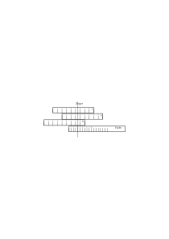

That would be, for example, the statement that a coloured circle of colour … and radius … lies at position … . One might think of the signals on a ship: “Stop”, “Full speed”, etc.

### [Ts-209](/ts-209/#36.5) [36\[5\]](https://cdn.wittgensteinnachlass.com/2000px/webp/Ts-209/36.webp)

Incidentally, they need not be scales. For one cannot call a disc with 2 signals a scale.

### [Ts-209](/ts-209/#36.6) [36\[6\]](https://cdn.wittgensteinnachlass.com/2000px/webp/Ts-209/36.webp)

85 That all sentences contain time in some way seems accidental to us, compared with the fact that the truth-functions are applicable to all sentences. This seems to have to do with their essence as sentences, the other with the essence of reality as we find it. True–False and the truth-functions have to do with the representation of reality by sentences. If someone were to say: well, how do you know that the whole of reality can be represented by sentences, the answer is: I know only that it can be represented by sentences in so far as it can be represented by sentences, and in language I cannot draw a boundary between a part that can and a part that cannot be represented in this way. ‘Language’ _means_ the totality of sentences. One might say: a sentence is what the truth-functions can be applied to. – The truth-functions are essential to _language_.

### [Ts-209](/ts-209/#36.7) [36\[7\]](https://cdn.wittgensteinnachlass.com/2000px/webp/Ts-209/36.webp)

86 Syntax prohibits a construction like “A is green and A is red”. (One’s first feeling is as if an injustice were being done to this sentence; as if its rights as a sentence were thereby curtailed) but as far as “A is green” is concerned, the sentence “A is red” is, so to speak, not a _different_ sentence at all – and that is really what syntax registers – but a different form of the same sentence. Syntax thus draws together sentences that are _one_ determination.

### [Ts-209](/ts-209/#36.8) [36\[8\]](https://cdn.wittgensteinnachlass.com/2000px/webp/Ts-209/36.webp)

If I say that I did _not_ dream last night, I must nevertheless know where one would look for the dream (that is, the sentence “I dreamed”, applied to the situation, can only be false, not nonsensical). I express the present situation by a position – the negative one – of the signal disc “dreams – no dreams”. But I must be able to distinguish it from other signal discs despite its negative position. I must know that it is _this_ signal disc that I am holding. One might now ask: Does this mean that you did feel something after all, a hint of a dream, so to speak, that makes you aware of the place where a dream would have been? Or, when I say “I have no pain in my arm”, does that mean I have a kind of shadowy feeling that indicates the place where the pain would occur? Evidently not, after all.

### [Ts-209](/ts-209/#37.1) [37\[1\]](https://cdn.wittgensteinnachlass.com/2000px/webp/Ts-209/37.webp)

In what respect does the present, painless state contain the possibility of pain? If someone says: “For the word pain to have meaning, it is necessary that one recognize pain as such when it occurs”, one can reply: “It is no more necessary than recognizing the absence of pain”. “Pain” means, so to speak, the whole scale and not one of its marks. That it stands at a particular mark can only be expressed by a _sentence_.

### [Ts-209](/ts-209/#37.2) [37\[2\]](https://cdn.wittgensteinnachlass.com/2000px/webp/Ts-209/37.webp)

87 The general sentence (I see a circle on a red background) seems simply to be a sentence that leaves possibilities open. An incomplete picture, as it were. A portrait in which the eyes, for instance, have not been painted. But what would this generality have to do with a totality of objects?

### [Ts-209](/ts-209/#37.3) [37\[3\]](https://cdn.wittgensteinnachlass.com/2000px/webp/Ts-209/37.webp)

There must be incomplete elementary propositions, from whose application the concept of generality arises. When we compare this incomplete picture with reality, it is either right or wrong. According to whether or not reality accords with what can be seen from the picture.

### [Ts-209](/ts-209/#37.4) [37\[4\]](https://cdn.wittgensteinnachlass.com/2000px/webp/Ts-209/37.webp)

The theory of probability is connected with this in that the more general, that is, the more incomplete, description is more likely to be correct than the more complete one.

### [Ts-209](/ts-209/#37.5) [37\[5\]](https://cdn.wittgensteinnachlass.com/2000px/webp/Ts-209/37.webp)

Generality in this sense thus enters into the doctrine of elementary propositions and not into the doctrine of truth-functions.

### [Ts-209](/ts-209/#37.6) [37\[6\]](https://cdn.wittgensteinnachlass.com/2000px/webp/Ts-209/37.webp)

88 If I do not describe the visual field completely, but only a part of it, it is clear that there is, as it were, a gap in the fact. Something has obviously been left out. If I painted a picture of this visual image, I would let the canvas show through in certain places. But the canvas too has a colour and fills the space. I could not leave _nothing_ in the place where something is missing. My description must therefore contain the whole of visual space, and indeed even its being coloured, even if it does not say which colour is at each place. That is, it must say that there is a colour at each place. Does this mean that the description must fill the space with variables in so far as it does not fill it with constants?

### [Ts-209](/ts-209/#37.7) [37\[7\]](https://cdn.wittgensteinnachlass.com/2000px/webp/Ts-209/37.webp)

One might object that one cannot describe a part of the visual field separately from the whole at all, since it is quite inconceivable _on its own_. But the form (the logical form) of the patch does in fact presuppose the whole space. And if only the whole visual field may be described, why then not only the whole stream of visual experience, since a visual image _can only_ exist in time.

### [Ts-209](/ts-209/#37.8) [37\[8\]](https://cdn.wittgensteinnachlass.com/2000px/webp/Ts-209/37.webp)

89 The question is: Can I leave something unspecified in a sentence _without_ also specifying exactly what possibilities are left open?

### [Ts-209](/ts-209/#38.1) [38\[1\]](https://cdn.wittgensteinnachlass.com/2000px/webp/Ts-209/38.webp)

Does the case of the general sentence “a red circle is in the square” differ essentially from a general statement of numerical equality, such as “I have as many jackets as pairs of trousers”? And is this sentence not in turn quite analogous to “there are _a_ number of chairs in this room”? Of course, in ordinary life one does not need to go very far with the disjunction of numbers. But however far one goes, at some point one must stop. The question here is always: How do I know such a proposition? Can I ever know it as an infinite disjunction? Even if the first case is understood in such a way that we can determine the position and size of the circle by measurement, even then the general proposition can never be understood as a disjunction (or if it can, then only as a finite one). For what, then, is the criterion (for the general proposition) for the circle’s being in the square? Either nothing at all that has to do with a multiplicity of positions (or sizes, as the case may be), or else something that has to do with a finite number of such positions.

### [Ts-209](/ts-209/#38.2) [38\[2\]](https://cdn.wittgensteinnachlass.com/2000px/webp/Ts-209/38.webp)

90 Suppose an incomplete picture is: A red circle is on a differently coloured background of colour x. It is clear that this picture can be used as a sentence in the positive sense, but also in the negative sense. In the negative sense it says what Russell expresses by non (∃x)․Fx. Now is there also, on my conception, an analogue to Russell’s (∃x)․nonFx? That would mean: There is an x for which it is not true that a red circle is on the background of that colour. Or in other words: There is a background colour on which there is no red circle. And that is nonsense here!

### [Ts-209](/ts-209/#38.3) [38\[3\]](https://cdn.wittgensteinnachlass.com/2000px/webp/Ts-209/38.webp)

But what about the sentence “there is a red sphere that is not in the box” or “there is a red circle that is not in the square”. This is again the general description of a visual image. Here negation now seems to be used in a different way. For it certainly seems as though I could express the sentence “this circle is not in the quadrilateral” in such a way that the “not” comes _before_ the sentence. – But this seems to be an illusion. If by the expression “this circle” one means “the circle I am pointing to”, then it does work, for the sentence then says “it is not true that I am pointing to a circle that is in the quadrilateral”, but it does not say that I am pointing to a circle that is outside the quadrilateral.

### [Ts-209](/ts-209/#38.4) [38\[4\]](https://cdn.wittgensteinnachlass.com/2000px/webp/Ts-209/38.webp)

This has to do with the fact that it is nonsense to give a circle a name. For I cannot say “the circle A is not in the quadrilateral”. For that would make sense only if it made sense to say “the circle A is in the quadrilateral” even when it is not in it.

### [Ts-209](/ts-209/#38.5) [38\[5\]](https://cdn.wittgensteinnachlass.com/2000px/webp/Ts-209/38.webp)

91 If generality no longer combines with the truth-functions to form a homogeneous whole, then no negation can stand _under_ a designation of generality. Admittedly, I could say: “There is a red circle outside the quadrilateral” means “it is not true that all red circles are in the quadrilateral”. But which circles are meant by _all_?

### [Ts-209](/ts-209/#38.6) [38\[6\]](https://cdn.wittgensteinnachlass.com/2000px/webp/Ts-209/38.webp)

“All circles are in the square” can only mean either “a certain number of circles are in the square” or “there is no circle outside”. But the sentence “there is no circle outside” is again the negation of a generality, not the generalization of a negation.

### [Ts-209](/ts-209/#39.1) [39\[1\]](https://cdn.wittgensteinnachlass.com/2000px/webp/Ts-209/39.webp)

92 If it is put to us that language can express everything with the help of nouns, adjectives and verbs, we must say that in that case it is certainly necessary to distinguish between quite different kinds of nouns, etc., since different grammatical rules apply to them. This is shown by the fact that they are not permitted to be substituted for one another. This shows that their character as nouns was merely superficial and that we are really dealing with quite different word classes. A word’s class is determined (only) by _all_ the grammatical rules that apply to it, and viewed in this way our language has an immense number of different kinds of words.

### [Ts-209](/ts-209/#39.2) [39\[2\]](https://cdn.wittgensteinnachlass.com/2000px/webp/Ts-209/39.webp)

If one gives a body a name, one cannot in the same sense give names to its colour, its shape, its position, its surface. And conversely. “A” is the name of a shape, not of a group of graphite particles. The different kinds of use of names correspond exactly to the different ways of using the demonstrative pronoun. If I say “that is a chair”, “that is the place where it stood”, “that is the colour it was”, the word “_that_” is used in so many different ways. (I cannot point to a place, a colour, etc. in the same sense.)

### [Ts-209](/ts-209/#39.3) [39\[3\]](https://cdn.wittgensteinnachlass.com/2000px/webp/Ts-209/39.webp)

93 Let us imagine two planes, with figures on plane I that we want to map onto plane II by some methods of projection or other. We can then fix a method of projection (say, orthogonal projection) and interpret the pictures on the second plane in accordance with this method of mapping. But we can also take quite a different course: suppose, for some reason or other, we stipulate that the pictures on the second plane are all to be circles, whatever the figures on the first plane may be. That is, different figures on the first plane are mapped onto the second plane by different methods of projection. To understand the circles in II as pictures, I will then have to say, for each circle, which method of projection goes with it. But the mere fact that a figure in II appears as a circle will in itself tell us nothing at all. – This is how it is with reality when we depict it in subject–predicate sentences. That we use subject–predicate sentences is merely a matter of our notation. The subject–predicate form is not in itself a logical form, and, like the circles on plane II, it is a means of expressing countless fundamentally different logical forms. The sentences “The plate is round”, “the man is tall”, “the patch is red” have nothing in common in their form.

### [Ts-209](/ts-209/#39.4) [39\[4\]](https://cdn.wittgensteinnachlass.com/2000px/webp/Ts-209/39.webp)

One difficulty with Frege’s theory is the generality of the words “concept” and “object”. For since one can count tables and tones and vibrations and thoughts, it is difficult to bring them all under one heading. But concept and object are predicate and subject. And we have just said that subject–predicate is not _one_ logical form.

### [Ts-209](/ts-209/#39.5) [39\[5\]](https://cdn.wittgensteinnachlass.com/2000px/webp/Ts-209/39.webp)

94 For it is clear that once one has started on the arithmetic, one no longer concerns oneself with functions and objects. Indeed, even if one has decided to work only with extensions, there is still the oddity that one takes no account whatever of the form of objects either.

### [Ts-209](/ts-209/#39.6) [39\[6\]](https://cdn.wittgensteinnachlass.com/2000px/webp/Ts-209/39.webp)

In a certain sense it must not be possible to describe an object. That is, the description must not ascribe to it any properties whose absence would nullify the very existence of the object. That is, the description must not state what would be essential to the object's existence.

### [Ts-209](/ts-209/#40.1) [40\[1\]](https://cdn.wittgensteinnachlass.com/2000px/webp/Ts-209/40.webp)

95 I see 3 circles in definite positions; I close my eyes, open them again and see 3 circles of the same size as before in different positions. Does it make sense to ask whether they are the same ones, and which is which? Certainly not. But now, _while_ I see them, I can identify them. (Even if they move before my eyes, I can identify the circles in new positions with those in their earlier positions.) If I give them proper names and close my eyes and open them again and see that the circles are in the same positions, I can give each its name again. (One can carry through the same train of thought if they have changed places by moving.) In any case I am always naming (directly or indirectly) a _place_.

### [Ts-209](/ts-209/#40.2) [40\[2\]](https://cdn.wittgensteinnachlass.com/2000px/webp/Ts-209/40.webp)

Would it be possible to discover a _new_ colour? (Because a colour-blind person is in the same situation as we are; their colours form just as complete a system as ours; they see no gap where the other colours would still belong). (Comparison with mathematics.)

### [Ts-209](/ts-209/#40.3) [40\[3\]](https://cdn.wittgensteinnachlass.com/2000px/webp/Ts-209/40.webp)

When one says that substance is indestructible, one _means_ that it is senseless to speak in any context – affirmatively or negatively – of “destroying a substance”.

### [Ts-209](/ts-209/#40.4) [40\[4\]](https://cdn.wittgensteinnachlass.com/2000px/webp/Ts-209/40.webp)

What is characteristic of sentences of the kind “this is …” is only that the reality outside the so-called sign-system somehow enters into the symbol.

### [Ts-209](/ts-209/#40.5) [40\[5\]](https://cdn.wittgensteinnachlass.com/2000px/webp/Ts-209/40.webp)

96 Russell and Frege, in a sense, understand the concept as a property of a thing. But it is very unnatural to understand the words man, tree, treatise, circle, as properties of a substrate.

### [Ts-209](/ts-209/#40.6) [40\[6\]](https://cdn.wittgensteinnachlass.com/2000px/webp/Ts-209/40.webp)

If a table is painted brown, it is easy to think of the wood as the bearer of the property brown, and one can imagine what remains when the colour changes. Indeed, even in the case of _one_ particular circle that appears now red, now blue. So it is easy to imagine _what_ is red, but hard to imagine what is circular. What _remains_ here when form and colour change? For position is part of the form, and it is arbitrary for me to stipulate that the centre is to remain fixed and that the form is to change only through the radius. We shall have to go back to ordinary language, and it says that a _patch_ is circular. It is clear that here the expression “bearer of the property” gives an entirely false – impossible – image. – If I have a lump of clay, I can think of it as the bearer of a form, and that is roughly where this image comes from. “The patch changes its shape” and “the lump of clay changes its shape” are fundamentally different sentential forms.

### [Ts-209](/ts-209/#40.7) [40\[7\]](https://cdn.wittgensteinnachlass.com/2000px/webp/Ts-209/40.webp)

One can say “measure to see whether _that_ is a circle” or “look to see whether _that_ thing lying there is a hat”. One can also say “measure to see whether _that_ is a circle or an ellipse”, but not “… whether that is a circle or a hat”, nor “look to see whether that is a hat or red”.

### [Ts-209](/ts-209/#40.8) [40\[8\]](https://cdn.wittgensteinnachlass.com/2000px/webp/Ts-209/40.webp)

If I point to a line and say “that is a circle”, one can object that if it were not a circle, it would no longer be _that_. I.e. what I mean by the word “that” must be independent of what is stated about it. (“Was _that_ thunder, or a shot?” But in this case one cannot ask “was that a noise”.)

### [Ts-209](/ts-209/#41.1) [41\[1\]](https://cdn.wittgensteinnachlass.com/2000px/webp/Ts-209/41.webp)

97 In passing, the equation of a circle is the sign for the concept circle if no definite values are substituted for the coordinates of the centre and the radius, or if these are given only as lying within certain intervals. The object that falls under the concept is then the circle given with a definite position and size.

### [Ts-209](/ts-209/#41.2) [41\[2\]](https://cdn.wittgensteinnachlass.com/2000px/webp/Ts-209/41.webp)

How do 2 red circles of equal size differ? This question sounds as if they were, after all, more or less one thing, distinguished only by some small detail. In representation by equations, what they have in common is expressed by the form of the equation, and their difference by the difference in the coordinates of their centres. It is as though the coordinates of the centres were what corresponded here to the objects falling under the concept. Could one not say “this point is the centre of a circle” instead of “this is a circle”? For being the centre of a circle is an external property of the point. In truth, the pair of numbers that represents the coordinates of the centre is no more a thing than the centre is; rather, the pair of numbers characterizes just that feature of the symbol which constitutes the “difference” between the circles.

### [Ts-209](/ts-209/#41.3) [41\[3\]](https://cdn.wittgensteinnachlass.com/2000px/webp/Ts-209/41.webp)

98 What is needed to describe – say – a book’s being in a particular place? The internal description of the book, i.e. of the concept, and the description of its position, which could be given by specifying the coordinates of three points. The sentence “a book of this kind is _here_” would then mean that it has _these_ 3 triples of determining coordinates. For specifying the here must not prejudge _what_ is here. But does it not amount to the same thing whether I say “_this_ is a book” or “here is a book”? The sentence would then come down to saying something like “these are 3 (particular) corners of a book of this kind”. Similarly, one can also say “this circle is the projection of a sphere” or “this is the appearance of a human being”. All I am saying comes down to this: F(x) must be an _external_ description of x. Now if I say in this sense, in three-dimensional space, “here is a circle” and on another occasion “here is a sphere”, are the two instances of _here_ of the same kind? Both could, after all, be the 3 coordinates of the centre in question. But the position of the circle in three-dimensional space is not determined by the coordinates of its centre.

### [Ts-209](/ts-209/#41.4) [41\[4\]](https://cdn.wittgensteinnachlass.com/2000px/webp/Ts-209/41.webp)

Suppose my visual image consists of two red circles of equal size on a blue background: what is present here twice and what once? And what does this question mean at all? We have _one_ colour here but _two_ locations.

### [Ts-209](/ts-209/#41.5+42.1) [41\[5\]](https://cdn.wittgensteinnachlass.com/2000px/webp/Ts-209/41.webp),[42\[1\]](https://cdn.wittgensteinnachlass.com/2000px/webp/Ts-209/42.webp)

99 One can ask: does number have anything essentially to do with a concept? I think this comes down to asking whether it makes sense to speak of a number of objects that have not been brought under a concept. Does it mean anything, for example, to say: “a and b and c are 3 objects”? I think the answer is plainly no. There is, to be sure, a feeling that tells us: Why talk of concepts? The number depends only on the _extension_ of the concept, after all, and once that has been determined the concept can leave the stage, so to speak. The concept is only a method for determining an extension, but the extension stands on its own and is in its nature independent of the concept; for it does not matter which concept we used to determine the extension. That is the argument for the extensional view. Against this one can first say: If the concept is really only an aid to arriving at the extension, then the concept has no place in arithmetic; one must then simply separate the class entirely from the concept contingently associated with it. In the opposite case, however, the extension independent of the concept is a mere chimera, and then it is better not to speak of it at all, but only of the concept.

### [Ts-209](/ts-209/#42.2) [42\[2\]](https://cdn.wittgensteinnachlass.com/2000px/webp/Ts-209/42.webp)

What about the sentence “(∃x,y,z)․aRx & xRy & yRz & zRb ․⌵․ aRy & yRx & xRz & zRb․⌵․ etc.” (All the combinations follow)? Can I not write it intelligibly in the form “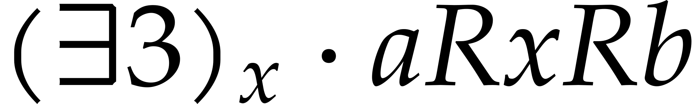”, something like “3 links are inserted between a and b”. Here we have formed the concept “link between a and b”. (Things between these walls.)

### [Ts-209](/ts-209/#42.3) [42\[3\]](https://cdn.wittgensteinnachlass.com/2000px/webp/Ts-209/42.webp)

If I have two objects, then of course I can bring them under one heading, at least hypothetically, but what is characteristic of the extension of a concept is the class, and the concept that embraces it was only a makeshift, an excuse.

### [Ts-209](/ts-209/#42.4) [42\[4\]](https://cdn.wittgensteinnachlass.com/2000px/webp/Ts-209/42.webp)

100 Numbers are pictures of the extensions of concepts.

### [Ts-209](/ts-209/#42.5) [42\[5\]](https://cdn.wittgensteinnachlass.com/2000px/webp/Ts-209/42.webp)

One might now regard the extension of a concept as an object, whose name likewise has sense only in the context of a sentence. “a and b and c” admittedly has no sense; it is not a sentence. But “a” is not a sentence either.

### [Ts-209](/ts-209/#42.6) [42\[6\]](https://cdn.wittgensteinnachlass.com/2000px/webp/Ts-209/42.webp)

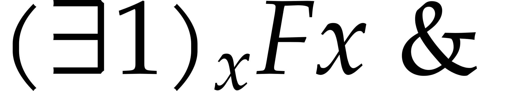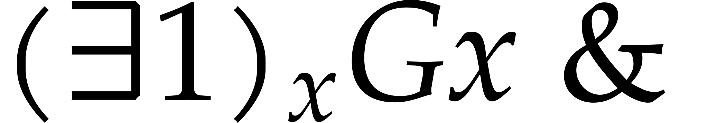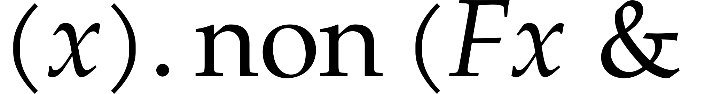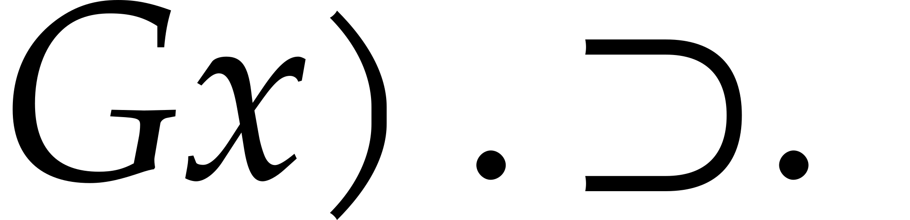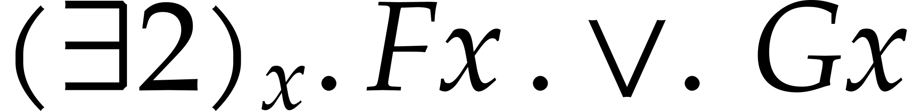 If F and G here are the forms x = a ․⌵․ x = b, etc., then the whole sentence has become a device for ensuring that the addition is done correctly.

### [Ts-209](/ts-209/#42.7) [42\[7\]](https://cdn.wittgensteinnachlass.com/2000px/webp/Ts-209/42.webp)

In the symbolism a correlation is actually made, whereas in the meaning there is talk only of the possibility of correlation.

### [Ts-209](/ts-209/#42.8) [42\[8\]](https://cdn.wittgensteinnachlass.com/2000px/webp/Ts-209/42.webp)

The problem is: How can one make preparations to receive something that may exist?

### [Ts-209](/ts-209/#42.9) [42\[9\]](https://cdn.wittgensteinnachlass.com/2000px/webp/Ts-209/42.webp)

The Axiom of infinity is nonsense if only because the possibility of expressing it would presuppose infinitely many things – that is, what it purports to assert. Of logical concepts, e.g. infinity, one can say that their essence proves their existence.

### [Ts-209](/ts-209/#42.10) [42\[10\]](https://cdn.wittgensteinnachlass.com/2000px/webp/Ts-209/42.webp)

101 (3)xFx & (4)xGx & non (∃x)Fx & Gx ․⊃․ (3 + 4)x․Fx ․⌵․ Gx

This expression is not the same as the substitution rule 3 + 4 = 7.

### [Ts-209](/ts-209/#42.11) [42\[11\]](https://cdn.wittgensteinnachlass.com/2000px/webp/Ts-209/42.webp)

One could also ask as follows: Suppose I have 4 objects that satisfy a function. Does it make sense in every case to say that these 4 objects are 2 + 2 objects? After all, I do not know whether there are functions that bring them under one heading in pairs (one heading for each pair). Does it make sense to say of any 4 objects that they consist of 2 objects and 2 objects? The notation I used above, “(3 + 4)x etc.”, already contains the assumption that it makes sense always to regard 7 as 3 + 4, for on the right-hand side of the “․⊃․ ” I have, so to speak, already forgotten where this 3 and this 4 came from. On the other hand: in the sign 1 + 1 + 1 + 1 + 1 + 1 + 1 I can in any case distinguish 3 and 4. Does the solution perhaps lie here? What if I had a sign for 7 in which I could not separate off 3 and 4? Is such a sign conceivable?

### [Ts-209](/ts-209/#43.1) [43\[1\]](https://cdn.wittgensteinnachlass.com/2000px/webp/Ts-209/43.webp)

Does it make sense to say that a relation connects 2 objects, even if they do not otherwise fall under any concept?

### [Ts-209](/ts-209/#43.2) [43\[2\]](https://cdn.wittgensteinnachlass.com/2000px/webp/Ts-209/43.webp)

102 I want to say that numbers can be defined only from sentential *forms*, independently of which sentences are true or false.

### [Ts-209](/ts-209/#43.3) [43\[3\]](https://cdn.wittgensteinnachlass.com/2000px/webp/Ts-209/43.webp)

Of the things a, b, c, d, 3 have the property F. That can be expressed by a disjunction. Evidently another case where a specification of number does not refer to a concept (although one can make it look as though it does by means of the “ = ”.)

### [Ts-209](/ts-209/#43.4) [43\[4\]](https://cdn.wittgensteinnachlass.com/2000px/webp/Ts-209/43.webp)

If I say: If there are 4 apples on the table, then there are 2 + 2 apples on it, this means only that with the 4 apples the possibility of grouping them into two and two is already given, and I need not wait for them actually to be grouped by means of a concept. This “_possibility_” concerns the sense, not the truth, of a sentence. 2 + 2 = 4 can mean “wherever I have 4 objects, there is the possibility of grouping them into two and two”.

### [Ts-209](/ts-209/#43.5) [43\[5\]](https://cdn.wittgensteinnachlass.com/2000px/webp/Ts-209/43.webp)

103 How can I know that ∣∣∣∣∣∣∣∣ and ∣∣∣∣∣∣∣∣ are _the same_ sign? Surely it is not enough that they look _similar_. For it is not the approximate sameness of shape that may constitute the identity of the signs, but precisely the equality in number.

### [Ts-209](/ts-209/#43.6) [43\[6\]](https://cdn.wittgensteinnachlass.com/2000px/webp/Ts-209/43.webp)

If one writes (∃∣∣∣∣∣) etc. & (∃∣∣∣∣∣∣∣) etc. ․⊃․ (∃∣∣∣∣∣∣∣∣∣∣∣∣) etc., one may wonder how I got the number sign in the bracket on the right, if one does not know that it was arrived at by adding the two number signs on the left. I believe this makes it clear that this expression represents only an application of 5 + 7 = 12, not the equation itself.

### [Ts-209](/ts-209/#43.7) [43\[7\]](https://cdn.wittgensteinnachlass.com/2000px/webp/Ts-209/43.webp)

If one asks: But what, then, does “5 + 7 = 12” mean – what sense or purpose is left for this expression – the answer is: This equation is a rule for signs that specifies which sign results when one applies a particular operation (addition) to 2 other particular signs. The content of 5 + 7 = 12 is (if one did not know it) exactly what gives children trouble when they learn this sentence in arithmetic lessons.

### [Ts-209](/ts-209/#43.8) [43\[8\]](https://cdn.wittgensteinnachlass.com/2000px/webp/Ts-209/43.webp)

One can disregard the particular character of sentence A altogether and attend simply to the relation, the relationship, between the number signs in it. This shows that this relationship holds independently of this sentence. That is, independently of the other features of its structure that make it a tautology.

### [Ts-209](/ts-209/#43.9) [43\[9\]](https://cdn.wittgensteinnachlass.com/2000px/webp/Ts-209/43.webp)

For when I consider it as a tautology I am, after all, perceiving only properties of its structure, and I can now perceive the addition theorem _in_ them without attending to other characteristics essential to the sentence.

### [Ts-209](/ts-209/#43.10+44.1) [43\[10\]](https://cdn.wittgensteinnachlass.com/2000px/webp/Ts-209/43.webp),[44\[1\]](https://cdn.wittgensteinnachlass.com/2000px/webp/Ts-209/44.webp)

So the addition theorem can be discerned in it (among other things), not _through_ it. This consideration would of course be nonsensical if what was at issue here were the _sense_ of a sentence rather than the structural workings of a tautology.

### [Ts-209](/ts-209/#44.2) [44\[2\]](https://cdn.wittgensteinnachlass.com/2000px/webp/Ts-209/44.webp)

104 One might reply: What I perceive in the sign A and call the relationship between the number signs is again nothing but the grouping together of extensions of concepts: I combine the first 5 strokes in the bracket on the right, which stand in a 1-1 relation to the 5 in one bracket on the left, and the next 7 strokes in the bracket on the right, which stand in a 1-1 relation to the 7 in the other bracket on the left, into 12 strokes that do either the one or the other. But even if I went through this process of thought, the fundamental insight would still be that the 5 strokes and the 7 combine to make _exactly_ 12 (thus giving, for instance, the same structure as 4 and 4 and 4). – What teaches us this is always just insight into the internal relationship between the structures, not any sentence or consideration of logic. And for this insight everything about the tautology apart from the number structures is incidental; these alone matter for the arithmetical sentence. (Everything else belongs to the _application_ of the arithmetical sentence.)

### [Ts-209](/ts-209/#44.3) [44\[3\]](https://cdn.wittgensteinnachlass.com/2000px/webp/Ts-209/44.webp)

So what I mean to say is: the arithmetical part is not what prompts us to put 5 and 7 together, but the process and what comes out of it.

### [Ts-209](/ts-209/#44.4) [44\[4\]](https://cdn.wittgensteinnachlass.com/2000px/webp/Ts-209/44.webp)

Suppose I wrote down sentence A but put the wrong number of strokes in the bracket on the right: one could and would discover this mistake only by comparing the structures, not by applying logical theorems.

### [Ts-209](/ts-209/#44.5) [44\[5\]](https://cdn.wittgensteinnachlass.com/2000px/webp/Ts-209/44.webp)

Indeed, if one asks: How do you know that this particular number of strokes in the bracket on the right is the correct one, I can justify it only by comparing the structures.

### [Ts-209](/ts-209/#44.6) [44\[6\]](https://cdn.wittgensteinnachlass.com/2000px/webp/Ts-209/44.webp)

It would turn out, then, that what Frege called the “peppernut standpoint” in arithmetic could after all be justified.

### [Ts-209](/ts-209/#44.7) [44\[7\]](https://cdn.wittgensteinnachlass.com/2000px/webp/Ts-209/44.webp)

105 And now too – I believe – the relationship between the extensional conception of classes and the conception of number as a feature of a logical structure becomes clear: An extension is a characterization of the sense of a sentence.

### [Ts-209](/ts-209/#44.8) [44\[8\]](https://cdn.wittgensteinnachlass.com/2000px/webp/Ts-209/44.webp)

106 Now if the transition in A were the only application of this arithmetical schema, could one not, or would one not have to, replace it, or define it, by the tautology itself?

### [Ts-209](/ts-209/#44.9) [44\[9\]](https://cdn.wittgensteinnachlass.com/2000px/webp/Ts-209/44.webp)

I.e.: What if A were the most general form of application of the arithmetical schema?

### [Ts-209](/ts-209/#44.10) [44\[10\]](https://cdn.wittgensteinnachlass.com/2000px/webp/Ts-209/44.webp)

If A were the only application of the schema – that is, _essentially_ the only one – then the schema could, of its own accord, mean nothing other than the tautology itself.

### [Ts-209](/ts-209/#45.1) [45\[1\]](https://cdn.wittgensteinnachlass.com/2000px/webp/Ts-209/45.webp)

Or: then the schema itself would have to be the tautology, and the tautology nothing other than the schema.

### [Ts-209](/ts-209/#45.2) [45\[2\]](https://cdn.wittgensteinnachlass.com/2000px/webp/Ts-209/45.webp)

Then one could no longer say that A was an application of the schema; rather, A would be the schema, only, as it were, not the tool alone but the tool with its handle, without which it cannot be used anyway.

### [Ts-209](/ts-209/#45.3) [45\[3\]](https://cdn.wittgensteinnachlass.com/2000px/webp/Ts-209/45.webp)

What A contains apart from the schema can then be only what is necessary for the application of the arithmetical schema. But nothing at all is necessary, for we can perfectly well understand and apply arithmetical sentences without any addition to them. Above all, though, this does not require the formation of a tautology, as we can see very well in that tautology itself, for otherwise, to recognize it as a tautology, we would have to recognize yet another as a tautology, and so on.

### [Ts-209](/ts-209/#45.4) [45\[4\]](https://cdn.wittgensteinnachlass.com/2000px/webp/Ts-209/45.webp)

107 Arithmetical sentences, like multiplication tables and the like, or like definitions that do not have whole sentences on either side, are for _application_ to sentences. And there is nothing else I can apply them to anyway. (So I do not first need any description of their application.)

### [Ts-209](/ts-209/#45.5) [45\[5\]](https://cdn.wittgensteinnachlass.com/2000px/webp/Ts-209/45.webp)

No investigation of concepts, only direct insight, can show that 3 + 2 = 5. This is what makes us balk at the assumption that A could be the sentence 3 + 2 = 5. For what enables us to recognize this expression as a tautology cannot itself result from a consideration of concepts, but must be immediately visible.

### [Ts-209](/ts-209/#45.6) [45\[6\]](https://cdn.wittgensteinnachlass.com/2000px/webp/Ts-209/45.webp)

And when we say that numbers are structures, we mean that they must always be of the same kind as what we use to represent them.

### [Ts-209](/ts-209/#45.7) [45\[7\]](https://cdn.wittgensteinnachlass.com/2000px/webp/Ts-209/45.webp)

I mean: Numbers are what I represent in my language by means of the number schemata. I.e. I take the number schemata of language (so to speak) as what is familiar to me, and say: Numbers are what these represent. This corresponds to what I meant at the time when I said: Numbers enter logic with the calculus.

### [Ts-209](/ts-209/#45.8) [45\[8\]](https://cdn.wittgensteinnachlass.com/2000px/webp/Ts-209/45.webp)

108 What I said earlier about the essence of the arithmetical equation and about an equation not being replaceable by a tautology explains – I think – what Kant meant in insisting that 5 + 7 = 12 is not an analytic proposition but synthetic a priori.

### [Ts-209](/ts-209/#45.9) [45\[9\]](https://cdn.wittgensteinnachlass.com/2000px/webp/Ts-209/45.webp)

Are they the same numbers with which I count the horses in a stable and the different kinds of animal in the stable? With which I count the strokes in a line and the kinds of group (also with the different numbers of strokes)? Whether they are cardinal numbers in the same sense depends on whether the same syntactic rules apply to them. (It is conceivable that there is no one in a room, but not that there is someone of _no_ race in it.)

### [Ts-209](/ts-209/#46.1) [46\[1\]](https://cdn.wittgensteinnachlass.com/2000px/webp/Ts-209/46.webp)

Arithmetic is the grammar of numbers. Kinds of number can differ only in the arithmetical rules that apply to them.

### [Ts-209](/ts-209/#46.2) [46\[2\]](https://cdn.wittgensteinnachlass.com/2000px/webp/Ts-209/46.webp)

109 One always feels reluctant to justify arithmetic by saying something about its application. It seems to be firmly enough grounded in itself. And this is, of course, because arithmetic is its own application.

### [Ts-209](/ts-209/#46.3) [46\[3\]](https://cdn.wittgensteinnachlass.com/2000px/webp/Ts-209/46.webp)

Arithmetic does not speak of numbers, but works with numbers.

### [Ts-209](/ts-209/#46.4) [46\[4\]](https://cdn.wittgensteinnachlass.com/2000px/webp/Ts-209/46.webp)

The calculus presupposes the calculus.

### [Ts-209](/ts-209/#46.5) [46\[5\]](https://cdn.wittgensteinnachlass.com/2000px/webp/Ts-209/46.webp)

Are numbers not a logical peculiarity of space and time? The calculus itself exists only in space and time.

### [Ts-209](/ts-209/#46.6) [46\[6\]](https://cdn.wittgensteinnachlass.com/2000px/webp/Ts-209/46.webp)

Every calculation in mathematics is an application of itself and has sense only as such. _That is why_ it is not necessary, in justifying arithmetic, to speak of the general form of logical operation.

### [Ts-209](/ts-209/#46.7) [46\[7\]](https://cdn.wittgensteinnachlass.com/2000px/webp/Ts-209/46.webp)

The cardinal number is to be applied to the subject–predicate form, but not to every variant of this form. And insofar as it is applicable, it characterizes precisely the subject–predicate form.

### [Ts-209](/ts-209/#46.8) [46\[8\]](https://cdn.wittgensteinnachlass.com/2000px/webp/Ts-209/46.webp)

On the one hand, it seems to me, one can develop arithmetic quite independently and its application takes care of itself, for wherever it is applicable, one is entitled to apply it. On the other hand, a nebulous introduction of the concept of number with the help of a general form of operation – as I did – cannot be necessary.

### [Ts-209](/ts-209/#46.9) [46\[9\]](https://cdn.wittgensteinnachlass.com/2000px/webp/Ts-209/46.webp)

One could say: Arithmetic is a kind of geometry: i.e. what constructions on paper are in geometry, calculations (on paper) are in arithmetic. – One could say it is a more general geometry.

### [Ts-209](/ts-209/#46.10) [46\[10\]](https://cdn.wittgensteinnachlass.com/2000px/webp/Ts-209/46.webp)

And can I not say that in this sense chess too (or any other game) is a kind of geometry? But then it must be possible to devise an _application_ of chess quite analogous to that of arithmetic.

### [Ts-209](/ts-209/#46.11) [46\[11\]](https://cdn.wittgensteinnachlass.com/2000px/webp/Ts-209/46.webp)

One could say: Why restrict the application of arithmetic? It takes care of itself. (I can make a knife without regard to the class of materials that it will be possible to cut with it; that will become clear in due course.) For what tells against delimiting the field of application is the feeling that we can understand arithmetic without having such a field in view. Or let us put it this way: instinct balks at anything that is not simply an analysis of the thoughts already there.

### [Ts-209](/ts-209/#47.1) [47\[1\]](https://cdn.wittgensteinnachlass.com/2000px/webp/Ts-209/47.webp)

110 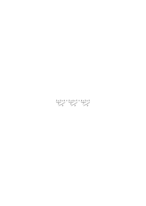

“You see, it really does always come out the same”, one would like to say. Taken in this way, we have carried out an experiment. We applied the rules of the addition table, and one cannot tell just by looking at them that they yield the same result in the 3 cases. One is, as it were, surprised that the digits work so correctly once detached from their definitions. Or rather: that the rules for the digits work so correctly (when they are not controlled by the definitions.) This is (curiously) connected with the internal consistency of geometry. For one can say that the rules for the digits always presuppose the definitions. But in what sense? What does it mean for a sign to presuppose another which is not actually there at all? It presupposes its possibility; its possibility in sign-space (in grammatical space).

### [Ts-209](/ts-209/#47.2) [47\[2\]](https://cdn.wittgensteinnachlass.com/2000px/webp/Ts-209/47.webp)

The question is always whether and how it is possible to represent the most general form of the application of arithmetic. And the strange thing here is precisely that in a certain sense this does not seem necessary. And if it really is not necessary, then it is also impossible.

### [Ts-209](/ts-209/#47.3) [47\[3\]](https://cdn.wittgensteinnachlass.com/2000px/webp/Ts-209/47.webp)

For it seems that the general form of its application is represented by saying _nothing_ about it. (And if that is a possible representation, then it is also _the_ correct one.)

### [Ts-209](/ts-209/#47.4) [47\[4\]](https://cdn.wittgensteinnachlass.com/2000px/webp/Ts-209/47.webp)

What is characteristic of specifying a number is that one can substitute any other number for the one given and the sentence must always retain its sense; hence the infinite series of sentential forms.

### [Ts-209](/ts-209/#47.5) [47\[5\]](https://cdn.wittgensteinnachlass.com/2000px/webp/Ts-209/47.webp)

111 The sense of the remark that arithmetic is a kind of geometry is precisely that arithmetical constructions are autonomous, like geometrical constructions, and hence, so to speak, guarantee their own applicability. For it must be possible to say of geometry too that it is its own application.

### [Ts-209](/ts-209/#47.6) [47\[6\]](https://cdn.wittgensteinnachlass.com/2000px/webp/Ts-209/47.webp)

This is an arithmetical construction and, in a _somewhat_ wider sense, a geometrical one too.

### [Ts-209](/ts-209/#47.7) [47\[7\]](https://cdn.wittgensteinnachlass.com/2000px/webp/Ts-209/47.webp)

Suppose I wanted to solve the following problem with this calculation: If I have 11 apples and want to give people 3 apples each, how many people can I give apples to? The calculation gives me the solution 3. Now suppose I went through all the actions of handing them out, and in the end 4 people each had 3 apples in their hands. Would I then say that working it out had yielded a wrong result? Of course not. And that just means that working it out was not an experiment. It might seem as though working it out mathematically entitled us to make a prediction, say that I would be able to give apples to 3 people and have 2 apples left over. But that is not how it is. What entitles us to make this prediction is a physical hypothesis that lies outside the calculation. The calculation is only a consideration of the logical forms, the structures, and can in itself yield nothing new.

### [Ts-209](/ts-209/#48.1) [48\[1\]](https://cdn.wittgensteinnachlass.com/2000px/webp/Ts-209/48.webp)

112 Different though strokes and court hearings are, one can nevertheless represent court hearings by strokes in a calendar. And one can count the one instead of the other. It is not like that if, say, I want to count hat sizes. It would not be natural to represent three hat sizes by 3 strokes. Just as if I wanted to represent a measurement, 3 m, by 3 strokes. One can do that, of course; only then “!!!∣∣∣” represents in a different way.

### [Ts-209](/ts-209/#48.2) [48\[2\]](https://cdn.wittgensteinnachlass.com/2000px/webp/Ts-209/48.webp)

If 3 strokes on paper are the sign for 3, then one can say that 3 is to be applied in the way that 3 strokes can be applied.

### [Ts-209](/ts-209/#48.3) [48\[3\]](https://cdn.wittgensteinnachlass.com/2000px/webp/Ts-209/48.webp)

Whatever three strokes are a picture of, they can serve as a picture of it.

### [Ts-209](/ts-209/#48.4) [48\[4\]](https://cdn.wittgensteinnachlass.com/2000px/webp/Ts-209/48.webp)

113 Cardinal numbers are a form given in reality by things, just as rational numbers are given by extensions, etc. I mean, by real forms. So complex numbers are given by real multiplicities. (The symbols are real, after all.)

### [Ts-209](/ts-209/#48.5) [48\[5\]](https://cdn.wittgensteinnachlass.com/2000px/webp/Ts-209/48.webp)

What is the difference between specifying the number of objects in the extension of a concept and specifying the number of values in the range of a variable? The first is a sentence, the second is not. For I can derive the specification of the number of values of a variable from the variable itself. (It must show itself.) But can I not give a variable by saying that its values are to be all the objects that satisfy a particular material function? Then the variable is not a form! And then the sense of one sentence depends on whether another is true or false.

### [Ts-209](/ts-209/#48.6) [48\[6\]](https://cdn.wittgensteinnachlass.com/2000px/webp/Ts-209/48.webp)

Specifying the number of values of a variable consists in a transformation of the variable that makes the number of its values visible.

### [Ts-209](/ts-209/#48.7) [48\[7\]](https://cdn.wittgensteinnachlass.com/2000px/webp/Ts-209/48.webp)

114 What sort of proposition is “there is a prime number between 5 and 8”? I would say: “That _shows_ itself”. And that is right; but can one not draw attention to this internal state of affairs? One could surely say: examine the interval from 10 to 20 for prime numbers. How many are there? Would that not be a clear task? And how would its solution be correctly expressed or represented? What does the sentence “There are 4 prime numbers between 10 and 20” mean? This sentence seems to draw our attention to a certain aspect of the matter.

### [Ts-209](/ts-209/#48.8) [48\[8\]](https://cdn.wittgensteinnachlass.com/2000px/webp/Ts-209/48.webp)

If I ask someone “How many prime numbers are there between ten and twenty?”, he will say, I don’t know at the moment but I can find out at any time. For it is as if it were already written down somewhere.

### [Ts-209](/ts-209/#48.9) [48\[9\]](https://cdn.wittgensteinnachlass.com/2000px/webp/Ts-209/48.webp)

If one wants to know what a sentence means, one can always ask “how do I know that”. Do I know that there are 6 permutations of 3 elements in the same way as I know that there are 6 people in the room? No. That is why the former sentence is of a different _kind_ from the latter.

### [Ts-209](/ts-209/#49.1) [49\[1\]](https://cdn.wittgensteinnachlass.com/2000px/webp/Ts-209/49.webp)

Another equally useful question is “how is this sentence actually applied in practice”, and there that proposition of combinatorics is of course applied as a rule of inference, in passing from one sentence to another, each of which describes a reality, not a _possibility_.

### [Ts-209](/ts-209/#49.2) [49\[2\]](https://cdn.wittgensteinnachlass.com/2000px/webp/Ts-209/49.webp)

One can presumably say quite generally that the use of apparent sentences about possibilities – and impossibilities – is always to pass from one actual sentence to another. Thus, for example, from the sentence “I designate 7 squares by permutations of a, b, c” I can infer that among them there is at least _one_ with repetition. – And from the sentence “I distribute 5 spoons among 4 cups” it follows that one cup gets 2 spoons, and so on.

### [Ts-209](/ts-209/#49.3) [49\[3\]](https://cdn.wittgensteinnachlass.com/2000px/webp/Ts-209/49.webp)

If someone disagrees with us about the number of people in this room and asserts that there are 7, while we see only 6, we can understand him even though we disagree with him. But if he asserts that for him there are 5 pure colours, then we do not understand him, or we must assume that we completely misunderstand each other. This number is delimited in the dictionary and the grammar, not within language.

### [Ts-209](/ts-209/#49.4) [49\[4\]](https://cdn.wittgensteinnachlass.com/2000px/webp/Ts-209/49.webp)

115 The statement of number does not always contain a generalization or indeterminacy: “The line segment A B is divided into two (3, 4, etc.) equal parts”.

### [Ts-209](/ts-209/#49.5) [49\[5\]](https://cdn.wittgensteinnachlass.com/2000px/webp/Ts-209/49.webp)

Not even a certain generality is essential to a specification of number. If, for instance, I say “I see 3 circles of equal size arranged at equal intervals”. If I give a correct description of the visual field in which there are 3 red circles on a blue background, the expression “(∃x,y,z):x is circular and red and y is circular and red etc. etc.” will certainly not occur in it.

### [Ts-209](/ts-209/#49.6) [49\[6\]](https://cdn.wittgensteinnachlass.com/2000px/webp/Ts-209/49.webp)

Of course one could write it like this: There are 3 circles that have the property of being red. But here the distinction comes to light between objects in the improper sense, patches of colour in the visual field, sounds, etc., and the elements of cognition, objects proper. It is striking that the sentence about the 3 circles does not have the generality, or indeterminacy, of a sentence of the form (∃x,y,z)․Fx & Fy & Fz. For in this case one can say: I do know that 3 things have the property F, but I do not know _which_ ones. In the case of the three circles one cannot say that. “There are now 3 red circles of such-and-such a size and in such-and-such positions in _one_ visual field” completely determines the fact, and it would be nonsensical to say that I do not yet know _which_ circles they are.

### [Ts-209](/ts-209/#49.7) [49\[7\]](https://cdn.wittgensteinnachlass.com/2000px/webp/Ts-209/49.webp)

Let us think of “objects” such as: a lightning strike, the simultaneous occurrence of two events, the points of intersection of a straight line with a circle, etc. The 3 circles in the visual field are an example for all these cases.

### [Ts-209](/ts-209/#49.8+50.1) [49\[8\]](https://cdn.wittgensteinnachlass.com/2000px/webp/Ts-209/49.webp),[50\[1\]](https://cdn.wittgensteinnachlass.com/2000px/webp/Ts-209/50.webp)

One can of course take the subject–predicate form, or, what amounts to the same thing, the argument–function form, as a norm of representation; and then it is indeed important and characteristic that whenever we apply numbers, the number can be represented as a property of a predicate. Only we must be clear that what we are dealing with now is not objects and concepts as the results of a decomposition, but norms into which we have forced the sentence. And it is significant, of course, that it could be made to conform to this norm. But forcing something into a norm is the opposite of analysis. Just as, to study the natural growth of an apple tree, one does not look at an espaliered tree, except to see how _this_ tree behaves under _this_ constraint.

### [Ts-209](/ts-209/#50.2) [50\[2\]](https://cdn.wittgensteinnachlass.com/2000px/webp/Ts-209/50.webp)

That would mean that Frege’s theory of number would be applicable as long as we did not intend to analyse the sentences. This theory explains the concept of number as it figures in the form of expression of ordinary language. Frege would indeed have said (I recall a conversation) that the coincidence of a lunar eclipse and a court hearing was an object. And what objection is there to that? Only that we are then using the word “object” ambiguously and so confusing the results of logical analysis.

### [Ts-209](/ts-209/#50.3) [50\[3\]](https://cdn.wittgensteinnachlass.com/2000px/webp/Ts-209/50.webp)

If I say “there are 4 people in this room”, a disjunction does seem to enter in, since it is not said _which_ people. But that is quite inessential. We could imagine that all people were alike apart from the place where they are (so that what we were dealing with in their case was humanity at a particular point in space), and then all indeterminacy would disappear.

### [Ts-209](/ts-209/#50.4) [50\[4\]](https://cdn.wittgensteinnachlass.com/2000px/webp/Ts-209/50.webp)

116 If I am right, there is no concept “pure colour”; the sentence “A has a pure colour” simply means “A is red, or yellow, or blue, or green”. “This hat belongs to either A or B or C” is not the same sentence as “this hat belongs to someone in this room”, even if in fact only A, B, C are in the room, for that has to be stated in addition. – There are two pure colours on this surface _means_: On this surface there are red and yellow, or red and blue, or red and green, or etc. Now if I cannot say “there are 4 pure colours”, the pure colours and the number 4 are nevertheless connected somehow and that too must find expression somehow. – E.g. when I say “on this surface I see 4 colours: yellow, blue, red, green”.

### [Ts-209](/ts-209/#50.5) [50\[5\]](https://cdn.wittgensteinnachlass.com/2000px/webp/Ts-209/50.webp)

Now it must be quite analogous with permutations. The permutations (without repetition) of A B _are_ A B, B A. They are not the extension of a concept; rather, they alone are the concept. But then one cannot say that there are two of them. And yet that is apparently what one does in combinatorics. It seems to me that what is involved here is a correspondence like that between algebra and the inductions of arithmetic. Or is the connection that between geometry and arithmetic? The proposition that there are 2 permutations of A B really is quite analogous to the proposition that the straight line intersects the circle at 2 points. Or that an equation of the second degree has two roots.

### [Ts-209](/ts-209/#50.6+51.1) [50\[6\]](https://cdn.wittgensteinnachlass.com/2000px/webp/Ts-209/50.webp),[51\[1\]](https://cdn.wittgensteinnachlass.com/2000px/webp/Ts-209/51.webp)

When one says that A B admits of 2 permutations, it sounds as if one were making a _general_ statement, analogous to “there are 2 people in the room”, where nothing further is said or need be known about the people. But it is not like that in the case of A B. I cannot describe A B, B A more generally, and so the proposition that 2 permutations are possible cannot say less than that the permutations A B and B A are possible. To say that 6 permutations of 3 elements are possible cannot say less, i.e. say something more general, than the schema shows:

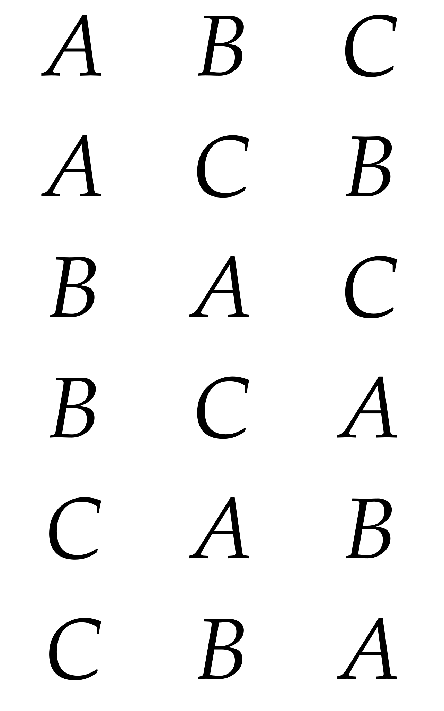

For it is _impossible_ to know the number of possible permutations without knowing the permutations themselves. And if that were not so, combinatorics could not arrive at its general formulae. The law we recognize in the formation of the permutations is represented by the equation p = n!. In the same sense, I believe, in which a circle is represented by the equation of a circle. – I can of course assign the number 2 to the permutations A B, B A, and likewise 6 to the permutations of A, B, C that have been worked out, but that does not give me the proposition of combinatorics. – What I see in A B, B A is an internal relation, which therefore cannot be described. I.e. _that_ which makes this class of permutations complete cannot be described. – I can only count what is actually there, not the possibilities. But I can, e.g., calculate how many lines a person has to write if they put a permutation of 3 elements on each line and go on permuting until they cannot go any further without repetition. And that means they need 6 lines to write down the permutations A B C, A C B etc. in this way, for these are precisely “_the_ permutations of A, B, C”. But it makes no sense to say that these are all the permutations of A B C.

### [Ts-209](/ts-209/#51.2) [51\[2\]](https://cdn.wittgensteinnachlass.com/2000px/webp/Ts-209/51.webp)

117 A calculating machine for combinatorics is conceivable, quite analogous to the Russian one.

### [Ts-209](/ts-209/#51.3) [51\[3\]](https://cdn.wittgensteinnachlass.com/2000px/webp/Ts-209/51.webp)

It is clear that there is a mathematical question; “how many permutations of – e.g. – 4 elements are there”, a question of exactly the same kind as “what is 25 × 18”. For there is a general method for solving each. But the question exists only in relation to this method.

### [Ts-209](/ts-209/#51.4) [51\[4\]](https://cdn.wittgensteinnachlass.com/2000px/webp/Ts-209/51.webp)

The sentence that there are 6 permutations of 3 elements is identical with the permutation schema, and that is why there is no sentence here “there are 7 permutations of 3 elements”, for no such schema corresponds to it.

### [Ts-209](/ts-209/#51.5) [51\[5\]](https://cdn.wittgensteinnachlass.com/2000px/webp/Ts-209/51.webp)

One can also say that the sentence “there are 6 permutations of 3 elements” stands in exactly the same relation to the sentence “there are 6 people in the room” as does the sentence 3 + 3 = 6, which one could also express in the form “there are 6 units in 3 + 3”. And just as in the one case I count the rows in the permutation schema, so in the other I can count the strokes in .

### [Ts-209](/ts-209/#51.6) [51\[6\]](https://cdn.wittgensteinnachlass.com/2000px/webp/Ts-209/51.webp)

Just as I can prove 4 × 3 = 12 by means of the schema: 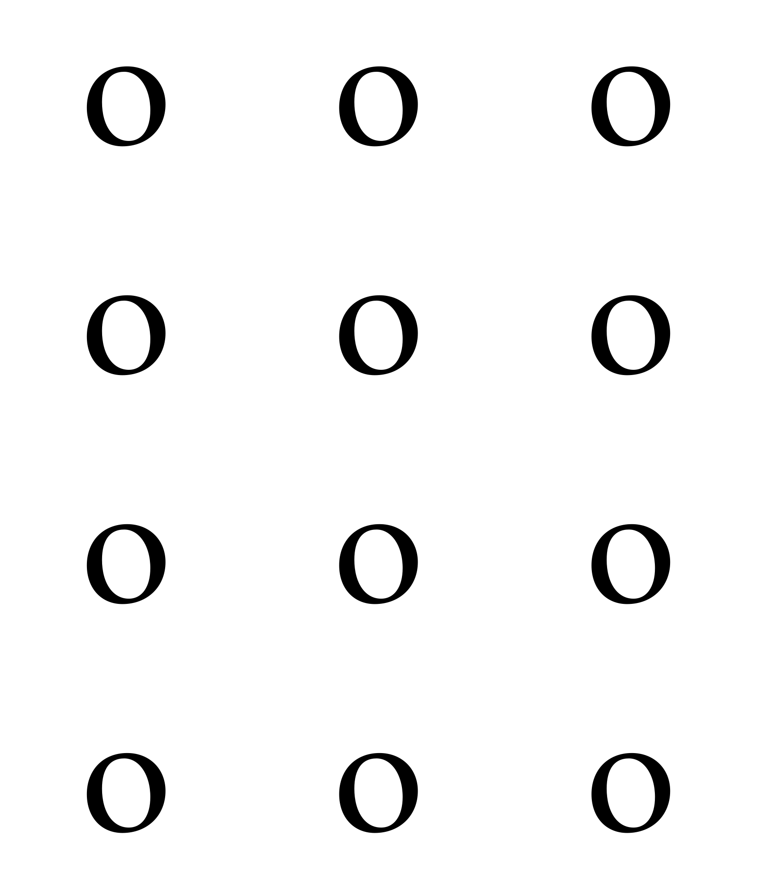, so I can prove 3! = 6 by means of the permutation schema.

### [Ts-209](/ts-209/#51.7) [51\[7\]](https://cdn.wittgensteinnachlass.com/2000px/webp/Ts-209/51.webp)

118 To say that I have so many spoons that they _can_ be distributed 1–1 among a dozen bowls, what does that mean? Either this sentence presupposes that I have 12 spoons, in which case I cannot say that they can be put into correspondence with the 12 bowls, for the opposite would be impossible; or the sentence does not presuppose that I have 12 spoons, in which case it says that I _can_ have 12 spoons, and that goes without saying and again cannot be said. One could also ask: Does that sentence say _less_ than that I have 12 spoons? Does it say something from which it follows only with the help of a further sentence that I have 12 spoons? If p follows from q alone, then q already says p. An apparent process of thought that effects the transition does not count.

### [Ts-209](/ts-209/#51.8) [51\[8\]](https://cdn.wittgensteinnachlass.com/2000px/webp/Ts-209/51.webp)

The symbol for a class is a list.

### [Ts-209](/ts-209/#52.1) [52\[1\]](https://cdn.wittgensteinnachlass.com/2000px/webp/Ts-209/52.webp)

Can I know that there are as many apples as pears on this table and not know how many? And what does it mean not to know how many? And how can I find out? Presumably by counting. It is evident that one can recognize equality of number by establishing a correspondence, without counting the classes.

### [Ts-209](/ts-209/#52.2) [52\[2\]](https://cdn.wittgensteinnachlass.com/2000px/webp/Ts-209/52.webp)

In Russell’s theory only the _actual_ correspondence can show the “similarity” of two classes. Not the _possibility_ of the correspondence, for this consists precisely in the equality of the numbers. The possibility must after all be an _internal_ relation between the extensions of the concepts, but this internal relation is given only by the equality of the two numbers.

### [Ts-209](/ts-209/#52.3) [52\[3\]](https://cdn.wittgensteinnachlass.com/2000px/webp/Ts-209/52.webp)

The cardinal number is an internal property of a list.

### [Ts-209](/ts-209/#52.4) [52\[4\]](https://cdn.wittgensteinnachlass.com/2000px/webp/Ts-209/52.webp)

119 We sort the evidence for the occurrence of a physical event according to the different kinds of such evidence, into evidence heard, seen, measured, etc., and see that in each of these kinds there is a formal element of order that we can call space.

### [Ts-209](/ts-209/#52.5) [52\[5\]](https://cdn.wittgensteinnachlass.com/2000px/webp/Ts-209/52.webp)

What kind of _impossibility_ is it to put, e.g., 3 circles and 2 crosses into 1–1 correspondence? One could also ask – and it would evidently be the same kind of question – what kind of impossibility is it to draw parallel straight lines to establish the correspondence, given the arrangement shown?

### [Ts-209](/ts-209/#52.6) [52\[6\]](https://cdn.wittgensteinnachlass.com/2000px/webp/Ts-209/52.webp)

That the 1–1 correspondence is possible is shown by the fact that a sentence with sense asserts – truly or falsely – that it obtains. And that the above correspondence is not possible is shown by the fact that we cannot describe it.

### [Ts-209](/ts-209/#52.7) [52\[7\]](https://cdn.wittgensteinnachlass.com/2000px/webp/Ts-209/52.webp)

We can say that there are 2 circles in this quadrilateral, though in reality there are 3, and this sentence is merely false. But I cannot say that this group of circles consists of 2 circles, and just as little can I say that it consists of 3 circles, because I would then be stating an _internal_ property.

### [Ts-209](/ts-209/#52.8) [52\[8\]](https://cdn.wittgensteinnachlass.com/2000px/webp/Ts-209/52.webp)

To say of an extension that it has such and such a number is nonsense, for the number is an _internal_ property of the extension. But one can predicate the number of the concept that brings the extension under one roof (just as one can say that this extension satisfies the concept).

### [Ts-209](/ts-209/#52.9) [52\[9\]](https://cdn.wittgensteinnachlass.com/2000px/webp/Ts-209/52.webp)

120 It is remarkable that in the case of tautologies and contradiction one really could speak of sense and meaning in Frege’s sense. If one calls the property of being a tautology the meaning of a tautology, then one can call the way in which the tautology comes about here its sense. The same goes for contradiction.

### [Ts-209](/ts-209/#53.1) [53\[1\]](https://cdn.wittgensteinnachlass.com/2000px/webp/Ts-209/53.webp)

If, as Ramsey suggests, one explains the sign “ = ” in such a way that x = x is a tautology and x = y a contradiction, then one can say that the tautology and the contradiction here have no “sense”.

### [Ts-209](/ts-209/#53.2) [53\[2\]](https://cdn.wittgensteinnachlass.com/2000px/webp/Ts-209/53.webp)

So if a tautology shows something by virtue of the fact that precisely _this_ sense yields _this_ meaning, then in Ramsey’s account the tautology shows nothing, for it is a tautology by definition.

### [Ts-209](/ts-209/#53.3) [53\[3\]](https://cdn.wittgensteinnachlass.com/2000px/webp/Ts-209/53.webp)

What relation, then, holds between the sign “≝” and that equality sign which is explained by tautology and contradiction? For this equality sign, is “p & q = non(nonp ⌵ nonq)” a tautology? One could say: “p & q = p & q” is a taut., and since one may here replace one of the signs “p & q” by “non (nonp & nonq)” in accordance with the definition, the expression above is also a taut.

### [Ts-209](/ts-209/#53.4) [53\[4\]](https://cdn.wittgensteinnachlass.com/2000px/webp/Ts-209/53.webp)

So one should not write the explanation of the equality sign like this: x = x is a taut.

x = y a contr. Rather, one would have to say: If, and _only_ if, “x” and “y” have the same meaning according to the rules for the signs, then “x = y” is a taut.; if “x” and “y” do not have the same meaning according to the rules for the signs, then “x = y” is a contr. It would then be expedient to write the equality sign so explained differently, to distinguish it from “x = y”, which represents a rule for the signs and says that we may replace x by y. For I cannot tell this from the sign explained above, but only from the fact that it is a tautology, and even that I know only if I already know the substitution rules.

### [Ts-209](/ts-209/#53.5) [53\[5\]](https://cdn.wittgensteinnachlass.com/2000px/webp/Ts-209/53.webp)

It seems to me that one can compare the equations of mathematics only with sentences that have sense, not with tautologies. For the equation contains this very element that states something – the equality sign – which is not meant to show anything. For what shows itself does so without the equality sign. The equality sign does not correspond to the “․⊃․” in “p & (p⊃q) ․⊃․ q”, for the “․⊃․” is only _one_ constituent among others that go to make up the tautology. It does not stand apart from the rest, but belongs to the sentence, like the “ & ” or “⊃”. The “ = ”, however, is a copula, which alone makes the equation something sentence-like. The tautology shows something; the equation shows nothing, but points to the fact that its terms show something.

### [Ts-209](/ts-209/#53.6) [53\[6\]](https://cdn.wittgensteinnachlass.com/2000px/webp/Ts-209/53.webp)

121 An equation is a syntactic rule.

### [Ts-209](/ts-209/#53.7) [53\[7\]](https://cdn.wittgensteinnachlass.com/2000px/webp/Ts-209/53.webp)

Does that not explain why we cannot have questions in mathematics that are unanswerable in principle? For if the rules of syntax are not intelligible, they are no use. And it likewise explains why an infinity that exceeds our powers of comprehension cannot enter into these rules. And it also makes sense of the attempts of the formalists, who see mathematics as a game with signs.

### [Ts-209](/ts-209/#53.8) [53\[8\]](https://cdn.wittgensteinnachlass.com/2000px/webp/Ts-209/53.webp)

One can indeed take rules for signs, e.g. definitions, as sentences that deal with signs, but one is not _obliged_ to take them as sentences at all. They are aids to language. Aids of a different kind from the sentences of language.

### [Ts-209](/ts-209/#54.1) [54\[1\]](https://cdn.wittgensteinnachlass.com/2000px/webp/Ts-209/54.webp)

Ramsey’s theory of identity makes the mistake one would make if one said that a painted picture could also be used as a mirror, even if only for a single position. What is then overlooked is that the essential thing about a mirror is precisely that one can infer from it the position of the body in front of the mirror, whereas in the case of the painted picture one must first know that the positions agree before one can take the picture as a mirror image.

### [Ts-209](/ts-209/#54.2) [54\[2\]](https://cdn.wittgensteinnachlass.com/2000px/webp/Ts-209/54.webp)

Weyl’s contradiction “Heterological”: nonf(“f”) [unreadable] “f” is heterological = F(“f”) ≝. F(“F”) = nonF(“F”) = non[non (nonf̂(“f̂”)) (“nonf̂ (“f̂”)”)]

### [Ts-209](/ts-209/#54.3) [54\[3\]](https://cdn.wittgensteinnachlass.com/2000px/webp/Ts-209/54.webp)

122 One can imagine the mathematical proposition as a living being that itself knows whether it is true or false. (In contrast to propositions proper.) The mathematical proposition itself knows that it is true, or that it is false. If it deals with all numbers, then it must already survey all numbers. Its truth or falsity, like its sense, must lie within it.

### [Ts-209](/ts-209/#54.4) [54\[4\]](https://cdn.wittgensteinnachlass.com/2000px/webp/Ts-209/54.webp)

It is as if the generality of a sentence like “(n)non chromatisch n” were only a pointer to the proper, actual, mathematical generality of a sentence. As it were, only a description of the generality, not the generality itself. As if the sentence formed a sign in a purely external way, and one still had to give that sign sense from within.

### [Ts-209](/ts-209/#54.5) [54\[5\]](https://cdn.wittgensteinnachlass.com/2000px/webp/Ts-209/54.webp)

We feel that the generality the mathematical assertion has is different from the generality of the proposition that has been proved.

### [Ts-209](/ts-209/#54.6) [54\[6\]](https://cdn.wittgensteinnachlass.com/2000px/webp/Ts-209/54.webp)

What relation does a mathematical problem stand in to its answer?

### [Ts-209](/ts-209/#54.7) [54\[7\]](https://cdn.wittgensteinnachlass.com/2000px/webp/Ts-209/54.webp)

One might say: A mathematical proposition is a pointer to a proof.

### [Ts-209](/ts-209/#54.8) [54\[8\]](https://cdn.wittgensteinnachlass.com/2000px/webp/Ts-209/54.webp)

A generality cannot be both empirical and provable.

### [Ts-209](/ts-209/#54.9) [54\[9\]](https://cdn.wittgensteinnachlass.com/2000px/webp/Ts-209/54.webp)

If a sentence is to have a determinate sense (and otherwise it is nonsensical), then it must grasp its sense entirely – survey it entirely; the generality has sense only if it – i.e. all the values of the variable – is completely determined.

### [Ts-209](/ts-209/#54.10) [54\[10\]](https://cdn.wittgensteinnachlass.com/2000px/webp/Ts-209/54.webp)

123 [unreadable] If I can make headway on an endless stretch only by trial, why should it be any different on an infinite one? And then of course I can never reach the goal. But if I go on only step by step along the infinite stretch, then I cannot grasp the infinite stretch at all. So I grasp it in another way; and once I have grasped it, the proposition about it can be verified only in the way it has apprehended it.

### [Ts-209](/ts-209/#54.11+55.1) [54\[11\]](https://cdn.wittgensteinnachlass.com/2000px/webp/Ts-209/54.webp),[55\[1\]](https://cdn.wittgensteinnachlass.com/2000px/webp/Ts-209/55.webp)

So it cannot now be verified by taking steps imagined as going on without end, for even that would not reach a goal, since the proposition can always go a step beyond ours, just as endlessly. Rather, only in _one_ step, just as the totality of the numbers could only be grasped at _one_ stroke.

### [Ts-209](/ts-209/#55.2) [55\[2\]](https://cdn.wittgensteinnachlass.com/2000px/webp/Ts-209/55.webp)

One can also say: There is no path to infinity, _not even the endless one_.

### [Ts-209](/ts-209/#55.3) [55\[3\]](https://cdn.wittgensteinnachlass.com/2000px/webp/Ts-209/55.webp)

It would be something like this: We have an infinitely long row of trees, and I make a path alongside it so that I can inspect it. Very well, then this path must be endless. But if it is endless, that means precisely that one cannot go all the way to the end of it. I.e. it does _not_ enable me to survey the row. (Admittedly not.) For the endless path does not have an “infinitely distant” end, but no end at all.

### [Ts-209](/ts-209/#55.4) [55\[4\]](https://cdn.wittgensteinnachlass.com/2000px/webp/Ts-209/55.webp)

124 It is not merely “for us human beings” that grasping all numbers in succession is impossible; it is impossible, it means nothing.

### [Ts-209](/ts-209/#55.5) [55\[5\]](https://cdn.wittgensteinnachlass.com/2000px/webp/Ts-209/55.webp)

Nor can one say: “The sentence cannot grasp all the numbers in succession, so it must grasp them by means of the concept”, as if this were so faute de mieux: “Because it cannot do it _this_ way, it must do it the other way”. But that is not how it is: Grasping them in succession is indeed possible; it just does _not_ lead to the totality. The totality, however, exists only as a concept.

### [Ts-209](/ts-209/#55.6) [55\[6\]](https://cdn.wittgensteinnachlass.com/2000px/webp/Ts-209/55.webp)

To the objection: “If I go through the series of numbers, then I either come at some point to the number with the desired property, or never do”, one need only reply that it makes no sense to say that one comes to the number _at some point_, and _just as little_ sense to say that one _never_ gets there. It is quite right to say that the number 101 is that number, or that it is not. But one cannot talk about _all_ numbers, because there are no such things as _all_ numbers.

### [Ts-209](/ts-209/#55.7) [55\[7\]](https://cdn.wittgensteinnachlass.com/2000px/webp/Ts-209/55.webp)

125 Can one say: One could not foresee that 6 ‒ 4 is exactly 2, but can only see it when one gets there.

### [Ts-209](/ts-209/#55.8) [55\[8\]](https://cdn.wittgensteinnachlass.com/2000px/webp/Ts-209/55.webp)

The very fact that the existence of its objects is already given with the logical concept [1, ‒ , ‒ + 1] shows that it determines them.

### [Ts-209](/ts-209/#55.9) [55\[9\]](https://cdn.wittgensteinnachlass.com/2000px/webp/Ts-209/55.webp)

This, incidentally, is quite clear: Each number has its irreducible individuality. And if I want to prove some property of a number, I must always bring the number itself in somehow.

### [Ts-209](/ts-209/#55.10) [55\[10\]](https://cdn.wittgensteinnachlass.com/2000px/webp/Ts-209/55.webp)

To that extent one can say that the properties of a particular number cannot be _foreseen_. One sees them only when one gets there. One could say: Can I not prove something about the number 3¹⁰ even though I cannot write it down? Yes, but 3¹⁰ is already the number, only written down in a different way.

### [Ts-209](/ts-209/#55.11) [55\[11\]](https://cdn.wittgensteinnachlass.com/2000px/webp/Ts-209/55.webp)

All that is fundamental is the repetition of an operation. Each stage of this repetition has its individuality.

### [Ts-209](/ts-209/#56.1) [56\[1\]](https://cdn.wittgensteinnachlass.com/2000px/webp/Ts-209/56.webp)

Now it is not as though the operation took me from one individuality to the next. As though the operation were the means of getting from one to the next. A vehicle, say, that stops at each number so that one can then look at it. Rather, performing the operation + 1 three times generates and _is_ the number 3.

### [Ts-209](/ts-209/#56.2) [56\[2\]](https://cdn.wittgensteinnachlass.com/2000px/webp/Ts-209/56.webp)

An “infinitely complicated law” means no law. How could one know that it is infinitely complicated? Only if there were, as it were, infinitely many approximations to this law. But does that not require that they actually _approach_ a goal? Or can one call the infinitely many descriptions of stretches of the series of prime numbers such approximations to the law? No, for no description of a finite stretch brings us any closer to the goal of a complete description. How, then, does an infinitely complicated law in this sense differ from no law at all? At most the law would then say “everything is as it is”.

### [Ts-209](/ts-209/#56.3) [56\[3\]](https://cdn.wittgensteinnachlass.com/2000px/webp/Ts-209/56.webp)

126 It now seems after all that the designation of generality for numbers has no sense. I mean: One cannot say “(n)Fn” because “all natural numbers” is not a bounded concept. But then one cannot say either that a general statement follows from a statement about the nature of number.

### [Ts-209](/ts-209/#56.4) [56\[4\]](https://cdn.wittgensteinnachlass.com/2000px/webp/Ts-209/56.webp)

But then it seems to me as if one cannot use generality – all, etc. – in mathematics at all. There are no such things as all numbers, precisely because there are infinitely many. And because here what is at issue is not the amorphous “all”, as in the sentence “all the apples are ripe”, where the collection is given by an external description, but the totality of structures, which have to be given as such.

### [Ts-209](/ts-209/#56.5) [56\[5\]](https://cdn.wittgensteinnachlass.com/2000px/webp/Ts-209/56.webp)

It is so to speak no concern of logic how many apples there are when one talks of _all_ the apples. With numbers, by contrast, things are different: logic is responsible for them individually.

### [Ts-209](/ts-209/#56.6) [56\[6\]](https://cdn.wittgensteinnachlass.com/2000px/webp/Ts-209/56.webp)

127 What does a mathematical proposition of the kind “(∃n)․4 + n = 7” mean? It would be a disjunction 4 + 0 = 7 ․⌵․ 4 + 1 = 7 ․⌵․ etc. ad inf. But what does that mean? I can understand a sentence that has a beginning and an end. But can one also understand a sentence that has no end? I also understand that one can specify an infinite rule according to which infinitely many finite sentences can be formed. But what does an endless sentence mean?

### [Ts-209](/ts-209/#56.7) [56\[7\]](https://cdn.wittgensteinnachlass.com/2000px/webp/Ts-209/56.webp)

If the proposition is not made true by any finite product, then that means: It is made true by _no_ product. And that is why it _is_ not a logical product.

### [Ts-209](/ts-209/#56.8) [56\[8\]](https://cdn.wittgensteinnachlass.com/2000px/webp/Ts-209/56.webp)

128 But can I not say of an equation: “I know it does not hold for some substitutions – I no longer remember which – but whether there is no substitution for which it holds, I do not know”? Does that not make perfectly good sense, and is it not compatible with the generality of the inequality?

### [Ts-209](/ts-209/#57.1) [57\[1\]](https://cdn.wittgensteinnachlass.com/2000px/webp/Ts-209/57.webp)

Am I to reply: “If one knows that the inequality holds for some substitutions, that can never mean ‘for some (arbitrary) members of the infinite series of numbers’; rather, I always also know that this number lies between 1 and 10⁷, or between some other bounds”?

### [Ts-209](/ts-209/#57.2) [57\[2\]](https://cdn.wittgensteinnachlass.com/2000px/webp/Ts-209/57.webp)

Can I know that _a_ number satisfies the equation without any finite range being demarcated for its occurrence in the infinite series? No.

### [Ts-209](/ts-209/#57.3) [57\[3\]](https://cdn.wittgensteinnachlass.com/2000px/webp/Ts-209/57.webp)

It would have been a good question for the Scholastics: “Can God know all the digits of π?” The answer in all such cases is: The question is senseless.

### [Ts-209](/ts-209/#57.4) [57\[4\]](https://cdn.wittgensteinnachlass.com/2000px/webp/Ts-209/57.webp)

“No level of brightness below this one hurts my eyes”. That is, I have observed that my experiences so far accord with a formal law.

### [Ts-209](/ts-209/#57.5) [57\[5\]](https://cdn.wittgensteinnachlass.com/2000px/webp/Ts-209/57.webp)

129 A sentence that deals with all sentences, or all functions, is an impossibility from the outset: what such a sentence would be meant to express would have to be shown by an induction. (For example, that _all_ sentences 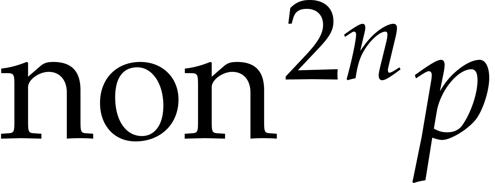 say the same thing.) This induction is not itself a sentence, and therefore a vicious circle is ruled out.

### [Ts-209](/ts-209/#57.6) [57\[6\]](https://cdn.wittgensteinnachlass.com/2000px/webp/Ts-209/57.webp)

When we form the concept “sentence”, what do we want to distinguish sentences from? Is it not the case that we can describe the sentence generally only from the outside? Likewise when we ask: Is there a general form of law? In contrast to what? The laws must after all fill the whole of logical space, so I can no longer set bounds to them.

### [Ts-209](/ts-209/#57.7) [57\[7\]](https://cdn.wittgensteinnachlass.com/2000px/webp/Ts-209/57.webp)

_Generality_ in arithmetic is represented by induction. Induction is the expression for arithmetical generality.

### [Ts-209](/ts-209/#57.8) [57\[8\]](https://cdn.wittgensteinnachlass.com/2000px/webp/Ts-209/57.webp)

Suppose a rule of a game read: “One is to write down a fraction that lies between 0 and 1.” Isn’t this rule intelligible? Does a limit need to be given here? And what about the rule “One is to write down a number greater than 100”? Both seem entirely intelligible.

### [Ts-209](/ts-209/#57.9) [57\[9\]](https://cdn.wittgensteinnachlass.com/2000px/webp/Ts-209/57.webp)

I have always said: one cannot speak of _all_ numbers because there are no such things as _all_ numbers. But that is only the expression of a feeling. What one ought really to say is “of _all_ numbers there _is_ never any talk in arithmetic”, and if one speaks that way all the same, one is, so to speak, making something up – something nonsensical – and adding it to the arithmetical facts. (What one makes up and adds to _logic_ must of course be _nonsensical_.)

### [Ts-209](/ts-209/#57.10) [57\[10\]](https://cdn.wittgensteinnachlass.com/2000px/webp/Ts-209/57.webp)

130 It is hard to free oneself entirely from the extensional conception: One always thinks: “Yes, but there must be an internal relation between x³ + y³ and z³, since the extension, if only I knew it, would have to represent the result of such a relation”. Something like: “Surely either _essentially all_ n must have the property or not, since _all_ n do have the property or not, even if I cannot know this.”

### [Ts-209](/ts-209/#58.1) [58\[1\]](https://cdn.wittgensteinnachlass.com/2000px/webp/Ts-209/58.webp)

If I write (∃x)․x² = 2x and do not understand (∃x) extensionally, then all it can assert is: “If I apply the rules for solving it, I arrive at a definite number, as opposed to the case in which I arrive at an identity or a forbidden equation”.

### [Ts-209](/ts-209/#58.2) [58\[2\]](https://cdn.wittgensteinnachlass.com/2000px/webp/Ts-209/58.webp)

The error (circularity) in Dedekind’s explanation of the concept of infinity lies in the application of the concept “_all_” in the formal implication. For there seems to be a formal implication that holds – if one may put it like that – independently of whether a finite or an infinite number of objects fall under its concepts. It says simply: If the one holds of an object, then the other holds of it too. It takes no account at all of the totality of objects, but says something only about whichever object is put before it, and _its application_ is finite or infinite, as the case may be. But how could we know such a proposition? – How is it verified? What really corresponds to what we mean is not a proposition at all, but the _inference_ from Fx to ψx, if this inference is permitted – but that is not expressed by a proposition.

### [Ts-209](/ts-209/#58.3) [58\[3\]](https://cdn.wittgensteinnachlass.com/2000px/webp/Ts-209/58.webp)

What does it mean: One can extend a straight line segment as far as one likes? Is there not an “and so on ad inf.” here that is quite different from that of mathematical induction? According to what has been said so far, the expression for the possibility of extending it would consist in the description of the extended piece, or of the extending. Here it seems, at first, to have nothing to do with numbers. I can imagine that the pencil, which draws the line segment, continues its movement and then always continues in the same way. But is it also conceivable that there is no possibility of accompanying this process with a countable process? I don’t think so.

### [Ts-209](/ts-209/#58.4) [58\[4\]](https://cdn.wittgensteinnachlass.com/2000px/webp/Ts-209/58.webp)

131 Generality of Euclidean proofs. One says that the demonstration is carried out on _one_ triangle, but that the proof holds for all triangles – or for any triangle whatsoever. First, it is odd that what holds for one triangle should on that account hold for all the others. Surely a doctor could not examine _one_ person and then infer that what he finds in this person must also be true of all the others. And if I measure and add up the angles in one triangle, I really cannot infer that their sum will be just as large in every other triangle. It is clear that the Euclidean proof cannot say anything about a totality of triangles. A proof cannot go beyond itself. But the construction in the proof is not an experiment either, and if it were, the result could not prove anything for other cases. So there is no need actually to carry out the construction with paper and pencil; rather, the description of the construction must suffice for one to see everything essential from it. (The description of an experiment is not enough for one to obtain the result of the experiment from it; the experiment must actually be carried out.) The construction in the Euclidean proof is exactly analogous to the proof that 2 + 2 = 4 by means of the Russian abacus.

### [Ts-209](/ts-209/#58.5) [58\[5\]](https://cdn.wittgensteinnachlass.com/2000px/webp/Ts-209/58.webp)

And is this not also the kind of generality that belongs to the tautologies of logic, which are demonstrated for p, q, r etc.?

### [Ts-209](/ts-209/#58.6) [58\[6\]](https://cdn.wittgensteinnachlass.com/2000px/webp/Ts-209/58.webp)

The essential thing in all these cases is that what is demonstrated cannot be expressed by a sentence.

### [Ts-209](/ts-209/#59.1) [59\[1\]](https://cdn.wittgensteinnachlass.com/2000px/webp/Ts-209/59.webp)

132 If I say “the world will end _someday_”, that says nothing at all if the time is left open without limit. For the world’s still existing on any given day is compatible with this specification. – What is _infinite_ is the _possibility_ of numbers in sentences of the form “in n days the world will end”.

### [Ts-209](/ts-209/#59.2) [59\[2\]](https://cdn.wittgensteinnachlass.com/2000px/webp/Ts-209/59.webp)

To understand the sense of a question, let us consider: What does the answer to this question look like? In answer to the question “is A my ancestor” I can only imagine the answers “A is to be found in my gallery of ancestors” or “A is not to be found in my gallery of ancestors” (where by gallery of ancestors I understand the sum total of all kinds of information about my forebears). But then the question too could only mean the same as: “Is A to be found in my gallery of ancestors”. (A gallery of ancestors has an end: that is a sentence of syntax.) If a god revealed to me that A was my ancestor, but not how many generations back, then this revelation too could only have the sense for me that I will find A among my ancestors if only I look long enough; but since I will search through N ancestors, the revelation must mean that A is among those N ancestors.

### [Ts-209](/ts-209/#59.3) [59\[3\]](https://cdn.wittgensteinnachlass.com/2000px/webp/Ts-209/59.webp)

If I ask how many 9s follow immediately one after another after 3,1415 in the expansion of π, and the question is meant to concern the extension, then the answer is either that in expanding the extension as far as the last place worked out (the Nth), one has got beyond the run of 9s, or that the 9s continue in succession up to the Nth place. But then the question too could have had no other sense than “are the first N-5 places of π all 9s or not?” – But that, of course, is not the question that interests us.

### [Ts-209](/ts-209/#59.4) [59\[4\]](https://cdn.wittgensteinnachlass.com/2000px/webp/Ts-209/59.webp)

133 In philosophy it is always a matter of applying a number of extremely simple principles that every child knows, and the – enormous – difficulty is only in applying them amid the confusion our language creates. It is never a matter of the latest results of experiments with exotic fish, or of mathematics. But the difficulty of applying the simple principles makes one doubt those very principles.

### [Ts-209](/ts-209/#59.5) [59\[5\]](https://cdn.wittgensteinnachlass.com/2000px/webp/Ts-209/59.webp)

134 What kind of sentence is: “On this strip one can see all the shades of grey between black and white”? At first sight it seems that what is spoken of here is infinitely many shades. Indeed, we apparently have the paradox here that, although we can distinguish only finitely many shades from one another and the difference between them is of course not infinitely small, we nevertheless see a continuous transition.

### [Ts-209](/ts-209/#59.6+60.1) [59\[6\]](https://cdn.wittgensteinnachlass.com/2000px/webp/Ts-209/59.webp),[60\[1\]](https://cdn.wittgensteinnachlass.com/2000px/webp/Ts-209/60.webp)

One can no more regard a particular grey as one of the infinitely many greys between black and white than one can regard a tangent t as one of the infinitely many

stages in the transition from t' to t''. If, say, I see a ruler roll along the circle from t' to t'', then – if it moves continuously – I see not a single one of the intermediate positions in the sense in which I see t when the tangent is at rest; or else I see only a finite number of intermediate positions. But if in such a case I appear to infer a special case from a general proposition, experience is never the source of this general proposition, and the proposition is not really a proposition at all. If, for example, I say: “I saw the ruler move from t' to t'', _so_ I must have seen it in t too”, we do not have a valid logical inference here. For if what I mean is that the ruler must have _appeared_ to me in position t – if, that is, I am speaking of the position in visual space, then that does not follow from the premise at all. But if I am speaking of the physical ruler, it is of course possible that it skipped position t and that the phenomenon in visual space was nevertheless continuous.

### [Ts-209](/ts-209/#60.2) [60\[2\]](https://cdn.wittgensteinnachlass.com/2000px/webp/Ts-209/60.webp)

135 Ramsey proposed expressing the proposition that infinitely many objects satisfy a function by negating all sentences of the form:

non (∃x)fx

(∃x)fx & non(∃x,y)fx & fy etc.

But now let us suppose that there are only three objects, i.e. that only three names have meaning. Then we cannot even write down the fourth sentence in the series, for it makes no sense then to write: non (∃x,y,z,u) fx & fy&fz&fu. So by negating all the sentences in that series I do not arrive at the infinite.

### [Ts-209](/ts-209/#60.3) [60\[3\]](https://cdn.wittgensteinnachlass.com/2000px/webp/Ts-209/60.webp)

“We know infinity from the description”. Well, then there is only this description and nothing else.

### [Ts-209](/ts-209/#60.4) [60\[4\]](https://cdn.wittgensteinnachlass.com/2000px/webp/Ts-209/60.webp)

136 In what respect does a notation for the infinite presuppose infinite space or infinite time? An infinitely large piece of paper is of course not presupposed. But its possibility is?

### [Ts-209](/ts-209/#60.5) [60\[5\]](https://cdn.wittgensteinnachlass.com/2000px/webp/Ts-209/60.webp)

We can surely imagine a notation that progresses in time instead of in space. Speech, for instance. Here too we can evidently imagine the infinite being represented, and in doing so we are surely making no _hypothesis_ about time. It appears to us essentially as an _infinite_ possibility. And indeed, evidently, infinite according to what we know about its structure.

### [Ts-209](/ts-209/#60.6) [60\[6\]](https://cdn.wittgensteinnachlass.com/2000px/webp/Ts-209/60.webp)

Surely it is impossible that mathematics should depend on a hypothesis about physical space. And _visual space_ is surely not infinite in this sense. And if what is at issue is not the reality but only the possibility of the hypothesis of infinite space, then this possibility must surely be prefigured somewhere. Here we come up against the problem that also arises in the extension of visual space, namely that of the smallest visible difference. The existence of a smallest visible difference contradicts continuity, and yet it must be possible to reconcile the two.

### [Ts-209](/ts-209/#60.7) [60\[7\]](https://cdn.wittgensteinnachlass.com/2000px/webp/Ts-209/60.webp)

137 If I have a series of patches that are alternately black and white, as the figure shows

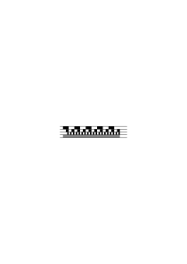

then with further subdivision I will soon reach a limit at which I can no longer distinguish the black and white patches, at which I have, say, the impression of a grey strip. But does this not mean that I cannot subdivide the stretch in my visual field as far as I like? And yet I see no discontinuity, and this too is obvious, since I could see a discontinuity only if I had not yet reached the limit of what is distinguishable. This looks very paradoxical.

### [Ts-209](/ts-209/#61.1) [61\[1\]](https://cdn.wittgensteinnachlass.com/2000px/webp/Ts-209/61.webp)

But what about continuity between the individual series? We evidently have a penultimate series of distinguishable patches and then the last, uniformly grey series; can one see from this last series that it really arose by subdivision of the penultimate one? Evidently not. On the other hand: Can one see from the so-called penultimate series that it cannot be subdivided any further in a visible way? It seems to me that one can no more see that. So there would be no last visibly subdivided series after all! But if I can no longer visibly subdivide the stretch, then I cannot even _try_ to subdivide it in this way, and so cannot see such an attempt fail either. (It is the same here as with the limitlessness of visual space.) The same would of course hold for differences of colour too.

### [Ts-209](/ts-209/#61.2) [61\[2\]](https://cdn.wittgensteinnachlass.com/2000px/webp/Ts-209/61.webp)

Continuity in our visual field consists in our seeing no discontinuity.

### [Ts-209](/ts-209/#61.3) [61\[3\]](https://cdn.wittgensteinnachlass.com/2000px/webp/Ts-209/61.webp)

138 But if I only ever see finitely many things, divisions, colours, etc., then there is no infinity at all; not in any sense. The feeling here is: If I only ever see so few, then there simply are no more. As if it were a case of: If I see only 4, then there simply aren’t 100. But infinity does not occupy the place of a number. It is quite right: If I see only 4, there aren’t 100, and there aren’t 5 either. But there is the infinite possibility, which is no more exhausted by a small number than by a large one. And this is in fact because it is not itself _any_ magnitude.

### [Ts-209](/ts-209/#61.4) [61\[4\]](https://cdn.wittgensteinnachlass.com/2000px/webp/Ts-209/61.webp)

We all know, of course, what it means for there to be an infinite possibility and a finite reality, for we say that time and physical space are infinite but that we can only ever see or live through finite stretches of them. But where then does my knowledge of the infinite come from at all? So in some sense I must have experiences of two kinds: one of the finite that cannot go beyond it (this very idea of going beyond it is already nonsensical), and one of the infinite. And so it is. Experience as the living through of facts gives me the finite; the objects _contain_ the infinite. Not, of course, as a magnitude competing with finite experience, but intensionally. Not as if I saw space almost entirely empty, with only a tiny finite experience in it. Rather, I see in space the possibility for every finite experience. That is, no experience can be too large for it, or exactly fill it. And this is not because we know the magnitude of all experiences and know that space is larger than they are, but because we understand that this lies in the essence of space. – We recognize this infinite essence of space in the smallest stretch. What is already nonsensical is that one so often thinks that surely a large number is closer to the infinite than a small one. The infinite – as I said – does not compete with the finite. It is that which essentially excludes no finite thing. In this sentence we have the word “no”, and once again this must not be understood as the expression of an infinite conjunction; rather, “essentially no” belongs together. It is no wonder that time and again I can explain infinity only by means of itself, that is, that I _cannot explain_ it.

### [Ts-209](/ts-209/#61.5) [61\[5\]](https://cdn.wittgensteinnachlass.com/2000px/webp/Ts-209/61.webp)

Space has no extension; only spatial objects are extended, but infinity is a property of space. (That alone shows that it is not an infinite extension.) And the same holds for time.

### [Ts-209](/ts-209/#62.1) [62\[1\]](https://cdn.wittgensteinnachlass.com/2000px/webp/Ts-209/62.webp)

139 What about infinite divisibility? Let us remember that it makes sense to say that _every_ finite number of parts is conceivable, but no infinite number; and that this is precisely what infinite divisibility consists in. But here “every” does not mean that the _totality of all_ divisions is conceivable (it is not, for there is no such totality). Rather, there is the _variable_ “divisibility” (i.e. the concept of divisibility), which _sets no limits_ to actual divisibility; and that is what its infinity consists in.

### [Ts-209](/ts-209/#62.2) [62\[2\]](https://cdn.wittgensteinnachlass.com/2000px/webp/Ts-209/62.webp)

But how do we construct an infinite hypothesis, say, the hypothesis of infinitely many fixed stars (it is clear that it can _ultimately_ correspond only to a finite reality) –? Once again, it can be given only by a law. Think of the infinite series of red spheres. – Think of an infinite strip of film. (It would provide the possibility for everything finite that happens on the screen.) It is the typical case of a hypothesis that reaches into the infinite. It is clear to us that no experience _corresponds_ to it. It exists only in the “second system”, that is, in language; but how is it expressed here? (If someone can _imagine_ an infinite strip, then for that person there is an infinite reality, and there is also the “actually infinite” in mathematics.) It is expressed by a sentence of the kind “(n):(∃nx)․Fx”. Everything that relates to the infinite possibility, that is, all the infinite statements about the film, is rendered in the expression in the first bracket, and the reality that limits this possibility in the second bracket.

### [Ts-209](/ts-209/#62.3) [62\[3\]](https://cdn.wittgensteinnachlass.com/2000px/webp/Ts-209/62.webp)

But what, then, does divisibility have to do with being divided, if something can be divisible that _never_ _is_ divided? Indeed, what does divisibility mean at all in what is primarily given? How can one distinguish possibility from reality here? It must be wrong to speak, as I do, of the _restriction_ of infinite possibility to the finite. For this makes it seem as if an infinite reality were conceivable – even if it did not exist, and thus once again as if what was at issue were a possible infinite extension and an actual finite one. As if infinite possibility were the possibility of an infinite number. And this shows again that we are dealing with two different meanings of the word “_possible_” when I say “the segment can be divided into 3 parts” and, on the other hand, “the segment is infinitely divisible”. (The remark above, which raises the doubt whether there is anything actual and possible in visual space, points to this too.) What does it mean that a patch in visual space _can_ be divided into 3 parts? Surely it can only mean that a sentence describing a patch divided in that way makes sense. (If this is not a case of confusing the divisibility of physical objects with that of a patch in visual space.) Infinite – or better, _unlimited_ – divisibility, by contrast, does not mean that there is a sentence describing a segment divided into infinitely many parts, for there is no such sentence. This possibility, then, is indicated not by a reality of the signs, but by a possibility of a _different_ kind belonging to the signs themselves.

### [Ts-209](/ts-209/#62.4) [62\[4\]](https://cdn.wittgensteinnachlass.com/2000px/webp/Ts-209/62.webp)

When one says: Space is infinitely divisible, what this really means is: Space does not consist of individual things (parts).

### [Ts-209](/ts-209/#62.5) [62\[5\]](https://cdn.wittgensteinnachlass.com/2000px/webp/Ts-209/62.webp)

Infinite divisibility means, in a certain sense, that space is indivisible, that a division does not affect _it_. That it has nothing to do with the matter: _It_ does not consist of parts. It says, as it were, to reality: You can do in me whatever you want. (You can be divided in me as many times as you want.) Space gives reality infinite scope for division.

### [Ts-209](/ts-209/#63.1) [63\[1\]](https://cdn.wittgensteinnachlass.com/2000px/webp/Ts-209/63.webp)

And that is why there is only _one_ letter in the first bracket. Evidently just an opportunity, nothing else.

### [Ts-209](/ts-209/#63.2) [63\[2\]](https://cdn.wittgensteinnachlass.com/2000px/webp/Ts-209/63.webp)

140 Is primary time infinite? I.e. is it an infinite possibility? Even if it is filled only as far as memory reaches, that by no means says that it is finite. It is infinite in the same sense in which three-dimensional visual space is infinite, even if I can in fact see only as far as the walls of my room. For what I see presupposes the possibility of seeing further. I.e. I could correctly represent what I see only by means of an infinite form. Is it possible to imagine time with one end or with two ends?

### [Ts-209](/ts-209/#63.3) [63\[3\]](https://cdn.wittgensteinnachlass.com/2000px/webp/Ts-209/63.webp)

What can happen _now_ could also have happened earlier and will always be able to happen in the future, if time remains as it is. But _that_ does not depend on future experience. Time contains within itself _now_ the possibility of all the future. But all this already means that time is not infinite in the sense of the primitive conception of the infinite set. And the same holds for space. If I say that I can imagine a cylinder extended infinitely, that already lies in its essence. Here again, in the essence of the homogeneity of the cylinder and of the space it is in, – and the one presupposes the other, of course, – and this homogeneity is present in the finite piece that I see.

### [Ts-209](/ts-209/#63.4) [63\[4\]](https://cdn.wittgensteinnachlass.com/2000px/webp/Ts-209/63.webp)

The space in which human beings move is infinite, like time.

### [Ts-209](/ts-209/#63.5) [63\[5\]](https://cdn.wittgensteinnachlass.com/2000px/webp/Ts-209/63.webp)

141 The rules for the numeral system – the decimal system, say – contain everything that is infinite about numbers. For example, that _these rules_ place no limit on how far the numerals can extend to the right or to the left: _that_ is what expresses the infinity. One might perhaps say: yes, but the numerals are surely limited by the use of paper and writing materials and by other circumstances. True, but that is not expressed in the _rules_ for their use, and only in these is their true nature set out.

### [Ts-209](/ts-209/#63.6) [63\[6\]](https://cdn.wittgensteinnachlass.com/2000px/webp/Ts-209/63.webp)

Does the relation m = 2n map the class of all numbers onto one of its subclasses? No. It assigns another number to any given number, and in this way we get infinitely many pairs of classes, one class in each pair being mapped onto the other, but the two _never_ stand in the relation of class to subclass. Nor is this infinite process itself in any sense such a pair of classes. In the superstition that m = 2n maps a class onto its subclass, we are once again dealing only with ambiguous grammar.

### [Ts-209](/ts-209/#63.7) [63\[7\]](https://cdn.wittgensteinnachlass.com/2000px/webp/Ts-209/63.webp)

And everything turns on the syntax of reality and possibility. m = 2n contains the _possibility of assigning each number_ to another, _but it does not assign all numbers to others_.

### [Ts-209](/ts-209/#64.1) [64\[1\]](https://cdn.wittgensteinnachlass.com/2000px/webp/Ts-209/64.webp)

The word possibility is of course misleading, for what is possible, one will say, is then to become actual. One also invariably thinks here of processes in time and infers from the fact that mathematics has nothing to do with time that in mathematics possibility is (already) reality.

### [Ts-209](/ts-209/#64.2) [64\[2\]](https://cdn.wittgensteinnachlass.com/2000px/webp/Ts-209/64.webp)

(In truth, however, it is the other way round, and what is called possibility in mathematics is just the same as what it is in time.)

### [Ts-209](/ts-209/#64.3) [64\[3\]](https://cdn.wittgensteinnachlass.com/2000px/webp/Ts-209/64.webp)

m = 2n points along the series of numbers, and if we add “into infinity”, this means nothing other than that it does not point to an object at a definite distance.

### [Ts-209](/ts-209/#64.4) [64\[4\]](https://cdn.wittgensteinnachlass.com/2000px/webp/Ts-209/64.webp)

142 The infinite series of numbers itself is only a possibility of this sort – as is clear from the sole symbol for it, “(1, x, x + 1)”. This symbol itself is an arrow, and the first “1” is the feather of the arrow and “x + 1” its point; what is characteristic is that, just as the length of an arrow is immaterial, so here the variable x indicates that it does not matter how far the arrowhead is from the feather.

### [Ts-209](/ts-209/#64.5) [64\[5\]](https://cdn.wittgensteinnachlass.com/2000px/webp/Ts-209/64.webp)

It is possible to speak of things that lie in the direction of the arrow, but nonsensical to speak of all the possible positions of things in the direction of the arrow as an equivalent of that direction itself.

### [Ts-209](/ts-209/#64.6) [64\[6\]](https://cdn.wittgensteinnachlass.com/2000px/webp/Ts-209/64.webp)

When a searchlight casts light into infinite space, it does indeed illuminate everything that lies in its direction, but one cannot say that it illuminates infinity.

### [Ts-209](/ts-209/#64.7) [64\[7\]](https://cdn.wittgensteinnachlass.com/2000px/webp/Ts-209/64.webp)

One can also put it this way: It makes sense to say that infinitely many things can lie in one direction, but it makes no sense to say that infinitely many things lie there. And this contrasts with the ordinary way in which the word “can” is applied. For if it makes sense to say that a book can lie on this table, then it also makes sense to say that it lies there. But here language leads us astray. “Infinitely many” is used, so to speak, adverbially, and is to be understood in that way.

### [Ts-209](/ts-209/#64.8) [64\[8\]](https://cdn.wittgensteinnachlass.com/2000px/webp/Ts-209/64.webp)

That is, the sentences “3 things can lie in this direction” and “infinitely many things can lie in this direction” only seem to be built alike; in reality they differ in structure. In particular, “infinitely many” in the second sentence does not play the role of “3” in the first.

### [Ts-209](/ts-209/#64.9) [64\[9\]](https://cdn.wittgensteinnachlass.com/2000px/webp/Ts-209/64.webp)

Again, it is only because of the ambiguity of our language that it seems as if the number words and the word “infinite” were answers to the same question. Whereas in reality the questions those words answer are fundamentally different.

### [Ts-209](/ts-209/#64.10) [64\[10\]](https://cdn.wittgensteinnachlass.com/2000px/webp/Ts-209/64.webp)

(The ordinary conception really amounts to this: the absence of a limit is itself a limit. Even if it is not expressed so clearly.)

### [Ts-209](/ts-209/#65.1) [65\[1\]](https://cdn.wittgensteinnachlass.com/2000px/webp/Ts-209/65.webp)

If two arrows point in the same direction, is it not absurd to call these directions equally _long_ because whatever lies in the direction of one arrow also lies in that of the other?

### [Ts-209](/ts-209/#65.2) [65\[2\]](https://cdn.wittgensteinnachlass.com/2000px/webp/Ts-209/65.webp)

Generality in mathematics is a direction, an arrow pointing along the series of operations. And one can indeed say that the arrow points into infinity; but does that mean that there is a something, infinity, which it points to – as to a thing? If one takes it that way, it must of course lead to endless nonsense.

### [Ts-209](/ts-209/#65.3) [65\[3\]](https://cdn.wittgensteinnachlass.com/2000px/webp/Ts-209/65.webp)

The arrow as it were designates the possibility of a position in its direction.

### [Ts-209](/ts-209/#65.4) [65\[4\]](https://cdn.wittgensteinnachlass.com/2000px/webp/Ts-209/65.webp)

143 In what respect is endless time a possibility and not a reality? For one might object to me that time must surely be as much a reality as, say, colour.

### [Ts-209](/ts-209/#65.5) [65\[5\]](https://cdn.wittgensteinnachlass.com/2000px/webp/Ts-209/65.webp)

But is not colour alone also merely a possibility, as long as it does not exist at a particular time in a particular place? Empty infinite time is only the possibility of facts, which alone are the realities. But must not the infinite _past_ be thought of as filled, and does that not give us an infinite reality? And if there is an infinite reality, then there is also chance in the infinite. So, for example, there is also the infinite decimal given by no law. Everything in Ramsey’s conception stands or falls with this.

### [Ts-209](/ts-209/#65.6) [65\[6\]](https://cdn.wittgensteinnachlass.com/2000px/webp/Ts-209/65.webp)

That we conceive of time not as an infinite reality but as intensionally infinite is shown by the fact that, on the one hand, we cannot conceive of an infinite stretch of time, yet we see that no day can be the last, so that time can have no end.

### [Ts-209](/ts-209/#65.7) [65\[7\]](https://cdn.wittgensteinnachlass.com/2000px/webp/Ts-209/65.webp)

One might also say: Infinity lies in the nature of time; it is not time’s contingent extent.

### [Ts-209](/ts-209/#65.8) [65\[8\]](https://cdn.wittgensteinnachlass.com/2000px/webp/Ts-209/65.webp)

After all, we know time only – as it were – from the stretch of time that lies before our eyes. It would be strange if we could grasp its infinite extent in this way (in the sense, namely, in which we would grasp it if we ourselves were its contemporaries for an infinitely long time).

### [Ts-209](/ts-209/#65.9) [65\[9\]](https://cdn.wittgensteinnachlass.com/2000px/webp/Ts-209/65.webp)

It is in fact the same with time as with space. The filled time we know is bounded (finite). Infinity is an internal quality of the form of time.

### [Ts-209](/ts-209/#66.1) [66\[1\]](https://cdn.wittgensteinnachlass.com/2000px/webp/Ts-209/66.webp)

144 The infinite number series is only the infinite possibility of finite number series. It is senseless to speak of the _whole_ infinite number series as if it too were an extension.

### [Ts-209](/ts-209/#66.2) [66\[2\]](https://cdn.wittgensteinnachlass.com/2000px/webp/Ts-209/66.webp)

The infinite possibility is rendered by the infinite possibility. In the signs themselves lies only the possibility of repetition, not its reality.

### [Ts-209](/ts-209/#66.3) [66\[3\]](https://cdn.wittgensteinnachlass.com/2000px/webp/Ts-209/66.webp)

Isn’t this how it goes: Facts are finite; the infinite possibility of facts lies in the objects. That is why it is shown, not described.

### [Ts-209](/ts-209/#66.4) [66\[4\]](https://cdn.wittgensteinnachlass.com/2000px/webp/Ts-209/66.webp)

And what corresponds to this is that the numbers – which after all describe the facts – are finite, whereas their possibility, which corresponds to the _possibility_ of the facts, is infinite. It is expressed, as I said, in the possibilities of the symbolism.

### [Ts-209](/ts-209/#66.5) [66\[5\]](https://cdn.wittgensteinnachlass.com/2000px/webp/Ts-209/66.webp)

The feeling is: There cannot be both reality and possibility in mathematics. Everything is on _one_ level. And is in a certain sense real. And that is right. For everything mathematics expresses with its signs is on _one_ level; that is: It does not speak now of its reality and now of its possibility. Rather, it must not try to speak of its possibility at all. But there is indeed a possibility in its signs, namely the very same one that lies in the sentences proper in which mathematics is applied. And when it tries (as in set theory) to _state_ its possibilities, that is, when it confuses them with its reality, one may relegate it to its proper bounds.

### [Ts-209](/ts-209/#66.6) [66\[6\]](https://cdn.wittgensteinnachlass.com/2000px/webp/Ts-209/66.webp)

We give far too little thought to the fact that a sign really cannot mean more than it is.

### [Ts-209](/ts-209/#66.7) [66\[7\]](https://cdn.wittgensteinnachlass.com/2000px/webp/Ts-209/66.webp)

The infinite possibility in the symbol relates – that is, points – only to the essence of finite extension and thereby leaves its magnitude open.

### [Ts-209](/ts-209/#66.8) [66\[8\]](https://cdn.wittgensteinnachlass.com/2000px/webp/Ts-209/66.webp)

When I say “If we knew an infinite extension, it would be in order to speak of the actually infinite”, it is really as if I said “if there is a sense called Abracadabra, then it is in order to speak of abracadabric sense perceptions”.

### [Ts-209](/ts-209/#66.9) [66\[9\]](https://cdn.wittgensteinnachlass.com/2000px/webp/Ts-209/66.webp)

We see a continuous transition in colour and a continuous movement, but then we simply see _no_ parts, _no_ jumps (not infinitely many).

### [Ts-209](/ts-209/#66.10) [66\[10\]](https://cdn.wittgensteinnachlass.com/2000px/webp/Ts-209/66.webp)

145 What is an infinite decimal without rules? Can one give an infinite sequence of digits by a non-mathematical – hence external – description instead of by a law? (Very strange that there should be two ways of grasping it.)

### [Ts-209](/ts-209/#66.11) [66\[11\]](https://cdn.wittgensteinnachlass.com/2000px/webp/Ts-209/66.webp)

“The number that comes out when the man goes on throwing dice endlessly” seems nonsensical because no infinite number comes out.

### [Ts-209](/ts-209/#67.1) [67\[1\]](https://cdn.wittgensteinnachlass.com/2000px/webp/Ts-209/67.webp)

But why is an endless life easier to conceive of than an endless spatial series? In some way because we never experience the endless life as complete, whereas the infinite spatial series would already have to be there as a whole.

### [Ts-209](/ts-209/#67.2) [67\[2\]](https://cdn.wittgensteinnachlass.com/2000px/webp/Ts-209/67.webp)

Let us imagine a man who has lived for an infinitely long time and who tells us: “Now I am writing down the last digit of π, namely 2”. He has written down a digit every day of his life and has never begun doing so; now he has finished. This seems to be utter nonsense and a reduction to absurdity of the concept of an infinite _totality_.

### [Ts-209](/ts-209/#67.3) [67\[3\]](https://cdn.wittgensteinnachlass.com/2000px/webp/Ts-209/67.webp)

Suppose we walk out into Euclidean space along a straight line and say that every 10 metres we encounter an iron sphere of a certain diameter, ad infinitum; is that a construction? So it seems. The curious thing is that one can take such an infinite complex of spheres as the endless recurrence of the same sphere according to a certain law. But the moment one thinks of the spheres as individually distinct, their infinite number seems to become nonsense.

### [Ts-209](/ts-209/#67.4) [67\[4\]](https://cdn.wittgensteinnachlass.com/2000px/webp/Ts-209/67.webp)

Let us imagine an infinite row of trees, all of different heights between 3 and 4 m. If a law is given according to which the height varies, the row is determined by the law and is imaginable (I assume that the trees differ in nothing but their height). But what if the heights vary without rules? Then – one must say – there is only an infinitely long, an endless description. But that is no description at all! I can imagine that there are infinitely many descriptions of the infinitely many finite stretches of the infinite row of trees, but then I must know these infinitely many descriptions through a law that they obey in succession. Or, if there is no such law, I need in turn an infinite description of these descriptions. And that in turn would get me nowhere.

### [Ts-209](/ts-209/#67.5) [67\[5\]](https://cdn.wittgensteinnachlass.com/2000px/webp/Ts-209/67.webp)

Now I might say: I know the law that every tree must be of a different height from all those preceding it. That is indeed a law, but it does not yet determine the series. If I now assume that there can be a series without rules, then this is a series of which, by its very nature, I can know nothing except that I cannot know it. Or better, that it cannot be known. For is this, say, a case in which “the human intellect is not up to it, but a higher one could manage it”? And how does the human understanding ever arrive at that question, get into that alley which it cannot follow to the end? The only thing infinite about endlessness is endlessness itself.

### [Ts-209](/ts-209/#67.6) [67\[6\]](https://cdn.wittgensteinnachlass.com/2000px/webp/Ts-209/67.webp)

146 Where does the mult. ax. get its plausibility from? Surely from the fact that in the case of a finite class of classes one can actually make a selection. But how is it with infinitely many subclasses? It is clear that here I can know only the law for forming a selection. Now from a finite class of classes I can form something like an _arbitrary_ selection. Is that _conceivable_ with an infinite class of classes? It seems nonsensical to me.

### [Ts-209](/ts-209/#67.7) [67\[7\]](https://cdn.wittgensteinnachlass.com/2000px/webp/Ts-209/67.webp)

Let us imagine an endless life, and the person living it chooses in turn an arbitrary fraction from among the fractions between 1 and 2, 2 and 3, and so on ad inf. Do we thereby obtain a selection from all those intervals? No, for he does _not_ finish. But can I not say that all those intervals must surely get their turn, because I cannot name one that he would not reach _at some point_? But from the fact that he will reach _each_ interval _at some point_, it does not follow that _at some point_ he will have reached them all.

### [Ts-209](/ts-209/#68.1) [68\[1\]](https://cdn.wittgensteinnachlass.com/2000px/webp/Ts-209/68.webp)

But do we not after all have a description of a process by which selections are produced without end, and does that not amount to saying that an infinite selection is formed? But here the infinite is contained only in the instruction.

### [Ts-209](/ts-209/#68.2) [68\[2\]](https://cdn.wittgensteinnachlass.com/2000px/webp/Ts-209/68.webp)

Suppose the hypothesis were: There is an infinite series of red spheres in space, lying one behind another at intervals of 1 m. What _conceivable_ experience could correspond to this hypothesis? I imagine, say, travelling along this series and passing a certain number n of red spheres every day. Then my experience would have to consist in seeing n new spheres on _every_ future day _that there can be_. But when will I have had this experience? Never!

### [Ts-209](/ts-209/#68.3) [68\[3\]](https://cdn.wittgensteinnachlass.com/2000px/webp/Ts-209/68.webp)

147 To the objection “But what if there are infinitely many things after all”, one can only reply: “But there aren’t.” And what makes us believe that perhaps there are is only that we confuse the things of physics with the elements of knowledge.

### [Ts-209](/ts-209/#68.4) [68\[4\]](https://cdn.wittgensteinnachlass.com/2000px/webp/Ts-209/68.webp)

That is why we cannot assume a hypothetical infinite visual space either, in which an infinite series of red patches is visible. What we imagine in physical space is not what is primary, which we can know only to a greater or lesser extent; rather, what we can know of physical space shows us how far what is primary extends and how we are to _interpret_ physical space.

### [Ts-209](/ts-209/#68.5) [68\[5\]](https://cdn.wittgensteinnachlass.com/2000px/webp/Ts-209/68.webp)

But how is a sentence of the form “The red patch a lies somewhere between b and c” to be analysed? The sentence does not say “one of the infinitely many numbers between the numbers for b and c corresponds to the patch a” (it is not a disjunction). It is clear that the infinite possibility of positions for a between b and c is not stated in the sentence. Just as in the sentence “I locked him in the room” the infinitely many possible positions of the person locked in the room do not somehow play a role.

### [Ts-209](/ts-209/#68.6) [68\[6\]](https://cdn.wittgensteinnachlass.com/2000px/webp/Ts-209/68.webp)

“Every thing has one and only one predecessor; a has no successor; all things except a have one and only one successor.” These sentences seem to describe an infinite series (and hence also to say that there are infinitely many things. But the latter would be a prerequisite for the sentences to have sense). They seem to describe a structure _amorphously_. We can draw a structure in accordance with these sentences, one they describe unambiguously. But where is this structure to be found in them? – (If there are only finitely many things, the proposition must lead to a contradiction. How does it come about? At any rate, when we infer its particular cases from the general proposition.)

### [Ts-209](/ts-209/#68.7) [68\[7\]](https://cdn.wittgensteinnachlass.com/2000px/webp/Ts-209/68.webp)

But can one not take the sentences above simply as sentences of physics that set out a scientific hypothesis? Then they ought to be unassailable. What if physiology were to discover an animal species in which _every_ individual seems to derive from _one_ earlier individual, and were to state this as a hypothesis?

### [Ts-209](/ts-209/#68.8) [68\[8\]](https://cdn.wittgensteinnachlass.com/2000px/webp/Ts-209/68.webp)

Are we misled here by the appearance that pieces of matter – in this case, say, the individuals of the animal species – are the simple objects? That is, isn’t it the combinations of things according to their infinite possibilities, and never the things themselves, that one can imagine multiplying without end?

### [Ts-209](/ts-209/#69.1) [69\[1\]](https://cdn.wittgensteinnachlass.com/2000px/webp/Ts-209/69.webp)

The things themselves are perhaps the 4 primary colours, space, time, and other such givens.

### [Ts-209](/ts-209/#69.2) [69\[2\]](https://cdn.wittgensteinnachlass.com/2000px/webp/Ts-209/69.webp)

What, then, about a series of fixed stars in which _each_ has a predecessor (in a particular direction in space)? And this hypothesis would come to the same thing as the hypothesis of an endless life. This seems to me to make sense, precisely because it does not conflict with the insight that one cannot make a hypothesis about the number of objects (elements of facts). Its analysis presupposes only the infinite possibility of space and time and a _finite_ number of elements of experience.

### [Ts-209](/ts-209/#69.3) [69\[3\]](https://cdn.wittgensteinnachlass.com/2000px/webp/Ts-209/69.webp)

148 One might also ask: How does that process actually go when we have as yet no idea at all how a certain proposition is to be proved, and yet ask “Can it be proved, or not?” and look out for a proof of it? When we “try to prove it”, what are we doing? Is it essentially a search without any internal system, and so really _no search_, or can there be some plan? The answer to this question gives an indication of whether the as yet unproved – or as yet unprovable – proposition is senseless or not. For in a very significant sense every proposition that has sense must, through its sense, instruct us how to satisfy ourselves whether it is true or false. “Every proposition says what is the case if it is true”. And in the case of a mathematical proposition this “what is the case” must refer to the way in which it is proved. By contrast, one cannot search for the _sense_ one does not know according to a logical plan. The sense would, so to speak, have to be revealed to one, and from outside, – since it cannot be gathered from the propositional sign alone – in contrast to the truth, which the proposition itself teaches us to search for and compare with it.

### [Ts-209](/ts-209/#69.4) [69\[4\]](https://cdn.wittgensteinnachlass.com/2000px/webp/Ts-209/69.webp)

This amounts to asking: Does the general mathematical proposition determine something, leaving only the Yes or No open? (Namely, a sense.)

### [Ts-209](/ts-209/#69.5) [69\[5\]](https://cdn.wittgensteinnachlass.com/2000px/webp/Ts-209/69.webp)

Where one can ask, one can also search and where one cannot search, one cannot ask either. Nor, of course, can one answer.

### [Ts-209](/ts-209/#69.6) [69\[6\]](https://cdn.wittgensteinnachlass.com/2000px/webp/Ts-209/69.webp)

My explanation must not do away with the mathematical problem. I.e. it is not the case that a mathematical proposition is certain to have a sense only once it (or its opposite) has been proved. (For in that case its opposite would never have sense (Weyl)) on the other hand, it might be that certain apparent problems lose the character of a problem – of a question calling for a Yes or No.

### [Ts-209](/ts-209/#69.7) [69\[7\]](https://cdn.wittgensteinnachlass.com/2000px/webp/Ts-209/69.webp)

149 Is it the case that I need a fresh intuition for every step of a proof? This is connected with the question of the individuality of numbers. It would be something like this: Given a certain general rule, in which a variable thus occurs, I must recognize afresh each time that this rule can be applied _here_. No act of foresight can spare me this act of _insight_. For in fact at each step the form to which the rule is applied is a different one.

### [Ts-209](/ts-209/#70.1) [70\[1\]](https://cdn.wittgensteinnachlass.com/2000px/webp/Ts-209/70.webp)

The proof of relevance would be a proof that would not yet yield the proposition. And that is just what might make such a proof possible. It would not climb the ladder, for _to do that one must_ take every step; it would only show that the ladder leads in this direction. I.e.: There is no substitute for going through every step, and whatever is equivalent to that must in turn have the same multiplicity. (In logic there is no substitute.) Nor is the arrow a substitute for going through all the steps to the specified goal. This is also connected with the impossibility of a hierarchy of proofs.

### [Ts-209](/ts-209/#70.2) [70\[2\]](https://cdn.wittgensteinnachlass.com/2000px/webp/Ts-209/70.webp)

Would not the idea of a hierarchy imply that a proof must precede the mere posing of the question, namely the proof of its sense? But then, I say, the proof of sense must be radically different in nature from the proof of truth; otherwise this proof in turn presupposes another, and we get an endless regress.

### [Ts-209](/ts-209/#70.3) [70\[3\]](https://cdn.wittgensteinnachlass.com/2000px/webp/Ts-209/70.webp)

Does the question of relevance have a sense? If so, one must always be able to say whether the basic laws are relevant to this proposition or not, and then it must always be possible to decide this question. But if this question can be decided, a question of the _first_ type has thereby already been decided. And if it cannot be decided, then it is altogether senseless.

### [Ts-209](/ts-209/#70.4) [70\[4\]](https://cdn.wittgensteinnachlass.com/2000px/webp/Ts-209/70.webp)

What drives us, apart from Fermat’s alleged proof, to concern ourselves with the formula 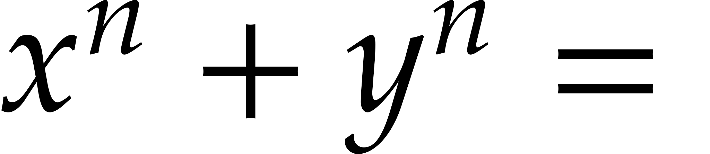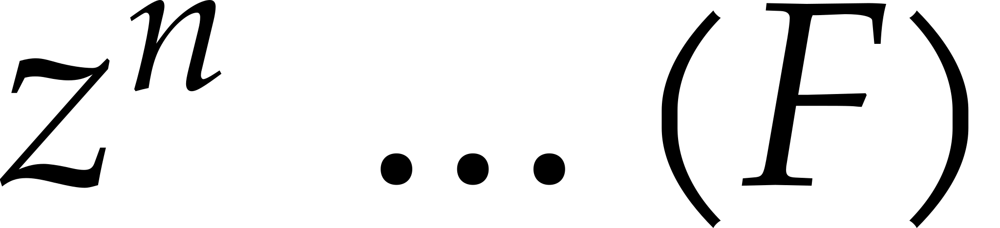 is the fact that one has never come across cardinal numbers that satisfy the equation; but that gives the general proposition _no_ support (probability) whatsoever and is thus no good reason to concern ourselves with this formula. One can, however, simply regard it as a way of writing a particular general form and ask whether the syntax deals with this form in _any_ way.

### [Ts-209](/ts-209/#70.5) [70\[5\]](https://cdn.wittgensteinnachlass.com/2000px/webp/Ts-209/70.webp)

I said: Where one cannot search, one cannot ask either, and that means: Where there is no logical _method_ of finding, the question cannot have a sense either.

### [Ts-209](/ts-209/#70.6) [70\[6\]](https://cdn.wittgensteinnachlass.com/2000px/webp/Ts-209/70.webp)

Only where there is a method of solution is there a problem (which of course does not mean “only where the solution has been found is there a problem”).

### [Ts-209](/ts-209/#70.7) [70\[7\]](https://cdn.wittgensteinnachlass.com/2000px/webp/Ts-209/70.webp)

I.e. where the solution can be expected only from a kind of revelation, there is no problem either. No question corresponds to a revelation.

### [Ts-209](/ts-209/#70.8) [70\[8\]](https://cdn.wittgensteinnachlass.com/2000px/webp/Ts-209/70.webp)

It is as if one were to ask about the experiences of a sense one does not yet have. Giving us a new sense – that is what I would call revelation.

### [Ts-209](/ts-209/#70.9) [70\[9\]](https://cdn.wittgensteinnachlass.com/2000px/webp/Ts-209/70.webp)

Nor can one _search_ for a new sense (sense perception).

### [Ts-209](/ts-209/#70.10) [70\[10\]](https://cdn.wittgensteinnachlass.com/2000px/webp/Ts-209/70.webp)

150 The question arises again: In what respect can one _assert_ a mathematical proposition? For _this_ would mean nothing: that I can assert it only if it is correct. – Rather, I must be able to assert it on the strength of its sense, not on the strength of its truth. It seems clear to me, as I have already said, that I can assert the general proposition to just the same extent, or just as little, as I can assert the equation 3 × 3 = 9 or even 3 × 3 = 11.

### [Ts-209](/ts-209/#71.1) [71\[1\]](https://cdn.wittgensteinnachlass.com/2000px/webp/Ts-209/71.webp)

It is almost unbelievable how a problem is completely blocked off, for miles around, by the mistaken ways of putting things that generation after generation sets up around it, so that it becomes almost impossible to get to it.

### [Ts-209](/ts-209/#71.2) [71\[2\]](https://cdn.wittgensteinnachlass.com/2000px/webp/Ts-209/71.webp)

What makes understanding difficult is the mistaken conception that the _general_ method of solution is only an – incidental – aid to obtaining numbers that satisfy the equation. Whereas it in itself gives insight into the essence (the nature) of the equation. It is – again – not an incidental aid to finding an extension, but an end in itself.

### [Ts-209](/ts-209/#71.3) [71\[3\]](https://cdn.wittgensteinnachlass.com/2000px/webp/Ts-209/71.webp)

What questions can one ask about a form, e.g. Fx = G? – Is Fx = G (x as a general constant) or not? Do the rules lead to a solution of the equation (x as an unknown) or not? Do the rules prohibit the form Fx = G (x taken as an empty place) or not? It must not be possible to check _any_ of these cases empirically, i.e. extensionally.

### [Ts-209](/ts-209/#71.4) [71\[4\]](https://cdn.wittgensteinnachlass.com/2000px/webp/Ts-209/71.webp)

Not even the last two, for I can see that, for example, “x² = 4” is permitted no less from 7² = 4 than from 2² = 4, and 2² ≠ ‒ 4 shows me that x² = ‒ 4 is prohibited no differently from 8² ≠ ‒ 4. I.e. here again it is only the rule that I see in the particular case.

### [Ts-209](/ts-209/#71.5) [71\[5\]](https://cdn.wittgensteinnachlass.com/2000px/webp/Ts-209/71.webp)

The question “Is the equation satisfied by any numbers?” has no sense, any more than the sentence “it is satisfied by numbers” or, of course, the assertion “it is satisfied by all numbers – or by no number”.

### [Ts-209](/ts-209/#71.6) [71\[6\]](https://cdn.wittgensteinnachlass.com/2000px/webp/Ts-209/71.webp)

The important thing is that even if I am given 3² + 4² = 5², I must _not_ say “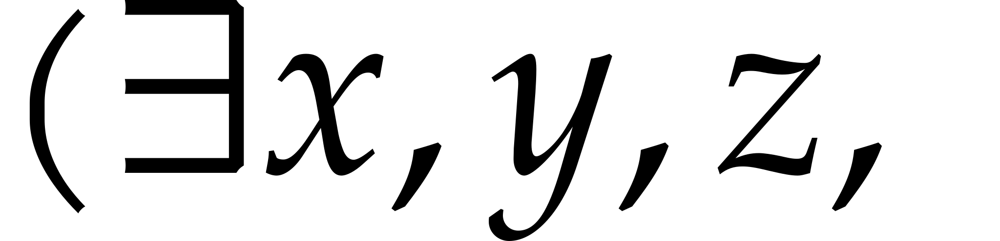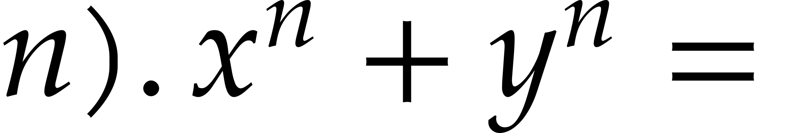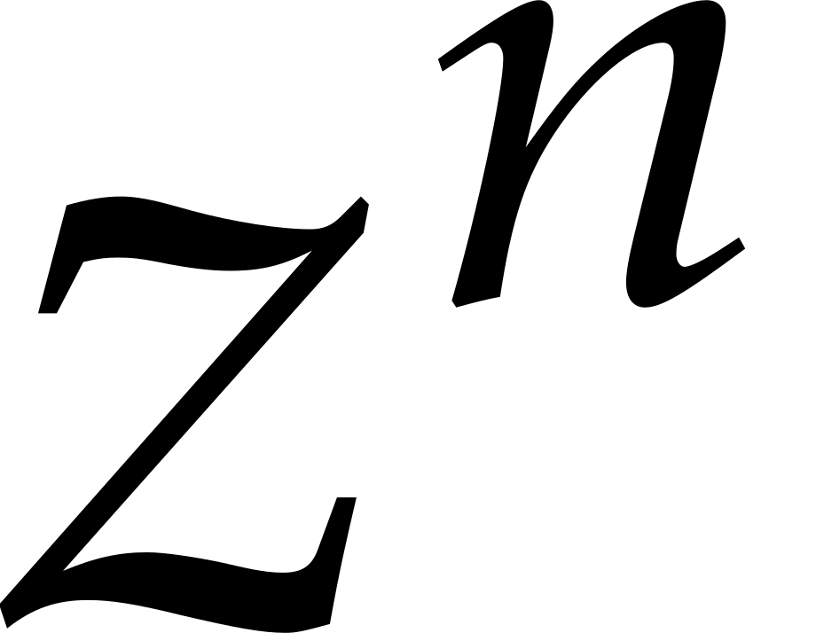”, for extensionally it means nothing and intensionally it is not thereby proved. Rather, all I may state then is the first equation.

### [Ts-209](/ts-209/#71.7) [71\[7\]](https://cdn.wittgensteinnachlass.com/2000px/webp/Ts-209/71.webp)

Clearly, I can write down the general proposition (with the general constant) only where it is analogous to the proposition 25 × 25 = 625, and that is where I know the rules of calculation for a and b just as I know the rules of calculation for 6, 2, and 5. This illustrates exactly what it means for a and b to be constants here. Constant forms, that is.

### [Ts-209](/ts-209/#71.8) [71\[8\]](https://cdn.wittgensteinnachlass.com/2000px/webp/Ts-209/71.webp)

Is it like this: I cannot apply the word “yields” as long as I know no method of solution, because _yields_ signifies a structure that I cannot designate without knowing it. Because the structure must be _represented_.

### [Ts-209](/ts-209/#72.2) [72\[2\]](https://cdn.wittgensteinnachlass.com/2000px/webp/Ts-209/72.webp)

Every proposition is an instruction for a verification.

### [Ts-209](/ts-209/#72.3) [72\[3\]](https://cdn.wittgensteinnachlass.com/2000px/webp/Ts-209/72.webp)

If I take the word “yields” to be essentially intensional, then the sentence “the equation G yields the solution a” means nothing as long as the word “yields” does not stand for a particular method. For that is precisely what I want to designate.

### [Ts-209](/ts-209/#71.9) [71\[9\]](https://cdn.wittgensteinnachlass.com/2000px/webp/Ts-209/71.webp)

What I have here is just the familiar case in which I cannot say that 2 complexes stand in a relation without logically depicting the relation.

### [Ts-209](/ts-209/#71.10) [71\[10\]](https://cdn.wittgensteinnachlass.com/2000px/webp/Ts-209/71.webp)

“The equation yields a” means that if I transform the equation according to certain rules, I obtain a, just as the equation 25 × 25 = 620 says that I obtain 620 if I apply the rules of multiplication to 25 × 25. But I must already have been given these rules before the word “yields” has a meaning and before the question whether the equation yields a has a sense.

### [Ts-209](/ts-209/#71.11) [71\[11\]](https://cdn.wittgensteinnachlass.com/2000px/webp/Ts-209/71.webp)

Thus Fermat’s proposition has no _sense_ as long as I cannot _search_ for a solution of the equation in cardinal numbers. And “searching” must always mean: searching systematically. It is not searching if I wander about in infinite space looking for a gold ring.

### [Ts-209](/ts-209/#72.4) [72\[4\]](https://cdn.wittgensteinnachlass.com/2000px/webp/Ts-209/72.webp)

One can only look within a system: so there is necessarily something one _cannot_ look for.

### [Ts-209](/ts-209/#72.5) [72\[5\]](https://cdn.wittgensteinnachlass.com/2000px/webp/Ts-209/72.webp)

151 Only where the answer is “I have to calculate it” can one ask (or conjecture) in mathematics. But can I not also say that in the case of , even if the result is not an extension but the emergence of that inductive relation? To do so, however, we must have a clear idea of this inductive relation if we are to expect it. I.e. here too we cannot simply conjecture or expect at random.

### [Ts-209](/ts-209/#72.6) [72\[6\]](https://cdn.wittgensteinnachlass.com/2000px/webp/Ts-209/72.webp)

What the “mathematical question” has in common with a question proper is just their answerability.

### [Ts-209](/ts-209/#72.7) [72\[7\]](https://cdn.wittgensteinnachlass.com/2000px/webp/Ts-209/72.webp)

If the 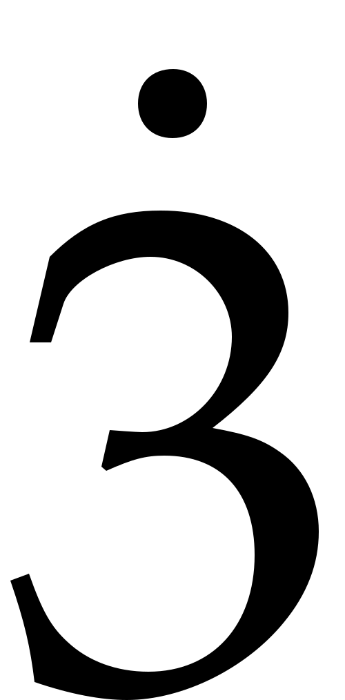 in  points to a particular method, then 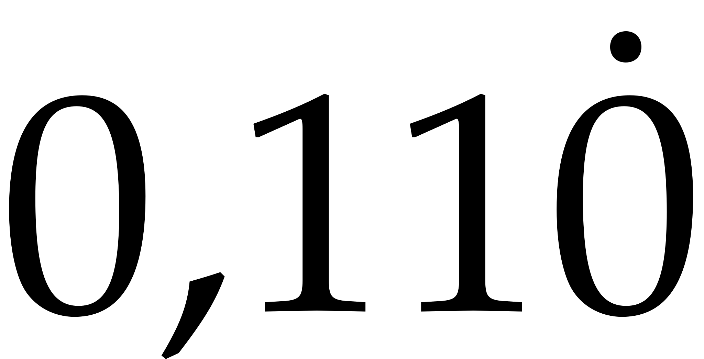 means nothing in connection with F, since here there is no method.

### [Ts-209](/ts-209/#72.8) [72\[8\]](https://cdn.wittgensteinnachlass.com/2000px/webp/Ts-209/72.webp)

A law that I do not know is not a law.

### [Ts-209](/ts-209/#72.9) [72\[9\]](https://cdn.wittgensteinnachlass.com/2000px/webp/Ts-209/72.webp)

The mathematical question must be as exact as the mathematical proposition.

### [Ts-209](/ts-209/#72.10) [72\[10\]](https://cdn.wittgensteinnachlass.com/2000px/webp/Ts-209/72.webp)

The question “how many solutions does this equation have?” is the keeping at the ready of the general method for solving it. And that is what a question in mathematics is in general: keeping a general method at the ready.

### [Ts-209](/ts-209/#72.11) [72\[11\]](https://cdn.wittgensteinnachlass.com/2000px/webp/Ts-209/72.webp)

I scarcely need to say that where the law of excluded middle does not hold, no other proposition of logic holds either, because we are not dealing there with propositions of mathematics. (Against this, Weyl and Brouwer)

### [Ts-209](/ts-209/#72.12) [72\[12\]](https://cdn.wittgensteinnachlass.com/2000px/webp/Ts-209/72.webp)

But would not the paradox follow from all this: that there are no difficult problems in mathematics, because what is difficult is not a problem? But that is not how it is: The difficult problems of mathematics are those for whose solution we do not yet have a _written_ system. The mathematician who is _searching_ then has a system in some mental symbols, images, “in his head”, and tries to put it down on paper. Once he has done that, the rest is easy. But if he has _no_ system, either in written or in unwritten symbols, then he cannot _search_ for a solution either, but at most grope about. – Now one can indeed find something by groping about without a plan. But then one has not searched for it, and the procedure, logically considered, was synthetic; whereas searching is an analytic process.

### [Ts-209](/ts-209/#73.1) [73\[1\]](https://cdn.wittgensteinnachlass.com/2000px/webp/Ts-209/73.webp)

What one can get hold of is a problem.

### [Ts-209](/ts-209/#73.2) [73\[2\]](https://cdn.wittgensteinnachlass.com/2000px/webp/Ts-209/73.webp)

Only where there can be a problem can anything be asserted!

### [Ts-209](/ts-209/#73.3) [73\[3\]](https://cdn.wittgensteinnachlass.com/2000px/webp/Ts-209/73.webp)

If I know the rules of elementary trigonometry, I can check the proposition sin 2x = 2sinx․cos x, but not the proposition 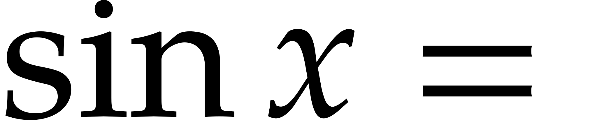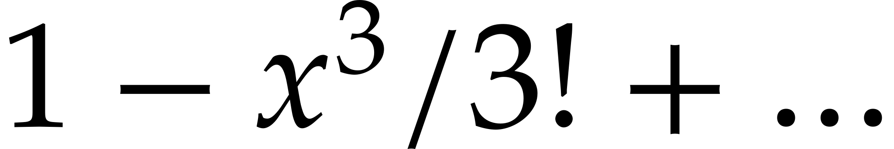. But that means that the sine of elementary trigonometry and that of higher trigonometry are _different_ concepts. If we give them the same name, there is indeed a good reason for this: the second concept includes the multiplicity of the first. But for the system of elementary trigonometry the second proposition has _no_ sense, and the question whether sin x = 1 ‒ etc. is of course also senseless here.

### [Ts-209](/ts-209/#73.5) [73\[5\]](https://cdn.wittgensteinnachlass.com/2000px/webp/Ts-209/73.webp)

152 Now is it a proper question whether the trisection of the angle is possible? And what kind of proposition is it that this is not possible with compasses and straightedge, and what kind of proof is its proof?

### [Ts-209](/ts-209/#73.6) [73\[6\]](https://cdn.wittgensteinnachlass.com/2000px/webp/Ts-209/73.webp)

One could say: Since it is not possible, one could never have looked for it either.

### [Ts-209](/ts-209/#73.7) [73\[7\]](https://cdn.wittgensteinnachlass.com/2000px/webp/Ts-209/73.webp)

As long as I do not _see_ the larger system that encompasses both, I cannot try to solve the higher problem.

### [Ts-209](/ts-209/#73.8) [73\[8\]](https://cdn.wittgensteinnachlass.com/2000px/webp/Ts-209/73.webp)

I can ask whether the angle can be trisected with straightedge and compasses only when I see the system “compasses and straightedge” embedded in a larger one in which the problem is soluble; or rather, in which the problem is a problem, in which this question has a sense.

### [Ts-209](/ts-209/#73.9) [73\[9\]](https://cdn.wittgensteinnachlass.com/2000px/webp/Ts-209/73.webp)

This also shows itself in the fact that one _must_ step outside the Euclidean system to prove the impossibility.

### [Ts-209](/ts-209/#73.10) [73\[10\]](https://cdn.wittgensteinnachlass.com/2000px/webp/Ts-209/73.webp)

A system is, so to speak, a world.

### [Ts-209](/ts-209/#73.11) [73\[11\]](https://cdn.wittgensteinnachlass.com/2000px/webp/Ts-209/73.webp)

So one cannot look for a system. But one can look for the expression for a system that is given to me in unwritten symbols.

### [Ts-209](/ts-209/#73.12) [73\[12\]](https://cdn.wittgensteinnachlass.com/2000px/webp/Ts-209/73.webp)

A pupil who had the tools of elementary trigonometry at his disposal and was asked to check the equation sin x = 1 etc. would simply not find there what he needs to carry out this task. If the teacher nevertheless expects him to solve it, he assumes that the multiplicity of syntax presupposed by this solution is somehow present in another form in the pupil’s head. And in such a way that the pupil sees the symbolism of elementary trigonometry as a part of that unwritten symbolism and now translates the rest from unwritten into written symbolism.

### [Ts-209](/ts-209/#74.1) [74\[1\]](https://cdn.wittgensteinnachlass.com/2000px/webp/Ts-209/74.webp)

The system of rules that determine a calculus thereby also determines the “meaning” of its signs. To put it more accurately: The form and the syntactic rules are equivalent. So if I change the rules – if I seemingly supplement them, for instance – I change the form, the meaning.

### [Ts-209](/ts-209/#74.2) [74\[2\]](https://cdn.wittgensteinnachlass.com/2000px/webp/Ts-209/74.webp)

I cannot draw the limits of my world, but I can draw limits within my world. I cannot ask whether the sentence p belongs to the system S, but I can ask whether it belongs to the part s of S. So I can assign the problem of trisecting the angle its place in the larger system, but I cannot ask within the Euclidean system whether it is soluble. In what _language_ am I supposed to ask that? In the Euclidean language? And just as little can I ask in the Euclidean language about the possibility of bisecting the angle in the Euclidean system. For in this language that would amount to a question about possibility as such, and that question is always nonsense.

### [Ts-209](/ts-209/#74.3) [74\[3\]](https://cdn.wittgensteinnachlass.com/2000px/webp/Ts-209/74.webp)

But there is nothing here that we would be entitled to call a hierarchy of types.

### [Ts-209](/ts-209/#74.4) [74\[4\]](https://cdn.wittgensteinnachlass.com/2000px/webp/Ts-209/74.webp)

In mathematics one cannot speak about systems in general, but only _in_ systems. They are precisely what one cannot speak about. And hence also what one cannot look for.

### [Ts-209](/ts-209/#74.5) [74\[5\]](https://cdn.wittgensteinnachlass.com/2000px/webp/Ts-209/74.webp)

The pupil who does not have the apparatus for answering the second question not only cannot answer it, but cannot understand it either. (This would be rather like the task the prince in the fairy tale sets the smith, to bring him a “Klamank”).

### [Ts-209](/ts-209/#74.6) [74\[6\]](https://cdn.wittgensteinnachlass.com/2000px/webp/Ts-209/74.webp)

_Every_ legitimate proposition of mathematics must, like the proposition 12 × 13 = 137, set a ladder against its problem – which I can then climb if I want to. This holds of propositions of every kind of generality. (N.B. There is no ladder with “infinitely many” rungs.)

### [Ts-209](/ts-209/#74.7) [74\[7\]](https://cdn.wittgensteinnachlass.com/2000px/webp/Ts-209/74.webp)

Suppose now that I have 2 systems. One cannot ask for a system that encompasses them both, for not only can I not look for this system _now_, but if ever a system turns up that encompasses two systems analogous to the original ones, I see that I could never have looked for it.

### [Ts-209](/ts-209/#74.8) [74\[8\]](https://cdn.wittgensteinnachlass.com/2000px/webp/Ts-209/74.webp)

153 Proofs that prove the same thing are translatable into one another and to that extent are the same proof. The only exceptions are proofs such as: “I can tell that he is at home from two facts: first, his coat is hanging in the hall, and second, I can hear him whistling”. Here we have two independent sources of knowledge. The proof needs grounds from outside, whereas a mathematical proof is the analysis of the mathematical proposition.

### [Ts-209](/ts-209/#74.9) [74\[9\]](https://cdn.wittgensteinnachlass.com/2000px/webp/Ts-209/74.webp)

What is the proof of provability? It is different from the proof of the proposition. And is the proof of provability perhaps the proof that the proposition has sense? But then this proof would have to rest on _quite different_ principles from the proof of the proposition. There can be no hierarchy of proofs?

### [Ts-209](/ts-209/#74.10) [74\[10\]](https://cdn.wittgensteinnachlass.com/2000px/webp/Ts-209/74.webp)

On the other hand there can be no metamathematics in any essential sense. Everything must lie within one type (or, therefore, within no type).

### [Ts-209](/ts-209/#75.1) [75\[1\]](https://cdn.wittgensteinnachlass.com/2000px/webp/Ts-209/75.webp)

Now is it possible to show that the fundamental rules are relevant to a proposition (i.e. that they prove it or its opposite) without actually carrying them through to it? I.e., do we know it only when we get there, or is it possible to know it sooner? And is the possibility of checking 36 × 47 = 128 a proof of this? It evidently makes sense to say: “I know how to check that” before one has checked it.

### [Ts-209](/ts-209/#75.2) [75\[2\]](https://cdn.wittgensteinnachlass.com/2000px/webp/Ts-209/75.webp)

So it is not enough to say p is provable; rather, it must be: Provable according to a particular system.

### [Ts-209](/ts-209/#75.3) [75\[3\]](https://cdn.wittgensteinnachlass.com/2000px/webp/Ts-209/75.webp)

And the sentence does not assert that p is provable according to the system S, but according to _its_ system, the system of p. That p belongs to the system S cannot be asserted; it must show itself.

### [Ts-209](/ts-209/#75.4) [75\[4\]](https://cdn.wittgensteinnachlass.com/2000px/webp/Ts-209/75.webp)

One cannot say that p belongs to the system S; one cannot ask which system p belongs to; one cannot look for the system of p. To understand p means to understand its system. If p seems to pass from one system to another, then in reality p has changed its sense.

### [Ts-209](/ts-209/#75.5) [75\[5\]](https://cdn.wittgensteinnachlass.com/2000px/webp/Ts-209/75.webp)

Ramsey thought that what I call recognizing the system is nothing more than the – perhaps unconscious – application of a general mathematical proposition. Thus, if I know that the question whether sin 3x = 5 cos x is correct is decidable, on Ramsey’s account I infer this merely from the law for sin x + y etc. But that is not true: I infer it from the fact that there is such a law, not from what it says.

### [Ts-209](/ts-209/#75.6) [75\[6\]](https://cdn.wittgensteinnachlass.com/2000px/webp/Ts-209/75.webp)

154 I could sum up equations with numbers and equations with letters as follows: Transforming the left-hand side according to the rules yields the right-hand side, or it does not. But for this the two sides of the equation (N.B. the _general_ one) must be, so to speak, _commensurable_.

### [Ts-209](/ts-209/#75.8) [75\[8\]](https://cdn.wittgensteinnachlass.com/2000px/webp/Ts-209/75.webp)

The classifications that philosophers and psychologists make are as if one were to try to classify clouds according to their shape.

### [Ts-209](/ts-209/#75.9) [75\[9\]](https://cdn.wittgensteinnachlass.com/2000px/webp/Ts-209/75.webp)

A mathematical proposition always says what its proof proves. I.e. it never says more than its proof proves.

### [Ts-209](/ts-209/#75.10) [75\[10\]](https://cdn.wittgensteinnachlass.com/2000px/webp/Ts-209/75.webp)

If I had a method for separating equations that have a solution from those that do not, then the expression “(∃x)․x² = 2x” would have sense with reference to that method.

### [Ts-209](/ts-209/#76.1) [76\[1\]](https://cdn.wittgensteinnachlass.com/2000px/webp/Ts-209/76.webp)

I can ask “what solution does the equation x² = 2x have”, but I cannot ask “does it have a solution”. For what would it look like if it did not have one? Only when I know what is the case if a proposition is false does it have a sense. – But what if that other case were, say, that of the equation “(∃x)․ x² ‒ 2x ‒ x(x ‒ 2) = 0”? Then the proposition (∃x)․x² = 2x would indeed have sense, and its proof would be that the rules do not allow the sides to be cancelled against each other. To the question “is there a solution to the equation 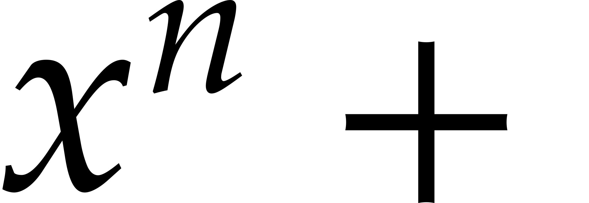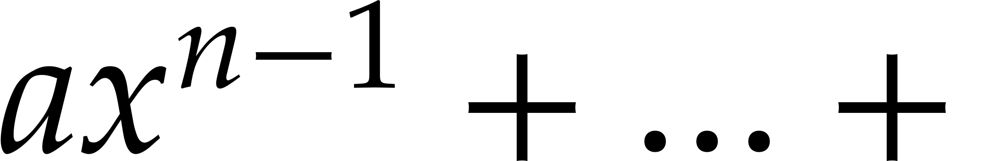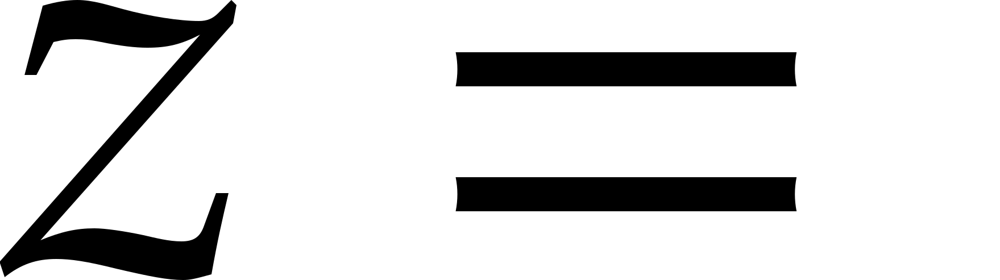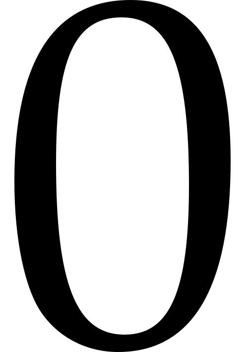?” one can always reply with the question “as opposed to what?”.

### [Ts-209](/ts-209/#76.2) [76\[2\]](https://cdn.wittgensteinnachlass.com/2000px/webp/Ts-209/76.webp)

25 × 25 = 625 What does the system that shows me commensurability consist in here? Presumably in the fact that multiplying two numbers written in this form according to the rule always gives me a number in the same form, and that a rule decides, for two numerals of this form, whether they designate the same number or different numbers.

### [Ts-209](/ts-209/#76.3) [76\[3\]](https://cdn.wittgensteinnachlass.com/2000px/webp/Ts-209/76.webp)

One could also characterize this conception as follows: It is impossible to discover rules of a new kind that apply to a form we know. If they are new rules, it is not the old form. The structure of rules must be _complete_ if we want to work with a concept at all. – _One cannot make discoveries in syntax_. – For it is the group of rules that _determines_ the sense of our signs, and any change (e.g. supplementation) of the rules means a change of sense. Just as one cannot change the marks of a concept without changing _it_. (Frege)

### [Ts-209](/ts-209/#76.4) [76\[4\]](https://cdn.wittgensteinnachlass.com/2000px/webp/Ts-209/76.webp)

A system is a series of forms, and the iterations that successively generate its members are described in the rules themselves.

### [Ts-209](/ts-209/#76.5) [76\[5\]](https://cdn.wittgensteinnachlass.com/2000px/webp/Ts-209/76.webp)

The opposite of “it is necessary that p hold for all numbers” is indeed “it is not necessary that …” and not “it is necessary that not …”. But now one thinks: If it is not _necessary_ that it hold for all numbers, it is possible all the same. But this is where the error lies, for one does not see that one has slipped into the extensional conception: The sentence “it is possible – even if not necessary – that p hold for all numbers” is nonsensical. For “_necessary_” and “_all_” belong together in mathematics. (So long as one does not replace this way of speaking altogether with a less misleading one.)

### [Ts-209](/ts-209/#76.6) [76\[6\]](https://cdn.wittgensteinnachlass.com/2000px/webp/Ts-209/76.webp)

155 What kind of discovery, for example, is Scheffer’s discovery that all truth-functions can be reduced to p ❘ q? Or the discovery of the method for extracting the cube root? What is it like when one has to apply a trick in mathematics? (As when solving an equation or integrating). Here it is as when untying a knot. I can try one way or another at random, and the knot may become more tightly entangled, or it may come undone. (At any rate, every operation is a permitted operation and leads somewhere).

### [Ts-209](/ts-209/#76.7+77.1) [76\[7\]](https://cdn.wittgensteinnachlass.com/2000px/webp/Ts-209/76.webp),[77\[1\]](https://cdn.wittgensteinnachlass.com/2000px/webp/Ts-209/77.webp)

I want to say that finding a system for solving problems that one previously could solve only individually by separate methods is not merely discovering a more convenient vehicle, but discovering something quite new that one did not have at all before. The unified method is not just the method of producing an object that is the same however it was produced. The method is not a vehicle that takes us to a place that is really our goal, however we get there. I.e.: I believe that in mathematics one cannot find a _route_ that is not itself a goal. One cannot say: I already had all these results, and now I merely find a better route that leads to them all. Rather, this route is a new place that one did not have before. The new route constitutes a new system.

### [Ts-209](/ts-209/#77.2) [77\[2\]](https://cdn.wittgensteinnachlass.com/2000px/webp/Ts-209/77.webp)

Doesn’t this amount to saying that in mathematics one cannot learn anything new about an object, because it is then a new object?

### [Ts-209](/ts-209/#77.3) [77\[3\]](https://cdn.wittgensteinnachlass.com/2000px/webp/Ts-209/77.webp)

This also amounts to this: If I hear a proposition of, say, number theory, but do not know its proof, then I do not understand the proposition either. This sounds very paradoxical. So I do not understand – this is what it means – the proposition that there are infinitely many prime numbers until I know its so-called proof. In coming to know the proof, then, I come to know something _quite new_, not just the route to a goal I already know. But then it is incomprehensible that, when the proof is supplied, I should grant that it is the proof of precisely _this_ proposition, or the induction meant by this proposition.

### [Ts-209](/ts-209/#77.4) [77\[4\]](https://cdn.wittgensteinnachlass.com/2000px/webp/Ts-209/77.webp)

I want to say that a mathematical sentence is not the prose but the exact expression.

### [Ts-209](/ts-209/#77.5) [77\[5\]](https://cdn.wittgensteinnachlass.com/2000px/webp/Ts-209/77.webp)

There cannot be two independent proofs of a mathematical proposition.

### [Ts-209](/ts-209/#77.6) [77\[6\]](https://cdn.wittgensteinnachlass.com/2000px/webp/Ts-209/77.webp)

156 Untying knots in mathematics: Can one _try_ to untie a knot that is one day proved impossible to untie? The cubic equation was solved; the trisection of the angle with straightedge and compass _could_ not succeed; both were attempted long before one knew the solution to the one problem and the insolubility of the other.

### [Ts-209](/ts-209/#77.7) [77\[7\]](https://cdn.wittgensteinnachlass.com/2000px/webp/Ts-209/77.webp)

Let us imagine an apparent knot that in reality consists of many pieces of thread that loop back on themselves and perhaps some that do not form closed loops. Now I set someone the task of untying the knot. If he clearly sees how the pieces of string run, he will say that this is not a knot and that there is therefore nothing to untie. If he sees only a tangle of strings, he may try to undo it by pulling at various ends at random, or actually carry out certain transformations because he does see certain parts of the knot clearly, even if he does not see its whole structure.

### [Ts-209](/ts-209/#77.8) [77\[8\]](https://cdn.wittgensteinnachlass.com/2000px/webp/Ts-209/77.webp)

Now I would say that one can speak of a genuine attempt to untie it only _insofar_ as the structure of the knot is seen clearly. Insofar as it is not seen clearly, it is all groping in the dark, for what looks like a knot to me may not be a knot at all; the best proof that I really had no method for looking for a solution. This process is not comparable to what happens when, e.g., I look methodically for an object in a room and thereby find out that it is not in the room at all. For here I am looking for a possible state of affairs and not an impossible one.

### [Ts-209](/ts-209/#78.1) [78\[1\]](https://cdn.wittgensteinnachlass.com/2000px/webp/Ts-209/78.webp)

But now I want to say that the simile of the knot is imperfect, since I can have a knot and get to know it better and better, whereas what I want to say is that in mathematics I cannot get to know something already given to me in my signs better and better, but am always getting to know and designating something _new_. I do not see how the signs we ourselves made in order to express certain things should set us problems.

### [Ts-209](/ts-209/#78.2) [78\[2\]](https://cdn.wittgensteinnachlass.com/2000px/webp/Ts-209/78.webp)

It is more as if a knot or tangle were shown to us bit by bit and we kept making pictures of it insofar as we could see it. We have no idea of what has not yet been revealed to us of the knot, and cannot conjecture about it in any way (by, for example, subjecting the pictures of the known part to an investigation).

### [Ts-209](/ts-209/#78.3) [78\[3\]](https://cdn.wittgensteinnachlass.com/2000px/webp/Ts-209/78.webp)

157 What was it that one found when one found that there are infinitely many prime numbers? What was it that one found when one saw that there are infinitely many cardinal numbers? – Isn’t it quite analogous to the realization – if it is one – that Euclidean space is infinite, after we have long since formed sentences about the objects in that space? What does an investigation of space mean? – For every mathematical investigation is, as it were, an investigation of space. That one can investigate the _things_ in space is clear, but space! (Geometry and grammar always correspond to each other.) Let us remember that in mathematics the signs themselves _make_ mathematics, not describe mathematics. After all, mathematical signs are like the beads of an abacus. And the beads are in space, and an investigation of the abacus is an investigation of space.

### [Ts-209](/ts-209/#78.4) [78\[4\]](https://cdn.wittgensteinnachlass.com/2000px/webp/Ts-209/78.webp)

What was not foreseen was not foreseeable; for one did not have the system in which it could have been foreseen. (And would have been foreseen.)

### [Ts-209](/ts-209/#78.5) [78\[5\]](https://cdn.wittgensteinnachlass.com/2000px/webp/Ts-209/78.webp)

One cannot write mathematics but can only make it. (That is precisely why in mathematics one cannot “cuddle up” to these signs.)

### [Ts-209](/ts-209/#78.6) [78\[6\]](https://cdn.wittgensteinnachlass.com/2000px/webp/Ts-209/78.webp)

Suppose I wanted to construct a regular pentagon but did not know how, and tried this and that until I finally hit on the right construction by chance: don’t we really have here the case of the knot untied by trial and error? No, for if I do not understand this construction, it is not yet the construction of a pentagon for me at all. I can indeed write down the solution to quadratic equations by chance, but I cannot understand it by chance. The way I arrived at it then disappears in what I understand. I then understand what I understand. I.e. chance can concern only something external, as when one says, for instance: “I found that out after drinking strong coffee”. The coffee is no longer contained in what I discovered.

### [Ts-209](/ts-209/#78.7) [78\[7\]](https://cdn.wittgensteinnachlass.com/2000px/webp/Ts-209/78.webp)

158 The discovery of the connection between two systems was not in _one_ space with those two systems, and had it been in the same space, it would not have been a discovery (but the solution to a school exercise).

### [Ts-209](/ts-209/#78.8) [78\[8\]](https://cdn.wittgensteinnachlass.com/2000px/webp/Ts-209/78.webp)

Where a connection is now known that was not known before, there was not previously a gap, something incomplete that has now been filled in. – (One could not say then “I know the thing this far; from here on it is no longer known to me”).

### [Ts-209](/ts-209/#79.1) [79\[1\]](https://cdn.wittgensteinnachlass.com/2000px/webp/Ts-209/79.webp)

So I have said: Mathematics has no gaps. This contradicts the usual view.

### [Ts-209](/ts-209/#79.2) [79\[2\]](https://cdn.wittgensteinnachlass.com/2000px/webp/Ts-209/79.webp)

In mathematics there is no “not yet” and no “until further notice” (except in the trivial sense that one has not yet multiplied 1000-digit numbers together).

### [Ts-209](/ts-209/#79.3) [79\[3\]](https://cdn.wittgensteinnachlass.com/2000px/webp/Ts-209/79.webp)

Induction has something in common with the multiplicity of a (finite, of course) class. On the other hand, it is not a class after all, and so one calls it an infinite class. – If, for example, I say “if I know one turn, I know the whole spiral”, what this really means is: If I know the law of the spiral, this is in many respects analogous to the case in which I know a totality of turns. – A “finite” totality, of course, since there is no other kind –. Now one cannot say: Yes, it is in many respects analogous to a finite totality, but not quite analogous, whereas it is entirely analogous to an infinite one. All we can say is that induction does not behave _quite_ like a totality.

### [Ts-209](/ts-209/#79.4) [79\[4\]](https://cdn.wittgensteinnachlass.com/2000px/webp/Ts-209/79.webp)

Mathematics cannot be incomplete; just as a _sense_ cannot be incomplete. What I can understand, I must understand completely. This is connected with the fact that my language is in order as it stands and that logical analysis need not add anything to the existing sense of my sentences in order to arrive at complete clarity. So that after analysis even the most seemingly unclear sentence retains its original content untouched, and only its grammar is clarified.

### [Ts-209](/ts-209/#79.5) [79\[5\]](https://cdn.wittgensteinnachlass.com/2000px/webp/Ts-209/79.webp)

159 But must it not be a question whether or not there is a finite number of primes in all? Once one has arrived at this concept at all. For it does seem that, given the concept of a prime number, I can immediately ask “how many prime numbers are there?”. Just as, given the concept “person in this room”, I can straightforwardly frame the question “how many people are in this room?”

### [Ts-209](/ts-209/#79.6) [79\[6\]](https://cdn.wittgensteinnachlass.com/2000px/webp/Ts-209/79.webp)

If this analogy misleads me, it can only be because the “concept of a prime number” is given to me in a quite different way from a concept proper. For what, after all, is the rigorous expression for the sentence “7 is a prime number”? It is plainly just that dividing 7 by smaller numbers leaves a remainder. There can be no other expression for it, since we cannot describe mathematics, but can only do it. (And that alone does away with any “set theory”.)

### [Ts-209](/ts-209/#79.7) [79\[7\]](https://cdn.wittgensteinnachlass.com/2000px/webp/Ts-209/79.webp)

So once I can write down the general form of a prime number, that is, an expression containing anything analogous to the “number of primes” at all, there is no longer any question of “how many” primes there are, and before that I cannot ask the question either. For I cannot ask “does the series of primes come to an end _at some point_”, nor can I ask “does a prime _ever_ occur after 7”.

### [Ts-209](/ts-209/#79.8) [79\[8\]](https://cdn.wittgensteinnachlass.com/2000px/webp/Ts-209/79.webp)

For since we could have the word prime number in ordinary language even before there was a rigorous expression that, as it were, allows a number to be specified, one could already mistakenly frame the question of how many primes there were. This makes it look as if the problem had already existed and had now been solved. The word-language seemed to allow the question just as before, and this gave the impression that there had been a genuine problem and that a genuine solution had been found. In the exact language, by contrast, one originally had nothing whose number one could ask for, and later had an expression from which one could read off the multiplicity directly.

### [Ts-209](/ts-209/#80.1) [80\[1\]](https://cdn.wittgensteinnachlass.com/2000px/webp/Ts-209/80.webp)

What I mean to say, then, is this: Only in our word-language (which here leads to a misunderstanding of logical form) are there “as yet unsolved” problems in mathematics, and the problem of the finite “solvability of all mathematical questions”.

### [Ts-209](/ts-209/#80.2) [80\[2\]](https://cdn.wittgensteinnachlass.com/2000px/webp/Ts-209/80.webp)

160 It seems to me that the idea of consistency in the axioms of mathematics, which so haunts mathematicians’ minds nowadays, rests on a misunderstanding.

### [Ts-209](/ts-209/#80.3) [80\[3\]](https://cdn.wittgensteinnachlass.com/2000px/webp/Ts-209/80.webp)

This is connected with their not taking the mathematical axioms for what they are, namely sentences of syntax.

### [Ts-209](/ts-209/#80.4) [80\[4\]](https://cdn.wittgensteinnachlass.com/2000px/webp/Ts-209/80.webp)

There is no question of provability, and in *that* respect no proof of provability either. The so-called proof of provability is an induction, and coming to know that induction is coming to know a new system.

### [Ts-209](/ts-209/#80.5) [80\[5\]](https://cdn.wittgensteinnachlass.com/2000px/webp/Ts-209/80.webp)

A proof of consistency cannot be essential to the application of the axioms.

### [Ts-209](/ts-209/#80.6) [80\[6\]](https://cdn.wittgensteinnachlass.com/2000px/webp/Ts-209/80.webp)

There are postulates only for the way we express things. The “axioms” are postulates governing the way we express things.

### [Ts-209](/ts-209/#80.7) [80\[7\]](https://cdn.wittgensteinnachlass.com/2000px/webp/Ts-209/80.webp)

161 Comparison between a mathematical expedition and a polar expedition. Making this comparison makes sense and is very useful.

### [Ts-209](/ts-209/#80.8) [80\[8\]](https://cdn.wittgensteinnachlass.com/2000px/webp/Ts-209/80.webp)

How strange it would be if a geographical expedition did not know for certain whether it had a destination, and hence whether it had a route at all. We cannot imagine that; it yields nonsense. But that is exactly how things stand with the mathematical expedition. So perhaps it will be best to drop the comparison altogether. It would be like an expedition that was not sure _of space_!

### [Ts-209](/ts-209/#80.9) [80\[9\]](https://cdn.wittgensteinnachlass.com/2000px/webp/Ts-209/80.webp)

How can there be conjectures in mathematics? Or rather: What is the nature of what looks like a conjecture in mathematics? If, for instance, I make conjectures about the distribution of the prime numbers. I could imagine, for example, that someone wrote down prime numbers in order in my presence, that I did not know they were the prime numbers – I might think, for example, that they were numbers written down as they occurred to him – and that I then tried to find some law in them. I could now go so far as to put forward a hypothesis about this sequence of numbers, as about any other sequence yielded by a physical experiment. In what sense have I thereby put forward a hypothesis about the distribution of the prime numbers?

### [Ts-209](/ts-209/#80.10) [80\[10\]](https://cdn.wittgensteinnachlass.com/2000px/webp/Ts-209/80.webp)

One might say that the value of a hypothesis in mathematics is that it fixes one’s thoughts on a particular object – I mean a particular domain – and one might say “we shall certainly find out something interesting about these things”.

### [Ts-209](/ts-209/#80.11) [80\[11\]](https://cdn.wittgensteinnachlass.com/2000px/webp/Ts-209/80.webp)

The trouble is that our language designates such fundamentally different things by each of the words “question”, “problem”, “investigation”, “discovery”. Likewise with the words “inference”, “proposition”, “proof”.

### [Ts-209](/ts-209/#81.1) [81\[1\]](https://cdn.wittgensteinnachlass.com/2000px/webp/Ts-209/81.webp)

The question again is: what kind of verification do I accept for my hypothesis? Or can I provisionally – faute de mieux – accept empirical verification as long as I have no “rigorous proof”? No. As long as there is no such proof, there is no connection at all between my hypothesis and the “concept” of a prime number.

### [Ts-209](/ts-209/#81.2) [81\[2\]](https://cdn.wittgensteinnachlass.com/2000px/webp/Ts-209/81.webp)

The concept of a prime number is the general law by which I check whether a number is a prime number or not.

### [Ts-209](/ts-209/#81.3) [81\[3\]](https://cdn.wittgensteinnachlass.com/2000px/webp/Ts-209/81.webp)

It is only the so-called proof that connects the hypothesis with the prime numbers _as such_ at all. And this is evident from the fact that – as I said – until then the hypothesis can be understood as purely physical. – If, on the other hand, the proof has been given, it does not at all prove what was conjectured, for I cannot conjecture into infinity. I can only conjecture what can be confirmed, but only a finite number of conjectures can be confirmed by experience, and one cannot conjecture the proof as long as one does not have it, nor can one do so then.

### [Ts-209](/ts-209/#81.4) [81\[4\]](https://cdn.wittgensteinnachlass.com/2000px/webp/Ts-209/81.webp)

The concept “prime number” is the general form of testing a number for the property in question; the concept “divisible” is the general form of testing for divisibility, and so on.

### [Ts-209](/ts-209/#81.5) [81\[5\]](https://cdn.wittgensteinnachlass.com/2000px/webp/Ts-209/81.webp)

162 What kind of discovery was Scheffer’s discovery that p․ ⌵ ․q and non-p can be expressed by means of p ❘ q? – One had no method for looking for p ❘ q, and if one found one today, that could make no difference. What was it that we did not know before the discovery? It was not something we did not know, but something we were not acquainted with. One sees this very clearly if one imagines the objection being raised that p ❘ p is not at all what non-p says. The answer, of course, is that all that matters is that the system p ❘ q etc. has the requisite multiplicity. So Scheffer found a symbolic system that has the requisite multiplicity. Is it a search if I am not acquainted with Scheffer’s system and say that I would like to construct a system with only _one_ logical constant? No! The systems are, after all, not in _one_ space at all, so that I could say: There are systems with 3 and 2 logical constants and now I am trying to reduce the number of constants _in the same way_. Here there is no _same way_.

### [Ts-209](/ts-209/#81.6) [81\[6\]](https://cdn.wittgensteinnachlass.com/2000px/webp/Ts-209/81.webp)

One could also put it like this: the fully analysed mathematical proposition is its own proof. Or again: the mathematical proposition is only the immediately visible surface of the whole body of the proof, marking its front boundary. The mathematical proposition is – in contrast to a proposition proper – _essentially_ the last link in a demonstration that shows it to be correct or incorrect.

### [Ts-209](/ts-209/#81.7) [81\[7\]](https://cdn.wittgensteinnachlass.com/2000px/webp/Ts-209/81.webp)

One can imagine a notation in which every sentence is represented as the result of certain operations – transitions – on the basis of certain “axioms”. (Rather as a chemical compound is represented by the chemical name “Trimethylamido …” etc.).

### [Ts-209](/ts-209/#81.8) [81\[8\]](https://cdn.wittgensteinnachlass.com/2000px/webp/Ts-209/81.webp)

Such a notation could be produced with a few modifications from the instructions that Russell and Whitehead put before the sentences of Principia Mathematica.

### [Ts-209](/ts-209/#82.1) [82\[1\]](https://cdn.wittgensteinnachlass.com/2000px/webp/Ts-209/82.webp)

The mathematical proposition then stands to its proof as the top face of a solid stands to the solid itself. One could speak of the proof-body of the proposition. The proposition has meaning for us only on the assumption that there is a solid behind the face. One also says: The mathematical proposition is (only) the last link in a chain of proof.

### [Ts-209](/ts-209/#82.2) [82\[2\]](https://cdn.wittgensteinnachlass.com/2000px/webp/Ts-209/82.webp)

163 “a + (b + c) = (a + b) + c” … A(c) can be regarded as a fundamental rule of a system; as such one can only prescribe it, not _assert_ or deny it (so no law of excluded middle). Yet it seems that I can also regard the proposition as the result of a proof. Has this proof answered a question, and which one? Has it proved an assertion true and hence its opposite false? But now it seems that I cannot prove the proposition at all in the sense in which it is a fundamental rule of a system. Rather, I prove something _about_ it.

### [Ts-209](/ts-209/#82.3) [82\[3\]](https://cdn.wittgensteinnachlass.com/2000px/webp/Ts-209/82.webp)

This is connected with the question whether one can deny 2 = 2 as one can deny 2 × 35 = 70, and why one cannot deny a definition.

### [Ts-209](/ts-209/#82.4) [82\[4\]](https://cdn.wittgensteinnachlass.com/2000px/webp/Ts-209/82.webp)

Children presumably learn 2 × 2 = 4 at school, but not 2 = 2.

### [Ts-209](/ts-209/#82.5) [82\[5\]](https://cdn.wittgensteinnachlass.com/2000px/webp/Ts-209/82.webp)

If we want to see what has been proved, we must look at nothing but the proof.

### [Ts-209](/ts-209/#82.6) [82\[6\]](https://cdn.wittgensteinnachlass.com/2000px/webp/Ts-209/82.webp)

We must not confuse the infinite possibility of application with what is actually proved. The infinite possibility of application is _not_ proved!

### [Ts-209](/ts-209/#82.7) [82\[7\]](https://cdn.wittgensteinnachlass.com/2000px/webp/Ts-209/82.webp)

What is striking about proof by recursion is above all that what it purports to prove is not what comes out of it.

### [Ts-209](/ts-209/#82.8) [82\[8\]](https://cdn.wittgensteinnachlass.com/2000px/webp/Ts-209/82.webp)

The proof shows that from the form 1) “A(c)”, by means of the rule 2) “A(1)”, the form “A(c + 1)” follows. Or, what amounts to the same thing, the form can be transformed into “(a + b) + (c + 1)” with the help of rules 1) and 2). “a + (b) + (c + 1))”

That is the whole reality of the proof. Everything else and the whole usual interpretation lie in the possibility of its application. And the usual error lies in confusing the extension of its application with what it actually contains.

### [Ts-209](/ts-209/#82.9) [82\[9\]](https://cdn.wittgensteinnachlass.com/2000px/webp/Ts-209/82.webp)

Of course I cannot deny a definition. It therefore has no sense either. It is a rule I can proceed by (or have to proceed by).

### [Ts-209](/ts-209/#82.10) [82\[10\]](https://cdn.wittgensteinnachlass.com/2000px/webp/Ts-209/82.webp)

I cannot negate the fundamental rules of a system – except as a consequence of those very rules.

### [Ts-209](/ts-209/#82.11) [82\[11\]](https://cdn.wittgensteinnachlass.com/2000px/webp/Ts-209/82.webp)

The “c” in Skolem’s proof has as yet no meaning _in_ the proof; it stands for 1 or whatever else may emerge from the proof, and _after_ the proof we are entitled to take it as any number. But surely it must already have meant something in the proof. If 1, why did we not write “1” instead of “c”? And if something else, what?

### [Ts-209](/ts-209/#83.1) [83\[1\]](https://cdn.wittgensteinnachlass.com/2000px/webp/Ts-209/83.webp)

Now suppose I want to apply the proposition to 5, 6, 7; the proof tells me that I am certainly entitled to do so. For if I write these numerals in the form ((1 + 1) + 1) etc., I can recognize that the proposition is a member of that series of propositions which the last proposition in Skolem’s chain of proof represents for me. This recognition, again, is not something that can be proved, but is intuitive.

### [Ts-209](/ts-209/#83.2) [83\[2\]](https://cdn.wittgensteinnachlass.com/2000px/webp/Ts-209/83.webp)

“Every symbol is what it is and not another symbol”.

### [Ts-209](/ts-209/#83.3) [83\[3\]](https://cdn.wittgensteinnachlass.com/2000px/webp/Ts-209/83.webp)

Can there be no proof that merely shows that every multiplication in the decimal system according to the rules must yield a number in the decimal system? (So that recognizing the same system would after all rest on recognizing the truth of a mathematical proposition.)

### [Ts-209](/ts-209/#83.4) [83\[4\]](https://cdn.wittgensteinnachlass.com/2000px/webp/Ts-209/83.webp)

It would have to be analogous to a proof that adding forms (1 + 1) + 1) etc. always produces numerals of this form again. Now can one prove that? The proof evidently lies in the rule for adding such expressions, i.e. in the definition and in nothing else. After all, to the question this proof is supposed to answer one could also say: Well, what _is_ the addition supposed to yield?

### [Ts-209](/ts-209/#83.5) [83\[5\]](https://cdn.wittgensteinnachlass.com/2000px/webp/Ts-209/83.webp)

164 A recursive proof is only a general instruction directing one to any particular proof. A signpost that directs all propositions of a certain form home along a certain path. It says to the proposition 2 + (3 + 4) = (2 + 3) + 4: “Go in _this_ direction (follow this spiral) and you’ll get home.”

### [Ts-209](/ts-209/#83.6) [83\[6\]](https://cdn.wittgensteinnachlass.com/2000px/webp/Ts-209/83.webp)

In what sense, then, can one call such an instruction for proofs the proof of a general proposition? (Is that not like asking “in what sense can one call a signpost a path”?) Yet it does justify applying A(c) to numbers. Must there not, after all, be a legitimate transition from the proof schema to this expression?

### [Ts-209](/ts-209/#83.7) [83\[7\]](https://cdn.wittgensteinnachlass.com/2000px/webp/Ts-209/83.webp)

I know a proof with endless possibility, which, e.g., starts with “A(1)” and goes on through “A(2)” etc. etc. The “recursive proof” is the general form of progression in this series. But it must itself prove something, after all, for it actually saves me the proof of each proposition of the form “A(7)”. But how could it have proved this proposition? Evidently it points along that series of proofs.

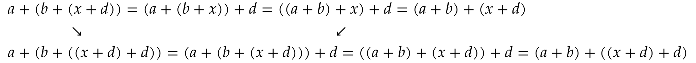

This is a piece of the spiral taken from the middle. x holds the place open for what only emerges as it is developed.

### [Ts-209](/ts-209/#83.8) [83\[8\]](https://cdn.wittgensteinnachlass.com/2000px/webp/Ts-209/83.webp)

When I look at this series, I may be struck by its kinship with the definition A(1); by the fact that, if I substitute “1” for “c” and “1” for “d”, the two systems become the same.

### [Ts-209](/ts-209/#83.9) [83\[9\]](https://cdn.wittgensteinnachlass.com/2000px/webp/Ts-209/83.webp)

In any case, in the proof what is to be proved is not the end of the _chain of equations_.

### [Ts-209](/ts-209/#84.1) [84\[1\]](https://cdn.wittgensteinnachlass.com/2000px/webp/Ts-209/84.webp)

The proof shows the spiral form of the law. But not by yielding it as the result of the chain of inferences.

### [Ts-209](/ts-209/#84.2) [84\[2\]](https://cdn.wittgensteinnachlass.com/2000px/webp/Ts-209/84.webp)

We can also quite well imagine the proof carried out in an informal manner with 1, and with perhaps a few dots after it to indicate what we are to look at. It would not be essentially less rigorous (for here what is different about the proof becomes still clearer). Let us imagine it like that. _How_ does it then justify the proposition A(c)?

### [Ts-209](/ts-209/#84.3) [84\[3\]](https://cdn.wittgensteinnachlass.com/2000px/webp/Ts-209/84.webp)

If one regards the proof as being of the same kind as the derivation of (x + y)² = x² + 2xy + y², then it proves the proposition “A(c + I)” (on the assumption of “A(c)”, i.e. the very proposition I wanted to prove). And it justifies – on this assumption – special cases such as 3 + (5 + (4 + 1)) = (3 + 5) + (4 + 1). It too has a generality, but not the one we want. This generality is not confined to the letters, however; it lies just as much in definite numbers, and consists in the fact that one can repeat the proof.

### [Ts-209](/ts-209/#84.4) [84\[4\]](https://cdn.wittgensteinnachlass.com/2000px/webp/Ts-209/84.webp)

But how can I indicate by the sign “F(a)” what I see in the transition from F(1) to F(2)? (Namely the possibility of repetition.)

### [Ts-209](/ts-209/#84.5) [84\[5\]](https://cdn.wittgensteinnachlass.com/2000px/webp/Ts-209/84.webp)

Nor can I prove that a + (b + 1) = (a + b) + 1 is a special case of a + (b + c) = (a + b) + c; I have to see it. (No rule can help me here either, for once again I have to know what counts as a special case of the general rule.)

### [Ts-209](/ts-209/#84.6) [84\[6\]](https://cdn.wittgensteinnachlass.com/2000px/webp/Ts-209/84.webp)

That is the unbridgeable gap between rule and application, or between law and special case.

### [Ts-209](/ts-209/#84.7) [84\[7\]](https://cdn.wittgensteinnachlass.com/2000px/webp/Ts-209/84.webp)

A(c) is a definition, a rule for algebraic calculation. It is _chosen_ so that this calculation accords with numerical calculation. It permits the same transition in algebraic calculation as holds for cardinal numbers, as the recursive proof shows. So A(c) is not the result of this proof, but runs, as it were, parallel to it. What we take from that proof cannot be represented in a sentence at all, and for that very reason it cannot, of course, be denied either.

### [Ts-209](/ts-209/#84.8) [84\[8\]](https://cdn.wittgensteinnachlass.com/2000px/webp/Ts-209/84.webp)

But what about a definition like A(1). This is not meant as a rule for algebraic calculation, but as an aid to explaining arithmetical expressions. It represents an _operation_ that I _can_ apply to any pair of numbers whatsoever.

### [Ts-209](/ts-209/#84.9) [84\[9\]](https://cdn.wittgensteinnachlass.com/2000px/webp/Ts-209/84.webp)

165 The correct expression of the associative law is not a sentence but precisely its “proof”, which, to be sure, does not assert the law but shows it. And here it becomes clear that one cannot deny this law, since it does not occur in the form of a sentence at all. One could of course deny the individual equations in the proof, but that would not deny the law. The law _escapes_ affirmation and denial.

### [Ts-209](/ts-209/#85.1) [85\[1\]](https://cdn.wittgensteinnachlass.com/2000px/webp/Ts-209/85.webp)

To know that one can prove something is to have proved it.

### [Ts-209](/ts-209/#85.2) [85\[2\]](https://cdn.wittgensteinnachlass.com/2000px/webp/Ts-209/85.webp)

7 + (8 + 9) = (7 + 8) + 9 How do I know that this is so without having proved it separately? And do I know it _just as well_ as if I had derived it in full? Yes! – Then it really has been proved. And in that case it cannot be proved any _better_, say by carrying the derivation right through to this proposition itself. So after going through one turn of the spiral I must be able to say “stop! I don’t need any more, I can already see how it goes on”, and any further ascent would then have to be simply superfluous and not make the matter any clearer after all. So if I draw all the turns of the spiral up to my point, I cannot see any better that it leads there than if I draw just _one_ turn. It is just that both show the same thing in different forms. I can, so to speak, follow the fully drawn spiral unthinkingly and arrive at my point, whereas I have to interpret the _one_ turn I have drawn in a particular way to gather from it that, if extended, it leads to point A. That is: I can gather the same thing from the proof for 6 + (7 + 8) = (6 + 7) + 8 worked out in full as from the one that describes only one “turn”, only in a different way. And in any case the _one_ turn _together with the forms of the numbers_ in the given equation is a complete proof of that equation. It is as if I said: “You want to get to point A? Yes, _that_ point you can reach with _this_ spiral.”

### [Ts-209](/ts-209/#85.3) [85\[3\]](https://cdn.wittgensteinnachlass.com/2000px/webp/Ts-209/85.webp)

When one teaches someone to take a step, one thereby gives him the possibility of walking any distance.

### [Ts-209](/ts-209/#85.4) [85\[4\]](https://cdn.wittgensteinnachlass.com/2000px/webp/Ts-209/85.webp)

166 The arithmetical relation one sees between the structure and the equation it verifies stands to that equation as the immediate datum stands to a sentence of ordinary language that it verifies. It is the thing itself, not an expression of something else, replaceable by another expression. I.e., not a symptom of something else, but the thing itself. For that is how it is usually understood (wrongly, that is). One says that induction is a sign that such and such holds for all numbers. But induction is not a sign for anything other than itself. If there were something besides the induction for which _it_ was only a sign, that something would have to have its own specific expression, which would be nothing other than the complete expression of that something.

### [Ts-209](/ts-209/#85.5) [85\[5\]](https://cdn.wittgensteinnachlass.com/2000px/webp/Ts-209/85.webp)

And this conception then goes further: the algebraic equation tells us what we see in the arithmetical induction. To do that it would have to have the same multiplicity as what it describes.

### [Ts-209](/ts-209/#85.6) [85\[6\]](https://cdn.wittgensteinnachlass.com/2000px/webp/Ts-209/85.webp)

A sentence says how it is verified. Compare the generality of sentences proper with generality in arithmetic. It is verified differently and is therefore a different generality.

### [Ts-209](/ts-209/#85.7) [85\[7\]](https://cdn.wittgensteinnachlass.com/2000px/webp/Ts-209/85.webp)

Verification is not _an_ indication of truth, but _the_ sense of the sentence. (Einstein: How a quantity is measured is what it is.)

### [Ts-209](/ts-209/#85.8) [85\[8\]](https://cdn.wittgensteinnachlass.com/2000px/webp/Ts-209/85.webp)

Russell, in fact, had already shown by his theory of descriptions that one cannot surreptitiously acquire knowledge of things by the back door and that it can only _seem_ as though we knew more about things than they have disclosed to us directly. But with the term “indirect knowledge” he concealed everything again.

### [Ts-209](/ts-209/#86.1) [86\[1\]](https://cdn.wittgensteinnachlass.com/2000px/webp/Ts-209/86.webp)

167 The algebraic schema gets its sense from the way it is applied. This must therefore always stand behind it. Hence the proof by induction, for that justifies the application.

### [Ts-209](/ts-209/#86.2) [86\[2\]](https://cdn.wittgensteinnachlass.com/2000px/webp/Ts-209/86.webp)

The algebraic sentence is just as much an equation as 2 × 2 = 4; it is merely applied differently. Its relation to arithmetic is different. It is about the replaceability of other parts of speech.

### [Ts-209](/ts-209/#86.3) [86\[3\]](https://cdn.wittgensteinnachlass.com/2000px/webp/Ts-209/86.webp)

I.e. the algebraic equation, that is, the equation between real numbers, _presumably_ is an arithmetical equation, for something arithmetical stands behind it. It just stands behind _it_ differently from the way it stands behind 1 + 1 = 2.

### [Ts-209](/ts-209/#86.4) [86\[4\]](https://cdn.wittgensteinnachlass.com/2000px/webp/Ts-209/86.webp)

Induction does not prove the algebraic proposition; because only an equation can prove an equation. But it justifies the formation of algebraic equations from the point of view of their application to arithmetic.

### [Ts-209](/ts-209/#86.5) [86\[5\]](https://cdn.wittgensteinnachlass.com/2000px/webp/Ts-209/86.webp)

I.e. it is only from induction that they get their sense, not their truth.

### [Ts-209](/ts-209/#86.6) [86\[6\]](https://cdn.wittgensteinnachlass.com/2000px/webp/Ts-209/86.webp)

Hence what cannot be reduced any further to other equations and can be justified only by induction is a _stipulation_. This is connected with the fact that in applying this algebraic proposition I cannot appeal to it, but can only appeal once again to the induction. Hence these ultimate equations cannot be negated. I.e. no arithmetical content corresponds to their negation. It is they that make the algebraic system applicable to numbers in the first place. They are therefore presumably, in a certain sense, the expression of something arithmetical, but as it were the expression of an arithmetical _existence_.

### [Ts-209](/ts-209/#86.7) [86\[7\]](https://cdn.wittgensteinnachlass.com/2000px/webp/Ts-209/86.webp)

It is they that make algebra a garment for arithmetic. – And they are therefore arbitrary in so far as no one forces us to make algebra into that. They fit algebra to arithmetic. And once arithmetic has the garment on, it can move in it.

### [Ts-209](/ts-209/#86.8) [86\[8\]](https://cdn.wittgensteinnachlass.com/2000px/webp/Ts-209/86.webp)

They are not the expression of anything that can be calculated, and to that extent they are stipulations.

### [Ts-209](/ts-209/#86.9) [86\[9\]](https://cdn.wittgensteinnachlass.com/2000px/webp/Ts-209/86.webp)

Can someone who sees these stipulations learn anything in arithmetic from them? And what? – Can I learn of an arithmetical state of affairs, and which one? The stipulation is more like a name than like a sentence.

### [Ts-209](/ts-209/#86.10) [86\[10\]](https://cdn.wittgensteinnachlass.com/2000px/webp/Ts-209/86.webp)

One can prove only a proposition whose truth one can ask about. “Is it this way or some other way?” “I shall prove to you that it is _this_ way.”

### [Ts-209](/ts-209/#86.11) [86\[11\]](https://cdn.wittgensteinnachlass.com/2000px/webp/Ts-209/86.webp)

Induction stands to the algebraic sentence not as the proof to what is proved, but as what is designated to the sign.

### [Ts-209](/ts-209/#86.12) [86\[12\]](https://cdn.wittgensteinnachlass.com/2000px/webp/Ts-209/86.webp)

The system of algebraic propositions corresponds to a _system_ of inductions.

### [Ts-209](/ts-209/#87.1) [87\[1\]](https://cdn.wittgensteinnachlass.com/2000px/webp/Ts-209/87.webp)

168 A proof by induction, if it were a proof, would be a proof of generality, not a proof of a certain property of all numbers.

### [Ts-209](/ts-209/#87.2) [87\[2\]](https://cdn.wittgensteinnachlass.com/2000px/webp/Ts-209/87.webp)

One can ask only from a standpoint from which a question is still possible. From which doubt is possible. If one wanted to ask about A(c), what would really answer us would not be the induction but the embarrassing feeling that only through the induction can we come to think of this equation at all.

### [Ts-209](/ts-209/#87.3) [87\[3\]](https://cdn.wittgensteinnachlass.com/2000px/webp/Ts-209/87.webp)

When we ask “is A(c)?” what can we mean? Taken purely algebraically, the question means nothing, for the answer would be “as you wish, as you determine it”. Nor can the question mean “does that hold for all numbers”; it can ask what the induction says, but the induction tells us nothing at all.

### [Ts-209](/ts-209/#87.4) [87\[4\]](https://cdn.wittgensteinnachlass.com/2000px/webp/Ts-209/87.webp)

One cannot ask about what comes first, what makes any question possible at all. Not about what first establishes the system. That there must be such a thing is clear. And it is also evident that in algebra what comes first must take the form of a rule of calculation with whose help one then tests the other propositions.

### [Ts-209](/ts-209/#87.5) [87\[5\]](https://cdn.wittgensteinnachlass.com/2000px/webp/Ts-209/87.webp)

An algebraic sentence acquires arithmetical meaning only when we substitute numerals for its letters, and then it acquires only a _special_ arithmetical meaning. Its generality lies not in the sentence itself but in the possibility of its correct application. And for that it must always refer us back to the induction. I.e., it does not state its generality, it does not express it; rather, its generality shows itself in the formal relation to the substitution, which proves to be a member of the series of the induction.

### [Ts-209](/ts-209/#87.6) [87\[6\]](https://cdn.wittgensteinnachlass.com/2000px/webp/Ts-209/87.webp)

(Е 24x)․Fx & (Е 18x)․Gx & Ind:⊃: (Е 24 + 18x)․Fx․ ⌵ ․Gx How do I know that this is so if I have not introduced the concept of addition in connection with this application? I can arrive at this proposition only through induction. I.e. to the general proposition – or rather, the tautology – (Еnx)․Fx & (Еmx)․Gx & Ind :⊃: (Е n + m x)․Fx․ ⌵ ․Gx there corresponds an induction, and this induction is the proof of the proposition above, “(Е 24x)․ etc.”, even before we have actually calculated 24 + 18 and tested whether it is a tautology.

### [Ts-209](/ts-209/#87.7) [87\[7\]](https://cdn.wittgensteinnachlass.com/2000px/webp/Ts-209/87.webp)

To _believe_ Goldbach’s proposition would be to believe that one had a proof of it, for one cannot believe it, as it were, in extenso, because that means nothing, and one cannot imagine an induction to which it corresponds until one has it.

### [Ts-209](/ts-209/#87.8) [87\[8\]](https://cdn.wittgensteinnachlass.com/2000px/webp/Ts-209/87.webp)

If the proof that every equation has a root is a recursive proof, then that means that the fundamental theorem of algebra is not a mathematical _proposition_ proper.

### [Ts-209](/ts-209/#87.9) [87\[9\]](https://cdn.wittgensteinnachlass.com/2000px/webp/Ts-209/87.webp)

169 If I want to know what “” means, then a relevant question is: “How can I know that?” For the proof comes in answer to this “how”, and I know no more than it shows.

### [Ts-209](/ts-209/#88.1) [88\[1\]](https://cdn.wittgensteinnachlass.com/2000px/webp/Ts-209/88.webp)

It is clear that every multiplication in the decimal system has a solution and that one can therefore prove any arithmetical equation of the form a × b = c, or prove its opposite. Now what does a proof of this provability look like? Evidently it is nothing more than a clarification of the symbolism and the exhibition of an induction that shows what kind of propositions the ladder leads to.

### [Ts-209](/ts-209/#88.2) [88\[2\]](https://cdn.wittgensteinnachlass.com/2000px/webp/Ts-209/88.webp)

I cannot deny the _generality_ of general arithmetical propositions.

### [Ts-209](/ts-209/#88.3) [88\[3\]](https://cdn.wittgensteinnachlass.com/2000px/webp/Ts-209/88.webp)

Is it not that alone that I cannot reflect in the algebraic sentence?

### [Ts-209](/ts-209/#88.4) [88\[4\]](https://cdn.wittgensteinnachlass.com/2000px/webp/Ts-209/88.webp)

An equation can be proved only by reducing it to equations. The last equations in this process are definitions. If an equation cannot be reduced to other equations, it is a definition. An induction cannot justify an equation. Hence, for example, the introduction of the notation  cannot relate to the induction of which it seems to be the sign. It must be similar to the relation of “A(c)” to its proof by induction. Or rather, it presumably relates to the mere facts of the induction, but not to the generality that is its proper sense.

### [Ts-209](/ts-209/#88.5) [88\[5\]](https://cdn.wittgensteinnachlass.com/2000px/webp/Ts-209/88.webp)

170 The theory of aggregates seeks to grasp the infinite in a more general way than the theory of prescriptions does. It says that the actual infinite cannot be grasped at all by arithmetical symbolism, and hence that it can only be described, not represented. A description would grasp it rather as one carries, packed in a box, a number of things that one cannot hold all at once in one’s hands. They are then invisible, and yet we know that we are carrying them (indirectly, so to speak). The theory of aggregates buys, as it were, a pig in a poke. Let the infinite make itself at home in the theory’s box however it likes.

### [Ts-209](/ts-209/#88.6) [88\[6\]](https://cdn.wittgensteinnachlass.com/2000px/webp/Ts-209/88.webp)

The idea that one can describe logical forms in language rests on this too. In such a description the structures and, say, the relations of correspondence etc. are presented in their packaging, and it does indeed look as though one could speak of a structure without reproducing it in the sentence itself. We may of course use concepts packaged in this way, whose structure is thus no longer recognizable, but they always get their meaning by way of definitions that package the concepts in just this way; and if we now work back through these definitions, the concepts are unpacked again and are thus present in their structure.

### [Ts-209](/ts-209/#88.7) [88\[7\]](https://cdn.wittgensteinnachlass.com/2000px/webp/Ts-209/88.webp)

This is what Russell does with R*; he wraps up the concept so that its form disappears.

### [Ts-209](/ts-209/#88.8) [88\[8\]](https://cdn.wittgensteinnachlass.com/2000px/webp/Ts-209/88.webp)

The sense of this method is to make everything amorphous and treat it as such.

### [Ts-209](/ts-209/#88.9) [88\[9\]](https://cdn.wittgensteinnachlass.com/2000px/webp/Ts-209/88.webp)

If in logic a question can be answered 1.) generally and 2.) in the particular case, then the particular answer must always prove to be a special case of the general one; or, to put it differently: The general case must always already contain the particular as a possibility. One instance of this is the calculation of the limit with δ and ν, which must contain the number system of the particular calculation. It must be possible to translate the general and the particular form into one another in a definite way.

### [Ts-209](/ts-209/#89.1) [89\[1\]](https://cdn.wittgensteinnachlass.com/2000px/webp/Ts-209/89.webp)

171 All proofs of the continuity of a function must refer to a ladder – a number system.

### [Ts-209](/ts-209/#89.2) [89\[2\]](https://cdn.wittgensteinnachlass.com/2000px/webp/Ts-209/89.webp)

For if I say “for every ν there is a δ that makes the function less than ν”, I must be referring to a general arithmetical criterion that indicates when φ(δ) is less than ν.

### [Ts-209](/ts-209/#89.3) [89\[3\]](https://cdn.wittgensteinnachlass.com/2000px/webp/Ts-209/89.webp)

What necessarily comes to light in calculating the function, namely the number ladder, cannot be allowed to disappear from the general treatment.

### [Ts-209](/ts-209/#89.4) [89\[4\]](https://cdn.wittgensteinnachlass.com/2000px/webp/Ts-209/89.webp)

If the number system belongs to the essence of number, then the general treatment cannot leave it out.

### [Ts-209](/ts-209/#89.5) [89\[5\]](https://cdn.wittgensteinnachlass.com/2000px/webp/Ts-209/89.webp)

And so if the notation of the number system mirrors the essence of number, then what is essential here must also enter into the general notation. The general notation thereby acquires the structure of the numbers.

### [Ts-209](/ts-209/#89.6) [89\[6\]](https://cdn.wittgensteinnachlass.com/2000px/webp/Ts-209/89.webp)

If I cannot, in principle, write down a number without a number system, this must show itself again in the general treatment of number (too).

### [Ts-209](/ts-209/#89.7) [89\[7\]](https://cdn.wittgensteinnachlass.com/2000px/webp/Ts-209/89.webp)

The number system is not something inferior – like a Russian abacus – that is of interest only to primary school pupils and that the higher, general treatment can disregard.

### [Ts-209](/ts-209/#89.8) [89\[8\]](https://cdn.wittgensteinnachlass.com/2000px/webp/Ts-209/89.webp)

The contradiction of the Cretan liar could also be produced by writing down the sentence: “This sentence is false”. – The demonstrative pronoun here plays the role of “I” in “I am lying”. The fundamental mistake, as in the earlier philosophy of logic, is to suppose that a word can, as it were, allude to its object (point to it from a distance) without having to stand for it.

### [Ts-209](/ts-209/#89.9) [89\[9\]](https://cdn.wittgensteinnachlass.com/2000px/webp/Ts-209/89.webp)

The real question would then be: Can the continuum be described? As Cantor and others have tried to do.

### [Ts-209](/ts-209/#89.10) [89\[10\]](https://cdn.wittgensteinnachlass.com/2000px/webp/Ts-209/89.webp)

A form cannot be described but only represented.

### [Ts-209](/ts-209/#89.11) [89\[11\]](https://cdn.wittgensteinnachlass.com/2000px/webp/Ts-209/89.webp)

Dedekind’s definition of an infinite set is likewise a definition that aims to describe the infinite without _representing_ it. It would be like describing a disease by its outward symptoms, which one knows always occur along with the disease. Only, in this case there is a connection that is not formal in nature.

### [Ts-209](/ts-209/#89.12) [89\[12\]](https://cdn.wittgensteinnachlass.com/2000px/webp/Ts-209/89.webp)

172 “The highest point of a curve” does not mean “the highest point among all the points of the curve” – after all, we do not see them; rather, it is a particular point that the curve generates. Likewise, the maximum of a function is not the greatest value among all its values (that is nonsense except in the case of finitely many discrete points), but a point generated by a law and a condition; one which does, to be sure, lie higher than any other point picked out at will (_possibility_, not reality). Likewise, the point of intersection of two lines is not the common member of two classes of points, but the intersection of two laws. As is also plainly evident in analytic geometry.

### [Ts-209](/ts-209/#90.1) [90\[1\]](https://cdn.wittgensteinnachlass.com/2000px/webp/Ts-209/90.webp)

The maximum of a function admits of an intentional explanation. The highest point of a curve is indeed higher than any other point picked out at will, but I do not find it by going through the points of the curve one by one and seeing whether there is a still higher one.

### [Ts-209](/ts-209/#90.2) [90\[2\]](https://cdn.wittgensteinnachlass.com/2000px/webp/Ts-209/90.webp)

Here it is once again grammar that plays a trick on us, as always in the domain of the infinite. We say “the highest point of the curve”. But this cannot mean “the highest point among all the points of the curve” in the sense in which one speaks of the largest of these three apples, for we do not have all the points of the curve before us; indeed, this expression is nonsensical. It is the same defect in our syntax that makes the sentence “the apple can be divided into two parts” appear to have the same form as “a line segment is indefinitely divisible”, so that one can apparently say in both cases “let us suppose the possible division has been carried out”. In fact, however, the expressions “divisible into two parts” and “indefinitely divisible” have quite different forms. This is of course the same as operating with the word “infinite” as with a numeral, because in everyday speech both are given in answer to the question “how many”.

### [Ts-209](/ts-209/#90.3) [90\[3\]](https://cdn.wittgensteinnachlass.com/2000px/webp/Ts-209/90.webp)

The curve is there independently of its individual points. This is also expressed by the fact that I can _construct_ the highest point. I.e. obtain it from a law and not by investigating individual points.

### [Ts-209](/ts-209/#90.4) [90\[4\]](https://cdn.wittgensteinnachlass.com/2000px/webp/Ts-209/90.webp)

It does not say “among _all_ the points there is only one at which it intersects the straight line”; rather, it speaks of just _one_ point. Of a point, so to speak, that runs along the straight line, but not of one among all the points of the straight line. The straight line does not _consist_ of points.

### [Ts-209](/ts-209/#90.5) [90\[5\]](https://cdn.wittgensteinnachlass.com/2000px/webp/Ts-209/90.webp)

173 But what then of a proper – not amorphous – explanation of 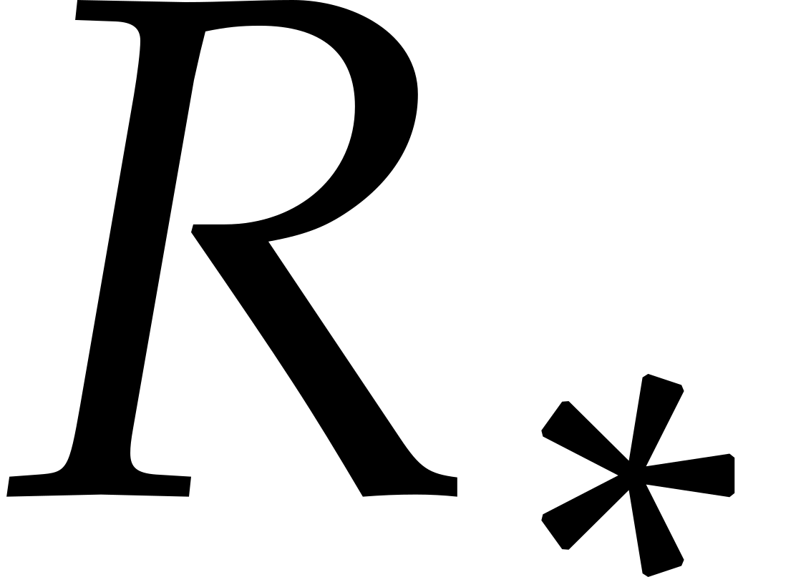? Here I do need “(n) …”. In this case this expression seems to be permissible. But “(∃x)․Fx” also says “there is a number of x that satisfy Fx”, and yet the expression “(∃x)․Fx” must not presuppose the totality of numbers.

### [Ts-209](/ts-209/#90.6) [90\[6\]](https://cdn.wittgensteinnachlass.com/2000px/webp/Ts-209/90.webp)

Ramsey’s explanation of infinity is also nonsensical for this very reason, for “(n):(∃nx)․Fx” would presuppose actual infinity as given and not merely the unlimited possibility of proceeding further.

### [Ts-209](/ts-209/#90.7) [90\[7\]](https://cdn.wittgensteinnachlass.com/2000px/webp/Ts-209/90.webp)

But is it unthinkable that I should know that someone is my ancestor but have _no idea at all_ how many generations back, so that the number of intermediate links would be _unbounded_?

### [Ts-209](/ts-209/#90.8) [90\[8\]](https://cdn.wittgensteinnachlass.com/2000px/webp/Ts-209/90.webp)

But how does the sentence “F is satisfied by as many objects as ψ” read? One would think: “(∃n):(Е nx)․Fx․(Е nx) ψx”.

### [Ts-209](/ts-209/#91.1) [91\[1\]](https://cdn.wittgensteinnachlass.com/2000px/webp/Ts-209/91.webp)

Brouwer is right when he says that the properties of his oscillating number are incompatible with the law of excluded middle. Only this does not reveal any peculiarity of the propositions about infinite aggregates. What underlies it, rather, is that logic presupposes that it must not be a priori – that is, logically – impossible to recognize whether a proposition is true or false. For if the question whether a proposition is true or false is a priori undecidable, the proposition thereby loses its sense, and for that very reason the propositions of logic cease to apply to it.

### [Ts-209](/ts-209/#91.2) [91\[2\]](https://cdn.wittgensteinnachlass.com/2000px/webp/Ts-209/91.webp)

Just as, quite generally, the whole way of looking at things according to which a proposition that holds in one area of mathematics need not necessarily hold in another is quite out of place in mathematics, entirely at odds with its essence. Although this is precisely what the authors regard as particularly subtle and contrary to prejudices.

### [Ts-209](/ts-209/#91.3) [91\[3\]](https://cdn.wittgensteinnachlass.com/2000px/webp/Ts-209/91.webp)

Mathematics is thoroughly infected by the pernicious set-theoretical way of speaking. _One_ example of this is that one says that the straight line consists of points. The straight line is a law and does not consist of anything at all. The straight line as a coloured stroke in visual space can consist of shorter coloured strokes (but of course not of points). And then one is surprised, for example, that there is still room for the irrational points “between the everywhere densely situated rational points”! What does a construction like that of the point √2 show? Does it show how this point still finds room between all the rational points? It simply shows that the point _generated_ by the construction is _not rational_. And what corresponds to this construction and this point in arithmetic? A number that _does_ manage to squeeze in between the rational numbers after all? A law that is not of the nature of a rational number.

### [Ts-209](/ts-209/#91.4) [91\[4\]](https://cdn.wittgensteinnachlass.com/2000px/webp/Ts-209/91.webp)

The explanation of the Dedekind cut pretends to be intuitive, namely when it is said: There are only 3 cases: either R has a last member and L no first member, or etc. In truth none of these cases can be thought (or imagined).

### [Ts-209](/ts-209/#91.5) [91\[5\]](https://cdn.wittgensteinnachlass.com/2000px/webp/Ts-209/91.webp)

174 Set theory is wrong because it apparently presupposes a symbolism that does not exist, instead of the one that does exist (the only one possible). It builds on a fictitious symbolism, and hence on nonsense.

### [Ts-209](/ts-209/#91.6) [91\[6\]](https://cdn.wittgensteinnachlass.com/2000px/webp/Ts-209/91.webp)

There is no logical hypothesis.

### [Ts-209](/ts-209/#91.7) [91\[7\]](https://cdn.wittgensteinnachlass.com/2000px/webp/Ts-209/91.webp)

If one says “the set of all transcendental numbers is larger than that of the algebraic numbers”, that is nonsense; it is of a different nature. It is not “no longer” countable, but simply not countable!

### [Ts-209](/ts-209/#91.8) [91\[8\]](https://cdn.wittgensteinnachlass.com/2000px/webp/Ts-209/91.webp)

The distribution of the primes would then be, for once, something in logic that a god could know and we could not. That is, there would be something in logic that we could not know but that can be known.

### [Ts-209](/ts-209/#91.9) [91\[9\]](https://cdn.wittgensteinnachlass.com/2000px/webp/Ts-209/91.webp)

One cannot assert that there is a process for arriving at the solution. For if there were no such process, the equation would be nonsensical as a general proposition. One can assert anything that can be checked by the act itself.

### [Ts-209](/ts-209/#91.10) [91\[10\]](https://cdn.wittgensteinnachlass.com/2000px/webp/Ts-209/91.webp)

It is the _possibility_ of checking that is at issue.

### [Ts-209](/ts-209/#92.1) [92\[1\]](https://cdn.wittgensteinnachlass.com/2000px/webp/Ts-209/92.webp)

If one says (as Brouwer does) that in the case of (x)․Fx = Gx there is, besides Yes and No, also the case of undecidability, this means that “(x)…” is meant extensionally and that one can speak of the case in which all x happen to possess a property. But in truth there is no speaking of this case at all, and the “(x)…” in arithmetic cannot be understood extensionally.

### [Ts-209](/ts-209/#92.2) [92\[2\]](https://cdn.wittgensteinnachlass.com/2000px/webp/Ts-209/92.webp)

One could say “the mathematical proposition is an instruction for arriving at an insight”. The assumption that no insight corresponds to it would make it complete nonsense. We cannot _understand_ an equation if we cannot see the connection between its two sides.

### [Ts-209](/ts-209/#92.3) [92\[3\]](https://cdn.wittgensteinnachlass.com/2000px/webp/Ts-209/92.webp)

Undecidability presupposes that between the two sides there is, so to speak, an underground connection; that the bridge cannot be built in symbols. But exists all the same: For otherwise the equation would be senseless. For the equation indicates a bridge that _can_ be built between the symbols.

### [Ts-209](/ts-209/#92.4) [92\[4\]](https://cdn.wittgensteinnachlass.com/2000px/webp/Ts-209/92.webp)

A connection between symbols that exists but cannot be represented by symbolic transitions is a thought that cannot be thought. If the connection is there, it must be possible to see it.

### [Ts-209](/ts-209/#92.5) [92\[5\]](https://cdn.wittgensteinnachlass.com/2000px/webp/Ts-209/92.webp)

For it _exists_ in the way the connection between parts of visual space exists. It is not a _causal_ chain. The transition is not effected by some obscure speculation of a different kind from what it connects. (Like a dark passage between two light places.)

### [Ts-209](/ts-209/#92.6) [92\[6\]](https://cdn.wittgensteinnachlass.com/2000px/webp/Ts-209/92.webp)

Of course, if mathematics were the empirical science of infinite extensions, which one can never know in their entirety, then a question undecidable in principle would indeed be conceivable.

### [Ts-209](/ts-209/#92.7) [92\[7\]](https://cdn.wittgensteinnachlass.com/2000px/webp/Ts-209/92.webp)

175 Does it make sense to say: “I have as many shoes as a root of the equation x³ + 2x ‒ 3 = 0 amounts to”? Even if the solution should yield a positive integer? For on my view we should have here a notation such that one cannot tell immediately by looking at it whether it is nonsensical or not.

### [Ts-209](/ts-209/#92.8) [92\[8\]](https://cdn.wittgensteinnachlass.com/2000px/webp/Ts-209/92.webp)

If one regards the expression “the root of the equation Fx = 0” as a description in Russell’s sense, then a sentence about the root of the equation x + 2 = 6 would have to have a different sense from one that says the same thing about 4.

### [Ts-209](/ts-209/#92.9) [92\[9\]](https://cdn.wittgensteinnachlass.com/2000px/webp/Ts-209/92.webp)

I cannot use a sentence before I know whether it has sense, whether it is a sentence. And in the above case of an unsolved equation I do not know this, because I do not know whether cardinal numbers correspond to the roots in the stipulated way. It is clear that in the given case the sentence becomes nonsensical rather than false (nor does it become a contradiction), for “I have n shoes and n² = 2” obviously means the same as “I have √2 shoes”.

### [Ts-209](/ts-209/#93.1) [93\[1\]](https://cdn.wittgensteinnachlass.com/2000px/webp/Ts-209/93.webp)

But I can establish that after all – or it can be established after all – if one just looks at the signs. But I must not put the equation into the sentence at random, but only if I know that it determines a cardinal number, for then it is simply another way of writing the cardinal number. Otherwise it is just as if I were to jumble signs together at random and leave it to chance whether they yield a sense or not.

### [Ts-209](/ts-209/#93.2) [93\[2\]](https://cdn.wittgensteinnachlass.com/2000px/webp/Ts-209/93.webp)

(x + y)² = x² + y² + 2xy. Is correct in the same sense as 2 × 2 = 4. And 2 + n = 1 (where n is a cardinal number) is false in the same way as 2 + 3 = 1, and 2 + n ≠ 1 correct in the same way as the one above.

### [Ts-209](/ts-209/#93.3) [93\[3\]](https://cdn.wittgensteinnachlass.com/2000px/webp/Ts-209/93.webp)

176 What makes one doubt the merely internal generality is the fact that it can be refuted by the occurrence of a single case (thus of something extensional). But what sort of collision is there here between the general and the particular proposition? The particular case refutes the general proposition from within, not in an external way. It is directed against the internal proof of the proposition and refutes it, not as the existence of a one-eyed person refutes the proposition “all people have two eyes”.

### [Ts-209](/ts-209/#93.4) [93\[4\]](https://cdn.wittgensteinnachlass.com/2000px/webp/Ts-209/93.webp)

“(x)․x² = x + x” seems to be false because examining the equation yields 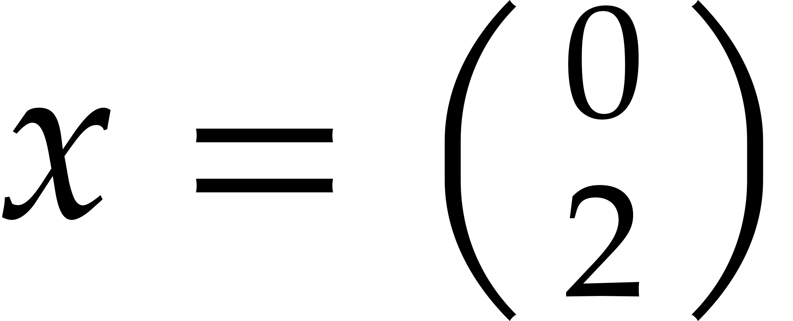, not that the two sides cancel out. Trying to substitute 3, for example, also yields the general result – (∃x)․x² ≠ 2x – and must therefore itself coincide with the general method in so far as its result coincides with that of solving the equation generally.

### [Ts-209](/ts-209/#93.5) [93\[5\]](https://cdn.wittgensteinnachlass.com/2000px/webp/Ts-209/93.webp)

If the equation x² + 2x + 2 = 0 yields x = ‒ 1 ± 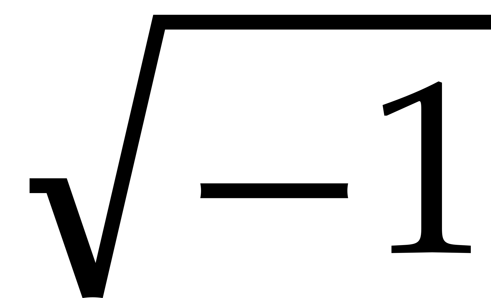 according to the rules of algebra, that is quite all right as long as we do not want the rules for x to accord with the rules for the real numbers. In that case the result of the algebraic calculation means that the equation has no solution.

### [Ts-209](/ts-209/#93.6) [93\[6\]](https://cdn.wittgensteinnachlass.com/2000px/webp/Ts-209/93.webp)

My difficulty is this: When I solve equations according to the rules in the domain of real numbers, rational numbers, or integers, in certain cases I arrive at apparent nonsense. Now if this happens: Am I to say that this proves that the original equation was nonsensical? So that only after I had finished applying the rules could I see whether it was nonsensical or had sense?! Must it not rather be put like this: The result of the apparently nonsensical equation does show something about the general form and does indeed connect the forbidden equation with ones that have a normal solution. The solution always shows how far the abnormal solution is from the normal one. If, e.g.,  is the result, I know that  ÷ 1 would already be a normal root. The continuity, the connection with the normal solution, is not broken. Would that mean that the concept of imaginary numbers is already presupposed in the concept of real numbers as we represent it by our symbolism and its rules? That would be rather like saying of the straight line g that it falls short of intersecting the circle by a, instead of simply saying that it does not intersect it. One could say “it fails to intersect it by a certain amount” and would thereby represent its continuity with normal intersection. “It misses it by a definite amount”.

### [Ts-209](/ts-209/#94.1) [94\[1\]](https://cdn.wittgensteinnachlass.com/2000px/webp/Ts-209/94.webp)

The difference between the two equations x² = x ∙ x and x² = 2x is _not_ one of the extension of their correctness.

### [Ts-209](/ts-209/#94.2) [94\[2\]](https://cdn.wittgensteinnachlass.com/2000px/webp/Ts-209/94.webp)

I can of course define m greater than n as (∃x)․n + x = m, but whether x = m ‒ n yields a number I know only if I know the rule of subtraction, and here it takes the place of the rule for determining greater and smaller. Formulated in this way, the rule reads: m is greater than n if m ‒ n yields a number according to the rule of subtraction.

### [Ts-209](/ts-209/#94.3) [94\[3\]](https://cdn.wittgensteinnachlass.com/2000px/webp/Ts-209/94.webp)

177 How does it show itself that space is not a collection of points but the realization of a law?

### [Ts-209](/ts-209/#94.4) [94\[4\]](https://cdn.wittgensteinnachlass.com/2000px/webp/Ts-209/94.webp)

It seems as though one must first build up the whole structure of space without sentences; and then one can form all the correct sentences within it.

### [Ts-209](/ts-209/#94.5) [94\[5\]](https://cdn.wittgensteinnachlass.com/2000px/webp/Ts-209/94.webp)

To represent space one needs – so it seems to me – a stretchable sign, as it were. Perhaps a sign that allows interpolation, analogous to the decimal system. The sign must have the multiplicity and properties of space.

### [Ts-209](/ts-209/#94.6) [94\[6\]](https://cdn.wittgensteinnachlass.com/2000px/webp/Ts-209/94.webp)

The axioms of a geometry must not contain any truths.

### [Ts-209](/ts-209/#94.7) [94\[7\]](https://cdn.wittgensteinnachlass.com/2000px/webp/Ts-209/94.webp)

One is sure to get the right multiplicity of designations if one uses analytical geometry. The fact that a point in the plane is represented by a pair of numbers and a point in three-dimensional space by a triple of numbers already shows that the object represented is not the point at all, but the fabric of points.

### [Ts-209](/ts-209/#94.8) [94\[8\]](https://cdn.wittgensteinnachlass.com/2000px/webp/Ts-209/94.webp)

178 The geometry of visual space is the syntax of sentences about objects in visual space.

### [Ts-209](/ts-209/#94.9) [94\[9\]](https://cdn.wittgensteinnachlass.com/2000px/webp/Ts-209/94.webp)

The axioms – for example – of Euclidean geometry are disguised rules of a syntax. This becomes very clear when one looks at what corresponds to them in analytic geometry.

### [Ts-209](/ts-209/#94.10) [94\[10\]](https://cdn.wittgensteinnachlass.com/2000px/webp/Ts-209/94.webp)

One could imagine the constructions of Euclidean geometry actually carried out, for example by using the edges of bodies as straight lines and their surfaces as planes. The axiom – for example – that a straight line can be drawn through any 2 points has the clear sense here that a straight line has not actually _been_ drawn through every arbitrary pair of points, but that it is _possible_ to draw one, and that only means that the sentence “a straight line passes through these points” has _sense_. That is, Euclidean geometry is the syntax of statements about objects in Euclidean space. And these objects are not straight lines, planes and points, but _bodies_.

### [Ts-209](/ts-209/#94.11) [94\[11\]](https://cdn.wittgensteinnachlass.com/2000px/webp/Ts-209/94.webp)

How are the equations of analysis connected with the results of measurements in space? I believe the connection is this: they – the equations – determine what is to count as an accurate measurement and what as an error.

### [Ts-209](/ts-209/#95.2) [95\[2\]](https://cdn.wittgensteinnachlass.com/2000px/webp/Ts-209/95.webp)

One could almost speak of an external and an internal geometry. What is arranged in visual space stands in this _kind_ of order a priori, i.e. by its logical nature, and geometry here is simply grammar. What the physicist relates to one another in the geometry of physical space are instrument readings, which in their _internal_ nature are no different whether we live in a straight or a spherical physical space. That is, it is not an investigation of the logical properties of these readings that leads the physicist to an assumption about the kind of physical space, but the facts read off.

### [Ts-209](/ts-209/#95.3) [95\[3\]](https://cdn.wittgensteinnachlass.com/2000px/webp/Ts-209/95.webp)

In this sense the geometry of physics has to do not with possibility but with facts. It is confirmed by facts; namely, in the sense in which _part_ of a hypothesis is confirmed.

### [Ts-209](/ts-209/#95.4) [95\[4\]](https://cdn.wittgensteinnachlass.com/2000px/webp/Ts-209/95.webp)

Comparison of working with the calculating machine and measuring geometrical figures. Are we conducting an experiment in making this measurement, or is it as with the calculating machine, where we merely establish internal relations and the physical result of our operations proves nothing?

### [Ts-209](/ts-209/#95.5) [95\[5\]](https://cdn.wittgensteinnachlass.com/2000px/webp/Ts-209/95.webp)

In visual space there is of course no geometrical experiment.

### [Ts-209](/ts-209/#95.6) [95\[6\]](https://cdn.wittgensteinnachlass.com/2000px/webp/Ts-209/95.webp)

I believe this is the crux of the misunderstanding about the a priori and the a posteriori in geometry.

### [Ts-209](/ts-209/#95.7) [95\[7\]](https://cdn.wittgensteinnachlass.com/2000px/webp/Ts-209/95.webp)

The question is in what sense the results of measurements can tell us something about _that_ which we also see.

### [Ts-209](/ts-209/#95.8) [95\[8\]](https://cdn.wittgensteinnachlass.com/2000px/webp/Ts-209/95.webp)

What about the sentence “the sum of the angles of a triangle is 180 degrees”? In any case one cannot tell by looking at it that it is a sentence of syntax. The sentence “Vertically opposite angles are equal” means that if they do not turn out to be equal when measured, I shall declare the measurement incorrect, and “the sum of the angles of a triangle is 180 degrees” means that if the sum does not turn out to be 180 degrees when measured, I shall assume an error of measurement. So the sentence is a postulate about the way the facts are described. Hence a sentence of syntax.

### [Ts-209](/ts-209/#95.9) [95\[9\]](https://cdn.wittgensteinnachlass.com/2000px/webp/Ts-209/95.webp)

There is obviously a method for making a straight ruler. This method includes an ideal, I mean, an approximation method with unlimited _possibility_, because this very method _is_ the ideal. Or rather: Only if it is an approximation method with unlimited possibility can (not must) the geometry of this method be Euclidean.

### [Ts-209](/ts-209/#95.10) [95\[10\]](https://cdn.wittgensteinnachlass.com/2000px/webp/Ts-209/95.webp)

Euclidean geometry presupposes _no method of measuring_ angles and line segments; it no more says in which cases two angles are to count as equal than the calculus of probability says in which cases two probabilities are to count as equal. If a particular method of measurement is then adopted, say one using iron rulers, the question is whether the measurements thus carried out yield Euclidean results.

### [Ts-209](/ts-209/#96.1) [96\[1\]](https://cdn.wittgensteinnachlass.com/2000px/webp/Ts-209/96.webp)

179 Let us imagine tossing a coin. I now want to determine a point on the segment A B by repeated tossing, each time carrying out the bisection prescribed by the toss; if, say, heads means that I am to halve the right-hand piece, and tails that I am to halve the left-hand piece.

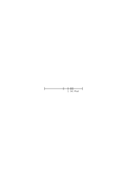

### [Ts-209](/ts-209/#96.2) [96\[2\]](https://cdn.wittgensteinnachlass.com/2000px/webp/Ts-209/96.webp)

Does it then describe the position of a point on the segment if I say “it is _the one_ that the bisection approaches without limit as the tossing goes on endlessly”?

### [Ts-209](/ts-209/#96.3) [96\[3\]](https://cdn.wittgensteinnachlass.com/2000px/webp/Ts-209/96.webp)

In this way I can approach any point on a segment without limit by repeated bisection, and with infinitely sharp eyes and infinitely fine tools _every_ step of the bisection would be determined. (The infinite sharpness of the eyes does not give rise to a vicious circle).

### [Ts-209](/ts-209/#96.4) [96\[4\]](https://cdn.wittgensteinnachlass.com/2000px/webp/Ts-209/96.webp)

Could one now call a sequence of digits determined in this way an infinite decimal fraction? That is, does this geometrical procedure determine a _number_?

### [Ts-209](/ts-209/#96.5) [96\[5\]](https://cdn.wittgensteinnachlass.com/2000px/webp/Ts-209/96.webp)

The geometrical procedure contains no vicious circle because it presupposes only infinite possibility, not infinite reality. (Lines and points are given by the boundaries of patches of colour.)

### [Ts-209](/ts-209/#96.6) [96\[6\]](https://cdn.wittgensteinnachlass.com/2000px/webp/Ts-209/96.webp)

In what sense can one say that I have thereby actually divided the rational numbers into two classes? After all, this division never actually comes about. But I have a _procedure_ by which I approach this division without limit? I have an unlimited procedure whose results as such do not lead me to the goal, but whose limitless possibility is precisely the goal. But what does this limitlessness consist in? have we not here again merely an operation, and that ad infinitum? Certainly. But the operation is not an arithmetical one. (And I cannot give arithmetically at all the point that serves as an aid in my endless construction.)

### [Ts-209](/ts-209/#96.7) [96\[7\]](https://cdn.wittgensteinnachlass.com/2000px/webp/Ts-209/96.webp)

Now many would say here: It does not matter that the method was geometrical; it is only the resulting _extension_ that is our goal. But do I actually have it?

### [Ts-209](/ts-209/#96.8) [96\[8\]](https://cdn.wittgensteinnachlass.com/2000px/webp/Ts-209/96.webp)

What in arithmetic is analogous to the geometrical process of bisection? It must be the reverse procedure, that of determining a point by a law. (Instead of determining the law by a point).

### [Ts-209](/ts-209/#96.9) [96\[9\]](https://cdn.wittgensteinnachlass.com/2000px/webp/Ts-209/96.webp)

Specifically, it would correspond to the endless process of choosing between 0 and 1 in an infinite binary fraction 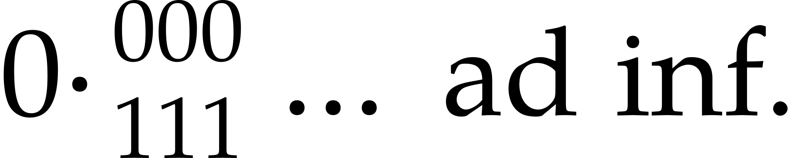. The law would read here, “you must put 0 or 1 at each step ad infinitum, each gives a law, each a different one”.

### [Ts-209](/ts-209/#96.10) [96\[10\]](https://cdn.wittgensteinnachlass.com/2000px/webp/Ts-209/96.webp)

But that does not mean that a law would be given _by_ my saying: “Toss for heads or tails in each case”. I would, of course, have to obtain a special case of that general law in this way, but would not know in advance which one. The instruction to toss does not describe any law of the sequence.

### [Ts-209](/ts-209/#97.1) [97\[1\]](https://cdn.wittgensteinnachlass.com/2000px/webp/Ts-209/97.webp)

What is arithmetical about the process of tossing is not the actual result but the infinite indeterminacy. But that does not _determine_ a number.

### [Ts-209](/ts-209/#97.2) [97\[2\]](https://cdn.wittgensteinnachlass.com/2000px/webp/Ts-209/97.webp)

If I indicate a law like this “0˙001001001… ad inf.”, what I want to show is not the finite series as a specimen of a part of an infinite one, but the kind of regularity that can be gathered from it. But from 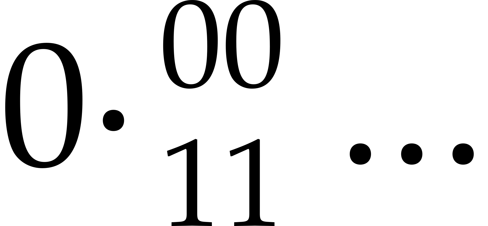 I gather _no_ law at all, but precisely the lack of a law. Unless perhaps it is the law that only “0” and “1”, and no other signs, represent the results of the particular laws.

### [Ts-209](/ts-209/#97.3) [97\[3\]](https://cdn.wittgensteinnachlass.com/2000px/webp/Ts-209/97.webp)

The rules for combining 0 and 1 yield the totality of _all_ finite fractions. That would be an infinite extension, in which one would also have to find the infinite extension of the fractions 0˙1, 0˙101, 0˙10101, etc. ad inf. and indeed all irrational numbers.

### [Ts-209](/ts-209/#97.4) [97\[4\]](https://cdn.wittgensteinnachlass.com/2000px/webp/Ts-209/97.webp)

What if one checks the various laws, so to speak, against the set of finite combinations. The results of a law run through the finite combinations, and the laws are therefore complete, as far as their extensions are concerned, if _all_ the finite combinations are run through.

### [Ts-209](/ts-209/#97.5) [97\[5\]](https://cdn.wittgensteinnachlass.com/2000px/webp/Ts-209/97.webp)

Nor can one say: Two laws are identical if they give the same result at every stage. Rather, they are identical if they give essentially the same result, that is, if they are identical.

### [Ts-209](/ts-209/#97.6) [97\[6\]](https://cdn.wittgensteinnachlass.com/2000px/webp/Ts-209/97.webp)

180 If an amorphous theory of infinite aggregates is possible, it must describe and represent only what is amorphous about these aggregates. It would then really have to regard the laws as merely inessential means of representing an aggregate. And abstract from what is inessential here and look only at what is essential. But at what? Is it possible to abstract from the law in the law and to see the extension represented as what is essential?

### [Ts-209](/ts-209/#97.7) [97\[7\]](https://cdn.wittgensteinnachlass.com/2000px/webp/Ts-209/97.webp)

This much, at any rate, is clear: there is no duality of law and the infinite series that follows it; that is, there is nothing in logic like description and reality.

### [Ts-209](/ts-209/#97.8) [97\[8\]](https://cdn.wittgensteinnachlass.com/2000px/webp/Ts-209/97.webp)

Suppose I make a cut where there is no rational number. Then there _must_ be approximations to this cut. But what does “nearer” mean here? _Nearer_ to what? As yet, of course, I have nothing in the domain of number that I can approach. But on the geometrical segment I do. Here it is clear that I can come as close as I like to any non-rational cut. – And it is also clear that this process never comes to an end and that the spatial fact leads me on unambiguously.

### [Ts-209](/ts-209/#97.9) [97\[9\]](https://cdn.wittgensteinnachlass.com/2000px/webp/Ts-209/97.webp)

Once again it is only the infinite possibility, but now the law is given in a different way.

### [Ts-209](/ts-209/#98.1) [98\[1\]](https://cdn.wittgensteinnachlass.com/2000px/webp/Ts-209/98.webp)

But can I be in doubt as to whether all the points on a segment really can be represented by arithmetical instructions? Can I ever find a point for which I can show that this is not the case? If it is given by a construction, then I can translate this into an arithmetical instruction, and if it is given by chance, then however far I carry on the approximation, there is always an arithmetically determined decimal fraction that accompanies it. It is clear that a point corresponds to an instruction.

### [Ts-209](/ts-209/#98.2) [98\[2\]](https://cdn.wittgensteinnachlass.com/2000px/webp/Ts-209/98.webp)

What about the types of instructions, and does it make sense to speak of all instructions, and thus of all points? In some sense there cannot be irrational numbers of different types. My feeling here is this: Whatever the instruction may say, I always get nothing more than an endless series of rational numbers. One can also put it this way: Whatever the instruction says, if I translate it into geometrical notation, everything is of the same type.

### [Ts-209](/ts-209/#98.3) [98\[3\]](https://cdn.wittgensteinnachlass.com/2000px/webp/Ts-209/98.webp)

In approximating by repeated bisection one approaches _any_ point by means of _rational_ numbers. There is no point that one could approach only by means of irrational numbers of a particular type.

### [Ts-209](/ts-209/#98.4) [98\[4\]](https://cdn.wittgensteinnachlass.com/2000px/webp/Ts-209/98.webp)

It is quite possible that in determining a maximum I may come across a new instruction, but it has nothing essential to do with determining the maximum; it does not refer explicitly to a totality of real numbers.

### [Ts-209](/ts-209/#98.5) [98\[5\]](https://cdn.wittgensteinnachlass.com/2000px/webp/Ts-209/98.webp)

181 The question would be: What criterion is there for the irrational numbers being _complete_?

### [Ts-209](/ts-209/#98.6) [98\[6\]](https://cdn.wittgensteinnachlass.com/2000px/webp/Ts-209/98.webp)

Let us look at an irrational number: It runs along a series of rational approximations. When does it leave this series? Never. But of course it never comes to an end either. Suppose we had the totality of all irrational numbers except one. How would we miss that one? And how would it then – if it were added – fill the gap? – Suppose it were π. If the irrational number is given by the totality of its approximations, then up to _any_ point one chooses there would be a series that agrees with that of π. Of course, for every such series there comes a point of divergence. But that point can lie as far “out” as one likes. So that for every series that accompanies π I can find one that accompanies it further. So if I have the totality of all irrational numbers except π, and now insert π, I cannot specify any point at which π is really needed: at _every_ point it has a companion that accompanies it from the beginning.

### [Ts-209](/ts-209/#98.7) [98\[7\]](https://cdn.wittgensteinnachlass.com/2000px/webp/Ts-209/98.webp)

This shows clearly that the irrational number is not the extension of an infinite decimal fraction but a law.

### [Ts-209](/ts-209/#98.8) [98\[8\]](https://cdn.wittgensteinnachlass.com/2000px/webp/Ts-209/98.webp)

It seems somehow to follow from this – and it strikes me as quite clear – that the infinity of the length is not a magnitude of length.

### [Ts-209](/ts-209/#99.1) [99\[1\]](https://cdn.wittgensteinnachlass.com/2000px/webp/Ts-209/99.webp)

To the above question one would have to reply: “π, if it were an extension, would never be missed”. That is, we could never notice a gap. If one were to ask us “but do you also have an infinite decimal fraction with m in the rth place and n in the sth” etc., we could always supply it.

### [Ts-209](/ts-209/#99.2) [99\[2\]](https://cdn.wittgensteinnachlass.com/2000px/webp/Ts-209/99.webp)

Now suppose we were given all the irrational numbers that can be represented by laws, but that these were not all of them, and I am given a cut representing a number not contained in this first class: How can I recognise that this is the case? It is impossible, for no matter how far I go with my values, a corresponding fraction will always be found. So one cannot say that the infinite decimal fractions that proceed according to a law still need to be supplemented by an infinite set of unordered infinite decimal fractions that would “fall by the wayside” if we _restricted ourselves to those generated according to a law_. Where is such an infinite fraction not generated according to a law? And how can we miss it? Where is the gap it would have to fill?

### [Ts-209](/ts-209/#99.3) [99\[3\]](https://cdn.wittgensteinnachlass.com/2000px/webp/Ts-209/99.webp)

If from the outset only the laws extend to infinity, then the question whether the totality of the laws exhausts the totality of the infinite decimal fractions could have no sense at all.

### [Ts-209](/ts-209/#99.4) [99\[4\]](https://cdn.wittgensteinnachlass.com/2000px/webp/Ts-209/99.webp)

The usual view is roughly that, although the real numbers have a different multiplicity from the rational numbers, one can first write the two series side by side, and the series of real numbers at some point leaves the other behind and goes on without end.

### [Ts-209](/ts-209/#99.5) [99\[5\]](https://cdn.wittgensteinnachlass.com/2000px/webp/Ts-209/99.webp)

My view, however, is this: One can only ever lay finite series side by side and compare them with one another in this way; putting dots after these finite stretches (as a sign that the series goes on to infinity) makes no sense. Further, one can compare a law with a law, but not a law with _no_ law.

### [Ts-209](/ts-209/#99.6) [99\[6\]](https://cdn.wittgensteinnachlass.com/2000px/webp/Ts-209/99.webp)

182 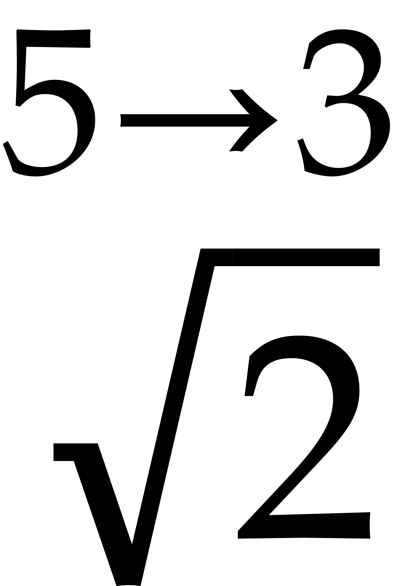 One would like to say that the individual digits are always only the results, the bark of the fully grown tree. What matters, or what something new can still grow from, is inside the trunk, where the forces that drive the growth are. A change to the outside does not change the tree at all. To change it one must go into the still living trunk.

### [Ts-209](/ts-209/#99.7) [99\[7\]](https://cdn.wittgensteinnachlass.com/2000px/webp/Ts-209/99.webp)

So it is as if the digits were dead excretions of the living creature that is the root. As when a snail secretes lime through its life process and goes on building its shell.

### [Ts-209](/ts-209/#99.8) [99\[8\]](https://cdn.wittgensteinnachlass.com/2000px/webp/Ts-209/99.webp)

The rules for the digits must be there first; then – for example – a root expresses itself in them. But this expression in the form of a sequence of digits is significant only in virtue of being the expression of a real number. If one alters it afterwards, one has merely disturbed the expression, not obtained a new number.

### [Ts-209](/ts-209/#99.9) [99\[9\]](https://cdn.wittgensteinnachlass.com/2000px/webp/Ts-209/99.webp)

The rules for the digits belong at the beginning, as preparation for the expression. For the construction of the system in which the law lives out its life.

### [Ts-209](/ts-209/#100.1) [100\[1\]](https://cdn.wittgensteinnachlass.com/2000px/webp/Ts-209/100.webp)

183 So I would say: If √2' is anything at all, it is the same as √2, only another expression; the expression in another system.

### [Ts-209](/ts-209/#100.2) [100\[2\]](https://cdn.wittgensteinnachlass.com/2000px/webp/Ts-209/100.webp)

One could then also put it quite naively like this: I understand what √2' means, but not √2' itself, since √2 has no places at all, so I cannot replace any of them with others.

### [Ts-209](/ts-209/#100.3) [100\[3\]](https://cdn.wittgensteinnachlass.com/2000px/webp/Ts-209/100.webp)

What about ⅐ (5→3)? Of course 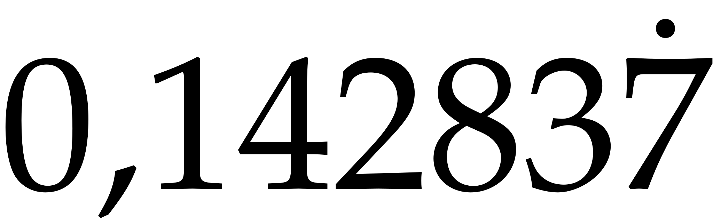 is not an infinite extension but again an infinite rule by means of which an extension can be formed. But it is the sort of rule that can, so to speak, digest the “(5→3)”.

### [Ts-209](/ts-209/#100.4) [100\[4\]](https://cdn.wittgensteinnachlass.com/2000px/webp/Ts-209/100.webp)

The addition “(1–3)” reaches, so to speak, into the heart of the law 0,1010010001… . The law mentions a 1, and that is replaced by 5.

### [Ts-209](/ts-209/#100.5) [100\[5\]](https://cdn.wittgensteinnachlass.com/2000px/webp/Ts-209/100.webp)

Could one perhaps put it like this: √2' does not measure until it is in a system.

### [Ts-209](/ts-209/#100.6) [100\[6\]](https://cdn.wittgensteinnachlass.com/2000px/webp/Ts-209/100.webp)

It is as if one needed a human being to carry out the rule √2'. As it were: To be an arithmetical affair, the rule must understand _itself_. The rule √2' does not do that; it is composed of two heterogeneous constituents. The human being who applies it brings these constituents together.

### [Ts-209](/ts-209/#100.7) [100\[7\]](https://cdn.wittgensteinnachlass.com/2000px/webp/Ts-209/100.webp)

Does that mean that the rule √2' lacks something, namely the connection between the system of the root and the system of the sequence of digits?

### [Ts-209](/ts-209/#100.8) [100\[8\]](https://cdn.wittgensteinnachlass.com/2000px/webp/Ts-209/100.webp)

One would no more ever say of the rule √2' that it was a limit towards which the values of the series tend than one would say this of the instruction to roll a die.

### [Ts-209](/ts-209/#100.9) [100\[9\]](https://cdn.wittgensteinnachlass.com/2000px/webp/Ts-209/100.webp)

How far must one expand √2 in order to know it to some extent? That of course means nothing. So we already know it without expanding it at all. But then √2' means nothing at all.

### [Ts-209](/ts-209/#100.10) [100\[10\]](https://cdn.wittgensteinnachlass.com/2000px/webp/Ts-209/100.webp)

The idea of √2 is this: We are looking for a rational number which, when multiplied by itself, yields 2. There is none. But there are some that come close to 2 in this way, and there are always some that come closer to 2. There is a procedure that allows me to come closer to 2 without limit. This procedure too is something. And I call it a real number. It expresses itself by yielding decimal places of a decimal fraction that lie ever further to the right.

### [Ts-209](/ts-209/#100.11) [100\[11\]](https://cdn.wittgensteinnachlass.com/2000px/webp/Ts-209/100.webp)

Only what can be foreseen in the sequence of digits is essential to the real number.

### [Ts-209](/ts-209/#100.12) [100\[12\]](https://cdn.wittgensteinnachlass.com/2000px/webp/Ts-209/100.webp)

184 That one can apply the law is true also of the law for obtaining the digits by rolling a die.

### [Ts-209](/ts-209/#101.1) [101\[1\]](https://cdn.wittgensteinnachlass.com/2000px/webp/Ts-209/101.webp)

And what distinguishes π' from this can only be its arithmetical determinacy. But does that not consist in our knowing that there must be a law according to which the digits 7 occur in π, even if we do not yet know this law?

### [Ts-209](/ts-209/#101.2) [101\[2\]](https://cdn.wittgensteinnachlass.com/2000px/webp/Ts-209/101.webp)

So one could also put it like this: π' alludes to a law that is not yet known. (⅐' does not.)

### [Ts-209](/ts-209/#101.3) [101\[3\]](https://cdn.wittgensteinnachlass.com/2000px/webp/Ts-209/101.webp)

But could one not now say: π' contains the description of a law. Namely, “the law according to which 7 occurs in the expansion of π”. Or would this allusion make sense only if we know how we can obtain this law? (Solution of a mathematical problem.)

### [Ts-209](/ts-209/#101.4) [101\[4\]](https://cdn.wittgensteinnachlass.com/2000px/webp/Ts-209/101.webp)

Then ex confesso I cannot read this very law out of this instruction, and so the law is contained in it in a language I cannot read. In this sense, then, I do not understand π' either.

### [Ts-209](/ts-209/#101.5) [101\[5\]](https://cdn.wittgensteinnachlass.com/2000px/webp/Ts-209/101.webp)

But what about the solvability of the problem of finding this law? Is it not a problem only in so far as the method of solving it is _known_? And if the method is known, π' gets its sense precisely _from that_; and if it is unknown, we cannot speak of the law we do not yet know, and π' loses all sense. For if there is no law, π' becomes analogous to the instruction to roll a die.

### [Ts-209](/ts-209/#101.6) [101\[6\]](https://cdn.wittgensteinnachlass.com/2000px/webp/Ts-209/101.webp)

185 The real number lives in the substrate of the operations from which it was born.

### [Ts-209](/ts-209/#101.7) [101\[7\]](https://cdn.wittgensteinnachlass.com/2000px/webp/Ts-209/101.webp)

One could also say: “√2” means the method of approximating 2 by an x².

### [Ts-209](/ts-209/#101.8) [101\[8\]](https://cdn.wittgensteinnachlass.com/2000px/webp/Ts-209/101.webp)

Only a path approaches a goal, not places. And only a law approaches a value.

### [Ts-209](/ts-209/#101.9) [101\[9\]](https://cdn.wittgensteinnachlass.com/2000px/webp/Ts-209/101.webp)

We call the approach of x² to 2 the approach of x to √2.

### [Ts-209](/ts-209/#101.10) [101\[10\]](https://cdn.wittgensteinnachlass.com/2000px/webp/Ts-209/101.webp)

186 The letter π stands for a law. The sign π' means nothing if the law for π makes no mention of a 7 that one can replace with a 3. The same applies, by analogy, to 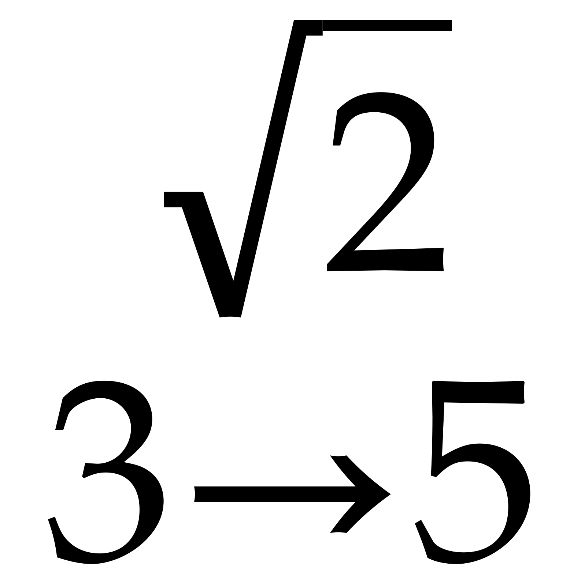. (By contrast,  could mean √5.)

### [Ts-209](/ts-209/#101.11) [101\[11\]](https://cdn.wittgensteinnachlass.com/2000px/webp/Ts-209/101.webp)

A real number _yields_ extensions; it is not an extension. The real number is: An arithmetical law that yields the places of a decimal fraction without end. This law has its place in arithmetical space. Or one could also say: in algebraic space. Whereas π' does not avail itself of the arithmetical mode of expression and thus does not assign the law a place in this space. What is missing, as it were, is the arithmetical creature that produces these excretions. The incomparability of the magnitudes of π and π' is connected with this homelessness of π'.

### [Ts-209](/ts-209/#102.1) [102\[1\]](https://cdn.wittgensteinnachlass.com/2000px/webp/Ts-209/102.webp)

One cannot say: Two real numbers are identical if they agree at every place. One cannot say: They are different if they disagree at one place in their expansion. Nor can one say that one is greater than the other if its first differing digit is greater than the corresponding digit of the other.

### [Ts-209](/ts-209/#102.3) [102\[3\]](https://cdn.wittgensteinnachlass.com/2000px/webp/Ts-209/102.webp)

Suppose someone invented a new arithmetical operation that was ordinary multiplication, with the sole modification that in the product he put a 3 in place of every 7. Then this operation x' too would have something about it that was not understood, so long as the occurrence of 7 in the product was not understood in general by means of a law.

### [Ts-209](/ts-209/#102.5) [102\[5\]](https://cdn.wittgensteinnachlass.com/2000px/webp/Ts-209/102.webp)

The remarkable thing here would be precisely that my symbolism expressed something I do not understand. (But there is no such thing.)

### [Ts-209](/ts-209/#102.2) [102\[2\]](https://cdn.wittgensteinnachlass.com/2000px/webp/Ts-209/102.webp)

It is clear that if I could apply x', all doubts about its warrant would be removed. For the possibility of application is the real criterion for arithmetical reality.

### [Ts-209](/ts-209/#102.6) [102\[6\]](https://cdn.wittgensteinnachlass.com/2000px/webp/Ts-209/102.webp)

Even if I did not already know the rule for forming √2 and took 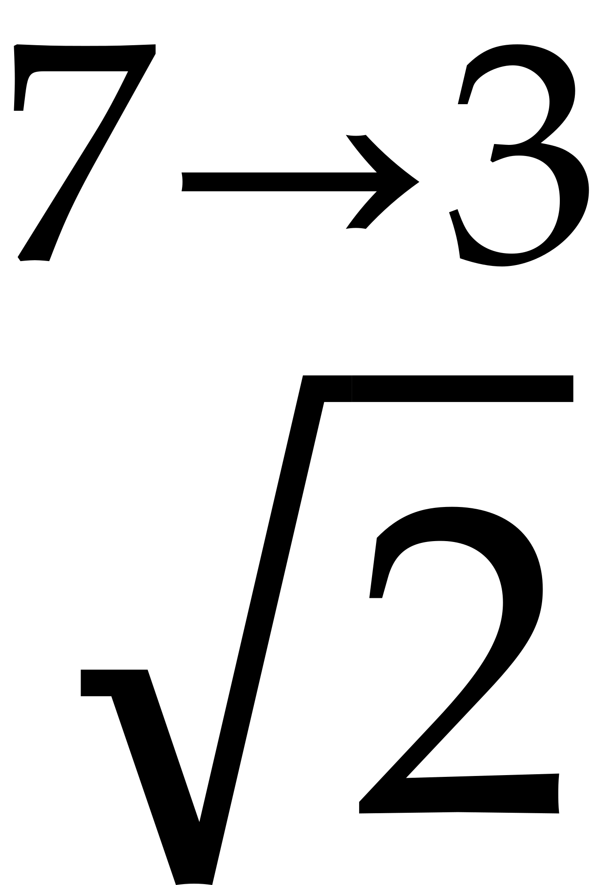 to be the primary rule, I would still ask: What is the point of this curious ceremony of replacing 7 with 3? Is 7 perhaps taboo, so that one is not allowed to write it down? For replacing 7 with 3 adds nothing at all to the law and is not an arithmetical operation in this system at all.

### [Ts-209](/ts-209/#102.7) [102\[7\]](https://cdn.wittgensteinnachlass.com/2000px/webp/Ts-209/102.webp)

Geometrically speaking: It is not enough for one – supposedly – to determine the point more and more precisely by narrowing down the region where it lies; one must be able to construct _it_. Repeated throws of the die narrow down without limit the region where the point could lie, but they do not determine a point. After _every_ throw the point is still infinitely indeterminate.

### [Ts-209](/ts-209/#102.8) [102\[8\]](https://cdn.wittgensteinnachlass.com/2000px/webp/Ts-209/102.webp)

Of course, in the course of ordinary root extraction too, the particular rules of the multiplication tables that fit each case have to be applied again and again, and one has not foreseen their application either. But there is no mention of them or their application in the principle of √2 either.

### [Ts-209](/ts-209/#102.9) [102\[9\]](https://cdn.wittgensteinnachlass.com/2000px/webp/Ts-209/102.webp)

A number must measure. And not merely: Values of its expansion must measure. For one cannot speak of _all_ the values, and it goes without saying that rational numbers (which I have formed according to some rule or other) measure.

### [Ts-209](/ts-209/#102.10) [102\[10\]](https://cdn.wittgensteinnachlass.com/2000px/webp/Ts-209/102.webp)

What I mean might be expressed by saying that for a real number a construction, and not merely an approximation, must be conceivable. – The construction corresponds to the unity of the law.

### [Ts-209](/ts-209/#103.1) [103\[1\]](https://cdn.wittgensteinnachlass.com/2000px/webp/Ts-209/103.webp)

187 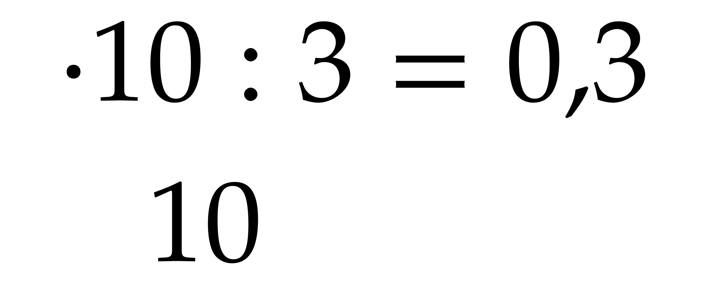

What I actually see and express by  is that the circle closes.  does not mean “nothing but 3s occur”, but “a 3 must occur again and again”.

### [Ts-209](/ts-209/#103.2) [103\[2\]](https://cdn.wittgensteinnachlass.com/2000px/webp/Ts-209/103.webp)

Understanding the prescription and how to carry it out in practice only ever takes us a finite distance. To determine a real number, the prescription must be completely intelligible _in itself_. That is, it must not be essentially undecided whether a part of it could be dispensed with.

### [Ts-209](/ts-209/#103.3) [103\[3\]](https://cdn.wittgensteinnachlass.com/2000px/webp/Ts-209/103.webp)

For then it is simply not clearly given, since there is no extension that would be equivalent to it, and in itself it is indeterminate. π' would then go looking for adventure in infinite space.

### [Ts-209](/ts-209/#103.4) [103\[4\]](https://cdn.wittgensteinnachlass.com/2000px/webp/Ts-209/103.webp)

Certainly, if a and b first disagree at the fourth place, one can say that they are therefore unequal. This fourth place does belong to the two numbers; but not the indeterminate nth place in the infinite progression.

### [Ts-209](/ts-209/#103.5) [103\[5\]](https://cdn.wittgensteinnachlass.com/2000px/webp/Ts-209/103.webp)

One can therefore presumably recognize the difference between π and e from the fact that they differ at the _first_ place. But one cannot say that they would be equal if all their digits were the same.

### [Ts-209](/ts-209/#103.6) [103\[6\]](https://cdn.wittgensteinnachlass.com/2000px/webp/Ts-209/103.webp)

If the extensions of two laws agree for the time being and I cannot compare the laws as such, then the numbers defined, if I have any right to speak of such numbers, are incomparable, and the question which is greater or whether they are equal is nonsensical. Indeed, an equation equating the two must be nonsensical! And that gives one pause. And it is true that we cannot mean anything by equating them if there is no internal connection between them; if they belong to different systems. (And the extension cannot help us.)

### [Ts-209](/ts-209/#103.7) [103\[7\]](https://cdn.wittgensteinnachlass.com/2000px/webp/Ts-209/103.webp)

But are these really two _numbers_ that are incomparable with one another? Does that not contradict the simple conception of the number line?

### [Ts-209](/ts-209/#103.8) [103\[8\]](https://cdn.wittgensteinnachlass.com/2000px/webp/Ts-209/103.webp)

188 There is no number outside a system.

### [Ts-209](/ts-209/#103.9) [103\[9\]](https://cdn.wittgensteinnachlass.com/2000px/webp/Ts-209/103.webp)

The expansion of π is at once an expression of the essence of π _and of the essence of the decimal system_.

### [Ts-209](/ts-209/#103.10) [103\[10\]](https://cdn.wittgensteinnachlass.com/2000px/webp/Ts-209/103.webp)

Arithmetical operations use the decimal system only as a means to an end; the rules of operation are thus such that they can be translated into the language of any other number system and have none of these systems as their _object_. The expansion of π is indeed an expression both of the essence of π and of decimal notation, but ordinarily we are interested exclusively in what is essential to π, and we pay no attention to the other thing. It is a servant whom we regard only as a tool, not as a being with rights of his own. But if we now regard him as part of society, society has thereby changed.

### [Ts-209](/ts-209/#104.1) [104\[1\]](https://cdn.wittgensteinnachlass.com/2000px/webp/Ts-209/104.webp)

A general rule of operation derives its generality from the generality of the change it produces in the numbers. This is why x' will not do as a general rule of operation: the result of a x'b depends not only on the essence of the numbers a and b; the decimal system also comes into play. Now of course it would not matter if this system were taken as a further constant underlying the operation 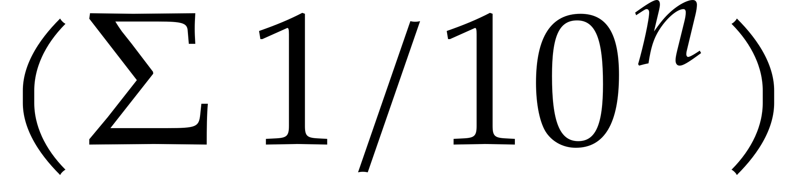 and one can presumably find an operation that corresponds to x' and then has not only a and b but also the decimal system as its _object_. This operation will be written in a number system that withdraws into the role of servant and _of which_ there is no mention in the operation.

### [Ts-209](/ts-209/#104.2) [104\[2\]](https://cdn.wittgensteinnachlass.com/2000px/webp/Ts-209/104.webp)

In just the same way π' makes the decimal system its object (or would have to do so if it were right), so it is no longer enough that one can apply the rule in forming the extension. For this application is now no longer the criterion for the rule’s being in order, since the rule is not the expression of the arithmetical law at all, but merely alters the language externally.

### [Ts-209](/ts-209/#104.3) [104\[3\]](https://cdn.wittgensteinnachlass.com/2000px/webp/Ts-209/104.webp)

So if it is no longer to be a servant, it must formally take its seat at table with the others and must therefore stop serving, for it cannot do both at once.

### [Ts-209](/ts-209/#104.4) [104\[4\]](https://cdn.wittgensteinnachlass.com/2000px/webp/Ts-209/104.webp)

It is like this: The number π is represented in the decimal system. One cannot produce a modification of this law by starting from the distinctive expression of the decimal system. What one influences in this way is not the law at all, but its accidental expression. This influence does not reach as far as the law at all. It stands apart from it on the other side. It is as if one wanted to influence a living creature by acting on a secretion it had already discharged.

### [Ts-209](/ts-209/#104.5) [104\[5\]](https://cdn.wittgensteinnachlass.com/2000px/webp/Ts-209/104.webp)

189 But what about a law 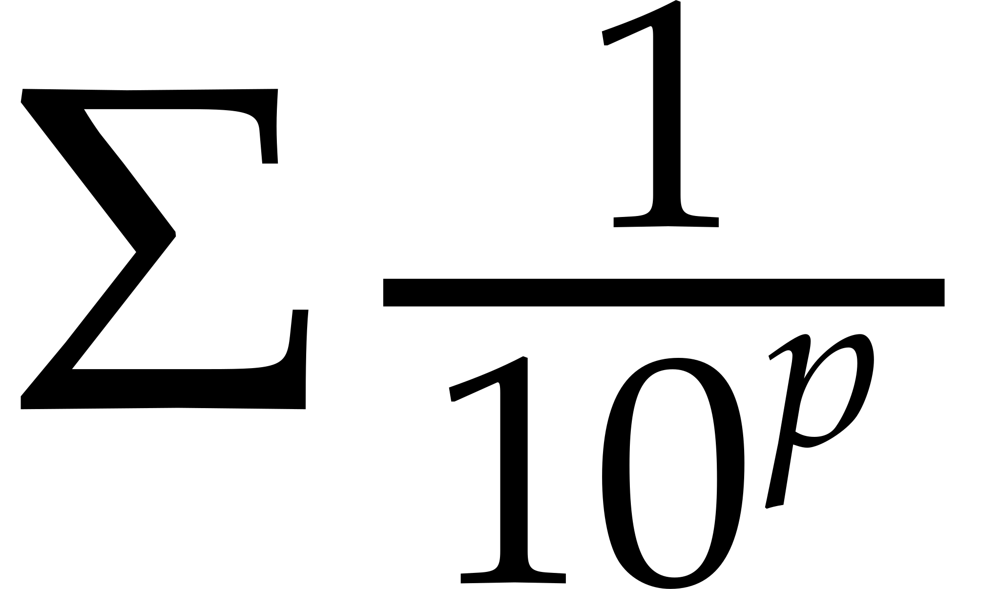 (where p runs through the series of prime numbers), or the case where p runs through the series of integers, except those for which Fermat’s theorem does not hold? – Do these rules determine real numbers?

### [Ts-209](/ts-209/#104.6) [104\[6\]](https://cdn.wittgensteinnachlass.com/2000px/webp/Ts-209/104.webp)

I say: The so-called “Fermat’s theorem” is not a _proposition_. (Not even in the sense of arithmetic.) What would correspond to it would be a proof by induction. But if there is a number F, 0,11000 etc., and that proof succeeds, then surely it would thereby be proved that F = 0,11, and surely that is a proposition! Or: It is a proposition if the law F is a number.

### [Ts-209](/ts-209/#104.7) [104\[7\]](https://cdn.wittgensteinnachlass.com/2000px/webp/Ts-209/104.webp)

A proof proves what it proves, and no more.

### [Ts-209](/ts-209/#104.8) [104\[8\]](https://cdn.wittgensteinnachlass.com/2000px/webp/Ts-209/104.webp)

The number F wants to use the spiral 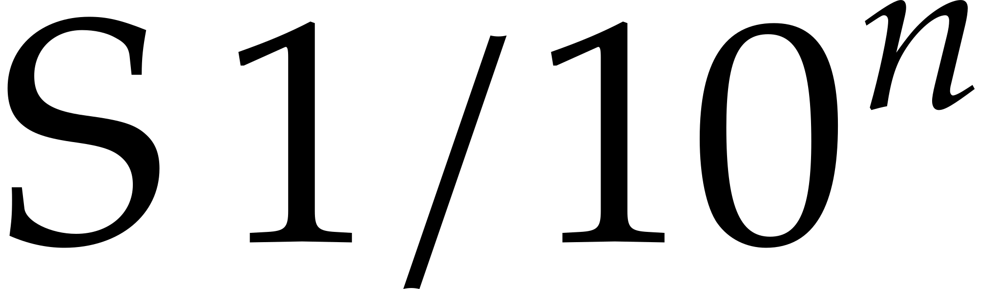 and then select turns of that spiral according to a principle. But this principle does not belong to the spiral. If I imagine turns of the spiral 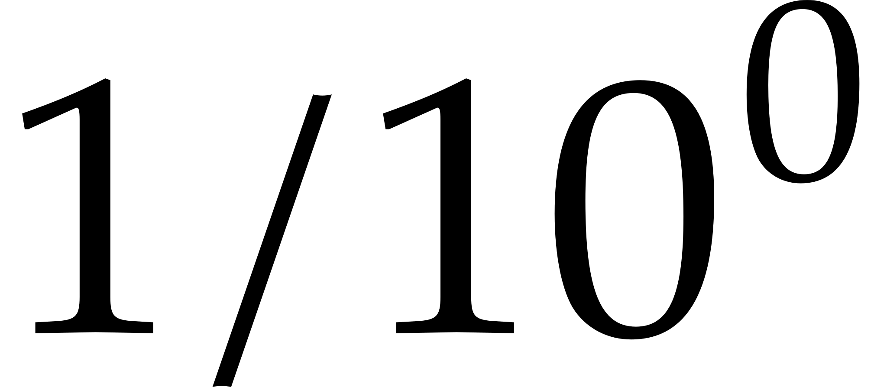, 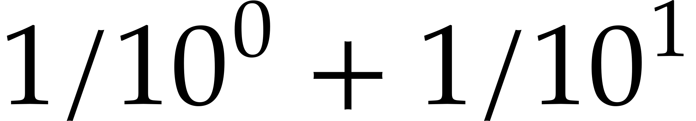, etc., written down, then F makes a remark on each turn, confirming it or crossing it out; and it does so in a selection _whose law we do not know_.

### [Ts-209](/ts-209/#105.1) [105\[1\]](https://cdn.wittgensteinnachlass.com/2000px/webp/Ts-209/105.webp)

This is also how the paradox arises that it becomes nonsensical to ask whether F = 0,11. For the assumption of F rests after all on the assumption of a law, an infinite law, according to which the numbers in Fermat’s formula behave. – But what does the infinity of the law mean to us? Only induction. And where does that lie here? In the infinitely many possibilities for the exponent n in , that is, in the unlimited possibility of making trials. But for us this is worth no more than the unlimited possibility of rolling a die, since we know of no law to which the _results_ of these trials correspond.

### [Ts-209](/ts-209/#105.2) [105\[2\]](https://cdn.wittgensteinnachlass.com/2000px/webp/Ts-209/105.webp)

There is a law there already (and with it an arithmetical interest too), but it does not apply directly to the number. The number is, as it were, a by-product of the law that does not itself follow a law. As if someone were walking along a road with a law-governed stride and were now to roll dice at every step and, depending on how they fell, stick a stake into the ground or not; then these stakes would not stand in accordance with a law. Or rather, the law in accordance with which they would stand would be only that of the striding, and no other.

### [Ts-209](/ts-209/#105.3) [105\[3\]](https://cdn.wittgensteinnachlass.com/2000px/webp/Ts-209/105.webp)

So does it make no sense, even when Fermat’s theorem has been proved, to say that 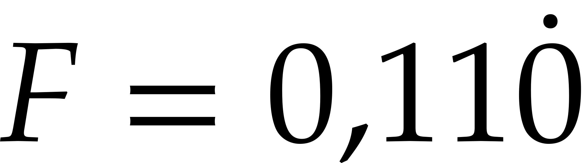? (If, say, I read about it in the newspaper.)

### [Ts-209](/ts-209/#105.4) [105\[4\]](https://cdn.wittgensteinnachlass.com/2000px/webp/Ts-209/105.webp)

The very essence of the real number must be induction. What I must see in the real number, its sign, is induction. – The _so_ of which one can say “and so on”. If the law, the winding of the spiral, is a number, then it must be comparable in respect of its position (on the number line) with all the others. For I determine the position by nothing other than the law.

### [Ts-209](/ts-209/#105.5) [105\[5\]](https://cdn.wittgensteinnachlass.com/2000px/webp/Ts-209/105.webp)

Only what I see is a law; not what I _describe_. I think that alone prevents me from expressing more in my signs than I can understand.

### [Ts-209](/ts-209/#105.6) [105\[6\]](https://cdn.wittgensteinnachlass.com/2000px/webp/Ts-209/105.webp)

190 Here we keep coming up against something one might call an “arithmetical experiment”. What comes out is determined by what is given, but I cannot see _how_ it is determined by it. (Rather as it is, for example, with the occurrence of 7 in π.) That is how prime numbers too come out of the method for looking for them, as results of an experiment. I can satisfy myself that 7 is a prime number, but I do not see the connection between it and the condition to which it corresponds. – I have merely found it, not generated it. I look for it, but do not generate it. I do see a law in the rule that teaches me how to find prime numbers, but not in the numbers that come out of it. So it is not as in 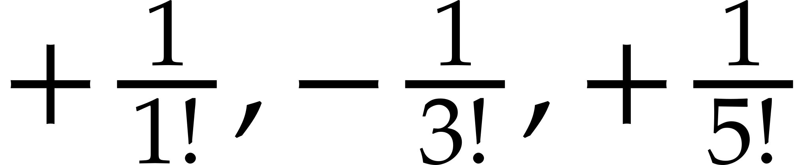, etc., where I see a law _in the numbers_.

### [Ts-209](/ts-209/#105.7) [105\[7\]](https://cdn.wittgensteinnachlass.com/2000px/webp/Ts-209/105.webp)

I must be able to write down a stretch of the series in such a way that one _recognizes_ the law. That is, there must be no _description_ in what is written down; everything must be represented.

### [Ts-209](/ts-209/#105.8) [105\[8\]](https://cdn.wittgensteinnachlass.com/2000px/webp/Ts-209/105.webp)

The approximate values must themselves form a _manifest_ series. That is, the approximate values themselves must proceed according to a law.

### [Ts-209](/ts-209/#105.9) [105\[9\]](https://cdn.wittgensteinnachlass.com/2000px/webp/Ts-209/105.webp)

Can one really say that if I did not know the geometrical representation of π and √2, I would know these numbers only approximately? Certainly not.

### [Ts-209](/ts-209/#106.1) [106\[1\]](https://cdn.wittgensteinnachlass.com/2000px/webp/Ts-209/106.webp)

191 The number must measure in and of itself. That seems to me to be, as it were, its office. If it does not do that, if it leaves that to the rational numbers, then we have no need of it.

### [Ts-209](/ts-209/#106.2) [106\[2\]](https://cdn.wittgensteinnachlass.com/2000px/webp/Ts-209/106.webp)

It seems a good rule for me to call something a number if it is comparable with any rational number whatsoever. That is, if for any rational number it can be established whether it is greater than, less than or equal to that number.

### [Ts-209](/ts-209/#106.3) [106\[3\]](https://cdn.wittgensteinnachlass.com/2000px/webp/Ts-209/106.webp)

That is, it makes sense to call a construct a number by analogy if it stands in relations to the rational numbers which are analogous to (of the same multiplicity as) those of greater than, less than and equal to.

### [Ts-209](/ts-209/#106.4) [106\[4\]](https://cdn.wittgensteinnachlass.com/2000px/webp/Ts-209/106.webp)

A real number is what is comparable with the rational numbers.

### [Ts-209](/ts-209/#106.5) [106\[5\]](https://cdn.wittgensteinnachlass.com/2000px/webp/Ts-209/106.webp)

When I say that I call only what is comparable with the rational numbers irrational numbers, I do not mean to overrate the stipulation of a mere name. I mean that this is precisely what has been meant or sought under the name “irrational number”.

### [Ts-209](/ts-209/#106.6) [106\[6\]](https://cdn.wittgensteinnachlass.com/2000px/webp/Ts-209/106.webp)

Yes, the way irrational numbers are introduced in textbooks always sounds as if the point were to say: You see, there is no rational number there, but there is a number there all the same. But why, then, do we call what _is_ there “a number” all the same? And the answer must be: Because it is comparable in a certain way with the rational numbers.

### [Ts-209](/ts-209/#106.7) [106\[7\]](https://cdn.wittgensteinnachlass.com/2000px/webp/Ts-209/106.webp)

“The process would determine a number only when it came to an end, but since it goes on to infinity and never finishes, it determines _no_ number.” The process must look infinitely far ahead, otherwise it determines no number. There must be no “I don’t know yet”, for there is no _yet_ in the infinite.

### [Ts-209](/ts-209/#106.8) [106\[8\]](https://cdn.wittgensteinnachlass.com/2000px/webp/Ts-209/106.webp)

Every rational number must stand in a visible relation to the law that is a number.

### [Ts-209](/ts-209/#106.9) [106\[9\]](https://cdn.wittgensteinnachlass.com/2000px/webp/Ts-209/106.webp)

The expansion proper is precisely the method of comparison with the rational numbers. The expansion proper of the number is the one that allows direct comparison with the rational numbers. If one brings a rational number near the law, the law must react to it in a definite way. It must answer the question “is it _that_ one”. I should like to put it this way: the expansion proper is what comparison with a rational number elicits from the law. The contraction of the interval serves the comparison, after all, by making every number come to lie to the right or to the left. That works only if comparison with a given rational number forces the law to speak out in relation to that number.

### [Ts-209](/ts-209/#107.1) [107\[1\]](https://cdn.wittgensteinnachlass.com/2000px/webp/Ts-209/107.webp)

192 The real number is comparable with the fiction of an infinite spiral, whereas constructs such as F, P, or π' are comparable only with finite pieces of a spiral. For the fact that I cannot establish how it passes a point means precisely that it is absurd to compare it with a complete (whole) spiral, since with that I would see on which side it leaves the point. For there is still, in the background of the thinking, the idea that although I do not know the whole spiral, and hence do not know how it runs at this place, what I do not know is nevertheless actually the case one way or the other.

### [Ts-209](/ts-209/#107.2) [107\[2\]](https://cdn.wittgensteinnachlass.com/2000px/webp/Ts-209/107.webp)

193 If I say that 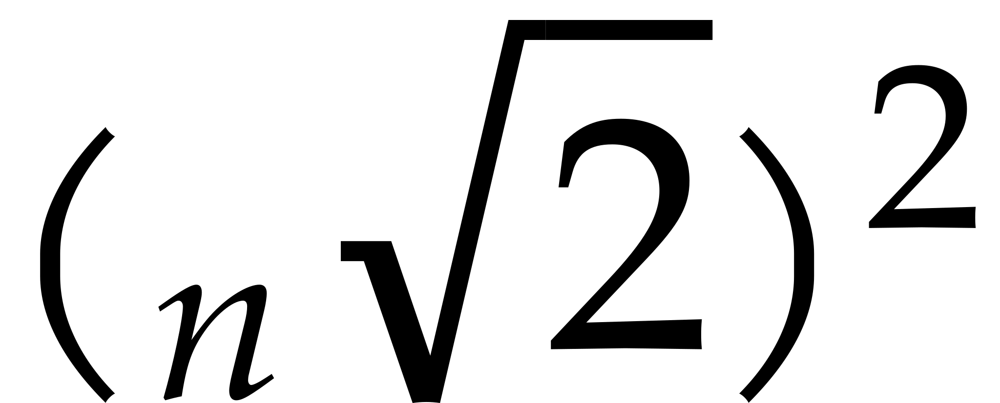 approaches 2 and therefore reaches the numbers 1,9, 1,99, 1,999 _at some point_, this is nonsensical if I cannot specify within how many steps these values will be reached, for “_at some point_” means nothing.

### [Ts-209](/ts-209/#107.3) [107\[3\]](https://cdn.wittgensteinnachlass.com/2000px/webp/Ts-209/107.webp)

To compare the rational numbers with √2, I must square them. – They then take the form √a, and √a is here an arithmetical operation. Written in this system they are comparable with √2, and it seems to me as though the “spiral” of the irrational number had here shrunk to a point.

### [Ts-209](/ts-209/#107.4) [107\[4\]](https://cdn.wittgensteinnachlass.com/2000px/webp/Ts-209/107.webp)

We do not understand the 4 in the third decimal place of √2, but we do not _need_ to understand it either. – For this lack of understanding is overcome by the further (uniform) use of the decimal system.

### [Ts-209](/ts-209/#107.5) [107\[5\]](https://cdn.wittgensteinnachlass.com/2000px/webp/Ts-209/107.webp)

After all, the decimal system eventually recedes as a whole, and then all that remains in the calculation is what is essential to √2.

### [Ts-209](/ts-209/#107.6) [107\[6\]](https://cdn.wittgensteinnachlass.com/2000px/webp/Ts-209/107.webp)

194 Is an arithmetical experiment still possible where there is a definition by recursion? I think evidently not; because recursion makes every stage arithmetically intelligible.

### [Ts-209](/ts-209/#107.7) [107\[7\]](https://cdn.wittgensteinnachlass.com/2000px/webp/Ts-209/107.webp)

And the recursion goes back not to a generality again but to a particular arithmetical case. The recursive definition provides understanding by building on a particular case that presupposes no generality.

### [Ts-209](/ts-209/#107.8) [107\[8\]](https://cdn.wittgensteinnachlass.com/2000px/webp/Ts-209/107.webp)

In the case of χ, F, P, I can indeed explain recursively the rule for examining the numbers, but not the result of the examination. I cannot build up the result.

### [Ts-209](/ts-209/#107.9) [107\[9\]](https://cdn.wittgensteinnachlass.com/2000px/webp/Ts-209/107.webp)

“𝔭↣ 4” is to mean: “The fourth prime number”. Can 𝔭↣ 4 = 5 be understood as an arithmetical operation with 4 as its base? So that 𝔭↣ 4 = 5 is an arithmetical equation, like 4² = 16? Or is it that, with 𝔭↣ 4, one can “only look for it, but not build it up”?

### [Ts-209](/ts-209/#107.10) [107\[10\]](https://cdn.wittgensteinnachlass.com/2000px/webp/Ts-209/107.webp)

195 Is it possible to prove that a is greater than b without being able to prove at which place the difference will show up? I do not believe so!

### [Ts-209](/ts-209/#107.11) [107\[11\]](https://cdn.wittgensteinnachlass.com/2000px/webp/Ts-209/107.webp)

How many zeros can occur in succession in e? If the nth decimal place stops changing after n + r steps and is preceded by a 0, that 0 must stop changing at the same time as the nth place, for another digit can become a zero only if the next place is still changing too. Thus the number of zeros is bounded.

### [Ts-209](/ts-209/#107.12) [107\[12\]](https://cdn.wittgensteinnachlass.com/2000px/webp/Ts-209/107.webp)

One can and must show that the decimal places stop changing after a _definite_ number of steps.

### [Ts-209](/ts-209/#107.13) [107\[13\]](https://cdn.wittgensteinnachlass.com/2000px/webp/Ts-209/107.webp)

If I do not know how many nines can follow 3,1415, then I cannot specify any distance smaller than the difference between π and 3,1416, and that means, I believe, that π does not correspond to a point on the number line, for if it corresponds to a point, then it must be possible to specify a segment shorter than the segment from this point to the point 3,1416.

### [Ts-209](/ts-209/#108.1) [108\[1\]](https://cdn.wittgensteinnachlass.com/2000px/webp/Ts-209/108.webp)

If the rational number with which I want to compare my real number is given in decimal notation, then to carry out the comparison I must be given a relation between the law of the real number and decimal notation.

### [Ts-209](/ts-209/#108.2) [108\[2\]](https://cdn.wittgensteinnachlass.com/2000px/webp/Ts-209/108.webp)

1,4, is that the square root of 2? No, for it is the square root of 1,96. That is, I can write it down at once as an approximation to √2; and of course see whether it is an upper or a lower approximation.

### [Ts-209](/ts-209/#108.3) [108\[3\]](https://cdn.wittgensteinnachlass.com/2000px/webp/Ts-209/108.webp)

What is an approximation? (After all, all rational numbers are either above or below the irrational number.) An approximation is a rational number written in such a way that we can compare it with the irrational number.

### [Ts-209](/ts-209/#108.5) [108\[5\]](https://cdn.wittgensteinnachlass.com/2000px/webp/Ts-209/108.webp)

Decimal expansion is a method of comparison with rational numbers if it is determined in advance how many places I must work out to arrive at a decision.

### [Ts-209](/ts-209/#108.6) [108\[6\]](https://cdn.wittgensteinnachlass.com/2000px/webp/Ts-209/108.webp)

196 The number as the result of an arithmetical experiment, and thus the experiment as the _description_ of a number, is an absurdity. The experiment would be the description, not the _representation_, of a number.

### [Ts-209](/ts-209/#108.7) [108\[7\]](https://cdn.wittgensteinnachlass.com/2000px/webp/Ts-209/108.webp)

I _cannot_ compare F with 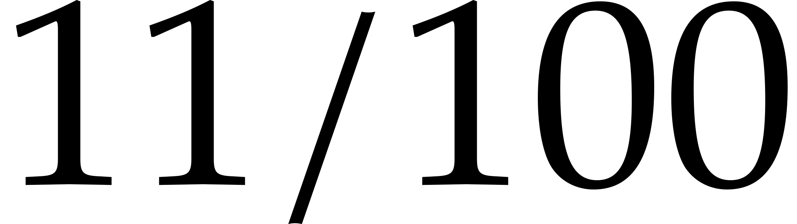, so it is not a number.

### [Ts-209](/ts-209/#108.9) [108\[9\]](https://cdn.wittgensteinnachlass.com/2000px/webp/Ts-209/108.webp)

If the real number is a rational number a, then comparison of its law with a must yield that result. That is, the law must be such that it snaps, as it were, into the rational number when it reaches the corresponding place (of this number).

### [Ts-209](/ts-209/#108.10) [108\[10\]](https://cdn.wittgensteinnachlass.com/2000px/webp/Ts-209/108.webp)

It would not do, for example, if one could not be certain whether 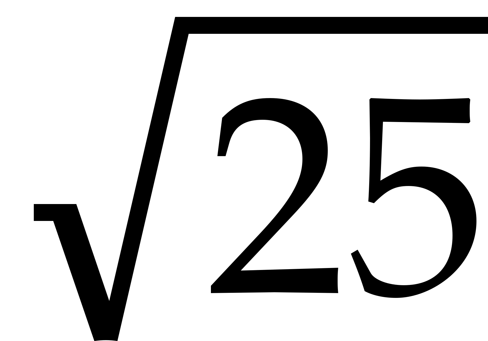 really stops at 5 (or whether perhaps something else follows).

### [Ts-209](/ts-209/#108.11) [108\[11\]](https://cdn.wittgensteinnachlass.com/2000px/webp/Ts-209/108.webp)

One could also put it this way: The law must be such that any rational number can be substituted into it and tried out.

### [Ts-209](/ts-209/#108.12) [108\[12\]](https://cdn.wittgensteinnachlass.com/2000px/webp/Ts-209/108.webp)

But what then of the number P = 0,1110101 etc. Suppose someone asserted that it became periodic and at some point it did look as though it did; then I would have to be able to try out the assumed number directly in the law, just as I can see directly by multiplication whether 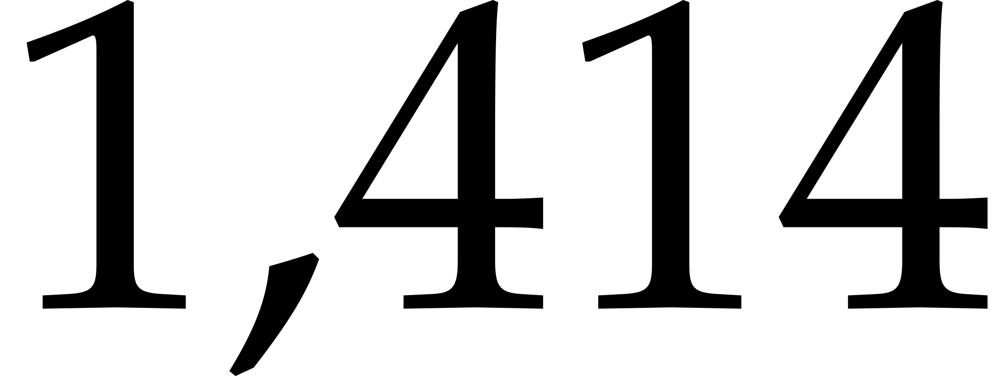 is √2. But that is not possible.

### [Ts-209](/ts-209/#108.13) [108\[13\]](https://cdn.wittgensteinnachlass.com/2000px/webp/Ts-209/108.webp)

What is characteristic of an arithmetical experiment is that there is something opaque about it.

### [Ts-209](/ts-209/#109.1) [109\[1\]](https://cdn.wittgensteinnachlass.com/2000px/webp/Ts-209/109.webp)

197 The _subsequent_ proof of convergence cannot justify treating it as a number. Where the convergence _shows itself_, there the number would have to be looked for.

### [Ts-209](/ts-209/#109.2) [109\[2\]](https://cdn.wittgensteinnachlass.com/2000px/webp/Ts-209/109.webp)

The proof that shows that something has the properties required of a number must _show_ this number. That is, it is precisely what points out the number.

### [Ts-209](/ts-209/#109.3) [109\[3\]](https://cdn.wittgensteinnachlass.com/2000px/webp/Ts-209/109.webp)

Is F not also an infinite narrowing of an interval? How can I know that, or whether, the spiral will not contract to this point? In the case of √2 I do know. Can I now call such a spiral a number too? A spiral which, for all I know, may stop at a rational point. But that cannot be it either: it is the lack of a _method_ of comparison with the rational numbers. For working out the extension is not such a method, since I can never know whether or when it will lead to a decision. To carry on working it out indefinitely is not a method, even if doing so leads to a result of the comparison. By contrast, it is a method to square _a_ and see whether the square is greater or less than 2.

### [Ts-209](/ts-209/#109.4) [109\[4\]](https://cdn.wittgensteinnachlass.com/2000px/webp/Ts-209/109.webp)

Could one say: the _general method_ of comparison with the rational numbers, that is the real number.

### [Ts-209](/ts-209/#109.5) [109\[5\]](https://cdn.wittgensteinnachlass.com/2000px/webp/Ts-209/109.webp)

The question must make sense: “Can this number be π?”

### [Ts-209](/ts-209/#109.6) [109\[6\]](https://cdn.wittgensteinnachlass.com/2000px/webp/Ts-209/109.webp)

198 F is not the interval 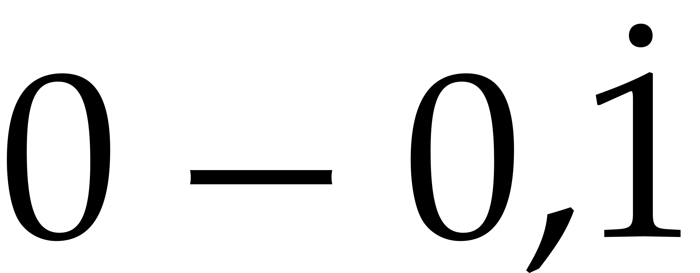, for I can also reach a certain decision within this interval, but it is not a number in this interval, since we cannot make the decisions that would be needed for that. Could one say, then: F is presumably an arithmetical construct, only not a number (nor an interval). That is, I cannot compare F with a point, nor with a segment. Is there a geometrical construct to which it corresponds? The law, i.e. the method of comparison, says only that it will yield either the answers “less, greater or equal” or “greater” (but not equal). It is similar when I walk in a dark room and say: I can only establish whether it is lower than I am or the same height – or – higher. And here one could say: So you cannot establish a height; what, then, is it that you can establish? The comparison falls short only because if I bump into the ceiling I can after all determine the height, whereas in the case of F I cannot in principle ask “is it this point”. I know no method for determining whether it is this point, so it is not a point. If the question of comparing F with a rational number makes no sense because all the working-out has still not given us the answer, then this question makes no sense before one has tried, at random, to decide the matter by means of the extension either. If it makes no sense now to ask “is F = 0,11”, then it made no sense before one had examined 100 places of the extension, and so neither did it before one had examined just _one_. But then it would make no sense at all in this case to ask whether the number is equal to _any_ rational number. That is, as long as one has no method that decides the matter unconditionally.

→ This much I know so far about the “number”

The given rational number is either equal to, less than, or greater than the interval calculated so far. In the first case the point forms the lower bound of the interval, in the second it lies below it, and in the third above it. In none of these cases is there any question of comparing the positions of two points.

### [Ts-209](/ts-209/#110.1) [110\[1\]](https://cdn.wittgensteinnachlass.com/2000px/webp/Ts-209/110.webp)

199  is not a result of 1 : 3 in the same sense as, say, 0,25 is of 1 : 4; it points to a different arithmetical fact.

### [Ts-209](/ts-209/#110.2) [110\[2\]](https://cdn.wittgensteinnachlass.com/2000px/webp/Ts-209/110.webp)

Suppose the division kept yielding the same digit 3, without one seeing in it any necessity for this; would it then make sense to voice the conjecture that the result would be ? That is, does  not designate precisely an induction that is seen, and not – an extension.

### [Ts-209](/ts-209/#110.3) [110\[3\]](https://cdn.wittgensteinnachlass.com/2000px/webp/Ts-209/110.webp)

One must always be able to determine the order of magnitude. Suppose there is nothing to rule out (in my notation) a hundred threes in a row at a particular place in e; there is something to rule out 10¹⁰⁰ threes occurring in a row. (Much must remain open in the decimal system that is determinate in the binary system).

### [Ts-209](/ts-209/#110.4) [110\[4\]](https://cdn.wittgensteinnachlass.com/2000px/webp/Ts-209/110.webp)

It is necessary to be able to say not only whether a given rational number is the real number, but also how close it can possibly come to it. That is, it is not enough to be able to say that the spiral does not pass through this point but passes below it; we must also know limits within which its distance from the point lies. We must know an order of magnitude for the distance.

### [Ts-209](/ts-209/#110.5) [110\[5\]](https://cdn.wittgensteinnachlass.com/2000px/webp/Ts-209/110.webp)

The expansion in the decimal system does not give me that, since I cannot know how many nines, for example, will follow a place that has been worked out.

### [Ts-209](/ts-209/#110.6) [110\[6\]](https://cdn.wittgensteinnachlass.com/2000px/webp/Ts-209/110.webp)

The question “is ” is nonsensical, for it asks not about an extension but about a law, namely an induction of which, however, we have no conception here. In the case of division one can ask this question; only because we know the form of induction that we call .

### [Ts-209](/ts-209/#110.7) [110\[7\]](https://cdn.wittgensteinnachlass.com/2000px/webp/Ts-209/110.webp)

The question “do the decimal places of e stop changing at some point” and the answer “they stop changing at some point” are both nonsense. The question is: After how many steps must the places stop changing.

### [Ts-209](/ts-209/#110.8) [110\[8\]](https://cdn.wittgensteinnachlass.com/2000px/webp/Ts-209/110.webp)

Can one say: “e is not this number” means nothing; rather, one must say that it is at least this interval away from it. I believe that is how it is. But that would mean that the question could not be answered at all without at the same time giving some idea of the distance.

### [Ts-209](/ts-209/#111.1) [111\[1\]](https://cdn.wittgensteinnachlass.com/2000px/webp/Ts-209/111.webp)

200 Our interest in negation in arithmetic seems to be limited in a peculiar way. It seems to me, namely, that a certain generality is needed to make negation interesting to us.

### [Ts-209](/ts-209/#111.2) [111\[2\]](https://cdn.wittgensteinnachlass.com/2000px/webp/Ts-209/111.webp)

But one can represent *in*divisibility so that it is _plain to see_ (e.g. in the “sieve”). One _sees_ how all the divisible numbers lie above or below the number under consideration. Negation in arithmetic is represented here by negation in space, by “somewhere else”.

### [Ts-209](/ts-209/#111.3) [111\[3\]](https://cdn.wittgensteinnachlass.com/2000px/webp/Ts-209/111.webp)

What do I _know_ when I know a mathematical inequality? Is it possible to know only an inequality, without any _positive_ knowledge?

### [Ts-209](/ts-209/#111.4) [111\[4\]](https://cdn.wittgensteinnachlass.com/2000px/webp/Ts-209/111.webp)

It seems clear that negation means something different in arithmetic from what it means in the rest of language. If I say that 7 is not divisible by 3, I cannot make a picture of that either; I cannot imagine what it would be like if 7 were divisible by 3. All this follows, of course, from the fact that mathematical equations are not propositions.

### [Ts-209](/ts-209/#111.5) [111\[5\]](https://cdn.wittgensteinnachlass.com/2000px/webp/Ts-209/111.webp)

It is very strange that one should have to use false equations as well in representing mathematics. For that is what it all comes down to. If negation or disjunction in the ordinary sense is necessary in arithmetic, then false equations are an essential part of its representation.

### [Ts-209](/ts-209/#111.6) [111\[6\]](https://cdn.wittgensteinnachlass.com/2000px/webp/Ts-209/111.webp)

What does “non (5 × 5 = 30)” mean? It seems to me that one ought not to write it _like that_, but rather “5 × 5 ≠ 30”; and that is because I want not to negate anything but to establish a relation, albeit an indeterminate one, between 5 × 5 and 30 (something positive, then). – One could, admittedly, say: “Granted, but at any rate this relation is incompatible with 5 × 5 = 30”. – And that is how the relation of indivisibility stands to the relation of divisibility! It is quite clear that if I exclude divisibility, that is equivalent in this logical system to establishing the relation of indivisibility. – And is this not the same case as that of a number which is less than 5 if it is _not_ equal to or greater than 5?

### [Ts-209](/ts-209/#111.7) [111\[7\]](https://cdn.wittgensteinnachlass.com/2000px/webp/Ts-209/111.webp)

201 Now something resists the application of the law of excluded middle in mathematics. Admittedly, the very name of this law is misleading. For it always sounds as if it concerned a case like this: a frog is either brown or green; there is no third possibility.

### [Ts-209](/ts-209/#111.8) [111\[8\]](https://cdn.wittgensteinnachlass.com/2000px/webp/Ts-209/111.webp)

One can show by induction that if one successively subtracts 3 from a number until one can do so no longer, only 0, 1, or 2 can remain as a remainder. One calls the cases in the first class those in which the division comes out exactly.

### [Ts-209](/ts-209/#111.9) [111\[9\]](https://cdn.wittgensteinnachlass.com/2000px/webp/Ts-209/111.webp)

The search for a law governing the distribution of the prime numbers is simply an attempt to replace the negative criterion for a prime number with a positive one. Or rather, the indeterminate criterion with a determinate one.

### [Ts-209](/ts-209/#111.10) [111\[10\]](https://cdn.wittgensteinnachlass.com/2000px/webp/Ts-209/111.webp)

I believe that negation here is not what it is in logic, but an indeterminacy. For how do I recognize, verify, what is negative? By means of something indeterminate but positive.

### [Ts-209](/ts-209/#112.1) [112\[1\]](https://cdn.wittgensteinnachlass.com/2000px/webp/Ts-209/112.webp)

An inequality, like an equation, must be either the result of a calculation or a stipulation.

### [Ts-209](/ts-209/#112.2) [112\[2\]](https://cdn.wittgensteinnachlass.com/2000px/webp/Ts-209/112.webp)

Just as equations can be understood as rules for signs, as opposed to propositions, so it must be possible to do the same with inequalities.

### [Ts-209](/ts-209/#112.3) [112\[3\]](https://cdn.wittgensteinnachlass.com/2000px/webp/Ts-209/112.webp)

How, then, can one use an inequality? This leads to the thought that in logic there is also the internal relation of not following, and that it can be important to recognize that one proposition does _not_ follow from another.

### [Ts-209](/ts-209/#112.4) [112\[4\]](https://cdn.wittgensteinnachlass.com/2000px/webp/Ts-209/112.webp)

The negation of an equation is as like and as unlike the negation of a proposition as the affirmation of an equation is like and unlike the affirmation of a proposition.

### [Ts-209](/ts-209/#112.5) [112\[5\]](https://cdn.wittgensteinnachlass.com/2000px/webp/Ts-209/112.webp)

202 It is quite clear that negation in arithmetic is entirely different from the negation proper of propositions. And it is clear that where it corresponds essentially – by virtue of the logical relations – to a disjunction, or to the exclusion of one part of a logical series in favour of another – there it must have quite a different meaning. It must be one with those logical forms, and hence only apparently a negation. If “not-equal” means greater or less, then that cannot, so to speak, be an accident as far as the “not” is concerned.

### [Ts-209](/ts-209/#112.6) [112\[6\]](https://cdn.wittgensteinnachlass.com/2000px/webp/Ts-209/112.webp)

A mathematical _sentence_ can only be either a stipulation or a result calculated from stipulations by a particular method. And this must hold for “9 is divisible by 3” or “9 is not divisible by 3”.

### [Ts-209](/ts-209/#112.7) [112\[7\]](https://cdn.wittgensteinnachlass.com/2000px/webp/Ts-209/112.webp)

How does one calculate 2 × 2 ≠ 5? Differently from 2 × 2 = 4? If at all, then by means of 2 × 2 = 4 and 4 ≠ 5.

### [Ts-209](/ts-209/#112.8) [112\[8\]](https://cdn.wittgensteinnachlass.com/2000px/webp/Ts-209/112.webp)

And how does one calculate “9 is divisible by 3”? One could understand it as a disjunction and first calculate 9 : 3 = 3 and then, in place of this determinate proposition, derive the disjunction by a rule of inference.

### [Ts-209](/ts-209/#112.9) [112\[9\]](https://cdn.wittgensteinnachlass.com/2000px/webp/Ts-209/112.webp)

Does it not help us here to remark that negation in arithmetic is only ever important in connection with generality: generality, however, is expressed by an induction.

### [Ts-209](/ts-209/#112.11) [112\[11\]](https://cdn.wittgensteinnachlass.com/2000px/webp/Ts-209/112.webp)

203 (On the penultimate remark) And this makes it possible for negation and disjunction, which in the individual case seem like superfluous indeterminacies, to become essential to arithmetic in the general “sentence”, i.e. in the induction.

### [Ts-209](/ts-209/#112.10) [112\[10\]](https://cdn.wittgensteinnachlass.com/2000px/webp/Ts-209/112.webp)

It is clear to me that arithmetic does not need false equations for its construction, but it seems to me that one can probably say “there is a prime number between 11 and 17” without referring to false equations in doing so.

### [Ts-209](/ts-209/#113.1) [113\[1\]](https://cdn.wittgensteinnachlass.com/2000px/webp/Ts-209/113.webp)

Is an inequality not a perfectly intelligible rule for signs, just like an equation? One permits a substitution, the other forbids a substitution. √( ) = √² ( ), √( ) ≠ √² ( )

### [Ts-209](/ts-209/#113.2) [113\[2\]](https://cdn.wittgensteinnachlass.com/2000px/webp/Ts-209/113.webp)

Perhaps the only essential thing is to see that what is expressed by inequalities is _essentially_ different from what is expressed by equations. And so one cannot directly compare a law that yields the places of a decimal fraction and works with inequalities with one that works with equations. Here we have quite different methods before us, and hence different kinds of arithmetical constructs.

### [Ts-209](/ts-209/#113.3) [113\[3\]](https://cdn.wittgensteinnachlass.com/2000px/webp/Ts-209/113.webp)

That is, in arithmetic one cannot simply put equations and something else (say, inequalities) on _one_ level, as if they were, say, different genera of animals. Rather, the two methods will then be categorically different and determine constructs that are incomparable with one another.

### [Ts-209](/ts-209/#113.4) [113\[4\]](https://cdn.wittgensteinnachlass.com/2000px/webp/Ts-209/113.webp)

Negation in arithmetic cannot be the same as the negation of propositions, for otherwise in 2 × 2 ≠ 5 I would have to make myself a picture of what it would be like if 2 × 2 = 5.

### [Ts-209](/ts-209/#113.5) [113\[5\]](https://cdn.wittgensteinnachlass.com/2000px/webp/Ts-209/113.webp)

204 “ = 5”, “divisible by 5”, “not divisible by 5”, “prime” could be called arithmetical predicates, and one could say: Arithmetical predicates always correspond to the application of a particular, generally defined method. One can also define a predicate like this: (n × 3 = 25) = F(n) Def.

### [Ts-209](/ts-209/#113.6) [113\[6\]](https://cdn.wittgensteinnachlass.com/2000px/webp/Ts-209/113.webp)

Arithmetical predicates that are unimportant in the particular case – because the determinate form makes the indeterminate one superfluous – become significant in the general _law_, i.e. in the induction. For here they are not, so to speak, overtaken by a determinate form. Or rather: They are not indeterminate at all in the general law.

### [Ts-209](/ts-209/#113.7) [113\[7\]](https://cdn.wittgensteinnachlass.com/2000px/webp/Ts-209/113.webp)

Could an engineer’s calculations show that, say, certain machine parts must essentially have the lengths that correspond to the series of prime numbers? No.

### [Ts-209](/ts-209/#113.8) [113\[8\]](https://cdn.wittgensteinnachlass.com/2000px/webp/Ts-209/113.webp)

Can one construct an irrational number with the help of the prime numbers? The answer is always: In so far as one can foresee the prime numbers, yes, and no further. If it is foreseeable that there must be a prime number in _this_ interval, then this interval is what can be foreseen and constructed, and it can therefore, I believe, play a role in the construction of an irrational number.

### [Ts-209](/ts-209/#113.9) [113\[9\]](https://cdn.wittgensteinnachlass.com/2000px/webp/Ts-209/113.webp)

205 Can one say that the smaller patch is simpler than the larger one? Suppose they are uniformly coloured circles: what is the greater simplicity of the smaller circle supposed to consist in? One might say that the larger can consist of the smaller and one further part, but not vice versa. But why should I not represent the smaller as the difference between the larger and the ring? So it seems to me that the smaller patch is no simpler than the larger one.

### [Ts-209](/ts-209/#113.10) [113\[10\]](https://cdn.wittgensteinnachlass.com/2000px/webp/Ts-209/113.webp)

It seems as though one cannot see a uniformly coloured patch as composite unless one imagines it as _not_ uniformly coloured. Imagining a dividing line makes the patch multicoloured, for the dividing line must be a different colour from the rest of the patch.

### [Ts-209](/ts-209/#114.1) [114\[1\]](https://cdn.wittgensteinnachlass.com/2000px/webp/Ts-209/114.webp)

Can one say: If one sees a figure in the visual field, say a red triangle, one cannot describe it by describing, say, one half of the triangle in one sentence and the other half in another sentence. That is, one can say that in a certain sense there is no such thing as half of _this_ triangle. One can speak of the triangle at all only if its boundary lines are the boundaries of two colours.

### [Ts-209](/ts-209/#114.3) [114\[3\]](https://cdn.wittgensteinnachlass.com/2000px/webp/Ts-209/114.webp)

206 Whether it makes sense to say “this part of a red area (which is not marked off by any visible boundary) is red” depends on whether there is such a thing as an absolute place. For if one can speak of an absolute place in visual space, then I can also ascribe a colour to this absolute place if its surroundings are uniformly coloured.

### [Ts-209](/ts-209/#114.4) [114\[4\]](https://cdn.wittgensteinnachlass.com/2000px/webp/Ts-209/114.webp)

Suppose I see a uniformly yellow visual field and say: “The centre of my visual field is yellow”. But can I then describe a _shape_ in this way?

### [Ts-209](/ts-209/#114.5) [114\[5\]](https://cdn.wittgensteinnachlass.com/2000px/webp/Ts-209/114.webp)

An apparent way out would (of course) be to say that red and circular are properties (external) of two objects that one might call patches, and that these patches also stand in certain spatial relations to each other; but that is nonsense.

### [Ts-209](/ts-209/#114.6) [114\[6\]](https://cdn.wittgensteinnachlass.com/2000px/webp/Ts-209/114.webp)

It is evidently possible to establish the identity of a place in the visual field, for otherwise one could not tell whether a patch stays in the same place throughout or changes its place. If we imagine a patch that disappears and reappears, we can still say whether it reappears in the same place or in another. So one really can speak of certain places in the visual field, and with the same right as one speaks of different places on the retina. Would such a space be comparable to a surface whose curvature differed at each of its points, so that each point is a distinguished point?

### [Ts-209](/ts-209/#114.7) [114\[7\]](https://cdn.wittgensteinnachlass.com/2000px/webp/Ts-209/114.webp)

One can also say that visual space is an oriented space, a space in which there is an up and a down, and a right and a left. And _this_ up and down, right and left, has nothing to do with gravity or with the right and left hands. It would, for example, retain its sense even if we spent our whole lives looking at the stars through a telescope.

### [Ts-209](/ts-209/#114.8) [114\[8\]](https://cdn.wittgensteinnachlass.com/2000px/webp/Ts-209/114.webp)

Suppose we were to look at the starry sky through a telescope. Then our visual field would be completely dark except for a lighter circle, and in this circle there would be points of light. Suppose further that we had never seen our body but had always seen only this image, so that we could not compare the position of a star with that of our head or feet. What then shows me that my space has an up and a down etc., or simply that it is oriented? At any rate I can perceive that the whole array of stars _rotates_ within the bright circle, that is, I can perceive different orientations of the array of stars. If I hold a book upside down, I cannot read the letters, or can do so only with difficulty. This state of affairs is not _explained_, as one might think, by saying: the retina does after all have an up and a down etc., so it is easy to understand that there is something analogous in the visual field. Rather, this is merely a _representation_ of the state of affairs by the roundabout route of the relations in the retina.

### [Ts-209](/ts-209/#115.1) [115\[1\]](https://cdn.wittgensteinnachlass.com/2000px/webp/Ts-209/115.webp)

We can also say that in our visual field it is always as if, along with everything else, we saw an oriented coordinate system by reference to which we can fix every direction. – But this too is not a correct representation, for if we really did see such a pair of coordinate axes (with arrows, say), we would in fact be able to fix not only the orientations of the objects relative to these axes, but also the position of the axes themselves in space, as it were relative to an unseen coordinate system inherent in the nature of this space.

### [Ts-209](/ts-209/#115.2) [115\[2\]](https://cdn.wittgensteinnachlass.com/2000px/webp/Ts-209/115.webp)

What would our visual field have to be like if that were not so? I could of course then see relative positions and changes of position, but not absolute ones. But that means, for example, that it would make no sense to speak of a rotation of the entire visual field. So far, perhaps, it is still intelligible. But now suppose that through our telescope we saw, say, only one star at a certain distance from the black rim. This star would disappear and reappear at the same distance from the rim. Then we could not know whether it reappeared in the same spot or in another. Or two stars might appear and disappear alternately at the same distance from the rim, and then we could not say whether – or that – they were the same star or different stars.

### [Ts-209](/ts-209/#115.3) [115\[3\]](https://cdn.wittgensteinnachlass.com/2000px/webp/Ts-209/115.webp)

It is not just that we could “not know whether”; it would make _no sense_ in this context to speak of the same or different places. And since in reality it does make sense, our visual field does not have this structure. The real criterion of the structure is precisely which sentences make sense for it – not which are true. To look for this is the method of philosophy.

### [Ts-209](/ts-209/#115.4) [115\[4\]](https://cdn.wittgensteinnachlass.com/2000px/webp/Ts-209/115.webp)

We can also represent it like this: suppose that at some point a pair of oriented coordinate axes had flashed up in our visual field for a few moments and disappeared again; with a good enough memory we could fix the orientation of any subsequent image by reference to our recollection of those axes. If there were no absolute direction, that would be logically impossible.

### [Ts-209](/ts-209/#115.5) [115\[5\]](https://cdn.wittgensteinnachlass.com/2000px/webp/Ts-209/115.webp)

But that means we have the possibility of describing a possible position – that is, a spot – in the visual field without referring to anything that happens to be there. So we can say, for example, that something can be at the top right and so on. (The analogy with the curved surface would be to say, for example: a patch on an egg can be near the blunt end.)

### [Ts-209](/ts-209/#115.6) [115\[6\]](https://cdn.wittgensteinnachlass.com/2000px/webp/Ts-209/115.webp)

Evidently I can see the sign V now as a v, now as an A, as the sign for greater than or for less than, even if I were seeing it through a telescope and could not compare its position with that of my body. Perhaps one will say that I feel the position of my body without seeing it. But position in the space of feeling (as I shall call it for now) has nothing to do with position in visual space; the two are independent of one another, and if there were no absolute direction in visual space, one could not correlate the direction in the space of feeling with such a direction at all.

### [Ts-209](/ts-209/#116.2) [116\[2\]](https://cdn.wittgensteinnachlass.com/2000px/webp/Ts-209/116.webp)

207 As for the composition of spatial configurations out of their smaller spatial constituents, it is like this: the larger geometrical configuration is not composed of smaller _geometrical_ configurations, any more than one can say that 5 is composed of 3 and 2, or indeed that 2 is composed of 5 and ‒ 3. For here the larger entails the smaller just as the smaller entails the larger. The quadrilateral  is not composed of the quadrilaterals

.

Rather, the first geometrical figure entails the other two and vice versa. So here Nicod would be right in saying that the larger figure does not contain the smaller ones as constituents. But things are different in filled space: the figure  does in fact consist of the constituents  and , although the purely geometrical figure of the large square does _not_ consist of the figures of the two rectangles. These “purely geometrical figures” are after all only logical possibilities. – Now one can in fact see a physical chessboard as a unity – not as composed of its squares – by seeing it as one large quadrilateral and disregarding its squares. – But if one does not disregard its squares, then it is a complex and the squares are its constituents, which constitute it, to use Nicod’s way of speaking. (Incidentally, I cannot understand what it is supposed to mean for something to be “determined” but not “constituted” by certain objects. If these two expressions have any sense at all, they have the same sense.) An intellect that surveys the constituents and their relations but not the whole is an absurdity. If each point in visual space is a distinguished point, then it certainly makes sense to speak of Here and There in visual space, and this now seems to me to make the representation of visual states of affairs simpler. But is this property of distinguished points really essential to visual space? I mean, could we not conceive of a visual space in which one perceived only certain relations of position but no absolute position, that is, could we picture such an experience? In much the same sense as we can imagine the experiences of someone with one eye –? I do not think so. One could not, for example, perceive a rotation of the whole visual image, or rather, it would not be conceivable. What, for instance, would the hand of a clock look like as it moved round the dial? (I assume that the dial, as on some large clocks, has only dots and no numerals.) We would then indeed perceive the movement from one dot to the next – provided it did not happen in _one_ jerk – but once the hand had reached a dot, we could not distinguish its position from the one at the previous dot. I think this shows that such a thing is unimaginable with our sense of sight.

### [Ts-209](/ts-209/#116.3) [116\[3\]](https://cdn.wittgensteinnachlass.com/2000px/webp/Ts-209/116.webp)

In visual space there is absolute position and hence absolute motion too. One is to imagine the image of two stars on a pitch-dark night, when I can see nothing but these two, and they move in a circle around each other.

### [Ts-209](/ts-209/#115.7) [115\[7\]](https://cdn.wittgensteinnachlass.com/2000px/webp/Ts-209/115.webp)

Can I now say, for example: the upper half of my visual field is red? And what does that mean? Can it say that an object (the upper half) has the property red? One must remember that every part of visual space _must_ have a colour and that every colour _must_ occupy a part of visual space. The forms _colour_ and _visual space_ permeate one another.

### [Ts-209](/ts-209/#116.1) [116\[1\]](https://cdn.wittgensteinnachlass.com/2000px/webp/Ts-209/116.webp)

It is clear that there is no relation of “being situated” between a colour and a place in which it “is situated”. There is no intermediate link between colour and space. Colour and space saturate one another. And the way they permeate one another makes up the visual field.

### [Ts-209](/ts-209/#116.4) [116\[4\]](https://cdn.wittgensteinnachlass.com/2000px/webp/Ts-209/116.webp)

208 It seems to me that the concept of distance is given directly in the structure of visual space. If that were not so, and the concept of distance were associated with visual space only through a correlation of a distance-free visual space with another structure that contains distances, then it would be conceivable that a change in this association would make, for example, the segment a appear longer than the segment b, although we would still see the point B between A and C. (See figure)

### [Ts-209](/ts-209/#117.1) [117\[1\]](https://cdn.wittgensteinnachlass.com/2000px/webp/Ts-209/117.webp)

What if one applies a yardstick _temporarily_ to an object in visual space? Is it measured even when the yardstick is not there? Yes, if the identity of what is measured with what is not measured can be established with any sense at all.

### [Ts-209](/ts-209/#117.2) [117\[2\]](https://cdn.wittgensteinnachlass.com/2000px/webp/Ts-209/117.webp)

_If_ I can say: “_This_ segment I _did_ measure and it was three times as long as _that_ one”, then it makes sense and is correct to say that the segments still stand in the same ratio to one another now.

### [Ts-209](/ts-209/#117.3) [117\[3\]](https://cdn.wittgensteinnachlass.com/2000px/webp/Ts-209/117.webp)

From “CC between BB” follows “CC between AA”, but only if the division is actually given by colour boundaries.

### [Ts-209](/ts-209/#117.4) [117\[4\]](https://cdn.wittgensteinnachlass.com/2000px/webp/Ts-209/117.webp)

It is evidently possible for the segments a and b to appear equally long to me, and for the pieces c and d also to appear equally long to me, but for counting them to show that I have 25 c and 24 d. Here we have the question: How can that be possible? Is it right to say here: That is just how it is, and all we see is that visual space does not follow the rules of – say – Euclidean space. That would mean that the question “how can that be possible” was nonsensical and hence unwarranted. So there would be nothing paradoxical here at all; we would simply have to accept it. – But is it _conceivable_ that a should appear equal to b and the c’s equal to the d’s, and that there should be unequal, _surveyable_ numbers of c’s and d’s? Or am I now to say that even in visual space something can after all _appear_ otherwise than it _is_? Certainly not! Or that n times a segment and n + 1 times the same segment can simply yield the same thing in visual space? No, not that either! Unless there is no sense at all in saying of segments in _visual space_ that they _are_ equal. So that it would make sense to speak of an “appearing” even for visual space alone, and this expression would not concern only the relation between two independent experiences. So that there would be an _absolute_ appearing. And so perhaps also an _absolute_ blurriness, or an _absolute_ lack of clarity. (Whereas my view is that something can be blurry or unclear only in comparison with something we set up as the goal of clarity; that is, relatively.)

### [Ts-209](/ts-209/#117.5+118.1) [117\[5\]](https://cdn.wittgensteinnachlass.com/2000px/webp/Ts-209/117.webp),[118\[1\]](https://cdn.wittgensteinnachlass.com/2000px/webp/Ts-209/118.webp)

But then – in the first case – if I cannot grasp the number “at a glance”, can I not go wrong in determining it? Or: do a and b then consist of a number of parts at all – in the ordinary sense – if I do not _see_ this number in a and b? For it seems to me that I am indeed not entitled either, for instance, to _infer_ that there must be the same number of c’s and d’s. Not even if counting really does give the same number! I mean: not even if it _never_ happens that, with a and b equal, etc., counting gives different results. (This shows, incidentally, how hard it is to describe what is actually seen.) But suppose we were entitled to speak of a number of parts – mind, always within what is purely seen – even if we do not see the number immediately; then the question would arise: Can I be certain that what I count really is the number I see, or rather, the number whose visual result I see. Could I be certain that the number of parts does not at some moment change from 24 to 25 without my perceiving it?

### [Ts-209](/ts-209/#118.2) [118\[2\]](https://cdn.wittgensteinnachlass.com/2000px/webp/Ts-209/118.webp)

If I see a = b and c = d and someone else counts the parts and finds the same number, I will certainly not feel that this contradicts what I see. But I also know that I can see the same thing when there are 25c in a and 24d in b. From this I can infer that I do not notice one part more or less, and so cannot notice when the number of parts in b changes between 24 and 25.

### [Ts-209](/ts-209/#118.3) [118\[3\]](https://cdn.wittgensteinnachlass.com/2000px/webp/Ts-209/118.webp)

209 But if one cannot say that there is a definite number of parts in a and b, how am I to describe the visual image? What emerges here – I believe – is that the visual image is much more complicated than it seems at first sight. What makes it so much more complicated is, for instance, the factor that produces the movement of the eye. If, for instance, I were to describe what is seen at a glance by means of a painted picture rather than by means of word-language, I would have to refrain from actually painting all the parts c and d. Instead, in some places I would have to paint something “blurry”, a grey patch, say.

### [Ts-209](/ts-209/#118.4) [118\[4\]](https://cdn.wittgensteinnachlass.com/2000px/webp/Ts-209/118.webp)

“Blurry” and “unclear” are relative expressions. If it often does not seem so, that is because we are still too little aware of the actual character of the given phenomena, because we imagine them to be more primitive than they are. Thus it is possible, for instance, that no picture in colour, of whatever kind, can correctly represent the impression of “blurriness”. But it does not follow from this that the visual image is in itself blurry and therefore cannot be represented by any determinate picture, of whatever kind. It would only indicate that – through the movement of the eyes, say – a factor enters into the visual field which the painted picture indeed cannot reproduce, but which is in itself as “determinate” as any other. One could then say that what is actually given is still indeterminate or blurry relative to the painted picture, but only because we then arbitrarily set up the painted picture as the standard for what is given, which has a greater multiplicity than the pictorial representation.

### [Ts-209](/ts-209/#118.5) [118\[5\]](https://cdn.wittgensteinnachlass.com/2000px/webp/Ts-209/118.webp)

If we really _saw_ 24 and 25 parts in a and b, then we could not see a and b as equal. If this is false, then the following must be possible: It would have to be possible to distinguish immediately between the cases where a and b are both equal to 24 and where a is 24 and b is 25, but it would be possible to distinguish only the numbers of parts, not the resulting length of a and b.

### [Ts-209](/ts-209/#118.6) [118\[6\]](https://cdn.wittgensteinnachlass.com/2000px/webp/Ts-209/118.webp)

One could also put it more simply like this: It would then have to be possible to see immediately that one segment consists of 24 parts, the other of 25 parts of the same size, without its being possible to distinguish between the resulting lengths. – I believe that the word “equal” has a meaning in visual space too that makes this a contradiction.

### [Ts-209](/ts-209/#118.7+119.1) [118\[7\]](https://cdn.wittgensteinnachlass.com/2000px/webp/Ts-209/118.webp),[119\[1\]](https://cdn.wittgensteinnachlass.com/2000px/webp/Ts-209/119.webp)

Do I recognize 2 segments of visual space as equal by not recognizing them as unequal? This is a very far-reaching question. Could I not have two impressions in succession: in one a segment visibly divided into 5 parts, in the other a segment likewise divided into 6 parts, and yet be unable to say that I saw the parts or the whole segments as differing in length? If I were asked: “Were the segments different in length or equal in length”, I could not answer “I saw them as different in length”, for, so to speak, no difference in length “struck” me. And yet – I believe – I could not say I saw them as equal in length. On the other hand, I could not say: “I don’t know whether they were equal or different” (unless my memory had failed me), for that means nothing as long as I am speaking only of what is immediately given.

### [Ts-209](/ts-209/#119.2) [119\[2\]](https://cdn.wittgensteinnachlass.com/2000px/webp/Ts-209/119.webp)

210 What matters is to explain certain contradictions that arise when we apply the modes of inference of Euclidean space to visual space. I mean: it is possible in visual space to follow a construction (and thus a chain of inferences) all of whose steps (transitions) we can see to be right, but whose result contradicts our geometrical concepts.

### [Ts-209](/ts-209/#119.3) [119\[3\]](https://cdn.wittgensteinnachlass.com/2000px/webp/Ts-209/119.webp)

Now I believe this always comes from our being able to see the construction only step by step, and not as a single whole. The explanation, then, would be that there is no visual construction at all composed of these individual visual pieces. It would be rather as if I showed someone a small portion of the surface of a large sphere and asked him whether he accepted the great circle visible on it as a straight line, and, once he had done so, turned the sphere and showed him that he would come back to the same place on the circle. But I have not thereby proved to him that, say, a straight line in visual space loops back on itself.

### [Ts-209](/ts-209/#119.4) [119\[4\]](https://cdn.wittgensteinnachlass.com/2000px/webp/Ts-209/119.webp)

The explanation, then, would be this: These are visual _pieces_, but they do not combine into a visual whole, or at any rate not into the whole whose final result I believe I see at the end.

### [Ts-209](/ts-209/#119.5) [119\[5\]](https://cdn.wittgensteinnachlass.com/2000px/webp/Ts-209/119.webp)

The simplest construction of this kind would, after all, be the one above with two segments of equal length, along one of which a piece can be marked off n times and along the other n + 1 times. The steps in the construction would consist in proceeding from one piece to the next and establishing the equality of these pieces. Here one could explain that in proceeding in this way I am not really examining the original visual field with its segments of equal length. Rather, something else takes its place in the examination and then leads to the astounding result.

### [Ts-209](/ts-209/#119.6) [119\[6\]](https://cdn.wittgensteinnachlass.com/2000px/webp/Ts-209/119.webp)

But there is an objection to this explanation. One could say: After all, while you were checking the individual pieces, we did not cover up any part of the construction. So you could see whether anything in the rest had meanwhile changed or shifted. If that did not happen, then surely you could see that everything was in order.

### [Ts-209](/ts-209/#119.7) [119\[7\]](https://cdn.wittgensteinnachlass.com/2000px/webp/Ts-209/119.webp)

It makes sense to speak of divisibility in visual space, for it must be possible in a description to replace an undivided piece with a divided one. And then it is clear, in light of what I explained earlier, what the infinite divisibility of this space means.

### [Ts-209](/ts-209/#120.1) [120\[1\]](https://cdn.wittgensteinnachlass.com/2000px/webp/Ts-209/120.webp)

211 As soon as one tries to apply exact concepts of measurement to immediate experience, one comes up against a peculiar blurriness in that experience. But this means only blurriness relative to those concepts of measurement. And now it seems to me that this blurriness is not something provisional that more precise knowledge will later eliminate, but a characteristic logical peculiarity. If, for example, I say, “I now see a red circle on a blue background and remember seeing one a few minutes ago that was the same size, or perhaps a little smaller and a little lighter”, then _this_ experience cannot be described more exactly. The words “approximately”, “roughly”, etc. of course have only a relative sense, but they are nonetheless _necessary_ and characterize the nature of our experience; not as approximate or blurry in itself, but as approximate and blurry in relation to our means of representation.

### [Ts-209](/ts-209/#120.2) [120\[2\]](https://cdn.wittgensteinnachlass.com/2000px/webp/Ts-209/120.webp)

All this is connected with the problem “how many grains of sand make a heap”. One could say: A heap is any group of more than 100 grains, and fewer than 10 grains do not make a heap: But this must be understood in such a way that 100 and 10 are not taken to be limits essential to the concept of a heap. And this is the same problem as specifying at which of the vertical strokes one first notices a difference in length from the first.

_Figure._

### [Ts-209](/ts-209/#120.3) [120\[3\]](https://cdn.wittgensteinnachlass.com/2000px/webp/Ts-209/120.webp)

What in Euclidean geometry corresponds to the visual circle is not a circle, but a class of figures that includes the circle, but also, for instance, the 100-gon, etc. The distinguishing mark of this class might be that it comprises all the figures that lie within a band produced by making a circle vibrate. – But this too is wrong: For why should I take the band produced by making a circle vibrate rather than the one produced by making the 100-gon vibrate? And here I come up against the main difficulty, for it seems that even an exact _delimitation_ of the inexactness is impossible. For the delimitation is arbitrary: how does what corresponds to the vibrating circle differ from what corresponds to the vibrating 100-gon?

### [Ts-209](/ts-209/#120.4) [120\[4\]](https://cdn.wittgensteinnachlass.com/2000px/webp/Ts-209/120.webp)

Something draws one towards the following explanation: Everything inside a a appears as the visual circle K; everything outside bb does not appear as K. This would then be the case of the word “heap”. An indeterminate zone would be left open, and the boundaries a and b are not essential to the concept defined. – The boundaries a and b are, so to speak, only the walls of the _forecourts_. They are drawn arbitrarily where one can still draw something definite. – As when one marks off a swamp with a wall, but the wall is not _the_ boundary of the swamp; it merely stands around it on firm ground. It is a sign that there is a swamp within it, but not that the swamp is exactly as large as the area it encloses.

### [Ts-209](/ts-209/#120.5) [120\[5\]](https://cdn.wittgensteinnachlass.com/2000px/webp/Ts-209/120.webp)

212 Now is the correlation between visual space and Euclidean space not this: Whatever Euclidean figure I show the observer, he must be able to tell whether it is the visual circle K or not. That is, by continually reducing the interval between the figures shown, I shall be able to narrow the indeterminate interval as much as I like, to “get as close as I like to a boundary between what I see as K and what I do not see as K”. On the other hand, I shall never be able to draw such a boundary as a line in Euclidean space, for if I could draw it, it would itself have to belong to one of the two classes and be the last in that class, so I would after all have to be able to see a Euclidean line.

### [Ts-209](/ts-209/#121.1) [121\[1\]](https://cdn.wittgensteinnachlass.com/2000px/webp/Ts-209/121.webp)

If, for example, one says that one never sees a real circle, but only approximate circles, this has a good, unobjectionable sense if it means that one can still discover inaccuracies in a body that looks circular by measuring it precisely or by looking at it through a magnifying glass. But we lose this sense as soon as we put what is immediately given, the patch, or whatever one wants to call it, in place of the circular body.

### [Ts-209](/ts-209/#121.2) [121\[2\]](https://cdn.wittgensteinnachlass.com/2000px/webp/Ts-209/121.webp)

_If_ a circle is at all what we see – see, in the same sense in which we see the blue patch – then we must be able to see _it_, and not merely something like it.

### [Ts-209](/ts-209/#121.3) [121\[3\]](https://cdn.wittgensteinnachlass.com/2000px/webp/Ts-209/121.webp)

If I cannot see an exact circle, then, in this sense, I cannot see an approximate one either. – Rather, the Euclidean circle then – like the approximate Euclidean circle too – is not in this sense an object of my perception at all, but perhaps merely a different logical construction, obtainable from the objects of a space quite different from immediate visual space. But this mode of expression too is misleading, and one must say instead that we see the Euclidean circle in another sense. That between the Euclidean circle and what is perceived there is, then, a different kind of projection from the one that one would naïvely assume.

### [Ts-209](/ts-209/#121.4) [121\[4\]](https://cdn.wittgensteinnachlass.com/2000px/webp/Ts-209/121.webp)

If I say that one cannot distinguish a 1000-gon from a circle, then the 1000-gon must here be given to me by its construction, by how it came into being. For how else would I know that it is “actually” a 1000-gon and _not_ a circle.

### [Ts-209](/ts-209/#121.5) [121\[5\]](https://cdn.wittgensteinnachlass.com/2000px/webp/Ts-209/121.webp)

There is no measurement in visual space.

### [Ts-209](/ts-209/#121.6) [121\[6\]](https://cdn.wittgensteinnachlass.com/2000px/webp/Ts-209/121.webp)

In visual space, for example, one could perfectly well define: “straight is what is not curved” and “a circle is a line of constant curvature”.

### [Ts-209](/ts-209/#121.7) [121\[7\]](https://cdn.wittgensteinnachlass.com/2000px/webp/Ts-209/121.webp)

213 We would need new concepts and we keep taking those of physical language. The word “exactness” is one of those questionable expressions. In ordinary language it relates to a _comparison_, and there it is quite intelligible. Where there is a certain degree of inexactness, complete exactness is also possible. But what is it supposed to mean if I say that I can never see an exact circle and I now use this word not relatively but absolutely?

### [Ts-209](/ts-209/#121.8) [121\[8\]](https://cdn.wittgensteinnachlass.com/2000px/webp/Ts-209/121.webp)

The words “I see” in “I see a patch” and “I see a line” thus have different meanings.

### [Ts-209](/ts-209/#121.9) [121\[9\]](https://cdn.wittgensteinnachlass.com/2000px/webp/Ts-209/121.webp)

Suppose I have to say “I never see a perfectly sharp line”; then the question is: “Is a sharp one conceivable?” If it is correct to say “I see no sharp line”, then a sharp line _is_ conceivable. If it makes sense to say “I never see an exact circle”, then this means: An exact circle is conceivable in visual space. If an exact circle is inconceivable in the visual field, then the sentence “I never see an exact circle in the visual field” must be of the same kind as the sentence “I never see high C in the visual field”.

### [Ts-209](/ts-209/#122.1) [122\[1\]](https://cdn.wittgensteinnachlass.com/2000px/webp/Ts-209/122.webp)

If I say “the upper segment is as long as the lower one” and mean by this sentence what would otherwise be said by the sentence “the upper segment appears to me to be as long as the lower one”, then the word “equal” in that sentence has quite a different meaning from the one it has in the identically worded sentence whose verification consists in transferring the length with a pair of compasses. That is why I can speak, e.g., of improving the methods of comparison in the second case but not in the first. The use of the same word “equal” with quite different meanings is very confusing. It is the typical case of words and turns of phrase that originally refer to the “things” of the physical mode of expression, the “bodies in space”, being applied to parts of our visual field, whereupon their meanings have to change completely, statements that previously had a sense lose it, and others that had none in the first mode of expression acquire one. Even if a certain analogy remains, the very one that tempts us to use the same expression.

### [Ts-209](/ts-209/#122.2) [122\[2\]](https://cdn.wittgensteinnachlass.com/2000px/webp/Ts-209/122.webp)

It is important, for example, that in the sentence “there is a red patch close to the boundary of the visual field” the words “close to” have a different meaning from the one they have in a sentence like “the red patch in the visual field is close to the brown patch”. Furthermore, the word “boundary” in the earlier sentence has a different meaning – and is a different kind of word – from “boundary” in the sentence “the boundary between red and blue in the visual field is a circle”!

### [Ts-209](/ts-209/#122.3) [122\[3\]](https://cdn.wittgensteinnachlass.com/2000px/webp/Ts-209/122.webp)

What sense does it make to say: our visual image is less distinct at the edges than towards the centre? That is, if we are not speaking here of seeing physical objects more distinctly in the centre of the visual field. One of the clearest examples of the confusion between physical and phenomenological language is the picture that Mach drew of his visual field, in which the so-called blurriness of the forms towards the edge of the visual field was rendered by a blurriness (in a quite different sense) of the drawing. No, one cannot make a visible picture of the visual image. So can I say that the patches of colour near the edge of the visual field no longer have sharp outlines: are outlines there even _conceivable_? I think it is clear that this indistinctness is an internal property of visual space. Does the word “colour”, for example, have a different meaning when it refers to forms near the edge? The boundlessness of visual space is inconceivable without this “blurriness”.

### [Ts-209](/ts-209/#122.4) [122\[4\]](https://cdn.wittgensteinnachlass.com/2000px/webp/Ts-209/122.webp)

214 The question is: what differences are there in visual space? Can one learn anything about this from the coordination of, for example, tactile space with visual space? By specifying, say, which changes in the one space correspond to no change in the other? The fact that one sees a physical hundred-sided polygon as a circle and cannot distinguish it from a physical circle tells us nothing at all about the _possibility_ of seeing a hundred-sided polygon. My not succeeding in finding a physical body that yields the visual image of a hundred-sided polygon is of no logical significance. The question is: does it make _sense_ to speak of a visual hundred-sided polygon? Or: does it make sense to speak of 30 strokes side by side _seen at once_. I believe not. The process is not at all that one first sees a triangle, then a quadrilateral, pentagon, etc. up to, say, a 50-sided polygon, and then comes the circle; rather, one sees a triangle, a quadrilateral, etc. up to perhaps the octagon, and then all one sees is many-sided figures with more or less long sides. The sides get smaller, then there begins a fluctuation towards the circle, and then comes the circle.

### [Ts-209](/ts-209/#123.1) [123\[1\]](https://cdn.wittgensteinnachlass.com/2000px/webp/Ts-209/123.webp)

Nor does the fact that a physical straight line drawn as a tangent to a circle yields the visual image of a straight line that coincides for a stretch with the curved one prove that our visual space is not Euclidean, for a different physical configuration might very well produce the image corresponding to the Euclidean tangent. In fact, however, such an image is inconceivable.

### [Ts-209](/ts-209/#123.2) [123\[2\]](https://cdn.wittgensteinnachlass.com/2000px/webp/Ts-209/123.webp)

215 What does the sentence “We never see an exact circle” mean? What is the criterion of exactness? Might I not just as well say “perhaps I see an exact circle, but I can never know”? All this makes sense only once one has laid down in what case one calls one measurement more exact than another. Now the concept of a circle – I believe – presupposes a concept of “greater exactness” that allows for an unlimited increase. And one can say that the concept of a circle _is_ the concept of the possibility of increasing exactness without limit. This capacity for unlimited increase would be a postulate of the mode of expression. It must then, of course, be clear in every case what I would count as an increase in exactness. It means nothing, of course, to say that the circle is merely an ideal that reality could only approach. That is a misleading simile. For one can approach only something that is there; and if the circle is given to us in some form, so that we can approach it, then it would be precisely that form that mattered to us, and the approximation of another form to it would be incidental. But it may also be that we call an infinite possibility itself the circle. The circle is then like an irrational number. It seems to me essential to the application of Euclidean geometry that we speak of an _inexact_ circle, an _inexact_ sphere, etc. And also that it must be logically possible to reduce this inexactness without limit. So to understand the application of Euclidean geometry, one must know what the word “_inexact_” means. – For nothing else is given to us but the result of our measurement and the concept of inexactness. These two together must correspond to Euclidean geometry.

### [Ts-209](/ts-209/#123.3) [123\[3\]](https://cdn.wittgensteinnachlass.com/2000px/webp/Ts-209/123.webp)

Now is the inexactness of measurement the same concept as the inexactness of the visual image? I think: certainly not.

### [Ts-209](/ts-209/#123.4) [123\[4\]](https://cdn.wittgensteinnachlass.com/2000px/webp/Ts-209/123.webp)

If the statement that we never _see_ an exact circle is meant to say that, e.g., we see no straight line touching the circle at one point (i.e. that nothing in our space of sight has the multiplicity of a straight line touching a circle), then no arbitrarily high degree of exactness is conceivable as a counterpart to _this_ inexactness. The word “equality” has a different meaning when we apply it to segments in the space of sight from the one it has when applied to physical space. Equality in the space of sight has a different multiplicity from equality in physical space; _that is why_ in the space of sight g' and g' can be straight lines (visual straight lines)

and the segments can be such that a' = a'', a'' = a''' etc. but _not_ such that a' = a'''''. Likewise, the circle and the straight line in visual space have a different multiplicity from the circle and the straight line in physical space, for a short piece of a circle that is seen can be straight; “circle” and “straight line” being used here in the sense of visual geometry. Ordinary language makes do here with the word “seems” or “appears”. It says that a' and a'' seem to be equal, whereas between a' and a''''' this semblance has already ceased to obtain. But it uses the word “seems” ambiguously. For its meaning depends on what is now set against this semblance as the reality. In one case it is the result of a measurement, in the other a further appearance. So the meaning of the word “seem” is different in these cases.

### [Ts-209](/ts-209/#124.1) [124\[1\]](https://cdn.wittgensteinnachlass.com/2000px/webp/Ts-209/124.webp)

216 It is now time to criticize the word “sense-datum”. A sense-datum is the appearance of this tree, whether “there really is a tree standing there” or there is a dummy, a reflection, a hallucination, etc. A sense-datum is the appearance of the tree, and what we want to say is that this linguistic representation is only _one_ description, but not _the_ essential one. Just as one can say of the expression “_my_ visual image” that it is only _one_ form of _description_, not the only possible and correct one. For the form of expression “the appearance of this tree” embodies the view that there is a necessary connexion between what we call this appearance and the “existence of a tree”, either through veridical cognition or through error. That is, if there is talk of “the appearance of a tree”, then either we would take something that is a tree for a tree or we would take something that is not a tree for one. But this connexion does not exist. The idealists would like to accuse language of representing the secondary as primary and the primary as secondary. But this happens only in these inessential valuations, which have nothing to do with knowledge (“only” the appearance). Apart from that, ordinary language makes no decision about what is primary and what secondary. One cannot see in what way the expression “the appearance of a tree” represents anything secondary to the expression “tree”. The expression “only a picture” goes back to the idea that we cannot eat the picture of an apple.

### [Ts-209](/ts-209/#124.2) [124\[2\]](https://cdn.wittgensteinnachlass.com/2000px/webp/Ts-209/124.webp)

217 One might think that the correct depiction of visual space would be a Euclidean drawing plane with its ideally fine constructions, which one makes tremble so that all the constructions blur to a certain extent (the plane trembling uniformly in all directions in its plane). Indeed, one could also put it like this: it is to tremble just enough for us still not to notice it, and then its physical geometry is a picture of our phenomenological geometry.

### [Ts-209](/ts-209/#124.3) [124\[3\]](https://cdn.wittgensteinnachlass.com/2000px/webp/Ts-209/124.webp)

But the big question is: can one translate the “blurriness” of the phenomenon into an inexactness of the drawing? It seems to me not. It is impossible, for example, to represent the inexactness of what is immediately seen by thick strokes and dots in the drawing. Just as one cannot represent the memory of a picture by painting that picture in pale colours. The paleness of the memory is quite different from the paleness of the shade one sees, and the indistinctness of seeing is of a different _kind_ from the blurriness of an unsharp drawing. (Indeed, the unsharp drawing is seen with the very indistinctness that one wanted to represent by its lack of sharpness.) (When a memory or a dream is to be represented in the cinema, one gives the images a bluish tint. But memory-images have no bluish tint, so the bluish projections are not correct _pictorial_ representations of the dreams, but pictures in a sense that is not immediately visual.)

### [Ts-209](/ts-209/#124.4) [124\[4\]](https://cdn.wittgensteinnachlass.com/2000px/webp/Ts-209/124.webp)

A segment in the visual field need be neither straight nor curved. Of course the third possibility is not called “doubtful” (that is nonsense); rather, one would have to use another word for it, or rather replace the whole mode of expression with another.

### [Ts-209](/ts-209/#124.5) [124\[5\]](https://cdn.wittgensteinnachlass.com/2000px/webp/Ts-209/124.webp)

That visual space is not Euclidean is already shown by the occurrence of two different kinds of lines and points: we see the fixed stars as points, i.e. we cannot see the outline of a fixed star, and the intersection of two colour boundaries is also a point in another sense; something analogous holds for lines. I can see a luminous line without thickness, for otherwise I would have to be able to make out its intersection as a quadrilateral, or at least make out the 4 points where the outlines intersect.

### [Ts-209](/ts-209/#125.1) [125\[1\]](https://cdn.wittgensteinnachlass.com/2000px/webp/Ts-209/125.webp)

A visual circle and a visual straight line can have a stretch in common. When I look at a drawn circle with a tangent, what would be remarkable is not that I never see a perfect circle and a perfect straight line touching one another; it would be interesting only if I saw that and the straight line then ran together with the circle for a stretch. For only that would show that the visual circle and the visual straight line differ essentially from the circle and the straight line of Euclidean geometry; not the first point, that one has never seen a perfect circle and a perfect straight line touching one another.

### [Ts-209](/ts-209/#125.2) [125\[2\]](https://cdn.wittgensteinnachlass.com/2000px/webp/Ts-209/125.webp)

218 There seem to be simple colours. Simple as psychological phenomena. What I need is a psychological, or rather phenomenological, theory of colour, not a physical one and no more a physiological one. And it must be a _purely_ phenomenological theory of colour, which speaks only of what really can be perceived and in which no hypothetical objects – waves, cells, etc. – occur.

### [Ts-209](/ts-209/#125.3) [125\[3\]](https://cdn.wittgensteinnachlass.com/2000px/webp/Ts-209/125.webp)

Now one can _immediately_ recognize colours as mixtures of red, green, blue, yellow, black and white. Here colour is always color, never pigmentum, never light, never a process on or in the retina, etc. One can also see that one colour is more reddish than another, or more whitish, etc. But can I find a metric for colours? Does it make sense to say that one colour is _in the middle_ between two other colours, say with respect to its red content? It seems in any case to make sense to say that in this respect one colour is nearer to another than to a third.

### [Ts-209](/ts-209/#125.4) [125\[4\]](https://cdn.wittgensteinnachlass.com/2000px/webp/Ts-209/125.webp)

219 One might say that violet and orange partly cancel each other out when mixed, but that red and yellow do not.

### [Ts-209](/ts-209/#125.5) [125\[5\]](https://cdn.wittgensteinnachlass.com/2000px/webp/Ts-209/125.webp)

Orange is in any case a mixture of red and yellow in a sense in which yellow is not a mixture of red and green, even though yellow lies between red and green on the circle. And if that were obviously nonsense, the question is at what point it begins to make sense; i.e. when I now move from red and green closer to yellow on the circle and call yellow a mixture of the two colours in question.

### [Ts-209](/ts-209/#125.6) [125\[6\]](https://cdn.wittgensteinnachlass.com/2000px/webp/Ts-209/125.webp)

For I no doubt recognize in yellow its affinity with red and green, namely the possibility of reddish yellow and greenish yellow – and yet I do not recognize green and red as constituents of yellow in the sense in which I recognize red and yellow as constituents of orange. I want to say that red is between violet and orange only in the same sense in which white is between pink and greenish white. But in this sense is not every colour between any two others, or at least between two that can be reached from the third by independent paths. Can one say that in this sense a colour lies between two others only in a given continuous transition. Say, then, blue between red and black.

### [Ts-209](/ts-209/#126.1) [126\[1\]](https://cdn.wittgensteinnachlass.com/2000px/webp/Ts-209/126.webp)

Is it then like this: to say that a patch has a colour that is a mixture of orange and violet ascribes a different colour to it from saying that the patch has the colour that orange and violet have in common? – But that will not do either; for in the sense in which orange is a mixture of red and yellow, there is no mixture at all of orange and violet. If I imagine the mixture of a bluish green and a yellowish green, I see that it cannot simply take place, but that one constituent must first, as it were, be killed before the union can take place. That is not the case with red and yellow. I do not see a continuous transition – by way of green – before me in my imagination; rather, only the discrete shades are involved.

### [Ts-209](/ts-209/#126.2) [126\[2\]](https://cdn.wittgensteinnachlass.com/2000px/webp/Ts-209/126.webp)

220 I must know the meaning of the expression “mixture of the colours A and B” in general, since its application is not limited to a finite number of pairs. So if, for example, I am shown some orange or other and some white, and am told that the colour of a patch is a mixture of these two, I must understand that, and I can understand it. If I am told that the colour of a patch lies between violet and red, I understand that and can imagine a more reddish violet than the one given. If I am now told that the colour lies between this violet and an orange – when I have no particular continuous transition before me in the form of a painted colour circle – the most I can imagine is that a more reddish violet is meant here too, but a more reddish orange might also be meant, for there is no colour that lies _in the middle_ between the two colours independently of a given colour circle, and for that very reason I cannot say at what point the orange that forms the one boundary already lies too near yellow to be mixed with violet; I simply cannot recognize which orange lies 45 degrees away from violet on a colour circle. The mixed colour’s lying in between here is just the same as red’s lying between blue and yellow.

### [Ts-209](/ts-209/#126.3) [126\[3\]](https://cdn.wittgensteinnachlass.com/2000px/webp/Ts-209/126.webp)

When I say in the ordinary sense that red and yellow give orange, there is no talk here of a _quantity_ of the constituents. So if an orange is given, I cannot say that still _more_ red would have made it a redder orange (after all, I am not talking about pigments), although of course it makes sense to speak of a redder orange. But it makes no sense, for example, to say that this orange and this violet contain the same amount of red. And how much red would _red_ contain? The comparison one is wrongly inclined to make is that of the series of colours with a system of 2 weights on a graduated rule, by increasing or shifting which I can shift the centre of gravity of the system as I please.

Now it is nonsense to believe that if I keep pan A at violet and shift B into the red-yellow region, S will move towards red. And what about the weights I put on the pans: Does it mean anything, then, to say “_more_ of _this_ red”? If I am not speaking of pigments. This can only mean something if by pure red I mean a definite number of units assumed in advance. But then the full number of these units means nothing other than that the scale pan is at _red_. So once again the numbers giving the ratio specify only a position of the pan, not a position and a weight.

### [Ts-209](/ts-209/#126.4) [126\[4\]](https://cdn.wittgensteinnachlass.com/2000px/webp/Ts-209/126.webp)

Now as long as my two boundary colours on the colour circle are – for example – in the blue-red region and I shift the redder colour towards red, I can say that the resultant also moves towards red. But if I go past red with one of the boundary colours and move towards yellow, the resultant does not get redder now! Mixing a yellowish red with a violet does not make the violet redder than mixing pure red with the violet. After all, the fact that the one red has now become yellower takes something away from the red rather than adding red.

### [Ts-209](/ts-209/#127.1) [127\[1\]](https://cdn.wittgensteinnachlass.com/2000px/webp/Ts-209/127.webp)

One could also describe it like this: If I have a paint pot with violet pigment and one with orange, and now increase the amount of orange added to the mixture, the colour of the mixture will indeed pass gradually from violet to orange, but not by way of pure red.

### [Ts-209](/ts-209/#127.2) [127\[2\]](https://cdn.wittgensteinnachlass.com/2000px/webp/Ts-209/127.webp)

I can say of two different shades of orange that for neither have I any reason to say it is nearer red than yellow. – There simply is no “in the middle” here. – On the other hand, I cannot see two different reds and be in doubt whether either of them is pure red, and which. Pure red is a point, whereas the middle between yellow and red is not.

### [Ts-209](/ts-209/#127.3) [127\[3\]](https://cdn.wittgensteinnachlass.com/2000px/webp/Ts-209/127.webp)

221 It is true, of course, that one can say of an orange that it is nearly yellow, so that it lies “nearer yellow than red”, and something analogous of a nearly red orange. But it does not follow that there must also be a middle in the sense of a point between red and yellow. This is just as it is with the geometry of visual space as compared with Euclidean geometry. The quantities here are of a different kind from those represented by our rational numbers. The concepts nearer and further are simply of no use here at all, or are misleading if we use these words.

### [Ts-209](/ts-209/#127.4) [127\[4\]](https://cdn.wittgensteinnachlass.com/2000px/webp/Ts-209/127.webp)

Put it this way too: To say of a colour that it lies between red and blue does not determine it precisely (unambiguously). But I would have to determine the pure colours _unambiguously_ by specifying that they lie between certain mixed colours. So here the words “lie between” mean something _different_ from what they mean in the first case. That is: If the expression “lie between” designates in one case the mixture of two simple colours and in another the simple component common to two mixed colours, the multiplicity of its application is different in each case. And that is _not_ a difference of degree, but an expression of the fact that we are dealing with 2 quite different categories.

### [Ts-209](/ts-209/#127.5) [127\[5\]](https://cdn.wittgensteinnachlass.com/2000px/webp/Ts-209/127.webp)

We say that a colour cannot lie between greenish yellow and bluish red in the same sense as between red and yellow, but we can say that only because in this case we can distinguish the angle of 45 degrees; because we see the _points_ yellow and red. But it is precisely this distinction that is lacking in the other case – where mixed colours are taken as primary. So here, as it were, we could never be sure whether the mixture was still possible or not. Of course I could choose any mixed colours and stipulate that they enclose an angle of 45 degrees, but that would be quite arbitrary, whereas it is not arbitrary to say that there is no mixture of bluish red and greenish yellow in the first sense. In the one case, then, grammar supplies the “angle of 45 degrees”, and now one mistakenly thinks that one need only halve it and do the same with the next section to get another section of 45 degrees. But this is just where the _simile_ of the angle breaks down.

### [Ts-209](/ts-209/#127.6) [127\[6\]](https://cdn.wittgensteinnachlass.com/2000px/webp/Ts-209/127.webp)

Of course one can also arrange all the shades of colour in a straight line, say with black and white as its limits, as has been done, but then one has to rule out certain transitions by means of rules, and in the end the picture on the straight line has to acquire the same kind of topological connectedness as the one on the octahedron. This is quite analogous to the relation of ordinary language to a “logically clarified” mode of expression. The two are perfectly equivalent, except that in the one the rules of grammar are already expressed by the outward appearance itself.

### [Ts-209](/ts-209/#128.2) [128\[2\]](https://cdn.wittgensteinnachlass.com/2000px/webp/Ts-209/128.webp)

In what respect can one say that grey is a mixture of black and white _in the same sense_ in which orange is a mixture of red and yellow. And that it does not lie between black and white in the sense in which red lies between bluish red and orange. If one represents the colours by a double cone instead of an octahedron, there is only one _between_ on the colour circle, and on it red appears between bluish red and orange in the same sense in which bluish red lies between blue and red. And if that really is all one can say, then representation by the double cone suffices, or at least representation by a double octagonal pyramid.

### [Ts-209](/ts-209/#128.3) [128\[3\]](https://cdn.wittgensteinnachlass.com/2000px/webp/Ts-209/128.webp)

222 Now, curiously, it seems clear from the outset that one cannot say that red has an orange tinge in the same sense in which one says that orange has a reddish tinge. That is, it seems clear that the forms of expression “x consists of (is a mixture of) y and z” and “x is the component common to y and z” are not interchangeable here. If they were interchangeable, the relation _between_ would suffice for the representation.

### [Ts-209](/ts-209/#128.4) [128\[4\]](https://cdn.wittgensteinnachlass.com/2000px/webp/Ts-209/128.webp)

The expressions “component common to” and “mixture of” do not differ in meaning at all unless one can be used where the other cannot.

### [Ts-209](/ts-209/#128.5) [128\[5\]](https://cdn.wittgensteinnachlass.com/2000px/webp/Ts-209/128.webp)

Now it has no bearing on our investigation that if I mix a blue and a green pigment I get a blue-green one, but if I mix a blue-green and a bluish red one, no blue one results.

### [Ts-209](/ts-209/#128.6) [128\[6\]](https://cdn.wittgensteinnachlass.com/2000px/webp/Ts-209/128.webp)

If my view is right, then “Red is a pure colour” is not a sentence, and what it is meant to indicate cannot be decided by experiment. It is then inconceivable that red should appear pure to me on one occasion and bluish red on another.

### [Ts-209](/ts-209/#128.7) [128\[7\]](https://cdn.wittgensteinnachlass.com/2000px/webp/Ts-209/128.webp)

223 Besides the transition from colour to colour on the colour circle, there seems to be another distinct transition, the one we have before us when we see small patches of one colour interspersed with small patches of the other. I mean, of course, a transition that is _seen_. And this kind of transition gives the word “mixture” a new meaning, which does not coincide with the relation of Between on the colour circle. One could describe it like this: I can imagine an orange patch coming about through interspersing small red and yellow patches, but not a red one through interspersing violet and orange ones. – In this sense grey is a mixture of black and white, and pink a mixture of red and white, but white is not a mixture of pink and a whitish green. Now I do not mean that it is established by an experiment in mixing that certain colours arise in this way from others. I could carry out the experiment with a spinning colour disc, say. It may then succeed or fail, but that only shows whether or not the visual process in question can be brought about in this physical way; it does not show whether it is possible. Just as the physical subdivision of a surface cannot establish or disprove its visual divisibility. For suppose I no longer see a physical subdivision as a visual subdivision, but when drunk I see the undivided surface as divided; was the visual surface then not divisible?

### [Ts-209](/ts-209/#129.1) [129\[1\]](https://cdn.wittgensteinnachlass.com/2000px/webp/Ts-209/129.webp)

If I am given 2 shades close to one another – reddish, say – it is impossible to doubt whether both lie between red and blue, both between red and yellow, or one between red and blue and the other between red and yellow. And in deciding this we have also decided whether both mix with blue, both with yellow, or one with blue and the other with yellow. And this holds however close one brings the shades to one another, as long as we can distinguish the pigments by their colour at all.

### [Ts-209](/ts-209/#129.2) [129\[2\]](https://cdn.wittgensteinnachlass.com/2000px/webp/Ts-209/129.webp)

If one asks whether the musical scale admits of infinite continuation, the answer is not given by the fact that one no longer perceives vibrations of the air above a certain frequency as notes, for it might be possible to produce sensations of higher notes in some other way. Rather, the finitude of the musical scale can follow only from its internal properties. For instance, one might recognize from a note _itself_ that it is the endpoint – that is, that this last note, or the last notes, exhibit internal properties that the middle ones do not have. Just as thin lines in our visual field exhibit internal properties that thicker ones do not have, so that there is a line in our visual field which is not a boundary between colours but itself has colour and yet in a certain sense has no width, so that when it intersects another such line one does not see 4 points A, B, C, D.

### [Ts-209](/ts-209/#129.3) [129\[3\]](https://cdn.wittgensteinnachlass.com/2000px/webp/Ts-209/129.webp)

224 The danger in wanting to see things as simpler than they are in reality is often greatly overestimated today. But this danger is in fact present to the highest degree in the phenomenological investigation of sense impressions. These are always taken to be _much_ simpler than they are.

### [Ts-209](/ts-209/#129.4) [129\[4\]](https://cdn.wittgensteinnachlass.com/2000px/webp/Ts-209/129.webp)

If I see the regularity of a figure that I did not notice before, then I now see a different figure. Thus I can see !!!!!!∣∣∣∣∣∣ ∣∣∣∣∣∣ as a special case of !!∣∣ !!∣∣ !!∣∣ ∣∣ ∣∣ ∣∣ or of !!!∣∣∣ !!!∣∣∣ ∣∣∣ ∣∣∣ or of !∣ !!!!∣∣∣∣ !∣ ∣ ∣∣∣∣ ∣, etc. That merely shows that what we see is not as simple as it seems.

### [Ts-209](/ts-209/#129.5) [129\[5\]](https://cdn.wittgensteinnachlass.com/2000px/webp/Ts-209/129.webp)

To understand a church mode does not mean getting used to the sequence of notes, in the sense in which I can get used to a smell and after a while no longer find it unpleasant. Rather, it means hearing something new that I have not heard before, rather like – indeed, quite analogous to – suddenly being able to see 10 strokes !!!!!!!!!!∣∣∣∣∣∣∣∣∣∣ ∣∣∣∣∣∣∣∣∣∣ as a characteristic whole, when before I could see them only as 2 times 5 strokes. Or suddenly seeing in three dimensions the drawing of a cube that I had only been able to see as a flat ornament.

### [Ts-209](/ts-209/#129.6) [129\[6\]](https://cdn.wittgensteinnachlass.com/2000px/webp/Ts-209/129.webp)

The boundlessness of the field of vision is most evident when we see nothing, in complete darkness.

### [Ts-209](/ts-209/#129.7) [129\[7\]](https://cdn.wittgensteinnachlass.com/2000px/webp/Ts-209/129.webp)

225 The proposition, the hypothesis, is coupled to reality, and more or less loosely. In the extreme case there is no longer any connection; reality can do as it likes without coming into conflict with the proposition: then the proposition, the hypothesis, is senseless! –

### [Ts-209](/ts-209/#129.8) [129\[8\]](https://cdn.wittgensteinnachlass.com/2000px/webp/Ts-209/129.webp)

All that matters is that, however complicated the way in which they do so, the signs refer in the end to immediate experience and not to an intermediate link (a thing in itself).

### [Ts-209](/ts-209/#130.1) [130\[1\]](https://cdn.wittgensteinnachlass.com/2000px/webp/Ts-209/130.webp)

All that is needed for our propositions (about reality) to have sense is that our experience should tend _in some sense_ to agree with them or not to agree with them. That is, immediate experience need only bear out something about them, some _one_ facet. And this picture is taken straight from reality, for we say “here is an armchair” when we see only _one_ side of it.

### [Ts-209](/ts-209/#130.2) [130\[2\]](https://cdn.wittgensteinnachlass.com/2000px/webp/Ts-209/130.webp)

According to my principle, the two assumptions must be identical in sense if all _possible_ experience that confirms the one also confirms the other. If, that is, no decision between the two by experience is conceivable.

### [Ts-209](/ts-209/#130.3) [130\[3\]](https://cdn.wittgensteinnachlass.com/2000px/webp/Ts-209/130.webp)

A proposition, so conceived that it can be true or false without any way of checking, is entirely detached from reality and no longer functions as a proposition.

### [Ts-209](/ts-209/#130.4) [130\[4\]](https://cdn.wittgensteinnachlass.com/2000px/webp/Ts-209/130.webp)

The views of more recent physicists (Eddington) agree entirely with mine when they say that the signs in their equations no longer have “meanings”, and that physics cannot arrive at any such meanings but must stop at the signs. What they fail to see, that is, is that these signs have meaning insofar – and only insofar – as the phenomenon observed directly (say, points of light) corresponds to them or does not correspond to them.

### [Ts-209](/ts-209/#130.5) [130\[5\]](https://cdn.wittgensteinnachlass.com/2000px/webp/Ts-209/130.webp)

The phenomenon is not a symptom of something else, but is reality. The phenomenon is not a symptom of something else that makes the proposition true or false in the first place, but is itself what verifies it.

### [Ts-209](/ts-209/#130.6) [130\[6\]](https://cdn.wittgensteinnachlass.com/2000px/webp/Ts-209/130.webp)

226 The hypothesis is a logical formation. That is, a symbol to which certain rules of representation apply.

### [Ts-209](/ts-209/#130.7) [130\[7\]](https://cdn.wittgensteinnachlass.com/2000px/webp/Ts-209/130.webp)

The point of talking about sense-data and immediate experience is that we are looking for a non-hypothetical representation. If a hypothesis cannot be verified definitively, then it cannot be verified at all, and there is no truth or falsity for it.

### [Ts-209](/ts-209/#130.8) [130\[8\]](https://cdn.wittgensteinnachlass.com/2000px/webp/Ts-209/130.webp)

My experience suggests that _this_ hypothesis will be able to represent it and future experience _simply_. If it turns out that another hypothesis represents the material of experience more simply, I choose the simpler method. The choice of representation is a procedure based on so-called induction (not mathematical induction).

### [Ts-209](/ts-209/#130.9) [130\[9\]](https://cdn.wittgensteinnachlass.com/2000px/webp/Ts-209/130.webp)

Thus one might try to represent the course of an experience, as depicted in the course of a curve, by different curves, depending on how much we know of its actual course.

### [Ts-209](/ts-209/#130.10) [130\[10\]](https://cdn.wittgensteinnachlass.com/2000px/webp/Ts-209/130.webp)

The line is the actual course, insofar as it was observed at all. The lines a, b, c are attempts at representation based on a larger or smaller portion of the entire body of observations.

### [Ts-209](/ts-209/#131.1) [131\[1\]](https://cdn.wittgensteinnachlass.com/2000px/webp/Ts-209/131.webp)

227 One gives up the hypothesis only at an ever higher price.

### [Ts-209](/ts-209/#131.2) [131\[2\]](https://cdn.wittgensteinnachlass.com/2000px/webp/Ts-209/131.webp)

Induction is a procedure governed by a principle of economy.

### [Ts-209](/ts-209/#131.3) [131\[3\]](https://cdn.wittgensteinnachlass.com/2000px/webp/Ts-209/131.webp)

The hypothesis stands, as it were, in a looser relation to reality than that of verification.

### [Ts-209](/ts-209/#131.4) [131\[4\]](https://cdn.wittgensteinnachlass.com/2000px/webp/Ts-209/131.webp)

The question of how simple a representation a particular hypothesis affords, once adopted, is, I believe, directly connected with the question of probability.

### [Ts-209](/ts-209/#131.5) [131\[5\]](https://cdn.wittgensteinnachlass.com/2000px/webp/Ts-209/131.webp)

One could evidently explain a hypothesis by means of pictures. I mean, for instance, that one could explain the hypothesis “there is a book lying here” by means of pictures showing the book in plan, elevation and various cross-sections.

### [Ts-209](/ts-209/#131.6) [131\[6\]](https://cdn.wittgensteinnachlass.com/2000px/webp/Ts-209/131.webp)

Such a representation gives a _law_. Just as the equation of a curve gives a law for finding the ordinates when one takes sections at different abscissae. The individual verifications then correspond to such sections actually taken. If our experiences yield the points on a straight line, then the proposition that these experiences are the different views of a straight line is a hypothesis. The hypothesis is a way of representing this reality, for a new experience can agree or disagree with it, or make a change in the hypothesis necessary.

### [Ts-209](/ts-209/#131.7) [131\[7\]](https://cdn.wittgensteinnachlass.com/2000px/webp/Ts-209/131.webp)

228 The essence of a hypothesis, I believe, is that it gives rise to an expectation by admitting of future confirmation. That is, it is the essence of a hypothesis that its confirmation is never complete. When I say that a hypothesis cannot be verified definitively, what is meant is _not_ that there is a verification of it to which one can come ever closer without ever reaching it. That is nonsense, and a kind one often falls into. Rather, a hypothesis simply stands in a different formal relation to reality from that of verification. (Hence the words “true” and “false” are of course also inapplicable here, or have a different meaning.)

### [Ts-209](/ts-209/#131.8) [131\[8\]](https://cdn.wittgensteinnachlass.com/2000px/webp/Ts-209/131.webp)

The nature of the belief in the uniformity of what happens is _perhaps_ most clearly seen in the case in which we feel fear of the expected event. Nothing could induce me to put my hand in the flame, although I have been burnt _only in the past_.

### [Ts-209](/ts-209/#131.9) [131\[9\]](https://cdn.wittgensteinnachlass.com/2000px/webp/Ts-209/131.webp)

When physics describes a body of a certain shape in physical space, it must assume the possibility of verification, even if this goes unspoken. Provision must be made for the points at which the hypothesis connects with immediate experience.

### [Ts-209](/ts-209/#132.1) [132\[1\]](https://cdn.wittgensteinnachlass.com/2000px/webp/Ts-209/132.webp)

A hypothesis is a law for forming sentences. One could also say: A hypothesis is a law for forming expectations. A sentence is, so to speak, a section through a hypothesis at a particular point.

### [Ts-209](/ts-209/#132.2) [132\[2\]](https://cdn.wittgensteinnachlass.com/2000px/webp/Ts-209/132.webp)

229 The probability of a hypothesis is measured by how much evidence is needed to make it advantageous to overturn it. Only in this sense can one say that repeated uniform experience in the past makes it probable that this uniformity will continue in the future. Now if I say in this sense: I assume that the sun will rise again tomorrow because the opposite is too improbable, then by “probable” or “improbable” I mean something quite different here from what is meant by these words in the sentence “it is equally probable that I toss heads or tails”. The two meanings of the word “probable” are indeed connected in a certain way, but they are not identical.

### [Ts-209](/ts-209/#132.3) [132\[3\]](https://cdn.wittgensteinnachlass.com/2000px/webp/Ts-209/132.webp)

What is essential is that I must be able to compare the expectation not only with what is regarded as the final answer (verification or falsification) but also with the present state of things. Only that makes the expectation a picture. That is: It must have sense _now_.

### [Ts-209](/ts-209/#132.4) [132\[4\]](https://cdn.wittgensteinnachlass.com/2000px/webp/Ts-209/132.webp)

To say that I see, say, a sphere amounts to nothing more than saying that I have a view such as a sphere affords, but that means only that I can construct views according to a certain law, that of the sphere, and that this is one such view.

### [Ts-209](/ts-209/#132.5) [132\[5\]](https://cdn.wittgensteinnachlass.com/2000px/webp/Ts-209/132.webp)

230 Description of the phenomena by means of the hypothesis of a world of physical bodies is indispensable because of its simplicity compared with the incomprehensibly complicated phenomenological description. If I see various scattered sections of a circumference, an exact direct description of them may be impossible, but specifying that they are sections of a circle which, for reasons not investigated further, I do not see in its entirety – is simple.

### [Ts-209](/ts-209/#132.6) [132\[6\]](https://cdn.wittgensteinnachlass.com/2000px/webp/Ts-209/132.webp)

This description always introduces some parameter or other that for our purposes we may leave unexamined.

### [Ts-209](/ts-209/#132.7) [132\[7\]](https://cdn.wittgensteinnachlass.com/2000px/webp/Ts-209/132.webp)

What is the difference between the logical multiplicity of an explanation of the phenomena by natural science and the logical multiplicity of a description?

### [Ts-209](/ts-209/#132.8) [132\[8\]](https://cdn.wittgensteinnachlass.com/2000px/webp/Ts-209/132.webp)

If, for instance, a regularly ticking sound were to be represented in physics, the multiplicity of the picture

would suffice for that, but what is at issue here is not the logical multiplicity of the sound but that of the regularity of the observed phenomenon. And so the theory of relativity represents not the logical multiplicity of the phenomena themselves, but the multiplicity of the observed regularities.

### [Ts-209](/ts-209/#133.1) [133\[1\]](https://cdn.wittgensteinnachlass.com/2000px/webp/Ts-209/133.webp)

If, for instance, we express the proposition that a sphere is at a certain distance from our eyes by means of a coordinate system and the equation of the sphere, this description has a greater multiplicity than a verification by sight does. The former multiplicity corresponds not to _one_ verification, but to a _law_ that verifications obey.

### [Ts-209](/ts-209/#133.2) [133\[2\]](https://cdn.wittgensteinnachlass.com/2000px/webp/Ts-209/133.webp)

So long as one pictures the soul as a _thing_, a _body_ that is in our head, this hypothesis is _not_ dangerous. The danger lies not in the imperfection and crudeness of our models but in their lack of clarity (indistinctness). The danger begins when we notice that the old model is inadequate but do not change it, merely sublimating it, as it were. As long as I say that the thought is in my head, everything is all right; it becomes dangerous when we say that the thought is not in my head but in my mind.

### [Ts-209](/ts-209/#133.3) [133\[3\]](https://cdn.wittgensteinnachlass.com/2000px/webp/Ts-209/133.webp)

What one _can_ mean by a sentence, one _may_ also mean by it. If people say, by the sentence “there is an armchair here” I mean not merely what immediate experience shows me, but something beyond that, then one can only answer: What you can mean must be connected with some kind of experience, and whatever you _can_ mean is beyond challenge.

### [Ts-209](/ts-209/#133.4) [133\[4\]](https://cdn.wittgensteinnachlass.com/2000px/webp/Ts-209/133.webp)

231 One can compare part of a hypothesis with the movement of part of a gear mechanism, a movement one can fix without thereby prejudging the movement one wants to produce. But then one does have to arrange the rest of the mechanism in a particular way so that it produces the desired movement. I am thinking of a differential gear. –

If I have decided that there is to be no departure from a certain part of my hypothesis, whatever the experience to be described, then I have fixed a way of representing it, and that part of the hypothesis is now a postulate. A postulate must be such that no conceivable experience can refute it, however extremely inconvenient it may be to hold to the postulate. In so far as one can speak here of greater or lesser convenience, there is a greater or lesser probability of the postulate.

### [Ts-209](/ts-209/#133.5) [133\[5\]](https://cdn.wittgensteinnachlass.com/2000px/webp/Ts-209/133.webp)

For the moment, then, it is senseless to speak of a measure of this probability. It is rather as in the case of, say, two kinds of number, where we can say with some justification that one is more like the other (is closer to it) than it is to a third, but there is no numerical measure of the similarity. Of course, one could imagine a measure being constructed in such cases too, by counting, say, the postulates or axioms the two systems have in common, etc., etc.

### [Ts-209](/ts-209/#134.1) [134\[1\]](https://cdn.wittgensteinnachlass.com/2000px/webp/Ts-209/134.webp)

232 We can apply our old principle to sentences that express a probability and say that we will recognize their sense if we consider what verifies them. If I say “that will probably happen”, is this sentence verified by its happening, or falsified by its not happening? I think the answer is clearly no. Then it says nothing about that either. For if a dispute arose as to whether it was probable or not, only arguments from the past would ever be adduced. And even then only if what had happened was already known.

### [Ts-209](/ts-209/#134.2) [134\[2\]](https://cdn.wittgensteinnachlass.com/2000px/webp/Ts-209/134.webp)

If one considers the thoughts about probability and its application, it always seems as though a priori and a posteriori were mingled, as though the very state of affairs whose existence is evident a priori could be discovered or confirmed by experience. This of course shows that something is not in order in our thoughts: apparently we are always confusing the assumed law of nature with experience.

### [Ts-209](/ts-209/#134.3) [134\[3\]](https://cdn.wittgensteinnachlass.com/2000px/webp/Ts-209/134.webp)

For it always seems as though our experience (say, when mixing) were in agreement with the probability calculated a priori. But that is nonsense. If experience agrees with the calculation, that means that my calculation is justified by experience, and of course not what is a priori in it but its foundations, which are a posteriori. These, however, must be certain laws of nature that I take as the basis of my calculations, and it is _these_ that are confirmed, not the calculus of probability.

### [Ts-209](/ts-209/#134.4) [134\[4\]](https://cdn.wittgensteinnachlass.com/2000px/webp/Ts-209/134.webp)

The calculus of probability can only put the law of nature into another form. It transforms the law of nature. It is the medium through which we view and apply the law of nature.

### [Ts-209](/ts-209/#134.5) [134\[5\]](https://cdn.wittgensteinnachlass.com/2000px/webp/Ts-209/134.webp)

If, for instance, I throw a die, I can apparently predict a priori that the numeral 1 will come up on average once in 6 throws, and can then confirm this by experience. But what I confirm by the experiment is not the calculation, but the assumed law of nature, which the calculus of probability can present to me in various forms. Through the medium of the calculus of probability I check the law of nature on which the calculation is based. In our case this law of nature takes the following form: the probability of coming up is the same for each of the 6 faces. It is this law that we test.

### [Ts-209](/ts-209/#134.6) [134\[6\]](https://cdn.wittgensteinnachlass.com/2000px/webp/Ts-209/134.webp)

233 This is of course a law of nature only if it can be confirmed by a particular experiment and also refuted by a particular experiment. This is not the case on the usual view, for if _every_ event can be justified by some time interval or other, then _any experience whatever_ can be brought into agreement with the law. But that means that the law runs idle; it is senseless.

### [Ts-209](/ts-209/#134.7) [134\[7\]](https://cdn.wittgensteinnachlass.com/2000px/webp/Ts-209/134.webp)

Certain possible events must contradict the law if it is to be a law at all, and if they occur they must be explained by another law.

### [Ts-209](/ts-209/#135.1) [135\[1\]](https://cdn.wittgensteinnachlass.com/2000px/webp/Ts-209/135.webp)

One always bets on a possibility on the assumption of the uniformity of natural events.

### [Ts-209](/ts-209/#135.2) [135\[2\]](https://cdn.wittgensteinnachlass.com/2000px/webp/Ts-209/135.webp)

If one says that the molecules of a gas move according to the laws of probability, this gives the impression that they move according to some laws or other that are a priori. That is of course nonsense. The laws of probability, that is, those on which the calculation is _based_, are hypothetical assumptions, which are then ground up by the calculation and confirmed – or refuted – in another form by experience.

### [Ts-209](/ts-209/#135.3) [135\[3\]](https://cdn.wittgensteinnachlass.com/2000px/webp/Ts-209/135.webp)

If one looks at what one calls a priori probability and then at its confirmation by the relative frequency of events, what strikes one above all is that a priori probability, which is something smooth, as it were, is supposed to determine relative frequency, which is something uneven. If the two bundles of hay are of equal size and at equal distances, that would explain why the donkey remains standing idle between them, but it does not explain why it eats from one about as often as from the other. _That_ requires _other_ laws of nature to explain it. – The fact that the die is homogeneous and has edges of exactly equal length, and that the laws of nature known to me say nothing about the outcome of a throw, is not enough to infer an approximately uniform distribution of the numerals 1 to 6 among the outcomes of the throws. Rather, the prediction that there will be such a distribution contains an assumption about those laws of nature that I do _not_ know exactly. Namely, the assumption that _they_ will produce such a distribution.

### [Ts-209](/ts-209/#135.4) [135\[4\]](https://cdn.wittgensteinnachlass.com/2000px/webp/Ts-209/135.webp)

234 Does not the following fact contradict my view of probability: It is plainly conceivable that someone who throws dice every day should throw nothing but ones for – say – a week, not because the dice are faulty, but simply because the movement of his hand, the position of the die in the cup and the friction against the tabletop come together in such a way that this is always the result. The man has examined the die and has also found that it gives the normal results when others throw it. Has he now grounds for thinking that there is a law of nature at work here that makes him always throw ones; has he grounds for believing that this is now probably going to continue, or has he grounds for assuming that this regularity cannot last much longer? That is: has he grounds for giving up the game, since it has turned out that he can throw only ones, or for going on playing, since it is now all the more likely that he will throw a higher number? In reality he will refuse to recognize it as a law of nature that he can throw only ones. At the very least, this will have to go on for a long time before he considers that possibility. But why? I believe it is because so much previous experience in life speaks against such a law of nature, and all of it has, so to speak, to be overcome before we accept an entirely new way of looking at things.

### [Ts-209](/ts-209/#135.5) [135\[5\]](https://cdn.wittgensteinnachlass.com/2000px/webp/Ts-209/135.webp)

If we draw conclusions from the relative frequency of an event about its relative frequency in the future, we can of course do so only on the basis of the frequency actually observed so far. And not on the basis of one we have obtained from the observed frequency by some procedure of the calculus of probability. For the calculated probability agrees with _any_ frequency actually observed, since it leaves the time open.

### [Ts-209](/ts-209/#136.1) [136\[1\]](https://cdn.wittgensteinnachlass.com/2000px/webp/Ts-209/136.webp)

When the gambler or the insurance company goes by probability, they do not go by the calculus of probability, for one cannot go by that alone, since _whatever_ happens can be brought into agreement with it; rather, the insurance company goes by an actually observed frequency. And this is of course an absolute frequency.

### [Ts-209](/ts-209/#136.2) [136\[2\]](https://cdn.wittgensteinnachlass.com/2000px/webp/Ts-209/136.webp)

235 

One can represent the equation of this line as the equation of a straight line with a variable parameter whose variation expresses the deviations from the straight line. It is not essential that these deviations be “slight”. They can be so great that the line does not look like a straight line. The “straight line with deviations” is _only a form_ of description. It enables me to disregard a certain part of the description – if I want to. (The form of the “rule with exceptions”).

### [Ts-209](/ts-209/#136.3) [136\[3\]](https://cdn.wittgensteinnachlass.com/2000px/webp/Ts-209/136.webp)

Galton’s photograph is the image of a probability. The law of probability is the law of nature that one sees when one squints.

### [Ts-209](/ts-209/#136.4) [136\[4\]](https://cdn.wittgensteinnachlass.com/2000px/webp/Ts-209/136.webp)

To say that the points that this experiment provides lie, on average, on this line, e.g. a straight line, means something like this: seen from a certain distance, they appear to lie on a straight line.

### [Ts-209](/ts-209/#136.5) [136\[5\]](https://cdn.wittgensteinnachlass.com/2000px/webp/Ts-209/136.webp)

If I assert “that is the rule”, this makes sense only so long as I have stipulated the maximum number of exceptions to the rule that I will allow without overturning it.

### [Ts-209](/ts-209/#136.6) [136\[6\]](https://cdn.wittgensteinnachlass.com/2000px/webp/Ts-209/136.webp)

236 I can say of a line that the general impression is that of a straight line, but not of the line , although it would be possible to see this segment as part of the course of a long stretch of line in which its deviation from a straight line would be lost. I mean: It makes sense to say only of the segment actually seen, and not of one hypothetically assumed, that it gives the general impression of a straight line.

### [Ts-209](/ts-209/#136.7) [136\[7\]](https://cdn.wittgensteinnachlass.com/2000px/webp/Ts-209/136.webp)

What does “in the long run” mean in an experiment to determine frequencies? An experiment must have a beginning and an end.

### [Ts-209](/ts-209/#136.8) [136\[8\]](https://cdn.wittgensteinnachlass.com/2000px/webp/Ts-209/136.webp)

The experiment of throwing dice lasts a certain time and our expectations for the future can be based only on tendencies we perceive in the results of this experiment. That is, the experiment can only give grounds for expecting that it will now go on in the _way_ the experiment has shown; but we cannot expect that the experiment, if continued, will now yield results that agree more closely with a preconceived opinion about its course than the results of the experiment actually carried out.

### [Ts-209](/ts-209/#136.9) [136\[9\]](https://cdn.wittgensteinnachlass.com/2000px/webp/Ts-209/136.webp)

So if, e.g., I toss heads and tails and find in the results of the experiment itself no tendency for the numbers of heads and tails to come still closer together, the experiment gives me no grounds for assuming that continuing it will show such a convergence. Indeed, the expectation of this convergence must _itself_ refer to a particular time, for I cannot expect something to happen _sometime_ without specifying any finite time.

### [Ts-209](/ts-209/#136.10) [136\[10\]](https://cdn.wittgensteinnachlass.com/2000px/webp/Ts-209/136.webp)

I cannot say, “The line  looks straight”, for it may be a segment of a line that, taken as a whole, gives me the impression of being straight.

### [Ts-209](/ts-209/#137.2) [137\[2\]](https://cdn.wittgensteinnachlass.com/2000px/webp/Ts-209/137.webp)

237 All “grounded” expectation is expectation that a rule observed up to now will continue to hold.

### [Ts-209](/ts-209/#137.3) [137\[3\]](https://cdn.wittgensteinnachlass.com/2000px/webp/Ts-209/137.webp)

But the rule must have been observed and cannot itself in turn be merely expected.

### [Ts-209](/ts-209/#137.4) [137\[4\]](https://cdn.wittgensteinnachlass.com/2000px/webp/Ts-209/137.webp)

The theory of probability has to do with the state of expectation only to the extent that, say, logic has to do with thinking.

### [Ts-209](/ts-209/#137.5) [137\[5\]](https://cdn.wittgensteinnachlass.com/2000px/webp/Ts-209/137.webp)

Probability has to do, rather, with the form and a standard of expectation.

### [Ts-209](/ts-209/#137.6) [137\[6\]](https://cdn.wittgensteinnachlass.com/2000px/webp/Ts-209/137.webp)

What is at issue is the expectation that future experience will correspond to a law to which experience up to now has corresponded.

### [Ts-209](/ts-209/#137.7) [137\[7\]](https://cdn.wittgensteinnachlass.com/2000px/webp/Ts-209/137.webp)

To say that an event is likely to occur means: _Something speaks in favour of_ its occurring.

### [Ts-209](/ts-209/#137.8) [137\[8\]](https://cdn.wittgensteinnachlass.com/2000px/webp/Ts-209/137.webp)

238 

A ray of light is emitted from the light source Q; it strikes the disc AB and produces a spot of light there, then strikes the disc AB' and produces a spot of light on it. We have no grounds for assuming that the spot on AB is to the right or to the left of M, but no grounds either for assuming that the spot on AB' is to the right or to the left of m; this gives apparently contradictory probabilities. But suppose I have made an assumption about the probability that the spot on AB lies in AM: how is this assumption verified? Surely by an experiment to determine frequencies. Suppose this confirms one of the views, then that view is thereby recognized as correct and thus proves to be a _physical_ hypothesis. The geometrical construction shows only that the equality of the segments AM and BM was _no_ ground for assuming equal probability.

### [Ts-209](/ts-209/#137.10+138.1) [137\[10\]](https://cdn.wittgensteinnachlass.com/2000px/webp/Ts-209/137.webp),[138\[1\]](https://cdn.wittgensteinnachlass.com/2000px/webp/Ts-209/138.webp)

I give someone this information and no other: At such and such a time you will see a spot of light appear on the segment A B. Now does the question have a sense

“is it more probable that this spot will appear in the interval A C than in C B”? I think the answer is clearly no. – I can, of course, stipulate that the ratio of the probability of the event occurring in C B to that of its occurring in AC is to be , but that is a stipulation for which I can have empirical grounds; nothing, however, can be said about it a priori. The observed distribution of events can lead me to this assumption. Where infinitely many possibilities come into consideration, probability must of course be regarded as a limit. For if I divide the segment AB into as many parts as I please, as unequal as I please, and regard the probabilities of the event occurring in any of these parts as equal to one another, we immediately have before us the simple case of the die. And now I can lay down a law – arbitrarily – according to which parts of equal probability are to be formed. E.g., the law that equal lengths of the parts entail equal probabilities. But any other law is equally permissible. Could I not also, in the case of the die, take, say, 5 faces together as one possibility and set them against the sixth as the second possibility? And what, apart from experience, can prevent me from regarding these two possibilities as equally probable? Imagine, say, a red ball being thrown that has only a very small green cap. In this case is it not much more probable that it will land on the red part than on the green? – But how would one justify this sentence? Presumably by the fact that the ball, when one throws it, lands much more often on the red surface than on the green. But that has nothing to do with logic. – One could always project the red and green surfaces and the events that occur on them onto a surface in such a way that the projection of the green surface would be as large as or larger than that of the red; so that the events, considered in this projection, appear to stand in quite a different ratio of probabilities from that on the original surface. If, e.g., I let the events be reflected in a suitably curved mirror and then consider which event I would have taken to be the more probable if I see only the image in the mirror. What the mirror cannot change is the number of clearly delineated possibilities. So if I have n patches of colour on my ball, the mirror also shows n, and if I have _stipulated_ that these are to count as equally probable, I can retain this stipulation for the mirror image too. To make myself clearer still: If I carry out the experiment in the concave mirror, i.e. make the _observations_ in the concave mirror, it may look as though the ball lands more often on the small surface than on the much larger one, and it is clear that neither experiment – in the concave mirror or outside it – deserves preference.

### [Ts-209](/ts-209/#138.2) [138\[2\]](https://cdn.wittgensteinnachlass.com/2000px/webp/Ts-209/138.webp)

But what does it really mean to stipulate that two possibilities have the same probability? Does it not mean that, first, the laws of nature known to us favour neither possibility and, second, that the relative frequencies of the events in the two cases approach one another under certain circumstances?
