# Prototractatus

1915–1918, 866 remarks, Ms-104

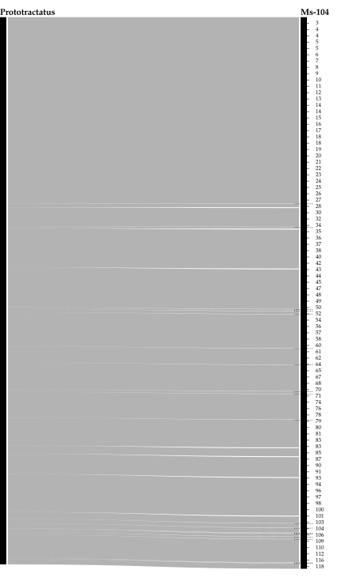

### [Ms-104](/ms-104/#V.1) [V\[1\]](https://cdn.wittgensteinnachlass.com/2000px/webp/Ms-104/V.webp)

## Logical-Philosophical Treatise

Ludwig Wittgenstein

### [Ms-104](/ms-104/#VI.1) [VI\[1\]](https://cdn.wittgensteinnachlass.com/2000px/webp/Ms-104/VI.webp)

_To the memory of my friend_

_David H. Pinsent_

_dedicated_

### [Ms-104](/ms-104/#1.1) [1\[1\]](https://cdn.wittgensteinnachlass.com/2000px/webp/Ms-104/1.webp)

_Motto: ‥․ and everything one_

_knows, and has not merely heard rustling and_

_roaring, can be_

_said in three words._

_Kürnberger_

### [Ms-104](/ms-104/#3.1) [3\[1\]](https://cdn.wittgensteinnachlass.com/2000px/webp/Ms-104/3.webp)

1 The world is everything that is the case.

### [Ms-104](/ms-104/#3.2) [3\[2\]](https://cdn.wittgensteinnachlass.com/2000px/webp/Ms-104/3.webp)

1˙1 The world is the totality of facts, not of things.

### [Ms-104](/ms-104/#3.3) [3\[3\]](https://cdn.wittgensteinnachlass.com/2000px/webp/Ms-104/3.webp)

2 What is the case, the fact, is the obtaining of states of affairs.

### [Ms-104](/ms-104/#3.4) [3\[4\]](https://cdn.wittgensteinnachlass.com/2000px/webp/Ms-104/3.webp)

2˙1 We grasp facts in pictures.

### [Ms-104](/ms-104/#3.5) [3\[5\]](https://cdn.wittgensteinnachlass.com/2000px/webp/Ms-104/3.webp)

2˙2 A picture has the logical form of depiction in common with what it depicts.

### [Ms-104](/ms-104/#3.6) [3\[6\]](https://cdn.wittgensteinnachlass.com/2000px/webp/Ms-104/3.webp)

3 The logical picture of the facts is the thought.

### [Ms-104](/ms-104/#3.7) [3\[7\]](https://cdn.wittgensteinnachlass.com/2000px/webp/Ms-104/3.webp)

3˙1 The perceptible expression of a thought is the propositional sign.

### [Ms-104](/ms-104/#3.8) [3\[8\]](https://cdn.wittgensteinnachlass.com/2000px/webp/Ms-104/3.webp)

3˙2 The propositional sign together with its manner of depiction is the proposition.

### [Ms-104](/ms-104/#3.9) [3\[9\]](https://cdn.wittgensteinnachlass.com/2000px/webp/Ms-104/3.webp)

4 The thought is the sentence with sense.

### [Ms-104](/ms-104/#3.10) [3\[10\]](https://cdn.wittgensteinnachlass.com/2000px/webp/Ms-104/3.webp)

4˙1 The proposition represents the obtaining and non-obtaining of states of affairs.

### [Ms-104](/ms-104/#3.11) [3\[11\]](https://cdn.wittgensteinnachlass.com/2000px/webp/Ms-104/3.webp)

4˙2 The sense of a proposition is its agreement, and lack of agreement, with the possibilities of the obtaining and non-obtaining of states of affairs.

### [Ms-104](/ms-104/#3.12) [3\[12\]](https://cdn.wittgensteinnachlass.com/2000px/webp/Ms-104/3.webp)

4˙3 The truth-possibilities of the elementary propositions signify the possibilities of the obtaining and non-obtaining of states of affairs.

### [Ms-104](/ms-104/#3.13) [3\[13\]](https://cdn.wittgensteinnachlass.com/2000px/webp/Ms-104/3.webp)

4˙4 A proposition is the expression of agreement and disagreement with the truth-possibilities of the elementary propositions.

### [Ms-104](/ms-104/#3.14) [3\[14\]](https://cdn.wittgensteinnachlass.com/2000px/webp/Ms-104/3.webp)

5 A proposition is a truth-function of the elementary propositions.

### [Ms-104](/ms-104/#3.15) [3\[15\]](https://cdn.wittgensteinnachlass.com/2000px/webp/Ms-104/3.webp)

6 The general form of the truth-function is: 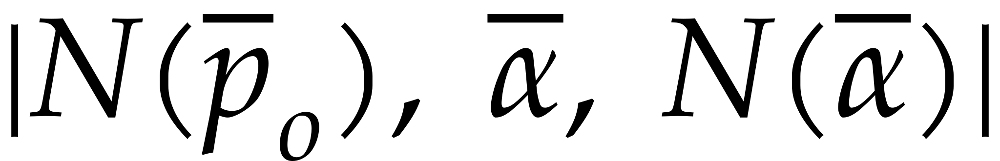

### [Ms-104](/ms-104/#4.1) [4\[1\]](https://cdn.wittgensteinnachlass.com/2000px/webp/Ms-104/4.webp)

1˙11 The world is determined by the facts and by their being _all_ the facts.

### [Ms-104](/ms-104/#4.2) [4\[2\]](https://cdn.wittgensteinnachlass.com/2000px/webp/Ms-104/4.webp)

1˙12

### [Ms-104](/ms-104/#4.3) [4\[3\]](https://cdn.wittgensteinnachlass.com/2000px/webp/Ms-104/4.webp)

1˙13 The facts in logical space are the world.

### [Ms-104](/ms-104/#4.4) [4\[4\]](https://cdn.wittgensteinnachlass.com/2000px/webp/Ms-104/4.webp)

2˙01 A state of affairs is a combination of objects, items.

### [Ms-104](/ms-104/#4.5) [4\[5\]](https://cdn.wittgensteinnachlass.com/2000px/webp/Ms-104/4.webp)

2˙02 An object is simple.

### [Ms-104](/ms-104/#4.6) [4\[6\]](https://cdn.wittgensteinnachlass.com/2000px/webp/Ms-104/4.webp)

2˙03-07

### [Ms-104](/ms-104/#4.7) [4\[7\]](https://cdn.wittgensteinnachlass.com/2000px/webp/Ms-104/4.webp)

⋎ 2˙12 A picture is a model of reality.

### [Ms-104](/ms-104/#4.8) [4\[8\]](https://cdn.wittgensteinnachlass.com/2000px/webp/Ms-104/4.webp)

2˙13 In the picture, the elements of the picture correspond to the objects.

### [Ms-104](/ms-104/#4.9) [4\[9\]](https://cdn.wittgensteinnachlass.com/2000px/webp/Ms-104/4.webp)

2˙14

### [Ms-104](/ms-104/#4.10) [4\[10\]](https://cdn.wittgensteinnachlass.com/2000px/webp/Ms-104/4.webp)

2˙15 A picture is a fact.

### [Ms-104](/ms-104/#4.11) [4\[11\]](https://cdn.wittgensteinnachlass.com/2000px/webp/Ms-104/4.webp)

2˙16 To be a picture, a fact must have something in common with what is depicted.

### [Ms-104](/ms-104/#4.12) [4\[12\]](https://cdn.wittgensteinnachlass.com/2000px/webp/Ms-104/4.webp)

2˙161

### [Ms-104](/ms-104/#4.13) [4\[13\]](https://cdn.wittgensteinnachlass.com/2000px/webp/Ms-104/4.webp)

2˙17-182

### [Ms-104](/ms-104/#4.14) [4\[14\]](https://cdn.wittgensteinnachlass.com/2000px/webp/Ms-104/4.webp)

2˙21 A picture agrees with reality or not; it is correct or incorrect, true or false.

### [Ms-104](/ms-104/#4.15) [4\[15\]](https://cdn.wittgensteinnachlass.com/2000px/webp/Ms-104/4.webp)

⋎ 2˙11 A picture presents the situation in logical space, the obtaining and non-obtaining of states of affairs.

### [Ms-104](/ms-104/#4.16) [4\[16\]](https://cdn.wittgensteinnachlass.com/2000px/webp/Ms-104/4.webp)

2˙22 A picture represents what it represents through its form of depiction, independently of whether it is true or false.

### [Ms-104](/ms-104/#5.1) [5\[1\]](https://cdn.wittgensteinnachlass.com/2000px/webp/Ms-104/5.webp)

3˙01 The totality of true thoughts is a picture of the world.

### [Ms-104](/ms-104/#5.2) [5\[2\]](https://cdn.wittgensteinnachlass.com/2000px/webp/Ms-104/5.webp)

3˙02

### [Ms-104](/ms-104/#5.3) [5\[3\]](https://cdn.wittgensteinnachlass.com/2000px/webp/Ms-104/5.webp)

3˙11 The propositional sign is a projection of the thought.

### [Ms-104](/ms-104/#5.4) [5\[4\]](https://cdn.wittgensteinnachlass.com/2000px/webp/Ms-104/5.webp)

3˙12 The method of projection is the way the propositional sign is applied.

### [Ms-104](/ms-104/#5.5) [5\[5\]](https://cdn.wittgensteinnachlass.com/2000px/webp/Ms-104/5.webp)

3˙13 The application of the propositional sign is the thinking of its sense.

### [Ms-104](/ms-104/#5.6) [5\[6\]](https://cdn.wittgensteinnachlass.com/2000px/webp/Ms-104/5.webp)

3˙21 The proposition is the projection according to its method.

### [Ms-104](/ms-104/#5.7) [5\[7\]](https://cdn.wittgensteinnachlass.com/2000px/webp/Ms-104/5.webp)

1˙12 For the totality of facts determines what is the case and also everything that is not the case.

### [Ms-104](/ms-104/#5.8) [5\[8\]](https://cdn.wittgensteinnachlass.com/2000px/webp/Ms-104/5.webp)

2˙03 In a state of affairs the objects are interlinked like the links of a chain.

### [Ms-104](/ms-104/#5.9) [5\[9\]](https://cdn.wittgensteinnachlass.com/2000px/webp/Ms-104/5.webp)

2˙031

### [Ms-104](/ms-104/#5.10) [5\[10\]](https://cdn.wittgensteinnachlass.com/2000px/webp/Ms-104/5.webp)

2˙04 The totality of states of affairs that obtain is the world.

### [Ms-104](/ms-104/#5.11) [5\[11\]](https://cdn.wittgensteinnachlass.com/2000px/webp/Ms-104/5.webp)

2˙05 The totality of states of affairs that obtain also determines which states of affairs do _not_ obtain.

### [Ms-104](/ms-104/#5.12) [5\[12\]](https://cdn.wittgensteinnachlass.com/2000px/webp/Ms-104/5.webp)

2˙06 The obtaining and non-obtaining of states of affairs is reality.

### [Ms-104](/ms-104/#5.13) [5\[13\]](https://cdn.wittgensteinnachlass.com/2000px/webp/Ms-104/5.webp)

2˙07 The whole of reality is the world.

### [Ms-104](/ms-104/#5.14) [5\[14\]](https://cdn.wittgensteinnachlass.com/2000px/webp/Ms-104/5.webp)

2˙031 In a state of affairs the objects are related to one another in a particular way.

### [Ms-104](/ms-104/#5.15) [5\[15\]](https://cdn.wittgensteinnachlass.com/2000px/webp/Ms-104/5.webp)

2˙14 A picture consists in its elements being related to one another in a particular way.

### [Ms-104](/ms-104/#5.16) [5\[16\]](https://cdn.wittgensteinnachlass.com/2000px/webp/Ms-104/5.webp)

2˙161 There must be something identical in a picture and what it depicts for the one to be a picture of the other at all.

### [Ms-104](/ms-104/#6.1) [6\[1\]](https://cdn.wittgensteinnachlass.com/2000px/webp/Ms-104/6.webp)

2˙17 What a picture must have in common with reality in order to depict it in its own way – correctly or falsely – is its form of depiction.

### [Ms-104](/ms-104/#6.2) [6\[2\]](https://cdn.wittgensteinnachlass.com/2000px/webp/Ms-104/6.webp)

2˙171 There are different forms of depiction.

### [Ms-104](/ms-104/#6.3) [6\[3\]](https://cdn.wittgensteinnachlass.com/2000px/webp/Ms-104/6.webp)

2˙18 What every picture, whatever its form, must have in common with reality in order to depict it at all – correctly or falsely – is logical form, that is, the structure of reality.

### [Ms-104](/ms-104/#6.4) [6\[4\]](https://cdn.wittgensteinnachlass.com/2000px/webp/Ms-104/6.webp)

2˙181 If the form of depiction is logical form, the picture is called a logical picture.

### [Ms-104](/ms-104/#6.5) [6\[5\]](https://cdn.wittgensteinnachlass.com/2000px/webp/Ms-104/6.webp)

2˙182 Every picture is _also_ a logical picture. (By contrast, not every picture is spatial, for example.)

### [Ms-104](/ms-104/#6.6) [6\[6\]](https://cdn.wittgensteinnachlass.com/2000px/webp/Ms-104/6.webp)

2˙201 A picture depicts reality by representing a possibility of states of affairs obtaining and not obtaining.

### [Ms-104](/ms-104/#6.7) [6\[7\]](https://cdn.wittgensteinnachlass.com/2000px/webp/Ms-104/6.webp)

2˙202 A picture represents a possible situation in logical space.

### [Ms-104](/ms-104/#6.8) [6\[8\]](https://cdn.wittgensteinnachlass.com/2000px/webp/Ms-104/6.webp)

2˙203 A picture contains the possibility of the situation it represents.

### [Ms-104](/ms-104/#6.9) [6\[9\]](https://cdn.wittgensteinnachlass.com/2000px/webp/Ms-104/6.webp)

2˙221 What a picture represents is its sense.

### [Ms-104](/ms-104/#6.10) [6\[10\]](https://cdn.wittgensteinnachlass.com/2000px/webp/Ms-104/6.webp)

2˙222 Its truth or falsity consists in the agreement or lack of agreement of its sense with reality.

### [Ms-104](/ms-104/#6.11) [6\[11\]](https://cdn.wittgensteinnachlass.com/2000px/webp/Ms-104/6.webp)

3˙3 The sentence-sign as applied, as thought, is the thought.

### [Ms-104](/ms-104/#6.12) [6\[12\]](https://cdn.wittgensteinnachlass.com/2000px/webp/Ms-104/6.webp)

4˙41 We can express agreement with the truth-possibilities by assigning them, say, the mark “W” (“True”) in the schema.

### [Ms-104](/ms-104/#6.13) [6\[13\]](https://cdn.wittgensteinnachlass.com/2000px/webp/Ms-104/6.webp)

4˙42 The absence of this mark signifies disagreement.

### [Ms-104](/ms-104/#7.1) [7\[1\]](https://cdn.wittgensteinnachlass.com/2000px/webp/Ms-104/7.webp)

4˙43 The sign that results from correlating those marks with the truth-possibilities is a propositional sign.

### [Ms-104](/ms-104/#7.2) [7\[2\]](https://cdn.wittgensteinnachlass.com/2000px/webp/Ms-104/7.webp)

4˙431 Thus, for example, ›‹

is a propositional sign.

### [Ms-104](/ms-104/#7.3) [7\[3\]](https://cdn.wittgensteinnachlass.com/2000px/webp/Ms-104/7.webp)

4˙432 For the sake of clarity we now write this sign as follows:

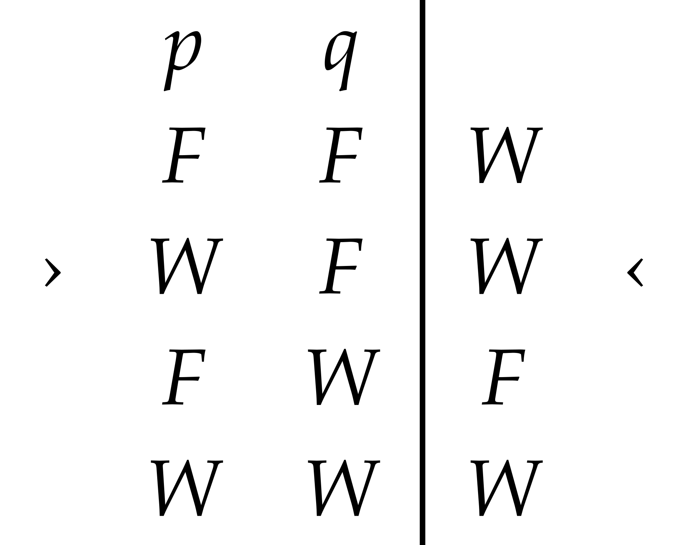

We call the propositional signs constructed in this way according to §4˙43 propositional signs of the first kind.

### [Ms-104](/ms-104/#7.4) [7\[4\]](https://cdn.wittgensteinnachlass.com/2000px/webp/Ms-104/7.webp)

4˙44 If the order of the truth-possibilities in the schema is fixed once and for all by a rule of combination, then the last column by itself is already an expression of the truth-conditions.

### [Ms-104](/ms-104/#7.5) [7\[5\]](https://cdn.wittgensteinnachlass.com/2000px/webp/Ms-104/7.webp)

4˙441 If we write this column as a row, the sign in 4˙432 becomes:

“(WWFW) (p,q)” or “(W,W, ,W) (p,q)”

.

### [Ms-104](/ms-104/#7.6) [7\[6\]](https://cdn.wittgensteinnachlass.com/2000px/webp/Ms-104/7.webp)

3˙02 A thought contains the possibility of the situation it thinks.

What is thinkable is also possible.

### [Ms-104](/ms-104/#7.7) [7\[7\]](https://cdn.wittgensteinnachlass.com/2000px/webp/Ms-104/7.webp)

3˙111 It is a projection of the possibility of a situation.

### [Ms-104](/ms-104/#7.8) [7\[8\]](https://cdn.wittgensteinnachlass.com/2000px/webp/Ms-104/7.webp)

3˙14 In the propositional sign, the simple signs correspond to the objects of reality.

### [Ms-104](/ms-104/#7.9) [7\[9\]](https://cdn.wittgensteinnachlass.com/2000px/webp/Ms-104/7.webp)

3˙15 A propositional sign consists in the simple signs being related to one another in it in a particular way.

### [Ms-104](/ms-104/#8.1) [8\[1\]](https://cdn.wittgensteinnachlass.com/2000px/webp/Ms-104/8.webp)

3˙16 A propositional sign is a fact.

### [Ms-104](/ms-104/#8.2) [8\[2\]](https://cdn.wittgensteinnachlass.com/2000px/webp/Ms-104/8.webp)

4˙01 The sentence is a picture of reality.

### [Ms-104](/ms-104/#8.3) [8\[3\]](https://cdn.wittgensteinnachlass.com/2000px/webp/Ms-104/8.webp)

4˙08 Reality is compared with the sentence.

### [Ms-104](/ms-104/#8.4) [8\[4\]](https://cdn.wittgensteinnachlass.com/2000px/webp/Ms-104/8.webp)

4˙09 A sentence can be true or false only by being a _picture_ of reality.

### [Ms-104](/ms-104/#8.5) [8\[5\]](https://cdn.wittgensteinnachlass.com/2000px/webp/Ms-104/8.webp)

4˙02 We can see this from the fact that we understand the sense of the sentence-sign without its having been explained to us.

### [Ms-104](/ms-104/#8.6) [8\[6\]](https://cdn.wittgensteinnachlass.com/2000px/webp/Ms-104/8.webp)

4˙03 The meanings of the simple signs, the words, must be explained to us for us to understand them.

### [Ms-104](/ms-104/#8.7) [8\[7\]](https://cdn.wittgensteinnachlass.com/2000px/webp/Ms-104/8.webp)

4˙04 But it is by means of sentences that we communicate with one another.

### [Ms-104](/ms-104/#8.8) [8\[8\]](https://cdn.wittgensteinnachlass.com/2000px/webp/Ms-104/8.webp)

4˙05 It belongs to the essence of the sentence that it can communicate to us a sense that is _new_ to us.

### [Ms-104](/ms-104/#8.9) [8\[9\]](https://cdn.wittgensteinnachlass.com/2000px/webp/Ms-104/8.webp)

4˙06 The sentence communicates a situation to us, so it must be _essentially_ connected with this situation.

### [Ms-104](/ms-104/#8.10) [8\[10\]](https://cdn.wittgensteinnachlass.com/2000px/webp/Ms-104/8.webp)

4˙07 And the connection is precisely that the sentence is the situation’s logical picture.

### [Ms-104](/ms-104/#8.11) [8\[11\]](https://cdn.wittgensteinnachlass.com/2000px/webp/Ms-104/8.webp)

3˙141 The simple sign means the object. The object is its meaning.

### [Ms-104](/ms-104/#8.12) [8\[12\]](https://cdn.wittgensteinnachlass.com/2000px/webp/Ms-104/8.webp)

3˙201 The simple signs used in a sentence are called names.

### [Ms-104](/ms-104/#8.13) [8\[13\]](https://cdn.wittgensteinnachlass.com/2000px/webp/Ms-104/8.webp)

4˙11 The proposition asserts that the situation whose possibility it represents obtains.

### [Ms-104](/ms-104/#8.15) [8\[15\]](https://cdn.wittgensteinnachlass.com/2000px/webp/Ms-104/8.webp)

4˙21 The simplest proposition – the elementary proposition – asserts that a state of affairs obtains.

### [Ms-104](/ms-104/#8.16) [8\[16\]](https://cdn.wittgensteinnachlass.com/2000px/webp/Ms-104/8.webp)

4˙1001 The totality of true sentences is the description of the world.

### [Ms-104](/ms-104/#9.1) [9\[1\]](https://cdn.wittgensteinnachlass.com/2000px/webp/Ms-104/9.webp)

4˙231 Specifying all the true elementary propositions describes the world completely.

### [Ms-104](/ms-104/#9.2) [9\[2\]](https://cdn.wittgensteinnachlass.com/2000px/webp/Ms-104/9.webp)

4˙232 The world is completely described by specifying all the elementary propositions plus specifying which of them are true and which false.

### [Ms-104](/ms-104/#9.3) [9\[3\]](https://cdn.wittgensteinnachlass.com/2000px/webp/Ms-104/9.webp)

4˙22 The elementary sentence consists of names. It is a nexus, a concatenation, of names.

### [Ms-104](/ms-104/#9.4) [9\[4\]](https://cdn.wittgensteinnachlass.com/2000px/webp/Ms-104/9.webp)

4˙221 A name occurs in a sentence only in the nexus of the elementary sentence.

### [Ms-104](/ms-104/#9.5) [9\[5\]](https://cdn.wittgensteinnachlass.com/2000px/webp/Ms-104/9.webp)

4˙222 Expressions like “a = a”, or expressions derived from it, which seem to contradict the foregoing, are neither elementary propositions nor any other kind of sign with sense, as will become apparent later.

### [Ms-104](/ms-104/#9.6) [9\[6\]](https://cdn.wittgensteinnachlass.com/2000px/webp/Ms-104/9.webp)

4˙23 If the elementary proposition is true, the state of affairs obtains; if the elementary proposition is false, the state of affairs does not obtain.

### [Ms-104](/ms-104/#9.7) [9\[7\]](https://cdn.wittgensteinnachlass.com/2000px/webp/Ms-104/9.webp)

4˙24 With regard to the obtaining and non-obtaining of n states of affairs there are 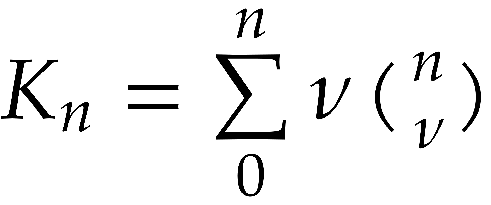 possibilities.

### [Ms-104](/ms-104/#9.8) [9\[8\]](https://cdn.wittgensteinnachlass.com/2000px/webp/Ms-104/9.webp)

4˙25 Any possible combination of the states of affairs can obtain, – the others not obtaining.

### [Ms-104](/ms-104/#9.9) [9\[9\]](https://cdn.wittgensteinnachlass.com/2000px/webp/Ms-104/9.webp)

4˙26 To these combinations correspond just as many possibilities of truth – and falsity – for n elementary propositions.

### [Ms-104](/ms-104/#9.10+10.1) [9\[10\]](https://cdn.wittgensteinnachlass.com/2000px/webp/Ms-104/9.webp),[10\[1\]](https://cdn.wittgensteinnachlass.com/2000px/webp/Ms-104/10.webp)

4˙31 We can represent the truth-possibilities by a schema of the following kind: (“p”, “q”, “r” are elementary propositions. “W” means “true”, “F” “false”; the rows of “W”s and “F”s beneath the row of elementary propositions signify their truth-possibilities in a notation that is easy to understand.)

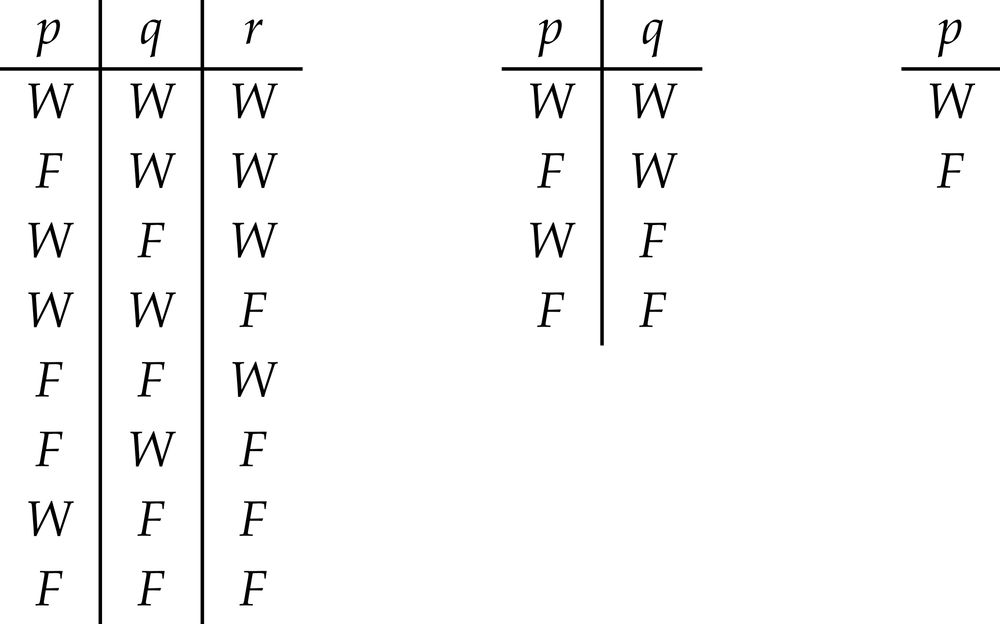

We call this schema I.

### [Ms-104](/ms-104/#10.2) [10\[2\]](https://cdn.wittgensteinnachlass.com/2000px/webp/Ms-104/10.webp)

5˙1 If all propositions are truth-functions (W-functions) of elementary propositions, it follows that they are also truth-functions of one another.

### [Ms-104](/ms-104/#10.3) [10\[3\]](https://cdn.wittgensteinnachlass.com/2000px/webp/Ms-104/10.webp)

5˙11 The schemata in 4˙31 have a meaning even when “p” “q” “r” etc. are not elementary propositions.

### [Ms-104](/ms-104/#10.4) [10\[4\]](https://cdn.wittgensteinnachlass.com/2000px/webp/Ms-104/10.webp)

5˙12 And it is easy to see that the propositional sign of the first kind expresses a _single_ W-function of elementary propositions even when p, q etc. are W-functions of elementary propositions.

### [Ms-104](/ms-104/#10.5) [10\[5\]](https://cdn.wittgensteinnachlass.com/2000px/webp/Ms-104/10.webp)

5˙001 Every proposition can be regarded as the result of an operation that was performed on another proposition (the base of the operation) and that transforms the latter into the former.

### [Ms-104](/ms-104/#10.6) [10\[6\]](https://cdn.wittgensteinnachlass.com/2000px/webp/Ms-104/10.webp)

5˙0011 Analogously, one can speak of operations with several bases. “(F)(p)” is the result of applying the operation “F( )” to the base p, (FWWF)(p,q) the result of an operation on two bases.

### [Ms-104](/ms-104/#10.7) [10\[7\]](https://cdn.wittgensteinnachlass.com/2000px/webp/Ms-104/10.webp)

5˙0014 If we regard (F)(p) as the result of an operation, we write it “(F)'(p)”; and, in general, we write an operation on “a” “b” “c” etc. as O'(a,b,c, etc.).

### [Ms-104](/ms-104/#10.8+11.1) [10\[8\]](https://cdn.wittgensteinnachlass.com/2000px/webp/Ms-104/10.webp),[11\[1\]](https://cdn.wittgensteinnachlass.com/2000px/webp/Ms-104/11.webp)

5˙2 Every W-function of W-functions is a function of elementary propositions, a proposition.

### [Ms-104](/ms-104/#11.2) [11\[2\]](https://cdn.wittgensteinnachlass.com/2000px/webp/Ms-104/11.webp)

5˙0016 The repeated application of an operation to its own result, or its own results, is called its successive application. (O'(O'(O'a)) is the result of the (threefold) successive application of O'ξ to a.)

### [Ms-104](/ms-104/#11.3) [11\[3\]](https://cdn.wittgensteinnachlass.com/2000px/webp/Ms-104/11.webp)

5˙3 It can be shown that every truth-function is a result of the successive application of the operation (W )'(ᾱ).

### [Ms-104](/ms-104/#11.4) [11\[4\]](https://cdn.wittgensteinnachlass.com/2000px/webp/Ms-104/11.webp)

5˙0015 “O' (a,b,c etc.)” is the result of the operation; I designate the operation itself by “O'(ξ,η,ζ etc.)”, where the Greek letters indicate the argument places.

### [Ms-104](/ms-104/#11.5) [11\[5\]](https://cdn.wittgensteinnachlass.com/2000px/webp/Ms-104/11.webp)

3˙202 Only the sentence has sense; only in the context of the sentence does a name have meaning.

### [Ms-104](/ms-104/#11.6) [11\[6\]](https://cdn.wittgensteinnachlass.com/2000px/webp/Ms-104/11.webp)

5˙003 We write every bracketed expression whose terms are propositions in the form “(ᾱ)”. “ᾱ” is a variable whose values are the terms of the bracketed expression. The bar over the “α” means that all values of α are inside the brackets.

### [Ms-104](/ms-104/#11.7) [11\[7\]](https://cdn.wittgensteinnachlass.com/2000px/webp/Ms-104/11.webp)

5˙004 Which values α may take is stipulated.

### [Ms-104](/ms-104/#11.8) [11\[8\]](https://cdn.wittgensteinnachlass.com/2000px/webp/Ms-104/11.webp)

5˙0013 We call an operation that turns a number of propositions into a truth-function of those propositions a “truth-operation” (W-operation).

### [Ms-104](/ms-104/#11.9) [11\[9\]](https://cdn.wittgensteinnachlass.com/2000px/webp/Ms-104/11.webp)

5˙02 The truth-functions of a given number of propositions can be written out in a schema of the following kind:

We call it schema II.

### [Ms-104](/ms-104/#11.10) [11\[10\]](https://cdn.wittgensteinnachlass.com/2000px/webp/Ms-104/11.webp)

5˙01 We can regard an elementary proposition as a truth-function of itself.

### [Ms-104](/ms-104/#11.11+12.1) [11\[11\]](https://cdn.wittgensteinnachlass.com/2000px/webp/Ms-104/11.webp),[12\[1\]](https://cdn.wittgensteinnachlass.com/2000px/webp/Ms-104/12.webp)

4˙423 The truth-possibilities of the elementary propositions are the truth-conditions of the propositions.

### [Ms-104](/ms-104/#12.2) [12\[2\]](https://cdn.wittgensteinnachlass.com/2000px/webp/Ms-104/12.webp)

5˙011 The elementary propositions are the truth-arguments (W-arguments) of the proposition.

### [Ms-104](/ms-104/#12.3) [12\[3\]](https://cdn.wittgensteinnachlass.com/2000px/webp/Ms-104/12.webp)

5˙03 I call those truth-possibilities of the W-arguments that make the proposition true its truth-grounds.

### [Ms-104](/ms-104/#12.4) [12\[4\]](https://cdn.wittgensteinnachlass.com/2000px/webp/Ms-104/12.webp)

5˙04 If the truth-grounds of a number of propositions are all also truth-grounds of a particular proposition, we say that the truth of this proposition follows from the truth of the totality of those other propositions.

### [Ms-104](/ms-104/#12.5) [12\[5\]](https://cdn.wittgensteinnachlass.com/2000px/webp/Ms-104/12.webp)

5˙041 In particular, the truth of a proposition p follows from the truth of another, q, if all the truth-grounds of the first are truth-grounds of the second.

### [Ms-104](/ms-104/#12.6) [12\[6\]](https://cdn.wittgensteinnachlass.com/2000px/webp/Ms-104/12.webp)

5˙04101 We also say that the truth-grounds of the one are contained in those of the other, that p follows from q.

### [Ms-104](/ms-104/#12.7) [12\[7\]](https://cdn.wittgensteinnachlass.com/2000px/webp/Ms-104/12.webp)

5˙042 Every proposition follows from itself.

### [Ms-104](/ms-104/#12.8) [12\[8\]](https://cdn.wittgensteinnachlass.com/2000px/webp/Ms-104/12.webp)

5˙05 If p follows from q and q from p, then they are one and the same proposition.

### [Ms-104](/ms-104/#12.9) [12\[9\]](https://cdn.wittgensteinnachlass.com/2000px/webp/Ms-104/12.webp)

5˙06 If one proposition follows from another, the latter says more than the former, the former less than the latter.

### [Ms-104](/ms-104/#12.10) [12\[10\]](https://cdn.wittgensteinnachlass.com/2000px/webp/Ms-104/12.webp)

5˙07 A tautology follows from all propositions; it says nothing.

### [Ms-104](/ms-104/#12.11) [12\[11\]](https://cdn.wittgensteinnachlass.com/2000px/webp/Ms-104/12.webp)

4˙421 The expression of agreement and disagreement with the truth-possibilities of the elementary propositions expresses the truth-conditions of the proposition.

### [Ms-104](/ms-104/#12.12) [12\[12\]](https://cdn.wittgensteinnachlass.com/2000px/webp/Ms-104/12.webp)

4˙422 A proposition is the expression of its truth-conditions.

### [Ms-104](/ms-104/#12.13+13.1) [12\[13\]](https://cdn.wittgensteinnachlass.com/2000px/webp/Ms-104/12.webp),[13\[1\]](https://cdn.wittgensteinnachlass.com/2000px/webp/Ms-104/13.webp)

4˙401 With regard to the agreement and disagreement of a proposition with the truth-possibilities of n elementary propositions, there are 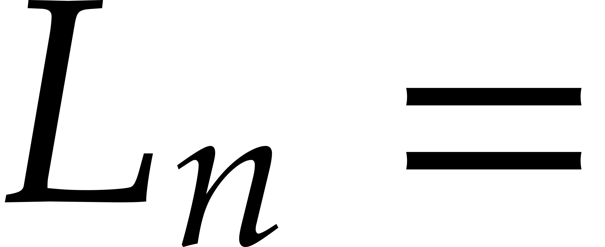 possibilities.

### [Ms-104](/ms-104/#13.2) [13\[2\]](https://cdn.wittgensteinnachlass.com/2000px/webp/Ms-104/13.webp)

4˙442 WWFW are thus the truth-conditions of this proposition.

### [Ms-104](/ms-104/#13.3) [13\[3\]](https://cdn.wittgensteinnachlass.com/2000px/webp/Ms-104/13.webp)

4˙444 The groups of truth-conditions that belong to the truth-possibilities of a given number of elementary propositions can be arranged in a series.

### [Ms-104](/ms-104/#13.4) [13\[4\]](https://cdn.wittgensteinnachlass.com/2000px/webp/Ms-104/13.webp)

4˙445 Among the possible groups of truth-conditions there are two extreme cases.

### [Ms-104](/ms-104/#13.5) [13\[5\]](https://cdn.wittgensteinnachlass.com/2000px/webp/Ms-104/13.webp)

4˙446 In the one case the proposition is true for all the truth-possibilities of the elementary propositions. We say the truth-conditions are tautological.

In the second case the proposition is false for all the truth-possibilities; the truth-conditions are contradictory.

### [Ms-104](/ms-104/#13.6) [13\[6\]](https://cdn.wittgensteinnachlass.com/2000px/webp/Ms-104/13.webp)

4˙443 For n elementary propositions there are 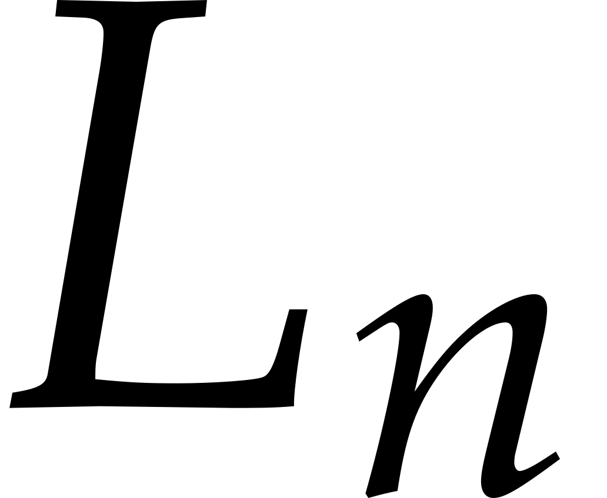 possible groups of truth-conditions.

### [Ms-104](/ms-104/#13.7) [13\[7\]](https://cdn.wittgensteinnachlass.com/2000px/webp/Ms-104/13.webp)

5˙3001 We call this operation the negation of the values of ᾱ and write, for short, in place of (W )(ᾱ): N(ᾱ).

### [Ms-104](/ms-104/#13.8) [13\[8\]](https://cdn.wittgensteinnachlass.com/2000px/webp/Ms-104/13.webp)

5˙3002 N(ᾱ) negates all the values of α.

### [Ms-104](/ms-104/#13.9) [13\[9\]](https://cdn.wittgensteinnachlass.com/2000px/webp/Ms-104/13.webp)

5˙31 If α has only one value, p, then N(ᾱ) is Russell’s ~p; if it has two values p and q, ~p ∙ ~q.

### [Ms-104](/ms-104/#13.10) [13\[10\]](https://cdn.wittgensteinnachlass.com/2000px/webp/Ms-104/13.webp)

5˙32 If the values of α are all the values of a function φ(x) for all values of x, then “N(ᾱ)” means ~(∃x) ∙ φ(x).

### [Ms-104](/ms-104/#13.11) [13\[11\]](https://cdn.wittgensteinnachlass.com/2000px/webp/Ms-104/13.webp)

4˙4011 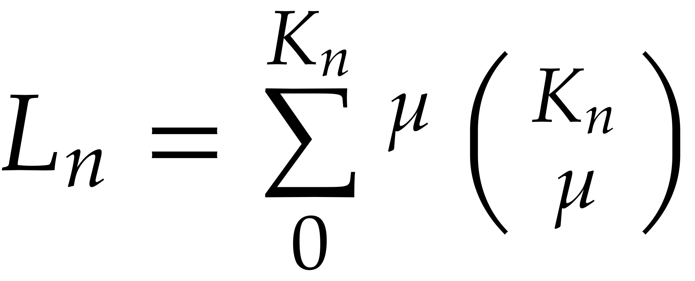

### [Ms-104](/ms-104/#13.12) [13\[12\]](https://cdn.wittgensteinnachlass.com/2000px/webp/Ms-104/13.webp)

2˙032 The way the objects are connected in a state of affairs is the structure of that state of affairs.

### [Ms-104](/ms-104/#13.13) [13\[13\]](https://cdn.wittgensteinnachlass.com/2000px/webp/Ms-104/13.webp)

2˙033 The structure of a fact consists of the structures of the states of affairs.

### [Ms-104](/ms-104/#14.1) [14\[1\]](https://cdn.wittgensteinnachlass.com/2000px/webp/Ms-104/14.webp)

2˙151 That the elements of the picture are related to one another in a particular way presents the items as being related to one another in that way.

### [Ms-104](/ms-104/#14.2) [14\[2\]](https://cdn.wittgensteinnachlass.com/2000px/webp/Ms-104/14.webp)

2˙1512 The picture is linked to reality in this way: it reaches right up to it.

### [Ms-104](/ms-104/#14.3) [14\[3\]](https://cdn.wittgensteinnachlass.com/2000px/webp/Ms-104/14.webp)

2˙1513 It is laid against reality like a yardstick.

### [Ms-104](/ms-104/#14.4) [14\[4\]](https://cdn.wittgensteinnachlass.com/2000px/webp/Ms-104/14.webp)

2˙172 A picture can depict any reality whose form it has.

A spatial picture, everything spatial, etc.

### [Ms-104](/ms-104/#14.5) [14\[5\]](https://cdn.wittgensteinnachlass.com/2000px/webp/Ms-104/14.webp)

2˙19 A logical picture can depict the world.

### [Ms-104](/ms-104/#14.6) [14\[6\]](https://cdn.wittgensteinnachlass.com/2000px/webp/Ms-104/14.webp)

2˙15131 Only the outermost points of the graduation marks _touch_ the object to be measured.

### [Ms-104](/ms-104/#14.7) [14\[7\]](https://cdn.wittgensteinnachlass.com/2000px/webp/Ms-104/14.webp)

2˙15101 This connection between the elements of the picture is called its form of depiction.

### [Ms-104](/ms-104/#14.8) [14\[8\]](https://cdn.wittgensteinnachlass.com/2000px/webp/Ms-104/14.webp)

2˙1514 On this view, then, the depicting relation that makes the picture a picture also belongs to it.

### [Ms-104](/ms-104/#14.9) [14\[9\]](https://cdn.wittgensteinnachlass.com/2000px/webp/Ms-104/14.webp)

2˙1515 The depicting relation consists of the pairings between the elements of the picture and the items.

### [Ms-104](/ms-104/#14.10) [14\[10\]](https://cdn.wittgensteinnachlass.com/2000px/webp/Ms-104/14.webp)

2˙1516 These pairings are, as it were, the feelers of the picture’s elements, with which the picture touches reality.

### [Ms-104](/ms-104/#14.11) [14\[11\]](https://cdn.wittgensteinnachlass.com/2000px/webp/Ms-104/14.webp)

2˙223 To recognize whether a picture is true or false, we must compare it with reality.

### [Ms-104](/ms-104/#14.12) [14\[12\]](https://cdn.wittgensteinnachlass.com/2000px/webp/Ms-104/14.webp)

2˙224 It cannot be recognized from the picture alone whether it is true or false.

### [Ms-104](/ms-104/#14.13) [14\[13\]](https://cdn.wittgensteinnachlass.com/2000px/webp/Ms-104/14.webp)

2˙225 There is no a priori true picture.

### [Ms-104](/ms-104/#14.14) [14\[14\]](https://cdn.wittgensteinnachlass.com/2000px/webp/Ms-104/14.webp)

2˙131 In the picture, the elements of the picture stand for the objects.

### [Ms-104](/ms-104/#15.1) [15\[1\]](https://cdn.wittgensteinnachlass.com/2000px/webp/Ms-104/15.webp)

4˙021 The sentence is a picture of reality; for I know the situation it represents if I understand the sentence. And I understand the sentence without its sense having been explained to me.

### [Ms-104](/ms-104/#15.2) [15\[2\]](https://cdn.wittgensteinnachlass.com/2000px/webp/Ms-104/15.webp)

4˙023 The sentence _shows_ how things stand _if_ it is true.

### [Ms-104](/ms-104/#15.3) [15\[3\]](https://cdn.wittgensteinnachlass.com/2000px/webp/Ms-104/15.webp)

4˙024 And it _says_ _that_ this is how things stand.

### [Ms-104](/ms-104/#15.4) [15\[4\]](https://cdn.wittgensteinnachlass.com/2000px/webp/Ms-104/15.webp)

4˙022 The sentence _shows_ its sense.

### [Ms-104](/ms-104/#15.5) [15\[5\]](https://cdn.wittgensteinnachlass.com/2000px/webp/Ms-104/15.webp)

4˙2212 In what follows I indicate elementary propositions generally by the letters p, q, r, s, t, or (like Frege) as functions of their objects in the form “φ(x)”, “ψ(x,y)” etc.

### [Ms-104](/ms-104/#15.6) [15\[6\]](https://cdn.wittgensteinnachlass.com/2000px/webp/Ms-104/15.webp)

4˙2211 In what follows I indicate names of objects by the letters x,y,z,u,v,w.

### [Ms-104](/ms-104/#15.7) [15\[7\]](https://cdn.wittgensteinnachlass.com/2000px/webp/Ms-104/15.webp)

4˙2213 If I use two names with _one_ and the same meaning, or two propositional signs with _one_ sense in common, I express this by putting the sign “ = ” between them.

### [Ms-104](/ms-104/#15.8) [15\[8\]](https://cdn.wittgensteinnachlass.com/2000px/webp/Ms-104/15.webp)

4˙2214 Expressions of the form a = b are thus only aids to representation; they say nothing about the meaning or sense of the signs “a” or “b”.

### [Ms-104](/ms-104/#15.9) [15\[9\]](https://cdn.wittgensteinnachlass.com/2000px/webp/Ms-104/15.webp)

4˙433 It is clear that no object (or complex of objects) corresponds to the complex of signs “F” and “W”, any more than to the horizontal and vertical lines or to the brackets. There are no “logical objects”.

### [Ms-104](/ms-104/#15.10) [15\[10\]](https://cdn.wittgensteinnachlass.com/2000px/webp/Ms-104/15.webp)

4˙4331 An analogous point of course holds for all signs that express the same thing as the schemata of “W”s and “F”s.

### [Ms-104](/ms-104/#15.11) [15\[11\]](https://cdn.wittgensteinnachlass.com/2000px/webp/Ms-104/15.webp)

2˙061 States of affairs are independent of one another.

### [Ms-104](/ms-104/#16.1) [16\[1\]](https://cdn.wittgensteinnachlass.com/2000px/webp/Ms-104/16.webp)

2˙062 One cannot infer from the obtaining or non-obtaining of the one the obtaining or non-obtaining of the other.

### [Ms-104](/ms-104/#16.2) [16\[2\]](https://cdn.wittgensteinnachlass.com/2000px/webp/Ms-104/16.webp)

5˙0412 If p follows from q, I can infer p from q, deduce p from q.

### [Ms-104](/ms-104/#16.3) [16\[3\]](https://cdn.wittgensteinnachlass.com/2000px/webp/Ms-104/16.webp)

5˙043 No elementary proposition can be inferred from another.

### [Ms-104](/ms-104/#16.4) [16\[4\]](https://cdn.wittgensteinnachlass.com/2000px/webp/Ms-104/16.webp)

5˙044 There is no way to infer from the obtaining of any situation that a wholly different situation obtains.

### [Ms-104](/ms-104/#16.5) [16\[5\]](https://cdn.wittgensteinnachlass.com/2000px/webp/Ms-104/16.webp)

5˙0441 There is no causal nexus that would justify such an inference.

### [Ms-104](/ms-104/#16.6) [16\[6\]](https://cdn.wittgensteinnachlass.com/2000px/webp/Ms-104/16.webp)

3˙04 An a priori correct thought would be one whose possibility entailed its truth.

### [Ms-104](/ms-104/#16.7) [16\[7\]](https://cdn.wittgensteinnachlass.com/2000px/webp/Ms-104/16.webp)

3˙05 We could know a priori that a thought is true only if its truth could be recognized from the thought itself (without an object of comparison).

### [Ms-104](/ms-104/#16.8) [16\[8\]](https://cdn.wittgensteinnachlass.com/2000px/webp/Ms-104/16.webp)

5˙0411 We can see from the structure of the propositions that one proposition follows from another.

### [Ms-104](/ms-104/#16.9) [16\[9\]](https://cdn.wittgensteinnachlass.com/2000px/webp/Ms-104/16.webp)

5˙0415 All inference takes place a priori.

### [Ms-104](/ms-104/#16.10) [16\[10\]](https://cdn.wittgensteinnachlass.com/2000px/webp/Ms-104/16.webp)

5˙0442 We are not _able_ to _know_ the events of the future.

### [Ms-104](/ms-104/#16.11) [16\[11\]](https://cdn.wittgensteinnachlass.com/2000px/webp/Ms-104/16.webp)

5˙0443 Belief in the causal nexus is superstition.

### [Ms-104](/ms-104/#16.12) [16\[12\]](https://cdn.wittgensteinnachlass.com/2000px/webp/Ms-104/16.webp)

2˙173 But a picture cannot depict its form of depiction; it displays it.

### [Ms-104](/ms-104/#16.13+17.1) [16\[13\]](https://cdn.wittgensteinnachlass.com/2000px/webp/Ms-104/16.webp),[17\[1\]](https://cdn.wittgensteinnachlass.com/2000px/webp/Ms-104/17.webp)

4˙101 A sentence can represent the whole of reality, but it cannot represent what it must have in common with reality in order to represent it – logical form.

### [Ms-104](/ms-104/#17.2) [17\[2\]](https://cdn.wittgensteinnachlass.com/2000px/webp/Ms-104/17.webp)

4˙102 A sentence cannot represent logical form; logical form is mirrored in it.

### [Ms-104](/ms-104/#17.3) [17\[3\]](https://cdn.wittgensteinnachlass.com/2000px/webp/Ms-104/17.webp)

4˙103 A sentence does not represent logical form: it displays it; it shows it.

### [Ms-104](/ms-104/#17.4) [17\[4\]](https://cdn.wittgensteinnachlass.com/2000px/webp/Ms-104/17.webp)

2˙174 A picture represents its object from outside (its standpoint is its form of representation), so it represents its object correctly or falsely.

### [Ms-104](/ms-104/#17.5) [17\[5\]](https://cdn.wittgensteinnachlass.com/2000px/webp/Ms-104/17.webp)

2˙175 But a picture cannot place itself outside its form of representation.

### [Ms-104](/ms-104/#17.6) [17\[6\]](https://cdn.wittgensteinnachlass.com/2000px/webp/Ms-104/17.webp)

3˙03 We cannot think anything illogical, because we would then have to think illogically.

### [Ms-104](/ms-104/#17.7) [17\[7\]](https://cdn.wittgensteinnachlass.com/2000px/webp/Ms-104/17.webp)

4˙104 To be able to represent logical form, we would have to be able to take up a position with the sentence outside logic, i.e. outside the world.

### [Ms-104](/ms-104/#17.8) [17\[8\]](https://cdn.wittgensteinnachlass.com/2000px/webp/Ms-104/17.webp)

4˙001 The totality of sentences is language.

### [Ms-104](/ms-104/#17.9) [17\[9\]](https://cdn.wittgensteinnachlass.com/2000px/webp/Ms-104/17.webp)

4˙1021 What is mirrored in language, language cannot represent.

### [Ms-104](/ms-104/#17.10) [17\[10\]](https://cdn.wittgensteinnachlass.com/2000px/webp/Ms-104/17.webp)

5˙0413 The nature of the inference is to be gleaned from the two propositions alone.

### [Ms-104](/ms-104/#17.11) [17\[11\]](https://cdn.wittgensteinnachlass.com/2000px/webp/Ms-104/17.webp)

5˙0414 They alone can justify the inference.

### [Ms-104](/ms-104/#17.12) [17\[12\]](https://cdn.wittgensteinnachlass.com/2000px/webp/Ms-104/17.webp)

5˙04141 “Laws of inference” that are supposed to justify inferences – as in Frege and Russell – are senseless, and would be superfluous.

### [Ms-104](/ms-104/#17.13) [17\[13\]](https://cdn.wittgensteinnachlass.com/2000px/webp/Ms-104/17.webp)

4˙10011 One can also call the totality of true propositions the whole of natural science (or the totality of the natural sciences).

### [Ms-104](/ms-104/#18.1) [18\[1\]](https://cdn.wittgensteinnachlass.com/2000px/webp/Ms-104/18.webp)

4˙10012 Philosophy is not one of the natural sciences.

### [Ms-104](/ms-104/#18.2) [18\[2\]](https://cdn.wittgensteinnachlass.com/2000px/webp/Ms-104/18.webp)

4˙10013 The word “philosophy” must mean something that stands above or below, but not _alongside_, the natural sciences.

### [Ms-104](/ms-104/#18.3) [18\[3\]](https://cdn.wittgensteinnachlass.com/2000px/webp/Ms-104/18.webp)

4˙10014 The purpose of philosophy is the logical clarification of thoughts.

### [Ms-104](/ms-104/#18.4) [18\[4\]](https://cdn.wittgensteinnachlass.com/2000px/webp/Ms-104/18.webp)

4˙10015 Philosophy is not a doctrine but an activity.

### [Ms-104](/ms-104/#18.5) [18\[5\]](https://cdn.wittgensteinnachlass.com/2000px/webp/Ms-104/18.webp)

4˙10016 The result of philosophy is not “philosophical propositions”, but propositions becoming clear.

### [Ms-104](/ms-104/#18.6) [18\[6\]](https://cdn.wittgensteinnachlass.com/2000px/webp/Ms-104/18.webp)

4˙100161 Philosophy is to make thoughts clear and delimit them sharply; otherwise they are, as it were, murky and blurred.

### [Ms-104](/ms-104/#18.7) [18\[7\]](https://cdn.wittgensteinnachlass.com/2000px/webp/Ms-104/18.webp)

4˙10017 It will thus delimit what is thinkable and thereby what is unthinkable.

### [Ms-104](/ms-104/#18.8) [18\[8\]](https://cdn.wittgensteinnachlass.com/2000px/webp/Ms-104/18.webp)

4˙100171 It will set limits to what is unthinkable from within, by means of what is thinkable.

### [Ms-104](/ms-104/#18.9) [18\[9\]](https://cdn.wittgensteinnachlass.com/2000px/webp/Ms-104/18.webp)

4˙10018 It will signify what cannot be said by clearly representing what can be said.

### [Ms-104](/ms-104/#18.10) [18\[10\]](https://cdn.wittgensteinnachlass.com/2000px/webp/Ms-104/18.webp)

5˙32 I express sameness of object by sameness of sign, and not with the aid of an equality sign. Difference of objects by difference of signs.

### [Ms-104](/ms-104/#18.11) [18\[11\]](https://cdn.wittgensteinnachlass.com/2000px/webp/Ms-104/18.webp)

5˙331 So I write not “F(a,b) ∙ a = b” but “F(a,a)” [or “F(b,b)”] and not “F(a,b) ∙ a ≠ b” but “F(a,b)”.

### [Ms-104](/ms-104/#18.12) [18\[12\]](https://cdn.wittgensteinnachlass.com/2000px/webp/Ms-104/18.webp)

5˙332 And analogously, not “(∃x,y) ∙ F(x,y) ∙ x = y” but “(∃x) ∙ F(x,x)” and not “(∃x,y) ∙ F(x,y) ∙ x ≠ y” but “(∃x,y) ∙ F(x,y)”.

(So instead of Russell’s “(∃x,y) ∙ F(x,y)”: “(∃x,y) ∙ F(x,y)⌵(∃x) ∙ F(x,x)”.)

### [Ms-104](/ms-104/#18.13+19.1) [18\[13\]](https://cdn.wittgensteinnachlass.com/2000px/webp/Ms-104/18.webp),[19\[1\]](https://cdn.wittgensteinnachlass.com/2000px/webp/Ms-104/19.webp)

5˙3321 So, for example, instead of “(x) ∙ Fx⊃x = a” we write “Fa: ~(∃x,y) ∙ Fx ∙ Fy”. And the sentence “_Only_ one x satisfies F(x̂)” reads: “(∃x) ∙ Fx: ~(∃x,y) ∙ Fx ∙ Fy”.

### [Ms-104](/ms-104/#19.2) [19\[2\]](https://cdn.wittgensteinnachlass.com/2000px/webp/Ms-104/19.webp)

5˙333 So the equality sign is not an essential part of a concept-script.

### [Ms-104](/ms-104/#19.3) [19\[3\]](https://cdn.wittgensteinnachlass.com/2000px/webp/Ms-104/19.webp)

5˙334 And now we see that pseudo-sentences such as “a = a”, “a = b ∙ b = c․⊃․a = c”, “(x) ∙ x = x”, “(∃x) ∙ x = a”, etc. cannot be written down at all in a correct concept-script.

### [Ms-104](/ms-104/#19.4) [19\[4\]](https://cdn.wittgensteinnachlass.com/2000px/webp/Ms-104/19.webp)

5˙3341 This also disposes of all the problems that were bound up with such pseudo-sentences.

### [Ms-104](/ms-104/#19.5) [19\[5\]](https://cdn.wittgensteinnachlass.com/2000px/webp/Ms-104/19.webp)

4˙1022 What expresses itself _in_ language, _we_ cannot express by means of it.

### [Ms-104](/ms-104/#19.6) [19\[6\]](https://cdn.wittgensteinnachlass.com/2000px/webp/Ms-104/19.webp)

4˙10221 The logical structure of the situation is thus mirrored in the sentence – we cannot express it by means of language – the sentence _shows_ it.

### [Ms-104](/ms-104/#19.7) [19\[7\]](https://cdn.wittgensteinnachlass.com/2000px/webp/Ms-104/19.webp)

4˙102211 Thus a sentence “φ(a)” shows that the object a occurs in its sense, and the sentences “φb” and “ψb” show that the same object occurs in their senses.

### [Ms-104](/ms-104/#19.8) [19\[8\]](https://cdn.wittgensteinnachlass.com/2000px/webp/Ms-104/19.webp)

4˙102212 Two propositions that contradict one another show this; likewise, when one proposition follows from others, this shows itself in the propositions. And so on.

### [Ms-104](/ms-104/#19.9) [19\[9\]](https://cdn.wittgensteinnachlass.com/2000px/webp/Ms-104/19.webp)

4˙10222 In a certain sense we can speak of properties-of-the-structure of facts, or of relations between their structures.

### [Ms-104](/ms-104/#19.10) [19\[10\]](https://cdn.wittgensteinnachlass.com/2000px/webp/Ms-104/19.webp)

4˙10223 But the obtaining of such properties and relations cannot be asserted by sentences; rather, _it shows itself in the sentences_ that represent the structures.

### [Ms-104](/ms-104/#19.11+20.1) [19\[11\]](https://cdn.wittgensteinnachlass.com/2000px/webp/Ms-104/19.webp),[20\[1\]](https://cdn.wittgensteinnachlass.com/2000px/webp/Ms-104/20.webp)

4˙10224 The obtaining of an internal property of a possible situation is not expressed _by_ a sentence, but expresses itself _in_ the sentence representing that situation, through an internal property of the sentence.

### [Ms-104](/ms-104/#20.2) [20\[2\]](https://cdn.wittgensteinnachlass.com/2000px/webp/Ms-104/20.webp)

4˙10225 The obtaining of an internal relation between possible situations expresses itself in language through an internal relation between the sentences representing them.

### [Ms-104](/ms-104/#20.3) [20\[3\]](https://cdn.wittgensteinnachlass.com/2000px/webp/Ms-104/20.webp)

4˙102231 Instead of property of the structure we also say “internal property”, instead of relation between structures, “internal relation”.

### [Ms-104](/ms-104/#20.4) [20\[4\]](https://cdn.wittgensteinnachlass.com/2000px/webp/Ms-104/20.webp)

5˙32041 The certainty, possibility, or impossibility of a situation is expressed not by a proposition, but by the situation’s being represented by a tautology, a proposition with sense, or a contradiction.

### [Ms-104](/ms-104/#20.5) [20\[5\]](https://cdn.wittgensteinnachlass.com/2000px/webp/Ms-104/20.webp)

5˙3204 It is incorrect to render the sentence “(∃x) ∙ φx” – as Russell does – in words as “φx is _possible_”.

### [Ms-104](/ms-104/#20.6) [20\[6\]](https://cdn.wittgensteinnachlass.com/2000px/webp/Ms-104/20.webp)

5˙005 The stipulation of the values of the sentence variable is the _specification_ of the _sentences_ for which the variable stands.

### [Ms-104](/ms-104/#20.7) [20\[7\]](https://cdn.wittgensteinnachlass.com/2000px/webp/Ms-104/20.webp)

5˙00501 The stipulation is a description of these sentences.

### [Ms-104](/ms-104/#20.8) [20\[8\]](https://cdn.wittgensteinnachlass.com/2000px/webp/Ms-104/20.webp)

5˙0051 The stipulation will therefore deal only with signs, not with their meaning.

### [Ms-104](/ms-104/#20.9) [20\[9\]](https://cdn.wittgensteinnachlass.com/2000px/webp/Ms-104/20.webp)

5˙0052 And this alone is essential to the stipulation: that it is only a description of signs and says nothing about what is designated.

### [Ms-104](/ms-104/#20.10) [20\[10\]](https://cdn.wittgensteinnachlass.com/2000px/webp/Ms-104/20.webp)

5˙0053 How the sentences are described is inessential.

### [Ms-104](/ms-104/#20.11) [20\[11\]](https://cdn.wittgensteinnachlass.com/2000px/webp/Ms-104/20.webp)

5˙0041 The stipulation of the values _is_ the variable.

### [Ms-104](/ms-104/#21.1) [21\[1\]](https://cdn.wittgensteinnachlass.com/2000px/webp/Ms-104/21.webp)

5˙00531 We can distinguish three kinds of description: 1) Direct enumeration. 2) Specification of a function F(x,y ....) all of whose values are the sentences to be described. 3) Specification of features that characterize those sentences.

### [Ms-104](/ms-104/#21.2) [21\[2\]](https://cdn.wittgensteinnachlass.com/2000px/webp/Ms-104/21.webp)

4˙102233 We can also call an internal property of a fact a feature of that fact. (In the sense in which we speak, for instance, of facial features.)

### [Ms-104](/ms-104/#21.3) [21\[3\]](https://cdn.wittgensteinnachlass.com/2000px/webp/Ms-104/21.webp)

4˙102234 A feature characterizes a class of facts if that class, and that class alone, possesses it.

### [Ms-104](/ms-104/#21.4) [21\[4\]](https://cdn.wittgensteinnachlass.com/2000px/webp/Ms-104/21.webp)

5˙00532 In the first case we can simply write the (constant) values of the variable in its place.

### [Ms-104](/ms-104/#21.5) [21\[5\]](https://cdn.wittgensteinnachlass.com/2000px/webp/Ms-104/21.webp)

5˙00533 In the second case the variable is a generalized proposition.

### [Ms-104](/ms-104/#21.6) [21\[6\]](https://cdn.wittgensteinnachlass.com/2000px/webp/Ms-104/21.webp)

5˙00534 In the third case the values of the variable are all sentences that possess certain _formal_ properties.

### [Ms-104](/ms-104/#21.7) [21\[7\]](https://cdn.wittgensteinnachlass.com/2000px/webp/Ms-104/21.webp)

5˙005341 This second kind of generalization, which one can call _formal_, was overlooked by Russell and Frege.

### [Ms-104](/ms-104/#21.8) [21\[8\]](https://cdn.wittgensteinnachlass.com/2000px/webp/Ms-104/21.webp)

5˙005342 All the propositions – for example – of the series: aRb,(∃x) ∙ aRx ∙ xRb,(∃x,y) ∙ aRx ∙ xRy ∙ yRb, and so on, are characterized by a formal property.

### [Ms-104](/ms-104/#21.9) [21\[9\]](https://cdn.wittgensteinnachlass.com/2000px/webp/Ms-104/21.webp)

5˙00535 The general form of these propositions can be represented _only_ by the form of a variable.

### [Ms-104](/ms-104/#21.10) [21\[10\]](https://cdn.wittgensteinnachlass.com/2000px/webp/Ms-104/21.webp)

5˙005351 Russell’s representation is incorrect; it contains a vicious circle.

### [Ms-104](/ms-104/#21.11) [21\[11\]](https://cdn.wittgensteinnachlass.com/2000px/webp/Ms-104/21.webp)

4˙1022501 This settles the disputed question “whether all relations are internal or external”.

### [Ms-104](/ms-104/#21.12+22.1) [21\[12\]](https://cdn.wittgensteinnachlass.com/2000px/webp/Ms-104/21.webp),[22\[1\]](https://cdn.wittgensteinnachlass.com/2000px/webp/Ms-104/22.webp)

4˙102253 In the sense in which we speak of formal properties, we can now also speak of formal concepts.

### [Ms-104](/ms-104/#22.2) [22\[2\]](https://cdn.wittgensteinnachlass.com/2000px/webp/Ms-104/22.webp)

4˙102254 I introduce this expression to clarify the reason for the confusion between formal concepts and concepts proper that runs through the whole of the old logic.

### [Ms-104](/ms-104/#22.3) [22\[3\]](https://cdn.wittgensteinnachlass.com/2000px/webp/Ms-104/22.webp)

4˙102232 I introduce these expressions to show the reason for the confusion, very widespread among philosophers, between relations of structure and relations proper (external relations).

### [Ms-104](/ms-104/#22.4) [22\[4\]](https://cdn.wittgensteinnachlass.com/2000px/webp/Ms-104/22.webp)

4˙102261 Formal concepts cannot, after all, be represented by a function in the way that concepts proper can.

### [Ms-104](/ms-104/#22.5) [22\[5\]](https://cdn.wittgensteinnachlass.com/2000px/webp/Ms-104/22.webp)

4˙102262 For their marks, the formal properties, are not, after all, expressed by functions.

### [Ms-104](/ms-104/#22.6) [22\[6\]](https://cdn.wittgensteinnachlass.com/2000px/webp/Ms-104/22.webp)

4˙102263 The expression of the formal property is a feature of a sentence structure.

### [Ms-104](/ms-104/#22.7) [22\[7\]](https://cdn.wittgensteinnachlass.com/2000px/webp/Ms-104/22.webp)

4˙102265 And the expression of the formal concept, then, a sentence variable in which only this characteristic feature is constant.

### [Ms-104](/ms-104/#22.8) [22\[8\]](https://cdn.wittgensteinnachlass.com/2000px/webp/Ms-104/22.webp)

4˙102264 Thus the sign of the mark of a formal concept is the characteristic feature of all sentences whose senses fall under the concept.

### [Ms-104](/ms-104/#22.9) [22\[9\]](https://cdn.wittgensteinnachlass.com/2000px/webp/Ms-104/22.webp)

4˙102271 In a similar sense every variable is the sign of a formal concept.

### [Ms-104](/ms-104/#23.1) [23\[1\]](https://cdn.wittgensteinnachlass.com/2000px/webp/Ms-104/23.webp)

4˙1022721 Thus the variable name x is the proper sign for the pseudo-concept: “object”.

### [Ms-104](/ms-104/#23.2) [23\[2\]](https://cdn.wittgensteinnachlass.com/2000px/webp/Ms-104/23.webp)

4˙1022722 Wherever the word object (or thing, item etc.) is used correctly, it is expressed in concept-script by the variable name.

### [Ms-104](/ms-104/#23.3) [23\[3\]](https://cdn.wittgensteinnachlass.com/2000px/webp/Ms-104/23.webp)

4˙1022723 For example, in the sentence “there are 2 _objects_ which ‥‥․” by “(∃x,y) .....”.

### [Ms-104](/ms-104/#23.4) [23\[4\]](https://cdn.wittgensteinnachlass.com/2000px/webp/Ms-104/23.webp)

4˙1022724 Wherever it is used otherwise, that is, as a concept-word proper, nonsensical pseudo-sentences arise.

### [Ms-104](/ms-104/#23.5) [23\[5\]](https://cdn.wittgensteinnachlass.com/2000px/webp/Ms-104/23.webp)

4˙1022725 Thus one cannot, for example, say “There are objects” as one might say “There are books”. Nor can one say: “There are 100 objects.” or “There are 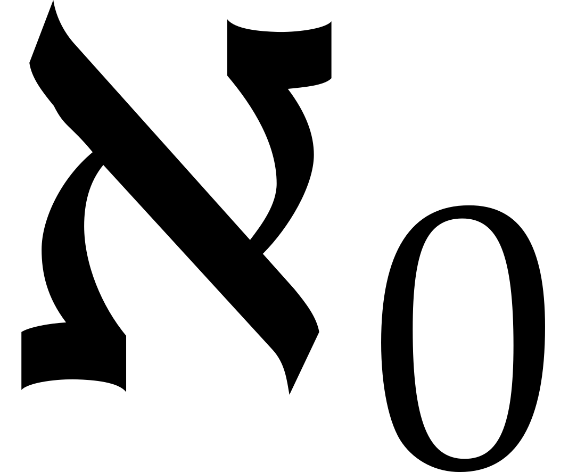 objects.”.

### [Ms-104](/ms-104/#23.6) [23\[6\]](https://cdn.wittgensteinnachlass.com/2000px/webp/Ms-104/23.webp)

4˙1022726 What holds for the word “object” holds correspondingly for the words “complex”, “fact”, “function”, “number” etc. etc.

### [Ms-104](/ms-104/#23.7) [23\[7\]](https://cdn.wittgensteinnachlass.com/2000px/webp/Ms-104/23.webp)

4˙1022727 All these words designate _formal_ concepts in the wider sense, and they are all represented in concept-script by _variables_, not by _functions_ or _classes_.

### [Ms-104](/ms-104/#23.8) [23\[8\]](https://cdn.wittgensteinnachlass.com/2000px/webp/Ms-104/23.webp)

4˙1022728 Expressions like “1 is a number”, “there is only one 0” and all similar expressions are nonsensical.

### [Ms-104](/ms-104/#23.9+24.1) [23\[9\]](https://cdn.wittgensteinnachlass.com/2000px/webp/Ms-104/23.webp),[24\[1\]](https://cdn.wittgensteinnachlass.com/2000px/webp/Ms-104/24.webp)

4˙10226 That something falls under a formal concept as an object of that concept cannot be expressed by a sentence.

It shows itself in the sign for this object itself.

(The name shows that it designates an object, the numeral that it designates a number.)

### [Ms-104](/ms-104/#24.2) [24\[2\]](https://cdn.wittgensteinnachlass.com/2000px/webp/Ms-104/24.webp)

4˙10227 The propositional variable thus designates the formal concept, and its values designate the objects that fall under this concept.

### [Ms-104](/ms-104/#24.3) [24\[3\]](https://cdn.wittgensteinnachlass.com/2000px/webp/Ms-104/24.webp)

4˙102272 For every variable represents a constant form that all its values possess, and that _can_ be understood as a formal property of those values.

### [Ms-104](/ms-104/#24.4) [24\[4\]](https://cdn.wittgensteinnachlass.com/2000px/webp/Ms-104/24.webp)

4˙102273 “Object”, “complex”, “fact”, “number”, etc. etc. are not names of concepts – as Russell believed – but variables.

### [Ms-104](/ms-104/#24.5) [24\[5\]](https://cdn.wittgensteinnachlass.com/2000px/webp/Ms-104/24.webp)

4˙22131 I also express the interchangeability of any two parts of a sentence concisely in the same way.

### [Ms-104](/ms-104/#24.6) [24\[6\]](https://cdn.wittgensteinnachlass.com/2000px/webp/Ms-104/24.webp)

4˙102241 It would be just as nonsensical to ascribe a formal property to a sentence as to deny it that property.

### [Ms-104](/ms-104/#24.7) [24\[7\]](https://cdn.wittgensteinnachlass.com/2000px/webp/Ms-104/24.webp)

4˙10227251 And it is nonsensical to speak of the “number of all objects”.

### [Ms-104](/ms-104/#24.8) [24\[8\]](https://cdn.wittgensteinnachlass.com/2000px/webp/Ms-104/24.webp)

3˙20121 I call the sentence, as well as any part of one, simply a “symbol”.

### [Ms-104](/ms-104/#24.9) [24\[9\]](https://cdn.wittgensteinnachlass.com/2000px/webp/Ms-104/24.webp)

3˙20122 Every symbol is a sentence or part of a sentence, and thus what sentences have in common with one another.

### [Ms-104](/ms-104/#24.10) [24\[10\]](https://cdn.wittgensteinnachlass.com/2000px/webp/Ms-104/24.webp)

3˙22 The sentence has essential and accidental features.

### [Ms-104](/ms-104/#24.11) [24\[11\]](https://cdn.wittgensteinnachlass.com/2000px/webp/Ms-104/24.webp)

3˙23 Accidental are the features that arise from the particular way the sentence-sign is produced.

Essential are those which alone enable the sentence to express its sense.

### [Ms-104](/ms-104/#25.1) [25\[1\]](https://cdn.wittgensteinnachlass.com/2000px/webp/Ms-104/25.webp)

3˙2016 Every sign can be represented as a sentence variable.

### [Ms-104](/ms-104/#25.2) [25\[2\]](https://cdn.wittgensteinnachlass.com/2000px/webp/Ms-104/25.webp)

3˙24 What is essential in the sentence is thus what all sentences that can express the same sense have in common.

### [Ms-104](/ms-104/#25.3) [25\[3\]](https://cdn.wittgensteinnachlass.com/2000px/webp/Ms-104/25.webp)

3˙213 So the proposition does not yet contain its sense, but it does contain the possibility of expressing it.

### [Ms-104](/ms-104/#25.4) [25\[4\]](https://cdn.wittgensteinnachlass.com/2000px/webp/Ms-104/25.webp)

3˙214 The proposition contains the form of its sense, but not the content of that sense.

### [Ms-104](/ms-104/#25.5) [25\[5\]](https://cdn.wittgensteinnachlass.com/2000px/webp/Ms-104/25.webp)

3˙211 Everything that belongs to the projection belongs to the proposition; but not what is projected.

### [Ms-104](/ms-104/#25.6) [25\[6\]](https://cdn.wittgensteinnachlass.com/2000px/webp/Ms-104/25.webp)

3˙212 Thus the possibility of what is projected, but not that itself.

### [Ms-104](/ms-104/#25.7) [25\[7\]](https://cdn.wittgensteinnachlass.com/2000px/webp/Ms-104/25.webp)

3˙241 And likewise, in general, what is essential in the sign is what all signs that can serve the same purpose have in common.

### [Ms-104](/ms-104/#25.8) [25\[8\]](https://cdn.wittgensteinnachlass.com/2000px/webp/Ms-104/25.webp)

3˙2131 “The content of the proposition” means the content of the proposition that has sense.

### [Ms-104](/ms-104/#25.9) [25\[9\]](https://cdn.wittgensteinnachlass.com/2000px/webp/Ms-104/25.webp)

4˙011 At first glance the sentence – as it appears, say, printed on the page – does not seem to be a picture of the reality it deals with.

### [Ms-104](/ms-104/#25.10) [25\[10\]](https://cdn.wittgensteinnachlass.com/2000px/webp/Ms-104/25.webp)

4˙0111 But at first glance musical notation does not seem to be a picture of music either, nor does our script of sound-signs (letters) seem to be a picture of our spoken language.

### [Ms-104](/ms-104/#25.11) [25\[11\]](https://cdn.wittgensteinnachlass.com/2000px/webp/Ms-104/25.webp)

4˙0112 And yet even in the ordinary sense these sign-languages prove to be pictures of what they represent.

### [Ms-104](/ms-104/#25.12+26.1) [25\[12\]](https://cdn.wittgensteinnachlass.com/2000px/webp/Ms-104/25.webp),[26\[1\]](https://cdn.wittgensteinnachlass.com/2000px/webp/Ms-104/26.webp)

4˙0113 And if we get to the essence of this pictorial character, we see that it is _not_ disturbed by _apparent_ _irregularities_ (such as the use of # and ♭ in musical notation).

### [Ms-104](/ms-104/#26.2) [26\[2\]](https://cdn.wittgensteinnachlass.com/2000px/webp/Ms-104/26.webp)

4˙0114 For these irregularities too depict what they are meant to express, only in a different way.

### [Ms-104](/ms-104/#26.3) [26\[3\]](https://cdn.wittgensteinnachlass.com/2000px/webp/Ms-104/26.webp)

3˙161 The fact that a sentence-sign is a fact is concealed by the usual form of expression in writing or print.

### [Ms-104](/ms-104/#26.4) [26\[4\]](https://cdn.wittgensteinnachlass.com/2000px/webp/Ms-104/26.webp)

3˙162 For in a printed sentence, for example, a sentence-sign does not look essentially different from a word.

### [Ms-104](/ms-104/#26.5) [26\[5\]](https://cdn.wittgensteinnachlass.com/2000px/webp/Ms-104/26.webp)

3˙1621 That is how Frege could call the sentence a composite name.

### [Ms-104](/ms-104/#26.6) [26\[6\]](https://cdn.wittgensteinnachlass.com/2000px/webp/Ms-104/26.webp)

3˙163 The essence of the sentence-sign becomes very clear if we put it together for ourselves not out of written signs but out of spatial objects (out of tables, chairs, books etc.).

### [Ms-104](/ms-104/#26.7) [26\[7\]](https://cdn.wittgensteinnachlass.com/2000px/webp/Ms-104/26.webp)

3˙164 The spatial arrangement of these things relative to one another then expresses the sense of the sentence.

### [Ms-104](/ms-104/#26.8) [26\[8\]](https://cdn.wittgensteinnachlass.com/2000px/webp/Ms-104/26.webp)

4˙0115 To understand the essence of the sentence, let us think of hieroglyphic writing, which admittedly depicts the facts it describes.

### [Ms-104](/ms-104/#26.9) [26\[9\]](https://cdn.wittgensteinnachlass.com/2000px/webp/Ms-104/26.webp)

4˙0116 And from it came alphabetic writing, without losing what is essential to depiction.

### [Ms-104](/ms-104/#26.10) [26\[10\]](https://cdn.wittgensteinnachlass.com/2000px/webp/Ms-104/26.webp)

2˙021 Objects form the substance of the world.

That is why they cannot be composite.

### [Ms-104](/ms-104/#27.1) [27\[1\]](https://cdn.wittgensteinnachlass.com/2000px/webp/Ms-104/27.webp)

2˙0211 If the world had no substance, whether a proposition has sense would depend on whether another proposition is true.

### [Ms-104](/ms-104/#27.2) [27\[2\]](https://cdn.wittgensteinnachlass.com/2000px/webp/Ms-104/27.webp)

2˙0212 It would then be impossible to construct a picture of the world (true or false).

### [Ms-104](/ms-104/#27.3) [27\[3\]](https://cdn.wittgensteinnachlass.com/2000px/webp/Ms-104/27.webp)

2˙022 It is obvious that however different we imagine a world to be from the actual world, it must have something – a form – in common with it.

### [Ms-104](/ms-104/#27.4) [27\[4\]](https://cdn.wittgensteinnachlass.com/2000px/webp/Ms-104/27.webp)

2˙023 This fixed form consists precisely of the objects.

### [Ms-104](/ms-104/#27.5) [27\[5\]](https://cdn.wittgensteinnachlass.com/2000px/webp/Ms-104/27.webp)

2˙0231 The substance of the world _can_ determine only a _form_ and not any material properties. For these are represented only by propositions – and are formed only by the configuration of objects.

### [Ms-104](/ms-104/#27.6) [27\[6\]](https://cdn.wittgensteinnachlass.com/2000px/webp/Ms-104/27.webp)

2˙0232 In passing: objects are colourless.

### [Ms-104](/ms-104/#27.7) [27\[7\]](https://cdn.wittgensteinnachlass.com/2000px/webp/Ms-104/27.webp)

2˙024 Substance is what exists independently of what is the case.

### [Ms-104](/ms-104/#27.8) [27\[8\]](https://cdn.wittgensteinnachlass.com/2000px/webp/Ms-104/27.webp)

2˙025 It is form and content.

### [Ms-104](/ms-104/#27.9) [27\[9\]](https://cdn.wittgensteinnachlass.com/2000px/webp/Ms-104/27.webp)

2˙0251 Space and time are forms of objects.

### [Ms-104](/ms-104/#27.10) [27\[10\]](https://cdn.wittgensteinnachlass.com/2000px/webp/Ms-104/27.webp)

2˙0252 Likewise, colour (or being coloured) is a form of visual objects.

### [Ms-104](/ms-104/#27.11) [27\[11\]](https://cdn.wittgensteinnachlass.com/2000px/webp/Ms-104/27.webp)

2˙026 Only if there are objects can there be a fixed form of the world.

### [Ms-104](/ms-104/#27.12) [27\[12\]](https://cdn.wittgensteinnachlass.com/2000px/webp/Ms-104/27.webp)

2˙027 The fixed, the enduring and the object are one.

### [Ms-104](/ms-104/#28.1) [28\[1\]](https://cdn.wittgensteinnachlass.com/2000px/webp/Ms-104/28.webp)

2˙0271 The object is what is fixed and enduring; the configuration is what changes and is inconstant.

### [Ms-104](/ms-104/#28.2) [28\[2\]](https://cdn.wittgensteinnachlass.com/2000px/webp/Ms-104/28.webp)

2˙0272 The configuration of objects forms the state of affairs.

---

### [Ms-104](/ms-104/#28.3) [28\[3\]](https://cdn.wittgensteinnachlass.com/2000px/webp/Ms-104/28.webp)

4˙09,1 If one overlooks the fact that the sentence has a sense independent of the facts, one can easily come to believe that true & false are relations of equal standing between a sign and what it designates.

### [Ms-104](/ms-104/#28.4) [28\[4\]](https://cdn.wittgensteinnachlass.com/2000px/webp/Ms-104/28.webp)

4˙09,11 (One might then say, for example, that “p” designates in the true way what “~p” designates in the false way, etc.)

### [Ms-104](/ms-104/#28.5) [28\[5\]](https://cdn.wittgensteinnachlass.com/2000px/webp/Ms-104/28.webp)

4˙09,2 “Can one not communicate with false sentences just as one has hitherto done with true ones? provided only that one knows they are meant to be false.”

4˙092 No! For a sentence is true if things are as we say they are by means of it; and if by “q” we mean ~q and things are as we mean they are, then “q” on this new understanding is true and not false.

### [Ms-104](/ms-104/#28.6) [28\[6\]](https://cdn.wittgensteinnachlass.com/2000px/webp/Ms-104/28.webp)

4˙0921 But it is important that the signs “q” and “~q” can say the same thing. For it shows that nothing in reality corresponds to the sign “~”.

### [Ms-104](/ms-104/#28.7) [28\[7\]](https://cdn.wittgensteinnachlass.com/2000px/webp/Ms-104/28.webp)

4˙0922 The mere occurrence of negation in a sentence is not yet a mark of its sense. (~~p = p).

### [Ms-104](/ms-104/#28.8) [28\[8\]](https://cdn.wittgensteinnachlass.com/2000px/webp/Ms-104/28.webp)

2˙0601 We also call the obtaining of states of affairs a positive – , their non-obtaining a negative fact.

### [Ms-104](/ms-104/#29.2) [29\[2\]](https://cdn.wittgensteinnachlass.com/2000px/webp/Ms-104/29.webp)

3˙2012 It can never indicate the feature common to two objects that we designate them with the same name but by two different _modes of designation_. For the name is arbitrary, after all; one could therefore choose two different names instead, and where would that leave what is common in the designation?

### [Ms-104](/ms-104/#29.3+30.1) [29\[3\]](https://cdn.wittgensteinnachlass.com/2000px/webp/Ms-104/29.webp),[30\[1\]](https://cdn.wittgensteinnachlass.com/2000px/webp/Ms-104/30.webp)

4˙094 A picture to explain the concept of truth: A black patch on white paper. One can describe the shape of the patch by specifying for each point on the surface whether it is white or black. To the fact that a point is black there corresponds a positive – to the fact that a point is white (not black), a negative fact. If I designate a point on the surface (a Fregean truth-value), this corresponds to the assumption put forward for judgement, etc. etc.

But to be able to say that a point is black or white, I must first know when one calls a point black and when one calls it white; to be able to say “p” is true (or false), I must have determined under what circumstances I call p true, and in doing so I determine the sense of the sentence.

Now the point at which the simile breaks down is this: We can point to a point on the paper even without knowing what white and black are; but nothing at all corresponds to a sentence without sense, for it designates no thing (truth-value) whose properties might be called “false” or “true”; the verb of a sentence is not “is true” or “is false” – as Frege believed – but what “is true” must already contain the verb.

### [Ms-104](/ms-104/#30.2) [30\[2\]](https://cdn.wittgensteinnachlass.com/2000px/webp/Ms-104/30.webp)

5˙222 It is surely scarcely credible from the outset that infinitely many _other_ facts should follow from a fact p, namely ~~p, ~~~~p, etc.

### [Ms-104](/ms-104/#30.3) [30\[3\]](https://cdn.wittgensteinnachlass.com/2000px/webp/Ms-104/30.webp)

4˙0011 Human beings have the ability to construct languages in which any sense can be expressed, without having any idea how each word means, and what it means. Just as one speaks without knowing how the individual sounds are produced.

### [Ms-104](/ms-104/#30.4) [30\[4\]](https://cdn.wittgensteinnachlass.com/2000px/webp/Ms-104/30.webp)

2˙0201 Every statement about complexes can be broken down into a statement about their components and the propositions that describe the complexes completely.

### [Ms-104](/ms-104/#30.5) [30\[5\]](https://cdn.wittgensteinnachlass.com/2000px/webp/Ms-104/30.webp)

5˙2201 It is evident to the unprejudiced mind that ⌵, ⊃, etc. are not relations in the sense in which right and left, etc. are.

### [Ms-104](/ms-104/#30.6) [30\[6\]](https://cdn.wittgensteinnachlass.com/2000px/webp/Ms-104/30.webp)

5˙221 The very possibility of cross-defining Frege’s and Russell’s logical “primitive signs” shows that these are not primitive signs; and all the more that they do not designate relations.

### [Ms-104](/ms-104/#30.7) [30\[7\]](https://cdn.wittgensteinnachlass.com/2000px/webp/Ms-104/30.webp)

5˙2211 And it is obvious that the “⊃” we define by means of “ ∙ ” and “⌵” is identical with the one by means of which we define “⌵” with “ ∙ ”, and that this “ ∙ ” is identical with the first. And so on.

### [Ms-104](/ms-104/#30.8+31.1) [30\[8\]](https://cdn.wittgensteinnachlass.com/2000px/webp/Ms-104/30.webp),[31\[1\]](https://cdn.wittgensteinnachlass.com/2000px/webp/Ms-104/31.webp)

4˙102274 If we turn a constituent of a sentence into a variable, there is a class of sentences that are all values of the resulting variable sentence. In general this class still depends on what, by arbitrary convention, we mean by parts of that sentence. But if we turn into variables all those signs whose meaning was determined arbitrarily, there is still such a class. This class, however, no longer depends on any convention, but only on the nature of the sentence. It corresponds to a logical prototype – a logical form.

### [Ms-104](/ms-104/#31.2) [31\[2\]](https://cdn.wittgensteinnachlass.com/2000px/webp/Ms-104/31.webp)

4˙1022631 One cannot distinguish forms from one another by saying that one has this property but the other has that one; for this presupposes that it makes sense to predicate both properties of both forms.

### [Ms-104](/ms-104/#31.3) [31\[3\]](https://cdn.wittgensteinnachlass.com/2000px/webp/Ms-104/31.webp)

3˙2011 Names are like points, sentences like arrows: they have sense.

### [Ms-104](/ms-104/#31.4) [31\[4\]](https://cdn.wittgensteinnachlass.com/2000px/webp/Ms-104/31.webp)

3˙201221 “A” is the same letter as “A”. This is of great importance for our language.

### [Ms-104](/ms-104/#31.5) [31\[5\]](https://cdn.wittgensteinnachlass.com/2000px/webp/Ms-104/31.webp)

5˙041021 If a god creates a world in which certain propositions are true, in doing so he already creates a world in which all the consequent propositions hold. And likewise he could not create a world in which the proposition p is true without creating all its objects.

### [Ms-104](/ms-104/#31.6) [31\[6\]](https://cdn.wittgensteinnachlass.com/2000px/webp/Ms-104/31.webp)

4˙4461 Tautologies are senseless. (For example, I know nothing about the weather if I know that it is raining or not raining.)

### [Ms-104](/ms-104/#31.7+32.1) [31\[7\]](https://cdn.wittgensteinnachlass.com/2000px/webp/Ms-104/31.webp),[32\[1\]](https://cdn.wittgensteinnachlass.com/2000px/webp/Ms-104/32.webp)

4˙025 To understand a sentence is to know what is the case if it is true.

### [Ms-104](/ms-104/#32.2) [32\[2\]](https://cdn.wittgensteinnachlass.com/2000px/webp/Ms-104/32.webp)

4˙025 One can therefore understand it without knowing whether it is true.

### [Ms-104](/ms-104/#32.3) [32\[3\]](https://cdn.wittgensteinnachlass.com/2000px/webp/Ms-104/32.webp)

4˙026 One understands it if one understands its constituents.

### [Ms-104](/ms-104/#32.4) [32\[4\]](https://cdn.wittgensteinnachlass.com/2000px/webp/Ms-104/32.webp)

5˙101 The sense of a truth-function of p is a function of the sense of p.

### [Ms-104](/ms-104/#32.5) [32\[5\]](https://cdn.wittgensteinnachlass.com/2000px/webp/Ms-104/32.webp)

5˙231 If, for example, one can produce an affirmation by double negation, is negation then – in some sense – contained in the affirmation? Does ~~p negate ~p, or does it affirm p; or both?

### [Ms-104](/ms-104/#32.6) [32\[6\]](https://cdn.wittgensteinnachlass.com/2000px/webp/Ms-104/32.webp)

4˙4311 Frege’s sign “⊢” has no logical meaning at all; in Frege (and Russell) it indicates only that these authors take the sentences so designated to be true. “⊢” is therefore no more a part of the structure of the sentence than, say, the sentence’s number. A sentence cannot possibly say of itself that it is true.

### [Ms-104](/ms-104/#32.8+33.1) [32\[8\]](https://cdn.wittgensteinnachlass.com/2000px/webp/Ms-104/32.webp),[33\[1\]](https://cdn.wittgensteinnachlass.com/2000px/webp/Ms-104/33.webp)

5˙301 If logic has basic concepts, they must be independent of one another. If a basic concept is introduced, it must be introduced in all the combinations in which it occurs at all. Thus one cannot introduce it first for one combination and then all over again for another. For example: Once negation has been introduced, we must now understand it in sentences of the form ~p just as we do in sentences such as ~(p ⌵ q) (or (Еx).~φx) and the like. We must not introduce it first for one class of cases and then for the other, for it would then remain doubtful whether its meaning was the same in both cases, and there would be no reason to use the same way of combining signs in both cases.

(In short, what Frege (Grundgesetze der Arithmetik) said about introducing signs by definitions applies, mutatis mutandis, to the introduction of primitive signs.)

### [Ms-104](/ms-104/#33.2) [33\[2\]](https://cdn.wittgensteinnachlass.com/2000px/webp/Ms-104/33.webp)

4˙4001 It is likely from the outset that introducing elementary propositions is fundamental to understanding all other kinds of proposition. Indeed, the understanding of general propositions depends perceptibly on that of elementary propositions.

### [Ms-104](/ms-104/#33.3) [33\[3\]](https://cdn.wittgensteinnachlass.com/2000px/webp/Ms-104/33.webp)

3˙1622 Not: “the complex sign ‘aRb’ says that a stands in the relation R to b”, but: _that_ “a” stands in a certain relation to “b” says _that_ aRb.

### [Ms-104](/ms-104/#33.4) [33\[4\]](https://cdn.wittgensteinnachlass.com/2000px/webp/Ms-104/33.webp)

4˙00163 It is to Russell’s credit that he showed that the apparent logical form of the sentence need not be its actual form.

### [Ms-104](/ms-104/#33.5) [33\[5\]](https://cdn.wittgensteinnachlass.com/2000px/webp/Ms-104/33.webp)

4˙100152 Epistemology is the philosophy of psychology.

### [Ms-104](/ms-104/#33.6) [33\[6\]](https://cdn.wittgensteinnachlass.com/2000px/webp/Ms-104/33.webp)

4˙100153 Psychology is no more closely related to philosophy than any other natural science.

### [Ms-104](/ms-104/#33.7) [33\[7\]](https://cdn.wittgensteinnachlass.com/2000px/webp/Ms-104/33.webp)

4˙100154 Philosophy sets limits to the disputable domain of natural science.

### [Ms-104](/ms-104/#34.1) [34\[1\]](https://cdn.wittgensteinnachlass.com/2000px/webp/Ms-104/34.webp)

5˙04442 If it does not _follow_ from a proposition’s being evident to us that it is true, then its being evident is no justification for our belief in its truth either.

### [Ms-104](/ms-104/#34.3) [34\[3\]](https://cdn.wittgensteinnachlass.com/2000px/webp/Ms-104/34.webp)

3˙20171 No sentence can say anything about itself, because the sentence-sign cannot be contained in itself. (That is the whole “Theory of Types”.)

### [Ms-104](/ms-104/#34.4) [34\[4\]](https://cdn.wittgensteinnachlass.com/2000px/webp/Ms-104/34.webp)

5˙321 What is distinctive about the designation of generality is, first, that it points to a logical prototype and, second, that it singles out constants.

---

### [Ms-104](/ms-104/#34.5) [34\[5\]](https://cdn.wittgensteinnachlass.com/2000px/webp/Ms-104/34.webp)

5˙3301 It is evident that identity is not a relation between objects.

### [Ms-104](/ms-104/#34.6) [34\[6\]](https://cdn.wittgensteinnachlass.com/2000px/webp/Ms-104/34.webp)

5˙3302 This becomes quite clear if one considers, for example, the proposition (x):φ(x)⊃x = a. What this proposition says is simply that _only_ a satisfies the function φ, not that only things that stand in a certain relation to a satisfy φ.

To be sure, one might now say that _only a_ stands in this relation to a, but to express this we would need the equality sign itself.

### [Ms-104](/ms-104/#34.7+35.1) [34\[7\]](https://cdn.wittgensteinnachlass.com/2000px/webp/Ms-104/34.webp),[35\[1\]](https://cdn.wittgensteinnachlass.com/2000px/webp/Ms-104/35.webp)

5˙3303 Russell’s definition of “ = ” is not adequate, because on that definition one cannot say: two objects have all their properties in common. (Even if this proposition is never true, it still has sense.)

### [Ms-104](/ms-104/#35.3) [35\[3\]](https://cdn.wittgensteinnachlass.com/2000px/webp/Ms-104/35.webp)

5˙3021 All numbers in logic must be capable of justification.

### [Ms-104](/ms-104/#35.4) [35\[4\]](https://cdn.wittgensteinnachlass.com/2000px/webp/Ms-104/35.webp)

5˙012 It is easy to confuse the arguments of functions with the indices of names. For both the argument and the index tell me the meaning of the sign in which they occur. In Russell’s “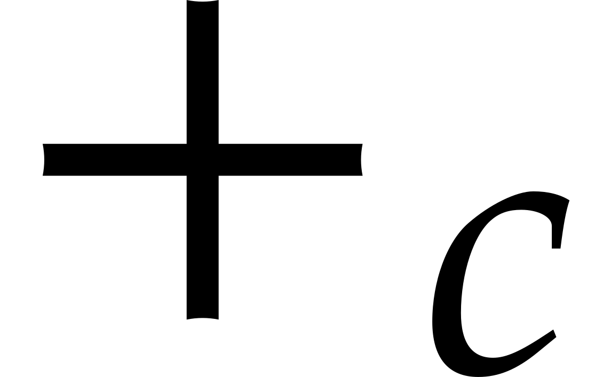”, for example, “c” is an index indicating that the whole sign is the sign for addition of cardinal numbers. But this rests on an arbitrary convention, and one could choose a simple sign in place of “”: but in “~p”, “p” is not an index but an argument; the sense of “~p” _cannot_ be understood unless the sense of p has already been understood. In the name “Julius Cäsar”, “Julius” is an index. (The index is always part of a description of the object whose name we attach to the index. (_The_ Caesar of the Julian family.))

### [Ms-104](/ms-104/#35.5) [35\[5\]](https://cdn.wittgensteinnachlass.com/2000px/webp/Ms-104/35.webp)

4˙10227252 The question of the existence of a form is always nonsensical.

### [Ms-104](/ms-104/#35.6) [35\[6\]](https://cdn.wittgensteinnachlass.com/2000px/webp/Ms-104/35.webp)

4˙10227253 For no proposition can answer such a question.

### [Ms-104](/ms-104/#35.7) [35\[7\]](https://cdn.wittgensteinnachlass.com/2000px/webp/Ms-104/35.webp)

4˙10227254 Thus one cannot, for example, ask: “Are there unanalysable subject–predicate sentences?” (or “2-place relations” or “relations between relations” etc.).

### [Ms-104](/ms-104/#36.1) [36\[1\]](https://cdn.wittgensteinnachlass.com/2000px/webp/Ms-104/36.webp)

5˙234 If a proposition is given to us, then _with it_ all its truth-functions are already given as well.

### [Ms-104](/ms-104/#36.2) [36\[2\]](https://cdn.wittgensteinnachlass.com/2000px/webp/Ms-104/36.webp)

4˙44602 Analytic propositions are tautologies.

### [Ms-104](/ms-104/#36.3) [36\[3\]](https://cdn.wittgensteinnachlass.com/2000px/webp/Ms-104/36.webp)

5˙21 Here it becomes apparent that there are no logical objects, no logical constants.

### [Ms-104](/ms-104/#36.4) [36\[4\]](https://cdn.wittgensteinnachlass.com/2000px/webp/Ms-104/36.webp)

5˙22 For: All W-functions of W-functions that are one and the same W-function of elementary propositions are identical.

### [Ms-104](/ms-104/#36.5) [36\[5\]](https://cdn.wittgensteinnachlass.com/2000px/webp/Ms-104/36.webp)

3˙2021 Names cannot be defined; they are primitive signs.

### [Ms-104](/ms-104/#36.6) [36\[6\]](https://cdn.wittgensteinnachlass.com/2000px/webp/Ms-104/36.webp)

4˙10018 Anything that can be thought at all can be thought clearly. Anything that can be put into words can be put into words clearly.

### [Ms-104](/ms-104/#36.7) [36\[7\]](https://cdn.wittgensteinnachlass.com/2000px/webp/Ms-104/36.webp)

4˙0012 Ordinary language is part of the human organism and no less complicated than it is.

### [Ms-104](/ms-104/#36.8) [36\[8\]](https://cdn.wittgensteinnachlass.com/2000px/webp/Ms-104/36.webp)

4˙0013 It is humanly impossible to glean the logic of language directly from it.

### [Ms-104](/ms-104/#36.9) [36\[9\]](https://cdn.wittgensteinnachlass.com/2000px/webp/Ms-104/36.webp)

4˙0014 It disguises thought.

### [Ms-104](/ms-104/#36.10) [36\[10\]](https://cdn.wittgensteinnachlass.com/2000px/webp/Ms-104/36.webp)

4˙00141 So much so that one cannot infer the form of the thought that is clothed from the outward form of its clothing; for the outward form of the clothing is fashioned with quite different considerations in mind from that of revealing the form of the body.

### [Ms-104](/ms-104/#36.11) [36\[11\]](https://cdn.wittgensteinnachlass.com/2000px/webp/Ms-104/36.webp)

4˙0015 Thus, if one goes by the outward appearance of ordinary language, every kind of deception and confusion is possible.

### [Ms-104](/ms-104/#36.12+37.1) [36\[12\]](https://cdn.wittgensteinnachlass.com/2000px/webp/Ms-104/36.webp),[37\[1\]](https://cdn.wittgensteinnachlass.com/2000px/webp/Ms-104/37.webp)

4˙00151 “To exist” appears as an intransitive verb like “to go”, “er ist” sounds like “er ißt”, “identical” is an adjective and “Weiß” is a person’s name.

### [Ms-104](/ms-104/#37.2) [37\[2\]](https://cdn.wittgensteinnachlass.com/2000px/webp/Ms-104/37.webp)

4˙0016 Most sentences and questions that have been written about philosophical matters are not false but nonsensical. We therefore cannot answer questions of this kind at all, but can only establish that they are nonsensical. Most of the questions and sentences of philosophers result from our failure to understand the logic of our language.

### [Ms-104](/ms-104/#37.3) [37\[3\]](https://cdn.wittgensteinnachlass.com/2000px/webp/Ms-104/37.webp)

4˙00161 They are of the same kind as the question whether the good is more or less identical than the beautiful.

### [Ms-104](/ms-104/#37.4) [37\[4\]](https://cdn.wittgensteinnachlass.com/2000px/webp/Ms-104/37.webp)

4˙00162 All philosophy is “critique of language” (though not in Mauthner’s sense).

### [Ms-104](/ms-104/#37.5) [37\[5\]](https://cdn.wittgensteinnachlass.com/2000px/webp/Ms-104/37.webp)

5˙224 Yet all propositions of logic say the same thing. Namely nothing.

### [Ms-104](/ms-104/#37.6) [37\[6\]](https://cdn.wittgensteinnachlass.com/2000px/webp/Ms-104/37.webp)

5˙223 But this is no less remarkable than that the infinite number of propositions of logic (of mathematics) should follow from half a dozen “basic laws”.

### [Ms-104](/ms-104/#37.7) [37\[7\]](https://cdn.wittgensteinnachlass.com/2000px/webp/Ms-104/37.webp)

5˙04102 If p follows from q, then the sense of p is contained in the sense of q.

### [Ms-104](/ms-104/#37.8) [37\[8\]](https://cdn.wittgensteinnachlass.com/2000px/webp/Ms-104/37.webp)

4˙0923 The sentences p and ~p have opposite senses, but one and the same reality corresponds to them.

### [Ms-104](/ms-104/#37.9) [37\[9\]](https://cdn.wittgensteinnachlass.com/2000px/webp/Ms-104/37.webp)

5˙08 Contradiction is what propositions have in common, which _no_ proposition has in common with another. Tautology is what all propositions have in common that have nothing in common with one another.

### [Ms-104](/ms-104/#37.10) [37\[10\]](https://cdn.wittgensteinnachlass.com/2000px/webp/Ms-104/37.webp)

5˙081 Contradiction vanishes, so to speak, outside all propositions, tautology within them all.

### [Ms-104](/ms-104/#37.11+38.1) [37\[11\]](https://cdn.wittgensteinnachlass.com/2000px/webp/Ms-104/37.webp),[38\[1\]](https://cdn.wittgensteinnachlass.com/2000px/webp/Ms-104/38.webp)

5˙082 Contradiction is the outer limit of propositions, tautology their centre without substance.

### [Ms-104](/ms-104/#38.2) [38\[2\]](https://cdn.wittgensteinnachlass.com/2000px/webp/Ms-104/38.webp)

4˙4481 Tautology and contradiction are (senseless) not nonsensical. They belong to the symbolism, rather as 0 belongs to arithmetic.

### [Ms-104](/ms-104/#38.3) [38\[3\]](https://cdn.wittgensteinnachlass.com/2000px/webp/Ms-104/38.webp)

4˙44601 In the first case we call the proposition a tautology, in the second a contradiction.

### [Ms-104](/ms-104/#38.4) [38\[4\]](https://cdn.wittgensteinnachlass.com/2000px/webp/Ms-104/38.webp)

3˙1601 Only facts can express a sense; a class of names cannot.

### [Ms-104](/ms-104/#38.5) [38\[5\]](https://cdn.wittgensteinnachlass.com/2000px/webp/Ms-104/38.webp)

3˙1602 A sentence is not a jumble of words. (Just as a melody is not a jumble of tones.)

### [Ms-104](/ms-104/#38.6) [38\[6\]](https://cdn.wittgensteinnachlass.com/2000px/webp/Ms-104/38.webp)

3˙1603 The sentence is articulated.

### [Ms-104](/ms-104/#38.7) [38\[7\]](https://cdn.wittgensteinnachlass.com/2000px/webp/Ms-104/38.webp)

5˙23 W-functions are not material functions.

### [Ms-104](/ms-104/#38.8) [38\[8\]](https://cdn.wittgensteinnachlass.com/2000px/webp/Ms-104/38.webp)

5˙232 The proposition ~~p is not about negation as it would be about an object; but the possibility of negation is already implicit in the affirmation.

### [Ms-104](/ms-104/#38.9) [38\[9\]](https://cdn.wittgensteinnachlass.com/2000px/webp/Ms-104/38.webp)

5˙302 If one introduced the primitive logical signs correctly, one would thereby have introduced the sense of all their combinations as well; thus not only “p ⌵ q” but also “~(p ⌵ ~q)” etc. etc. One would thereby have introduced the effect of every possible combination of brackets as well. And it would thereby have become clear that the genuine general primitive signs are not “p ⌵ q”, (Еx) ∙ φx, etc., but the most general form of their combinations.

### [Ms-104](/ms-104/#39.1) [39\[1\]](https://cdn.wittgensteinnachlass.com/2000px/webp/Ms-104/39.webp)

5˙3024 The use of brackets with those apparent primitive signs already suggests that these are not the genuine primitive signs. And presumably no one will believe that brackets have an independent meaning.

### [Ms-104](/ms-104/#39.2) [39\[2\]](https://cdn.wittgensteinnachlass.com/2000px/webp/Ms-104/39.webp)

5˙3023 If there is more than one primitive logical sign, a correct logic must make clear how they stand in relation to one another and justify their existence. It must become clear how logic is built _out of_ its primitive signs.

### [Ms-104](/ms-104/#39.3) [39\[3\]](https://cdn.wittgensteinnachlass.com/2000px/webp/Ms-104/39.webp)

5˙30231 The introduction of a new device into the symbolism of logic must always be a momentous event. No new device may be introduced into logic – as it were, with a quite innocent look – in brackets or below the line. Thus in the “Principia Mathematica” by Russell & Whitehead there are definitions and basic laws in words. Why, all of a sudden, words here? This would need a lengthy justification. It is missing and must be missing, since the procedure is in fact inadmissible.

### [Ms-104](/ms-104/#39.4) [39\[4\]](https://cdn.wittgensteinnachlass.com/2000px/webp/Ms-104/39.webp)

5˙013 The confusion of argument and index, if I am not mistaken, underlies Frege’s theory of the meaning of propositions and functions. For Frege the propositions of logic were names, and their arguments the indices of these names.

### [Ms-104](/ms-104/#39.5+40.1) [39\[5\]](https://cdn.wittgensteinnachlass.com/2000px/webp/Ms-104/39.webp),[40\[1\]](https://cdn.wittgensteinnachlass.com/2000px/webp/Ms-104/40.webp)

5˙3342 There are certain cases in which one is tempted to use expressions of the form a = a or p⊃p and the like; this happens when one would like to speak of the prototype sentence, thing, etc. Thus in the “Principles of Mathematics” Russell rendered the nonsense “p is a sentence” in symbols as “p⊃p” and placed it as a hypothesis before certain sentences so that their argument places could be occupied only by sentences.

### [Ms-104](/ms-104/#40.2) [40\[2\]](https://cdn.wittgensteinnachlass.com/2000px/webp/Ms-104/40.webp)

5˙3343 It is nonsense to put the hypothesis p⊃p before a sentence to ensure that it has arguments of the right form, if only because with a non-sentence as argument the hypothesis becomes not false but nonsensical, and because arguments of the wrong kind make the sentence itself nonsensical, so that it guards itself against the wrong arguments just as well or as badly as the senseless hypothesis attached for this purpose.

### [Ms-104](/ms-104/#40.3) [40\[3\]](https://cdn.wittgensteinnachlass.com/2000px/webp/Ms-104/40.webp)

5˙3022 Or rather, it must turn out that there are no numbers in logic.

### [Ms-104](/ms-104/#40.4) [40\[4\]](https://cdn.wittgensteinnachlass.com/2000px/webp/Ms-104/40.webp)

5˙3304 In passing: to say of _two_ things that they are identical is nonsense, and to say of _one_ thing that it is identical with itself is to say nothing at all.

### [Ms-104](/ms-104/#40.5) [40\[5\]](https://cdn.wittgensteinnachlass.com/2000px/webp/Ms-104/40.webp)

4˙0951 One might say: negation already refers to the logical place determined by the negated sentence. The negating sentence determines a _different_ logical place from the one determined by the negated sentence.

### [Ms-104](/ms-104/#40.6+41.1) [40\[6\]](https://cdn.wittgensteinnachlass.com/2000px/webp/Ms-104/40.webp),[41\[1\]](https://cdn.wittgensteinnachlass.com/2000px/webp/Ms-104/41.webp)

4˙0952 The negating sentence determines its logical place with the aid of the logical place of the negated sentence, by describing the former as lying outside the latter.

### [Ms-104](/ms-104/#41.2) [41\[2\]](https://cdn.wittgensteinnachlass.com/2000px/webp/Ms-104/41.webp)

4˙0953 The fact that one can negate the negating sentence again already shows that what is negated is already a sentence and not merely the preparation for one.

### [Ms-104](/ms-104/#41.3) [41\[3\]](https://cdn.wittgensteinnachlass.com/2000px/webp/Ms-104/41.webp)

4˙1031 What _can_ be shown cannot be said.

### [Ms-104](/ms-104/#41.4) [41\[4\]](https://cdn.wittgensteinnachlass.com/2000px/webp/Ms-104/41.webp)

4˙1001531 Does not my study of sign-language correspond to the study of thought processes that philosophers always held to be so essential to the philosophy of logic? Only they mostly got entangled in inessential psychological investigations, and there is an analogous danger with my method too.

### [Ms-104](/ms-104/#41.5) [41\[5\]](https://cdn.wittgensteinnachlass.com/2000px/webp/Ms-104/41.webp)

4˙4322 In a negative sense the sentence, the picture, the model are like a solid body that limits the freedom of movement of other bodies; in a positive sense, like the space bounded by solid matter in which a body has room.

### [Ms-104](/ms-104/#41.6) [41\[6\]](https://cdn.wittgensteinnachlass.com/2000px/webp/Ms-104/41.webp)

4˙0102 The possibility of the sentence rests on the principle of signs standing for objects.

### [Ms-104](/ms-104/#41.7) [41\[7\]](https://cdn.wittgensteinnachlass.com/2000px/webp/Ms-104/41.webp)

4˙0103 My fundamental thought is that the “logical constants” do not stand for anything. That nothing can stand for the _logic_ of the facts.

### [Ms-104](/ms-104/#41.8) [41\[8\]](https://cdn.wittgensteinnachlass.com/2000px/webp/Ms-104/41.webp)

3˙20104 The sentence that deals with the complex stands in an internal relation to the sentence that deals with the constituent of that complex.

### [Ms-104](/ms-104/#41.9+42.1) [41\[9\]](https://cdn.wittgensteinnachlass.com/2000px/webp/Ms-104/41.webp),[42\[1\]](https://cdn.wittgensteinnachlass.com/2000px/webp/Ms-104/42.webp)

5˙0444 Free will consists in the fact that future events cannot be known now. We could know them only if causality were an _internal_ necessity, like that of logical inference. – The connection between knowledge and what is known is that of logical necessity.

### [Ms-104](/ms-104/#42.2) [42\[2\]](https://cdn.wittgensteinnachlass.com/2000px/webp/Ms-104/42.webp)

4˙4484 In a tautology the elementary proposition of course still depicts, but it is so loosely connected with reality that reality has _unrestricted_ freedom. A contradiction sets such limits that no reality can exist within them.

### [Ms-104](/ms-104/#42.3) [42\[3\]](https://cdn.wittgensteinnachlass.com/2000px/webp/Ms-104/42.webp)

4˙4485 A tautology leaves the whole – infinite – logical space free for reality; a contradiction fills the whole of logical space and leaves reality not a single point. Neither can therefore determine reality in any way.

### [Ms-104](/ms-104/#42.4) [42\[4\]](https://cdn.wittgensteinnachlass.com/2000px/webp/Ms-104/42.webp)

4˙44861 Certain, possible, impossible: here we have an indication of the gradation we need in probability theory.

### [Ms-104](/ms-104/#42.5) [42\[5\]](https://cdn.wittgensteinnachlass.com/2000px/webp/Ms-104/42.webp)

4˙051 A sentence must communicate a new sense with old expressions.

### [Ms-104](/ms-104/#42.6) [42\[6\]](https://cdn.wittgensteinnachlass.com/2000px/webp/Ms-104/42.webp)

4˙0101 The possibility of all similes, of the whole pictorial character of our way of expressing ourselves, rests on the logic of depiction.

### [Ms-104](/ms-104/#42.7) [42\[7\]](https://cdn.wittgensteinnachlass.com/2000px/webp/Ms-104/42.webp)

3˙001 “A state of affairs is thinkable” (“imaginable”) means: we can make a picture of it for ourselves.

### [Ms-104](/ms-104/#42.8) [42\[8\]](https://cdn.wittgensteinnachlass.com/2000px/webp/Ms-104/42.webp)

3˙031 One once said that God could create anything except what would run counter to the laws of logic. For we could not _say_ what an “illogical” world would look like.

### [Ms-104](/ms-104/#42.9+43.1) [42\[9\]](https://cdn.wittgensteinnachlass.com/2000px/webp/Ms-104/42.webp),[43\[1\]](https://cdn.wittgensteinnachlass.com/2000px/webp/Ms-104/43.webp)

3˙032 One can no more represent in language something “that contradicts logic” than one can represent in geometry, by its coordinates, “a figure that contradicts the laws of space”, or, as for the coordinates, “give them for a point that does not exist”.

### [Ms-104](/ms-104/#43.2) [43\[2\]](https://cdn.wittgensteinnachlass.com/2000px/webp/Ms-104/43.webp)

3˙0321 We can, to be sure, represent spatially a state of affairs that would run counter to the laws of physics, but not one that would run counter to the laws of geometry.

### [Ms-104](/ms-104/#43.4) [43\[4\]](https://cdn.wittgensteinnachlass.com/2000px/webp/Ms-104/43.webp)

3˙2101 The sentence determines a place in logical space. The existence of this logical place is guaranteed by the existence of the constituents alone, by the existence of the sentence with sense.

### [Ms-104](/ms-104/#43.5) [43\[5\]](https://cdn.wittgensteinnachlass.com/2000px/webp/Ms-104/43.webp)

3˙2102 The sentence-sign and the logical coordinates: that is the logical place.

### [Ms-104](/ms-104/#43.6) [43\[6\]](https://cdn.wittgensteinnachlass.com/2000px/webp/Ms-104/43.webp)

3˙2103 The geometrical and the logical place agree in that both are the possibility of an existence.

### [Ms-104](/ms-104/#43.7) [43\[7\]](https://cdn.wittgensteinnachlass.com/2000px/webp/Ms-104/43.webp)

3˙2104 Although the sentence may determine only one place in logical space, the whole of logical space must already be given by it.

(Otherwise negation, disjunction, etc. would keep introducing new elements – in coordination.)

### [Ms-104](/ms-104/#43.8) [43\[8\]](https://cdn.wittgensteinnachlass.com/2000px/webp/Ms-104/43.webp)

3˙2141 The logical scaffolding around the picture determines logical space.

### [Ms-104](/ms-104/#43.9) [43\[9\]](https://cdn.wittgensteinnachlass.com/2000px/webp/Ms-104/43.webp)

3˙2142 The sentence reaches through the whole of logical space.

### [Ms-104](/ms-104/#43.10+44.1) [43\[10\]](https://cdn.wittgensteinnachlass.com/2000px/webp/Ms-104/43.webp),[44\[1\]](https://cdn.wittgensteinnachlass.com/2000px/webp/Ms-104/44.webp)

5˙3344 Similarly, one wanted to express “There are no _things_” by “~(Еx) ∙ x = x”. But even if this were a proposition, would it not also be true if “there were things”, but they were not identical with themselves?

### [Ms-104](/ms-104/#44.2) [44\[2\]](https://cdn.wittgensteinnachlass.com/2000px/webp/Ms-104/44.webp)

3˙242 There is admittedly something arbitrary about our notations, but _this_ is not arbitrary: that _if_ we have determined something arbitrarily, then something else _must_ be the case. (This depends on the _nature_ of the notation.)

### [Ms-104](/ms-104/#44.3) [44\[3\]](https://cdn.wittgensteinnachlass.com/2000px/webp/Ms-104/44.webp)

3˙2421 A particular mode of designation may be unimportant, but it is always important that it is _a possible_ mode of designation.

### [Ms-104](/ms-104/#44.4) [44\[4\]](https://cdn.wittgensteinnachlass.com/2000px/webp/Ms-104/44.webp)

3˙24211 And so it is throughout philosophy: the particular case repeatedly turns out to be unimportant, but the possibility of each particular case gives us an insight into the essence of the world.

### [Ms-104](/ms-104/#44.5) [44\[5\]](https://cdn.wittgensteinnachlass.com/2000px/webp/Ms-104/44.webp)

3˙20101 The requirement for simple signs is the requirement that sense be determinate.

### [Ms-104](/ms-104/#44.6) [44\[6\]](https://cdn.wittgensteinnachlass.com/2000px/webp/Ms-104/44.webp)

3˙20102 The analysis of signs must come to an end at some point, because if signs are to express anything at all, they must signify in a way that is settled once and for all.

### [Ms-104](/ms-104/#44.7) [44\[7\]](https://cdn.wittgensteinnachlass.com/2000px/webp/Ms-104/44.webp)

3˙20108 There is one and only one complete analysis of the sentence.

### [Ms-104](/ms-104/#44.8) [44\[8\]](https://cdn.wittgensteinnachlass.com/2000px/webp/Ms-104/44.webp)

4˙4483 In a tautology the conditions of agreement with the world – the relations of representation – cancel one another out, so that it stands in no representational relation to reality.

### [Ms-104](/ms-104/#45.1) [45\[1\]](https://cdn.wittgensteinnachlass.com/2000px/webp/Ms-104/45.webp)

4˙4462 A proposition shows what it says; tautology and contradiction show that they say nothing.

### [Ms-104](/ms-104/#45.2) [45\[2\]](https://cdn.wittgensteinnachlass.com/2000px/webp/Ms-104/45.webp)

4˙447 A tautology has no truth-conditions, for it is unconditionally true, and a contradiction is true under no condition.

### [Ms-104](/ms-104/#45.3) [45\[3\]](https://cdn.wittgensteinnachlass.com/2000px/webp/Ms-104/45.webp)

4˙448 Tautology and contradiction are senseless.

### [Ms-104](/ms-104/#45.4) [45\[4\]](https://cdn.wittgensteinnachlass.com/2000px/webp/Ms-104/45.webp)

4˙44801 (Like the point from which two arrows diverge in opposite directions)

### [Ms-104](/ms-104/#45.5) [45\[5\]](https://cdn.wittgensteinnachlass.com/2000px/webp/Ms-104/45.webp)

4˙4482 Tautology and contradiction are not pictures of reality. They depict no possible situation. For the former allows _every_ possible situation, the latter _none_.

### [Ms-104](/ms-104/#45.6) [45\[6\]](https://cdn.wittgensteinnachlass.com/2000px/webp/Ms-104/45.webp)

4˙449 The logical product of a tautology and a proposition says the same as the proposition. So that product is identical with the proposition. For one cannot change what is essential to the sign without changing its sense.

### [Ms-104](/ms-104/#45.7) [45\[7\]](https://cdn.wittgensteinnachlass.com/2000px/webp/Ms-104/45.webp)

4˙4321 The truth-conditions determine how much room the proposition leaves the facts.

### [Ms-104](/ms-104/#45.8) [45\[8\]](https://cdn.wittgensteinnachlass.com/2000px/webp/Ms-104/45.webp)

4˙4486 The truth of a tautology is certain, that of a proposition possible, that of a contradiction impossible.

### [Ms-104](/ms-104/#45.9) [45\[9\]](https://cdn.wittgensteinnachlass.com/2000px/webp/Ms-104/45.webp)

4˙095 Every sentence must _already_ have sense; affirmation cannot give it sense, for it is precisely the sense that is affirmed. And the same holds for negation, etc.

### [Ms-104](/ms-104/#46.1) [46\[1\]](https://cdn.wittgensteinnachlass.com/2000px/webp/Ms-104/46.webp)

4˙2214 Can we understand two names without knowing whether they designate the same thing or different things? – Can we understand a sentence in which two names occur without knowing whether they mean the same thing or different things?

### [Ms-104](/ms-104/#46.2) [46\[2\]](https://cdn.wittgensteinnachlass.com/2000px/webp/Ms-104/46.webp)

4˙22141 If, for instance, I know the meaning of an English word and of a German word with the same meaning, it is impossible for me not to know that the two have the same meaning; it is impossible for me to be unable to translate either into the other.

### [Ms-104](/ms-104/#46.3) [46\[3\]](https://cdn.wittgensteinnachlass.com/2000px/webp/Ms-104/46.webp)

4˙4301 It now seems possible, in light of this, to specify the most general sentential form; i.e. to describe the sentence-signs of _any_ sign-language in such a way that every possible sense can be expressed by a sign that fits the description, and that every sign that fits the description can express a sense if the meaning of the simple signs is chosen accordingly.

### [Ms-104](/ms-104/#46.4) [46\[4\]](https://cdn.wittgensteinnachlass.com/2000px/webp/Ms-104/46.webp)

4˙43011 It is clear that in describing the most general sentential form _only_ what is essential to it may be described – for otherwise it would not be the most general.

### [Ms-104](/ms-104/#46.5) [46\[5\]](https://cdn.wittgensteinnachlass.com/2000px/webp/Ms-104/46.webp)

5˙304 The single logical constant is what _all_ propositions, by their nature, have in common.

### [Ms-104](/ms-104/#46.6+47.1) [46\[6\]](https://cdn.wittgensteinnachlass.com/2000px/webp/Ms-104/46.webp),[47\[1\]](https://cdn.wittgensteinnachlass.com/2000px/webp/Ms-104/47.webp)

4˙4303 The most general sentential form is: things stand thus and so. This form must be contained in all sentences in some way.

### [Ms-104](/ms-104/#47.2) [47\[2\]](https://cdn.wittgensteinnachlass.com/2000px/webp/Ms-104/47.webp)

5˙305 But that is the general sentential form.

### [Ms-104](/ms-104/#47.3) [47\[3\]](https://cdn.wittgensteinnachlass.com/2000px/webp/Ms-104/47.webp)

5˙306 The general sentential form is the essence of the proposition.

### [Ms-104](/ms-104/#47.4) [47\[4\]](https://cdn.wittgensteinnachlass.com/2000px/webp/Ms-104/47.webp)

5˙3061 To specify the essence of the proposition is to specify the essence of all description, hence the essence of the world.

### [Ms-104](/ms-104/#47.5) [47\[5\]](https://cdn.wittgensteinnachlass.com/2000px/webp/Ms-104/47.webp)

5˙303 It is clear that everything that can be said at all _in advance_ about the form of all sentences must be capable of being said _all at once_.

### [Ms-104](/ms-104/#47.6) [47\[6\]](https://cdn.wittgensteinnachlass.com/2000px/webp/Ms-104/47.webp)

4˙0231 Reality must be pinned down by the sentence to a yes or no; for that to happen it must be completely described by the sentence.

### [Ms-104](/ms-104/#47.7) [47\[7\]](https://cdn.wittgensteinnachlass.com/2000px/webp/Ms-104/47.webp)

4˙0232 The sentence is the description of a state of affairs.

### [Ms-104](/ms-104/#47.8) [47\[8\]](https://cdn.wittgensteinnachlass.com/2000px/webp/Ms-104/47.webp)

4˙02321 Just as a description describes an object in terms of its external properties, so the sentence describes reality in terms of its internal properties.

### [Ms-104](/ms-104/#47.9) [47\[9\]](https://cdn.wittgensteinnachlass.com/2000px/webp/Ms-104/47.webp)

4˙02322 The sentence constructs a world with the aid of its logical scaffolding, and that is why one can also see from the sentence how everything logical would stand if it were true. One can _draw inferences_ from a false sentence.

### [Ms-104](/ms-104/#47.10) [47\[10\]](https://cdn.wittgensteinnachlass.com/2000px/webp/Ms-104/47.webp)

5˙30201 It is of profound significance that apparent logical relations such as ⌵ and ⊃ require brackets, a seemingly unimportant fact; actual relations, by contrast, do not.

### [Ms-104](/ms-104/#48.1) [48\[1\]](https://cdn.wittgensteinnachlass.com/2000px/webp/Ms-104/48.webp)

5˙30221 There are no privileged numbers.

### [Ms-104](/ms-104/#48.2) [48\[2\]](https://cdn.wittgensteinnachlass.com/2000px/webp/Ms-104/48.webp)

4˙0711 In the sentence a situation is, as it were, put together on a trial basis.

### [Ms-104](/ms-104/#48.3) [48\[3\]](https://cdn.wittgensteinnachlass.com/2000px/webp/Ms-104/48.webp)

4˙071 The sentence says something only in so far as it is a picture.

### [Ms-104](/ms-104/#48.4) [48\[4\]](https://cdn.wittgensteinnachlass.com/2000px/webp/Ms-104/48.webp)

4˙0712 One can quite simply say: instead of “This sentence has such and such a sense”, say “This sentence represents such and such a situation”.

### [Ms-104](/ms-104/#48.5) [48\[5\]](https://cdn.wittgensteinnachlass.com/2000px/webp/Ms-104/48.webp)

4˙072 A sentence is a picture of a situation only in so far as it is logically articulated.

### [Ms-104](/ms-104/#48.6) [48\[6\]](https://cdn.wittgensteinnachlass.com/2000px/webp/Ms-104/48.webp)

4˙073 There must be just as much to distinguish in the sentence as in the situation it represents.

### [Ms-104](/ms-104/#48.7) [48\[7\]](https://cdn.wittgensteinnachlass.com/2000px/webp/Ms-104/48.webp)

4˙074 The two must have the same logical (mathematical) multiplicity. (Cf. Hertz’s mechanics)

### [Ms-104](/ms-104/#48.8) [48\[8\]](https://cdn.wittgensteinnachlass.com/2000px/webp/Ms-104/48.webp)

2˙012 In logic nothing is accidental: if a thing can occur in a state of affairs, then the possibility of that state of affairs must already be settled in advance in the thing.

### [Ms-104](/ms-104/#48.9) [48\[9\]](https://cdn.wittgensteinnachlass.com/2000px/webp/Ms-104/48.webp)

2˙0121 However independent a thing may be – which means only that it can occur in all _possible_ situations – this very form of independence is a form of connection with the state of affairs, a form of dependence.

### [Ms-104](/ms-104/#48.10+49.1) [48\[10\]](https://cdn.wittgensteinnachlass.com/2000px/webp/Ms-104/48.webp),[49\[1\]](https://cdn.wittgensteinnachlass.com/2000px/webp/Ms-104/49.webp)

2˙0122 This amounts to saying that if names had meaning both _within_ and outside the context of a sentence, there would, so to speak, be no guarantee that they really meant the same thing in both cases, in the same sense of the word. It seems impossible for words to occur in two different ways, on their own and in a sentence.

### [Ms-104](/ms-104/#49.2) [49\[2\]](https://cdn.wittgensteinnachlass.com/2000px/webp/Ms-104/49.webp)

2˙0123 It would seem, as it were, accidental if a situation were subsequently to fit a thing that exists on its own.

### [Ms-104](/ms-104/#49.3) [49\[3\]](https://cdn.wittgensteinnachlass.com/2000px/webp/Ms-104/49.webp)

2˙013 If I can conceive of a thing _in_ a situation, then I cannot conceive of it outside the situation.

### [Ms-104](/ms-104/#49.4) [49\[4\]](https://cdn.wittgensteinnachlass.com/2000px/webp/Ms-104/49.webp)

2˙014 Each thing is as it were in a space of possible states of affairs. I can conceive of this space as empty, but not of the thing without the space.

### [Ms-104](/ms-104/#49.5) [49\[5\]](https://cdn.wittgensteinnachlass.com/2000px/webp/Ms-104/49.webp)

2˙011 It is essential to a thing that it can be a component of a state of affairs.

### [Ms-104](/ms-104/#49.6) [49\[6\]](https://cdn.wittgensteinnachlass.com/2000px/webp/Ms-104/49.webp)

4˙0261 Note: Translation from one language into another does not proceed by translating each _sentence_ of one into one of the other; only the constituents of sentences are translated.

### [Ms-104](/ms-104/#49.7) [49\[7\]](https://cdn.wittgensteinnachlass.com/2000px/webp/Ms-104/49.webp)

5˙30222 In logic there is no juxtaposition, there can be no classification.

### [Ms-104](/ms-104/#49.8) [49\[8\]](https://cdn.wittgensteinnachlass.com/2000px/webp/Ms-104/49.webp)

4˙100141 A philosophical work consists essentially of elucidations.

### [Ms-104](/ms-104/#50.1) [50\[1\]](https://cdn.wittgensteinnachlass.com/2000px/webp/Ms-104/50.webp)

6˙51 Scepticism is _not_ irrefutable, but obviously nonsensical when it seeks to doubt where no question can be asked. For doubt can exist only where there is a question; a question only where there is an answer, and an answer only where something _can_ be _said_.

### [Ms-104](/ms-104/#50.2) [50\[2\]](https://cdn.wittgensteinnachlass.com/2000px/webp/Ms-104/50.webp)

5˙3101 Must the sign of the negative sentence be formed using the sign of the positive one? Why should one not be able to express the negative sentence by means of a negative fact? (For instance: if “a” does not stand in a particular relation to “b”, this is to express that aRb is not the case.)

### [Ms-104](/ms-104/#50.3) [50\[3\]](https://cdn.wittgensteinnachlass.com/2000px/webp/Ms-104/50.webp)

5˙3102 But here too, of course, the negative sentence is formed indirectly by means of the positive one.

### [Ms-104](/ms-104/#50.4) [50\[4\]](https://cdn.wittgensteinnachlass.com/2000px/webp/Ms-104/50.webp)

5˙3103 The positive _sentence_ must presuppose the existence of the negative _sentence_ and vice versa.

### [Ms-104](/ms-104/#50.5) [50\[5\]](https://cdn.wittgensteinnachlass.com/2000px/webp/Ms-104/50.webp)

3˙25 Definitions are rules for translation from one language into another.

Every correct sign-language must be translatable into every other according to such rules: _this_ is what they all have in common.

### [Ms-104](/ms-104/#50.6+51.1) [50\[6\]](https://cdn.wittgensteinnachlass.com/2000px/webp/Ms-104/50.webp),[51\[1\]](https://cdn.wittgensteinnachlass.com/2000px/webp/Ms-104/51.webp)

3˙2511 One can express what all notations for truth-functions have in common as follows: what they have in common is that they all _can be replaced_ – for example – by the notation of ~ξ and ξ⌵η.

### [Ms-104](/ms-104/#51.2) [51\[2\]](https://cdn.wittgensteinnachlass.com/2000px/webp/Ms-104/51.webp)

3˙2512 This characterizes the way in which a particular possible notation can give us general insights.

### [Ms-104](/ms-104/#51.3) [51\[3\]](https://cdn.wittgensteinnachlass.com/2000px/webp/Ms-104/51.webp)

5˙307 The description of the most general sentential form is the description of the one and only general primitive sign of logic.

---

### [Ms-104](/ms-104/#51.4) [51\[4\]](https://cdn.wittgensteinnachlass.com/2000px/webp/Ms-104/51.webp)

3˙20211 Every defined sign designates _via_ the signs by which it was defined. And the definitions show the way. Two signs, a primitive sign and a defined sign, can never designate in the same way. One _cannot_ define names. One cannot define any sign at all that has a meaning on its own, independently.

### [Ms-104](/ms-104/#51.5) [51\[5\]](https://cdn.wittgensteinnachlass.com/2000px/webp/Ms-104/51.webp)

5˙233 And if there were an object called “~”, then ~~p would have to say something different from p. For one proposition would then be about ~ and the other would not.

### [Ms-104](/ms-104/#51.6) [51\[6\]](https://cdn.wittgensteinnachlass.com/2000px/webp/Ms-104/51.webp)

5˙2331 This disappearance of apparent logical constants also occurs when “~(Еx) ∙ ~φx” says the same thing as “(x).φx”, or “(Еx) ∙ φx ∙ x = a” the same as “φa”.

---

### [Ms-104](/ms-104/#51.7) [51\[7\]](https://cdn.wittgensteinnachlass.com/2000px/webp/Ms-104/51.webp)

5˙3031 [] After all, all logical operations are already contained in the elementary proposition. For φa = (Еx) ∙ φx ∙ x = a.

### [Ms-104](/ms-104/#51.8+52.1) [51\[8\]](https://cdn.wittgensteinnachlass.com/2000px/webp/Ms-104/51.webp),[52\[1\]](https://cdn.wittgensteinnachlass.com/2000px/webp/Ms-104/52.webp)

4˙4491 A determinate logical combination of their meanings corresponds to a determinate logical combination of signs; _any_ combination whatever corresponds only to uncombined signs. That is, propositions that are true for every situation cannot be combinations of signs at all, for otherwise only determinate combinations of objects could correspond to them.

(And where there is no logical combination, _no_ combination of objects corresponds.)

### [Ms-104](/ms-104/#52.2) [52\[2\]](https://cdn.wittgensteinnachlass.com/2000px/webp/Ms-104/52.webp)

5˙04111 If one proposition follows from others, this is expressed by certain relations in which the forms of those propositions stand to one another; and we do not first have to put them into this relation by combining them in a proposition. Rather, these relations are internal and obtain as soon as, and by virtue of the fact that, those sentence-signs exist.

### [Ms-104](/ms-104/#52.3) [52\[3\]](https://cdn.wittgensteinnachlass.com/2000px/webp/Ms-104/52.webp)

5˙04112 When we infer q from p ⌵ q and ~p, the relation between the sentential forms of “p ⌵ q” and “~p” is concealed here by the notation. But if we write “p ❘ q ∙ ❘ ∙ p ❘ q” for “p ⌵ q” and “p ❘ p” for “~p” (p ❘ q = neither p nor q), the internal connection becomes apparent.

### [Ms-104](/ms-104/#52.4) [52\[4\]](https://cdn.wittgensteinnachlass.com/2000px/webp/Ms-104/52.webp)

5˙04113 That one can infer φa from (x) ∙ φx shows how generality is also present in the sign “(x) ∙ φx”.

---

### [Ms-104](/ms-104/#52.5) [52\[5\]](https://cdn.wittgensteinnachlass.com/2000px/webp/Ms-104/52.webp)

5˙3062 Logic must look after itself.

### [Ms-104](/ms-104/#52.6+53.1) [52\[6\]](https://cdn.wittgensteinnachlass.com/2000px/webp/Ms-104/52.webp),[53\[1\]](https://cdn.wittgensteinnachlass.com/2000px/webp/Ms-104/53.webp)

5˙3063 A _possible_ sign must also be capable of designating. Everything that is possible in logic is also permissible. (The sentence “Socrates is Plato” is nonsensical because we have not made an arbitrary stipulation, not because the sign is in and of itself inadmissible): In a certain sense we cannot go wrong in logic.

### [Ms-104](/ms-104/#53.2) [53\[2\]](https://cdn.wittgensteinnachlass.com/2000px/webp/Ms-104/53.webp)

5˙30631 The self-evidence of which Russell spoke so much can become dispensable in logic only through language itself preventing every logical error. – The a priori character of logic consists in the impossibility of thinking illogically.

### [Ms-104](/ms-104/#53.3) [53\[3\]](https://cdn.wittgensteinnachlass.com/2000px/webp/Ms-104/53.webp)

5˙3064 Frege says: Every legitimately formed sentence must have a sense; and I say: every possible sentence is legitimately formed, and if it has no sense, that can only be because we have given some of its constituents no _meaning_. Even if we believe we have done so.

### [Ms-104](/ms-104/#53.4) [53\[4\]](https://cdn.wittgensteinnachlass.com/2000px/webp/Ms-104/53.webp)

5˙30641 Thus “Socrates is identical” says nothing because we have given the word “identical” as an _adjective no_ meaning. For when it occurs as an equality sign, it symbolizes in an altogether different way, the designating relation is a different one, so the sign too is altogether different in the two cases; the two signs have only their visible part in common, and that by chance.

### [Ms-104](/ms-104/#53.5) [53\[5\]](https://cdn.wittgensteinnachlass.com/2000px/webp/Ms-104/53.webp)

3˙2013 The sign is the part of the symbol that can be perceived by the senses. Two different symbols can thus have the sign (written sign or sound sign etc.) in common – they then designate in different ways.

### [Ms-104](/ms-104/#54.1) [54\[1\]](https://cdn.wittgensteinnachlass.com/2000px/webp/Ms-104/54.webp)

3˙2014 In ordinary language it happens exceedingly often that the same word can designate in different ways – and so can belong to different symbols – or at least that two words that designate in different ways are outwardly applied in the same way in a sentence.

### [Ms-104](/ms-104/#54.2) [54\[2\]](https://cdn.wittgensteinnachlass.com/2000px/webp/Ms-104/54.webp)

3˙20141 Thus the word “is” appears as a copula, as an equality sign and as an expression of existence; the word “Grün” as an adjective and as a person’s name; “Identical” is applied like an adjective etc. etc. In the sentence “Grün ist Grün” (where “ist” means the copula) the first and last words do not merely have different meanings but are _different symbols_.

### [Ms-104](/ms-104/#54.3) [54\[3\]](https://cdn.wittgensteinnachlass.com/2000px/webp/Ms-104/54.webp)

3˙20142 In this way the most fundamental confusions readily arise (and the whole of philosophy is full of them).

### [Ms-104](/ms-104/#54.4) [54\[4\]](https://cdn.wittgensteinnachlass.com/2000px/webp/Ms-104/54.webp)

3˙2015 To avoid such errors we must use a sign-language that rules them out by not using the same sign in different symbols and by not using signs that designate in different ways in outwardly the same way. A sign-language, then, that obeys _logical_ grammar – _logical_ syntax.

### [Ms-104](/ms-104/#54.5+55.1) [54\[5\]](https://cdn.wittgensteinnachlass.com/2000px/webp/Ms-104/54.webp),[55\[1\]](https://cdn.wittgensteinnachlass.com/2000px/webp/Ms-104/55.webp)

3˙20151 Frege’s and Russell’s concept-script is such a language, though – as will become clear – it still does not rule out all errors.

### [Ms-104](/ms-104/#55.2) [55\[2\]](https://cdn.wittgensteinnachlass.com/2000px/webp/Ms-104/55.webp)

3˙251 What designates in a symbol is what all the symbols by any one of which the original symbol can be replaced according to the rules of logical syntax have in common.

### [Ms-104](/ms-104/#55.3) [55\[3\]](https://cdn.wittgensteinnachlass.com/2000px/webp/Ms-104/55.webp)

3˙252 To recognize the symbol in the sign, one must attend to its use.

### [Ms-104](/ms-104/#55.4) [55\[4\]](https://cdn.wittgensteinnachlass.com/2000px/webp/Ms-104/55.webp)

3˙20152 In logical syntax the meaning of a sign must never play a part; it must be possible to lay down the syntax without speaking of the _meaning_ of a sign; it may presuppose _only_ the description of the symbols. – From this remark we look across to Russell’s “Theory of Types”: Russell’s error shows itself in the fact that in laying down the rules for signs he had to name the meanings of signs.

### [Ms-104](/ms-104/#55.5) [55\[5\]](https://cdn.wittgensteinnachlass.com/2000px/webp/Ms-104/55.webp)

4˙4221 Frege was therefore quite right to set them out at the start to explain the signs of his concept-script. It is just that Frege’s explanation of the concept of truth is wrong: if “the True” and “the False” really were objects and were the arguments in ~p etc., then on Frege’s “determination” the sense of ~p would by no means be determined.

### [Ms-104](/ms-104/#55.6) [55\[6\]](https://cdn.wittgensteinnachlass.com/2000px/webp/Ms-104/55.webp)

5˙33411 All the problems that Russell’s Axiom of infinity brings with it are to be resolved here already.

### [Ms-104](/ms-104/#55.7) [55\[7\]](https://cdn.wittgensteinnachlass.com/2000px/webp/Ms-104/55.webp)

3˙1604 One cannot name facts.

### [Ms-104](/ms-104/#55.8+56.1) [55\[8\]](https://cdn.wittgensteinnachlass.com/2000px/webp/Ms-104/55.webp),[56\[1\]](https://cdn.wittgensteinnachlass.com/2000px/webp/Ms-104/56.webp)

5˙3032 Where there is composition, there are argument and function, and where these are, all the logical constants are already there.

### [Ms-104](/ms-104/#56.2) [56\[2\]](https://cdn.wittgensteinnachlass.com/2000px/webp/Ms-104/56.webp)

4˙1011 In passing: A sentence can only say _how_ a thing is, not _what_ it is.

### [Ms-104](/ms-104/#56.3) [56\[3\]](https://cdn.wittgensteinnachlass.com/2000px/webp/Ms-104/56.webp)

4˙01121 It is evident that we experience a sentence in the form aRb as a picture.

### [Ms-104](/ms-104/#56.4) [56\[4\]](https://cdn.wittgensteinnachlass.com/2000px/webp/Ms-104/56.webp)

5˙34 We must now answer a priori the question of all the possible forms of elementary propositions.

### [Ms-104](/ms-104/#56.5) [56\[5\]](https://cdn.wittgensteinnachlass.com/2000px/webp/Ms-104/56.webp)

5˙341 Our principle is that every question that can be decided by logic at all must be decidable without further ado. (And if we find ourselves having to answer such a problem by looking at the world, this shows that we are altogether on the wrong track.)

### [Ms-104](/ms-104/#56.6) [56\[6\]](https://cdn.wittgensteinnachlass.com/2000px/webp/Ms-104/56.webp)

5˙4 An elementary proposition consists of names. But since we cannot show the number of names with different meanings, neither can we show the composition of the elementary proposition.

### [Ms-104](/ms-104/#56.7) [56\[7\]](https://cdn.wittgensteinnachlass.com/2000px/webp/Ms-104/56.webp)

5˙401 Russell said that there were simple relations between different numbers of things (individuals). But between which numbers? And how is that to be decided? – By experience?

### [Ms-104](/ms-104/#56.8) [56\[8\]](https://cdn.wittgensteinnachlass.com/2000px/webp/Ms-104/56.webp)

5˙402 It must be possible to specify a priori whether I could find myself having to designate something by means of a 27-place relation, for example.

### [Ms-104](/ms-104/#57.1) [57\[1\]](https://cdn.wittgensteinnachlass.com/2000px/webp/Ms-104/57.webp)

5˙403 But are we entitled to ask such a question at all? Can we set up a form of sign and not know whether anything could correspond to it?

### [Ms-104](/ms-104/#57.2) [57\[2\]](https://cdn.wittgensteinnachlass.com/2000px/webp/Ms-104/57.webp)

5˙404 Does the question have sense: What must _be_ for it to be possible for something to be-the-case?

### [Ms-104](/ms-104/#57.3) [57\[3\]](https://cdn.wittgensteinnachlass.com/2000px/webp/Ms-104/57.webp)

5˙414 All the sentences of our everyday language are in fact in perfect logical order, just as they are. – That simplest thing which we are to specify here is not a simile for the truth, but the full truth itself. (Our problems are not abstract, but perhaps the most concrete there are.)

### [Ms-104](/ms-104/#57.4) [57\[4\]](https://cdn.wittgensteinnachlass.com/2000px/webp/Ms-104/57.webp)

5˙42 We can leave that question open: language will decide it on its own.

### [Ms-104](/ms-104/#57.5) [57\[5\]](https://cdn.wittgensteinnachlass.com/2000px/webp/Ms-104/57.webp)

5˙405 Wherever one can form signs according to a system, it is the system that matters logically, not the individual signs.

### [Ms-104](/ms-104/#57.6) [57\[6\]](https://cdn.wittgensteinnachlass.com/2000px/webp/Ms-104/57.webp)

5˙41 But whether a sign of the kind F(a,b,c ....) can be analysed or not does not show itself in the sign. Rather, if it can be analysed, this shows itself in the designating relation. That is, in the fact that a definition that analyses the sign has sense.

### [Ms-104](/ms-104/#57.7+58.1) [57\[7\]](https://cdn.wittgensteinnachlass.com/2000px/webp/Ms-104/57.webp),[58\[1\]](https://cdn.wittgensteinnachlass.com/2000px/webp/Ms-104/58.webp)

5˙422 We designate elementary propositions by 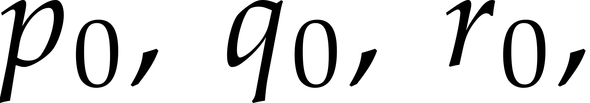 etc. or by 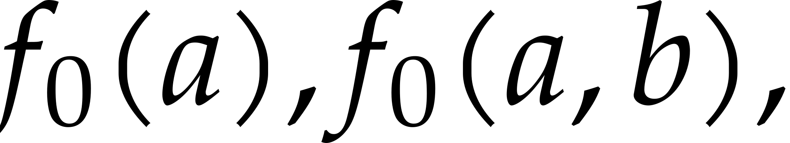 etc., leaving it open whether a = b or not.

### [Ms-104](/ms-104/#58.2) [58\[2\]](https://cdn.wittgensteinnachlass.com/2000px/webp/Ms-104/58.webp)

5˙30632 We cannot give a sign the wrong sense.

### [Ms-104](/ms-104/#58.3) [58\[3\]](https://cdn.wittgensteinnachlass.com/2000px/webp/Ms-104/58.webp)

5˙342 The “experience” we need to understand logic is not that something is thus and so, but that something is; but that is precisely _not_ an experience.

### [Ms-104](/ms-104/#58.4) [58\[4\]](https://cdn.wittgensteinnachlass.com/2000px/webp/Ms-104/58.webp)

5˙343 Logic is prior to any experience – that something is _so_.

### [Ms-104](/ms-104/#58.5) [58\[5\]](https://cdn.wittgensteinnachlass.com/2000px/webp/Ms-104/58.webp)

5˙3431 It is prior to the How, not prior to the What.

### [Ms-104](/ms-104/#58.6) [58\[6\]](https://cdn.wittgensteinnachlass.com/2000px/webp/Ms-104/58.webp)

5˙3432 And if this were not so, how could we apply logic. One might say: If there were a logic even if there were no world, how could there be a logic given that there is a world.

### [Ms-104](/ms-104/#58.7) [58\[7\]](https://cdn.wittgensteinnachlass.com/2000px/webp/Ms-104/58.webp)

4˙4492 A tautology is the limiting case of the combination of signs, namely its dissolution.

### [Ms-104](/ms-104/#58.8) [58\[8\]](https://cdn.wittgensteinnachlass.com/2000px/webp/Ms-104/58.webp)

3˙20105 The complex can be given only by its description, and this will be correct or not. The sentence that speaks of a complex will, if the complex does not exist, be simply false, not nonsensical.

### [Ms-104](/ms-104/#58.9) [58\[9\]](https://cdn.wittgensteinnachlass.com/2000px/webp/Ms-104/58.webp)

3˙253 Signs mark what is common to _one_ form and _one_ content. – Only together with their syntactic use do they determine a logical form.

### [Ms-104](/ms-104/#58.10+59.1) [58\[10\]](https://cdn.wittgensteinnachlass.com/2000px/webp/Ms-104/58.webp),[59\[1\]](https://cdn.wittgensteinnachlass.com/2000px/webp/Ms-104/59.webp)

3˙20106 One can tell that a simple symbol designates a complex from an indeterminacy in the sentences in which it occurs. We _know_ that this sentence does not yet determine everything. The notation for generality does, after all, _contain_ a prototype.

### [Ms-104](/ms-104/#59.2) [59\[2\]](https://cdn.wittgensteinnachlass.com/2000px/webp/Ms-104/59.webp)

3˙2531 Even in analysis the sign for the complex does not resolve itself arbitrarily, so that, say, it would resolve differently in each sentential structure.

### [Ms-104](/ms-104/#59.3) [59\[3\]](https://cdn.wittgensteinnachlass.com/2000px/webp/Ms-104/59.webp)

3˙20107 The condensation of the symbol for a complex into a simple symbol can be expressed by a definition.

### [Ms-104](/ms-104/#59.4) [59\[4\]](https://cdn.wittgensteinnachlass.com/2000px/webp/Ms-104/59.webp)

3˙2411 One could therefore say: The name proper is what all symbols that can designate the object have in common. It would thus emerge step by step that no kind of composition is essential to the name.

### [Ms-104](/ms-104/#59.5) [59\[5\]](https://cdn.wittgensteinnachlass.com/2000px/webp/Ms-104/59.webp)

3˙20212 The meanings of primitive signs can be explained by elucidations. Elucidations are sentences that contain the primitive signs. They can therefore be understood only if the meanings of these signs are already known.

### [Ms-104](/ms-104/#59.6) [59\[6\]](https://cdn.wittgensteinnachlass.com/2000px/webp/Ms-104/59.webp)

5˙33412 What the Axiom of infinity is supposed to say would be expressed in language by there being infinitely many names with different meanings.

### [Ms-104](/ms-104/#59.7) [59\[7\]](https://cdn.wittgensteinnachlass.com/2000px/webp/Ms-104/59.webp)

5˙335 _The limits of my language_ mean the limits of my world.

### [Ms-104](/ms-104/#59.8) [59\[8\]](https://cdn.wittgensteinnachlass.com/2000px/webp/Ms-104/59.webp)

5˙3351 This remark provides the key to deciding to what extent solipsism is a truth.

### [Ms-104](/ms-104/#60.1) [60\[1\]](https://cdn.wittgensteinnachlass.com/2000px/webp/Ms-104/60.webp)

5˙3352 For what solipsism _means_ is quite right, only it cannot be _said_; rather, it shows itself.

### [Ms-104](/ms-104/#60.2) [60\[2\]](https://cdn.wittgensteinnachlass.com/2000px/webp/Ms-104/60.webp)

5˙3353 That the world is _my_ world shows itself in the fact that the limits of _the_ language (the language that _alone_ I understand) mean the limits of _my_ world.

### [Ms-104](/ms-104/#60.3) [60\[3\]](https://cdn.wittgensteinnachlass.com/2000px/webp/Ms-104/60.webp)

5˙3354 There is no subject that thinks, that forms mental images.

### [Ms-104](/ms-104/#60.4) [60\[4\]](https://cdn.wittgensteinnachlass.com/2000px/webp/Ms-104/60.webp)

5˙30633 Ockham’s maxim is of course not an arbitrary rule, nor one justified by its practical success: it says that _unnecessary_ sign-units mean nothing.

### [Ms-104](/ms-104/#60.5) [60\[5\]](https://cdn.wittgensteinnachlass.com/2000px/webp/Ms-104/60.webp)

5˙30634 Signs that serve the _same_ purpose are logically equivalent. Signs that serve _no_ purpose are logically meaningless.

### [Ms-104](/ms-104/#60.6) [60\[6\]](https://cdn.wittgensteinnachlass.com/2000px/webp/Ms-104/60.webp)

3˙2521 If a sign is _not used_, it has no meaning. That is the sense of Ockham’s maxim.

---

### [Ms-104](/ms-104/#60.7) [60\[7\]](https://cdn.wittgensteinnachlass.com/2000px/webp/Ms-104/60.webp)

5˙30224 The solutions to logical problems must be simple, for they set the standard of simplicity.

### [Ms-104](/ms-104/#60.8) [60\[8\]](https://cdn.wittgensteinnachlass.com/2000px/webp/Ms-104/60.webp)

3˙20103 One could also formulate the demand for determinacy in this way: If a sentence is to have sense, the syntactic use of each of its parts must first be fixed. – One cannot, for example, discover only afterwards that a sentence follows from it. Rather, which sentences follow from it must be completely settled before this sentence can have a sense.

### [Ms-104](/ms-104/#60.9) [60\[9\]](https://cdn.wittgensteinnachlass.com/2000px/webp/Ms-104/60.webp)

3˙2513 The rules of logical syntax must be self-evident once one knows how each sign designates.

### [Ms-104](/ms-104/#61.1) [61\[1\]](https://cdn.wittgensteinnachlass.com/2000px/webp/Ms-104/61.webp)

4˙1032 Now we also understand why one always felt that we would have a correct logical conception if only everything in our symbolism were in order.

### [Ms-104](/ms-104/#61.2) [61\[2\]](https://cdn.wittgensteinnachlass.com/2000px/webp/Ms-104/61.webp)

5˙04103 A proposition affirms every proposition that follows from it.

### [Ms-104](/ms-104/#61.3) [61\[3\]](https://cdn.wittgensteinnachlass.com/2000px/webp/Ms-104/61.webp)

5˙04104 Two propositions are opposed to each other if there is no proposition with sense that affirms them both.

### [Ms-104](/ms-104/#61.4) [61\[4\]](https://cdn.wittgensteinnachlass.com/2000px/webp/Ms-104/61.webp)

5˙04105 Any proposition that contradicts another negates it.

### [Ms-104](/ms-104/#61.5) [61\[5\]](https://cdn.wittgensteinnachlass.com/2000px/webp/Ms-104/61.webp)

5˙311 How can the all-encompassing logic that mirrors the world make use of such particular hooks and manipulations? Only by all of these linking up into an infinitely fine network to form the great mirror.

### [Ms-104](/ms-104/#61.6) [61\[6\]](https://cdn.wittgensteinnachlass.com/2000px/webp/Ms-104/61.webp)

5˙312 “~p” is true if “p” is false. So in the true proposition “~p”, “p” is a false proposition. How, then, can the hook “~” bring it into agreement with reality?

### [Ms-104](/ms-104/#61.7) [61\[7\]](https://cdn.wittgensteinnachlass.com/2000px/webp/Ms-104/61.webp)

5˙313 But what negates in “~p” is not the “~”, but what is common to all the signs in this notation that negate “p”.

That is, the common rule by which ~p, ~~~p, ~p⌵~p, ~p ∙ ~p, etc. etc. (ad inf.) are formed. And what they have in common mirrors negation.

### [Ms-104](/ms-104/#61.8) [61\[8\]](https://cdn.wittgensteinnachlass.com/2000px/webp/Ms-104/61.webp)

5˙041031 “p ∙ q” is one of the propositions that affirm “p” and at the same time one of the propositions that affirm “q”.

### [Ms-104](/ms-104/#61.9+62.1) [61\[9\]](https://cdn.wittgensteinnachlass.com/2000px/webp/Ms-104/61.webp),[62\[1\]](https://cdn.wittgensteinnachlass.com/2000px/webp/Ms-104/62.webp)

5˙3131 One might say: What all symbols that affirm both p and q have in common is the proposition “p ∙ q”. What all symbols that affirm either p or q have in common is the proposition “p⌵q”.

### [Ms-104](/ms-104/#62.2) [62\[2\]](https://cdn.wittgensteinnachlass.com/2000px/webp/Ms-104/62.webp)

5˙3132 And so one can say: Two propositions are opposed to one another if they have nothing in common, and: each proposition has only one negative because there is only one proposition that lies wholly outside it.

### [Ms-104](/ms-104/#62.3) [62\[3\]](https://cdn.wittgensteinnachlass.com/2000px/webp/Ms-104/62.webp)

5˙3133 Thus it also shows itself in the new notation that “q:p⌵~p” says the same as “q”. That “p⌵~p” says nothing.

### [Ms-104](/ms-104/#62.4) [62\[4\]](https://cdn.wittgensteinnachlass.com/2000px/webp/Ms-104/62.webp)

5˙315 It must be apparent from our sentential signs that what is linked together by “⌵” “ ∙ ” etc. must be sentential signs.

And this is indeed so, for the symbols “p” and “q” themselves presuppose “⌵”, “~”, etc. If the sign “p” in “p ⌵ q” does not stand for a complex sign, then on its own it cannot have sense; but then the signs “p ⌵ p”, “p ∙ p” etc., which have the same sense as “p”, cannot have sense either. But if “p ⌵ p” has no sense, then “p ⌵ q” cannot have sense either.

### [Ms-104](/ms-104/#62.5) [62\[5\]](https://cdn.wittgensteinnachlass.com/2000px/webp/Ms-104/62.webp)

5˙323 One can describe the world completely by means of fully generalized propositions, that is, without assigning any name to a particular object in advance.

### [Ms-104](/ms-104/#63.1) [63\[1\]](https://cdn.wittgensteinnachlass.com/2000px/webp/Ms-104/63.webp)

5˙324 To arrive at the ordinary way of expressing oneself, one then simply has to say, after an expression “there is one and only one x such that ‥․”: and this x is A.

### [Ms-104](/ms-104/#63.2) [63\[2\]](https://cdn.wittgensteinnachlass.com/2000px/webp/Ms-104/63.webp)

5˙325 A fully generalized proposition is composite, like any other proposition. (This shows itself in the fact that in “(Еx,f) ∙ fx” we have to mention “f” and “x” separately.) The two stand independently in designating relations to the world, as in the ungeneralized proposition.

### [Ms-104](/ms-104/#63.3) [63\[3\]](https://cdn.wittgensteinnachlass.com/2000px/webp/Ms-104/63.webp)

5˙3251 A mark of a composite symbol: it has something in common with _other_ signs.

### [Ms-104](/ms-104/#63.4) [63\[4\]](https://cdn.wittgensteinnachlass.com/2000px/webp/Ms-104/63.webp)

5˙326 After all, the truth or falsity of _every_ proposition alters something in the general structure of the world. And the latitude that the totality of elementary propositions leaves to its structure is precisely what the fully general propositions delimit.

(For if an elementary proposition is true, then at any rate _one_ _more_ elementary proposition is true.)

### [Ms-104](/ms-104/#63.5) [63\[5\]](https://cdn.wittgensteinnachlass.com/2000px/webp/Ms-104/63.webp)

5˙322 The designation of generality occurs as an argument.

### [Ms-104](/ms-104/#63.6) [63\[6\]](https://cdn.wittgensteinnachlass.com/2000px/webp/Ms-104/63.webp)

5˙0012 Negation, disjunction, logical multiplication etc. are operations.

### [Ms-104](/ms-104/#63.7) [63\[7\]](https://cdn.wittgensteinnachlass.com/2000px/webp/Ms-104/63.webp)

5˙002 The occurrence of an operation in a sentence can of course say nothing on its own.

### [Ms-104](/ms-104/#64.1) [64\[1\]](https://cdn.wittgensteinnachlass.com/2000px/webp/Ms-104/64.webp)

5˙0021 After all, an operation says nothing; only its result does, and this depends on its base.

### [Ms-104](/ms-104/#64.2) [64\[2\]](https://cdn.wittgensteinnachlass.com/2000px/webp/Ms-104/64.webp)

5˙0022 Only operations can disappear. (Like negation in ~~p, for example.)

### [Ms-104](/ms-104/#64.3) [64\[3\]](https://cdn.wittgensteinnachlass.com/2000px/webp/Ms-104/64.webp)

3˙16021 The musical theme is a sentence.

---

### [Ms-104](/ms-104/#64.4) [64\[4\]](https://cdn.wittgensteinnachlass.com/2000px/webp/Ms-104/64.webp)

6˙1 The sentences of logic are the tautologies.

### [Ms-104](/ms-104/#64.5) [64\[5\]](https://cdn.wittgensteinnachlass.com/2000px/webp/Ms-104/64.webp)

6˙1001 Thus the sentences of logic say nothing. They are the analytic sentences.

### [Ms-104](/ms-104/#64.6) [64\[6\]](https://cdn.wittgensteinnachlass.com/2000px/webp/Ms-104/64.webp)

6˙11 That _they_ are tautologies _shows_ the formal – logical – properties of language, of the world.

### [Ms-104](/ms-104/#64.7) [64\[7\]](https://cdn.wittgensteinnachlass.com/2000px/webp/Ms-104/64.webp)

6˙111 That their constituents yield a tautology when combined _in this way_ characterizes the logic of their constituents.

### [Ms-104](/ms-104/#64.8) [64\[8\]](https://cdn.wittgensteinnachlass.com/2000px/webp/Ms-104/64.webp)

6˙112 For sentences to yield a tautology when combined in a particular way, they must have particular properties of structure. That they yield a tautology when joined _in this way_ thus shows that they possess these properties of structure.

### [Ms-104](/ms-104/#64.9) [64\[9\]](https://cdn.wittgensteinnachlass.com/2000px/webp/Ms-104/64.webp)

6˙12 It follows from this that logical sentences are not absolutely necessary, since in a suitable notation we can recognize the structural properties of sentences merely by looking at them.

### [Ms-104](/ms-104/#65.1) [65\[1\]](https://cdn.wittgensteinnachlass.com/2000px/webp/Ms-104/65.webp)

6˙121 If, for example, two sentences p and q yield a tautology in the combination p ⊃ q, it is clear that q then follows from p. We see from those two sentences themselves that “q”, for example, follows from “p ⊃ q ∙ p”, but we can also show it _in this way_: by combining them into “p ⊃ q ∙ p ․⊃․ q” and then showing that this is a tautology.

### [Ms-104](/ms-104/#65.2) [65\[2\]](https://cdn.wittgensteinnachlass.com/2000px/webp/Ms-104/65.webp)

6˙1211 Logical sentences demonstrate the logical properties of sentences by combining them into sentences that say nothing.

### [Ms-104](/ms-104/#65.3) [65\[3\]](https://cdn.wittgensteinnachlass.com/2000px/webp/Ms-104/65.webp)

6˙1212 One might also call this method a null method. In a logical sentence, sentences are brought into equilibrium with one another, and the state of equilibrium then indicates how these sentences must be constituted logically.

### [Ms-104](/ms-104/#65.4) [65\[4\]](https://cdn.wittgensteinnachlass.com/2000px/webp/Ms-104/65.webp)

6˙122 In life it is never the logical sentence that we need; rather, we use the logical sentence _only_ to infer from propositions that do not belong to logic others that likewise do not belong to logic.

### [Ms-104](/ms-104/#65.5) [65\[5\]](https://cdn.wittgensteinnachlass.com/2000px/webp/Ms-104/65.webp)

6˙1213 A proposition with sense says something, and its proof shows that it is so; in logic every sentence is the form of a proof.

### [Ms-104](/ms-104/#65.6+66.1) [65\[6\]](https://cdn.wittgensteinnachlass.com/2000px/webp/Ms-104/65.webp),[66\[1\]](https://cdn.wittgensteinnachlass.com/2000px/webp/Ms-104/66.webp)

6˙101 It is the distinctive feature of logical sentences that one can recognize from the symbol alone that they are true, and this fact encompasses the whole philosophy of logic. And so it is also one of the most important facts that the truth or falsity of non-logical sentences is _not_ recognizable from the sentence alone.

### [Ms-104](/ms-104/#66.2) [66\[2\]](https://cdn.wittgensteinnachlass.com/2000px/webp/Ms-104/66.webp)

6˙13 Logic is not a doctrine but a mirror image of the world.

### [Ms-104](/ms-104/#66.3) [66\[3\]](https://cdn.wittgensteinnachlass.com/2000px/webp/Ms-104/66.webp)

6˙131 Logic is transcendental.

### [Ms-104](/ms-104/#66.4) [66\[4\]](https://cdn.wittgensteinnachlass.com/2000px/webp/Ms-104/66.webp)

6˙1214 Every logical sentence is a modus ponens represented in signs. (And modus ponens cannot be expressed by a sentence.)

### [Ms-104](/ms-104/#66.5) [66\[5\]](https://cdn.wittgensteinnachlass.com/2000px/webp/Ms-104/66.webp)

6˙1003 The correct explanation of logical sentences must give them a unique position among all sentences.

### [Ms-104](/ms-104/#66.6) [66\[6\]](https://cdn.wittgensteinnachlass.com/2000px/webp/Ms-104/66.webp)

6˙1002 Theories that make a sentence of logic appear rich in content are always false. The words “True” and “False”, for example, seem to designate two properties among other properties, and then it seems to be a very curious fact that every sentence has one of these properties. Now this seems anything but self-evident, just as little self-evident as, say, the sentence “all roses are either yellow or red” would sound, even if it were true. Indeed, the former sentence now takes on all the character of a proposition of natural science, and this is a sure sign that it has been misconstrued.

### [Ms-104](/ms-104/#66.7+67.1) [66\[7\]](https://cdn.wittgensteinnachlass.com/2000px/webp/Ms-104/66.webp),[67\[1\]](https://cdn.wittgensteinnachlass.com/2000px/webp/Ms-104/67.webp)

6˙1215 It now also becomes clear why logic was called the doctrine of forms and of inference.

### [Ms-104](/ms-104/#67.2) [67\[2\]](https://cdn.wittgensteinnachlass.com/2000px/webp/Ms-104/67.webp)

6˙1121 That p and ~p, for example, contradict one another shows itself in the tautology “~(p ∙ ~p)”.

### [Ms-104](/ms-104/#67.3) [67\[3\]](https://cdn.wittgensteinnachlass.com/2000px/webp/Ms-104/67.webp)

6˙11211 It is now clear that there need not be a separate “law of contradiction” for each “type”, as Russell thought, but that _one_ is enough, since it need not be applied to itself.

### [Ms-104](/ms-104/#67.4) [67\[4\]](https://cdn.wittgensteinnachlass.com/2000px/webp/Ms-104/67.webp)

6˙113 Logical sentences describe the framework of the world, or rather, they represent it. They are not “about” anything. They presuppose that names have meaning and elementary sentences have sense: and this is their connection with the world. It is clear that it must indicate something about the world that certain combinations of symbols – which necessarily have a certain character – are tautologies. This is the decisive point. We said that some aspects of the signs we use were arbitrary, others not. In logic only what is not arbitrary expresses anything: but this means that in logic it is not _we_ who express what we want with the help of signs; rather, in logic the very nature of the signs that are necessary by nature speaks: if we know the logical syntax of any sign-language, then all logical sentences are already given.

### [Ms-104](/ms-104/#67.5) [67\[5\]](https://cdn.wittgensteinnachlass.com/2000px/webp/Ms-104/67.webp)

6˙1004 The investigation of logic means the investigation of _all lawfulness_. And outside logic everything is chance.

### [Ms-104](/ms-104/#68.1) [68\[1\]](https://cdn.wittgensteinnachlass.com/2000px/webp/Ms-104/68.webp)

6˙102 Can the laws of logic themselves in turn be subject to laws of logic?

### [Ms-104](/ms-104/#68.2) [68\[2\]](https://cdn.wittgensteinnachlass.com/2000px/webp/Ms-104/68.webp)

6˙114 Universal validity is not the mark of a logical sentence. For to be general means only this: to hold for all things by chance.

### [Ms-104](/ms-104/#68.3) [68\[3\]](https://cdn.wittgensteinnachlass.com/2000px/webp/Ms-104/68.webp)

6˙1141 After all, an ungeneralized sentence can be tautological just as a generalized one can.

### [Ms-104](/ms-104/#68.4) [68\[4\]](https://cdn.wittgensteinnachlass.com/2000px/webp/Ms-104/68.webp)

6˙12111 This sheds light on the question why logical sentences can no more be confirmed by experience than they can be refuted by experience. A sentence of logic must not only be incapable of being refuted by any possible experience; it must also be incapable of being confirmed by any such experience.

### [Ms-104](/ms-104/#68.5) [68\[5\]](https://cdn.wittgensteinnachlass.com/2000px/webp/Ms-104/68.webp)

6˙1122 It is clear that one could also use contradictions instead of tautologies for the same purpose.

### [Ms-104](/ms-104/#68.6) [68\[6\]](https://cdn.wittgensteinnachlass.com/2000px/webp/Ms-104/68.webp)

6˙1215 It now becomes clear why one often felt as though the “logical truths” were for us to “_demand_”: we can in fact demand them in so far as we can demand an adequate notation.

### [Ms-104](/ms-104/#68.7) [68\[7\]](https://cdn.wittgensteinnachlass.com/2000px/webp/Ms-104/68.webp)

6˙1131 It is possible, even according to the old logic, to give in advance a description of all “true” logical sentences.

### [Ms-104](/ms-104/#68.8) [68\[8\]](https://cdn.wittgensteinnachlass.com/2000px/webp/Ms-104/68.webp)

6˙1132 That is also why there can _never_ be surprises in logic.

### [Ms-104](/ms-104/#68.9+69.1) [68\[9\]](https://cdn.wittgensteinnachlass.com/2000px/webp/Ms-104/68.webp),[69\[1\]](https://cdn.wittgensteinnachlass.com/2000px/webp/Ms-104/69.webp)

6˙1133 One can calculate whether a sentence belongs to logic by calculating the logical properties of the _symbol_.

### [Ms-104](/ms-104/#69.2) [69\[2\]](https://cdn.wittgensteinnachlass.com/2000px/webp/Ms-104/69.webp)

6˙1134 And this is what we do when we “prove” a logical sentence. For without attending to sense or meaning, we form the logical sentence from others by following mere _rules for signs_.

### [Ms-104](/ms-104/#69.3) [69\[3\]](https://cdn.wittgensteinnachlass.com/2000px/webp/Ms-104/69.webp)

6˙1136 But one can always conceive of logic in such a way that every sentence is its own proof.

### [Ms-104](/ms-104/#69.4) [69\[4\]](https://cdn.wittgensteinnachlass.com/2000px/webp/Ms-104/69.webp)

6˙1142 One might call logical universal validity essential, in contrast to the accidental universal validity of, for example, the proposition “all human beings are mortal”. Propositions such as Russell’s Axiom of reducibility are not logical propositions, and this explains our feeling, namely that, if they are true, they could only be true by a fortunate accident.

### [Ms-104](/ms-104/#69.5) [69\[5\]](https://cdn.wittgensteinnachlass.com/2000px/webp/Ms-104/69.webp)

6˙1143 One can imagine a world in which the Axiom of reducibility does not hold. But it is clear that logic has nothing to do with the question whether our world is actually like that or not.

### [Ms-104](/ms-104/#69.6) [69\[6\]](https://cdn.wittgensteinnachlass.com/2000px/webp/Ms-104/69.webp)

6˙1221 In philosophy the question “what do we actually use that word, that sentence for?” yields valuable insights time and again.

### [Ms-104](/ms-104/#69.7+70.1) [69\[7\]](https://cdn.wittgensteinnachlass.com/2000px/webp/Ms-104/69.webp),[70\[1\]](https://cdn.wittgensteinnachlass.com/2000px/webp/Ms-104/70.webp)

6˙11341 The proof of logical sentences consists in making them arise from other logical sentences by the successive application of certain operations, which repeatedly produces tautologies from the original ones.

(And indeed only tautologies _follow_ from a tautology.)

### [Ms-104](/ms-104/#70.2) [70\[2\]](https://cdn.wittgensteinnachlass.com/2000px/webp/Ms-104/70.webp)

6˙11342 Of course, this way of showing that sentences are tautologies is quite inessential to logic. If only because the sentences from which the proof starts must show without proof that they are tautologies.

### [Ms-104](/ms-104/#70.3) [70\[3\]](https://cdn.wittgensteinnachlass.com/2000px/webp/Ms-104/70.webp)

6˙1135 All the sentences of logic have equal standing; there is no essential distinction among them between basic laws and derived sentences. Every tautology itself shows that it is a tautology.

### [Ms-104](/ms-104/#70.4) [70\[4\]](https://cdn.wittgensteinnachlass.com/2000px/webp/Ms-104/70.webp)

6˙11351 Proof in logic is merely a mechanical aid to recognizing a tautology more easily when it is complicated.

### [Ms-104](/ms-104/#70.5) [70\[5\]](https://cdn.wittgensteinnachlass.com/2000px/webp/Ms-104/70.webp)

6˙11352 It would indeed be too strange if one could prove a proposition with sense _logically_ from others, and a logical proposition too. It is clear from the outset that the logical proof of a proposition with sense and proof _in_ logic must be two quite different things.

### [Ms-104](/ms-104/#70.6) [70\[6\]](https://cdn.wittgensteinnachlass.com/2000px/webp/Ms-104/70.webp)

6˙11343 In logic, process and result are equivalent (hence no surprise).

---

### [Ms-104](/ms-104/#70.7) [70\[7\]](https://cdn.wittgensteinnachlass.com/2000px/webp/Ms-104/70.webp)

6˙01 The general form of operation is: 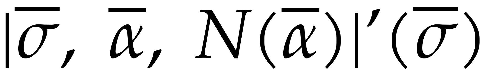.

### [Ms-104](/ms-104/#70.8) [70\[8\]](https://cdn.wittgensteinnachlass.com/2000px/webp/Ms-104/70.webp)

6˙02 The general form of the integer is: ❘O, α, α + 1❘.

### [Ms-104](/ms-104/#71.2) [71\[2\]](https://cdn.wittgensteinnachlass.com/2000px/webp/Ms-104/71.webp)

6˙4 All propositions are of equal value.

### [Ms-104](/ms-104/#71.3) [71\[3\]](https://cdn.wittgensteinnachlass.com/2000px/webp/Ms-104/71.webp)

7 What one cannot speak about, one must remain silent about.

---

### [Ms-104](/ms-104/#71.4) [71\[4\]](https://cdn.wittgensteinnachlass.com/2000px/webp/Ms-104/71.webp)

6˙12112 The so-called law of induction cannot in any case be a logical law, for it is evidently a proposition with sense. – And that is why it cannot be an a priori law either.

### [Ms-104](/ms-104/#71.5) [71\[5\]](https://cdn.wittgensteinnachlass.com/2000px/webp/Ms-104/71.webp)

6˙3 The law of causality is not a law but the form of a law.

### [Ms-104](/ms-104/#71.6) [71\[6\]](https://cdn.wittgensteinnachlass.com/2000px/webp/Ms-104/71.webp)

6˙31 “Law of causality” is a generic name. And just as there are, say, minimum laws in mechanics, – that of least action, for example – so there is _a_ law of causality in physics, _a_ law of the causal form.

### [Ms-104](/ms-104/#71.7) [71\[7\]](https://cdn.wittgensteinnachlass.com/2000px/webp/Ms-104/71.webp)

6˙311 One also had an inkling that there must be _a_ “law of least action” before one knew exactly what it said.

(Here as always, what is a priori turns out to be something purely logical.)

### [Ms-104](/ms-104/#71.8) [71\[8\]](https://cdn.wittgensteinnachlass.com/2000px/webp/Ms-104/71.webp)

6˙32 We do not _believe_ a priori in a conservation law; rather, we _know_ a priori that its logical form is possible.

### [Ms-104](/ms-104/#71.9+72.1) [71\[9\]](https://cdn.wittgensteinnachlass.com/2000px/webp/Ms-104/71.webp),[72\[1\]](https://cdn.wittgensteinnachlass.com/2000px/webp/Ms-104/72.webp)

6˙33 All those propositions, such as the principle of sufficient reason, the principle of continuity in nature, of least expenditure in nature, etc., etc., are all a priori insights into the possible ways of giving form to the propositions of science.

### [Ms-104](/ms-104/#72.2+73.1) [72\[2\]](https://cdn.wittgensteinnachlass.com/2000px/webp/Ms-104/72.webp),[73\[1\]](https://cdn.wittgensteinnachlass.com/2000px/webp/Ms-104/73.webp)

6˙331 Newtonian mechanics, for example, brings the description of the world into a uniform form. Let us imagine a white surface with irregular black patches on it. Now we say: whatever picture results from this, I will always be able to come as close as I like to a description of it by covering the surface with a suitably fine square grid and then saying of each square that it is white or black. In this way I will have brought the description of the surface into a uniform form. This form is arbitrary, for I could have used a grid with triangular or hexagonal meshes with the same success. It may be that the description would have been simpler with a triangular grid; that is, that we could describe the surface more accurately with a coarser triangular grid than with a finer square one (or vice versa) and so on. Different grids correspond to different systems for describing the world. Mechanics determines a form for describing the world by saying: all the propositions describing the world must be obtained in a given way from a number of given propositions – the axioms of mechanics. It thereby supplies the building blocks for the construction of the scientific edifice and says: whatever edifice you want to erect, you must somehow put it together with these and only these building blocks.

(Just as one can write down any number with the number system, so I must be able to write down any proposition of physics with the system of mechanics.)

### [Ms-104](/ms-104/#73.2) [73\[2\]](https://cdn.wittgensteinnachlass.com/2000px/webp/Ms-104/73.webp)

6˙34 And here we now see how logic and mechanics stand in relation to one another (one could also make the grid out of figures of different kinds). That a picture like the one just mentioned can be described by a grid of a given form tells us _nothing_ about the picture (for this holds for every picture of this kind). But what characterizes the picture is that it can be described _completely_ by a particular grid of a _particular_ fineness.

Likewise, that the world can be described by Newtonian mechanics tells us nothing about the world; what does tell us something is that it can be described by that mechanics in just _the way_ it actually can. And that it can be described more simply by one system of mechanics than by another also tells us something about the world.

### [Ms-104](/ms-104/#73.3) [73\[3\]](https://cdn.wittgensteinnachlass.com/2000px/webp/Ms-104/73.webp)

6˙341 Mechanics is an attempt to construct, according to a plan, all the _true_ propositions we need to describe the world.

### [Ms-104](/ms-104/#74.1) [74\[1\]](https://cdn.wittgensteinnachlass.com/2000px/webp/Ms-104/74.webp)

6˙35 Although the patches in our picture are geometrical figures, geometry can of course tell us nothing at all about their actual shape and position. The grid, however, is _purely_ geometrical; all its properties can be specified a priori.

### [Ms-104](/ms-104/#74.2) [74\[2\]](https://cdn.wittgensteinnachlass.com/2000px/webp/Ms-104/74.webp)

6˙36 Laws such as the principle of sufficient reason, etc., deal with the grid, not with what the grid describes.

### [Ms-104](/ms-104/#74.3) [74\[3\]](https://cdn.wittgensteinnachlass.com/2000px/webp/Ms-104/74.webp)

6˙001 In the general sentential form, a proposition occurs in a proposition only as a W-argument.

### [Ms-104](/ms-104/#74.4) [74\[4\]](https://cdn.wittgensteinnachlass.com/2000px/webp/Ms-104/74.webp)

6˙002 But now at first glance it seems as though a proposition could also occur in another in a different way.

### [Ms-104](/ms-104/#74.5) [74\[5\]](https://cdn.wittgensteinnachlass.com/2000px/webp/Ms-104/74.webp)

6˙003 Especially in certain psychological sentential forms such as “A believes that p” or “A thinks p”, etc. For on the surface it seems here as though the proposition p stands in a kind of relation to an object A – and in modern epistemology (Russell, Moore, etc.) those propositions have indeed been understood in this way.

### [Ms-104](/ms-104/#74.6+75.1) [74\[6\]](https://cdn.wittgensteinnachlass.com/2000px/webp/Ms-104/74.webp),[75\[1\]](https://cdn.wittgensteinnachlass.com/2000px/webp/Ms-104/75.webp)

6˙004 But it is clear that “A believes that”, “A thinks p” “A says p” are of the form “‘p’ says p”; and it is clear that what we have here is not a correlation between a fact and an object, but a correlation of facts by correlating their objects.

### [Ms-104](/ms-104/#75.2) [75\[2\]](https://cdn.wittgensteinnachlass.com/2000px/webp/Ms-104/75.webp)

6˙0041 This also shows that the mind – the subject, etc. – as conceived in today’s superficial psychology, is an absurdity.

### [Ms-104](/ms-104/#75.3) [75\[3\]](https://cdn.wittgensteinnachlass.com/2000px/webp/Ms-104/75.webp)

6˙0042 For a composite mind would no longer be a mind.

### [Ms-104](/ms-104/#75.4) [75\[4\]](https://cdn.wittgensteinnachlass.com/2000px/webp/Ms-104/75.webp)

6˙0043 The correct theory of judgement must show that it is impossible to judge nonsense. (Russell’s theory does not meet this condition.)

### [Ms-104](/ms-104/#75.5) [75\[5\]](https://cdn.wittgensteinnachlass.com/2000px/webp/Ms-104/75.webp)

6˙41 The sense of the world must lie outside it. In the world everything is as it is and everything happens as it happens; there is no value _in_ it – and if there were, it would have no value.

If there is a value that has value, it must lie outside all happening and being-so. For all happening and being-so is contingent.

What makes it non-contingent cannot lie _in_ the world, for then it would itself be contingent. It must lie outside the world.

### [Ms-104](/ms-104/#75.6) [75\[6\]](https://cdn.wittgensteinnachlass.com/2000px/webp/Ms-104/75.webp)

6˙42 That is also why there can be no propositions of ethics. Propositions cannot express anything higher.

### [Ms-104](/ms-104/#75.7) [75\[7\]](https://cdn.wittgensteinnachlass.com/2000px/webp/Ms-104/75.webp)

6˙43 There is indeed what cannot be put into words. It _shows_ itself; it is the mystical.

### [Ms-104](/ms-104/#75.8+76.1) [75\[8\]](https://cdn.wittgensteinnachlass.com/2000px/webp/Ms-104/75.webp),[76\[1\]](https://cdn.wittgensteinnachlass.com/2000px/webp/Ms-104/76.webp)

6˙5 If one cannot put an answer into words, one cannot put the question into words either. There is no such thing as _the riddle_.

If a question can be asked at all, it _can_ be answered.

### [Ms-104](/ms-104/#76.2) [76\[2\]](https://cdn.wittgensteinnachlass.com/2000px/webp/Ms-104/76.webp)

6˙52 We feel that even when all _possible_ scientific questions have been answered, the problems of our lives have not even been touched. Of course, there is then simply no question left; and that is precisely the answer.

### [Ms-104](/ms-104/#76.3) [76\[3\]](https://cdn.wittgensteinnachlass.com/2000px/webp/Ms-104/76.webp)

5˙33541 If I wrote a book “The World as I Found It”, I would also have to report in it on my body and say which limbs are subject to my will, etc. For this is a method of isolating the subject, or rather of showing that in an important sense there is no subject: it is the one thing that could _not_ be spoken of in this book. –

### [Ms-104](/ms-104/#76.4) [76\[4\]](https://cdn.wittgensteinnachlass.com/2000px/webp/Ms-104/76.webp)

5˙30225 People have always surmised that there must be a domain of questions in which the answers are – a priori – symmetrical and lie united in a closed, regular structure.

A domain in which the saying holds: simplex sigillum veri.

### [Ms-104](/ms-104/#76.5) [76\[5\]](https://cdn.wittgensteinnachlass.com/2000px/webp/Ms-104/76.webp)

5˙3221 That precedent to which one would always like to appeal must already lie in the symbol itself.

### [Ms-104](/ms-104/#76.6+77.1) [76\[6\]](https://cdn.wittgensteinnachlass.com/2000px/webp/Ms-104/76.webp),[77\[1\]](https://cdn.wittgensteinnachlass.com/2000px/webp/Ms-104/77.webp)

4˙0742 If we wanted to express what we express by “(x) ∙ fx”, for example, by putting an index before “fx” – say, like this: “Alg ∙ fx”, it would not suffice – we would not know what had been generalized.

If we wanted to indicate it by an index on the “x” – say, like this 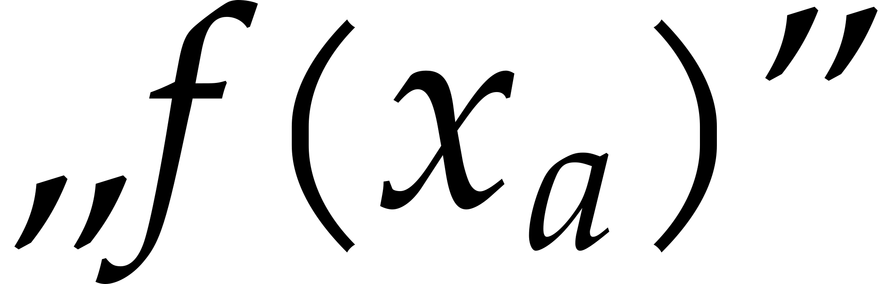 – that would not suffice either – we would not know the scope of the generality notation.

If we wanted to try introducing a mark into the argument places – say, like this: “(A,A) ∙ F(A,A)” – it would not suffice – we could not establish the identity of the variables. And so on.

None of these modes of designation suffices, because they lack the necessary mathematical multiplicity.

### [Ms-104](/ms-104/#77.2) [77\[2\]](https://cdn.wittgensteinnachlass.com/2000px/webp/Ms-104/77.webp)

4˙0743 For the same reason the idealist explanation of how we see spatial relations by means of “spatial spectacles” does not suffice, because it cannot explain the multiplicity of these relations.

### [Ms-104](/ms-104/#77.3) [77\[3\]](https://cdn.wittgensteinnachlass.com/2000px/webp/Ms-104/77.webp)

5˙021 Truth-functions can be arranged in series.

### [Ms-104](/ms-104/#77.4) [77\[4\]](https://cdn.wittgensteinnachlass.com/2000px/webp/Ms-104/77.webp)

5˙022 That is the basis of probability theory.

### [Ms-104](/ms-104/#77.5) [77\[5\]](https://cdn.wittgensteinnachlass.com/2000px/webp/Ms-104/77.webp)

5˙023 In a schema, let 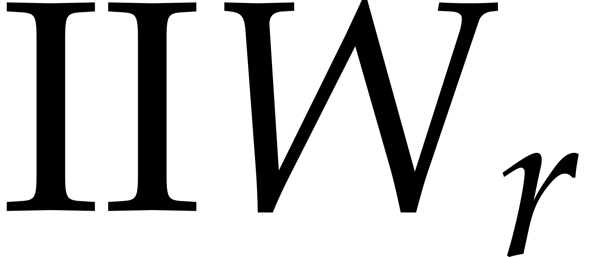 be the number of “W”s in the column of the proposition r; Wrs the number of those “W”s in the column of the proposition s that are in the same rows as “W”s in the column of r. The proposition “r” then gives the proposition s the probability 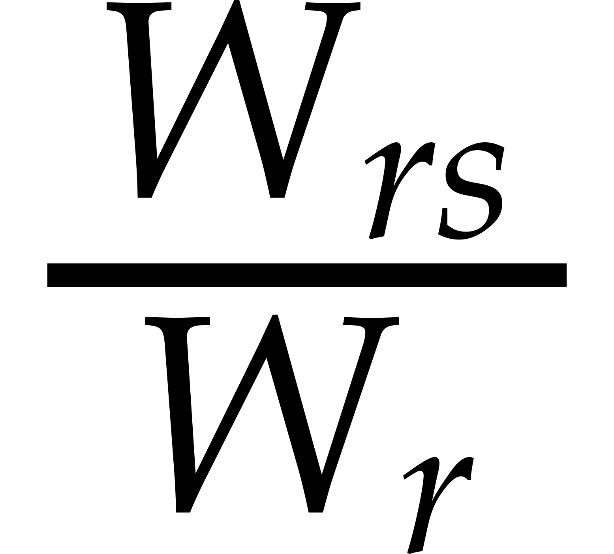.

### [Ms-104](/ms-104/#78.1) [78\[1\]](https://cdn.wittgensteinnachlass.com/2000px/webp/Ms-104/78.webp)

5˙09 If one proposition follows from another, the latter gives the former the probability 1. If two propositions are independent of one another, each gives the other the probability ½.

### [Ms-104](/ms-104/#78.2) [78\[2\]](https://cdn.wittgensteinnachlass.com/2000px/webp/Ms-104/78.webp)

5˙091 Following is a limiting case of being made probable.

### [Ms-104](/ms-104/#78.3) [78\[3\]](https://cdn.wittgensteinnachlass.com/2000px/webp/Ms-104/78.webp)

5˙092 Thus probability is a generalization.

### [Ms-104](/ms-104/#78.4) [78\[4\]](https://cdn.wittgensteinnachlass.com/2000px/webp/Ms-104/78.webp)

5˙093 It involves a general description of a sentential form.

### [Ms-104](/ms-104/#78.5) [78\[5\]](https://cdn.wittgensteinnachlass.com/2000px/webp/Ms-104/78.webp)

5˙0931 Only in the absence of certainty do we use probability. When we do not know a fact fully, but do know _something_ about its form.

### [Ms-104](/ms-104/#78.6) [78\[6\]](https://cdn.wittgensteinnachlass.com/2000px/webp/Ms-104/78.webp)

5˙0932 There is no special logical constant peculiar to probability propositions.

### [Ms-104](/ms-104/#78.7) [78\[7\]](https://cdn.wittgensteinnachlass.com/2000px/webp/Ms-104/78.webp)

5˙0933 A probability proposition is, as it were, an extract from elementary propositions.

### [Ms-104](/ms-104/#78.8) [78\[8\]](https://cdn.wittgensteinnachlass.com/2000px/webp/Ms-104/78.webp)

5˙0934 What can be confirmed by experiment in propositions about probability cannot be mathematics.

### [Ms-104](/ms-104/#78.9) [78\[9\]](https://cdn.wittgensteinnachlass.com/2000px/webp/Ms-104/78.webp)

1˙2 The world breaks down into facts.

### [Ms-104](/ms-104/#78.10) [78\[10\]](https://cdn.wittgensteinnachlass.com/2000px/webp/Ms-104/78.webp)

1˙21 One thing can be the case or not be the case and everything else remain the same.

---

### [Ms-104](/ms-104/#78.11) [78\[11\]](https://cdn.wittgensteinnachlass.com/2000px/webp/Ms-104/78.webp)

4˙43012 That there is a general sentential form is proved by the fact that there cannot be a sentence whose form one could not have foreseen (i.e. constructed).

### [Ms-104](/ms-104/#79.1) [79\[1\]](https://cdn.wittgensteinnachlass.com/2000px/webp/Ms-104/79.webp)

5˙00 The Theory of Types now becomes clear.

### [Ms-104](/ms-104/#79.2) [79\[2\]](https://cdn.wittgensteinnachlass.com/2000px/webp/Ms-104/79.webp)

6˙0201 The theory of classes is entirely superfluous in mathematics. This is connected with the fact that the generality we need in mathematics is not “accidental” generality.

### [Ms-104](/ms-104/#79.3) [79\[3\]](https://cdn.wittgensteinnachlass.com/2000px/webp/Ms-104/79.webp)

4˙102252 Thus the series of numbers is ordered not by an external relation but by an internal one.

### [Ms-104](/ms-104/#79.5) [79\[5\]](https://cdn.wittgensteinnachlass.com/2000px/webp/Ms-104/79.webp)

4˙4302 The general sentential form is a variable.

### [Ms-104](/ms-104/#79.6) [79\[6\]](https://cdn.wittgensteinnachlass.com/2000px/webp/Ms-104/79.webp)

4˙01122 Here the mode of designation is evidently a simile for what is designated.

### [Ms-104](/ms-104/#79.7) [79\[7\]](https://cdn.wittgensteinnachlass.com/2000px/webp/Ms-104/79.webp)

3˙201411 We speak of _something_, but also of _something_ happening.

### [Ms-104](/ms-104/#79.8) [79\[8\]](https://cdn.wittgensteinnachlass.com/2000px/webp/Ms-104/79.webp)

6˙211 Russell, Whitehead and Frege did not understand what is essential about the mathematical method of working with equations. That every mathematical sentence is self-evident or nonsensical rests on this method.

### [Ms-104](/ms-104/#79.9) [79\[9\]](https://cdn.wittgensteinnachlass.com/2000px/webp/Ms-104/79.webp)

6˙212 For we form expressions by means of the operations and assert the identity of their meaning.

### [Ms-104](/ms-104/#79.10) [79\[10\]](https://cdn.wittgensteinnachlass.com/2000px/webp/Ms-104/79.webp)

6˙23 ‥․ When two expressions are joined by the “ = ” sign, this means that they can be substituted for one another. But whether this is the case must be apparent from the two expressions themselves.

### [Ms-104](/ms-104/#80.1) [80\[1\]](https://cdn.wittgensteinnachlass.com/2000px/webp/Ms-104/80.webp)

2˙0141 Let the thing be the material point with infinite space around it. It is clear that the material point is inconceivable without infinite space.

### [Ms-104](/ms-104/#80.2) [80\[2\]](https://cdn.wittgensteinnachlass.com/2000px/webp/Ms-104/80.webp)

2˙0142 A patch in the visual field need not be red, but it must have _some_ colour; it has colour space around it, so to speak. A tone must have _some_ pitch, an object of the sense of touch _some_ hardness, etc.

### [Ms-104](/ms-104/#80.3) [80\[3\]](https://cdn.wittgensteinnachlass.com/2000px/webp/Ms-104/80.webp)

2˙01411 On this conception, a point in space is an argument place.

### [Ms-104](/ms-104/#80.4) [80\[4\]](https://cdn.wittgensteinnachlass.com/2000px/webp/Ms-104/80.webp)

5˙3071 The number of basic operations needed depends _only_ on our notation.

### [Ms-104](/ms-104/#80.5) [80\[5\]](https://cdn.wittgensteinnachlass.com/2000px/webp/Ms-104/80.webp)

5˙3072 It is only a matter of forming a system of signs with a determinate number of dimensions – with a determinate mathematical multiplicity.

### [Ms-104](/ms-104/#80.6) [80\[6\]](https://cdn.wittgensteinnachlass.com/2000px/webp/Ms-104/80.webp)

5˙3073 It is clear, of course, that what is at issue here is not a _number_ _of basic concepts_ that have to be designated, but only the expression of a rule.

### [Ms-104](/ms-104/#80.7) [80\[7\]](https://cdn.wittgensteinnachlass.com/2000px/webp/Ms-104/80.webp)

5˙411 There can be no hierarchy of the forms of elementary propositions.

### [Ms-104](/ms-104/#80.8+81.1) [80\[8\]](https://cdn.wittgensteinnachlass.com/2000px/webp/Ms-104/80.webp),[81\[1\]](https://cdn.wittgensteinnachlass.com/2000px/webp/Ms-104/81.webp)

5˙4103 Even if the world were infinitely complex, so that every fact consisted of infinitely many states of affairs and every state of affairs were composed of infinitely many objects, even then there would have to be objects and states of affairs.

### [Ms-104](/ms-104/#81.2) [81\[2\]](https://cdn.wittgensteinnachlass.com/2000px/webp/Ms-104/81.webp)

5˙4101 It is evident that in analysing sentences we must arrive at elementary sentences consisting of names in immediate combination.

### [Ms-104](/ms-104/#81.3) [81\[3\]](https://cdn.wittgensteinnachlass.com/2000px/webp/Ms-104/81.webp)

5˙4102 It is a mark of an elementary proposition that no elementary proposition can contradict it.

### [Ms-104](/ms-104/#81.4) [81\[4\]](https://cdn.wittgensteinnachlass.com/2000px/webp/Ms-104/81.webp)

3˙2522 If everything is as though a sign had meaning, then it does have meaning.

### [Ms-104](/ms-104/#81.5) [81\[5\]](https://cdn.wittgensteinnachlass.com/2000px/webp/Ms-104/81.webp)

5˙412 We can foresee only what we construct ourselves.

### [Ms-104](/ms-104/#81.6) [81\[6\]](https://cdn.wittgensteinnachlass.com/2000px/webp/Ms-104/81.webp)

4˙43013 Suppose we were given _all_ the simple propositions. Then one may simply ask: which propositions can I form from them? And those are _all_ the propositions, and _that_ is how they are _delimited_.

### [Ms-104](/ms-104/#81.7) [81\[7\]](https://cdn.wittgensteinnachlass.com/2000px/webp/Ms-104/81.webp)

5˙00162 In this way and only in this way is it possible to proceed from one type to another in the hierarchy.

### [Ms-104](/ms-104/#81.8) [81\[8\]](https://cdn.wittgensteinnachlass.com/2000px/webp/Ms-104/81.webp)

5˙413 Empirical reality is bounded by the totality of objects.

The limit shows itself once more in the totality of elementary propositions.

The hierarchies are, and must be, independent of reality.

### [Ms-104](/ms-104/#81.9+82.1) [81\[9\]](https://cdn.wittgensteinnachlass.com/2000px/webp/Ms-104/81.webp),[82\[1\]](https://cdn.wittgensteinnachlass.com/2000px/webp/Ms-104/82.webp)

6˙371 The whole modern world-view rests on the illusion that the so-called laws of nature are the explanations of natural phenomena.

### [Ms-104](/ms-104/#82.2) [82\[2\]](https://cdn.wittgensteinnachlass.com/2000px/webp/Ms-104/82.webp)

6˙372 So they stop at the laws of nature as at something inviolable, just as people in earlier times stopped at God and fate. And both are right and wrong. The ancients are, however, clearer in that they acknowledge a definite stopping point, whereas the new system is meant to give the impression that _everything_ has been explained.

### [Ms-104](/ms-104/#82.3) [82\[3\]](https://cdn.wittgensteinnachlass.com/2000px/webp/Ms-104/82.webp)

6˙373 The world is independent of my will.

### [Ms-104](/ms-104/#82.4) [82\[4\]](https://cdn.wittgensteinnachlass.com/2000px/webp/Ms-104/82.webp)

6˙374 Even if everything we wish for were to happen, this would still be only, so to speak, a favour granted by fate, for there is no _logical_ connection between will and world that would guarantee this, and we could not in turn will the supposed physical one itself.

### [Ms-104](/ms-104/#82.5) [82\[5\]](https://cdn.wittgensteinnachlass.com/2000px/webp/Ms-104/82.webp)

6˙44 If good or evil willing changes the world, then it can change only the limits of the world, not the facts; not what can be expressed by language, but what language expresses.

### [Ms-104](/ms-104/#82.6) [82\[6\]](https://cdn.wittgensteinnachlass.com/2000px/webp/Ms-104/82.webp)

6˙441 In short, the world must then thereby become a different world altogether. It must, so to speak, wane or wax as a whole.

### [Ms-104](/ms-104/#83.1) [83\[1\]](https://cdn.wittgensteinnachlass.com/2000px/webp/Ms-104/83.webp)

6˙442 Just as in death, too, the world does not change but comes to an end.

### [Ms-104](/ms-104/#83.2) [83\[2\]](https://cdn.wittgensteinnachlass.com/2000px/webp/Ms-104/83.webp)

6˙521 One notices the solution to the problem of life by the disappearance of this problem.

### [Ms-104](/ms-104/#83.3) [83\[3\]](https://cdn.wittgensteinnachlass.com/2000px/webp/Ms-104/83.webp)

6˙5211 Is this not the reason why people to whom the sense of life became clear after long doubts, why they could not then say what that sense consisted in.

### [Ms-104](/ms-104/#83.4) [83\[4\]](https://cdn.wittgensteinnachlass.com/2000px/webp/Ms-104/83.webp)

6˙4421 Death is not an event in life.

### [Ms-104](/ms-104/#83.5) [83\[5\]](https://cdn.wittgensteinnachlass.com/2000px/webp/Ms-104/83.webp)

6˙4422 If by eternity one means not infinite duration but timelessness, then whoever lives in the present lives eternally.

### [Ms-104](/ms-104/#83.6) [83\[6\]](https://cdn.wittgensteinnachlass.com/2000px/webp/Ms-104/83.webp)

5˙3203 If the elementary propositions are given, then _all_ elementary propositions are given with them too.

### [Ms-104](/ms-104/#83.7) [83\[7\]](https://cdn.wittgensteinnachlass.com/2000px/webp/Ms-104/83.webp)

5˙3003 Since it is evidently easy to express how propositions can be formed with this operation and how propositions are not to be formed, it must also be possible somehow to express this exactly.

### [Ms-104](/ms-104/#83.8) [83\[8\]](https://cdn.wittgensteinnachlass.com/2000px/webp/Ms-104/83.webp)

5˙33531 The world and life are one.

### [Ms-104](/ms-104/#83.9) [83\[9\]](https://cdn.wittgensteinnachlass.com/2000px/webp/Ms-104/83.webp)

6˙4221 Ethics and aesthetics are one.

### [Ms-104](/ms-104/#83.10) [83\[10\]](https://cdn.wittgensteinnachlass.com/2000px/webp/Ms-104/83.webp)

6˙421 It is clear that ethics cannot be put into words.

### [Ms-104](/ms-104/#83.11) [83\[11\]](https://cdn.wittgensteinnachlass.com/2000px/webp/Ms-104/83.webp)

6˙422 Ethics is transcendental.

### [Ms-104](/ms-104/#83.12) [83\[12\]](https://cdn.wittgensteinnachlass.com/2000px/webp/Ms-104/83.webp)

6˙4411 The world of the happy is different from that of the unhappy.

### [Ms-104](/ms-104/#84.1) [84\[1\]](https://cdn.wittgensteinnachlass.com/2000px/webp/Ms-104/84.webp)

6˙4412 The first thought when an ethical law of the form “Thou shalt ‥‥” is laid down is: “And what then, if I do not do it”? But it is clear that ethics has nothing to do with punishment and reward in the ordinary sense. So this question about the _consequences_ of an action must be beside the point. At the very least, these consequences must not be events. For there must be something right about asking the question in that way. There must, to be sure, be a _kind_ of ethical reward and ethical punishment, but they must lie in the action itself. (And it is also clear that the reward must be something pleasant and the punishment something unpleasant.)

### [Ms-104](/ms-104/#84.3) [84\[3\]](https://cdn.wittgensteinnachlass.com/2000px/webp/Ms-104/84.webp)

5˙33542 The subject does not belong to the world, but is a limit of the world.

### [Ms-104](/ms-104/#84.4) [84\[4\]](https://cdn.wittgensteinnachlass.com/2000px/webp/Ms-104/84.webp)

5˙33543 Where _in_ the world can a metaphysical subject be discerned? You say that here it is just as with the eye and the visual field. But you really do _not_ see the eye.

And nothing _about the visual field_ allows one to infer that it is seen by an eye.

### [Ms-104](/ms-104/#84.5) [84\[5\]](https://cdn.wittgensteinnachlass.com/2000px/webp/Ms-104/84.webp)

5˙335431 For the visual field does not have a shape like this:

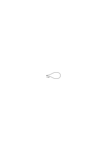

### [Ms-104](/ms-104/#85.1) [85\[1\]](https://cdn.wittgensteinnachlass.com/2000px/webp/Ms-104/85.webp)

5˙33551 So there really is a sense in which philosophy can speak of the self non-psychologically.

The self enters philosophy through the fact that “the world is my world”.

### [Ms-104](/ms-104/#85.2) [85\[2\]](https://cdn.wittgensteinnachlass.com/2000px/webp/Ms-104/85.webp)

5˙33544a This is connected with the fact that no part of our experience is also a priori.

### [Ms-104](/ms-104/#85.3) [85\[3\]](https://cdn.wittgensteinnachlass.com/2000px/webp/Ms-104/85.webp)

5˙33545 Everything we see could be otherwise.

Everything we can describe at all could be otherwise.

### [Ms-104](/ms-104/#85.4) [85\[4\]](https://cdn.wittgensteinnachlass.com/2000px/webp/Ms-104/85.webp)

5˙3355 Here one sees that solipsism, carried through rigorously, coincides with pure realism.

The self of solipsism shrinks to a point without extension, and what remains is the reality correlated with it.

### [Ms-104](/ms-104/#85.5) [85\[5\]](https://cdn.wittgensteinnachlass.com/2000px/webp/Ms-104/85.webp)

5˙33532 I am my world (the microcosm).

### [Ms-104](/ms-104/#85.6) [85\[6\]](https://cdn.wittgensteinnachlass.com/2000px/webp/Ms-104/85.webp)

6˙431 Contemplating the world sub specie aeterni is contemplating it as a – bounded – _whole_.

### [Ms-104](/ms-104/#85.7+86.1) [85\[7\]](https://cdn.wittgensteinnachlass.com/2000px/webp/Ms-104/85.webp),[86\[1\]](https://cdn.wittgensteinnachlass.com/2000px/webp/Ms-104/86.webp)

6˙53 The right method of philosophy would really be this: to say nothing except what can be said, that is, propositions of natural science – that is, something that has nothing to do with philosophy – and then, whenever someone else wanted to say something metaphysical, to show them that they had given no meaning to certain signs in their sentences.

### [Ms-104](/ms-104/#86.2) [86\[2\]](https://cdn.wittgensteinnachlass.com/2000px/webp/Ms-104/86.webp)

6˙531 This method would be unsatisfying to the other person – they would not feel that we were teaching them philosophy – but it would be the only strictly correct one.

### [Ms-104](/ms-104/#86.3) [86\[3\]](https://cdn.wittgensteinnachlass.com/2000px/webp/Ms-104/86.webp)

6˙54 My sentences elucidate by being recognized as nonsensical in the end by whoever understands me, once they have climbed by means of them – on them – beyond them. (They must, so to speak, throw away the ladder after they have climbed up it.)

### [Ms-104](/ms-104/#86.4) [86\[4\]](https://cdn.wittgensteinnachlass.com/2000px/webp/Ms-104/86.webp)

6˙55 They must get beyond these sentences; then they come into the world on the right rung.

### [Ms-104](/ms-104/#86.6) [86\[6\]](https://cdn.wittgensteinnachlass.com/2000px/webp/Ms-104/86.webp)

6˙432 The feeling of the world as a bounded whole is the mystical.

### [Ms-104](/ms-104/#86.7) [86\[7\]](https://cdn.wittgensteinnachlass.com/2000px/webp/Ms-104/86.webp)

5˙3202 If the objects are given, then all objects are already given to us with them.

### [Ms-104](/ms-104/#87.1) [87\[1\]](https://cdn.wittgensteinnachlass.com/2000px/webp/Ms-104/87.webp)

5˙3201 I separate the concept “All” from the truth-function.

Frege and Russell introduced generality in connection with the logical product or the logical sum. This made it difficult to understand the propositions (Еx) ∙ φx and (x) ∙ φx, in which both ideas are contained.

### [Ms-104](/ms-104/#87.3) [87\[3\]](https://cdn.wittgensteinnachlass.com/2000px/webp/Ms-104/87.webp)

5˙30223 In logic there can be nothing more general or more particular.

### [Ms-104](/ms-104/#87.4) [87\[4\]](https://cdn.wittgensteinnachlass.com/2000px/webp/Ms-104/87.webp)

5˙4051 And how could it be possible for me to deal in logic with forms I can invent? Rather, what I must deal with is what makes it possible for me to invent them.

### [Ms-104](/ms-104/#87.5) [87\[5\]](https://cdn.wittgensteinnachlass.com/2000px/webp/Ms-104/87.webp)

5˙314 Once a notation is fixed, there is in it a rule by which all sentences negating p are formed, a rule by which all sentences affirming p are formed, a rule by which all sentences affirming p or q are formed, and so on. These rules are equivalent to the symbols, and the sense of the symbols is mirrored in them.

### [Ms-104](/ms-104/#87.6) [87\[6\]](https://cdn.wittgensteinnachlass.com/2000px/webp/Ms-104/87.webp)

2˙0126 If all objects are given, then all _possible_ states of affairs are thereby given as well.

### [Ms-104](/ms-104/#87.7) [87\[7\]](https://cdn.wittgensteinnachlass.com/2000px/webp/Ms-104/87.webp)

6˙3411 Through all the logical apparatus, the propositions of physics still speak of the objects of the world.

### [Ms-104](/ms-104/#87.8+88.1) [87\[8\]](https://cdn.wittgensteinnachlass.com/2000px/webp/Ms-104/87.webp),[88\[1\]](https://cdn.wittgensteinnachlass.com/2000px/webp/Ms-104/88.webp)

6˙375 Just as there is only _logical_ necessity, so there is only _logical_ impossibility.

### [Ms-104](/ms-104/#88.2) [88\[2\]](https://cdn.wittgensteinnachlass.com/2000px/webp/Ms-104/88.webp)

6˙3751 For example, it is impossible for two colours to be at one place in the visual field at the same time, and indeed logically impossible, for this impossibility is determined by the logical structure of colour. Let us consider how this contradiction appears in physics: roughly, as the fact that a particle cannot have two velocities at the same time, i.e. that it cannot be in two places at the same time, i.e. that particles in different places at one time cannot be the same particle.

### [Ms-104](/ms-104/#88.3) [88\[3\]](https://cdn.wittgensteinnachlass.com/2000px/webp/Ms-104/88.webp)

3˙20172 A function cannot be its own argument because the function sign already contains the prototype of its argument and so cannot contain itself.

### [Ms-104](/ms-104/#88.4) [88\[4\]](https://cdn.wittgensteinnachlass.com/2000px/webp/Ms-104/88.webp)

3˙20173 For suppose the function F (fξ) could be its own argument. Then there would be a sentence “F{F(fξ)}”, and in it the outer function F and the inner F would have to have different meanings, for the inner has the form Φ(fξ) and the outer the form ψ{Φ(fξ)}.

All the two functions have in common is the letter “F”, which by itself designates nothing.

### [Ms-104](/ms-104/#90.1) [90\[1\]](https://cdn.wittgensteinnachlass.com/2000px/webp/Ms-104/90.webp)

3˙202111 Although every word has meaning over and above its definitions, this means only that these definitions are needed to represent in the sign-language how the thought that the word helps to express is completely depicted by language. But the definitions can also be left unstated without the word thereby losing its meaning, for it still stands in the same relation to its objects, the relation depicted by the definition; only we do not depict this relation explicitly. This of course often simplifies the sign-language, but always makes it harder to understand, for what is decisive now lies outside the signs, in their unexpressed relation to their objects.

### [Ms-104](/ms-104/#90.2) [90\[2\]](https://cdn.wittgensteinnachlass.com/2000px/webp/Ms-104/90.webp)

3˙201731 This is immediately clear if instead of “F{F(fξ)}” we write “(Еφ) ∙ F{φη} ∙ φη = Fη”.

### [Ms-104](/ms-104/#90.3) [90\[3\]](https://cdn.wittgensteinnachlass.com/2000px/webp/Ms-104/90.webp)

5˙40421 What we cannot think, we cannot think; so neither can we say what we cannot think.

### [Ms-104](/ms-104/#90.4) [90\[4\]](https://cdn.wittgensteinnachlass.com/2000px/webp/Ms-104/90.webp)

4˙0262 And the dictionary translates not only nouns but also verbs and adjectives and conjunctions etc.; and it treats them all alike.

### [Ms-104](/ms-104/#90.5) [90\[5\]](https://cdn.wittgensteinnachlass.com/2000px/webp/Ms-104/90.webp)

2˙01201 If things can occur in facts, this must already lie in the things themselves.

### [Ms-104](/ms-104/#91.1) [91\[1\]](https://cdn.wittgensteinnachlass.com/2000px/webp/Ms-104/91.webp)

5˙4041 Logic fills the world; the limits of the world are also its limits.

### [Ms-104](/ms-104/#91.2) [91\[2\]](https://cdn.wittgensteinnachlass.com/2000px/webp/Ms-104/91.webp)

5˙4042 So in logic we cannot say: there is this and that in the world, but not that other thing.

### [Ms-104](/ms-104/#91.3) [91\[3\]](https://cdn.wittgensteinnachlass.com/2000px/webp/Ms-104/91.webp)

2˙01202 Something logical cannot be merely-possible. Logic deals with every possibility, and all possibilities are its facts.

### [Ms-104](/ms-104/#91.4) [91\[4\]](https://cdn.wittgensteinnachlass.com/2000px/webp/Ms-104/91.webp)

2˙01203 Just as we cannot conceive of spatial objects outside space at all, or of temporal objects outside time, so there is _no_ object we can conceive of outside the _possibility_ of its combination with others.

### [Ms-104](/ms-104/#91.5) [91\[5\]](https://cdn.wittgensteinnachlass.com/2000px/webp/Ms-104/91.webp)

2˙01204 If I can conceive of an object as part of a state of affairs, I cannot conceive of it outside the possibility of its being so combined.

### [Ms-104](/ms-104/#91.6) [91\[6\]](https://cdn.wittgensteinnachlass.com/2000px/webp/Ms-104/91.webp)

5˙4043 For that would apparently presuppose that we exclude certain possibilities, and this cannot be the case, since logic would otherwise have to go beyond the limits of the world, if, that is, it could view those limits from the other side as well.

### [Ms-104](/ms-104/#91.7) [91\[7\]](https://cdn.wittgensteinnachlass.com/2000px/webp/Ms-104/91.webp)

4˙43014 Propositions are everything that follows from the totality of all the elementary propositions. (Of course also from the fact that it _is the totality of them all_.)

### [Ms-104](/ms-104/#92.1) [92\[1\]](https://cdn.wittgensteinnachlass.com/2000px/webp/Ms-104/92.webp)

4˙430141 Thus in a certain sense one might say that all propositions are generalizations from the elementary propositions.

### [Ms-104](/ms-104/#92.2) [92\[2\]](https://cdn.wittgensteinnachlass.com/2000px/webp/Ms-104/92.webp)

5˙33546 There is no order of things a priori.

### [Ms-104](/ms-104/#92.3) [92\[3\]](https://cdn.wittgensteinnachlass.com/2000px/webp/Ms-104/92.webp)

4˙01141 The gramophone record, the musical thought, musical notation and the sound waves all stand to one another in that internal relation of depiction which holds between language and the world. They all have their logical structure in common.

### [Ms-104](/ms-104/#92.4) [92\[4\]](https://cdn.wittgensteinnachlass.com/2000px/webp/Ms-104/92.webp)

4˙011411 As with the two young men, their two horses and their lilies in the fairy tale. In a certain sense they are all one.

### [Ms-104](/ms-104/#92.5) [92\[5\]](https://cdn.wittgensteinnachlass.com/2000px/webp/Ms-104/92.webp)

The signs for logical operations are punctuation marks.

### [Ms-104](/ms-104/#92.6) [92\[6\]](https://cdn.wittgensteinnachlass.com/2000px/webp/Ms-104/92.webp)

6˙4423 Not only is the immortality in time of the human soul, that is, its living on for ever even after death, in no way guaranteed, but above all this assumption does not at all accomplish what one has always wanted it to accomplish. Is a riddle solved by my living on for ever? Is this eternal life, then, not just as riddling as the present one? The solution to the riddle of life in space and time lies _outside_ space and time. (After all, it is not problems of natural science that are to be solved.)

### [Ms-104](/ms-104/#92.7) [92\[7\]](https://cdn.wittgensteinnachlass.com/2000px/webp/Ms-104/92.webp)

6˙44231 _How_ the world is is of no concern whatsoever here. God does not reveal himself _in_ the world.

### [Ms-104](/ms-104/#93.1) [93\[1\]](https://cdn.wittgensteinnachlass.com/2000px/webp/Ms-104/93.webp)

6˙44232 The mystical is not _how_ the world is, but that it is.

### [Ms-104](/ms-104/#93.3) [93\[3\]](https://cdn.wittgensteinnachlass.com/2000px/webp/Ms-104/93.webp)

5˙005341 The internal relation that orders the series is equivalent to the operation by which one term arises from another.

### [Ms-104](/ms-104/#93.4) [93\[4\]](https://cdn.wittgensteinnachlass.com/2000px/webp/Ms-104/93.webp)

6˙012 The “concept of number” is nothing other than what all numerical signs have in common; it is the general form of number.

And the concept of numerical equality is the general form of all particular numerical equalities.

### [Ms-104](/ms-104/#93.5) [93\[5\]](https://cdn.wittgensteinnachlass.com/2000px/webp/Ms-104/93.webp)

4˙0721 The sentence “ambulo” is composite too, for its stem with a different ending, and its ending with a different stem, yield a different sense.

### [Ms-104](/ms-104/#93.7) [93\[7\]](https://cdn.wittgensteinnachlass.com/2000px/webp/Ms-104/93.webp)

6˙005 To perceive a complex is to perceive that its constituents stand in such-and-such relations to one another.

### [Ms-104](/ms-104/#93.8) [93\[8\]](https://cdn.wittgensteinnachlass.com/2000px/webp/Ms-104/93.webp)

6˙0051 This presumably also explains why one can see the figure

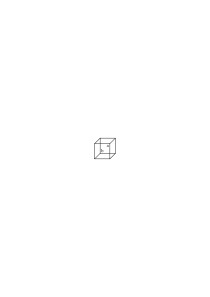

as a cube in two ways; and all similar phenomena. For we really do see two different facts. (If I look first at corner a and only glance at b, a appears at the front, and vice versa.)

### [Ms-104](/ms-104/#94.1) [94\[1\]](https://cdn.wittgensteinnachlass.com/2000px/webp/Ms-104/94.webp)

6˙113501 It is clear that the number of “basic laws of logic” is arbitrary, for one could derive logic from a _single_ basic law simply by forming, for instance, the logical product of Frege’s basic laws.

(Frege might have said that this basic law would then no longer be immediately evident. But it is curious that so exact a thinker as Frege should have appealed to the degree of self-evidence as a criterion of a logical sentence.)

### [Ms-104](/ms-104/#94.2) [94\[2\]](https://cdn.wittgensteinnachlass.com/2000px/webp/Ms-104/94.webp)

5˙04441 “A knows that p” is tautological if p is a tautology.

### [Ms-104](/ms-104/#94.3) [94\[3\]](https://cdn.wittgensteinnachlass.com/2000px/webp/Ms-104/94.webp)

5˙41011 The question here is how the combination into a sentence comes about.

### [Ms-104](/ms-104/#94.4) [94\[4\]](https://cdn.wittgensteinnachlass.com/2000px/webp/Ms-104/94.webp)

5˙09311 A proposition may be an incomplete picture of a certain situation, but it is always _a_ complete picture.

### [Ms-104](/ms-104/#94.5) [94\[5\]](https://cdn.wittgensteinnachlass.com/2000px/webp/Ms-104/94.webp)

5˙33552 The philosophical I is not the human being, not the human body or the human mind that psychology deals with, but the metaphysical subject, the limit (not a part) of the world.

### [Ms-104](/ms-104/#94.6) [94\[6\]](https://cdn.wittgensteinnachlass.com/2000px/webp/Ms-104/94.webp)

6˙3752 It is clear that the logical product of two elementary propositions can be neither a tautology nor a contradiction (“A is green and A is red” is a contradiction).

### [Ms-104](/ms-104/#94.7+95.1) [94\[7\]](https://cdn.wittgensteinnachlass.com/2000px/webp/Ms-104/94.webp),[95\[1\]](https://cdn.wittgensteinnachlass.com/2000px/webp/Ms-104/95.webp)

2˙0233 Two objects of the same logical form are distinguished from one another – apart from their external properties – only by being different.

### [Ms-104](/ms-104/#95.2) [95\[2\]](https://cdn.wittgensteinnachlass.com/2000px/webp/Ms-104/95.webp)

2˙0124 If I know an object, then I also know _every_ possibility of its occurring in states of affairs.

Each such possibility must lie in the nature of the object.

### [Ms-104](/ms-104/#95.3) [95\[3\]](https://cdn.wittgensteinnachlass.com/2000px/webp/Ms-104/95.webp)

2˙0125 A new possibility cannot be found afterwards.

### [Ms-104](/ms-104/#95.4) [95\[4\]](https://cdn.wittgensteinnachlass.com/2000px/webp/Ms-104/95.webp)

4˙1022331 A property is internal if it is unthinkable that its object should not possess it.

(This shade of blue and that one stand in the internal relation of lighter to darker eo ipso. It is unthinkable that _these_ two objects should not stand in this relation.)

### [Ms-104](/ms-104/#95.5) [95\[5\]](https://cdn.wittgensteinnachlass.com/2000px/webp/Ms-104/95.webp)

3˙201412 The tacit agreements on which understanding our language depends are enormously complicated; with every sentence much that is not said is supplied in thought.

If what is meant by “A” is a human being, the sentence “A is sitting” is admissible, but not if A designates this book. – But if a sentence is completely analysed, then the meanings of its parts must be irrelevant to everything that depends on understanding its form.

### [Ms-104](/ms-104/#95.6+96.1) [95\[6\]](https://cdn.wittgensteinnachlass.com/2000px/webp/Ms-104/95.webp),[96\[1\]](https://cdn.wittgensteinnachlass.com/2000px/webp/Ms-104/96.webp)

4˙102251 I call series ordered by _internal_ relations series of forms.

### [Ms-104](/ms-104/#96.2) [96\[2\]](https://cdn.wittgensteinnachlass.com/2000px/webp/Ms-104/96.webp)

6˙37 There is no compulsion by which one thing must happen because something else has happened. There is only logical necessity.

### [Ms-104](/ms-104/#96.3) [96\[3\]](https://cdn.wittgensteinnachlass.com/2000px/webp/Ms-104/96.webp)

3˙2017 I regard the sentence – as Frege and Russell do – as a function of the symbols it contains.

### [Ms-104](/ms-104/#96.4) [96\[4\]](https://cdn.wittgensteinnachlass.com/2000px/webp/Ms-104/96.webp)

5˙4011 There is no distinguished number.

### [Ms-104](/ms-104/#96.5) [96\[5\]](https://cdn.wittgensteinnachlass.com/2000px/webp/Ms-104/96.webp)

6˙44221 Our life is as endless as our visual field is boundless.

### [Ms-104](/ms-104/#96.6) [96\[6\]](https://cdn.wittgensteinnachlass.com/2000px/webp/Ms-104/96.webp)

4˙0741 This mathematical multiplicity cannot, of course, itself be depicted in turn, since every picture of it must itself possess this multiplicity. In depicting, one cannot get outside it.

### [Ms-104](/ms-104/#96.7) [96\[7\]](https://cdn.wittgensteinnachlass.com/2000px/webp/Ms-104/96.webp)

4˙10227281 It is just as nonsensical to say “There is only one 1” as it would be to say: “2 + 2 equals 4 at 3 o’clock”.

### [Ms-104](/ms-104/#96.8) [96\[8\]](https://cdn.wittgensteinnachlass.com/2000px/webp/Ms-104/96.webp)

4˙1022729 Logical forms are number*less*.

### [Ms-104](/ms-104/#96.9) [96\[9\]](https://cdn.wittgensteinnachlass.com/2000px/webp/Ms-104/96.webp)

4˙10227291 That is why there are no distinguished numbers in logic, and why there is no philosophical monism or dualism, etc.

### [Ms-104](/ms-104/#96.10) [96\[10\]](https://cdn.wittgensteinnachlass.com/2000px/webp/Ms-104/96.webp)

2˙01241 To know an object, I need not know its external properties, but I must know all its internal properties.

### [Ms-104](/ms-104/#96.11+97.1) [96\[11\]](https://cdn.wittgensteinnachlass.com/2000px/webp/Ms-104/96.webp),[97\[1\]](https://cdn.wittgensteinnachlass.com/2000px/webp/Ms-104/97.webp)

2˙02331 In passing: Either a thing has properties that no other thing has, in which case one can readily single it out from the others by a description and point to it; or there are several things that have all their properties in common, in which case it is quite impossible to point to one.

For if nothing singles the thing out, I cannot single it out, for otherwise it is indeed singled out.

### [Ms-104](/ms-104/#97.2) [97\[2\]](https://cdn.wittgensteinnachlass.com/2000px/webp/Ms-104/97.webp)

5˙421 The _application_ of logic decides which elementary propositions there are.

### [Ms-104](/ms-104/#97.3) [97\[3\]](https://cdn.wittgensteinnachlass.com/2000px/webp/Ms-104/97.webp)

5˙4211 Logic cannot anticipate what lies in its application.

### [Ms-104](/ms-104/#97.4) [97\[4\]](https://cdn.wittgensteinnachlass.com/2000px/webp/Ms-104/97.webp)

5˙4212 This is clear: logic must not collide with its application.

### [Ms-104](/ms-104/#97.5) [97\[5\]](https://cdn.wittgensteinnachlass.com/2000px/webp/Ms-104/97.webp)

5˙4213 But logic must be in contact with its application.

### [Ms-104](/ms-104/#97.6) [97\[6\]](https://cdn.wittgensteinnachlass.com/2000px/webp/Ms-104/97.webp)

5˙4214 So logic and its application must not overlap.

### [Ms-104](/ms-104/#97.7) [97\[7\]](https://cdn.wittgensteinnachlass.com/2000px/webp/Ms-104/97.webp)

5˙4012 Specifying any particular form would be completely arbitrary.

### [Ms-104](/ms-104/#97.8) [97\[8\]](https://cdn.wittgensteinnachlass.com/2000px/webp/Ms-104/97.webp)

5˙4221 It is clear that we have a concept of the elementary proposition apart from its particular logical form.

### [Ms-104](/ms-104/#97.9) [97\[9\]](https://cdn.wittgensteinnachlass.com/2000px/webp/Ms-104/97.webp)

5˙4222 If I know on purely logical grounds – and I do – that there must be elementary propositions, then anyone else who sees the sentences in their unanalysed form must know it too.

### [Ms-104](/ms-104/#97.10+98.1) [97\[10\]](https://cdn.wittgensteinnachlass.com/2000px/webp/Ms-104/97.webp),[98\[1\]](https://cdn.wittgensteinnachlass.com/2000px/webp/Ms-104/98.webp)

5˙4223 If I cannot specify the elementary propositions a priori, then wanting to specify them must lead to patent nonsense.

### [Ms-104](/ms-104/#98.2) [98\[2\]](https://cdn.wittgensteinnachlass.com/2000px/webp/Ms-104/98.webp)

5˙0017 The operation can only occur where one proposition arises from another in a logically significant way, that is, as early as, but not before, the point where the logical construction of the proposition begins.

### [Ms-104](/ms-104/#98.3) [98\[3\]](https://cdn.wittgensteinnachlass.com/2000px/webp/Ms-104/98.webp)

6˙3412 We must not forget that the description of the world by mechanics is always wholly general. For example, it never speaks of _particular_ material points, but only ever of _arbitrary ones_.

### [Ms-104](/ms-104/#98.4) [98\[4\]](https://cdn.wittgensteinnachlass.com/2000px/webp/Ms-104/98.webp)

5˙0054 One must be able to see from the variable itself what it stands for. – There must be a quite definite similarity between it and its value.

### [Ms-104](/ms-104/#98.5) [98\[5\]](https://cdn.wittgensteinnachlass.com/2000px/webp/Ms-104/98.webp)

6˙361 If there were a law of causality, it might read: “There are laws of nature”.

### [Ms-104](/ms-104/#98.6) [98\[6\]](https://cdn.wittgensteinnachlass.com/2000px/webp/Ms-104/98.webp)

6˙362 But of course one cannot say this; it shows itself.

### [Ms-104](/ms-104/#98.7) [98\[7\]](https://cdn.wittgensteinnachlass.com/2000px/webp/Ms-104/98.webp)

6˙363 In Hertz’s manner of expression one could say: only connections that are _law-governed_ are _thinkable_.

### [Ms-104](/ms-104/#98.8+99.1) [98\[8\]](https://cdn.wittgensteinnachlass.com/2000px/webp/Ms-104/98.webp),[99\[1\]](https://cdn.wittgensteinnachlass.com/2000px/webp/Ms-104/99.webp)

6˙3631 We cannot compare any process with “the passage of time” – there is no such thing – but only with another process (say, with the running of the chronometer). Hence we can describe the temporal course only by relying on another process.

### [Ms-104](/ms-104/#99.2) [99\[2\]](https://cdn.wittgensteinnachlass.com/2000px/webp/Ms-104/99.webp)

6˙3632 An entirely analogous point holds for space. Where, for example, one says that neither of two events (which exclude one another) can occur because there is _no cause_ for one to occur rather than the other, the real point is that one cannot describe _one_ of the two events at all unless there is some asymmetry. And _if_ there _is_ such an asymmetry, we can regard it as the _cause_ of the occurrence of the one and the non-occurrence of the other.

### [Ms-104](/ms-104/#99.3) [99\[3\]](https://cdn.wittgensteinnachlass.com/2000px/webp/Ms-104/99.webp)

6˙36321 Kant’s problem of the right and left hands that cannot be made to coincide already arises in the plane, indeed in one-dimensional space, where the two congruent figures a & b likewise cannot be made to coincide without

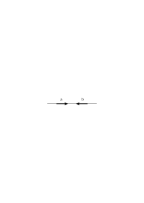

being moved out of that space.

### [Ms-104](/ms-104/#99.4+100.1) [99\[4\]](https://cdn.wittgensteinnachlass.com/2000px/webp/Ms-104/99.webp),[100\[1\]](https://cdn.wittgensteinnachlass.com/2000px/webp/Ms-104/100.webp)

6˙36322 Right and left hands are in fact perfectly congruent. And the fact that they cannot be made to coincide has nothing to do with that.

### [Ms-104](/ms-104/#100.2) [100\[2\]](https://cdn.wittgensteinnachlass.com/2000px/webp/Ms-104/100.webp)

6˙36323 One could put the right glove on the left hand if one could turn it over in four-dimensional space.

### [Ms-104](/ms-104/#100.3) [100\[3\]](https://cdn.wittgensteinnachlass.com/2000px/webp/Ms-104/100.webp)

6˙364 What can be described can also happen, and what the law of causality is supposed to rule out cannot be described either.

### [Ms-104](/ms-104/#100.4) [100\[4\]](https://cdn.wittgensteinnachlass.com/2000px/webp/Ms-104/100.webp)

6˙231 The question whether one needs intuition to solve mathematical problems must be answered by saying that it is language itself that supplies the requisite intuition here.

### [Ms-104](/ms-104/#100.5) [100\[5\]](https://cdn.wittgensteinnachlass.com/2000px/webp/Ms-104/100.webp)

6˙232 It is a property of affirmation that one can construe it as double negation.

### [Ms-104](/ms-104/#100.6) [100\[6\]](https://cdn.wittgensteinnachlass.com/2000px/webp/Ms-104/100.webp)

It is a property of 1 + 1 + 1 + 1 that one can construe it as (1 + 1) + (1 + 1).

### [Ms-104](/ms-104/#100.7) [100\[7\]](https://cdn.wittgensteinnachlass.com/2000px/webp/Ms-104/100.webp)

6˙013 The concept of number is the variable number.

### [Ms-104](/ms-104/#100.8) [100\[8\]](https://cdn.wittgensteinnachlass.com/2000px/webp/Ms-104/100.webp)

6˙24 The method by which mathematics arrives at its equations is the method of substitution.

For equations express the substitutability of two expressions, and we proceed from a number of equations to new equations by replacing some expressions with others in accordance with the equations.

### [Ms-104](/ms-104/#101.1) [101\[1\]](https://cdn.wittgensteinnachlass.com/2000px/webp/Ms-104/101.webp)

6˙2 Mathematics is a logical method.

### [Ms-104](/ms-104/#101.2) [101\[2\]](https://cdn.wittgensteinnachlass.com/2000px/webp/Ms-104/101.webp)

6˙21 The logic of the world that the logical sentences show in tautologies, mathematics shows in equations.

### [Ms-104](/ms-104/#101.3) [101\[3\]](https://cdn.wittgensteinnachlass.com/2000px/webp/Ms-104/101.webp)

6˙22 Mathematics is a method of logic.

### [Ms-104](/ms-104/#101.4) [101\[4\]](https://cdn.wittgensteinnachlass.com/2000px/webp/Ms-104/101.webp)

6˙365 The process of induction consists in our adopting the _simplest_ law that can be reconciled with our experiences.

### [Ms-104](/ms-104/#101.5) [101\[5\]](https://cdn.wittgensteinnachlass.com/2000px/webp/Ms-104/101.webp)

6˙3652 But it is clear that there is no reason to believe that the simplest case will actually occur.

### [Ms-104](/ms-104/#101.6) [101\[6\]](https://cdn.wittgensteinnachlass.com/2000px/webp/Ms-104/101.webp)

6˙3651 But this has no logical grounds, only psychological ones.

### [Ms-104](/ms-104/#101.7) [101\[7\]](https://cdn.wittgensteinnachlass.com/2000px/webp/Ms-104/101.webp)

6˙36521 That the sun will rise tomorrow is a hypothesis; and that means we _do not know_ whether it will rise.

### [Ms-104](/ms-104/#101.9+102.1) [101\[9\]](https://cdn.wittgensteinnachlass.com/2000px/webp/Ms-104/101.webp),[102\[1\]](https://cdn.wittgensteinnachlass.com/2000px/webp/Ms-104/102.webp)

4˙1022511 The terms of the series of forms are formed according to a formal law.

### [Ms-104](/ms-104/#102.2) [102\[2\]](https://cdn.wittgensteinnachlass.com/2000px/webp/Ms-104/102.webp)

5˙005351 Let us write the general term of the series of forms _thus_: 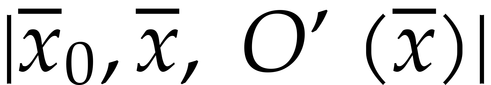.

The 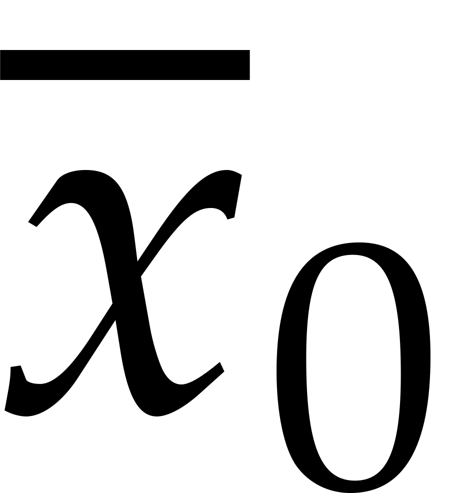 are the initial terms of the series, the 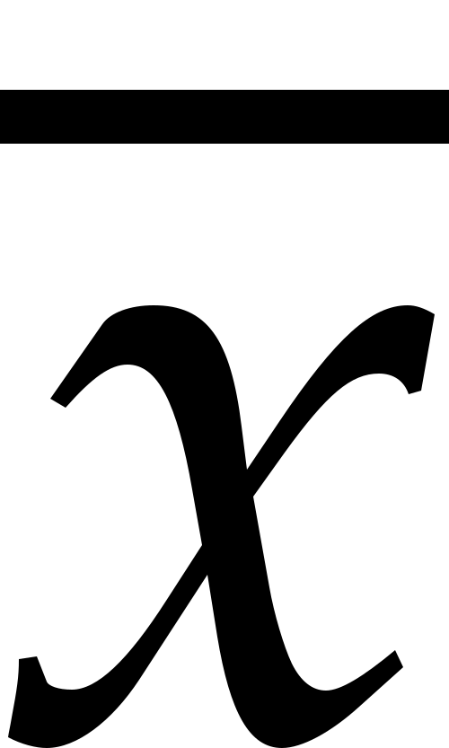 are any of its terms, and 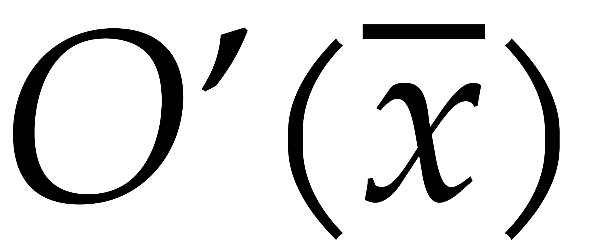 is the term that arises from the 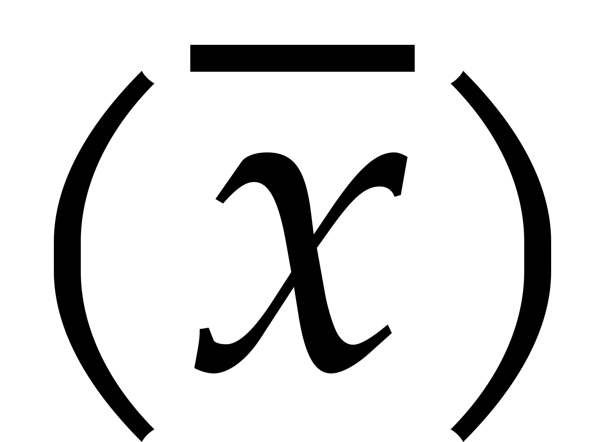 by the operation O'(ᾱ) in proceeding along the series.

### [Ms-104](/ms-104/#102.3) [102\[3\]](https://cdn.wittgensteinnachlass.com/2000px/webp/Ms-104/102.webp)

6˙011 I now define: 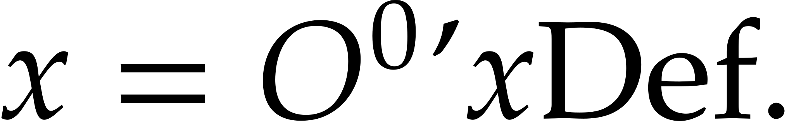 and

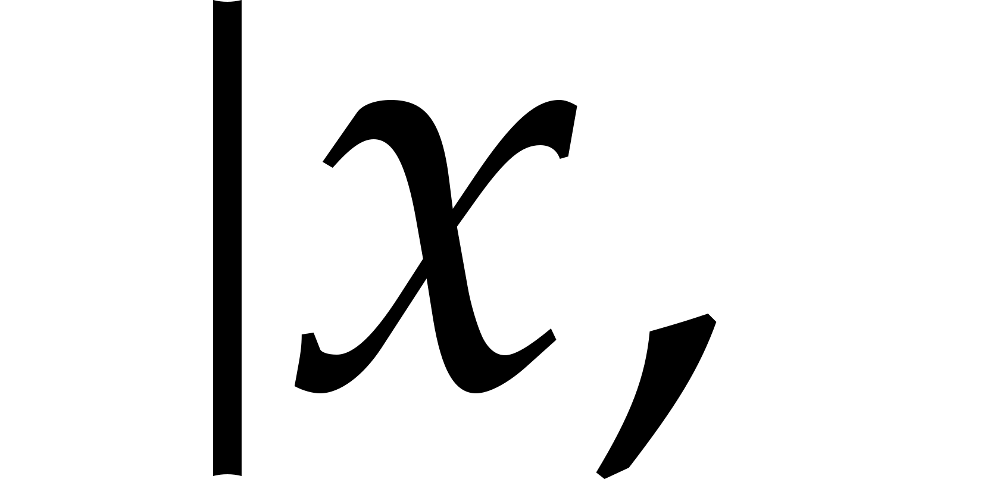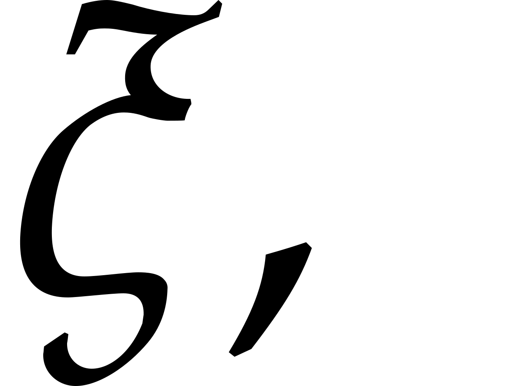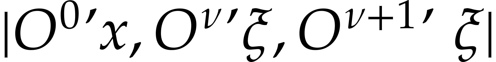 and O + 1 = 1 Def.

so instead of “x, O'x, O'O'x, O'O'O'x etc.” I write

“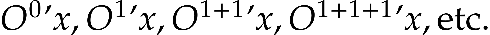”

1 + 1 = 2 Def. 1 + 1 + 1 = 3 Def. and so on.

### [Ms-104](/ms-104/#102.4) [102\[4\]](https://cdn.wittgensteinnachlass.com/2000px/webp/Ms-104/102.webp)

4˙22121 Thus “a = b” means that the sign “a” can be replaced by the sign “b”.

### [Ms-104](/ms-104/#102.5) [102\[5\]](https://cdn.wittgensteinnachlass.com/2000px/webp/Ms-104/102.webp)

4˙22122 If I introduce a new sign α by means of an equation by saying that it is to replace an already familiar sign β, I write the equation – definition – (following Russell) in the form α = β Def.

### [Ms-104](/ms-104/#102.6) [102\[6\]](https://cdn.wittgensteinnachlass.com/2000px/webp/Ms-104/102.webp)

5˙00161 A function cannot be its own argument, but the result of an operation can be the basis of that same operation.

### [Ms-104](/ms-104/#103.1) [103\[1\]](https://cdn.wittgensteinnachlass.com/2000px/webp/Ms-104/103.webp)

5˙00163 Russell & Whitehead did not admit the possibility of this progression, but made use of it again and again.

### [Ms-104](/ms-104/#103.2) [103\[2\]](https://cdn.wittgensteinnachlass.com/2000px/webp/Ms-104/103.webp)

2˙014 Objects contain the possibility of all situations.

### [Ms-104](/ms-104/#103.3) [103\[3\]](https://cdn.wittgensteinnachlass.com/2000px/webp/Ms-104/103.webp)

2˙0141 The possibility of its occurring in states of affairs is the form of an object.

### [Ms-104](/ms-104/#103.4) [103\[4\]](https://cdn.wittgensteinnachlass.com/2000px/webp/Ms-104/103.webp)

2˙033 Form is the possibility of structure.

### [Ms-104](/ms-104/#103.5) [103\[5\]](https://cdn.wittgensteinnachlass.com/2000px/webp/Ms-104/103.webp)

2˙151 The form of depiction is the possibility that things are related to one another as the elements of the picture are.

---

### [Ms-104](/ms-104/#103.6) [103\[6\]](https://cdn.wittgensteinnachlass.com/2000px/webp/Ms-104/103.webp)

3˙1 The thought finds expression in the sentence in a way that can be perceived by the senses.

### [Ms-104](/ms-104/#103.7) [103\[7\]](https://cdn.wittgensteinnachlass.com/2000px/webp/Ms-104/103.webp)

3˙11 We use the sign perceptible to the senses (spoken or written sign, etc.) of the sentence as a projection of the possible situation.

The method of projection is the thinking of the proposition’s sense.

### [Ms-104](/ms-104/#103.8) [103\[8\]](https://cdn.wittgensteinnachlass.com/2000px/webp/Ms-104/103.webp)

3˙12 I call the sign by which we express the thought the propositional sign. And the proposition is the propositional sign in its projective relation to the world.

### [Ms-104](/ms-104/#103.9) [103\[9\]](https://cdn.wittgensteinnachlass.com/2000px/webp/Ms-104/103.webp)

3˙203 The name means the object. The object is its meaning. (“A” is the same sign as “A”.)

### [Ms-104](/ms-104/#103.10+104.1) [103\[10\]](https://cdn.wittgensteinnachlass.com/2000px/webp/Ms-104/103.webp),[104\[1\]](https://cdn.wittgensteinnachlass.com/2000px/webp/Ms-104/104.webp)

3˙2 In a sentence the thought can be expressed in such a way that elements of the propositional sign correspond to the objects of the thought.

### [Ms-104](/ms-104/#104.2) [104\[2\]](https://cdn.wittgensteinnachlass.com/2000px/webp/Ms-104/104.webp)

3˙201 I call these elements “simple signs” and the sentence “completely analysed”.

### [Ms-104](/ms-104/#104.3) [104\[3\]](https://cdn.wittgensteinnachlass.com/2000px/webp/Ms-104/104.webp)

3˙21 The configuration of the objects in the situation corresponds to the configuration of the simple signs in the sentence-sign.

---

### [Ms-104](/ms-104/#104.4) [104\[4\]](https://cdn.wittgensteinnachlass.com/2000px/webp/Ms-104/104.webp)

3˙3 Only the sentence has sense; only in the context of the sentence does a name have meaning.

### [Ms-104](/ms-104/#104.5) [104\[5\]](https://cdn.wittgensteinnachlass.com/2000px/webp/Ms-104/104.webp)

3˙25 No definition can break the name down any further: it is a primitive sign.

### [Ms-104](/ms-104/#104.6) [104\[6\]](https://cdn.wittgensteinnachlass.com/2000px/webp/Ms-104/104.webp)

3˙251 Every defined sign designates _via_ the signs by which it was defined; and the definitions show the way. Two signs, a primitive sign and a sign defined by primitive signs, cannot designate in the same way. One _cannot_ unpack names by means of definitions (no sign that has a meaning on its own, independently).

### [Ms-104](/ms-104/#104.7) [104\[7\]](https://cdn.wittgensteinnachlass.com/2000px/webp/Ms-104/104.webp)

3˙31 I call every part of the sentence that characterizes its sense an expression (a symbol). (The sentence itself is an expression.) An expression is anything essential to the sense of the sentence that sentences can have in common.

(Every expression can be designated as a variable sentence – in the limiting case as a sentence.) An expression marks out a form and a content.

### [Ms-104](/ms-104/#104.8) [104\[8\]](https://cdn.wittgensteinnachlass.com/2000px/webp/Ms-104/104.webp)

3˙32 The sign is what can be perceived by the senses in the symbol.

### [Ms-104](/ms-104/#105.1) [105\[1\]](https://cdn.wittgensteinnachlass.com/2000px/webp/Ms-104/105.webp)

3˙321 Two different symbols can thus have the sign (written sign or sound sign etc.) in common – they then designate in different ways.

### [Ms-104](/ms-104/#105.2) [105\[2\]](https://cdn.wittgensteinnachlass.com/2000px/webp/Ms-104/105.webp)

3˙323 In ordinary language it happens exceedingly often that the same word designates in different ways – and so belongs to different symbols – or at least that two words that designate in different ways are outwardly applied in the same way in a sentence.

Thus the word “is” appears as a copula, as an equality sign and as an expression of existence; “exist” as an intransitive verb like “walk”; “identical” as an adjective; we speak of _Something_ but also of _something_ happening. (In the sentence “Grün ist grün” – where the first word is a person’s name and the last an adjective – these words do not merely have different meanings but are _different symbols_.)

### [Ms-104](/ms-104/#105.3+106.1) [105\[3\]](https://cdn.wittgensteinnachlass.com/2000px/webp/Ms-104/105.webp),[106\[1\]](https://cdn.wittgensteinnachlass.com/2000px/webp/Ms-104/106.webp)

3˙322 It can never indicate the feature common to two objects that we designate them with the same sign but by two different _modes of designation_. For the sign is arbitrary, after all. One could therefore choose two different signs instead, and where would that leave what is common in the designation?

---

### [Ms-104](/ms-104/#106.2) [106\[2\]](https://cdn.wittgensteinnachlass.com/2000px/webp/Ms-104/106.webp)

4˙24 Names are the simple symbols; I indicate them by individual letters (x,y,z).

I write the elementary sentence as a function of the names in the form: “f(x)”, “g(x,y)”, etc..

Or I indicate it by the letters p, q, r.

---

### [Ms-104](/ms-104/#106.3) [106\[3\]](https://cdn.wittgensteinnachlass.com/2000px/webp/Ms-104/106.webp)

5˙15 If Wr is the number of truth-grounds of the proposition “r”, and Wrs the number of truth-grounds of the proposition “s” that are also truth-grounds of “r”, then we call the ratio 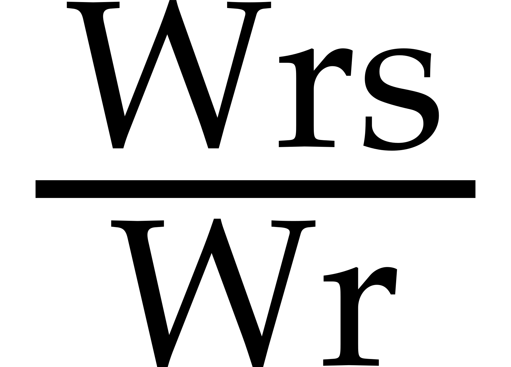 the measure of the _probability_ that the proposition “r” gives the proposition “s”.

### [Ms-104](/ms-104/#106.4) [106\[4\]](https://cdn.wittgensteinnachlass.com/2000px/webp/Ms-104/106.webp)

5˙152 Propositions that have no truth-grounds in common we call independent of one another.

Propositions independent of one another (e.g. two elementary propositions) give one another the probability ½. If p follows from q, then the proposition “q” gives the proposition “p” the probability 1.

The certainty of logical inference is a limiting case of probability.

(Application to tautology and contradiction)

### [Ms-104](/ms-104/#106.5+107.1) [106\[5\]](https://cdn.wittgensteinnachlass.com/2000px/webp/Ms-104/106.webp),[107\[1\]](https://cdn.wittgensteinnachlass.com/2000px/webp/Ms-104/107.webp)

5˙153 A proposition is in itself neither probable nor improbable. An event occurs or it does not occur; there is nothing in between.

### [Ms-104](/ms-104/#107.2) [107\[2\]](https://cdn.wittgensteinnachlass.com/2000px/webp/Ms-104/107.webp)

5˙154 Suppose there are as many white balls as black ones in an urn (and no others). I draw one ball after another, putting each back in the urn. Then I can establish by experiment that the numbers of black and white balls drawn approach one another as the drawing continues.

_That_, then, is not a mathematical fact.

Now if I say: it is as probable that I will draw a white ball as that I will draw a black one, this means: all the circumstances known to me (including the laws of nature assumed hypothetically) give the occurrence of one event no _greater_ probability than the occurrence of the other. That is, they give – as is readily inferred from the explanations above – each the probability ½.

What I confirm by experiment is that the occurrence of the two events is independent of the circumstances I do not know in detail.

### [Ms-104](/ms-104/#107.3+108.1) [107\[3\]](https://cdn.wittgensteinnachlass.com/2000px/webp/Ms-104/107.webp),[108\[1\]](https://cdn.wittgensteinnachlass.com/2000px/webp/Ms-104/108.webp)

5˙155 The unit of the probability proposition is: The circumstances – of which I otherwise know nothing further – give the occurrence of a particular event such and such a degree of probability.

---

### [Ms-104](/ms-104/#108.2) [108\[2\]](https://cdn.wittgensteinnachlass.com/2000px/webp/Ms-104/108.webp)

3˙311 An expression presupposes the forms of all the sentences in which it can occur.

It is the common, characteristic feature of a class of sentences.

### [Ms-104](/ms-104/#108.3) [108\[3\]](https://cdn.wittgensteinnachlass.com/2000px/webp/Ms-104/108.webp)

3˙312 It is thus represented by the general form of the sentences it characterizes.

More precisely, in this form the expression will be _constant_ and everything else _variable_.

### [Ms-104](/ms-104/#108.4) [108\[4\]](https://cdn.wittgensteinnachlass.com/2000px/webp/Ms-104/108.webp)

3˙313 The expression is thus represented by a variable whose values are the sentences that contain the expression.

(In the limiting case the variable becomes a constant and the expression becomes a sentence.)

I call such a variable a “sentence variable”.

### [Ms-104](/ms-104/#108.5) [108\[5\]](https://cdn.wittgensteinnachlass.com/2000px/webp/Ms-104/108.webp)

3˙314 The expression has meaning only in the sentence. Any variable can be regarded as a sentence variable.

(The variable name too.)

---

### [Ms-104](/ms-104/#108.6) [108\[6\]](https://cdn.wittgensteinnachlass.com/2000px/webp/Ms-104/108.webp)

5˙21 One can regard every proposition as the result of an operation that was performed on a number of propositions – the bases of the operation – and forms that proposition from them.

### [Ms-104](/ms-104/#109.1) [109\[1\]](https://cdn.wittgensteinnachlass.com/2000px/webp/Ms-104/109.webp)

The operation is the expression of a relation between the forms of its result and of its bases.

The operation expresses this relation by showing what one had to do with the one proposition to obtain the other.

### [Ms-104](/ms-104/#109.2) [109\[2\]](https://cdn.wittgensteinnachlass.com/2000px/webp/Ms-104/109.webp)

5˙232 The internal relation that orders a series is equivalent to the operation by which one term arises from another.

### [Ms-104](/ms-104/#109.3) [109\[3\]](https://cdn.wittgensteinnachlass.com/2000px/webp/Ms-104/109.webp)

The operation expresses the difference between the forms.

And what the bases and the result of the operation have in common is precisely the bases.

### [Ms-104](/ms-104/#109.4) [109\[4\]](https://cdn.wittgensteinnachlass.com/2000px/webp/Ms-104/109.webp)

The operation is thus an expression.

It is represented as a variable.

What is variable in it is its bases.

### [Ms-104](/ms-104/#109.5) [109\[5\]](https://cdn.wittgensteinnachlass.com/2000px/webp/Ms-104/109.webp)

I indicate the operation in general by a sign of the form “O'(p, q, ...)”. “p”, “q”, etc. are the bases of the operation O'(ξ, η, ...), and O'(p, q, ...) is its result.

### [Ms-104](/ms-104/#109.6) [109\[6\]](https://cdn.wittgensteinnachlass.com/2000px/webp/Ms-104/109.webp)

Truth-functions are the results of operations on elementary propositions.

### [Ms-104](/ms-104/#110.1) [110\[1\]](https://cdn.wittgensteinnachlass.com/2000px/webp/Ms-104/110.webp)

5˙2 We see that the structures of propositions stand in internal relations to one another.

### [Ms-104](/ms-104/#110.2) [110\[2\]](https://cdn.wittgensteinnachlass.com/2000px/webp/Ms-104/110.webp)

5˙21 We can bring out these internal relations in our way of expressing ourselves by representing a proposition as the result of an operation that produces it from other propositions (the bases of the operation).

### [Ms-104](/ms-104/#110.3) [110\[3\]](https://cdn.wittgensteinnachlass.com/2000px/webp/Ms-104/110.webp)

5˙22 The operation is the expression of a relation between the structures of its result and of its bases.

### [Ms-104](/ms-104/#110.4) [110\[4\]](https://cdn.wittgensteinnachlass.com/2000px/webp/Ms-104/110.webp)

5˙23 The operation is what has to happen to one proposition in order to make the other out of it.

### [Ms-104](/ms-104/#110.5) [110\[5\]](https://cdn.wittgensteinnachlass.com/2000px/webp/Ms-104/110.webp)

5˙231 And that will of course depend on their formal properties, on the internal similarity of their forms.

### [Ms-104](/ms-104/#110.6) [110\[6\]](https://cdn.wittgensteinnachlass.com/2000px/webp/Ms-104/110.webp)

5˙24 The operation shows itself in a variable; it shows how one can get from one form of propositions to another.

It expresses the difference between the forms. (And what the bases and the result of the operation have in common is precisely the bases.)

### [Ms-104](/ms-104/#110.7) [110\[7\]](https://cdn.wittgensteinnachlass.com/2000px/webp/Ms-104/110.webp)

5˙241 The operation marks no form, but only the difference between the forms.

### [Ms-104](/ms-104/#110.8+111.1) [110\[8\]](https://cdn.wittgensteinnachlass.com/2000px/webp/Ms-104/110.webp),[111\[1\]](https://cdn.wittgensteinnachlass.com/2000px/webp/Ms-104/111.webp)

5˙25 The occurrence of the operation does not characterize the sense of the proposition.

After all, the operation says nothing; only its result does; and this depends on the bases of the operation.

(Operation and function must not be confused with one another.)

### [Ms-104](/ms-104/#111.2) [111\[2\]](https://cdn.wittgensteinnachlass.com/2000px/webp/Ms-104/111.webp)

5˙233 The operation can only occur where one proposition arises from another in a logically significant way. That is, where the logical construction of the proposition begins.

### [Ms-104](/ms-104/#111.3) [111\[3\]](https://cdn.wittgensteinnachlass.com/2000px/webp/Ms-104/111.webp)

5˙251 A function cannot be its own argument, but the result of an operation can become the basis of that same operation.

### [Ms-104](/ms-104/#111.4) [111\[4\]](https://cdn.wittgensteinnachlass.com/2000px/webp/Ms-104/111.webp)

5˙252 Only in this way is it possible to progress from term to term in a series of forms (from type to type in the hierarchies of Russell and Whitehead).

(Russell and Whitehead did not admit the possibility of this progression, but made use of it again and again.)

### [Ms-104](/ms-104/#111.5) [111\[5\]](https://cdn.wittgensteinnachlass.com/2000px/webp/Ms-104/111.webp)

5˙2521 I call the repeated application of an operation to its own result its successive application. (“O'O'O'a” is the result of the threefold successive application of “O'ξ” to “a”.)

### [Ms-104](/ms-104/#111.6+112.1) [111\[6\]](https://cdn.wittgensteinnachlass.com/2000px/webp/Ms-104/111.webp),[112\[1\]](https://cdn.wittgensteinnachlass.com/2000px/webp/Ms-104/112.webp)

5˙253 One operation can undo the effect of another. Operations can cancel one another out.

### [Ms-104](/ms-104/#112.2) [112\[2\]](https://cdn.wittgensteinnachlass.com/2000px/webp/Ms-104/112.webp)

5˙254 The operation can disappear (e.g. negation in “~~p”; ~~p = p).

### [Ms-104](/ms-104/#112.3) [112\[3\]](https://cdn.wittgensteinnachlass.com/2000px/webp/Ms-104/112.webp)

5˙234 The truth-functions of elementary propositions are results of operations that have elementary propositions as their bases. (I call these operations truth-operations.)

### [Ms-104](/ms-104/#112.4) [112\[4\]](https://cdn.wittgensteinnachlass.com/2000px/webp/Ms-104/112.webp)

5˙242 The same operation that makes “q” out of “p” makes “r” out of “q”; etc.

This can be expressed only by “p”, “q”, “r”, etc. being variables that express certain formal relations generally.

### [Ms-104](/ms-104/#112.5+113.1) [112\[5\]](https://cdn.wittgensteinnachlass.com/2000px/webp/Ms-104/112.webp),[113\[1\]](https://cdn.wittgensteinnachlass.com/2000px/webp/Ms-104/113.webp)

5˙3 All propositions are results of truth-operations on elementary propositions.

A truth-operation is the way in which a truth-function arises from elementary propositions.

It is in the nature of a truth-operation that a new truth-function arises from truth-functions in the same way as their truth-function arises from elementary propositions. Every truth-operation produces from truth-functions of elementary propositions another truth-function of elementary propositions, a proposition. The result of any truth-operation on the results of truth-operations on elementary propositions is again the result of a truth-operation on elementary propositions.

Every proposition is the result of truth-operations on elementary propositions.

### [Ms-104](/ms-104/#113.2) [113\[2\]](https://cdn.wittgensteinnachlass.com/2000px/webp/Ms-104/113.webp)

5˙2341 The sense of a truth-function of p is a function of the sense of p.

(Negation reverses the sense of the proposition.) Negation, logical addition, logical multiplication, etc., etc. are operations.

### [Ms-104](/ms-104/#113.3) [113\[3\]](https://cdn.wittgensteinnachlass.com/2000px/webp/Ms-104/113.webp)

In a similar sense I speak of the successive application of _several_ operations to a number of propositions.

### [Ms-104](/ms-104/#113.4) [113\[4\]](https://cdn.wittgensteinnachlass.com/2000px/webp/Ms-104/113.webp)

5˙32 All truth-functions are results of the successive application of a finite number of truth-functions to elementary propositions.

### [Ms-104](/ms-104/#113.5+114.1) [113\[5\]](https://cdn.wittgensteinnachlass.com/2000px/webp/Ms-104/113.webp),[114\[1\]](https://cdn.wittgensteinnachlass.com/2000px/webp/Ms-104/114.webp)

But if introducing a new device has proved necessary at one point, one must immediately ask oneself: Where must this device now _always_ be applied? Its place in logic must now be explained.

### [Ms-104](/ms-104/#114.2+115.1) [114\[2\]](https://cdn.wittgensteinnachlass.com/2000px/webp/Ms-104/114.webp),[115\[1\]](https://cdn.wittgensteinnachlass.com/2000px/webp/Ms-104/115.webp)

5˙501 I indicate a bracketed expression whose terms are propositions – when the order of the terms in the brackets does not matter – by a sign of the form 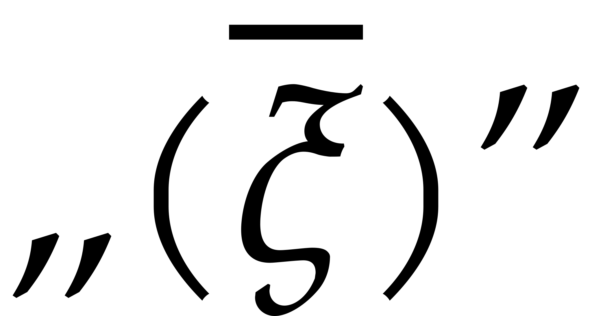. “ξ” is a variable whose values are the terms of the bracketed expression; and the stroke over the variable indicates that it stands for all its values within the brackets. (Thus if ξ has, say, the 3 values “P”, “Q”, “R”, then 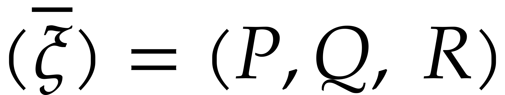.) The values of the variable are specified.

The specification is the description of the propositions for which the variable stands.

How the terms of the bracketed expression are described is inessential.

We _can_ distinguish three kinds of description: 1) Direct enumeration. In this case we can simply put the constant values of the variable in its place. 2) Specification of a function f(x) whose values for all values of x are the propositions to be described. 3) Specification of a formal law according to which those propositions are formed. In this case the terms of the bracketed expression are all the terms of a series of forms.

### [Ms-104](/ms-104/#115.2) [115\[2\]](https://cdn.wittgensteinnachlass.com/2000px/webp/Ms-104/115.webp)

4˙1273 If we want to express the general proposition “b is a successor of a” in concept-script, we need an expression for the general term of the series of forms: aRb, (Еx):aRx ∙ xRb, (Еx,y):aRx ∙ xRy ∙ yRb, ...... One can express the general term of a series of forms only by a variable, for the concept ‘term of this series of forms’ is a formal concept. (Frege and Russell overlooked this; the way in which they want to express general propositions like the one above is therefore wrong; it contains a circulus vitiosus.)

We can determine the general term of the series of forms by specifying its first term and the general form of the operation that generates the next term from the preceding one.

### [Ms-104](/ms-104/#115.3) [115\[3\]](https://cdn.wittgensteinnachlass.com/2000px/webp/Ms-104/115.webp)

5˙2522 I therefore write the general term of a series of forms a, O'a, O'O'a, ..... like this: “[a, x, O'x]”. This bracketed expression is a variable. The first term of the bracketed expression is the beginning of the series of forms, the second the form of an arbitrary term x of the series, and the third the form of the term of the series that immediately follows x.

### [Ms-104](/ms-104/#116.1) [116\[1\]](https://cdn.wittgensteinnachlass.com/2000px/webp/Ms-104/116.webp)

5˙5 Every truth-function is a result of the successive application of the operation (–W) (ξ, ....) to elementary propositions.

This operation negates all the propositions in the right-hand brackets, and I call it the negation of these propositions.

### [Ms-104](/ms-104/#116.2) [116\[2\]](https://cdn.wittgensteinnachlass.com/2000px/webp/Ms-104/116.webp)

(The number of empty places in the left-hand brackets is determined by the number of terms in the right-hand ones.)

### [Ms-104](/ms-104/#116.4) [116\[4\]](https://cdn.wittgensteinnachlass.com/2000px/webp/Ms-104/116.webp)

5˙502 Thus instead of “(–W) (ξ, ....)” I write “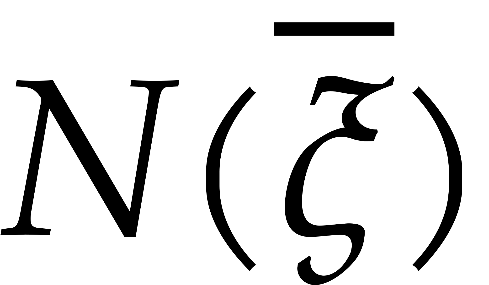”.  is the negation of all the values of the sentence variable ξ.

### [Ms-104](/ms-104/#116.5) [116\[5\]](https://cdn.wittgensteinnachlass.com/2000px/webp/Ms-104/116.webp)

5˙503 Since it is evidently easy to express how propositions can be formed with this operation and how they cannot be formed with it, it must also be possible to give exact expression to this easily.

### [Ms-104](/ms-104/#116.7+117.1) [116\[7\]](https://cdn.wittgensteinnachlass.com/2000px/webp/Ms-104/116.webp),[117\[1\]](https://cdn.wittgensteinnachlass.com/2000px/webp/Ms-104/117.webp)

6˙1201 That, for example, the sentences “p” and “~p” yield a tautology in the combination “~(p ∙ ~p)” shows that they contradict one another. That the sentences “p⊃q”, “p” and “q”, when

combined in the form “(p⊃q) ∙ (p):⊃:(q)”, yield a tautology shows that q follows from p and p⊃q. That “(x) ∙ fx:⊃:fa” is a tautology shows that fa follows from (x) ∙ fx. etc. etc..

### [Ms-104](/ms-104/#117.2) [117\[2\]](https://cdn.wittgensteinnachlass.com/2000px/webp/Ms-104/117.webp)

6˙123 It is clear: the laws of logic must not themselves in turn be subject to laws of logic.

---

### [Ms-104](/ms-104/#117.3) [117\[3\]](https://cdn.wittgensteinnachlass.com/2000px/webp/Ms-104/117.webp)

6˙2331 The process of _calculating_ affords precisely this intuition.

---

A calculation is not an experiment.

---

### [Ms-104](/ms-104/#117.4) [117\[4\]](https://cdn.wittgensteinnachlass.com/2000px/webp/Ms-104/117.webp)

The sentences of mathematics are equations, and hence pseudo-sentences.

### [Ms-104](/ms-104/#117.5) [117\[5\]](https://cdn.wittgensteinnachlass.com/2000px/webp/Ms-104/117.webp)

6˙21 A mathematical sentence does not express a thought.

### [Ms-104](/ms-104/#117.6) [117\[6\]](https://cdn.wittgensteinnachlass.com/2000px/webp/Ms-104/117.webp)

That two expressions can be substituted for one another characterizes their logical form.

### [Ms-104](/ms-104/#117.7+118.1) [117\[7\]](https://cdn.wittgensteinnachlass.com/2000px/webp/Ms-104/117.webp),[118\[1\]](https://cdn.wittgensteinnachlass.com/2000px/webp/Ms-104/118.webp)

6˙232 Frege says that the two expressions have the same meaning but different senses.

But what is essential about the equation is that it is not needed to show that the two expressions joined by the equality sign have the same meaning, since this is evident from the two expressions themselves.

### [Ms-104](/ms-104/#118.2) [118\[2\]](https://cdn.wittgensteinnachlass.com/2000px/webp/Ms-104/118.webp)

6˙2321 And that the sentences of mathematics can be proved means nothing other than that their correctness can be seen without having to compare what they express itself with the facts to check its correctness.

### [Ms-104](/ms-104/#118.3) [118\[3\]](https://cdn.wittgensteinnachlass.com/2000px/webp/Ms-104/118.webp)

6˙2322 The identity of meaning of two expressions cannot be _asserted_. For to be able to assert anything about their meaning I must know their meaning; and in knowing their meaning I know whether they mean the same thing or different things.

### [Ms-104](/ms-104/#118.4) [118\[4\]](https://cdn.wittgensteinnachlass.com/2000px/webp/Ms-104/118.webp)

6˙2323 The equation only marks the standpoint from which I consider the two expressions, namely, the standpoint of their sameness of meaning.

### [Ms-104](/ms-104/#118.5+118.6) [118\[5\]](https://cdn.wittgensteinnachlass.com/2000px/webp/Ms-104/118.webp),[118\[6\]](https://cdn.wittgensteinnachlass.com/2000px/webp/Ms-104/118.webp)

6˙241 The proof of the proposition 2 × 2 = 4 runs as follows:

The concept of an operation is equivalent to the concept “and so on”.

### [Ms-104](/ms-104/#119.1+120.1+121.1) [119\[1\]](https://cdn.wittgensteinnachlass.com/2000px/webp/Ms-104/119.webp),[120\[1\]](https://cdn.wittgensteinnachlass.com/2000px/webp/Ms-104/120.webp),[121\[1\]](https://cdn.wittgensteinnachlass.com/2000px/webp/Ms-104/121.webp)

Preface

Perhaps the only person who will understand this book is someone who has himself already thought the thoughts expressed in it – or at least similar thoughts. – It is therefore not a textbook. – Its purpose would be achieved if it gave pleasure to someone who reads it with understanding.

The book deals with the problems of philosophy and shows – as I believe – that the way these problems are posed rests on a misunderstanding of the logic of our language. One might put the whole sense of the book roughly in these words: What can be said at all can be said clearly; and what one cannot speak about, one must pass over in silence.

The book thus aims to draw a limit to thinking, or rather – not to thinking but to the expression of thoughts: For to draw a limit to thinking, we would have to be able to think both sides of that limit (we would thus have to be able to think what cannot be thought).

The limit can therefore be drawn only in language, and what lies beyond the limit will simply be nonsense. I do not wish to judge how far my efforts coincide with those of other philosophers. Indeed, what I have written here makes no claim at all to novelty in its particulars; and that is why I give no sources either, because it makes no difference to me whether someone else has thought what I have thought before I did.

I wish only to mention that I owe a large part of the stimulus for my thoughts to Frege’s magnificent works and to the writings of my friend Mr Bertrand Russell. If this work has any value, it is twofold. First, thoughts are expressed in it, and this value will be the greater, the better the thoughts are expressed. The more squarely the nail is hit on the head. – Here I am conscious of having fallen far short of what is possible. Simply because my powers are not equal to the task. – May others come and do it better. On the other hand, the _truth_ of the thoughts communicated here seems to me unassailable and definitive. I am therefore of the opinion that I have solved the problems once and for all in their essentials. And if I am not mistaken about this, the value of this work consists, secondly, in its showing how little is achieved by the fact that these problems have been solved.

I thank my uncle Mr Paul Wittgenstein and my friend Mr Bertrand Russell for the affectionate encouragement they have given me.

_L.W._
