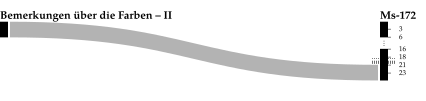
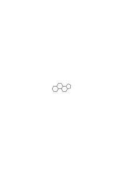

# Remarks on Colour – II

1950, 20 remarks, Ms-172

### [Ms-172](/ms-172/#21.1) [21\[1\]](https://cdn.wittgensteinnachlass.com/2000px/webp/Ms-172/21.webp)

1 One could talk about the colour impression of a surface, which does not mean the colour, but the colour tones and their distribution, if, for example, one wants to create the impression of a brown surface.

### [Ms-172](/ms-172/#21.2) [21\[2\]](https://cdn.wittgensteinnachlass.com/2000px/webp/Ms-172/21.webp)

2 The addition of white diminishes the colour’s _colour_; the addition of yellow, however, does not. — Is this at the root of the sentence, that there cannot be a clear, transparent white?

### [Ms-172](/ms-172/#21.3) [21\[3\]](https://cdn.wittgensteinnachlass.com/2000px/webp/Ms-172/21.webp)

3 But what is this sentence: that the addition of white takes away the colour from the colour? As I mean it, it cannot be a physical sentence. Here, the temptation is very great to believe in a phenomenology, a middle ground between science & logic.

### [Ms-172](/ms-172/#21.4) [21\[4\]](https://cdn.wittgensteinnachlass.com/2000px/webp/Ms-172/21.webp)

4 What, then, is the essence of _turbidity_? For red, yellow transparent things are not turbid, white things are turbid.

### [Ms-172](/ms-172/#21.5+22.1) [21\[5\]](https://cdn.wittgensteinnachlass.com/2000px/webp/Ms-172/21.webp),[22\[1\]](https://cdn.wittgensteinnachlass.com/2000px/webp/Ms-172/22.webp)

5 Is turbidity what obscures the forms, and does it obscure the forms because it blurs light and shadow?

### [Ms-172](/ms-172/#22.2) [22\[2\]](https://cdn.wittgensteinnachlass.com/2000px/webp/Ms-172/22.webp)

6 Is not white what cancels out darkness?

### [Ms-172](/ms-172/#22.3) [22\[3\]](https://cdn.wittgensteinnachlass.com/2000px/webp/Ms-172/22.webp)

7 One speaks of ‘black glass,’ but whoever looks at a white surface through red glass sees it red, through ‘black’ glass, not black.

### [Ms-172](/ms-172/#22.4) [22\[4\]](https://cdn.wittgensteinnachlass.com/2000px/webp/Ms-172/22.webp)

8 One uses coloured lenses to see clearly, but never turbid ones.

### [Ms-172](/ms-172/#22.5) [22\[5\]](https://cdn.wittgensteinnachlass.com/2000px/webp/Ms-172/22.webp)

9 “The addition of white blurs the difference between light & dark, light & shadow”: does this define the concepts more precisely? I think so.

### [Ms-172](/ms-172/#22.6) [22\[6\]](https://cdn.wittgensteinnachlass.com/2000px/webp/Ms-172/22.webp)

10 If someone didn't find that to be the case, they wouldn't have the opposite experience; rather, we wouldn't understand them.

### [Ms-172](/ms-172/#23.1) [23\[1\]](https://cdn.wittgensteinnachlass.com/2000px/webp/Ms-172/23.webp)

11 In philosophy, one must always ask: “_How_ must one look at this problem in order for it to become solvable?”

### [Ms-172](/ms-172/#23.2) [23\[2\]](https://cdn.wittgensteinnachlass.com/2000px/webp/Ms-172/23.webp)

12 For here (when I consider the colours, for example), there is only an inability to create any kind of order. We stand there, like the ox in front of the newly (re)painted stable door.

### [Ms-172](/ms-172/#23.3) [23\[3\]](https://cdn.wittgensteinnachlass.com/2000px/webp/Ms-172/23.webp)

13 Think about how a painter would depict the view through a reddish-coloured glass. It is, after all, a _complicated_ arrangement of surfaces that results. That is to say, the picture will contain a variety of gradations of red & other colours side by side. And analogously, if one were to look through a blue glass. But how if one were to paint a picture in which, where previously something became bluish or reddish, it becomes whitish?

### [Ms-172](/ms-172/#23.4) [23\[4\]](https://cdn.wittgensteinnachlass.com/2000px/webp/Ms-172/23.webp)

14 Is the whole difference here that the colours do not lose their saturation through the reddish glow, but they do through the whitish one? Yes, one doesn't even speak of a ‘whitish glow’!

### [Ms-172](/ms-172/#24.1) [24\[1\]](https://cdn.wittgensteinnachlass.com/2000px/webp/Ms-172/24.webp)

15 If, with a certain illumination, everything looked whitish, we would not conclude that the luminous must look white.

### [Ms-172](/ms-172/#24.2) [24\[2\]](https://cdn.wittgensteinnachlass.com/2000px/webp/Ms-172/24.webp)

16 The phenomenological analysis (as, for example, Goethe wanted) is an analysis of concepts & can neither agree with nor contradict physics.

### [Ms-172](/ms-172/#24.3) [24\[3\]](https://cdn.wittgensteinnachlass.com/2000px/webp/Ms-172/24.webp)

17 But what if it were the case somewhere that the light of a white-hot body makes things appear bright but whitish, i.e., colour-weak, the light of a red-hot body reddish, etc.? (Only an invisible source, not perceptible to the eye, would make them shine in colours.)

### [Ms-172](/ms-172/#24.4) [24\[4\]](https://cdn.wittgensteinnachlass.com/2000px/webp/Ms-172/24.webp)

18 Yes, as if the things only shone in their colours when, in our sense, _no_ light falls on them, when, for example, the sky is _black_? Could one then not say: only in black light do the full colours appear (to us)?

### [Ms-172](/ms-172/#24.5) [24\[5\]](https://cdn.wittgensteinnachlass.com/2000px/webp/Ms-172/24.webp)

19 But wouldn't there be a contradiction here?

### [Ms-172](/ms-172/#24.6) [24\[6\]](https://cdn.wittgensteinnachlass.com/2000px/webp/Ms-172/24.webp)

20 I _see_ that the colours of the objects reflect light into my eye.
