### [Ts-204](/ts-204/#1r.1) [1r\[1\]](https://cdn.wittgensteinnachlass.com/2000px/webp/Ts-204/1r.webp)

1 The world is everything that is the case.

### [Ts-204](/ts-204/#1r.2) [1r\[2\]](https://cdn.wittgensteinnachlass.com/2000px/webp/Ts-204/1r.webp)

1.1 The world is the totality of facts, not of things.

### [Ts-204](/ts-204/#1r.3) [1r\[3\]](https://cdn.wittgensteinnachlass.com/2000px/webp/Ts-204/1r.webp)

1.11 The world is determined by the facts and by their being _all_ the facts.

### [Ts-204](/ts-204/#1r.4) [1r\[4\]](https://cdn.wittgensteinnachlass.com/2000px/webp/Ts-204/1r.webp)

1.12 For the totality of facts determines what is the case and also everything that is not the case.

### [Ts-204](/ts-204/#1r.5) [1r\[5\]](https://cdn.wittgensteinnachlass.com/2000px/webp/Ts-204/1r.webp)

1.13 The facts in logical space are the world.

### [Ts-204](/ts-204/#1r.6) [1r\[6\]](https://cdn.wittgensteinnachlass.com/2000px/webp/Ts-204/1r.webp)

1.2 The world breaks down into facts.

### [Ts-204](/ts-204/#1r.7) [1r\[7\]](https://cdn.wittgensteinnachlass.com/2000px/webp/Ts-204/1r.webp)

1.21 One thing can be the case or not be the case and everything else remain the same.

### [Ts-204](/ts-204/#1r.8) [1r\[8\]](https://cdn.wittgensteinnachlass.com/2000px/webp/Ts-204/1r.webp)

2 What is the case, the fact, is the obtaining of states of affairs.

### [Ts-204](/ts-204/#1r.9) [1r\[9\]](https://cdn.wittgensteinnachlass.com/2000px/webp/Ts-204/1r.webp)

2.01 A state of affairs is a combination of objects (items, things).

### [Ts-204](/ts-204/#1r.10) [1r\[10\]](https://cdn.wittgensteinnachlass.com/2000px/webp/Ts-204/1r.webp)

2.011 It is essential to a thing that it can be a component of a state of affairs.

### [Ts-204](/ts-204/#1r.11) [1r\[11\]](https://cdn.wittgensteinnachlass.com/2000px/webp/Ts-204/1r.webp)

2.012 In logic nothing is accidental: if a thing _can_ occur in a state of affairs, then the possibility of that state of affairs must already be settled in advance in the thing.

### [Ts-204](/ts-204/#1r.12) [1r\[12\]](https://cdn.wittgensteinnachlass.com/2000px/webp/Ts-204/1r.webp)

2.0121 It would seem, as it were, accidental if a situation were to fit a thing after the fact when the thing could exist on its own.

If things can occur in states of affairs, this must already lie in the things themselves.

(Something logical cannot be merely-possible. Logic deals with every possibility, and all possibilities are its facts.)

Just as we cannot conceive of spatial objects outside space at all, or of temporal objects outside time, so there is _no_ object we can conceive of outside the _possibility_ of its combination with others.

If I can conceive of an object as part of a state of affairs, I cannot conceive of it outside the possibility of its being so combined.

### [Ts-204](/ts-204/#1r.13) [1r\[13\]](https://cdn.wittgensteinnachlass.com/2000px/webp/Ts-204/1r.webp)

2.0122 A thing is independent in so far as it can occur in all _possible_ situations, but this form of independence is a form of connection with the state of affairs, a form of dependence. (It is impossible for words to occur in two different ways, on their own and in a sentence.)

### [Ts-204](/ts-204/#1r.14) [1r\[14\]](https://cdn.wittgensteinnachlass.com/2000px/webp/Ts-204/1r.webp)

2.0123 If I know an object, then I also know every possibility of its occurring in states of affairs.

(Each such possibility must lie in the nature of the object.) A new possibility cannot be found afterwards.

### [Ts-204](/ts-204/#2r.1) [2r\[1\]](https://cdn.wittgensteinnachlass.com/2000px/webp/Ts-204/2r.webp)

2.01231 To know an object, I need not know its external properties, but I must know all its internal properties.

### [Ts-204](/ts-204/#2r.2) [2r\[2\]](https://cdn.wittgensteinnachlass.com/2000px/webp/Ts-204/2r.webp)

2.0124 If all objects are given, then all _possible_ states of affairs are thereby given as well.

### [Ts-204](/ts-204/#2r.3) [2r\[3\]](https://cdn.wittgensteinnachlass.com/2000px/webp/Ts-204/2r.webp)

2.013 Each thing is, as it were, in a space of possible states of affairs. I can conceive of this space as empty, but not of the thing without the space.

### [Ts-204](/ts-204/#2r.4) [2r\[4\]](https://cdn.wittgensteinnachlass.com/2000px/webp/Ts-204/2r.webp)

2.0131 A spatial object must lie in infinite space.

(A point in space is an argument place.)

A patch in the visual field need not be red, but it must have a colour; it has colour space around it, so to speak. A tone must have _some_ pitch, an object of the sense of touch _some_ hardness, and so on.

### [Ts-204](/ts-204/#2r.5) [2r\[5\]](https://cdn.wittgensteinnachlass.com/2000px/webp/Ts-204/2r.webp)

2.014 Objects contain the possibility of all situations.

### [Ts-204](/ts-204/#2r.6) [2r\[6\]](https://cdn.wittgensteinnachlass.com/2000px/webp/Ts-204/2r.webp)

2.0141 The possibility of its occurring in states of affairs is the form of an object.

### [Ts-204](/ts-204/#2r.7) [2r\[7\]](https://cdn.wittgensteinnachlass.com/2000px/webp/Ts-204/2r.webp)

2.02 An object is simple.

### [Ts-204](/ts-204/#2r.8) [2r\[8\]](https://cdn.wittgensteinnachlass.com/2000px/webp/Ts-204/2r.webp)

2.0201 Every statement about complexes can be broken down into a statement about their components and the propositions that describe the complexes completely.

### [Ts-204](/ts-204/#2r.9) [2r\[9\]](https://cdn.wittgensteinnachlass.com/2000px/webp/Ts-204/2r.webp)

2.021 Objects form the substance of the world. That is why they cannot be composite.

### [Ts-204](/ts-204/#2r.10) [2r\[10\]](https://cdn.wittgensteinnachlass.com/2000px/webp/Ts-204/2r.webp)

2.0211 If the world had no substance, whether a proposition has sense would depend on whether another proposition is true.

### [Ts-204](/ts-204/#2r.11) [2r\[11\]](https://cdn.wittgensteinnachlass.com/2000px/webp/Ts-204/2r.webp)

2.0212 It would then be impossible to construct a picture of the world (true or false).

### [Ts-204](/ts-204/#2r.12) [2r\[12\]](https://cdn.wittgensteinnachlass.com/2000px/webp/Ts-204/2r.webp)

2.022 It is obvious that however different we imagine a world to be from the actual world, it must have something – a form – in common with it.

### [Ts-204](/ts-204/#2r.13) [2r\[13\]](https://cdn.wittgensteinnachlass.com/2000px/webp/Ts-204/2r.webp)

2.023 This fixed form consists precisely of the objects.

### [Ts-204](/ts-204/#2r.14) [2r\[14\]](https://cdn.wittgensteinnachlass.com/2000px/webp/Ts-204/2r.webp)

2.0231 The substance of the world _can_ determine only a form and not any material properties. For these are represented only by propositions – formed only by the configuration of objects.

### [Ts-204](/ts-204/#2r.15) [2r\[15\]](https://cdn.wittgensteinnachlass.com/2000px/webp/Ts-204/2r.webp)

2.0232 In passing: objects are colourless.

### [Ts-204](/ts-204/#2r.16) [2r\[16\]](https://cdn.wittgensteinnachlass.com/2000px/webp/Ts-204/2r.webp)

2.0233 Two objects of the same logical form are distinguished from one another – apart from their external properties – only by being different.

### [Ts-204](/ts-204/#2r.17+3r.1) [2r\[17\]](https://cdn.wittgensteinnachlass.com/2000px/webp/Ts-204/2r.webp),[3r\[1\]](https://cdn.wittgensteinnachlass.com/2000px/webp/Ts-204/3r.webp)

2.02331 Either a thing has properties that no other thing has, in which case one can readily single it out from the others by a description and point to it; or there are several things that have all their properties in common, in which case it is quite impossible to point to one of them.

For if nothing singles the thing out, I cannot single it out, for otherwise it is indeed singled out.

### [Ts-204](/ts-204/#3r.2) [3r\[2\]](https://cdn.wittgensteinnachlass.com/2000px/webp/Ts-204/3r.webp)

2.024 Substance is what exists independently of what is the case.

### [Ts-204](/ts-204/#3r.3) [3r\[3\]](https://cdn.wittgensteinnachlass.com/2000px/webp/Ts-204/3r.webp)

2.025 It is form and content.

### [Ts-204](/ts-204/#3r.4) [3r\[4\]](https://cdn.wittgensteinnachlass.com/2000px/webp/Ts-204/3r.webp)

2.0251 Space, time and colour (being coloured) are forms of objects.

### [Ts-204](/ts-204/#3r.5) [3r\[5\]](https://cdn.wittgensteinnachlass.com/2000px/webp/Ts-204/3r.webp)

2.026 Only if there are objects can there be a fixed form of the world.

### [Ts-204](/ts-204/#3r.6) [3r\[6\]](https://cdn.wittgensteinnachlass.com/2000px/webp/Ts-204/3r.webp)

2.027 The fixed, the enduring and the object are one.

### [Ts-204](/ts-204/#3r.7) [3r\[7\]](https://cdn.wittgensteinnachlass.com/2000px/webp/Ts-204/3r.webp)

2.0271 The object is what is fixed and enduring; the configuration is what changes and is inconstant.

### [Ts-204](/ts-204/#3r.8) [3r\[8\]](https://cdn.wittgensteinnachlass.com/2000px/webp/Ts-204/3r.webp)

2.0272 The configuration of objects forms the state of affairs.

### [Ts-204](/ts-204/#3r.9) [3r\[9\]](https://cdn.wittgensteinnachlass.com/2000px/webp/Ts-204/3r.webp)

2.03 In a state of affairs the objects are interlinked like the links of a chain.

### [Ts-204](/ts-204/#3r.10) [3r\[10\]](https://cdn.wittgensteinnachlass.com/2000px/webp/Ts-204/3r.webp)

2.031 In a state of affairs the objects are related to one another in a particular way.

### [Ts-204](/ts-204/#3r.11) [3r\[11\]](https://cdn.wittgensteinnachlass.com/2000px/webp/Ts-204/3r.webp)

2.032 The way the objects are connected in a state of affairs is the structure of that state of affairs.

### [Ts-204](/ts-204/#3r.12) [3r\[12\]](https://cdn.wittgensteinnachlass.com/2000px/webp/Ts-204/3r.webp)

2.033 Form is the possibility of structure.

### [Ts-204](/ts-204/#3r.13) [3r\[13\]](https://cdn.wittgensteinnachlass.com/2000px/webp/Ts-204/3r.webp)

2.034 The structure of a fact consists of the structures of the states of affairs.

### [Ts-204](/ts-204/#3r.14) [3r\[14\]](https://cdn.wittgensteinnachlass.com/2000px/webp/Ts-204/3r.webp)

2.04 The totality of states of affairs that obtain is the world.

### [Ts-204](/ts-204/#3r.15) [3r\[15\]](https://cdn.wittgensteinnachlass.com/2000px/webp/Ts-204/3r.webp)

2.05 The totality of states of affairs that obtain also determines which states of affairs do not obtain.

### [Ts-204](/ts-204/#3r.16) [3r\[16\]](https://cdn.wittgensteinnachlass.com/2000px/webp/Ts-204/3r.webp)

2.06 The obtaining and non-obtaining of states of affairs is reality.

(We also call the obtaining of states of affairs a positive fact, their non-obtaining a negative fact.)

### [Ts-204](/ts-204/#3r.17) [3r\[17\]](https://cdn.wittgensteinnachlass.com/2000px/webp/Ts-204/3r.webp)

2.061 States of affairs are independent of one another.

### [Ts-204](/ts-204/#3r.18) [3r\[18\]](https://cdn.wittgensteinnachlass.com/2000px/webp/Ts-204/3r.webp)

2.062 One cannot infer from the obtaining or non-obtaining of one state of affairs the obtaining or non-obtaining of another.

### [Ts-204](/ts-204/#3r.19) [3r\[19\]](https://cdn.wittgensteinnachlass.com/2000px/webp/Ts-204/3r.webp)

2.063 The whole of reality is the world.

### [Ts-204](/ts-204/#3r.20) [3r\[20\]](https://cdn.wittgensteinnachlass.com/2000px/webp/Ts-204/3r.webp)

2.1 We make pictures of facts for ourselves.

### [Ts-204](/ts-204/#3r.21) [3r\[21\]](https://cdn.wittgensteinnachlass.com/2000px/webp/Ts-204/3r.webp)

2.11 A picture presents the situation in logical space, the obtaining and non-obtaining of states of affairs.

### [Ts-204](/ts-204/#3r.22) [3r\[22\]](https://cdn.wittgensteinnachlass.com/2000px/webp/Ts-204/3r.webp)

2.12 A picture is a model of reality.

### [Ts-204](/ts-204/#3r.23) [3r\[23\]](https://cdn.wittgensteinnachlass.com/2000px/webp/Ts-204/3r.webp)

2.13 In the picture, the elements of the picture correspond to the objects.

### [Ts-204](/ts-204/#3r.24) [3r\[24\]](https://cdn.wittgensteinnachlass.com/2000px/webp/Ts-204/3r.webp)

2.132 In the picture, the elements of the picture stand for the objects.

### [Ts-204](/ts-204/#3r.25) [3r\[25\]](https://cdn.wittgensteinnachlass.com/2000px/webp/Ts-204/3r.webp)

2.14 A picture consists in its elements being related to one another in a particular way.

### [Ts-204](/ts-204/#3r.26) [3r\[26\]](https://cdn.wittgensteinnachlass.com/2000px/webp/Ts-204/3r.webp)

2.141 A picture is a fact.

### [Ts-204](/ts-204/#4r.1) [4r\[1\]](https://cdn.wittgensteinnachlass.com/2000px/webp/Ts-204/4r.webp)

2.15 That the elements of the picture are related to one another in a particular way presents the items as being related to one another in that way.

This connection between the elements of the picture is called its structure, and the possibility of that structure its form of depiction.

### [Ts-204](/ts-204/#4r.2) [4r\[2\]](https://cdn.wittgensteinnachlass.com/2000px/webp/Ts-204/4r.webp)

2.151 The form of depiction is the possibility that things are related to one another as the elements of the picture are.

### [Ts-204](/ts-204/#4r.3) [4r\[3\]](https://cdn.wittgensteinnachlass.com/2000px/webp/Ts-204/4r.webp)

2.1511 The picture is linked to reality in this way: it reaches right up to it.

### [Ts-204](/ts-204/#4r.4) [4r\[4\]](https://cdn.wittgensteinnachlass.com/2000px/webp/Ts-204/4r.webp)

2.1512 It is laid against reality like a yardstick.

### [Ts-204](/ts-204/#4r.5) [4r\[5\]](https://cdn.wittgensteinnachlass.com/2000px/webp/Ts-204/4r.webp)

2.15121 Only the outermost points of the graduation marks _touch_ the object to be measured.

### [Ts-204](/ts-204/#4r.6) [4r\[6\]](https://cdn.wittgensteinnachlass.com/2000px/webp/Ts-204/4r.webp)

2.1513 On this view, then, the depicting relation that makes the picture a picture also belongs to it.

### [Ts-204](/ts-204/#4r.7) [4r\[7\]](https://cdn.wittgensteinnachlass.com/2000px/webp/Ts-204/4r.webp)

2.1514 The depicting relation consists of the pairings between the elements of the picture and the items.

### [Ts-204](/ts-204/#4r.8) [4r\[8\]](https://cdn.wittgensteinnachlass.com/2000px/webp/Ts-204/4r.webp)

2.1515 These pairings are, as it were, the feelers of the picture’s elements, with which the picture touches reality.

### [Ts-204](/ts-204/#4r.9) [4r\[9\]](https://cdn.wittgensteinnachlass.com/2000px/webp/Ts-204/4r.webp)

2.16 To be a picture, a fact must have something in common with what is depicted.

### [Ts-204](/ts-204/#4r.10) [4r\[10\]](https://cdn.wittgensteinnachlass.com/2000px/webp/Ts-204/4r.webp)

2.161 There must be something identical in a picture and what it depicts for the one to be a picture of the other at all.

### [Ts-204](/ts-204/#4r.11) [4r\[11\]](https://cdn.wittgensteinnachlass.com/2000px/webp/Ts-204/4r.webp)

2.17 What a picture must have in common with reality in order to depict it in its own way – correctly or falsely – is its form of depiction.

### [Ts-204](/ts-204/#4r.12) [4r\[12\]](https://cdn.wittgensteinnachlass.com/2000px/webp/Ts-204/4r.webp)

2.171 A picture can depict any reality whose form it has. A spatial picture, everything spatial; a coloured picture, everything coloured, etc.

### [Ts-204](/ts-204/#4r.13) [4r\[13\]](https://cdn.wittgensteinnachlass.com/2000px/webp/Ts-204/4r.webp)

2.172 But a picture cannot depict its form of depiction; it displays it.

### [Ts-204](/ts-204/#4r.14) [4r\[14\]](https://cdn.wittgensteinnachlass.com/2000px/webp/Ts-204/4r.webp)

2.173 A picture represents its object from outside (its standpoint is its form of representation), so it represents its object correctly or falsely.

### [Ts-204](/ts-204/#4r.15) [4r\[15\]](https://cdn.wittgensteinnachlass.com/2000px/webp/Ts-204/4r.webp)

2.174 But a picture cannot place itself outside its form of representation.

### [Ts-204](/ts-204/#4r.16) [4r\[16\]](https://cdn.wittgensteinnachlass.com/2000px/webp/Ts-204/4r.webp)

2.18 What every picture, whatever its form, must have in common with reality in order to depict it at all – correctly or falsely – is logical form, that is, the form of reality.

### [Ts-204](/ts-204/#4r.17) [4r\[17\]](https://cdn.wittgensteinnachlass.com/2000px/webp/Ts-204/4r.webp)

2.181 If the form of depiction is logical form, the picture is called a logical picture.

### [Ts-204](/ts-204/#4r.18) [4r\[18\]](https://cdn.wittgensteinnachlass.com/2000px/webp/Ts-204/4r.webp)

2.182 Every picture is _also_ a logical picture. (By contrast, not every picture is spatial, for example.)

### [Ts-204](/ts-204/#4r.19) [4r\[19\]](https://cdn.wittgensteinnachlass.com/2000px/webp/Ts-204/4r.webp)

2.19 A logical picture can depict the world.

### [Ts-204](/ts-204/#5r.1) [5r\[1\]](https://cdn.wittgensteinnachlass.com/2000px/webp/Ts-204/5r.webp)

2.2 A picture has the logical form of depiction in common with what it depicts.

### [Ts-204](/ts-204/#5r.2) [5r\[2\]](https://cdn.wittgensteinnachlass.com/2000px/webp/Ts-204/5r.webp)

2.201 A picture depicts reality by representing a possibility of states of affairs obtaining and not obtaining.

### [Ts-204](/ts-204/#5r.3) [5r\[3\]](https://cdn.wittgensteinnachlass.com/2000px/webp/Ts-204/5r.webp)

2.202 A picture represents a possible situation in logical space.

### [Ts-204](/ts-204/#5r.4) [5r\[4\]](https://cdn.wittgensteinnachlass.com/2000px/webp/Ts-204/5r.webp)

2.203 A picture contains the possibility of the situation it represents.

### [Ts-204](/ts-204/#5r.5) [5r\[5\]](https://cdn.wittgensteinnachlass.com/2000px/webp/Ts-204/5r.webp)

2.21 A picture agrees with reality or not; it is correct or incorrect, true or false.

### [Ts-204](/ts-204/#5r.6) [5r\[6\]](https://cdn.wittgensteinnachlass.com/2000px/webp/Ts-204/5r.webp)

2.22 A picture represents what it represents through its form of depiction, independently of whether it is true or false.

### [Ts-204](/ts-204/#5r.7) [5r\[7\]](https://cdn.wittgensteinnachlass.com/2000px/webp/Ts-204/5r.webp)

2.221 What a picture represents is its sense.

### [Ts-204](/ts-204/#5r.8) [5r\[8\]](https://cdn.wittgensteinnachlass.com/2000px/webp/Ts-204/5r.webp)

2.222 Its truth or falsity consists in its sense agreeing or not agreeing with reality.

### [Ts-204](/ts-204/#5r.9) [5r\[9\]](https://cdn.wittgensteinnachlass.com/2000px/webp/Ts-204/5r.webp)

2.223 To recognize whether a picture is true or false, we must compare it with reality.

### [Ts-204](/ts-204/#5r.10) [5r\[10\]](https://cdn.wittgensteinnachlass.com/2000px/webp/Ts-204/5r.webp)

2.224 It cannot be recognized from the picture alone whether it is true or false.

### [Ts-204](/ts-204/#5r.11) [5r\[11\]](https://cdn.wittgensteinnachlass.com/2000px/webp/Ts-204/5r.webp)

2.225 There is no a priori true picture.

### [Ts-204](/ts-204/#5r.12) [5r\[12\]](https://cdn.wittgensteinnachlass.com/2000px/webp/Ts-204/5r.webp)

3 The logical picture of the facts is the thought.

### [Ts-204](/ts-204/#5r.13) [5r\[13\]](https://cdn.wittgensteinnachlass.com/2000px/webp/Ts-204/5r.webp)

3.001 “A state of affairs is thinkable” means: we can make a picture of it for ourselves.

### [Ts-204](/ts-204/#5r.14) [5r\[14\]](https://cdn.wittgensteinnachlass.com/2000px/webp/Ts-204/5r.webp)

3.01 The totality of true thoughts is a picture of the world.

### [Ts-204](/ts-204/#5r.15) [5r\[15\]](https://cdn.wittgensteinnachlass.com/2000px/webp/Ts-204/5r.webp)

3.02 A thought contains the possibility of the situation it thinks. What is thinkable is also possible.

### [Ts-204](/ts-204/#5r.16) [5r\[16\]](https://cdn.wittgensteinnachlass.com/2000px/webp/Ts-204/5r.webp)

3.03 We cannot think anything illogical, because we would then have to think illogically.

### [Ts-204](/ts-204/#5r.17) [5r\[17\]](https://cdn.wittgensteinnachlass.com/2000px/webp/Ts-204/5r.webp)

3.031 One once said that God could create anything except what would run counter to the laws of logic. – For we could not _say_ what an “illogical” world would look like.

### [Ts-204](/ts-204/#5r.18) [5r\[18\]](https://cdn.wittgensteinnachlass.com/2000px/webp/Ts-204/5r.webp)

3.032 One can no more represent in language something “that contradicts logic” than one can represent in geometry, by its coordinates, a figure that contradicts the laws of space; or give the coordinates of a point that does not exist.

### [Ts-204](/ts-204/#5r.19) [5r\[19\]](https://cdn.wittgensteinnachlass.com/2000px/webp/Ts-204/5r.webp)

3.0321 We can, to be sure, represent spatially a state of affairs that would run counter to the laws of physics, but not one that would run counter to the laws of geometry.

### [Ts-204](/ts-204/#5r.20) [5r\[20\]](https://cdn.wittgensteinnachlass.com/2000px/webp/Ts-204/5r.webp)

3.04 An a priori correct thought would be one whose possibility entailed its truth.

### [Ts-204](/ts-204/#5r.21) [5r\[21\]](https://cdn.wittgensteinnachlass.com/2000px/webp/Ts-204/5r.webp)

3.05 We could know a priori that a thought is true only if its truth could be recognized from the thought itself (without an object of comparison).

### [Ts-204](/ts-204/#6r.1) [6r\[1\]](https://cdn.wittgensteinnachlass.com/2000px/webp/Ts-204/6r.webp)

3.1 In a sentence a thought finds expression in a way that can be perceived by the senses.

### [Ts-204](/ts-204/#6r.2) [6r\[2\]](https://cdn.wittgensteinnachlass.com/2000px/webp/Ts-204/6r.webp)

3.11 We use the sign perceptible to the senses (spoken or written sign, etc.) of the sentence as a projection of the possible situation.

The method of projection is the thinking of the proposition’s sense.

### [Ts-204](/ts-204/#6r.3) [6r\[3\]](https://cdn.wittgensteinnachlass.com/2000px/webp/Ts-204/6r.webp)

3.12 I call the sign by which we express the thought the propositional sign. And the proposition is the propositional sign in its projective relation to the world.

### [Ts-204](/ts-204/#6r.4) [6r\[4\]](https://cdn.wittgensteinnachlass.com/2000px/webp/Ts-204/6r.webp)

3.13 Everything that belongs to the projection belongs to the proposition; but not what is projected.

Thus the possibility of what is projected, but not that itself.

So the proposition does not yet contain its sense, but it does contain the possibility of expressing it.

(“The content of the proposition” means the content of the proposition that has sense.)

The proposition contains the form of its sense, but not the content of that sense.

### [Ts-204](/ts-204/#6r.5) [6r\[5\]](https://cdn.wittgensteinnachlass.com/2000px/webp/Ts-204/6r.webp)

3.14 A propositional sign consists in its elements, the words, being related to one another in it in a particular way.

A propositional sign is a fact.

### [Ts-204](/ts-204/#6r.6) [6r\[6\]](https://cdn.wittgensteinnachlass.com/2000px/webp/Ts-204/6r.webp)

3.141 A sentence is not a jumble of words. – (Just as a musical theme is not a jumble of tones.) There is nothing blurred in it.

A sentence is articulated.

3.142 Only facts can express a sense; a class of names cannot.

### [Ts-204](/ts-204/#6r.7) [6r\[7\]](https://cdn.wittgensteinnachlass.com/2000px/webp/Ts-204/6r.webp)

3.143 The fact that a propositional sign is a fact is concealed by the usual form of expression in writing or print.

For in a printed sentence, for example, a propositional sign does not look essentially different from a word.

(That is how Frege could call the proposition a composite name.)

### [Ts-204](/ts-204/#6r.8) [6r\[8\]](https://cdn.wittgensteinnachlass.com/2000px/webp/Ts-204/6r.webp)

3.1431 The essence of a propositional sign becomes very clear if we imagine it composed not of written signs but of spatial objects (say, tables, chairs, books).

The spatial arrangement of these things relative to one another then expresses the sense of the proposition.

### [Ts-204](/ts-204/#6r.9) [6r\[9\]](https://cdn.wittgensteinnachlass.com/2000px/webp/Ts-204/6r.webp)

3.1432 Not: “The complex sign ‘aRb’ says that a stands in the relation R to b”, but: _That_ “a” stands in a certain relation to “b” says _that_ aRb.

### [Ts-204](/ts-204/#6r.10) [6r\[10\]](https://cdn.wittgensteinnachlass.com/2000px/webp/Ts-204/6r.webp)

3.144 One can describe situations, not _name_ them.

(Names are like points, propositions like arrows: they have sense.)

### [Ts-204](/ts-204/#7r.1) [7r\[1\]](https://cdn.wittgensteinnachlass.com/2000px/webp/Ts-204/7r.webp)

3.2 In a sentence the thought can be expressed in such a way that elements of the propositional sign correspond to the objects of the thought.

### [Ts-204](/ts-204/#7r.2) [7r\[2\]](https://cdn.wittgensteinnachlass.com/2000px/webp/Ts-204/7r.webp)

3.201 I call these elements “simple signs” and the sentence “completely analysed”.

### [Ts-204](/ts-204/#7r.3) [7r\[3\]](https://cdn.wittgensteinnachlass.com/2000px/webp/Ts-204/7r.webp)

3.202 The simple signs used in a sentence are called names.

### [Ts-204](/ts-204/#7r.4) [7r\[4\]](https://cdn.wittgensteinnachlass.com/2000px/webp/Ts-204/7r.webp)

3.203 The name means the object. The object is its meaning.

(“A” is the same sign as “A”.)

### [Ts-204](/ts-204/#7r.5) [7r\[5\]](https://cdn.wittgensteinnachlass.com/2000px/webp/Ts-204/7r.webp)

3.21 The configuration of the simple signs in the sentence-sign corresponds to the configuration of the objects in the situation.

### [Ts-204](/ts-204/#7r.6) [7r\[6\]](https://cdn.wittgensteinnachlass.com/2000px/webp/Ts-204/7r.webp)

3.22 The name stands for the object in the sentence.

### [Ts-204](/ts-204/#7r.7) [7r\[7\]](https://cdn.wittgensteinnachlass.com/2000px/webp/Ts-204/7r.webp)

3.221 I can only _name_ the objects. Signs stand for them. I can only speak _of_ them; I cannot _speak them_. A sentence can only say _how_ a thing is, not _what_ it is.

### [Ts-204](/ts-204/#7r.8) [7r\[8\]](https://cdn.wittgensteinnachlass.com/2000px/webp/Ts-204/7r.webp)

3.23 The requirement that simple signs be possible is the requirement that sense be determinate.

### [Ts-204](/ts-204/#7r.9) [7r\[9\]](https://cdn.wittgensteinnachlass.com/2000px/webp/Ts-204/7r.webp)

3.24 The sentence that deals with the complex stands in an internal relation to the sentence that deals with its constituent.

The complex can be given only by its description, and this will be correct or not. The sentence that speaks of a complex will, if the complex does not exist, be simply false, not nonsensical.

One can tell that an element of a sentence designates a complex from an indeterminacy in the sentences in which it occurs. We _know_ that this sentence does not yet determine everything. (The notation for generality does, after all, _contain_ a prototype.)

The condensation of the symbol for a complex into a simple symbol can be expressed by a definition.

### [Ts-204](/ts-204/#7r.10) [7r\[10\]](https://cdn.wittgensteinnachlass.com/2000px/webp/Ts-204/7r.webp)

3.25 There is one and only one complete analysis of the sentence.

### [Ts-204](/ts-204/#7r.11) [7r\[11\]](https://cdn.wittgensteinnachlass.com/2000px/webp/Ts-204/7r.webp)

3.251 The sentence expresses what it expresses in a determinate way that can be clearly specified. The sentence is articulated.

### [Ts-204](/ts-204/#7r.12) [7r\[12\]](https://cdn.wittgensteinnachlass.com/2000px/webp/Ts-204/7r.webp)

3.26 No definition can break the name down any further; it is a primitive sign.

### [Ts-204](/ts-204/#7r.13+8r.1) [7r\[13\]](https://cdn.wittgensteinnachlass.com/2000px/webp/Ts-204/7r.webp),[8r\[1\]](https://cdn.wittgensteinnachlass.com/2000px/webp/Ts-204/8r.webp)

3.261 Every defined sign designates _via_ the signs by which it was defined; and the definitions show the way.

Two signs, a primitive sign and a sign defined by primitive signs, cannot designate in the same way. One _cannot_ unpack names by means of definitions. (No sign that has a meaning on its own, independently.)

### [Ts-204](/ts-204/#8r.2) [8r\[2\]](https://cdn.wittgensteinnachlass.com/2000px/webp/Ts-204/8r.webp)

3.262 What does not come to expression in the signs is shown by their application.

What the signs swallow, their application utters.

### [Ts-204](/ts-204/#8r.3) [8r\[3\]](https://cdn.wittgensteinnachlass.com/2000px/webp/Ts-204/8r.webp)

3.263 The meanings of primitive signs can be explained by elucidations.

Elucidations are sentences that contain the primitive signs. They can therefore be understood only if the meanings of these signs are already known.

### [Ts-204](/ts-204/#8r.4) [8r\[4\]](https://cdn.wittgensteinnachlass.com/2000px/webp/Ts-204/8r.webp)

3.3 Only the sentence has sense; only in the context of the sentence does a name have meaning.

### [Ts-204](/ts-204/#8r.5) [8r\[5\]](https://cdn.wittgensteinnachlass.com/2000px/webp/Ts-204/8r.webp)

3.31 I call every part of the sentence that characterizes its sense an expression (a symbol.)

(The sentence itself is an expression.)

An expression is anything essential to the sense of the sentence that sentences can have in common.

An expression marks out a form and a content.

### [Ts-204](/ts-204/#8r.6) [8r\[6\]](https://cdn.wittgensteinnachlass.com/2000px/webp/Ts-204/8r.webp)

3.311 An expression presupposes the forms of all the sentences in which it can occur.

It is the common, characteristic feature of a class of sentences.

### [Ts-204](/ts-204/#8r.7) [8r\[7\]](https://cdn.wittgensteinnachlass.com/2000px/webp/Ts-204/8r.webp)

3.312 It is thus represented by the general form of the sentences it characterizes.

In this form the expression will be _constant_ and everything else _variable_.

### [Ts-204](/ts-204/#8r.8) [8r\[8\]](https://cdn.wittgensteinnachlass.com/2000px/webp/Ts-204/8r.webp)

3.313 The expression is thus represented by a variable whose values are the sentences that contain the expression.

(In the limiting case the variable becomes a constant and the expression becomes a sentence.)

I call such a variable a “sentence variable”.

### [Ts-204](/ts-204/#8r.9) [8r\[9\]](https://cdn.wittgensteinnachlass.com/2000px/webp/Ts-204/8r.webp)

3.314 The expression has meaning only in the sentence. Any variable can be regarded as a sentence variable.

(The variable name too.)

### [Ts-204](/ts-204/#8r.10) [8r\[10\]](https://cdn.wittgensteinnachlass.com/2000px/webp/Ts-204/8r.webp)

3.315 If we turn a constituent of a sentence into a variable, there is a class of sentences that are all values of the resulting variable sentence. In general this class still depends on what, by arbitrary convention, we mean by parts of that sentence. But if we turn all the signs whose meaning was determined arbitrarily into variables, there is still such a class. This class, however, no longer depends on any convention, but only on the nature of the sentence. It corresponds to a logical form – a logical prototype.

### [Ts-204](/ts-204/#8r.11) [8r\[11\]](https://cdn.wittgensteinnachlass.com/2000px/webp/Ts-204/8r.webp)

3.316 Which values the sentence variable may take is stipulated.

The stipulation of the values _is_ the variable.

### [Ts-204](/ts-204/#8r.12+9r.1) [8r\[12\]](https://cdn.wittgensteinnachlass.com/2000px/webp/Ts-204/8r.webp),[9r\[1\]](https://cdn.wittgensteinnachlass.com/2000px/webp/Ts-204/9r.webp)

3.317 The stipulation of the values of the sentence variable is the _specification of the sentences_ whose common feature the variable is.

The stipulation is a description of these sentences.

The stipulation will therefore deal _only_ with symbols, not with their meaning. And this alone is essential to the stipulation: _that it is only a description of symbols and says nothing about what is designated._

How the sentences are described is inessential.

### [Ts-204](/ts-204/#9r.2) [9r\[2\]](https://cdn.wittgensteinnachlass.com/2000px/webp/Ts-204/9r.webp)

3.318 I regard the sentence – as Frege and Russell do – as a function of the expressions it contains.

### [Ts-204](/ts-204/#9r.3) [9r\[3\]](https://cdn.wittgensteinnachlass.com/2000px/webp/Ts-204/9r.webp)

3.32 The sign is what can be perceived by the senses in the symbol.

### [Ts-204](/ts-204/#9r.4) [9r\[4\]](https://cdn.wittgensteinnachlass.com/2000px/webp/Ts-204/9r.webp)

3.321 Two different symbols can thus have the sign (written sign or sound sign etc.) in common – they then designate in different ways.

### [Ts-204](/ts-204/#9r.5) [9r\[5\]](https://cdn.wittgensteinnachlass.com/2000px/webp/Ts-204/9r.webp)

3.322 It can never indicate the feature common to two objects that we designate them with the same sign but by two different _modes of designation_. For the sign is arbitrary, after all. One could therefore choose two different signs instead, and where would that leave what is common in the designation?

### [Ts-204](/ts-204/#9r.6) [9r\[6\]](https://cdn.wittgensteinnachlass.com/2000px/webp/Ts-204/9r.webp)

3.323 In ordinary language it happens exceedingly often that the same word designates in different ways – and so belongs to different symbols – or that two words that designate in different ways are outwardly applied in the same way in a sentence.

Thus the word “is” appears as a copula, as an equality sign and as an expression of existence; “exist” as an intransitive verb like “walk”; “identical” as an adjective; we speak of _Something_ but also of _something_ happening.

(In the sentence “Grün ist grün” – where the first word is a person’s name and the last an adjective – these words do not merely have different meanings but are _different symbols_.)

### [Ts-204](/ts-204/#9r.7) [9r\[7\]](https://cdn.wittgensteinnachlass.com/2000px/webp/Ts-204/9r.webp)

3.324 In this way the most fundamental confusions readily arise (and the whole of philosophy is full of them).

### [Ts-204](/ts-204/#9r.8) [9r\[8\]](https://cdn.wittgensteinnachlass.com/2000px/webp/Ts-204/9r.webp)

3.325 To avoid these errors we must use a sign-language that rules them out by not using the same sign in different symbols and by not using signs that designate in different ways in outwardly the same way. A sign-language, then, that obeys _logical_ grammar – logical syntax.

(Frege’s and Russell’s concept-script is such a language, though it still does not rule out all errors.)

### [Ts-204](/ts-204/#10r.1) [10r\[1\]](https://cdn.wittgensteinnachlass.com/2000px/webp/Ts-204/10r.webp)

3.326 To recognize the symbol in the sign, one must attend to its use with sense.

### [Ts-204](/ts-204/#10r.2) [10r\[2\]](https://cdn.wittgensteinnachlass.com/2000px/webp/Ts-204/10r.webp)

3.327 Only together with its logico-syntactic use does the sign determine a logical form.

### [Ts-204](/ts-204/#10r.3) [10r\[3\]](https://cdn.wittgensteinnachlass.com/2000px/webp/Ts-204/10r.webp)

3.328 If a sign is _not used_, it has no meaning. That is the sense of Ockham’s maxim.

(If everything is as though a sign had meaning, then it does have meaning.)

### [Ts-204](/ts-204/#10r.4) [10r\[4\]](https://cdn.wittgensteinnachlass.com/2000px/webp/Ts-204/10r.webp)

3.33 In logical syntax the meaning of a sign must never play a part; it must be possible to lay down the syntax without speaking of the _meaning_ of a sign; it may presuppose _only_ the description of the expressions.

### [Ts-204](/ts-204/#10r.5) [10r\[5\]](https://cdn.wittgensteinnachlass.com/2000px/webp/Ts-204/10r.webp)

3.331 From this remark we look across to Russell’s “Theory of types”: Russell’s error shows itself in the fact that in laying down the rules for signs he had to speak of the meaning of the signs.

### [Ts-204](/ts-204/#10r.6) [10r\[6\]](https://cdn.wittgensteinnachlass.com/2000px/webp/Ts-204/10r.webp)

3.332 No sentence can say anything about itself, because the sentence-sign cannot be contained in itself (that is the whole “Theory of types”).

### [Ts-204](/ts-204/#10r.7) [10r\[7\]](https://cdn.wittgensteinnachlass.com/2000px/webp/Ts-204/10r.webp)

3.333 A function cannot be its own argument because the function sign already contains the prototype of its argument and cannot contain itself.

For suppose the function F (fx) could be its own argument; then there would be a sentence “F(F(fx))”, and in it the outer function F and the inner function F must have different meanings, for the inner has the form G (fz), the outer the form H(G(fz)). All the two functions have in common is the letter “F”, which by itself designates nothing.

This is immediately clear if instead of “F(F(fx))” we write “(∃g):F(gu)․gu = Fu.”

This disposes of Russell’s paradox.

### [Ts-204](/ts-204/#10r.8) [10r\[8\]](https://cdn.wittgensteinnachlass.com/2000px/webp/Ts-204/10r.webp)

3.334 The rules of logical syntax must be self-evident once one knows how each sign designates.

### [Ts-204](/ts-204/#10r.9+10ar.1) [10r\[9\]](https://cdn.wittgensteinnachlass.com/2000px/webp/Ts-204/10r.webp),[10ar\[1\]](https://cdn.wittgensteinnachlass.com/2000px/webp/Ts-204/10ar.webp)

3.34 The sentence has essential and accidental features.

Accidental are the features that arise from the particular way the sentence-sign is produced. Essential are those which _alone_ enable the sentence to express its sense.

### [Ts-204](/ts-204/#10ar.2) [10ar\[2\]](https://cdn.wittgensteinnachlass.com/2000px/webp/Ts-204/10ar.webp)

3.341̇ What is essential in the sentence is thus what all sentences that can express the same sense have in common.

And likewise, in general, what is essential in the symbol is what all symbols that can serve the same purpose have in common.

### [Ts-204](/ts-204/#10ar.3) [10ar\[3\]](https://cdn.wittgensteinnachlass.com/2000px/webp/Ts-204/10ar.webp)

3.341̇1̇ One could therefore say: The name proper is what all symbols that designate the object have in common. It would thus emerge step by step that no kind of composition is essential to the name.

### [Ts-204](/ts-204/#10ar.4) [10ar\[4\]](https://cdn.wittgensteinnachlass.com/2000px/webp/Ts-204/10ar.webp)

3.342 There is admittedly something arbitrary about our notations, but _this_ is not arbitrary: that _if_ we have determined something arbitrarily, then something else _must_ be the case. (This depends on the _nature_ of the notation.)

### [Ts-204](/ts-204/#10ar.5) [10ar\[5\]](https://cdn.wittgensteinnachlass.com/2000px/webp/Ts-204/10ar.webp)

3.3421̇ A particular mode of designation may be unimportant, but it is always important that it is a _possible_ mode of designation. And so it is in philosophy generally: the particular case repeatedly turns out to be unimportant, but the possibility of each particular case gives us an insight into the essence of the world.

### [Ts-204](/ts-204/#10ar.6) [10ar\[6\]](https://cdn.wittgensteinnachlass.com/2000px/webp/Ts-204/10ar.webp)

3.343 Definitions are rules for translation from one language into another. Every correct sign-language must be translatable into every other according to such rules: _this_ is what they all have in common.

### [Ts-204](/ts-204/#10ar.7) [10ar\[7\]](https://cdn.wittgensteinnachlass.com/2000px/webp/Ts-204/10ar.webp)

3.344 What designates in a symbol is what all the symbols by which the original symbol can be replaced according to the rules of logical syntax have in common.

### [Ts-204](/ts-204/#10ar.8+10av.1) [10ar\[8\]](https://cdn.wittgensteinnachlass.com/2000px/webp/Ts-204/10ar.webp),[10av\[1\]](https://cdn.wittgensteinnachlass.com/2000px/webp/Ts-204/10av.webp)

3.3441̇ One can, for example, express what all notations for truth-functions have in common as follows: what they have in common is that they all _can be replaced_, for example, by the notation of “~p” (not p) and “pvq” (p or q). (This characterizes the way in which a particular possible notation can give us general insights.)

### [Ts-204](/ts-204/#10av.2) [10av\[2\]](https://cdn.wittgensteinnachlass.com/2000px/webp/Ts-204/10av.webp)

3.3442 Even in analysis the sign for the complex does not resolve itself arbitrarily, so that, say, it would resolve differently in each sentential structure.

### [Ts-204](/ts-204/#10av.3) [10av\[3\]](https://cdn.wittgensteinnachlass.com/2000px/webp/Ts-204/10av.webp)

3.4 The sentence determines a place in logical space. The existence of this logical place is guaranteed by the existence of the constituents alone, by the existence of the sentence with sense.

### [Ts-204](/ts-204/#10av.4) [10av\[4\]](https://cdn.wittgensteinnachlass.com/2000px/webp/Ts-204/10av.webp)

3.41̇ The sentence-sign and the logical coordinates: that is the logical place.

### [Ts-204](/ts-204/#10av.5) [10av\[5\]](https://cdn.wittgensteinnachlass.com/2000px/webp/Ts-204/10av.webp)

3.41̇1̇ The geometrical and the logical place agree in that both are the possibility of an existence.

### [Ts-204](/ts-204/#11r.1) [11r\[1\]](https://cdn.wittgensteinnachlass.com/2000px/webp/Ts-204/11r.webp)

3.42 Although the sentence may determine only one place in logical space, the whole of logical space must already be given by it.

(Otherwise negation, logical sum, logical product etc. would keep introducing new elements – in coordination.)

(The logical scaffolding around the picture determines logical space. The sentence reaches through the whole of logical space.)

### [Ts-204](/ts-204/#11r.2) [11r\[2\]](https://cdn.wittgensteinnachlass.com/2000px/webp/Ts-204/11r.webp)

3.5 The sentence-sign as applied, as thought, is the thought.

### [Ts-204](/ts-204/#11r.3) [11r\[3\]](https://cdn.wittgensteinnachlass.com/2000px/webp/Ts-204/11r.webp)

4 The thought is the sentence with sense.

### [Ts-204](/ts-204/#11r.4) [11r\[4\]](https://cdn.wittgensteinnachlass.com/2000px/webp/Ts-204/11r.webp)

4.001 The totality of sentences is language.

### [Ts-204](/ts-204/#11r.5) [11r\[5\]](https://cdn.wittgensteinnachlass.com/2000px/webp/Ts-204/11r.webp)

4.002 Human beings have the ability to construct languages in which any sense can be expressed, without having any idea how or what each word means. – Just as one speaks without knowing how the individual sounds are produced.

Ordinary language is part of the human organism and no less complicated than it is.

It is humanly impossible to glean the logic of language directly from it.

Language disguises thought. So much so that one cannot infer the form of the thought that is clothed from the outward form of its clothing; for the outward form of the clothing is meant to serve quite different purposes from revealing the form of the body.

The tacit agreements that make it possible to understand ordinary language are enormously complicated.

### [Ts-204](/ts-204/#11r.6) [11r\[6\]](https://cdn.wittgensteinnachlass.com/2000px/webp/Ts-204/11r.webp)

4.003 Most sentences and questions that have been written about philosophical matters are not false but nonsensical. We therefore cannot answer questions of this kind at all, but can only establish that they are nonsensical. Most of the questions and sentences of philosophers result from our failure to understand the logic of our language.

(They are of the same kind as the question whether the good is more or less identical than the beautiful.)

And it is not surprising that the deepest problems are really _not_ problems.

### [Ts-204](/ts-204/#11r.7) [11r\[7\]](https://cdn.wittgensteinnachlass.com/2000px/webp/Ts-204/11r.webp)

4.0031 All philosophy is “critique of language”. (Though not in Mauthner’s sense.) It is to Russell’s credit that he showed that the apparent logical form of the sentence need not be its actual form.

### [Ts-204](/ts-204/#11r.8) [11r\[8\]](https://cdn.wittgensteinnachlass.com/2000px/webp/Ts-204/11r.webp)

4.01 The sentence is a picture of reality.

The sentence is a model of reality as we think of it.

### [Ts-204](/ts-204/#11r.9+12r.1) [11r\[9\]](https://cdn.wittgensteinnachlass.com/2000px/webp/Ts-204/11r.webp),[12r\[1\]](https://cdn.wittgensteinnachlass.com/2000px/webp/Ts-204/12r.webp)

4.011 At first glance the sentence – as it appears, say, printed on the page – does not seem to be a picture of the reality it deals with.

But at first glance musical notation does not seem to be a picture of music either, nor does our script of sound-signs (letters) seem to be a picture of our spoken language. And yet even in the ordinary sense these sign-languages prove to be pictures of what they represent.

### [Ts-204](/ts-204/#12r.2) [12r\[2\]](https://cdn.wittgensteinnachlass.com/2000px/webp/Ts-204/12r.webp)

4.012 It is evident that we experience a sentence of the form “aRb” as a picture. Here the sign is evidently a simile for what it designates.

### [Ts-204](/ts-204/#12r.3) [12r\[3\]](https://cdn.wittgensteinnachlass.com/2000px/webp/Ts-204/12r.webp)

4.013 And if we get to the essence of this pictorial character, we see that it is _not_ disturbed by _apparent irregularities_ (such as the use of # and ♭ in musical notation).

For these irregularities too depict what they are meant to express, only in a different way.

### [Ts-204](/ts-204/#12r.4) [12r\[4\]](https://cdn.wittgensteinnachlass.com/2000px/webp/Ts-204/12r.webp)

4.014 The gramophone record, the musical thought, musical notation and the sound waves all stand to one another in that internal relation of depiction which holds between language and the world.

They all have their logical structure in common.

(As with the two young men, their two horses and their lilies in the fairy tale. In a certain sense they are all one.)

### [Ts-204](/ts-204/#12r.5) [12r\[5\]](https://cdn.wittgensteinnachlass.com/2000px/webp/Ts-204/12r.webp)

4.015 The possibility of all similes, of the whole pictorial character of our way of expressing ourselves, rests on the logic of depiction.

### [Ts-204](/ts-204/#12r.6) [12r\[6\]](https://cdn.wittgensteinnachlass.com/2000px/webp/Ts-204/12r.webp)

4.016 To understand the essence of the sentence, let us think of hieroglyphic writing, which depicts the facts it describes.

And from it came alphabetic writing, without losing what is essential to depiction.

### [Ts-204](/ts-204/#12r.7) [12r\[7\]](https://cdn.wittgensteinnachlass.com/2000px/webp/Ts-204/12r.webp)

4.02 We can see this from the fact that we understand the sense of the sentence-sign without its having been explained to us.

### [Ts-204](/ts-204/#12r.8) [12r\[8\]](https://cdn.wittgensteinnachlass.com/2000px/webp/Ts-204/12r.webp)

4.021 The sentence is a picture of reality: for I know the situation it represents if I understand the sentence. And I understand the sentence without its sense having been explained to me.

### [Ts-204](/ts-204/#12r.9) [12r\[9\]](https://cdn.wittgensteinnachlass.com/2000px/webp/Ts-204/12r.webp)

4.022 The sentence _shows_ its sense.

The sentence _shows_ how things stand _if_ it is true.

And it _says that_ this is how things stand.

### [Ts-204](/ts-204/#12r.10) [12r\[10\]](https://cdn.wittgensteinnachlass.com/2000px/webp/Ts-204/12r.webp)

4.023 Reality must be pinned down by the sentence to a yes or no.

For that to happen it must be completely described by the sentence.

The sentence is the description of a state of affairs.

Just as a description describes an object in terms of its external properties, so the sentence describes reality in terms of its internal properties.

The sentence constructs a world with the aid of a logical scaffolding, and that is why one can also see from the sentence how everything logical stands _if_ it is true. One can _draw inferences_ from a false sentence.

### [Ts-204](/ts-204/#13r.1) [13r\[1\]](https://cdn.wittgensteinnachlass.com/2000px/webp/Ts-204/13r.webp)

4.024 To understand a sentence is to know what is the case if it is true.

(One can therefore understand it without knowing whether it is true.)

One understands it if one understands its constituents.

### [Ts-204](/ts-204/#13r.2) [13r\[2\]](https://cdn.wittgensteinnachlass.com/2000px/webp/Ts-204/13r.webp)

4.025 Translation from one language into another does not proceed by translating each _sentence_ of one into a _sentence_ of the other; only the constituents of sentences are translated.

(And the dictionary translates not only nouns but also verbs, adjectives and conjunctions etc.; and it treats them all alike.)

### [Ts-204](/ts-204/#13r.3) [13r\[3\]](https://cdn.wittgensteinnachlass.com/2000px/webp/Ts-204/13r.webp)

4.026 The meanings of the simple signs (the words) must be explained to us for us to understand them.

But it is by means of sentences that we communicate with one another.

### [Ts-204](/ts-204/#13r.4) [13r\[4\]](https://cdn.wittgensteinnachlass.com/2000px/webp/Ts-204/13r.webp)

4.027 It belongs to the essence of the sentence that it can communicate a _new_ sense to us.

### [Ts-204](/ts-204/#13r.5) [13r\[5\]](https://cdn.wittgensteinnachlass.com/2000px/webp/Ts-204/13r.webp)

4.03 A sentence must communicate a new sense with old expressions.

The sentence communicates a situation to us, so it must be _essentially_ connected with the situation.

And the connection is precisely that it is its logical picture.

The sentence says something only in so far as it is a picture.

### [Ts-204](/ts-204/#13r.6) [13r\[6\]](https://cdn.wittgensteinnachlass.com/2000px/webp/Ts-204/13r.webp)

4.031 In the sentence a situation is, as it were, put together on a trial basis.

One can quite simply say: instead of “This sentence has such and such a sense”, say “This sentence represents such and such a situation”.

### [Ts-204](/ts-204/#13r.7) [13r\[7\]](https://cdn.wittgensteinnachlass.com/2000px/webp/Ts-204/13r.webp)

4.0311 One name stands for one thing, another for another thing, and they are linked to one another; thus the whole – like a tableau vivant – presents the state of affairs.

### [Ts-204](/ts-204/#13r.8) [13r\[8\]](https://cdn.wittgensteinnachlass.com/2000px/webp/Ts-204/13r.webp)

4.0312 The possibility of the sentence rests on the principle of signs standing for objects.

My fundamental thought is that the “logical constants” do not stand for anything. That nothing can stand for the _logic_ of the facts.

### [Ts-204](/ts-204/#13r.9) [13r\[9\]](https://cdn.wittgensteinnachlass.com/2000px/webp/Ts-204/13r.webp)

4.032 A sentence is a picture of a situation only in so far as it is logically articulated.

(The sentence “ambulo” is composite too, for its stem with a different ending, and its ending with a different stem, yield a different sense.)

### [Ts-204](/ts-204/#13r.10) [13r\[10\]](https://cdn.wittgensteinnachlass.com/2000px/webp/Ts-204/13r.webp)

4.04 There must be just as much to distinguish in the sentence as in the situation it represents.

The two must have the same logical (mathematical) multiplicity. (Compare Hertz’s mechanics, on dynamical models.)

### [Ts-204](/ts-204/#13r.11) [13r\[11\]](https://cdn.wittgensteinnachlass.com/2000px/webp/Ts-204/13r.webp)

4.041 This mathematical multiplicity cannot, of course, itself be depicted in turn. In depicting, one cannot get outside it.

### [Ts-204](/ts-204/#14r.1) [14r\[1\]](https://cdn.wittgensteinnachlass.com/2000px/webp/Ts-204/14r.webp)

4.0411 If, for example, we wanted to express what we express by “(x)․fx” by putting an index before “fx” – say, like this: “Alg.fx”, it would not suffice – we would not know what had been generalized.

If we wanted to indicate it by an index “a” – say, like this: “f(xa)” – that would not suffice either – we would not know the scope of the generality notation.

If we wanted to try introducing a mark into the argument places – say, like this: “(A,A)․F(A,A) – it would not suffice – we could not establish the identity of the variables, and so on.

None of these modes of designation suffices, because they lack the necessary mathematical multiplicity.

### [Ts-204](/ts-204/#14r.2) [14r\[2\]](https://cdn.wittgensteinnachlass.com/2000px/webp/Ts-204/14r.webp)

4.0412 For the same reason the idealist explanation of how we see spatial relations by means of “spatial spectacles” does not suffice, because it cannot explain the multiplicity of these relations.

### [Ts-204](/ts-204/#14r.3) [14r\[3\]](https://cdn.wittgensteinnachlass.com/2000px/webp/Ts-204/14r.webp)

4.05 Reality is compared with the sentence.

### [Ts-204](/ts-204/#14r.4) [14r\[4\]](https://cdn.wittgensteinnachlass.com/2000px/webp/Ts-204/14r.webp)

4.06 A sentence can be true or false only by being a picture of reality.

### [Ts-204](/ts-204/#14r.5) [14r\[5\]](https://cdn.wittgensteinnachlass.com/2000px/webp/Ts-204/14r.webp)

4.061 If one overlooks the fact that the sentence has a sense independent of the facts, one can easily come to believe that true and false are relations of equal standing between a sign and what it designates.

One might then say, for example, that “p” designates in the true way what “~p” designates in the false way, etc.)

### [Ts-204](/ts-204/#14r.6) [14r\[6\]](https://cdn.wittgensteinnachlass.com/2000px/webp/Ts-204/14r.webp)

4.062 Can one not communicate with false sentences just as one has hitherto done with true ones? So long as one knows they are meant to be false. No! For a sentence is true if things are as we say they are by means of it; and if by “p” we mean ~p and things are as we mean them to be, then “p” on this new understanding is true and not false.

### [Ts-204](/ts-204/#14r.7) [14r\[7\]](https://cdn.wittgensteinnachlass.com/2000px/webp/Ts-204/14r.webp)

4.0621 But it is important that the signs “p” and “~p” can say the same thing. For it shows that nothing in reality corresponds to the sign “~”.

The mere occurrence of negation in a sentence is not yet a mark of its sense. (~~p = p).

The sentences “p” and “~p” have opposite senses, but one and the same reality corresponds to them.

### [Ts-204](/ts-204/#14r.8+15r.1) [14r\[8\]](https://cdn.wittgensteinnachlass.com/2000px/webp/Ts-204/14r.webp),[15r\[1\]](https://cdn.wittgensteinnachlass.com/2000px/webp/Ts-204/15r.webp)

4.063 A picture to explain the concept of truth: A black patch on white paper; one can describe the shape of the patch by specifying for each point on the surface whether it is white or black. To the fact that a point is black there corresponds a positive fact; to the fact that a point is white (not black), a negative fact. If I designate a point on the surface (a Fregean truth-value), this corresponds to the assumption put forward for judgement, etc. etc.

But to be able to say that a point is black or white, I must first know when one calls a point black and when one calls it white; to be able to say “p” is true (or false), I must have determined under what circumstances I call “p” true, and in doing so I determine the sense of the sentence.

Now the point at which the simile breaks down is this: We can point to a point on the paper even without knowing what white and black are; but nothing at all corresponds to a sentence without sense, for it designates no thing (truth-value) whose properties might be called “false” or “true”; the verb of a sentence is not “is true” or “is false” – as Frege believed – but what “is true” must already contain the verb.

### [Ts-204](/ts-204/#15r.2) [15r\[2\]](https://cdn.wittgensteinnachlass.com/2000px/webp/Ts-204/15r.webp)

4.064 Every sentence must _already_ have a sense; affirmation cannot give it one, for it is precisely the sense that is affirmed. And the same holds for negation, etc.

### [Ts-204](/ts-204/#15r.3) [15r\[3\]](https://cdn.wittgensteinnachlass.com/2000px/webp/Ts-204/15r.webp)

4.0641 One might say: Negation already refers to the logical place determined by the negated sentence.

The negating sentence determines a _different_ logical place from the negated one.

The negating sentence determines a logical place with the aid of the logical place of the negated sentence, by describing the former as lying outside the latter.

The fact that one can negate the negated sentence again already shows that what is negated is already a sentence and not merely the preparation for one.

### [Ts-204](/ts-204/#15r.4) [15r\[4\]](https://cdn.wittgensteinnachlass.com/2000px/webp/Ts-204/15r.webp)

4.1 The proposition represents the obtaining and non-obtaining of states of affairs.

### [Ts-204](/ts-204/#15r.5) [15r\[5\]](https://cdn.wittgensteinnachlass.com/2000px/webp/Ts-204/15r.webp)

4.11 The totality of true propositions is the whole of natural science (or the totality of the natural sciences).

### [Ts-204](/ts-204/#15r.6) [15r\[6\]](https://cdn.wittgensteinnachlass.com/2000px/webp/Ts-204/15r.webp)

4.111 Philosophy is not one of the natural sciences.

(The word “philosophy” must mean something that stands above or below, but not alongside, the natural sciences.)

### [Ts-204](/ts-204/#15r.7+16r.1) [15r\[7\]](https://cdn.wittgensteinnachlass.com/2000px/webp/Ts-204/15r.webp),[16r\[1\]](https://cdn.wittgensteinnachlass.com/2000px/webp/Ts-204/16r.webp)

4.112 The purpose of philosophy is the logical clarification of thoughts.

Philosophy is not a doctrine but an activity.

A philosophical work consists essentially of elucidations. The result of philosophy is not “philosophical propositions”, but propositions becoming clear.

Philosophy is to make thoughts clear and delimit them sharply; otherwise they are, as it were, murky and blurred.

### [Ts-204](/ts-204/#16r.2) [16r\[2\]](https://cdn.wittgensteinnachlass.com/2000px/webp/Ts-204/16r.webp)

4.1121 Psychology is no more closely related to philosophy than any other natural science.

Epistemology is the philosophy of psychology.

Does not my study of sign-language correspond to the study of thought processes that philosophers held to be so essential to the philosophy of logic? Only they mostly got entangled in inessential psychological investigations, and there is an analogous danger with my method too.

### [Ts-204](/ts-204/#16r.3) [16r\[3\]](https://cdn.wittgensteinnachlass.com/2000px/webp/Ts-204/16r.webp)

4˙1122 Darwin’s theory has no more to do with philosophy than any other hypothesis of natural science.

### [Ts-204](/ts-204/#16r.4) [16r\[4\]](https://cdn.wittgensteinnachlass.com/2000px/webp/Ts-204/16r.webp)

4.113 Philosophy sets limits to the disputable domain of natural science.

### [Ts-204](/ts-204/#16r.5) [16r\[5\]](https://cdn.wittgensteinnachlass.com/2000px/webp/Ts-204/16r.webp)

4.114 It is to delimit what is thinkable and thereby what is unthinkable.

It is to set limits to what is unthinkable from within, by means of what is thinkable.

### [Ts-204](/ts-204/#16r.6) [16r\[6\]](https://cdn.wittgensteinnachlass.com/2000px/webp/Ts-204/16r.webp)

4.115 It will signify what cannot be said by clearly representing what can be said.

### [Ts-204](/ts-204/#16r.7) [16r\[7\]](https://cdn.wittgensteinnachlass.com/2000px/webp/Ts-204/16r.webp)

4.116 Anything that can be thought at all can be thought clearly. Anything that can be put into words can be put into words clearly.

### [Ts-204](/ts-204/#16r.8) [16r\[8\]](https://cdn.wittgensteinnachlass.com/2000px/webp/Ts-204/16r.webp)

4.12 A sentence can represent the whole of reality, but it cannot represent what it must have in common with reality in order to represent it – logical form.

To be able to represent logical form, we would have to be able to take up a position with the sentence outside logic, that is, outside the world.

### [Ts-204](/ts-204/#16r.9) [16r\[9\]](https://cdn.wittgensteinnachlass.com/2000px/webp/Ts-204/16r.webp)

4.121 A sentence cannot represent logical form; logical form is mirrored in it.

What is mirrored in language, language cannot represent.

What expresses _itself_ in language, _we_ cannot express by means of it.

The sentence _shows_ the logical form of reality.

It exhibits it.

### [Ts-204](/ts-204/#16r.10) [16r\[10\]](https://cdn.wittgensteinnachlass.com/2000px/webp/Ts-204/16r.webp)

4.1211 Thus a sentence “f(a)” shows that the object a occurs in its sense; two sentences “fa” and “ga” show that they are both about the same object.

If two sentences contradict one another, their structure shows it; likewise if one follows from the other; and so on.

### [Ts-204](/ts-204/#16r.11) [16r\[11\]](https://cdn.wittgensteinnachlass.com/2000px/webp/Ts-204/16r.webp)

4.1212 What _can_ be shown _cannot_ be said.

### [Ts-204](/ts-204/#16r.12) [16r\[12\]](https://cdn.wittgensteinnachlass.com/2000px/webp/Ts-204/16r.webp)

4.1213 Now we also understand our feeling that we have a correct logical conception if only everything in our sign-language is in order.

### [Ts-204](/ts-204/#17r.1) [17r\[1\]](https://cdn.wittgensteinnachlass.com/2000px/webp/Ts-204/17r.webp)

4.122 In a certain sense we can speak of formal properties of objects and states of affairs, or of properties of the structure of facts, and in the same sense of formal relations and relations between structures.

(Instead of ‘property of the structure’ I also say “internal property”; instead of ‘relation between structures’, “internal relation”.

I introduce these expressions to show the reason for the confusion, very widespread among philosophers, between internal relations and relations proper (external relations).)

But the obtaining of such internal properties and relations cannot be asserted by sentences; rather, it shows itself in the sentences that represent those states of affairs and are about those objects.

### [Ts-204](/ts-204/#17r.2) [17r\[2\]](https://cdn.wittgensteinnachlass.com/2000px/webp/Ts-204/17r.webp)

4.1221 We can also call an internal property of a fact a feature of that fact. (In the sense in which we speak, for instance, of facial features.)

### [Ts-204](/ts-204/#17r.3) [17r\[3\]](https://cdn.wittgensteinnachlass.com/2000px/webp/Ts-204/17r.webp)

4.123 A property is internal if it is unthinkable that its object should not possess it.

(This shade of blue and that one stand in the internal relation of lighter to darker eo ipso. It is unthinkable that _these_ two objects should not stand in this relation.)

(Here the fluctuating use of the word “object” corresponds to the fluctuating use of the words “property” and “relation”.)

### [Ts-204](/ts-204/#17r.4) [17r\[4\]](https://cdn.wittgensteinnachlass.com/2000px/webp/Ts-204/17r.webp)

4.124 The obtaining of an internal property of a possible situation is not expressed by a sentence, but expresses itself in the sentence representing that situation, through an internal property of that sentence.

It would be just as nonsensical to ascribe a formal property to a sentence as to deny it that property.

### [Ts-204](/ts-204/#17r.5) [17r\[5\]](https://cdn.wittgensteinnachlass.com/2000px/webp/Ts-204/17r.webp)

4.1241 One cannot distinguish forms from one another by saying that one has this property but the other has that one; for this presupposes that it makes sense to predicate both properties of both forms.

### [Ts-204](/ts-204/#17r.6) [17r\[6\]](https://cdn.wittgensteinnachlass.com/2000px/webp/Ts-204/17r.webp)

4.125 The obtaining of an internal relation between possible situations expresses itself in language through an internal relation between the sentences representing them.

### [Ts-204](/ts-204/#17r.7) [17r\[7\]](https://cdn.wittgensteinnachlass.com/2000px/webp/Ts-204/17r.webp)

4.1251 This settles the disputed question “whether all relations are internal or external”.

### [Ts-204](/ts-204/#17r.8) [17r\[8\]](https://cdn.wittgensteinnachlass.com/2000px/webp/Ts-204/17r.webp)

4.1252 I call series ordered by _internal_ relations series of forms.

The series of numbers is ordered not by an external relation but by an internal one.

Likewise the series of sentences “aRb”, “(∃x):aRx.xRb”, “(∃x,y):aRx.xRy.yRb”, and so forth.

(If b stands in one of these relations to a, then I call b a successor of a.)

### [Ts-204](/ts-204/#18r.1) [18r\[1\]](https://cdn.wittgensteinnachlass.com/2000px/webp/Ts-204/18r.webp)

4.126 In the sense in which we speak of formal properties, we can now also speak of formal concepts.

(I introduce this expression to clarify the reason for the confusion between formal concepts and concepts proper that runs through the whole of the old logic.)

That something falls under a formal concept as an object of that concept cannot be expressed by a sentence. Rather, it shows itself in the sign for this object itself. (The name shows that it designates an object, the numeral that it designates a number, etc.)

Formal concepts cannot, after all, be represented by a function in the way that concepts proper can.

For their marks, the formal properties, are not expressed by functions.

The expression of the formal property is a feature of certain symbols. Thus the sign of the marks of a formal concept is a characteristic feature of all symbols whose meanings fall under the concept.

The expression of the formal concept, then, a propositional variable in which only this characteristic feature is constant.

### [Ts-204](/ts-204/#18r.2) [18r\[2\]](https://cdn.wittgensteinnachlass.com/2000px/webp/Ts-204/18r.webp)

4.127 The propositional variable designates the formal concept, and its values designate the objects that fall under this concept.

### [Ts-204](/ts-204/#18r.3) [18r\[3\]](https://cdn.wittgensteinnachlass.com/2000px/webp/Ts-204/18r.webp)

4.1271 Every variable is the sign of a formal concept.

For every variable represents a constant form that all its values possess, and that can be understood as a formal property of those values.

### [Ts-204](/ts-204/#18r.4+19r.1) [18r\[4\]](https://cdn.wittgensteinnachlass.com/2000px/webp/Ts-204/18r.webp),[19r\[1\]](https://cdn.wittgensteinnachlass.com/2000px/webp/Ts-204/19r.webp)

4.1272 Thus the variable name “x” is the proper sign for the pseudo-concept _object_.

Wherever the word “object” (“thing”, “item”, etc.) is used correctly, it is expressed in concept-script by the variable name.

For example, in the sentence “there are 2 objects which …” by “(∃x,y)…”.

Wherever it is used otherwise, that is, as a concept-word proper, nonsensical pseudo-sentences arise.

Thus one cannot, for example, say “There are objects.” as one might say “There are books.”. Nor can one say “There are 100 objects.” or “There are 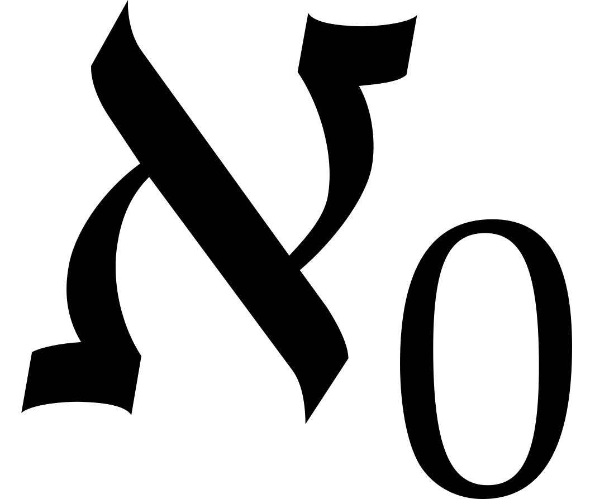 objects.”

And it is nonsensical to speak of the _number of all objects_. The same holds for the words “complex”, “fact”, “function”, “number”, etc.

They all designate formal concepts and are represented in concept-script by variables, not by functions or classes. (As Frege and Russell believed.)

Expressions like “1 is a number”, “there is only _one_ number” and all similar expressions are nonsensical.

(It is just as nonsensical to say “there is only one 1” as it would be to say: 2 + 2 equals 4 at 3 o’clock.)

### [Ts-204](/ts-204/#19r.2) [19r\[2\]](https://cdn.wittgensteinnachlass.com/2000px/webp/Ts-204/19r.webp)

4˙12721 The formal concept is already given with an object that falls under it. One cannot, therefore, introduce objects of a formal concept _and_ the formal concept itself as primitive concepts. One cannot, for example, introduce both the concept of function and particular functions (as Russell does) as primitive concepts; or the concept of number and particular numbers.

### [Ts-204](/ts-204/#19r.3) [19r\[3\]](https://cdn.wittgensteinnachlass.com/2000px/webp/Ts-204/19r.webp)

4.1273 If we want to express the general proposition “b is a successor of a” in concept-script, we need an expression for the general term of the series of forms: aRb, (∃x):aRx.xRb, (∃x,y):aRx.xRy.yRb, ...... One can express the general term of a series of forms only by a variable, for the concept term of this series of forms is a formal concept. (Frege and Russell overlooked this; the way in which they want to express general propositions like the one above is therefore wrong; it contains a circulus vitiosus.)

We can determine the general term of the series of forms by specifying its first term and the general form of the operation that generates the next term from the preceding sentence.

### [Ts-204](/ts-204/#19r.4) [19r\[4\]](https://cdn.wittgensteinnachlass.com/2000px/webp/Ts-204/19r.webp)

4.1274 The question of the existence of a formal concept is nonsensical. For no proposition can answer such a question.

(Thus one cannot, for example, ask: “Are there unanalysable subject–predicate sentences?”)

### [Ts-204](/ts-204/#19r.5) [19r\[5\]](https://cdn.wittgensteinnachlass.com/2000px/webp/Ts-204/19r.webp)

4.128 Logical forms are number*less*.

That is why there are no distinguished numbers in logic, and why there is no philosophical monism or dualism, etc.

### [Ts-204](/ts-204/#19r.6) [19r\[6\]](https://cdn.wittgensteinnachlass.com/2000px/webp/Ts-204/19r.webp)

4.2 The sense of a proposition is its agreement and disagreement with the possibilities of the obtaining and non-obtaining of states of affairs.

### [Ts-204](/ts-204/#19r.7) [19r\[7\]](https://cdn.wittgensteinnachlass.com/2000px/webp/Ts-204/19r.webp)

4.21 The simplest proposition, the elementary proposition, asserts that a state of affairs obtains.

### [Ts-204](/ts-204/#19r.8) [19r\[8\]](https://cdn.wittgensteinnachlass.com/2000px/webp/Ts-204/19r.webp)

4.211 It is a mark of an elementary proposition that no elementary proposition can contradict it.

### [Ts-204](/ts-204/#19ar.1) [19ar\[1\]](https://cdn.wittgensteinnachlass.com/2000px/webp/Ts-204/19ar.webp)

4.22 The elementary sentence consists of names. It is a nexus, a concatenation, of names.

### [Ts-204](/ts-204/#19ar.2) [19ar\[2\]](https://cdn.wittgensteinnachlass.com/2000px/webp/Ts-204/19ar.webp)

4.221 It is evident that in analysing sentences we must arrive at elementary sentences consisting of names in immediate combination.

The question here is how the combination into a sentence comes about.

### [Ts-204](/ts-204/#19ar.3) [19ar\[3\]](https://cdn.wittgensteinnachlass.com/2000px/webp/Ts-204/19ar.webp)

4.2211 Even if the world is infinitely complex, so that every fact consists of infinitely many states of affairs and every state of affairs is composed of infinitely many objects, even then there would have to be objects and states of affairs.

### [Ts-204](/ts-204/#19ar.4) [19ar\[4\]](https://cdn.wittgensteinnachlass.com/2000px/webp/Ts-204/19ar.webp)

4.23 A name occurs in a sentence only in the nexus of the elementary sentence.

### [Ts-204](/ts-204/#19ar.5) [19ar\[5\]](https://cdn.wittgensteinnachlass.com/2000px/webp/Ts-204/19ar.webp)

4.24 Names are the simple symbols; I indicate them by individual letters (x,y,z).

I write the elementary sentence as a function of the names in the form: “f(x)”, “g(x,y)”, etc.

Or I indicate it by the letters p, q, r.

### [Ts-204](/ts-204/#19ar.6) [19ar\[6\]](https://cdn.wittgensteinnachlass.com/2000px/webp/Ts-204/19ar.webp)

4.241 If I use two signs with one and the same meaning, I express this by putting the sign “ = ” between them.

Thus “a = b” means that the sign “a” can be replaced by the sign “b”.

(If I introduce a new sign “b” by means of an equation by stipulating that it is to replace an already familiar sign “a”, I write the equation – definition – (as Russell does) in the form “a = b Def”. The definition is a rule for signs.)

### [Ts-204](/ts-204/#19ar.7) [19ar\[7\]](https://cdn.wittgensteinnachlass.com/2000px/webp/Ts-204/19ar.webp)

4.242 Expressions of the form “a = b” are thus only aids to representation; they say nothing about the meaning of the signs “a” and “b”.

### [Ts-204](/ts-204/#19ar.8+20r.1) [19ar\[8\]](https://cdn.wittgensteinnachlass.com/2000px/webp/Ts-204/19ar.webp),[20r\[1\]](https://cdn.wittgensteinnachlass.com/2000px/webp/Ts-204/20r.webp)

4.243 Can we understand two names without knowing whether they designate the same thing or two different things? – Can we understand a sentence in which two names occur without knowing whether they mean the same thing or different things?

If, for instance, I know the meaning of an English word and of a German word with the same meaning, it is impossible for me not to know that the two have the same meaning; it is impossible for me to be unable to translate either into the other.

### [Ts-204](/ts-204/#20r.2) [20r\[2\]](https://cdn.wittgensteinnachlass.com/2000px/webp/Ts-204/20r.webp)

Expressions like “a = a”, or expressions derived from these, are neither elementary propositions nor any other kind of sign with sense. (This will become apparent later.)

### [Ts-204](/ts-204/#20r.3) [20r\[3\]](https://cdn.wittgensteinnachlass.com/2000px/webp/Ts-204/20r.webp)

4.25 If the elementary proposition is true, the state of affairs obtains; if the elementary proposition is false, the state of affairs does not obtain.

### [Ts-204](/ts-204/#20r.4) [20r\[4\]](https://cdn.wittgensteinnachlass.com/2000px/webp/Ts-204/20r.webp)

4.26 Specifying all the true elementary propositions describes the world completely. The world is completely described by specifying the elementary propositions plus specifying which of them are true and which false.

### [Ts-204](/ts-204/#20r.5) [20r\[5\]](https://cdn.wittgensteinnachlass.com/2000px/webp/Ts-204/20r.webp)

4.27 With regard to the obtaining and non-obtaining of n states of affairs there are 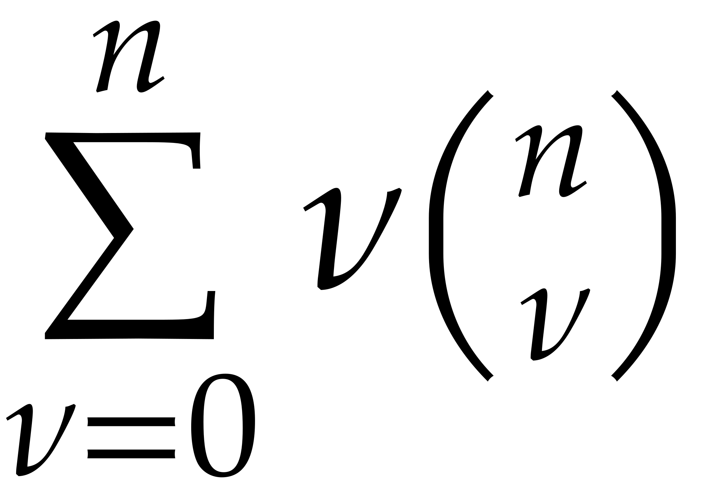 possibilities.

Any combination of states of affairs can obtain, the others not obtaining.

### [Ts-204](/ts-204/#20r.6) [20r\[6\]](https://cdn.wittgensteinnachlass.com/2000px/webp/Ts-204/20r.webp)

4.28 To these combinations correspond just as many possibilities of truth – and falsity – for n elementary propositions.

### [Ts-204](/ts-204/#20r.7) [20r\[7\]](https://cdn.wittgensteinnachlass.com/2000px/webp/Ts-204/20r.webp)

4.3 The truth-possibilities of the elementary propositions signify the possibilities of the obtaining and non-obtaining of states of affairs.

### [Ts-204](/ts-204/#20r.8) [20r\[8\]](https://cdn.wittgensteinnachlass.com/2000px/webp/Ts-204/20r.webp)

4.31 We can represent the truth-possibilities by schemata of the following kind (“W” means “true”, “F” “false”. The rows of “W”s and “F”s beneath the row of elementary propositions signify their truth-possibilities in a notation that is easy to understand):

### [Ts-204](/ts-204/#21r.1) [21r\[1\]](https://cdn.wittgensteinnachlass.com/2000px/webp/Ts-204/21r.webp)

4.4 A proposition is the expression of agreement and disagreement with the truth-possibilities of the elementary propositions.

### [Ts-204](/ts-204/#21r.2) [21r\[2\]](https://cdn.wittgensteinnachlass.com/2000px/webp/Ts-204/21r.webp)

4.41 The truth-possibilities of the elementary propositions are the conditions for the truth and falsity of propositions.

### [Ts-204](/ts-204/#21r.3) [21r\[3\]](https://cdn.wittgensteinnachlass.com/2000px/webp/Ts-204/21r.webp)

4.411 It is likely from the outset that introducing elementary propositions is fundamental to understanding all other kinds of proposition. Indeed, the understanding of general propositions depends perceptibly on that of elementary propositions.

### [Ts-204](/ts-204/#21r.4) [21r\[4\]](https://cdn.wittgensteinnachlass.com/2000px/webp/Ts-204/21r.webp)

4.42 With regard to the agreement and disagreement of a proposition with the truth-possibilities of n elementary propositions, there are 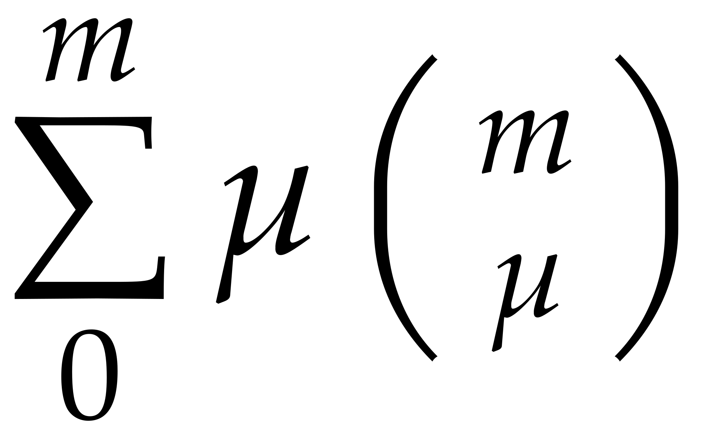 = Ln possibilities.

### [Ts-204](/ts-204/#21r.5) [21r\[5\]](https://cdn.wittgensteinnachlass.com/2000px/webp/Ts-204/21r.webp)

4.43 We can express agreement with the truth-possibilities by assigning them, say, the mark “W” (true) in the schema.

The absence of this mark signifies disagreement.

### [Ts-204](/ts-204/#21r.6) [21r\[6\]](https://cdn.wittgensteinnachlass.com/2000px/webp/Ts-204/21r.webp)

4.431 The expression of agreement and disagreement with the truth-possibilities of the elementary propositions expresses the truth-conditions of the proposition.

A proposition is the expression of its truth-conditions.

(Frege was therefore quite right to set them out at the start to explain the signs of his concept-script. It is just that Frege’s explanation of the concept of truth is wrong: if “the True” and “the False” really were objects and were the arguments in ~p etc., then on Frege’s definition the sense of “~p” would by no means be determined.)

### [Ts-204](/ts-204/#21r.7) [21r\[7\]](https://cdn.wittgensteinnachlass.com/2000px/webp/Ts-204/21r.webp)

4.44 The sign that results from correlating those “W” marks with the truth-possibilities is a propositional sign.

### [Ts-204](/ts-204/#21r.8) [21r\[8\]](https://cdn.wittgensteinnachlass.com/2000px/webp/Ts-204/21r.webp)

4.441 It is clear that no object (or complex of objects) corresponds to the complex of signs “F” and “W”, any more than to the horizontal and vertical lines or to the brackets. – There are no “logical objects”.

An analogous point of course holds for all signs that express the same thing as the schemata of “W”s and “F”s.

### [Ts-204](/ts-204/#21r.9+22r.1) [21r\[9\]](https://cdn.wittgensteinnachlass.com/2000px/webp/Ts-204/21r.webp),[22r\[1\]](https://cdn.wittgensteinnachlass.com/2000px/webp/Ts-204/22r.webp)

4.442 For example:

“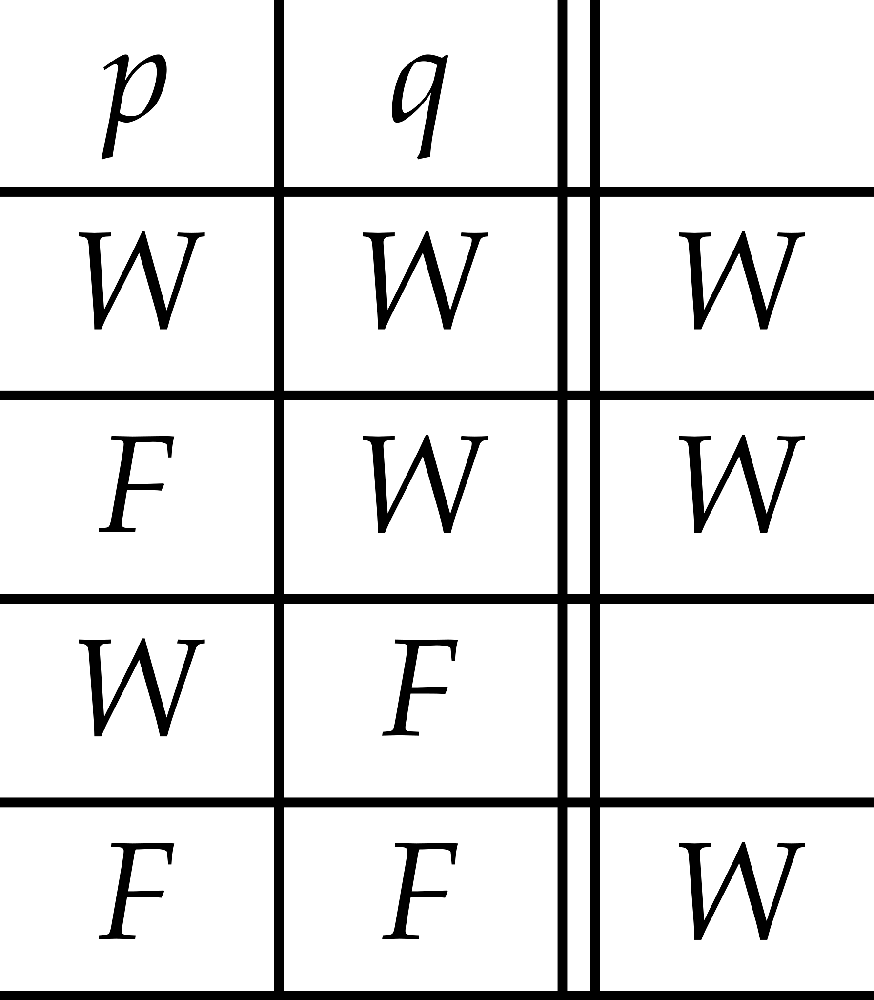”

is a propositional sign. (Frege’s judgement stroke “⊢” has no logical significance at all; in Frege (and Russell) it indicates only that these authors take the propositions so marked to be true. “⊢” is therefore no more a part of the structure of the proposition than, say, the proposition’s number. A proposition cannot possibly say of itself that it is true.)

If the order of the truth-possibilities in the schema is fixed once and for all by a rule of combination, then the last column by itself already expresses the truth-conditions. If we write this column as a row, the propositional sign becomes:

“(W W – W) (p, q)” or, more clearly, “(W W F W) (p, q)”

(The number of places in the left-hand brackets is determined by the number of terms in the right-hand ones.)

### [Ts-204](/ts-204/#22r.2) [22r\[2\]](https://cdn.wittgensteinnachlass.com/2000px/webp/Ts-204/22r.webp)

4.45 For n elementary propositions there are 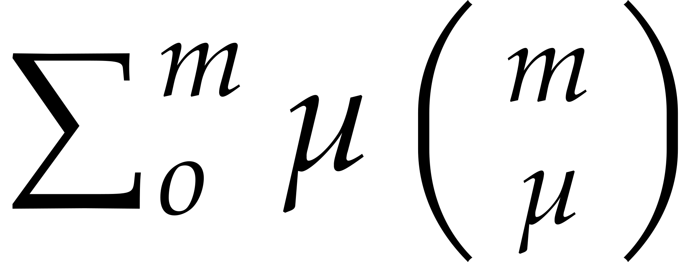 possible groups of truth-conditions.

The groups of truth-conditions that belong to the truth-possibilities of a given number of elementary propositions can be arranged in a series.

### [Ts-204](/ts-204/#22r.3) [22r\[3\]](https://cdn.wittgensteinnachlass.com/2000px/webp/Ts-204/22r.webp)

4.46 Among the possible groups of truth-conditions there are two extreme cases.

In the one case the proposition is true for all the truth-possibilities of the elementary propositions. We say the truth-conditions are _tautological_.

In the second case the proposition is false for all the truth-possibilities: the truth-conditions are _contradictory_.

In the first case we call the proposition a tautology, in the second a contradiction.

### [Ts-204](/ts-204/#22r.4+23r.1) [22r\[4\]](https://cdn.wittgensteinnachlass.com/2000px/webp/Ts-204/22r.webp),[23r\[1\]](https://cdn.wittgensteinnachlass.com/2000px/webp/Ts-204/23r.webp)

4.461 A proposition shows what it says; tautology and contradiction show that they say nothing. A tautology has no truth-conditions, for it is unconditionally true: and a contradiction is true under no condition.

Tautology and contradiction are senseless.

(Like the point from which two arrows diverge in opposite directions.)

(For example, I know nothing about the weather if I know that it is raining or not raining.)

### [Ts-204](/ts-204/#23r.2) [23r\[2\]](https://cdn.wittgensteinnachlass.com/2000px/webp/Ts-204/23r.webp)

4.4611 But tautology and contradiction are not nonsensical; they belong to the symbolism, rather as “0” belongs to the symbolism of arithmetic.

### [Ts-204](/ts-204/#23r.3) [23r\[3\]](https://cdn.wittgensteinnachlass.com/2000px/webp/Ts-204/23r.webp)

4.462 Tautology and contradiction are not pictures of reality. They depict no possible situation. For the former allows _every_ possible situation, the latter _none_.

In a tautology the conditions of agreement with the world – the relations of representation – cancel one another out, so that it stands in no representational relation to reality.

### [Ts-204](/ts-204/#23r.4) [23r\[4\]](https://cdn.wittgensteinnachlass.com/2000px/webp/Ts-204/23r.webp)

4.463 The truth-conditions determine how much room the proposition leaves the facts.

(In a negative sense the proposition, the picture, the model are like a solid body that limits the freedom of movement of other bodies; in a positive sense, like the space bounded by solid matter in which a body has room.)

A tautology leaves the whole – infinite – logical space to reality; a contradiction fills the whole of logical space and leaves reality not a single point. Neither can therefore determine reality in any way.

### [Ts-204](/ts-204/#23r.5) [23r\[5\]](https://cdn.wittgensteinnachlass.com/2000px/webp/Ts-204/23r.webp)

4.464 The truth of a tautology is certain, that of a proposition possible, that of a contradiction impossible.

(Certain, possible, impossible: here we have an indication of the gradation we need in probability theory.)

### [Ts-204](/ts-204/#23r.6) [23r\[6\]](https://cdn.wittgensteinnachlass.com/2000px/webp/Ts-204/23r.webp)

4.465 The logical product of a tautology and a proposition says the same as the proposition. So that product is identical with the proposition. For one cannot change what is essential to the symbol without changing its sense.

### [Ts-204](/ts-204/#23r.7+23r.8+24r.1) [23r\[7\]](https://cdn.wittgensteinnachlass.com/2000px/webp/Ts-204/23r.webp),[23r\[8\]](https://cdn.wittgensteinnachlass.com/2000px/webp/Ts-204/23r.webp),[24r\[1\]](https://cdn.wittgensteinnachlass.com/2000px/webp/Ts-204/24r.webp)

4.466 A determinate logical combination of their meanings corresponds to a determinate logical combination of signs; a combination of _any kind whatever_ corresponds only to uncombined signs.

That is, propositions that are true for every situation cannot be combinations of signs at all, for otherwise only determinate combinations of objects could correspond to them.

(And where there is no logical combination, _no_ combination of objects corresponds.)

Tautology and contradiction are the limiting cases of the combination of signs, namely its dissolution.

### [Ts-204](/ts-204/#23r.8-relocated) [23r\[8\]-relocated](https://cdn.wittgensteinnachlass.com/2000px/webp/Ts-204/23r.webp)

4˙4661 Admittedly, even in tautology and contradiction the signs are still combined, i.e. they stand in relations to one another, but these relations are devoid of meaning, inessential to the _symbol_.

### [Ts-204](/ts-204/#24r.2) [24r\[2\]](https://cdn.wittgensteinnachlass.com/2000px/webp/Ts-204/24r.webp)

4.5 It now seems possible to specify the most general sentential form: that is, to describe the sentences of _any_ sign-language in such a way that every possible sense can be expressed by a symbol that fits the description, and that every symbol that fits the description can express a sense if the meanings of the names are chosen accordingly.

It is clear that in describing the most general sentential form _only_ what is essential to it may be described – for otherwise it would not be the most general.

That there is a general sentential form is proved by the fact that there cannot be a sentence whose form one could not have foreseen (i.e. constructed). The general form of the sentence is: Things stand thus and so.

### [Ts-204](/ts-204/#24r.3) [24r\[3\]](https://cdn.wittgensteinnachlass.com/2000px/webp/Ts-204/24r.webp)

4.51 Suppose I were given _all_ the elementary propositions: then one may simply ask, which propositions can I form from them? And those are _all_ the propositions, and _that_ is how they are delimited.

### [Ts-204](/ts-204/#24r.4) [24r\[4\]](https://cdn.wittgensteinnachlass.com/2000px/webp/Ts-204/24r.webp)

4.52 Propositions are everything that follows from the totality of all the elementary propositions (of course also from the fact that it is the _totality of them all_. (So in a certain sense one might say that all propositions are generalizations of the elementary propositions.)

### [Ts-204](/ts-204/#24r.5) [24r\[5\]](https://cdn.wittgensteinnachlass.com/2000px/webp/Ts-204/24r.webp)

4.53 The general sentential form is a variable.

### [Ts-204](/ts-204/#24r.6) [24r\[6\]](https://cdn.wittgensteinnachlass.com/2000px/webp/Ts-204/24r.webp)

5 A proposition is a truth-function of the elementary propositions.

(An elementary proposition is a truth-function of itself.)

### [Ts-204](/ts-204/#24r.7) [24r\[7\]](https://cdn.wittgensteinnachlass.com/2000px/webp/Ts-204/24r.webp)

5.01 The elementary propositions are the truth-arguments of the proposition.

### [Ts-204](/ts-204/#24r.8+25r.1) [24r\[8\]](https://cdn.wittgensteinnachlass.com/2000px/webp/Ts-204/24r.webp),[25r\[1\]](https://cdn.wittgensteinnachlass.com/2000px/webp/Ts-204/25r.webp)

5.02 It is easy to confuse the arguments of functions with the indices of names. For both the argument and the index tell me the meaning of the sign in which they occur. In Russell’s “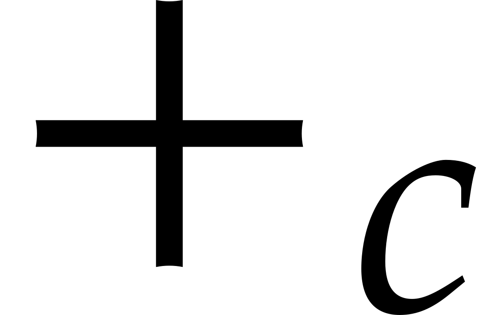”, for example, “c” is an index indicating that the whole sign is the sign for addition of cardinal numbers. But this designation rests on an arbitrary convention, and one could choose a simple sign in place of “”; but in “~p”, “p” is not an index but an argument: the sense of “~p” _cannot_ be understood unless the sense of “p” has already been understood. (In the name Julius Caesar, “Julius” is an index. The index is always part of a description of the object whose name we attach to the index. For example, _the_ Caesar of the Julian family.) The confusion of argument and index, if I am not mistaken, underlies Frege’s theory of the meaning of propositions and functions.

For Frege the propositions of logic were names, and their arguments the indices of these names.

### [Ts-204](/ts-204/#25r.2) [25r\[2\]](https://cdn.wittgensteinnachlass.com/2000px/webp/Ts-204/25r.webp)

5.1 Truth-functions can be arranged in series.

That is the basis of probability theory.

### [Ts-204](/ts-204/#25r.3) [25r\[3\]](https://cdn.wittgensteinnachlass.com/2000px/webp/Ts-204/25r.webp)

5.101 The truth-functions of any number of elementary propositions can be written out in a schema of the following kind:

I shall call those truth-possibilities of a proposition’s truth-arguments that make it true its _truth-grounds_.

### [Ts-204](/ts-204/#25r.4) [25r\[4\]](https://cdn.wittgensteinnachlass.com/2000px/webp/Ts-204/25r.webp)

5.11 If the truth-grounds common to a number of propositions are also truth-grounds of a particular proposition, we say that the truth of this proposition _follows_ from the truth of those propositions.

### [Ts-204](/ts-204/#25r.5) [25r\[5\]](https://cdn.wittgensteinnachlass.com/2000px/webp/Ts-204/25r.webp)

5.12 In particular, the truth of a proposition “p” follows from the truth of another, “p”, if all the truth-grounds of the first are truth-grounds of the second.

### [Ts-204](/ts-204/#25r.6) [25r\[6\]](https://cdn.wittgensteinnachlass.com/2000px/webp/Ts-204/25r.webp)

5.121 The truth-grounds of the one are contained in those of the other; p follows from q.

### [Ts-204](/ts-204/#25r.7) [25r\[7\]](https://cdn.wittgensteinnachlass.com/2000px/webp/Ts-204/25r.webp)

5.122 If p follows from q, then the sense of “p” is contained in the sense of “q”.

### [Ts-204](/ts-204/#25r.8) [25r\[8\]](https://cdn.wittgensteinnachlass.com/2000px/webp/Ts-204/25r.webp)

5.123 If a god creates a world in which certain propositions are true, in doing so he already creates a world in which all the propositions that follow from them hold. And likewise he could not create a world in which the proposition p is true without creating all its objects.

### [Ts-204](/ts-204/#26r.1) [26r\[1\]](https://cdn.wittgensteinnachlass.com/2000px/webp/Ts-204/26r.webp)

5.124 A proposition affirms every proposition that follows from it.

### [Ts-204](/ts-204/#26r.2) [26r\[2\]](https://cdn.wittgensteinnachlass.com/2000px/webp/Ts-204/26r.webp)

5.1241 “p.q” is one of the propositions that affirm “p” and at the same time one of the propositions that affirm “q”.

Two propositions are opposed to each other if there is no proposition with sense that affirms them both.

Any proposition that contradicts another negates it.

### [Ts-204](/ts-204/#26r.3) [26r\[3\]](https://cdn.wittgensteinnachlass.com/2000px/webp/Ts-204/26r.webp)

5.13 We can see from the structure of the propositions that the truth of one proposition follows from the truth of others.

### [Ts-204](/ts-204/#26r.4) [26r\[4\]](https://cdn.wittgensteinnachlass.com/2000px/webp/Ts-204/26r.webp)

5.131 If the truth of one proposition follows from the truth of others, this is expressed by the relations in which the forms of those propositions stand to one another; and we do not first have to put them into those relations by combining them in a proposition. Rather, these relations are internal and obtain as soon as, and by virtue of the fact that, those propositions obtain.

### [Ts-204](/ts-204/#26r.5) [26r\[5\]](https://cdn.wittgensteinnachlass.com/2000px/webp/Ts-204/26r.webp)

5.1311 When we infer q from p⌵q and ~p, the relation between the sentential forms of “p⌵q” and “~p” is concealed by the notation. But if, for example, we write “p ❘ q․ ❘ ․p ❘ q” for “p⌵q” and “p ❘ p” for “~p” (p ❘ q = neither p nor q), the internal connection becomes apparent.

(That one can infer fx from (x)․fx shows that generality is also present in the symbol “(x)․fx”.)

### [Ts-204](/ts-204/#26r.6) [26r\[6\]](https://cdn.wittgensteinnachlass.com/2000px/webp/Ts-204/26r.webp)

5.132 If p follows from q, I can infer p from q; deduce p from q.

The nature of the inference is to be gleaned from the two propositions alone.

They alone can justify the inference.

“Laws of inference” that are supposed to justify inferences – as in Frege and Russell – are senseless, and would be superfluous.

### [Ts-204](/ts-204/#26r.7) [26r\[7\]](https://cdn.wittgensteinnachlass.com/2000px/webp/Ts-204/26r.webp)

5.133 All inference takes place a priori.

### [Ts-204](/ts-204/#26r.8) [26r\[8\]](https://cdn.wittgensteinnachlass.com/2000px/webp/Ts-204/26r.webp)

5.134 No elementary proposition can be inferred from another.

### [Ts-204](/ts-204/#26r.9) [26r\[9\]](https://cdn.wittgensteinnachlass.com/2000px/webp/Ts-204/26r.webp)

5.135 There is no way to infer from the obtaining of any situation that a wholly different situation obtains.

### [Ts-204](/ts-204/#26r.10) [26r\[10\]](https://cdn.wittgensteinnachlass.com/2000px/webp/Ts-204/26r.webp)

5.136 There is no causal nexus that would justify such an inference.

### [Ts-204](/ts-204/#26r.11) [26r\[11\]](https://cdn.wittgensteinnachlass.com/2000px/webp/Ts-204/26r.webp)

5.1361 We are not _able_ to infer future events from present ones.

Belief in the causal nexus is _superstition_.

### [Ts-204](/ts-204/#26r.12+27r.1) [26r\[12\]](https://cdn.wittgensteinnachlass.com/2000px/webp/Ts-204/26r.webp),[27r\[1\]](https://cdn.wittgensteinnachlass.com/2000px/webp/Ts-204/27r.webp)

5.1362 Free will consists in the fact that future actions cannot be known now. We could know them only if causality were an _internal_ necessity, like that of logical inference. – The connection between knowledge and what is known is that of logical necessity. (“A knows that p is the case” is senseless if p is a tautology.)

### [Ts-204](/ts-204/#27r.2) [27r\[2\]](https://cdn.wittgensteinnachlass.com/2000px/webp/Ts-204/27r.webp)

5.1363 If it does not _follow_ from a proposition’s being evident to us that it is true, then its being evident is no justification for our belief in its truth either.

### [Ts-204](/ts-204/#27r.3) [27r\[3\]](https://cdn.wittgensteinnachlass.com/2000px/webp/Ts-204/27r.webp)

5.14 If one proposition follows from another, the latter says more than the former, the former less than the latter.

### [Ts-204](/ts-204/#27r.4) [27r\[4\]](https://cdn.wittgensteinnachlass.com/2000px/webp/Ts-204/27r.webp)

5.141 If p follows from q and q from p, then they are one and the same proposition.

### [Ts-204](/ts-204/#27r.5) [27r\[5\]](https://cdn.wittgensteinnachlass.com/2000px/webp/Ts-204/27r.webp)

5.142 A tautology follows from all propositions; it says nothing.

### [Ts-204](/ts-204/#27r.6) [27r\[6\]](https://cdn.wittgensteinnachlass.com/2000px/webp/Ts-204/27r.webp)

5.143 Contradiction is what propositions have in common, which _no_ proposition has in common with another. Tautology is what all propositions have in common that have nothing in common with one another.

Contradiction vanishes, so to speak, outside all propositions, tautology within them all.

Contradiction is the outer limit of propositions, tautology their centre without substance.

### [Ts-204](/ts-204/#27r.7) [27r\[7\]](https://cdn.wittgensteinnachlass.com/2000px/webp/Ts-204/27r.webp)

5.15 If 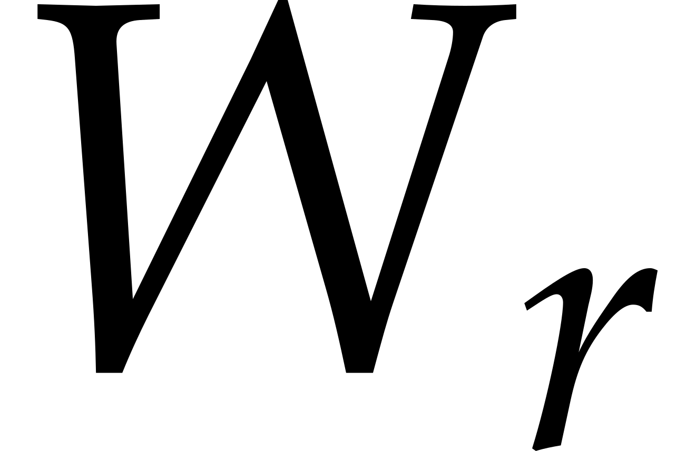 is the number of truth-grounds of the proposition “r”, and  the number of those truth-grounds of the proposition “s” that are also truth-grounds of “r”, then we call the ratio  the measure of the _probability_ that the proposition “r” gives the proposition “s”.

### [Ts-204](/ts-204/#27r.8) [27r\[8\]](https://cdn.wittgensteinnachlass.com/2000px/webp/Ts-204/27r.webp)

5.151 In a schema like the one above in [→ № 5.101], let  be the number of “W”s in the proposition r; and 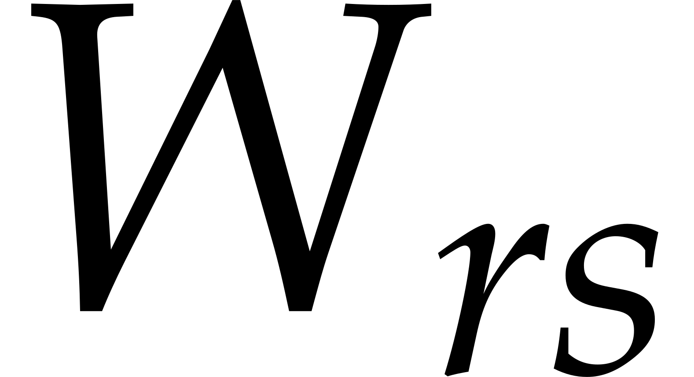 the number of those “W”s in the proposition s that are in the same columns as “W”s in the proposition r. The proposition r then gives the proposition s the probability: 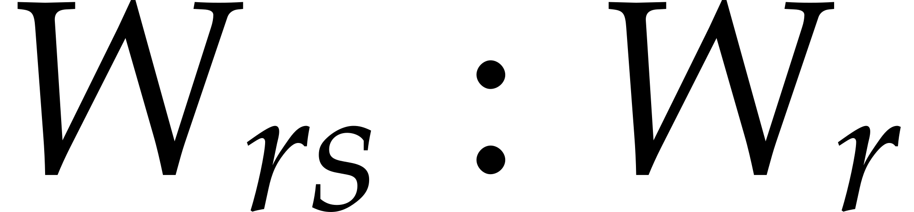.

### [Ts-204](/ts-204/#27r.9) [27r\[9\]](https://cdn.wittgensteinnachlass.com/2000px/webp/Ts-204/27r.webp)

5.1511 There is no special object peculiar to probability propositions.

### [Ts-204](/ts-204/#27r.10) [27r\[10\]](https://cdn.wittgensteinnachlass.com/2000px/webp/Ts-204/27r.webp)

5.152 Propositions that have no truth-grounds in common we call independent of one another.

Propositions independent of one another (e.g. any two elementary propositions) give one another the probability ½.

If p follows from q, then the proposition “q” gives the proposition “p” the probability 1. The certainty of logical inference is a limiting case of probability.

(Application to tautology and contradiction.)

### [Ts-204](/ts-204/#27r.11) [27r\[11\]](https://cdn.wittgensteinnachlass.com/2000px/webp/Ts-204/27r.webp)

5.153 A proposition is in itself neither probable nor improbable. An event occurs or it does not occur; there is nothing in between.

### [Ts-204](/ts-204/#27r.12+28r.1) [27r\[12\]](https://cdn.wittgensteinnachlass.com/2000px/webp/Ts-204/27r.webp),[28r\[1\]](https://cdn.wittgensteinnachlass.com/2000px/webp/Ts-204/28r.webp)

5.154 Suppose there are as many white balls as black ones in an urn (and no others). I draw one ball after another, putting each back in the urn. Then I can establish by experiment that the numbers of black and white balls drawn approach one another as the drawing continues.

_That_, then, is not a mathematical fact.

Now if I say: It is as probable that I will draw a white ball as that I will draw a black one, this means: All the circumstances known to me (including the laws of nature assumed hypothetically) give the occurrence of one event no _greater_ probability than the occurrence of the other. That is, they give – as is readily inferred from the explanations above – each the probability ½.

What I confirm by experiment is that the occurrence of the two events is independent of the circumstances I do not know in detail.

### [Ts-204](/ts-204/#28r.2) [28r\[2\]](https://cdn.wittgensteinnachlass.com/2000px/webp/Ts-204/28r.webp)

5.155 The unit of the probability proposition is: The circumstances – of which I otherwise know nothing further – give the occurrence of a particular event such and such a degree of probability.

### [Ts-204](/ts-204/#28r.3) [28r\[3\]](https://cdn.wittgensteinnachlass.com/2000px/webp/Ts-204/28r.webp)

5.156 Thus probability is a generalization.

It involves a general description of a sentential form.

Only in the absence of certainty do we use probability. –

When we do not know a fact fully, but do know _something_ about its form.

(A proposition may be an incomplete picture of a certain situation, but it is always _a_ complete picture.)

A probability proposition is, as it were, an extract from other propositions.

### [Ts-204](/ts-204/#28r.4) [28r\[4\]](https://cdn.wittgensteinnachlass.com/2000px/webp/Ts-204/28r.webp)

5.2 The structures of propositions stand in internal relations to one another.

### [Ts-204](/ts-204/#28r.5) [28r\[5\]](https://cdn.wittgensteinnachlass.com/2000px/webp/Ts-204/28r.webp)

5.21 We can bring out these internal relations in our way of expressing ourselves by representing a proposition as the result of an operation that produces it from other propositions (the bases of the operation).

### [Ts-204](/ts-204/#28r.6) [28r\[6\]](https://cdn.wittgensteinnachlass.com/2000px/webp/Ts-204/28r.webp)

5.22 The operation is the expression of a relation between the structures of its result and of its bases.

### [Ts-204](/ts-204/#28r.7) [28r\[7\]](https://cdn.wittgensteinnachlass.com/2000px/webp/Ts-204/28r.webp)

5.23 The operation is what has to happen to one proposition in order to make the other out of it.

### [Ts-204](/ts-204/#28r.8) [28r\[8\]](https://cdn.wittgensteinnachlass.com/2000px/webp/Ts-204/28r.webp)

5.231 And that will of course depend on their formal properties, on the internal similarity of their forms.

### [Ts-204](/ts-204/#28r.9) [28r\[9\]](https://cdn.wittgensteinnachlass.com/2000px/webp/Ts-204/28r.webp)

5.232 The internal relation that orders a series is equivalent to the operation by which one term arises from another.

### [Ts-204](/ts-204/#28r.10) [28r\[10\]](https://cdn.wittgensteinnachlass.com/2000px/webp/Ts-204/28r.webp)

5.233 The operation can only occur where one proposition arises from another in a logically significant way. That is, where the logical construction of the proposition begins.

### [Ts-204](/ts-204/#29r.1) [29r\[1\]](https://cdn.wittgensteinnachlass.com/2000px/webp/Ts-204/29r.webp)

5.234 The truth-functions of elementary propositions are results of operations that have elementary propositions as their bases. (I call these operations truth-operations.)

### [Ts-204](/ts-204/#29r.2) [29r\[2\]](https://cdn.wittgensteinnachlass.com/2000px/webp/Ts-204/29r.webp)

5.2341 The sense of a truth-function of p is a function of the sense of p.

Negation, logical addition, logical multiplication, etc., etc. are operations.

(Negation reverses the sense of the proposition.)

### [Ts-204](/ts-204/#29r.3) [29r\[3\]](https://cdn.wittgensteinnachlass.com/2000px/webp/Ts-204/29r.webp)

5.24 The operation shows itself in a variable; it shows how one can get from one form of propositions to another.

It expresses the difference between the forms.

(And what the bases and the result of the operation have in common is precisely the bases.)

### [Ts-204](/ts-204/#29r.4) [29r\[4\]](https://cdn.wittgensteinnachlass.com/2000px/webp/Ts-204/29r.webp)

5.241 The operation marks no form, but only the difference between the forms.

### [Ts-204](/ts-204/#29r.5) [29r\[5\]](https://cdn.wittgensteinnachlass.com/2000px/webp/Ts-204/29r.webp)

5.242 The same operation that makes “q” out of “p” makes “r” out of “q”, and so on. This can be expressed only by “p”, “q”, “r”, etc. being variables that express certain formal relations generally.

### [Ts-204](/ts-204/#29r.6) [29r\[6\]](https://cdn.wittgensteinnachlass.com/2000px/webp/Ts-204/29r.webp)

5.25 The occurrence of the operation does not characterize the sense of the proposition.

After all, the operation says nothing; only its result does; and this depends on the bases of the operation.

(Operation and function must not be confused with one another.)

### [Ts-204](/ts-204/#29r.7) [29r\[7\]](https://cdn.wittgensteinnachlass.com/2000px/webp/Ts-204/29r.webp)

5.251 A function cannot be its own argument, but the result of an operation can become the basis of that same operation.

### [Ts-204](/ts-204/#29r.8) [29r\[8\]](https://cdn.wittgensteinnachlass.com/2000px/webp/Ts-204/29r.webp)

5.252 Only in this way is it possible to progress from term to term in a series of forms (from type to type in the hierarchies of Russell and Whitehead). (Russell and Whitehead did not admit the possibility of this progression, but made use of it again and again.)

### [Ts-204](/ts-204/#29r.9) [29r\[9\]](https://cdn.wittgensteinnachlass.com/2000px/webp/Ts-204/29r.webp)

5.2521 I call the repeated application of an operation to its own result its successive application (“O'O'O'a” is the result of the threefold successive application of “O'ξ” to “a”.)

In a similar sense I speak of the successive application of _several_ operations to a number of propositions.

### [Ts-204](/ts-204/#29r.10) [29r\[10\]](https://cdn.wittgensteinnachlass.com/2000px/webp/Ts-204/29r.webp)

5.2522 I therefore write the general term of a series of forms a, O'a, O'O'a, … like this: “[a,x,O'x]”. This bracketed expression is a variable. The first term of the bracketed expression is the beginning of the series of forms, the second the form of an arbitrary term x of the series, and the third the form of the term of the series that immediately follows x.

### [Ts-204](/ts-204/#30r.1) [30r\[1\]](https://cdn.wittgensteinnachlass.com/2000px/webp/Ts-204/30r.webp)

5˙2523 The concept of the successive application of a function is equivalent to the concept “and so on”.

### [Ts-204](/ts-204/#30r.2) [30r\[2\]](https://cdn.wittgensteinnachlass.com/2000px/webp/Ts-204/30r.webp)

5.253 One operation can undo the effect of another. Operations can cancel one another out.

### [Ts-204](/ts-204/#30r.3) [30r\[3\]](https://cdn.wittgensteinnachlass.com/2000px/webp/Ts-204/30r.webp)

5.254 The operation can disappear (e.g. negation in “~~p”; ~~p = p).

### [Ts-204](/ts-204/#30r.4) [30r\[4\]](https://cdn.wittgensteinnachlass.com/2000px/webp/Ts-204/30r.webp)

5.3 All propositions are results of truth-operations on elementary propositions.

A truth-operation is the way in which a truth-function arises from elementary propositions.

It is in the nature of a truth-operation that a new truth-function arises from truth-functions in the same way as their truth-function arises from elementary propositions. Every truth-operation produces from truth-functions of elementary propositions another truth-function of elementary propositions, a proposition. The result of any truth-operation on the results of truth-operations on elementary propositions is again the result of a single truth-operation on elementary propositions.

Every proposition is the result of truth-operations on elementary propositions.

### [Ts-204](/ts-204/#30r.5) [30r\[5\]](https://cdn.wittgensteinnachlass.com/2000px/webp/Ts-204/30r.webp)

5.31 The schemata [→ № 4.31] have a meaning even when “p”, “q”, “r”, etc. are not elementary propositions.

And it is easy to see that the propositional sign in [→ № 4.42] expresses a single truth-function of elementary propositions even when “p” and “q” are truth-functions of elementary propositions.

### [Ts-204](/ts-204/#30r.6) [30r\[6\]](https://cdn.wittgensteinnachlass.com/2000px/webp/Ts-204/30r.webp)

5.32 All truth-functions are results of the successive application of a finite number of truth-operations to elementary propositions.

### [Ts-204](/ts-204/#30r.7) [30r\[7\]](https://cdn.wittgensteinnachlass.com/2000px/webp/Ts-204/30r.webp)

5.4 Here it becomes apparent that there are no “logical objects”, no “logical constants” (in Frege’s and Russell’s sense).

### [Ts-204](/ts-204/#30r.8) [30r\[8\]](https://cdn.wittgensteinnachlass.com/2000px/webp/Ts-204/30r.webp)

5.41 For: All results of truth-operations on truth-functions are identical if the results are one and the same truth-function of elementary propositions.

### [Ts-204](/ts-204/#30r.9) [30r\[9\]](https://cdn.wittgensteinnachlass.com/2000px/webp/Ts-204/30r.webp)

5.42 It is evident that ⌵, ⊃, etc. are not relations in the sense in which right and left, etc. are.

The very possibility of cross-defining Frege’s and Russell’s logical “primitive signs” shows that these are not primitive signs, and all the more that they do not designate relations.

And it is obvious that the “⊃” we define by means of “.” and “⌵” is identical with the one by means of which we define “⌵” with “.”, and that this “.” is identical with the first. And so on.

### [Ts-204](/ts-204/#31r.1) [31r\[1\]](https://cdn.wittgensteinnachlass.com/2000px/webp/Ts-204/31r.webp)

5.43 It is surely scarcely credible from the outset that infinitely many _other_ facts should follow from a fact p, namely ~~p, ~~~~p, etc. And it is no less remarkable that the infinite number of propositions of logic (of mathematics) should follow from half a dozen “basic laws”.

Yet all propositions of logic say the same thing. Namely nothing.

### [Ts-204](/ts-204/#31r.2) [31r\[2\]](https://cdn.wittgensteinnachlass.com/2000px/webp/Ts-204/31r.webp)

5.44 Truth-functions are not material functions.

If, for example, one can produce an affirmation by double negation, is negation then – in some sense – contained in the affirmation?

Does “~~p” negate ~p, or does it affirm p; or both?

The proposition “~~p” is not about negation as it would be about an object; but the possibility of negation is already implicit in the affirmation.

And if there were an object called “~”, then “~~p” would have to say something different from “p”. For one proposition would then be about ~ and the other would not.

### [Ts-204](/ts-204/#31r.3) [31r\[3\]](https://cdn.wittgensteinnachlass.com/2000px/webp/Ts-204/31r.webp)

5.441 This disappearance of apparent logical constants also occurs when “~(∃x).~fx” says the same thing as “(x)․fx”, or “(∃x)․fx.x = a” the same as “fa”.

### [Ts-204](/ts-204/#31r.4) [31r\[4\]](https://cdn.wittgensteinnachlass.com/2000px/webp/Ts-204/31r.webp)

5.442 If a proposition is given to us, then _with it_ the results of all truth-operations that have it as their basis are already given as well.

### [Ts-204](/ts-204/#31r.5) [31r\[5\]](https://cdn.wittgensteinnachlass.com/2000px/webp/Ts-204/31r.webp)

5.45 If there are primitive logical signs, a correct logic must make clear how they stand in relation to one another and justify their existence. It must become clear how logic is built _out of_ its primitive signs.

### [Ts-204](/ts-204/#31r.6) [31r\[6\]](https://cdn.wittgensteinnachlass.com/2000px/webp/Ts-204/31r.webp)

5.451 If logic has basic concepts, they must be independent of one another. If a basic concept is introduced, it must be introduced in all the combinations in which it occurs at all. Thus one cannot introduce it first for _one_ combination and then all over again for another. For example: Once negation has been introduced, we must now understand it in sentences of the form “~p” just as we do in sentences such as “~(p⌵q)”, “(∃x).~fx” and the like. We must not introduce it first for one class of cases and then for the other, for it would then remain doubtful whether its meaning was the same in both cases, and there would be no reason to use the same way of combining signs in both cases.

(In short, what Frege (Grundgesetze der Arithmetik) said about introducing signs by definitions applies, mutatis mutandis, to the introduction of primitive signs.)

### [Ts-204](/ts-204/#32r.1) [32r\[1\]](https://cdn.wittgensteinnachlass.com/2000px/webp/Ts-204/32r.webp)

5.452 The introduction of a new device into the symbolism of logic must always be a momentous event. No new device may be introduced into logic – as it were, with a quite innocent look – in brackets or below the line.

(Thus in Russell and Whitehead’s “Principia Mathematica” there are definitions and basic laws in words. Why, all of a sudden, words here? This would need a justification. It is missing and must be missing, since the procedure is in fact inadmissible.)

But if introducing a new device has proved necessary at one point, one must immediately ask oneself: Where must this device now _always_ be applied? Its place in logic must now be explained.

### [Ts-204](/ts-204/#32r.2) [32r\[2\]](https://cdn.wittgensteinnachlass.com/2000px/webp/Ts-204/32r.webp)

5.453 All numbers in logic must be capable of justification.

Or rather: It must turn out that there are no numbers in logic.

There are no privileged numbers.

### [Ts-204](/ts-204/#32r.3) [32r\[3\]](https://cdn.wittgensteinnachlass.com/2000px/webp/Ts-204/32r.webp)

5.454 In logic there is no juxtaposition, there can be no classification.

In logic there can be nothing more general or more particular.

### [Ts-204](/ts-204/#32r.4) [32r\[4\]](https://cdn.wittgensteinnachlass.com/2000px/webp/Ts-204/32r.webp)

5.4541 The solutions to logical problems must be simple, for they set the standard of simplicity.

People have always surmised that there must be a domain of questions whose answers are – a priori – symmetrical and lie united in a closed, regular structure.

A domain in which the saying holds: simplex sigillum veri.

### [Ts-204](/ts-204/#32r.5) [32r\[5\]](https://cdn.wittgensteinnachlass.com/2000px/webp/Ts-204/32r.webp)

5.46 If one introduced the logical signs correctly, one would thereby have introduced the sense of all their combinations as well; thus not only “p⌵q” but also “~(p⌵~q)” etc. etc. One would thereby have introduced the effect of every possible combination of brackets as well. And it would thereby have become clear that the genuine general primitive signs are not “p⌵q”, “(∃x)․fx”, etc., but the most general form of their combinations.

### [Ts-204](/ts-204/#32r.6) [32r\[6\]](https://cdn.wittgensteinnachlass.com/2000px/webp/Ts-204/32r.webp)

5.461 The seemingly unimportant fact that apparent logical relations, such as ⌵ and ⊃, require brackets – unlike actual relations – is significant.

The use of brackets with those apparent primitive signs already suggests that these are not the genuine primitive signs. And surely no one will believe that brackets have an independent meaning.

### [Ts-204](/ts-204/#32r.7) [32r\[7\]](https://cdn.wittgensteinnachlass.com/2000px/webp/Ts-204/32r.webp)

5.4611 The signs for logical operations are punctuation marks.

### [Ts-204](/ts-204/#33r.1) [33r\[1\]](https://cdn.wittgensteinnachlass.com/2000px/webp/Ts-204/33r.webp)

5.47 It is clear that everything that can be said at all _in advance_ about the form of all propositions must be capable of being said _all at once_.

After all, all logical operations are already contained in the elementary proposition. For “fa” says the same thing as “(∃x)․fx.x = a”.

Where there is complexity, there are argument and function, and where these are, all the logical constants are already there.

One might say: The single logical constant is what _all_ propositions, by their nature, have in common.

But that is the general sentential form.

### [Ts-204](/ts-204/#33r.2) [33r\[2\]](https://cdn.wittgensteinnachlass.com/2000px/webp/Ts-204/33r.webp)

5.471 The general sentential form is the essence of the proposition.

### [Ts-204](/ts-204/#33r.3) [33r\[3\]](https://cdn.wittgensteinnachlass.com/2000px/webp/Ts-204/33r.webp)

5.4711 To specify the essence of the proposition is to specify the essence of all description, hence the essence of the world.

### [Ts-204](/ts-204/#33r.4) [33r\[4\]](https://cdn.wittgensteinnachlass.com/2000px/webp/Ts-204/33r.webp)

5.472 The description of the most general sentential form is the description of the one and only general primitive sign of logic.

### [Ts-204](/ts-204/#33r.5) [33r\[5\]](https://cdn.wittgensteinnachlass.com/2000px/webp/Ts-204/33r.webp)

5.473 Logic must look after itself.

A _possible_ sign must also be capable of designating. Everything that is possible in logic is also permissible. (“Socrates is identical” means nothing because there is no property called “identical”. The sentence is nonsensical because we have not made an arbitrary stipulation, not because the symbol is in and of itself inadmissible.)

In a certain sense we cannot go wrong in logic.

### [Ts-204](/ts-204/#33r.6) [33r\[6\]](https://cdn.wittgensteinnachlass.com/2000px/webp/Ts-204/33r.webp)

5.4731 The self-evidence of which Russell spoke so much can become dispensable in logic only through language itself preventing every logical error. – For logic to be a priori is for it to be impossible to think illogically.

### [Ts-204](/ts-204/#33r.7) [33r\[7\]](https://cdn.wittgensteinnachlass.com/2000px/webp/Ts-204/33r.webp)

5.4732 We cannot give a sign the wrong sense.

### [Ts-204](/ts-204/#33r.8) [33r\[8\]](https://cdn.wittgensteinnachlass.com/2000px/webp/Ts-204/33r.webp)

5.47321 Ockham’s maxim is of course not an arbitrary rule, nor one justified by its practical success: it says that _unnecessary_ sign-units mean nothing.

Signs that serve the _same_ purpose are logically equivalent, signs that serve _no_ purpose logically meaningless.

### [Ts-204](/ts-204/#33r.9+34r.1) [33r\[9\]](https://cdn.wittgensteinnachlass.com/2000px/webp/Ts-204/33r.webp),[34r\[1\]](https://cdn.wittgensteinnachlass.com/2000px/webp/Ts-204/34r.webp)

5.4733 Frege says: Every legitimately formed sentence must have a sense; and I say: Every possible sentence is legitimately formed, and if it has no sense, that can only be because we have given some of its constituents no _meaning_.

(Even if we believe we have done so.) Thus “Socrates is identical” says nothing because we have given the word “identical” as an _adjective no_ meaning. For when it occurs as an equality sign, it symbolizes in an altogether different way – the designating relation is a different one – so the symbol too is altogether different in the two cases; it is only by chance that the two symbols have the sign in common.

### [Ts-204](/ts-204/#34r.2) [34r\[2\]](https://cdn.wittgensteinnachlass.com/2000px/webp/Ts-204/34r.webp)

5.474 The number of basic operations needed depends _only_ on our notation.

### [Ts-204](/ts-204/#34r.3) [34r\[3\]](https://cdn.wittgensteinnachlass.com/2000px/webp/Ts-204/34r.webp)

5.475 All that matters is to form a system of signs with a determinate number of dimensions – with a determinate mathematical multiplicity.

### [Ts-204](/ts-204/#34r.4) [34r\[4\]](https://cdn.wittgensteinnachlass.com/2000px/webp/Ts-204/34r.webp)

5.476 It is clear that what is at issue here is not a _number of basic concepts_ that have to be designated, but the expression of a rule.

### [Ts-204](/ts-204/#34r.5) [34r\[5\]](https://cdn.wittgensteinnachlass.com/2000px/webp/Ts-204/34r.webp)

5.5 Every truth-function is a result of the successive application of the operation (-----W) (ξ, ....) to elementary propositions.

This operation negates all the propositions in the right-hand bracket, and I call it the negation of these propositions.

### [Ts-204](/ts-204/#34r.6) [34r\[6\]](https://cdn.wittgensteinnachlass.com/2000px/webp/Ts-204/34r.webp)

5.501 I indicate a bracketed expression whose terms are propositions – when the order of the terms in the brackets does not matter – by a sign of the form “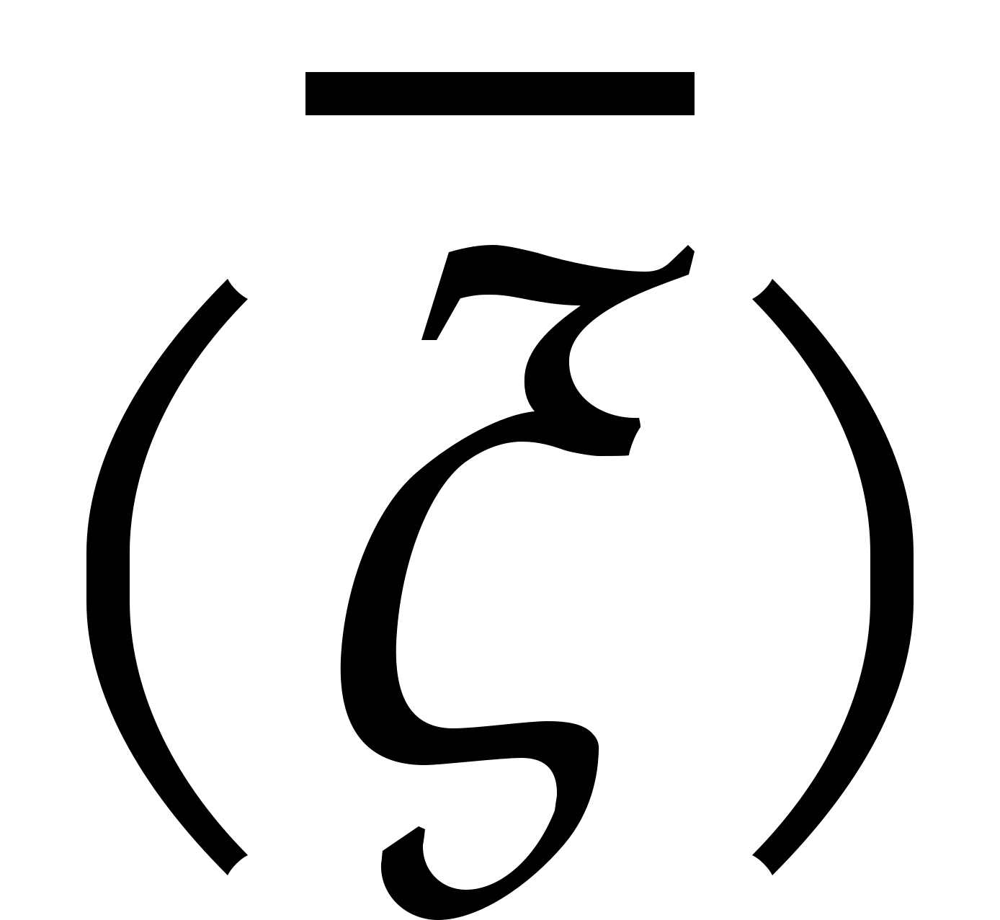”. “ξ” is a variable whose values are the terms of the bracketed expression; and the stroke over the variable indicates that it stands for all its values within the brackets.

(Thus if ξ has, say, the 3 values “P”, “Q”, “R”, then 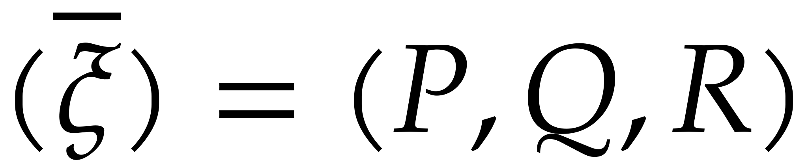.)

The values of the variable are specified.

The specification is the description of the propositions for which the variable stands.

How the terms of the bracketed expression are described is inessential.

We _can_ distinguish three kinds of description: 1) Direct enumeration. In this case we can simply put the constant values of the variable in its place. 2) Specification of a function f(x) whose values for all values of x are the propositions to be described. 3) Specification of a formal law according to which those propositions are formed. In this case the terms of the bracketed expression are all the terms of a series of forms.

### [Ts-204](/ts-204/#34r.7) [34r\[7\]](https://cdn.wittgensteinnachlass.com/2000px/webp/Ts-204/34r.webp)

5.502 Thus instead of “(– – –W)(ξ,…)” I write “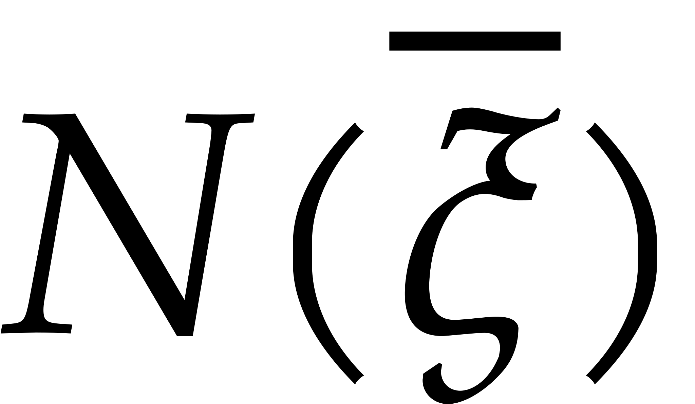”.

 is the negation of all the values of the propositional variable ξ.

### [Ts-204](/ts-204/#35r.1) [35r\[1\]](https://cdn.wittgensteinnachlass.com/2000px/webp/Ts-204/35r.webp)

5.503 Since it is evidently easy to express how propositions can be formed with this operation and how they cannot be formed with it, it must also be possible to give exact expression to this.

### [Ts-204](/ts-204/#35r.2) [35r\[2\]](https://cdn.wittgensteinnachlass.com/2000px/webp/Ts-204/35r.webp)

5.51 If ξ has only one value, then 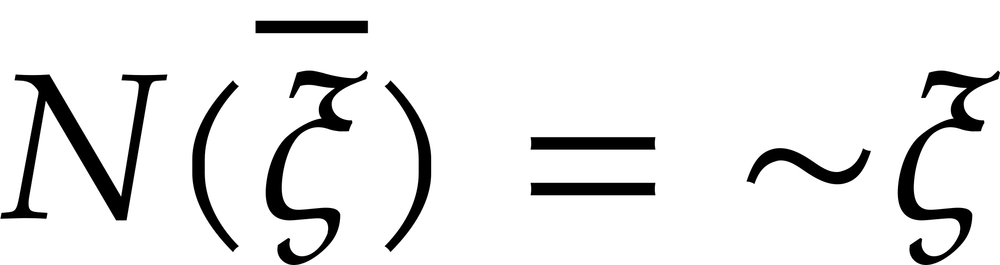 (not ξ); if it has two values, then 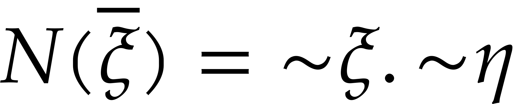 (neither ξ nor η).

### [Ts-204](/ts-204/#35r.3) [35r\[3\]](https://cdn.wittgensteinnachlass.com/2000px/webp/Ts-204/35r.webp)

5.511 How can the all-encompassing logic that mirrors the world make use of such particular hooks and manipulations? Only by all of these linking up into an infinitely fine network to form the great mirror.

### [Ts-204](/ts-204/#35r.4) [35r\[4\]](https://cdn.wittgensteinnachlass.com/2000px/webp/Ts-204/35r.webp)

5.512 “~p” is true if “p” is false. So in the true proposition “~p”, “p” is a false proposition. How, then, can the stroke “~” bring it into agreement with reality?

But what negates in “~p” is not the “~”, but what is common to all the signs in this notation that negate p.

That is, the common rule by which “~p”, “~~~p”, “~p⌵~p”, “~p.~p”, etc. etc. (ad inf.) are formed. And what they have in common mirrors negation.

### [Ts-204](/ts-204/#35r.5) [35r\[5\]](https://cdn.wittgensteinnachlass.com/2000px/webp/Ts-204/35r.webp)

5.513 One might say: What all symbols that affirm both p and q have in common is the proposition “p.q”. What all symbols that affirm either p or q have in common is the proposition “p⌵q”.

And so one can say: Two propositions are opposed to one another if they have nothing in common, and: Each proposition has only one negative, because there is only one proposition that lies wholly outside it.

Thus it also shows itself in Russell’s notation that “q:p⌵~p” says the same as “q”. That “p⌵~p” says nothing.

### [Ts-204](/ts-204/#35r.6) [35r\[6\]](https://cdn.wittgensteinnachlass.com/2000px/webp/Ts-204/35r.webp)

5.514 Once a notation is fixed, there is in it a rule by which all sentences negating p are formed, a rule by which all sentences affirming p are formed, a rule by which all sentences affirming p or q are formed, and so on. These rules are equivalent to the symbols, and the sense of the symbols is mirrored in them.

### [Ts-204](/ts-204/#35r.7) [35r\[7\]](https://cdn.wittgensteinnachlass.com/2000px/webp/Ts-204/35r.webp)

5.515 It must be apparent from our symbols that what is linked together by “⌵”, “.”, etc. must be sentences.

And this is indeed so, for the symbols “p” and “q” themselves presuppose “⌵”, “~”, etc. If the sign “p” in “p⌵q” does not stand for a complex sign, then on its own it cannot have sense; but then the signs “p⌵p”, “p.p”, etc., which have the same sense as “p”, cannot have sense either. But if “p⌵p” has no sense, then “p⌵q” cannot have sense either.

### [Ts-204](/ts-204/#35r.8+36r.1) [35r\[8\]](https://cdn.wittgensteinnachlass.com/2000px/webp/Ts-204/35r.webp),[36r\[1\]](https://cdn.wittgensteinnachlass.com/2000px/webp/Ts-204/36r.webp)

5.5151 Must the sign of the negative sentence be formed using the sign of the positive one? Why should one not be able to express the negative sentence by means of a negative fact? (For instance: If “a” does not stand in a particular relation to “b”, this could express that aRb is not the case.)

But here too, of course, the negative sentence is formed indirectly by means of the positive one.

The positive _sentence_ must presuppose the existence of the negative _sentence_, and vice versa.

### [Ts-204](/ts-204/#36r.2) [36r\[2\]](https://cdn.wittgensteinnachlass.com/2000px/webp/Ts-204/36r.webp)

5.52 If the values of ξ are all the values of a function f(x) for all values of x, then we get 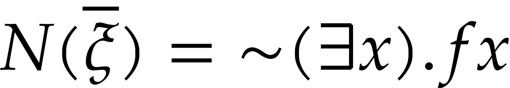.

### [Ts-204](/ts-204/#36r.3) [36r\[3\]](https://cdn.wittgensteinnachlass.com/2000px/webp/Ts-204/36r.webp)

5.521 I separate the concept _All_ from the truth-function.

Frege and Russell introduced generality in connection with the logical product or the logical sum. This made it difficult to understand the propositions (∃x)․fx and (x)․fx, in which both ideas are contained.

### [Ts-204](/ts-204/#36r.4) [36r\[4\]](https://cdn.wittgensteinnachlass.com/2000px/webp/Ts-204/36r.webp)

5.522 What is distinctive about the designation of generality is, first, that it points to a logical prototype and, second, that it singles out constants.

### [Ts-204](/ts-204/#36r.5) [36r\[5\]](https://cdn.wittgensteinnachlass.com/2000px/webp/Ts-204/36r.webp)

5.523 The designation of generality occurs as an argument.

### [Ts-204](/ts-204/#36r.6) [36r\[6\]](https://cdn.wittgensteinnachlass.com/2000px/webp/Ts-204/36r.webp)

5.524 If the objects are given, then _all_ objects are already given to us with them.

If the elementary propositions are given, then _all_ elementary propositions are given with them too.

### [Ts-204](/ts-204/#36r.7) [36r\[7\]](https://cdn.wittgensteinnachlass.com/2000px/webp/Ts-204/36r.webp)

5.525 It is incorrect to render the proposition “(∃x)․fx” – as Russell does – in words as “fx is _possible_”.

The certainty, possibility, or impossibility of a situation is expressed not by a proposition, but by an expression’s being a tautology, a proposition with sense, or a contradiction.

That precedent to which one would always like to appeal must already lie in the symbol itself.

### [Ts-204](/ts-204/#36r.8) [36r\[8\]](https://cdn.wittgensteinnachlass.com/2000px/webp/Ts-204/36r.webp)

5.526 One can describe the world completely by means of fully generalized propositions, that is, without assigning any name to a particular object in advance.

To arrive at the ordinary way of expressing oneself, one then simply has to say, after an expression “there is one and only one x such that …”: And this x is a.

### [Ts-204](/ts-204/#36r.9) [36r\[9\]](https://cdn.wittgensteinnachlass.com/2000px/webp/Ts-204/36r.webp)

5.5261 A fully generalized proposition is composite, like any other proposition. (This shows itself in the fact that in “(∃x,f)․fx” we have to mention “f” and “x” separately.) The two stand independently in designating relations to the world, as in the ungeneralized proposition.

A mark of a composite symbol: It has something in common with _other_ symbols.

### [Ts-204](/ts-204/#37r.1) [37r\[1\]](https://cdn.wittgensteinnachlass.com/2000px/webp/Ts-204/37r.webp)

5.5262 After all, the truth or falsity of _every_ proposition alters something in the general structure of the world. And the latitude that the totality of elementary propositions leaves to its structure is precisely what the fully general propositions delimit.

(If an elementary proposition is true, then at any rate one _more_ elementary proposition is true.)

### [Ts-204](/ts-204/#37r.2) [37r\[2\]](https://cdn.wittgensteinnachlass.com/2000px/webp/Ts-204/37r.webp)

5.53 I express sameness of object by sameness of sign, and not with the aid of an equality sign. Difference of objects by difference of signs.

### [Ts-204](/ts-204/#37r.3) [37r\[3\]](https://cdn.wittgensteinnachlass.com/2000px/webp/Ts-204/37r.webp)

5.5301 It is evident that identity is not a relation between objects. This becomes quite clear if one considers, for example, the proposition “(x):fx․⊃․x = a”. What this proposition says is simply that _only_ a satisfies the function f, not that only things that stand in a certain relation to a satisfy the function f.

To be sure, one might now say that _only_ a stands in this relation to a, but to express this we would need the equality sign itself.

### [Ts-204](/ts-204/#37r.4) [37r\[4\]](https://cdn.wittgensteinnachlass.com/2000px/webp/Ts-204/37r.webp)

5.5302 Russell’s definition of “ = ” is not adequate, because on that definition one cannot say that two objects have all their properties in common. (Even if this proposition is never true, it still has _sense_.)

### [Ts-204](/ts-204/#37r.5) [37r\[5\]](https://cdn.wittgensteinnachlass.com/2000px/webp/Ts-204/37r.webp)

5.5303 In passing: To say of _two_ things that they are identical is nonsense, and to say of _one_ thing that it is identical with itself is to say nothing at all.

### [Ts-204](/ts-204/#37r.6) [37r\[6\]](https://cdn.wittgensteinnachlass.com/2000px/webp/Ts-204/37r.webp)

5.531 So I write not “f(a,b)․a = b” but “f(a,a)” (or “f(b,b)”). And not “f(a,b)․~a = b” but “f(a,b)”.

### [Ts-204](/ts-204/#37r.7) [37r\[7\]](https://cdn.wittgensteinnachlass.com/2000px/webp/Ts-204/37r.webp)

5.532 And analogously: Not “(∃x,y)․f(x,y)․x = y” but “(∃x).f(x,x)”. And: Not “(∃x,y)․f(x,y)․~x = y” but “(∃x,y)․f(x,y)”.

(So instead of Russell’s “(∃x,y)․f(x,y)”: “(∃x,y)․f(x,y)⌵(∃x).f(x,x)”).

### [Ts-204](/ts-204/#37r.8) [37r\[8\]](https://cdn.wittgensteinnachlass.com/2000px/webp/Ts-204/37r.webp)

5.5321 So, for example, instead of “(x):fx⊃x = a” we write “fa: ~∃x,y)․fx.fy”.

And the sentence “_only_ one x satisfies f()” reads: “(∃x)․fx: ~(∃x,y)․fx.fy”.

### [Ts-204](/ts-204/#37r.9) [37r\[9\]](https://cdn.wittgensteinnachlass.com/2000px/webp/Ts-204/37r.webp)

5.533 So the equality sign is not an essential part of a concept-script.

### [Ts-204](/ts-204/#37r.10) [37r\[10\]](https://cdn.wittgensteinnachlass.com/2000px/webp/Ts-204/37r.webp)

5.534 And now we see that pseudo-sentences such as “a = a”, “a = b.b = c.⊃.a = c”, “(x).x = x”, “(∃x).x = a”, etc. cannot be written down at all in a correct concept-script.

### [Ts-204](/ts-204/#37r.11+38r.1) [37r\[11\]](https://cdn.wittgensteinnachlass.com/2000px/webp/Ts-204/37r.webp),[38r\[1\]](https://cdn.wittgensteinnachlass.com/2000px/webp/Ts-204/38r.webp)

5.535 This also disposes of all the problems that were bound up with such pseudo-sentences.

All the problems that Russell’s “Axiom of infinity” brings with it are to be resolved here already. What the Axiom of infinity is supposed to say would be expressed in language by there being infinitely many names with different meanings.

### [Ts-204](/ts-204/#38r.2) [38r\[2\]](https://cdn.wittgensteinnachlass.com/2000px/webp/Ts-204/38r.webp)

5.5351 There are certain cases in which one is tempted to use expressions of the form “a = a” or “p⊃p” and the like. This happens when one wants to speak of the prototype sentence, thing, etc. Thus in the “Principles of Mathematics” Russell rendered the nonsense “p is a sentence” in symbols as “p⊃p” and placed it as a hypothesis before certain sentences so that their argument places could be occupied only by sentences.

(It is nonsense to put the hypothesis p⊃p before a sentence to ensure that it has arguments of the right form, if only because with a non-sentence as argument the hypothesis becomes not false but nonsensical, and because arguments of the wrong kind make the sentence itself nonsensical, so that it guards itself against the wrong arguments just as well, or just as badly, as the senseless hypothesis attached for this purpose.)

### [Ts-204](/ts-204/#38r.3) [38r\[3\]](https://cdn.wittgensteinnachlass.com/2000px/webp/Ts-204/38r.webp)

5.5352 Similarly, one wanted to express “There are no _things_” by “~(∃x)․ x = x”. But even if this were a proposition, would it not also be true if “there were things”, but they were not identical with themselves?

### [Ts-204](/ts-204/#38r.4) [38r\[4\]](https://cdn.wittgensteinnachlass.com/2000px/webp/Ts-204/38r.webp)

5.54 In the general sentential form, a proposition occurs in a proposition only as the basis of truth-operations.

### [Ts-204](/ts-204/#38r.5) [38r\[5\]](https://cdn.wittgensteinnachlass.com/2000px/webp/Ts-204/38r.webp)

5.541 At first glance it seems as though a proposition could also occur in another in a different way.

Especially in certain sentential forms of psychology, such as “A believes that p is the case” or “A thinks p”, etc.

For on the surface it seems here as though the proposition p stands in a kind of relation to an object A.

(And in modern epistemology (Russell, Moore, etc.) those propositions have indeed been understood in this way.)

### [Ts-204](/ts-204/#38r.6) [38r\[6\]](https://cdn.wittgensteinnachlass.com/2000px/webp/Ts-204/38r.webp)

5.542 But it is clear that “A believes that p”, “A thinks p”, “A says p” are of the form “‘p’ says p”: And what we have here is not a correlation between a fact and an object, but a correlation of facts by correlating their objects.

### [Ts-204](/ts-204/#38r.7) [38r\[7\]](https://cdn.wittgensteinnachlass.com/2000px/webp/Ts-204/38r.webp)

5.5421 This also shows that the mind – the subject, etc. – as conceived in today’s superficial psychology, is an absurdity.

For a composite mind would no longer be a mind.

### [Ts-204](/ts-204/#38r.8) [38r\[8\]](https://cdn.wittgensteinnachlass.com/2000px/webp/Ts-204/38r.webp)

5.5422 The correct explanation of the form of the sentence “A judges p” must show that it is impossible to judge nonsense. (Russell’s theory does not meet this condition.)

### [Ts-204](/ts-204/#39r.1) [39r\[1\]](https://cdn.wittgensteinnachlass.com/2000px/webp/Ts-204/39r.webp)

5.5423 To perceive a complex is to perceive that its constituents stand in such-and-such relations to one another.

This presumably also explains why one can see the figure 

as a cube in two ways; and all similar phenomena. For we really do see two different facts.

(If I look first at corner a and only glance at b, a appears at the front, and vice versa.)

### [Ts-204](/ts-204/#39r.2) [39r\[2\]](https://cdn.wittgensteinnachlass.com/2000px/webp/Ts-204/39r.webp)

5.55 We must now answer a priori the question of all the possible forms of elementary propositions.

An elementary proposition consists of names. But since we cannot specify the number of names with different meanings, neither can we specify the composition of the elementary proposition.

### [Ts-204](/ts-204/#39r.3) [39r\[3\]](https://cdn.wittgensteinnachlass.com/2000px/webp/Ts-204/39r.webp)

5.551 Our principle is that every question that can be decided by logic at all must be decidable without further ado.

(And if we find ourselves having to answer such a problem by looking at the world, this shows that we are altogether on the wrong track.)

### [Ts-204](/ts-204/#39r.4) [39r\[4\]](https://cdn.wittgensteinnachlass.com/2000px/webp/Ts-204/39r.webp)

5.552 The “experience” we need to understand logic is not that something is thus and so, but that something _is_; but that is precisely _not_ an experience.

Logic is _prior_ to any experience – that something is _so_.

It is prior to the How, not prior to the What.

### [Ts-204](/ts-204/#39r.5) [39r\[5\]](https://cdn.wittgensteinnachlass.com/2000px/webp/Ts-204/39r.webp)

5.5521 And if this were not so, how could we apply logic? One might say: If there were a logic even if there were no world, how could there be a logic given that there is a world?

### [Ts-204](/ts-204/#39r.6) [39r\[6\]](https://cdn.wittgensteinnachlass.com/2000px/webp/Ts-204/39r.webp)

5.553 Russell said that there were simple relations between different numbers of things. (Individuals). But between which numbers? And how is that to be decided? – By experience?

(There is no privileged number.)

### [Ts-204](/ts-204/#39r.7) [39r\[7\]](https://cdn.wittgensteinnachlass.com/2000px/webp/Ts-204/39r.webp)

5.554 Specifying any particular form would be completely arbitrary.

### [Ts-204](/ts-204/#39r.8) [39r\[8\]](https://cdn.wittgensteinnachlass.com/2000px/webp/Ts-204/39r.webp)

5.5541 It should be possible to specify a priori whether I could find myself having to designate something about a 27-place relation, for example.

### [Ts-204](/ts-204/#39r.9) [39r\[9\]](https://cdn.wittgensteinnachlass.com/2000px/webp/Ts-204/39r.webp)

5.5542 But are we entitled to ask such a question at all? Can we set up a form of sign and not know whether anything could correspond to it?

Does the question have sense: What must _be_ for it to be possible for something to be-the-case?

### [Ts-204](/ts-204/#39r.10+40r.1) [39r\[10\]](https://cdn.wittgensteinnachlass.com/2000px/webp/Ts-204/39r.webp),[40r\[1\]](https://cdn.wittgensteinnachlass.com/2000px/webp/Ts-204/40r.webp)

5.555 It is clear that we have a concept of the elementary proposition apart from its particular logical form. But where one can form symbols according to a system, it is this system that matters logically, not the individual symbols.

And how could it be possible for me to deal in logic with forms I can invent? Rather, what I must deal with is what makes it possible for me to invent them.

### [Ts-204](/ts-204/#40r.2) [40r\[2\]](https://cdn.wittgensteinnachlass.com/2000px/webp/Ts-204/40r.webp)

5.556 There can be no hierarchy of the forms of elementary propositions. We can foresee only what we construct ourselves.

### [Ts-204](/ts-204/#40r.3) [40r\[3\]](https://cdn.wittgensteinnachlass.com/2000px/webp/Ts-204/40r.webp)

5.5561 Empirical reality is bounded by the totality of objects. The limit shows itself once more in the totality of elementary propositions.

The hierarchies are, and must be, independent of reality.

### [Ts-204](/ts-204/#40r.4) [40r\[4\]](https://cdn.wittgensteinnachlass.com/2000px/webp/Ts-204/40r.webp)

5.5562 If we know on purely logical grounds that there must be elementary propositions, then anyone who understands propositions in their unanalysed form must know it.

### [Ts-204](/ts-204/#40r.5) [40r\[5\]](https://cdn.wittgensteinnachlass.com/2000px/webp/Ts-204/40r.webp)

5.5563 All the sentences of our everyday language are in fact in perfect logical order, just as they are. – That simplest thing which we are to specify here is not a simile for the truth, but the full truth itself.

(Our problems are not abstract, but perhaps the most concrete there are.)

### [Ts-204](/ts-204/#40r.6) [40r\[6\]](https://cdn.wittgensteinnachlass.com/2000px/webp/Ts-204/40r.webp)

5.557 The _application_ of logic decides which elementary propositions there are.

Logic cannot anticipate what lies in its application.

This is clear: Logic must not collide with its application.

But logic must be in contact with its application.

So logic and its application must not overlap.

### [Ts-204](/ts-204/#40r.7) [40r\[7\]](https://cdn.wittgensteinnachlass.com/2000px/webp/Ts-204/40r.webp)

5.5571 If I cannot specify the elementary propositions a priori, then wanting to specify them must lead to patent nonsense.

### [Ts-204](/ts-204/#40r.8) [40r\[8\]](https://cdn.wittgensteinnachlass.com/2000px/webp/Ts-204/40r.webp)

5.6 _The limits of my language_ mean the limits of my world.

### [Ts-204](/ts-204/#40r.9) [40r\[9\]](https://cdn.wittgensteinnachlass.com/2000px/webp/Ts-204/40r.webp)

5.61 Logic fills the world: the limits of the world are also its limits.

So in logic we cannot say: There is this and that in the world, but not that other thing.

For that would apparently presuppose that we exclude certain possibilities, and this cannot be the case, since logic would otherwise have to go beyond the limits of the world; if, that is, it could view those limits from the other side as well.

What we cannot think, we cannot think; so neither can we _say_ what we cannot think.

### [Ts-204](/ts-204/#41r.1) [41r\[1\]](https://cdn.wittgensteinnachlass.com/2000px/webp/Ts-204/41r.webp)

5.62 This remark provides the key to deciding to what extent solipsism is a truth.

For what solipsism _means_ is quite right, only it cannot be _said_; rather, it shows itself.

That the world is _my_ world shows itself in the fact that the limits of _the_ language (the language that alone I understand) mean the limits of _my_ world.

### [Ts-204](/ts-204/#41r.2) [41r\[2\]](https://cdn.wittgensteinnachlass.com/2000px/webp/Ts-204/41r.webp)

5.621 The world and life are one.

### [Ts-204](/ts-204/#41r.3) [41r\[3\]](https://cdn.wittgensteinnachlass.com/2000px/webp/Ts-204/41r.webp)

5.63 I am my world. (The microcosm).

### [Ts-204](/ts-204/#41r.4) [41r\[4\]](https://cdn.wittgensteinnachlass.com/2000px/webp/Ts-204/41r.webp)

5.631 There is no subject that thinks, that forms representations.

If I wrote a book “The World as I Found It”, I would also have to report in it on my body and say which limbs are subject to my will and which are not, etc.; for this is a method of isolating the subject, or rather of showing that in an important sense there is no subject: it is the one thing that could _not_ be spoken of in this book. –

### [Ts-204](/ts-204/#41r.5) [41r\[5\]](https://cdn.wittgensteinnachlass.com/2000px/webp/Ts-204/41r.webp)

5.632 The subject does not belong to the world, but is a limit of the world.

### [Ts-204](/ts-204/#41r.6) [41r\[6\]](https://cdn.wittgensteinnachlass.com/2000px/webp/Ts-204/41r.webp)

5.633 Where _in_ the world can a metaphysical subject be discerned?

You say it is just as with the eye and the visual field. But you really do _not_ see the eye.

And nothing _about the visual field_ allows one to infer that it is seen by an eye.

### [Ts-204](/ts-204/#41r.7) [41r\[7\]](https://cdn.wittgensteinnachlass.com/2000px/webp/Ts-204/41r.webp)

5.6331 For the visual field does not have a shape like this:

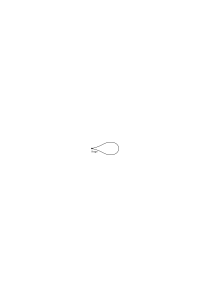

### [Ts-204](/ts-204/#41r.8) [41r\[8\]](https://cdn.wittgensteinnachlass.com/2000px/webp/Ts-204/41r.webp)

5.634 This is connected with the fact that no part of our experience is also a priori.

Everything we see could be otherwise.

Everything we can describe at all could be otherwise.

There is no order of things a priori.

### [Ts-204](/ts-204/#41r.9) [41r\[9\]](https://cdn.wittgensteinnachlass.com/2000px/webp/Ts-204/41r.webp)

5.64 Here one sees that solipsism, carried through rigorously, coincides with pure realism. The self of solipsism shrinks to a point without extension, and what remains is the reality correlated with it.

### [Ts-204](/ts-204/#41r.10+42r.1) [41r\[10\]](https://cdn.wittgensteinnachlass.com/2000px/webp/Ts-204/41r.webp),[42r\[1\]](https://cdn.wittgensteinnachlass.com/2000px/webp/Ts-204/42r.webp)

5.641 So there really is a sense in which philosophy can speak of the self non-psychologically.

The self enters philosophy through the fact that “the world is my world.” The philosophical self is not the human being, not the human body or the human mind with which psychology deals, but the metaphysical subject, the limit (not a part) of the world.

### [Ts-204](/ts-204/#42r.2) [42r\[2\]](https://cdn.wittgensteinnachlass.com/2000px/webp/Ts-204/42r.webp)

6 The general form of the truth-function is:

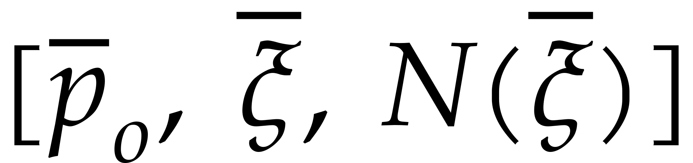

This is the general form of the proposition.

### [Ts-204](/ts-204/#42r.3) [42r\[3\]](https://cdn.wittgensteinnachlass.com/2000px/webp/Ts-204/42r.webp)

6.01 The general form of operation is:

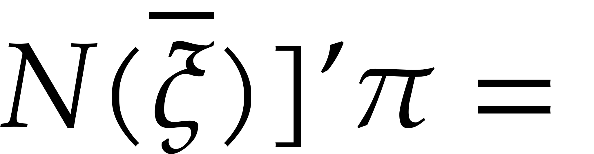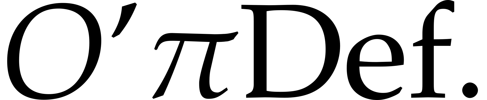

### [Ts-204](/ts-204/#42r.4) [42r\[4\]](https://cdn.wittgensteinnachlass.com/2000px/webp/Ts-204/42r.webp)

6.011 I now define:

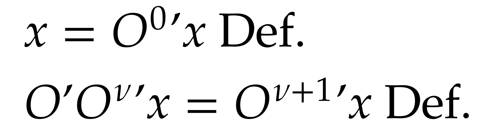

So instead of “O'x” I write “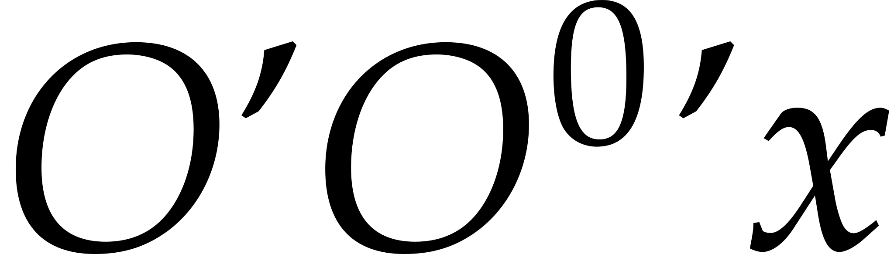” or “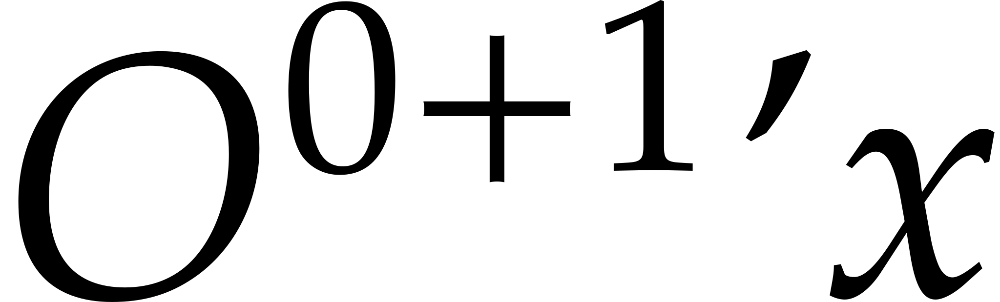”

instead of “O'O'x” 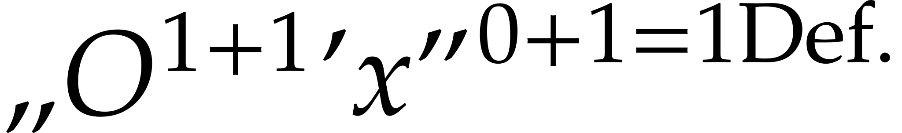 1 + 1 = 2 Def.

instead of “O'O'O'x” “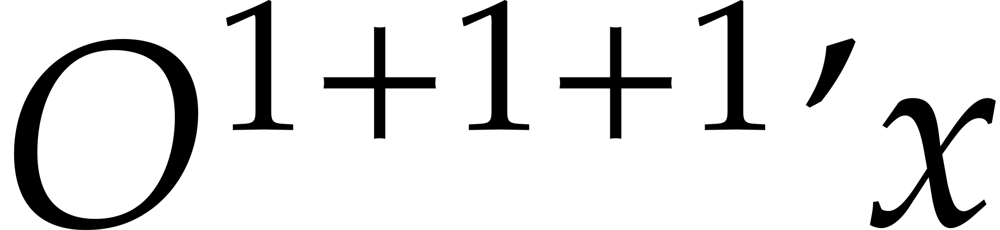” 1 + 1 + 1 = 3 Def. and so on.

### [Ts-204](/ts-204/#42r.5) [42r\[5\]](https://cdn.wittgensteinnachlass.com/2000px/webp/Ts-204/42r.webp)

6.022 The concept of number is nothing other than what all numbers have in common, the general form of number.

The concept of number is the variable number.

And the concept of numerical equality is the general form of all particular numerical equalities.

### [Ts-204](/ts-204/#42r.6) [42r\[6\]](https://cdn.wittgensteinnachlass.com/2000px/webp/Ts-204/42r.webp)

6.02 The general form of the integer is:

[0, ξ, ξ + 1]

### [Ts-204](/ts-204/#42r.7) [42r\[7\]](https://cdn.wittgensteinnachlass.com/2000px/webp/Ts-204/42r.webp)

6.021 The theory of classes is entirely superfluous in mathematics.

This is connected with the fact that the generality we need in mathematics is not _accidental_ generality.

### [Ts-204](/ts-204/#42r.8) [42r\[8\]](https://cdn.wittgensteinnachlass.com/2000px/webp/Ts-204/42r.webp)

6.1 The sentences of logic are tautologies.

### [Ts-204](/ts-204/#42ar.2) [42ar\[2\]](https://cdn.wittgensteinnachlass.com/2000px/webp/Ts-204/42ar.webp)

6 The general form of the truth-function is: 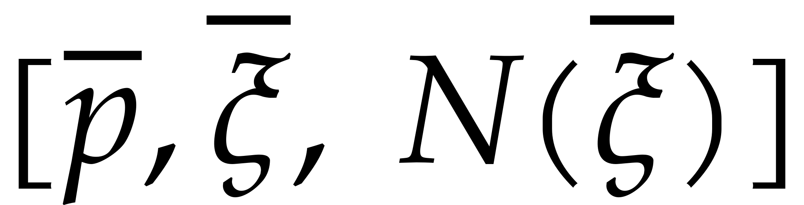

This is the general form of the sentence.

### [Ts-204](/ts-204/#42ar.3) [42ar\[3\]](https://cdn.wittgensteinnachlass.com/2000px/webp/Ts-204/42ar.webp)

6˙001 This says nothing other than that every sentence is a result of the successive application of the operation N'(x) to the elementary sentences.

### [Ts-204](/ts-204/#42ar.4) [42ar\[4\]](https://cdn.wittgensteinnachlass.com/2000px/webp/Ts-204/42ar.webp)

6˙002 Once the general form of how a sentence is constructed is given, so too is the general form of how one sentence can be produced from another by an operation.

### [Ts-204](/ts-204/#42ar.5) [42ar\[5\]](https://cdn.wittgensteinnachlass.com/2000px/webp/Ts-204/42ar.webp)

6.01 The general form of the operation 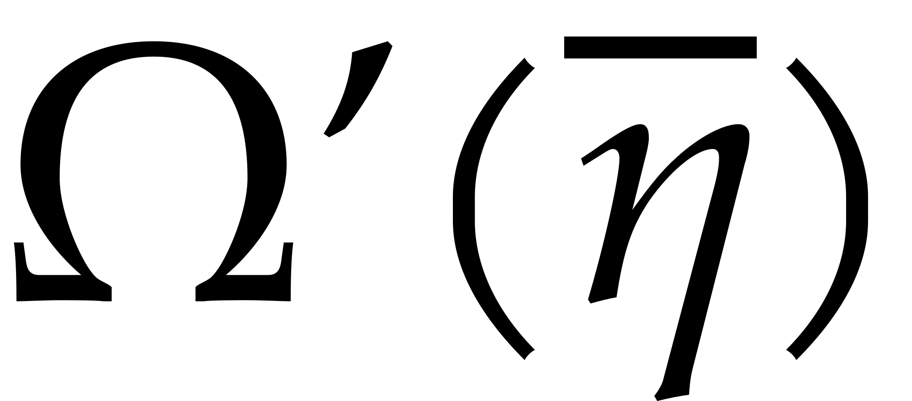 is therefore: 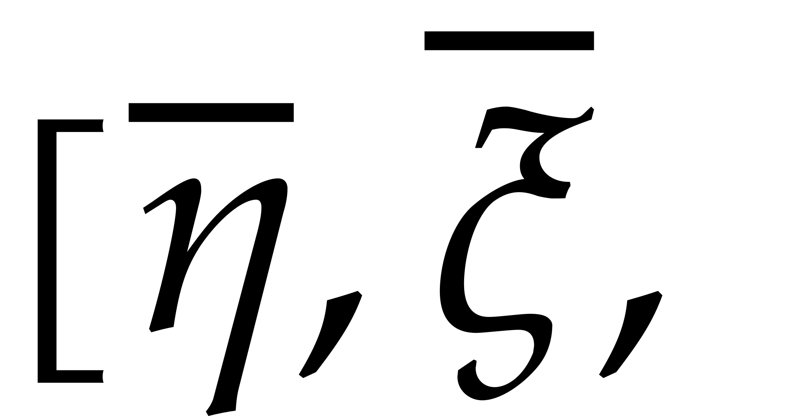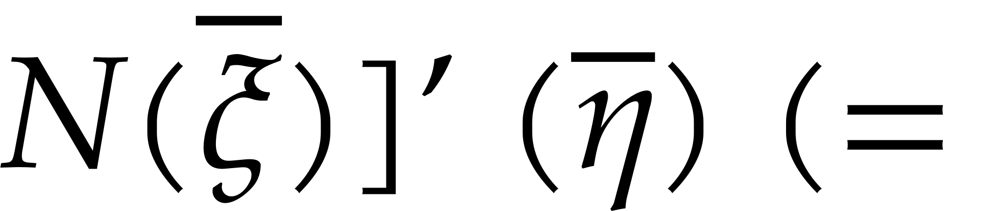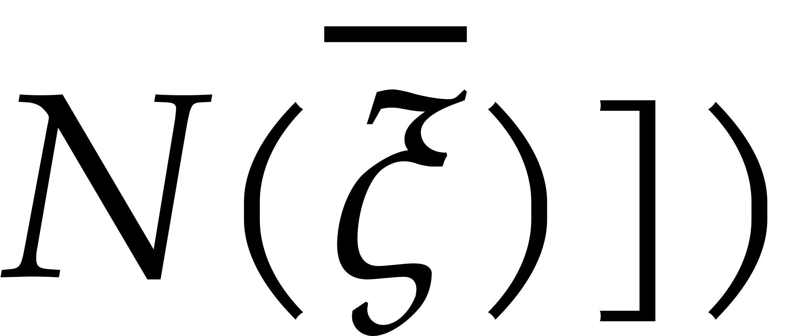

That is the most general form of the transition from one sentence to another.

### [Ts-204](/ts-204/#42ar.6) [42ar\[6\]](https://cdn.wittgensteinnachlass.com/2000px/webp/Ts-204/42ar.webp)

6.02 And _this_ is how we arrive at numbers: I define

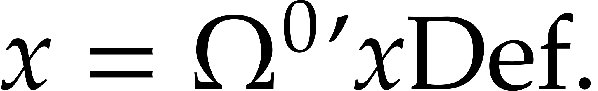 and

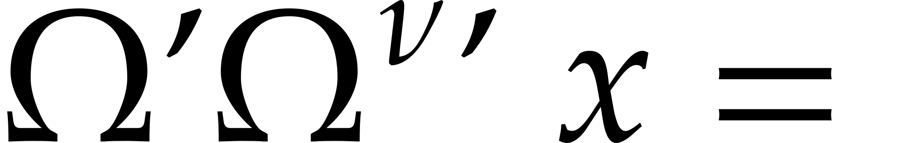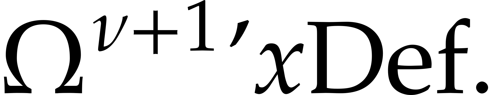

In accordance with these rules for signs we therefore write the series

x, Ω'x, Ω'Ω'x, Ω'Ω'Ω'x,… as follows:

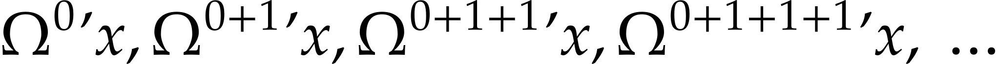

So instead of “[x, ξ, Ω'ξ]” I write:

“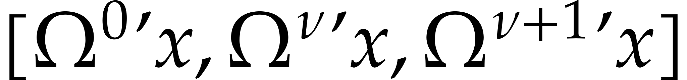”

And define: o + 1 = 1 Def. o + 1 + 1 = 2 Def. o + 1 + 1 + 1 = 3 Def. (and so on)

### [Ts-204](/ts-204/#42ar.7) [42ar\[7\]](https://cdn.wittgensteinnachlass.com/2000px/webp/Ts-204/42ar.webp)

6.021 Number is the exponent of an operation.

### [Ts-204](/ts-204/#42ar.8) [42ar\[8\]](https://cdn.wittgensteinnachlass.com/2000px/webp/Ts-204/42ar.webp)

6.022 The concept of number is nothing other than what all numbers have in common, the general form of number.

The concept of number is the variable number.

And the concept of numerical equality is the general form of all particular numerical equalities.

### [Ts-204](/ts-204/#42ar.9) [42ar\[9\]](https://cdn.wittgensteinnachlass.com/2000px/webp/Ts-204/42ar.webp)

6.03 The general form of the integer is: [0, ξ, ξ + 1].

### [Ts-204](/ts-204/#42ar.10) [42ar\[10\]](https://cdn.wittgensteinnachlass.com/2000px/webp/Ts-204/42ar.webp)

6.031 The theory of classes is entirely superfluous in mathematics.

This is connected with the fact that the generality we need in mathematics is not _accidental_ generality.

### [Ts-204](/ts-204/#42ar.11) [42ar\[11\]](https://cdn.wittgensteinnachlass.com/2000px/webp/Ts-204/42ar.webp)

6.1 The sentences of logic are tautologies.

### [Ts-204](/ts-204/#43r.1) [43r\[1\]](https://cdn.wittgensteinnachlass.com/2000px/webp/Ts-204/43r.webp)

6.11 Thus the sentences of logic say nothing. (They are the analytic sentences.)

### [Ts-204](/ts-204/#43r.2) [43r\[2\]](https://cdn.wittgensteinnachlass.com/2000px/webp/Ts-204/43r.webp)

6.111 Theories that make a sentence of logic appear to have content are always false. One might believe, for example, that the words “true” and “false” designate two properties among other properties, and then it would appear to be a curious fact that every sentence has one of these properties. Now this seems anything but self-evident, just as little self-evident as, say, the sentence “all roses are either yellow or red” would sound, even if it were true. Indeed, the former sentence now takes on all the character of a proposition of natural science, and this is a sure sign that it has been misconstrued.

### [Ts-204](/ts-204/#43r.3) [43r\[3\]](https://cdn.wittgensteinnachlass.com/2000px/webp/Ts-204/43r.webp)

6.112 The correct explanation of logical sentences must give them a unique position among all sentences.

### [Ts-204](/ts-204/#43r.4) [43r\[4\]](https://cdn.wittgensteinnachlass.com/2000px/webp/Ts-204/43r.webp)

6.113 It is the distinctive feature of logical sentences that one can recognize from the symbol alone that they are true, and this fact encompasses the whole philosophy of logic. And so it is also one of the most important facts that the truth or falsity of non-logical sentences is _not_ recognizable from the sentence alone.

### [Ts-204](/ts-204/#43r.5) [43r\[5\]](https://cdn.wittgensteinnachlass.com/2000px/webp/Ts-204/43r.webp)

6.12 That the sentences of logic are tautologies _shows_ the formal – logical – properties of language, of the world.

That their constituents yield a tautology when combined _in this way_ characterizes the logic of their constituents.

For sentences to yield a tautology when combined in a particular way, they must have particular properties of structure. That they yield a tautology when joined _in this way_ thus shows that they possess these properties of structure.

### [Ts-204](/ts-204/#43r.6) [43r\[6\]](https://cdn.wittgensteinnachlass.com/2000px/webp/Ts-204/43r.webp)

6.1201 That, for example, the sentences “p” and “~p” yield a tautology in the combination “~(p.~p)” shows that they contradict one another. That the sentences “p⊃q”, “p” and “q” yield a tautology when combined in the form “(p⊃q).(p) :⊃: (q)” shows that q follows from p and p⊃q. That “(x)․fx :⊃: fa” is a tautology, that fa follows from (x)․fx. etc. etc.

### [Ts-204](/ts-204/#43r.7) [43r\[7\]](https://cdn.wittgensteinnachlass.com/2000px/webp/Ts-204/43r.webp)

6.1202 It is clear that one could also use contradictions instead of tautologies for the same purpose.

### [Ts-204](/ts-204/#43r.8) [43r\[8\]](https://cdn.wittgensteinnachlass.com/2000px/webp/Ts-204/43r.webp)

6.121 The sentences of logic demonstrate the logical properties of sentences by combining them into sentences that say nothing.

One might also call this method a null method. In a logical sentence, sentences are brought into equilibrium with one another, and the state of equilibrium then indicates how these sentences must be constituted logically.

### [Ts-204](/ts-204/#44r.1) [44r\[1\]](https://cdn.wittgensteinnachlass.com/2000px/webp/Ts-204/44r.webp)

6.122 It follows from this that we can also do without logical sentences, since in a suitable notation we can recognize the formal properties of sentences merely by looking at them.

### [Ts-204](/ts-204/#44r.2) [44r\[2\]](https://cdn.wittgensteinnachlass.com/2000px/webp/Ts-204/44r.webp)

6.1221 If, for example, two sentences “p” and “q” yield a tautology in the combination “p⊃q”, then it is clear that q follows from p.

We see from these two sentences themselves that “q”, for example, follows from “p⊃q.p”, but we can also show it _in this way_: by combining them into “p⊃q.p :⊃: q” and then showing that this is a tautology.

### [Ts-204](/ts-204/#44r.3) [44r\[3\]](https://cdn.wittgensteinnachlass.com/2000px/webp/Ts-204/44r.webp)

6.1222 This sheds light on the question why logical sentences can no more be confirmed by experience than they can be refuted by experience. A sentence of logic must not only be incapable of being refuted by any possible experience; it must also be incapable of being confirmed by any such experience.

### [Ts-204](/ts-204/#44r.4) [44r\[4\]](https://cdn.wittgensteinnachlass.com/2000px/webp/Ts-204/44r.webp)

6.1223 It now becomes clear why one often felt as though the “logical truths” were for us to “_demand_”: we can in fact demand them in so far as we can demand an adequate notation.

### [Ts-204](/ts-204/#44r.5) [44r\[5\]](https://cdn.wittgensteinnachlass.com/2000px/webp/Ts-204/44r.webp)

6.1224 It now also becomes clear why logic was called the doctrine of forms and of inference.

### [Ts-204](/ts-204/#44r.6) [44r\[6\]](https://cdn.wittgensteinnachlass.com/2000px/webp/Ts-204/44r.webp)

6.123 It is clear: the laws of logic must not themselves in turn be subject to laws of logic.

(There is not, as Russell thought, a separate law of contradiction for each “type”; rather, one is enough, since it is not applied to itself.)

### [Ts-204](/ts-204/#44r.7) [44r\[7\]](https://cdn.wittgensteinnachlass.com/2000px/webp/Ts-204/44r.webp)

6.1231 Universal validity is _not_ the mark of a logical sentence.

For to be general means only this: to hold for all things by chance. An ungeneralized sentence can be tautological just as a generalized one can.

### [Ts-204](/ts-204/#44r.8) [44r\[8\]](https://cdn.wittgensteinnachlass.com/2000px/webp/Ts-204/44r.webp)

6.1232 One might call logical universal validity essential, in contrast to the accidental universal validity of, for example, the proposition “all human beings are mortal”. Propositions such as Russell’s “Axiom of reducibility” are not logical propositions, and this explains our feeling: that if they are true, it can only be by a fortunate accident.

### [Ts-204](/ts-204/#44r.9) [44r\[9\]](https://cdn.wittgensteinnachlass.com/2000px/webp/Ts-204/44r.webp)

6.1233 One can imagine a world in which the Axiom of reducibility does not hold. But it is clear that logic has nothing to do with the question whether our world is actually like that or not.

### [Ts-204](/ts-204/#44r.10+45r.1) [44r\[10\]](https://cdn.wittgensteinnachlass.com/2000px/webp/Ts-204/44r.webp),[45r\[1\]](https://cdn.wittgensteinnachlass.com/2000px/webp/Ts-204/45r.webp)

6.124 Logical sentences describe the framework of the world, or rather they represent it. They are not “about” anything. They presuppose that names have meaning and elementary sentences have sense: and this is their connection with the world. It is clear that it must indicate something about the world that certain combinations of symbols – which essentially have a certain character – are tautologies. This is the decisive point. We said that some aspects of the symbols we use were arbitrary, others not. In logic only what is not arbitrary expresses anything: but this means that in logic it is not _we_ who express what we want with the help of signs; rather, in logic the very nature of the signs that are necessary by nature speaks: if we know the logical syntax of any sign-language, then all the sentences of logic are already given.

### [Ts-204](/ts-204/#45r.2) [45r\[2\]](https://cdn.wittgensteinnachlass.com/2000px/webp/Ts-204/45r.webp)

6.125 It is possible, even on the old conception of logic, to give in advance a description of all “true” logical sentences.

### [Ts-204](/ts-204/#45r.3) [45r\[3\]](https://cdn.wittgensteinnachlass.com/2000px/webp/Ts-204/45r.webp)

6.1251 That is also why there can _never_ be surprises in logic.

### [Ts-204](/ts-204/#45r.4) [45r\[4\]](https://cdn.wittgensteinnachlass.com/2000px/webp/Ts-204/45r.webp)

6.126 One can calculate whether a sentence belongs to logic by calculating the logical properties of the _symbol_.

And this is what we do when we “prove” a logical sentence. For without attending to sense or meaning, we form the logical sentence from others by following mere _rules for signs_.

The proof of logical sentences consists in making them arise from other logical sentences by the successive application of certain operations that repeatedly produce tautologies from the original ones. (And indeed only tautologies _follow_ from a tautology.)

Of course, this way of showing that its sentences are tautologies is quite inessential to logic. If only because the sentences from which the proof starts must show without proof that they are tautologies.

### [Ts-204](/ts-204/#45r.5) [45r\[5\]](https://cdn.wittgensteinnachlass.com/2000px/webp/Ts-204/45r.webp)

6.1261 In logic, process and result are equivalent. (Hence no surprise.)

### [Ts-204](/ts-204/#45r.6) [45r\[6\]](https://cdn.wittgensteinnachlass.com/2000px/webp/Ts-204/45r.webp)

6.1262 Proof in logic is merely a mechanical aid to recognizing a tautology more easily when it is complicated.

### [Ts-204](/ts-204/#45r.7) [45r\[7\]](https://cdn.wittgensteinnachlass.com/2000px/webp/Ts-204/45r.webp)

6.1263 It would indeed be too strange if one could prove a proposition with sense _logically_ from others, and a logical proposition _too_. It is clear from the outset that the logical proof of a proposition with sense and proof _in_ logic must be two quite different things.

### [Ts-204](/ts-204/#45r.8) [45r\[8\]](https://cdn.wittgensteinnachlass.com/2000px/webp/Ts-204/45r.webp)

6.1264 A proposition with sense says something, and its proof shows that it is so; in logic every sentence is the form of a proof.

Every sentence of logic is a modus ponens represented in signs. (And modus ponens cannot be expressed by a sentence.)

### [Ts-204](/ts-204/#45r.9) [45r\[9\]](https://cdn.wittgensteinnachlass.com/2000px/webp/Ts-204/45r.webp)

6.1265 One can always conceive of logic in such a way that every sentence is its own proof.

### [Ts-204](/ts-204/#46r.1) [46r\[1\]](https://cdn.wittgensteinnachlass.com/2000px/webp/Ts-204/46r.webp)

6.127 All the sentences of logic have equal standing; there is no essential distinction among them between basic laws and derived sentences.

Every tautology itself shows that it is a tautology.

### [Ts-204](/ts-204/#46r.2) [46r\[2\]](https://cdn.wittgensteinnachlass.com/2000px/webp/Ts-204/46r.webp)

6.1271 It is clear that the number of “basic laws of logic” is arbitrary, for one could derive logic from a single basic law simply by forming, for instance, the logical product of Frege’s basic laws. (Frege might say that this basic law would then no longer be immediately evident. But it is curious that so exact a thinker as Frege should have appealed to the degree of self-evidence as a criterion of a logical sentence.)

### [Ts-204](/ts-204/#46r.3) [46r\[3\]](https://cdn.wittgensteinnachlass.com/2000px/webp/Ts-204/46r.webp)

6.13 Logic is not a doctrine but a mirror image of the world.

Logic is transcendental.

### [Ts-204](/ts-204/#46r.4) [46r\[4\]](https://cdn.wittgensteinnachlass.com/2000px/webp/Ts-204/46r.webp)

6.2 Mathematics is a logical method.

The sentences of mathematics are equations, and hence pseudo-sentences.

### [Ts-204](/ts-204/#46r.5) [46r\[5\]](https://cdn.wittgensteinnachlass.com/2000px/webp/Ts-204/46r.webp)

6.21 A mathematical sentence does not express a thought.

### [Ts-204](/ts-204/#46r.6) [46r\[6\]](https://cdn.wittgensteinnachlass.com/2000px/webp/Ts-204/46r.webp)

6.211 In life it is never the mathematical sentence that we need; rather, we use the mathematical sentence _only_ to infer from propositions that do not belong to mathematics others that likewise do not belong to mathematics.

(In philosophy the question “what do we actually use that word, that sentence for?” yields valuable insights time and again.)

### [Ts-204](/ts-204/#46r.7) [46r\[7\]](https://cdn.wittgensteinnachlass.com/2000px/webp/Ts-204/46r.webp)

6.22 The logic of the world that the sentences of logic show in tautologies, mathematics shows in equations.

### [Ts-204](/ts-204/#46r.8) [46r\[8\]](https://cdn.wittgensteinnachlass.com/2000px/webp/Ts-204/46r.webp)

6.23 When two expressions are joined by the equality sign, this means that they can be substituted for one another. But whether this is the case must be apparent from the two expressions themselves.

That two expressions can be substituted for one another characterizes their logical form.

### [Ts-204](/ts-204/#46r.9) [46r\[9\]](https://cdn.wittgensteinnachlass.com/2000px/webp/Ts-204/46r.webp)

6.231 It is a property of affirmation that one can construe it as double negation.

It is a property of “1 + 1 + 1 + 1” that one can construe it as “(1 + 1) + (1 + 1)”.

### [Ts-204](/ts-204/#46r.10) [46r\[10\]](https://cdn.wittgensteinnachlass.com/2000px/webp/Ts-204/46r.webp)

6.232 Frege says that the two expressions have the same meaning but different senses.

But what is essential about the equation is that it is not needed to show that the two expressions joined by the equality sign have the same meaning, since this is evident from the two expressions themselves.

### [Ts-204](/ts-204/#47r.1) [47r\[1\]](https://cdn.wittgensteinnachlass.com/2000px/webp/Ts-204/47r.webp)

6.2321 And that the sentences of mathematics can be proved means nothing other than that their correctness can be seen without having to compare what they express itself with the facts to check its correctness.

### [Ts-204](/ts-204/#47r.2) [47r\[2\]](https://cdn.wittgensteinnachlass.com/2000px/webp/Ts-204/47r.webp)

6.2322 The identity of meaning of two expressions cannot be _asserted_. For to be able to assert anything about their meaning I must know their meaning; and in knowing their meaning I know whether they mean the same thing or different things.

### [Ts-204](/ts-204/#47r.3) [47r\[3\]](https://cdn.wittgensteinnachlass.com/2000px/webp/Ts-204/47r.webp)

6.2323 The equation only marks the standpoint from which I consider the two expressions, namely, the standpoint of their sameness of meaning.

### [Ts-204](/ts-204/#47r.4) [47r\[4\]](https://cdn.wittgensteinnachlass.com/2000px/webp/Ts-204/47r.webp)

6.233 The question whether one needs intuition to solve mathematical problems must be answered by saying that it is language itself that supplies the requisite intuition here.

### [Ts-204](/ts-204/#47r.5) [47r\[5\]](https://cdn.wittgensteinnachlass.com/2000px/webp/Ts-204/47r.webp)

6.2331 The process of _calculating_ affords precisely this intuition.

A calculation is not an experiment.

### [Ts-204](/ts-204/#47r.6) [47r\[6\]](https://cdn.wittgensteinnachlass.com/2000px/webp/Ts-204/47r.webp)

6.234 Mathematics is a method of logic.

### [Ts-204](/ts-204/#47r.7) [47r\[7\]](https://cdn.wittgensteinnachlass.com/2000px/webp/Ts-204/47r.webp)

6.2341 Russell, Whitehead and Frege did not understand what is essential about the mathematical method of working with equations. For it is on this method that the requirement that every mathematical sentence be self-evident rests.

### [Ts-204](/ts-204/#47r.8) [47r\[8\]](https://cdn.wittgensteinnachlass.com/2000px/webp/Ts-204/47r.webp)

6.24 The method by which mathematics arrives at its equations is the method of substitution.

For equations express the substitutability of two expressions, and we proceed from a number of equations to new equations by replacing expressions with others in accordance with the equations.

### [Ts-204](/ts-204/#47r.9) [47r\[9\]](https://cdn.wittgensteinnachlass.com/2000px/webp/Ts-204/47r.webp)

6.241 The proof of the sentence 2 + 2 = 4 runs as follows: 1 + 1 + 1 + 1 = 4 Def. 1 + 1 = 2 Def. 2 + 2 = 4

### [Ts-204](/ts-204/#47r.10) [47r\[10\]](https://cdn.wittgensteinnachlass.com/2000px/webp/Ts-204/47r.webp)

6.3 The investigation of logic means the investigation of _all lawfulness_. And outside logic everything is chance.

### [Ts-204](/ts-204/#47r.11) [47r\[11\]](https://cdn.wittgensteinnachlass.com/2000px/webp/Ts-204/47r.webp)

6.31 The so-called law of induction cannot in any case be a logical law, for it is evidently a proposition with sense. – And that is why it cannot be an a priori law either.

### [Ts-204](/ts-204/#48r.1) [48r\[1\]](https://cdn.wittgensteinnachlass.com/2000px/webp/Ts-204/48r.webp)

6.32 The law of causality is not a law but the form of a law.

### [Ts-204](/ts-204/#48r.2) [48r\[2\]](https://cdn.wittgensteinnachlass.com/2000px/webp/Ts-204/48r.webp)

6.321 “Law of causality” is a generic name. And just as there are, say, minimum laws in mechanics, – that of least action, for example – so there are laws of causality in physics, laws of the causal form.

### [Ts-204](/ts-204/#48r.3) [48r\[3\]](https://cdn.wittgensteinnachlass.com/2000px/webp/Ts-204/48r.webp)

6.3211 One also had an inkling that there must be _a_ “law of least action” before one knew exactly what it said. (Here as always, what is certain a priori turns out to be something purely logical.)

### [Ts-204](/ts-204/#48r.4) [48r\[4\]](https://cdn.wittgensteinnachlass.com/2000px/webp/Ts-204/48r.webp)

6.33 We do not _believe_ a priori in a conservation law; rather, we _know_ a priori that a logical form is possible.

### [Ts-204](/ts-204/#48r.5) [48r\[5\]](https://cdn.wittgensteinnachlass.com/2000px/webp/Ts-204/48r.webp)

6.34 All those propositions, such as the principle of sufficient reason, the principle of continuity in nature, of least expenditure in nature, etc. etc., are all a priori insights into the possible ways of giving form to the propositions of science.

### [Ts-204](/ts-204/#48r.6) [48r\[6\]](https://cdn.wittgensteinnachlass.com/2000px/webp/Ts-204/48r.webp)

6.341 Newtonian mechanics, for example, brings the description of the world into a uniform form. Let us imagine a white surface with irregular black patches on it. Now we say: whatever picture results from this, I can always come as close as I like to a description of it by covering the surface with a suitably fine square grid and then saying of each square that it is white or black. In this way I will have brought the description of the surface into a uniform form. This form is arbitrary, for I could have used a grid with triangular or hexagonal meshes with the same success. It may be that the description would have been simpler with a triangular grid; that is, that we could describe the surface more accurately with a coarser triangular grid than with a finer square one (or vice versa) and so on. Different grids correspond to different systems for describing the world. Mechanics determines a form for describing the world by saying: all the propositions describing the world must be obtained in a given way from a number of given propositions – the axioms of mechanics. It thereby supplies the building blocks for the construction of the scientific edifice and says: whatever edifice you want to erect, you must somehow put it together with these and only these building blocks.

(Just as one can write down any number with the number system, so one must be able to write down any proposition of physics with the system of mechanics.)

### [Ts-204](/ts-204/#49r.1) [49r\[1\]](https://cdn.wittgensteinnachlass.com/2000px/webp/Ts-204/49r.webp)

6.342 And now we see how logic and mechanics stand in relation to one another. (One could also make the grid out of figures of different kinds, triangles and hexagons, for example.) That a picture like the one just mentioned can be described by a grid of a given form tells us _nothing_ about the picture. (For this holds for every picture of this kind.) But what characterizes the picture is that it can be described _completely_ by a particular grid of a _particular_ fineness.

Likewise, that the world can be described by Newtonian mechanics tells us nothing about the world; what does tell us something is that it can be described by that mechanics in just _the way_ it actually can. And that it can be described more simply by one system of mechanics than by another also tells us something about the world.

### [Ts-204](/ts-204/#49r.2) [49r\[2\]](https://cdn.wittgensteinnachlass.com/2000px/webp/Ts-204/49r.webp)

6.343 Mechanics is an attempt to construct, according to a plan, all the _true_ propositions we need to describe the world.

### [Ts-204](/ts-204/#49r.3) [49r\[3\]](https://cdn.wittgensteinnachlass.com/2000px/webp/Ts-204/49r.webp)

6.3431 Through all the logical apparatus, the laws of physics still speak of the objects of the world.

### [Ts-204](/ts-204/#49r.4) [49r\[4\]](https://cdn.wittgensteinnachlass.com/2000px/webp/Ts-204/49r.webp)

6.3432 We must not forget that the description of the world by mechanics is always wholly general. For example, it never speaks of _particular_ material points, but only ever of _arbitrary ones_.

### [Ts-204](/ts-204/#49r.5) [49r\[5\]](https://cdn.wittgensteinnachlass.com/2000px/webp/Ts-204/49r.webp)

6.35 Although the patches in our picture are geometrical figures, geometry can of course tell us nothing at all about their actual shape and position. The grid, however, is _purely_ geometrical; all its properties can be specified a priori.

Laws such as the principle of sufficient reason, etc., deal with the grid, not with what the grid describes.

### [Ts-204](/ts-204/#49r.6) [49r\[6\]](https://cdn.wittgensteinnachlass.com/2000px/webp/Ts-204/49r.webp)

6.36 If there were a law of causality, it might read: ‘There are laws of nature’.

But of course one cannot say this; it shows itself.

### [Ts-204](/ts-204/#49r.7) [49r\[7\]](https://cdn.wittgensteinnachlass.com/2000px/webp/Ts-204/49r.webp)

6.361 In Hertz’s manner of expression one could say: Only connections that are _law-governed_ are _thinkable_.

### [Ts-204](/ts-204/#49r.8+50r.1) [49r\[8\]](https://cdn.wittgensteinnachlass.com/2000px/webp/Ts-204/49r.webp),[50r\[1\]](https://cdn.wittgensteinnachlass.com/2000px/webp/Ts-204/50r.webp)

6.3611 We cannot compare any process with ‘the passage of time’ – there is no such thing – but only with another process (say, with the running of the chronometer.)

Hence we can describe the temporal course only by relying on another process.

An entirely analogous point holds for space. Where, for example, one says that neither of two events (which exclude one another) could occur because there is _no cause_ for one to occur rather than the other, the real point is that one cannot describe _one_ of the two events at all unless there is some asymmetry. And _if_ there _is_ such an asymmetry, we can regard it as the _cause_ of the occurrence of the one and the non-occurrence of the other.

### [Ts-204](/ts-204/#50r.2) [50r\[2\]](https://cdn.wittgensteinnachlass.com/2000px/webp/Ts-204/50r.webp)

6.36111 Kant’s problem of the right and left hands that cannot be made to coincide already arises in the plane, indeed in one-dimensional space, 

where the two congruent figures a and b likewise cannot be made to coincide without being moved out of that space. Right and left hands are in fact perfectly congruent. And the fact that they cannot be made to coincide has nothing to do with that.

One could put the right glove on the left hand if one could turn it over in four-dimensional space.

### [Ts-204](/ts-204/#50r.3) [50r\[3\]](https://cdn.wittgensteinnachlass.com/2000px/webp/Ts-204/50r.webp)

6.362 What can be described can also happen, and what the law of causality is supposed to rule out cannot be described either.

### [Ts-204](/ts-204/#50r.4) [50r\[4\]](https://cdn.wittgensteinnachlass.com/2000px/webp/Ts-204/50r.webp)

6.363 The process of induction consists in our adopting the _simplest_ law that can be reconciled with our experiences.

### [Ts-204](/ts-204/#50r.5) [50r\[5\]](https://cdn.wittgensteinnachlass.com/2000px/webp/Ts-204/50r.webp)

6.3631 But this process has no logical justification, only a psychological one.

Clearly there is no reason to believe that the simplest case will actually occur.

### [Ts-204](/ts-204/#50r.6) [50r\[6\]](https://cdn.wittgensteinnachlass.com/2000px/webp/Ts-204/50r.webp)

6.36311 That the sun will rise tomorrow is a hypothesis; and that means we do not _know_ whether it will rise.

### [Ts-204](/ts-204/#50r.7) [50r\[7\]](https://cdn.wittgensteinnachlass.com/2000px/webp/Ts-204/50r.webp)

6.37 There is no compulsion by which one thing must happen because something else has happened. There is only _logical_ necessity.

### [Ts-204](/ts-204/#50r.8) [50r\[8\]](https://cdn.wittgensteinnachlass.com/2000px/webp/Ts-204/50r.webp)

6.371 The whole modern world-view rests on the illusion that the so-called laws of nature are the explanations of natural phenomena.

### [Ts-204](/ts-204/#50r.9) [50r\[9\]](https://cdn.wittgensteinnachlass.com/2000px/webp/Ts-204/50r.webp)

6.372 So they stop at the laws of nature as at something inviolable, just as people in earlier times stopped at God and fate.

And both are right, and wrong. The ancients are, however, clearer in that they acknowledge a definite stopping point, whereas the new system is meant to give the impression that _everything_ has been explained.

### [Ts-204](/ts-204/#51r.1) [51r\[1\]](https://cdn.wittgensteinnachlass.com/2000px/webp/Ts-204/51r.webp)

6.373 The world is independent of my will.

### [Ts-204](/ts-204/#51r.2) [51r\[2\]](https://cdn.wittgensteinnachlass.com/2000px/webp/Ts-204/51r.webp)

6.374 Even if everything we wish for were to happen, this would still be only, so to speak, a favour granted by fate, for there is no _logical_ connection between will and world that would guarantee this, and we could not in turn will the supposed physical connection itself.

### [Ts-204](/ts-204/#51r.3) [51r\[3\]](https://cdn.wittgensteinnachlass.com/2000px/webp/Ts-204/51r.webp)

6.375 Just as there is only _logical_ necessity, so there is only _logical_ impossibility.

### [Ts-204](/ts-204/#51r.4) [51r\[4\]](https://cdn.wittgensteinnachlass.com/2000px/webp/Ts-204/51r.webp)

6.3751 For example, it is impossible for two colours to be at one place in the visual field at the same time, and indeed logically impossible, for it is ruled out by the logical structure of colour.

Let us consider how this contradiction appears in physics: roughly, as the fact that a particle cannot have two velocities at the same time; that is, that it cannot be in two places at the same time; that is, that particles in different places at one time cannot be identical.

(It is clear that the logical product of two elementary propositions can be neither a tautology nor a contradiction. The statement that a point in the visual field has two different colours at the same time is a contradiction.)

### [Ts-204](/ts-204/#51r.5) [51r\[5\]](https://cdn.wittgensteinnachlass.com/2000px/webp/Ts-204/51r.webp)

6.4 All propositions are of equal value.

### [Ts-204](/ts-204/#51r.6) [51r\[6\]](https://cdn.wittgensteinnachlass.com/2000px/webp/Ts-204/51r.webp)

6.41 The sense of the world must lie outside it. In the world everything is as it is and everything happens as it happens; there is no value _in_ it – and if there were, it would have no value.

If there is a value that has value, it must lie outside all happening and being-so. For all happening and being-so is contingent.

What makes it non-contingent cannot lie _in_ the world, for then it would itself be contingent.

It must lie outside the world.

### [Ts-204](/ts-204/#51r.7) [51r\[7\]](https://cdn.wittgensteinnachlass.com/2000px/webp/Ts-204/51r.webp)

6.42 That is also why there can be no propositions of ethics.

Propositions cannot express anything higher.

### [Ts-204](/ts-204/#51r.8) [51r\[8\]](https://cdn.wittgensteinnachlass.com/2000px/webp/Ts-204/51r.webp)

6.421 It is clear that ethics cannot be put into words.

Ethics is transcendental.

(Ethics and aesthetics are one.)

### [Ts-204](/ts-204/#51r.9+52r.1) [51r\[9\]](https://cdn.wittgensteinnachlass.com/2000px/webp/Ts-204/51r.webp),[52r\[1\]](https://cdn.wittgensteinnachlass.com/2000px/webp/Ts-204/52r.webp)

6.422 The first thought when an ethical law of the form ‘thou shalt …’ is laid down is: And what then, if I do not do it? But it is clear that ethics has nothing to do with punishment and reward in the ordinary sense. So this question about the _consequences_ of an action must be beside the point. At the very least, these consequences must not be events. For there must be something right about asking the question in that way. There must, to be sure, be a kind of ethical reward and ethical punishment, but they must lie in the action itself.

(And it is also clear that the reward must be something pleasant and the punishment something unpleasant.)

### [Ts-204](/ts-204/#52r.2) [52r\[2\]](https://cdn.wittgensteinnachlass.com/2000px/webp/Ts-204/52r.webp)

6˙423 The will as the bearer of the ethical cannot be spoken of. And the will as a phenomenon is of interest only to psychology.

### [Ts-204](/ts-204/#52r.3) [52r\[3\]](https://cdn.wittgensteinnachlass.com/2000px/webp/Ts-204/52r.webp)

6.43 If good or evil willing changes the world, then it can change only the limits of the world, not the facts; not what can be expressed by language.

In short, the world must thereby become a different world altogether. It must, so to speak, wane or wax as a whole.

The world of the happy is different from that of the unhappy.

### [Ts-204](/ts-204/#52r.4) [52r\[4\]](https://cdn.wittgensteinnachlass.com/2000px/webp/Ts-204/52r.webp)

6.431 Just as in death, too, the world does not change but comes to an end.

### [Ts-204](/ts-204/#52r.5) [52r\[5\]](https://cdn.wittgensteinnachlass.com/2000px/webp/Ts-204/52r.webp)

6.4311 Death is not an event in life. One does not experience death.

If by eternity one means not infinite duration but timelessness, then whoever lives in the present lives eternally.

Our life is as endless as our visual field is boundless.

### [Ts-204](/ts-204/#52r.6) [52r\[6\]](https://cdn.wittgensteinnachlass.com/2000px/webp/Ts-204/52r.webp)

6.4312 Not only is the immortality in time of the human soul, that is, its living on for ever even after death, in no way guaranteed, but above all this assumption does not accomplish what one has always wanted it to accomplish. Is a riddle solved by my living on for ever? Is this eternal life, then, not just as riddling as the present one? The solution to the riddle of life in space and time lies _outside_ space and time.

(After all, it is not problems of natural science that are to be solved.)

### [Ts-204](/ts-204/#52r.7) [52r\[7\]](https://cdn.wittgensteinnachlass.com/2000px/webp/Ts-204/52r.webp)

6.432 _How_ the world is is of no concern whatsoever to what is higher. God does not reveal himself _in_ the world.

### [Ts-204](/ts-204/#52r.8) [52r\[8\]](https://cdn.wittgensteinnachlass.com/2000px/webp/Ts-204/52r.webp)

6˙4321 The facts all belong only to the problem, not to the solution.

### [Ts-204](/ts-204/#52r.9) [52r\[9\]](https://cdn.wittgensteinnachlass.com/2000px/webp/Ts-204/52r.webp)

6.44 The mystical is not _how_ the world is, but _that_ it is.

### [Ts-204](/ts-204/#52r.10) [52r\[10\]](https://cdn.wittgensteinnachlass.com/2000px/webp/Ts-204/52r.webp)

6.45 Contemplating the world sub specie aeterni is contemplating it as a – bounded – whole.

The feeling of the world as a bounded whole is the mystical.

### [Ts-204](/ts-204/#52r.11) [52r\[11\]](https://cdn.wittgensteinnachlass.com/2000px/webp/Ts-204/52r.webp)

6.5 If one cannot put an answer into words, one cannot put the question into words either.

There is no such thing as _**the** riddle_.

If a question can be asked at all, it _can_ be answered.

### [Ts-204](/ts-204/#52r.12) [52r\[12\]](https://cdn.wittgensteinnachlass.com/2000px/webp/Ts-204/52r.webp)

6.51 Scepticism is _not_ irrefutable, but obviously nonsensical when it seeks to doubt where no question can be asked.

For doubt can exist only where there is a question; a question only where there is an answer, and an answer only where something _can_ be _said_.

### [Ts-204](/ts-204/#53r.1) [53r\[1\]](https://cdn.wittgensteinnachlass.com/2000px/webp/Ts-204/53r.webp)

6.52 We feel that even when all _possible_ scientific questions have been answered, the problems of our lives have not even been touched. Of course, there is then simply no question left; and that is precisely the answer.

### [Ts-204](/ts-204/#53r.2) [53r\[2\]](https://cdn.wittgensteinnachlass.com/2000px/webp/Ts-204/53r.webp)

6.521 One notices the solution to the problem of life by the disappearance of this problem.

(Is this not the reason why people to whom the sense of life became clear after long doubts, why they could not then say what that sense consisted in.)

### [Ts-204](/ts-204/#53r.3) [53r\[3\]](https://cdn.wittgensteinnachlass.com/2000px/webp/Ts-204/53r.webp)

6.522 There is indeed what cannot be put into words. It _shows_ itself; it is the mystical.

### [Ts-204](/ts-204/#53r.4) [53r\[4\]](https://cdn.wittgensteinnachlass.com/2000px/webp/Ts-204/53r.webp)

6.53 The right method of philosophy would really be this: to say nothing except what can be said, that is, propositions of the natural sciences – that is, something that has nothing to do with philosophy – and then, whenever someone else wanted to say something metaphysical, to show them that they had given no meaning to certain signs in their sentences. This method would be unsatisfying to the other person – they would not feel that we were teaching them philosophy – but _it_ would be the only strictly correct one.

### [Ts-204](/ts-204/#53r.5) [53r\[5\]](https://cdn.wittgensteinnachlass.com/2000px/webp/Ts-204/53r.webp)

6.54 My sentences elucidate by being recognized as nonsensical in the end by whoever understands me, once they have climbed by means of them – on them – beyond them. (They must, so to speak, throw away the ladder after they have climbed up it.)

They must get beyond these sentences; then they see the world aright.

### [Ts-204](/ts-204/#53r.6) [53r\[6\]](https://cdn.wittgensteinnachlass.com/2000px/webp/Ts-204/53r.webp)

7 What one cannot speak about, one must remain silent about.

### [Ts-203](/ts-203/#1r.1) [1r\[1\]](https://cdn.wittgensteinnachlass.com/2000px/webp/Ts-203/1r.webp)

1 The world is everything that is the case.

### [Ts-203](/ts-203/#1r.2) [1r\[2\]](https://cdn.wittgensteinnachlass.com/2000px/webp/Ts-203/1r.webp)

1.1 The world is the totality of facts, not of things.

### [Ts-203](/ts-203/#1r.3) [1r\[3\]](https://cdn.wittgensteinnachlass.com/2000px/webp/Ts-203/1r.webp)

1.11 The world is determined by the facts and by their being _all_ the facts.

### [Ts-203](/ts-203/#1r.4) [1r\[4\]](https://cdn.wittgensteinnachlass.com/2000px/webp/Ts-203/1r.webp)

1.12 For the totality of facts determines what is the case and also everything that is not the case.

### [Ts-203](/ts-203/#2r.6) [2r\[6\]](https://cdn.wittgensteinnachlass.com/2000px/webp/Ts-203/2r.webp)

2.014 Objects contain the possibility of all situations.

### [Ts-202](/ts-202/#41av.2-relocated) [41av\[2\]-relocated](https://cdn.wittgensteinnachlass.com/2000px/webp/Ts-202/41av.webp)

6.002 Once the general form of how a sentence is constructed is given, the general form of how one sentence can be produced from another by an operation is thereby already given as well.
