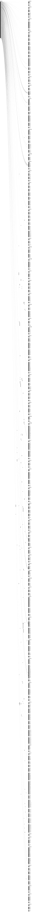
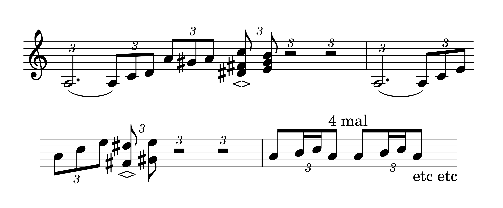

# Culture and Value

1914–1951, 593 remarks, Ms-101, Ms-106, Ms-105, Ms-107, and 53 more

### [Ms-101](/ms-101/#7r.2) [7r\[2\]](https://cdn.wittgensteinnachlass.com/2000px/webp/Ms-101/7r.webp)

21.08.1914

The lieutenant & I have often talked about all sorts of things already; a very nice person. He can deal with the greatest scoundrels & be friendly without lowering himself. When we hear a Chinese man, we are inclined to take his speech for inarticulate gurgling. Someone who understands Chinese will recognize the _language_ in it. In the same way I often cannot recognize the _human being_ in a human being etc.. Worked a little but without success.

---

### [Ms-106](/ms-106/#58.4+60.1) [58\[4\]](https://cdn.wittgensteinnachlass.com/2000px/webp/Ms-106/58.webp),[60\[1\]](https://cdn.wittgensteinnachlass.com/2000px/webp/Ms-106/60.webp)

In no religious denomination has there been so much sinning through the misuse of metaphorical expressions as in mathematics.

### [Ms-106](/ms-106/#247.5) [247\[5\]](https://cdn.wittgensteinnachlass.com/2000px/webp/Ms-106/247.webp)

It is in the nature of the human gaze that it can make things precious, though they then become more expensive too.

### [Ms-105](/ms-105/#46.2) [46\[2\]](https://cdn.wittgensteinnachlass.com/2000px/webp/Ms-105/46.webp)

My way of philosophizing is still new to me, & new to me again and again, & that is why I must repeat myself so often. For another generation it will have become second nature & they will find the repetitions boring. For me they are necessary. – This method is essentially the transition from the question of _truth_ to the question of _sense_.

### [Ms-105](/ms-105/#67.7) [67\[7\]](https://cdn.wittgensteinnachlass.com/2000px/webp/Ms-105/67.webp)

It is good that I do not let myself be influenced!

### [Ms-105](/ms-105/#73.6) [73\[6\]](https://cdn.wittgensteinnachlass.com/2000px/webp/Ms-105/73.webp)

A good simile refreshes the understanding.

### [Ms-105](/ms-105/#85.2) [85\[2\]](https://cdn.wittgensteinnachlass.com/2000px/webp/Ms-105/85.webp)

It is difficult to describe a route to a short-sighted person. Because one cannot say to him “look at the church tower there 10 miles away from us and go in that direction.”

### [Ms-107](/ms-107/#70.4) [70\[4\]](https://cdn.wittgensteinnachlass.com/2000px/webp/Ms-107/70.webp)

Just let nature speak & acknowledge only _one_ thing higher than nature, but not what the others might think.

### [Ms-107](/ms-107/#72.2) [72\[2\]](https://cdn.wittgensteinnachlass.com/2000px/webp/Ms-107/72.webp)

The tragedy consists in the tree not bending but breaking. Tragedy is something un-Jewish. Mendelssohn is probably the least tragic composer. The tragic holding fast, the defiant holding fast to a tragic situation in love, always seems to me quite alien to my ideal. Is my ideal feeble for that reason? I cannot _& ought not to judge it_. If it is feeble, it is bad. I believe that at bottom I have a gentle & quiet ideal. But God preserve my ideal from weakness & sentimentality!

### [Ms-107](/ms-107/#82.6) [82\[6\]](https://cdn.wittgensteinnachlass.com/2000px/webp/Ms-107/82.webp)

(A new word is like a fresh seed cast into the soil of the discussion.)

### [Ms-107](/ms-107/#82.8) [82\[8\]](https://cdn.wittgensteinnachlass.com/2000px/webp/Ms-107/82.webp)

Every morning one has to work one’s way through the dead rubble again to get to the living, warm core.

### [Ms-107](/ms-107/#97.8) [97\[8\]](https://cdn.wittgensteinnachlass.com/2000px/webp/Ms-107/97.webp)

With a full philosophical rucksack I can climb the mountain of mathematics only slowly.

### [Ms-107](/ms-107/#98.8) [98\[8\]](https://cdn.wittgensteinnachlass.com/2000px/webp/Ms-107/98.webp)

Mendelssohn is not a peak but a plateau. What is English about him.

### [Ms-107](/ms-107/#100.2) [100\[2\]](https://cdn.wittgensteinnachlass.com/2000px/webp/Ms-107/100.webp)

No one can think a thought for me, just as no one but me can put my hat on my head.

### [Ms-107](/ms-107/#116.3) [116\[3\]](https://cdn.wittgensteinnachlass.com/2000px/webp/Ms-107/116.webp)

Whoever hears a child scream and listens with understanding will know that there are forces of the mind slumbering in the child other than those one usually supposes, dreadful ones. Deep rage & pain & a lust for destruction.

### [Ms-107](/ms-107/#120.5) [120\[5\]](https://cdn.wittgensteinnachlass.com/2000px/webp/Ms-107/120.webp)

Mendelssohn is like someone who is cheerful only when everything is cheerful anyway, or good when everyone around him is good, & not really like a tree that stands firm as it stands, whatever may go on around it. I am rather like that myself & tend to be so.

### [Ms-107](/ms-107/#130.6) [130\[6\]](https://cdn.wittgensteinnachlass.com/2000px/webp/Ms-107/130.webp)

My ideal is a certain coolness. A temple that serves as a setting for the passions without interfering with them.

### [Ms-107](/ms-107/#156.9+157.1) [156\[9\]](https://cdn.wittgensteinnachlass.com/2000px/webp/Ms-107/156.webp),[157\[1\]](https://cdn.wittgensteinnachlass.com/2000px/webp/Ms-107/157.webp)

10.10.1929

I often wonder whether my cultural ideal is a new one, i.e. one in keeping with the times, or one from Schumann’s time. At the very least it seems to me to be a continuation of that ideal, though not the continuation it actually had at the time. Thus excluding the second half of the 19th century. I must say that it came to be this way purely by instinct & not as a result of reflection.

### [Ms-107](/ms-107/#176.5) [176\[5\]](https://cdn.wittgensteinnachlass.com/2000px/webp/Ms-107/176.webp)

24.10.1929

When we think of the future of the world, we always mean the place where it will be if it goes on moving as we now see it move, and do not take into account that it is moving not in a straight line but in a curve & that its direction is constantly changing.

### [Ms-107](/ms-107/#184.4+185.1) [184\[4\]](https://cdn.wittgensteinnachlass.com/2000px/webp/Ms-107/184.webp),[185\[1\]](https://cdn.wittgensteinnachlass.com/2000px/webp/Ms-107/185.webp)

I believe that what is good in things Austrian (Grillparzer, Lenau, Bruckner, Labor) is particularly difficult to understand. In a certain sense it is _subtler_ than everything else, and its truth is never on the side of probability.

### [Ms-107](/ms-107/#192.5) [192\[5\]](https://cdn.wittgensteinnachlass.com/2000px/webp/Ms-107/192.webp)

If something is good, then it is also divine. Curiously, that sums up my ethics.

### [Ms-107](/ms-107/#192.6) [192\[6\]](https://cdn.wittgensteinnachlass.com/2000px/webp/Ms-107/192.webp)

Only the supernatural can express the supernatural.

### [Ms-107](/ms-107/#196.4) [196\[4\]](https://cdn.wittgensteinnachlass.com/2000px/webp/Ms-107/196.webp)

One cannot lead people to the good; one can only lead them somewhere; the good lies outside the space of facts.

### [Ms-107](/ms-107/#229.4+230.1) [229\[4\]](https://cdn.wittgensteinnachlass.com/2000px/webp/Ms-107/229.webp),[230\[1\]](https://cdn.wittgensteinnachlass.com/2000px/webp/Ms-107/230.webp)

I said the other day to Arvid, with whom I had seen an ancient film at the cinema: A film of today stands to the old one as a motor car of today stands to one from 25 years ago. The old film looks just as ridiculous & clumsy as the old car, & the improvement in film corresponds to a technical improvement like that in the motor car. It does not correspond to the improvement – if one may call it that – of an artistic style. It would have to be much the same in modern dance music. It would have to be possible to improve a jazz dance as one improves a film. What distinguishes all this development from the emergence of a _style_ is that the spirit plays no part in it.

### [Ms-107](/ms-107/#230.2) [230\[2\]](https://cdn.wittgensteinnachlass.com/2000px/webp/Ms-107/230.webp)

11.01.1930

The difference today between a good & a bad architect is that the latter yields to every temptation while the good one resists it.

### [Ms-107](/ms-107/#230.3) [230\[3\]](https://cdn.wittgensteinnachlass.com/2000px/webp/Ms-107/230.webp)

I once said, & perhaps rightly: The old culture will become a heap of rubble & in the end a heap of ashes; but spirits will hover over the ashes.

### [Ms-107](/ms-107/#242.2) [242\[2\]](https://cdn.wittgensteinnachlass.com/2000px/webp/Ms-107/242.webp)

16.01.1930

One wants to stuff the gaps in the organism of the work of art with straw, but to ease one’s conscience one takes the _best_ straw.

### [Ms-108](/ms-108/#207.2) [207\[2\]](https://cdn.wittgensteinnachlass.com/2000px/webp/Ms-108/207.webp)

If someone believes he has found the solution to the problem of life & wanted to say to himself that now everything is quite easy, to refute himself he need only tell himself that there was a time when this “solution” had not been found; but even at _that_ time one had to be able to live, & in the light of that time the solution he has found seems like a mere accident. And so it is with us in logic. If there were a “solution to the logical (philosophical) problems”, we would only have to remind ourselves that they were once unsolved (and even then one had to be able to live & think) – – –

### [Ms-109](/ms-109/#28.2+29.1+30.1) [28\[2\]](https://cdn.wittgensteinnachlass.com/2000px/webp/Ms-109/28.webp),[29\[1\]](https://cdn.wittgensteinnachlass.com/2000px/webp/Ms-109/29.webp),[30\[1\]](https://cdn.wittgensteinnachlass.com/2000px/webp/Ms-109/30.webp)

22.08.1930

Engelmann told me that when he rummaged at home in his drawer full of his manuscripts, they seemed so wonderfully beautiful to him that he thought them worth giving to other people. (This was also the case, he said, when he looked through letters from his deceased relatives.) But if he imagined a selection of them published, the whole thing lost all charm & value & became impossible. I said we had here a case like the following: Nothing could be more remarkable than seeing someone engaged in some quite simple everyday activity when he thinks he is unobserved. Let us imagine a theatre: the curtain would go up & we would see someone alone in his room walking up & down, lighting a cigarette, sitting down, and so on, so that we would suddenly see someone from outside as one can otherwise never see oneself; if we saw, as it were, a chapter of a biography with our own eyes, – that would have to be uncanny & wonderful at once. More wonderful than anything a playwright could arrange to have enacted or spoken on the stage. We would see life itself. – But we see that every day & it does not make the slightest impression on us! Yes, but we do not see it from _that_ perspective. – Thus when E. looks at his writings & finds them splendid (though he would not want to publish them individually), he sees his life as a work of art by God, & as such it is indeed worth contemplating, as is every life & everything. But only the artist can represent the particular in such a way that it appears to us as a work of art; those manuscripts _rightly_ lose their value when one looks at them individually & indeed whenever one looks at them un*prejudicedly*, that is, without already being filled with enthusiasm. The work of art forces us – so to speak – into the right perspective, but without art the object is a piece of nature like any other & the fact that _we_ can exalt it through enthusiasm does not entitle anyone to set it before us. (I always have to think of one of those insipid photographs of nature which the person who took it finds interesting because he was there himself and experienced something, but which a third party regards with justified coldness; if it is justifiable at all to regard a thing with coldness. But it now seems to me that besides the artist’s work there is another way of capturing the world sub specie äterni. It is – I believe – the way of thought that flies, as it were, over the world & leaves it as it is, – contemplating it from above in flight.

### [Ms-109](/ms-109/#200.3+201.1) [200\[3\]](https://cdn.wittgensteinnachlass.com/2000px/webp/Ms-109/200.webp),[201\[1\]](https://cdn.wittgensteinnachlass.com/2000px/webp/Ms-109/201.webp)

05.11.1930

I read in Renan’s Peuple d'Israel: “La naissance, la maladie, la mort, le délire, la catalepsie, le sommeil, les rêves frappaient infiniment, et, même aujourd'hui, il n'est donné qu'à un petit nombre de voir clairement que ces phénomènes ont leurs causes dans notre organisation.” On the contrary, there is no reason at all to wonder at these things; for they are so commonplace. If primitive man _must_ wonder at them, how much more so the dog & the ape. Or does one assume that human beings, as it were, suddenly woke up & suddenly noticed these things that had always been there & were understandably astonished? – Yes, one might even assume something of the sort; but not that they perceived these things for the first time, rather that they suddenly began to wonder at them. But that in turn has nothing to do with their primitiveness. Unless one calls it primitive not to wonder at things; but then it is precisely people today who are primitive, & Renan himself, if he believes that scientific explanation can dispel wonder. As if lightning were more commonplace or less worthy of wonder today than it was 2000 years ago. A human being must wake up to wonder – and perhaps peoples must too. Science is a means of putting him back to sleep.

### [Ms-109](/ms-109/#201.2+202.1) [201\[2\]](https://cdn.wittgensteinnachlass.com/2000px/webp/Ms-109/201.webp),[202\[1\]](https://cdn.wittgensteinnachlass.com/2000px/webp/Ms-109/202.webp)

I.e. it is simply wrong to say: Of course, these primitive peoples _had_ to marvel at all phenomena. But perhaps it is right to say: these peoples _did_ marvel at everything around them. – That they had to marvel at such things is a primitive superstition. (Like the superstition that they _had_ to fear all the forces of nature & we, of course, need not fear them. But experience may teach us that certain primitive tribes are very prone to fear natural phenomena. Yet it is not out of the question that highly civilized peoples will once again be prone to that very fear & their civilization & scientific knowledge will not protect them from it. Admittedly, it is true that the _spirit_ in which science is pursued today is incompatible with such fear.)

### [Ms-109](/ms-109/#202.2) [202\[2\]](https://cdn.wittgensteinnachlass.com/2000px/webp/Ms-109/202.webp)

When Renan speaks of the bon sens précoce of the Semitic races (an idea I already had in mind a long time ago), what he is talking about is the _unpoetic_, what goes straight to the concrete. What characterizes my philosophy. Things lie there directly before our eyes, with no veil over them. – Here religion & art part ways.

### [Ms-109](/ms-109/#204.4+205.1+206.1) [204\[4\]](https://cdn.wittgensteinnachlass.com/2000px/webp/Ms-109/204.webp),[205\[1\]](https://cdn.wittgensteinnachlass.com/2000px/webp/Ms-109/205.webp),[206\[1\]](https://cdn.wittgensteinnachlass.com/2000px/webp/Ms-109/206.webp)

For a preface:

This book is written for those who are sympathetic to the spirit in which it is written. This spirit is, I believe, different from that of the great European & American civilization. The spirit of this civilization, whose expression is the industry, architecture, music, Fascism & Socialism of the present day, is a spirit alien and uncongenial to the author. This is not a value judgement. Not that I do not know that what passes for architecture today is not architecture, & not that he does not regard what is called modern music with the greatest mistrust without understanding its language, but the disappearance of the arts does not justify a dismissive judgement on humanity. For genuine & strong natures in precisely this age turn away from the domain of the arts & towards other things, & the worth of the individual finds expression somehow. Admittedly, not as in the age of a great culture. A culture is, as it were, a great organization which assigns everyone who belongs to it a place where they can work in the spirit of the whole, and their strength can with some justification be measured by their success in terms of the whole.

In an age without culture, however, energies are dissipated and the individual’s strength is used up by opposing forces & frictional resistances & finds expression not in the distance covered but perhaps only in the heat he generated in overcoming the frictional resistance. But energy remains energy & so even if the spectacle this age presents is not that of a great cultural work in the making, in which the best all work towards the same great goal, but the unimpressive spectacle of a crowd whose best pursue only private goals, we must not forget that it is not the spectacle that matters. So while it is clear to me that the disappearance of a culture does not mean the disappearance of human worth, but merely of certain means of expressing that worth, the fact remains that I watch the current of European civilization without sympathy, without understanding its goals, if it has any. I am really writing, then, for friends who are scattered in corners of the world.

### [Ms-109](/ms-109/#206.2) [206\[2\]](https://cdn.wittgensteinnachlass.com/2000px/webp/Ms-109/206.webp)

It makes no difference to me whether I am understood or appreciated by the typical Western scientist, since he does not understand the spirit in which I write anyway.

### [Ms-109](/ms-109/#207.1) [207\[1\]](https://cdn.wittgensteinnachlass.com/2000px/webp/Ms-109/207.webp)

Our civilization is characterized by the word progress. Progress is its form; its progressing is not one of its properties. It is typically constructive. Its activity is to construct an ever more complicated structure. And clarity, too, only serves this purpose in turn & is not an end in itself. For me, by contrast, clarity, transparency, is an end in itself. I am not interested in putting up a building but in having the foundations of possible buildings transparently before me. My aim, then, is different from that of scientists & my movement of thought differs from theirs.

### [Ms-109](/ms-109/#207.2) [207\[2\]](https://cdn.wittgensteinnachlass.com/2000px/webp/Ms-109/207.webp)

Every sentence I write already means the whole, and thus always the same thing, & these are, as it were, only views of an object seen from different angles.

### [Ms-109](/ms-109/#207.3+208.1) [207\[3\]](https://cdn.wittgensteinnachlass.com/2000px/webp/Ms-109/207.webp),[208\[1\]](https://cdn.wittgensteinnachlass.com/2000px/webp/Ms-109/208.webp)

I could say: If the place I want to reach could only be climbed to on a ladder, I would give up trying to get there. For where I really must go, there I must actually already be. What can be reached on a ladder does not interest me.

### [Ms-109](/ms-109/#208.2) [208\[2\]](https://cdn.wittgensteinnachlass.com/2000px/webp/Ms-109/208.webp)

The one movement puts one thought after another, the other always aims at the same place.

### [Ms-109](/ms-109/#208.3) [208\[3\]](https://cdn.wittgensteinnachlass.com/2000px/webp/Ms-109/208.webp)

The one movement builds & takes up (in its hand) stone after stone, the other reaches again and again for the same thing.

### [Ms-109](/ms-109/#208.4+209.1) [208\[4\]](https://cdn.wittgensteinnachlass.com/2000px/webp/Ms-109/208.webp),[209\[1\]](https://cdn.wittgensteinnachlass.com/2000px/webp/Ms-109/209.webp)

07.11.1930

The danger of a long preface is that the spirit of a book must show itself in the book & cannot be described. For if a book is written only for a few, this will show itself precisely in the fact that only a few understand it. The book must automatically separate those who understand it from those who do not. The preface, too, is written precisely for those who understand the book. There is no sense in saying something to someone that they do not understand, even if one adds that they cannot understand it. (This happens so often with someone one loves.) If you do not want certain people to go into a room, put a lock on it for which they have no key. But it is senseless to talk to them about it, unless after all you want them to admire the room from outside! The decent thing is to put a lock on the door that attracts only those who can open it & does not catch the attention of the others. But it is right to say that in my opinion the book has nothing to do with advancing European & American civilization. That this civilization may be the necessary surroundings of this spirit but that they have different aims. Everything ritualistic (as it were, high-priestly) is to be strictly avoided because it immediately rots. A kiss, admittedly, is also a rite & it does not rot; but only as much ritual is allowed as is as genuine as a kiss.

### [Ms-109](/ms-109/#209.2) [209\[2\]](https://cdn.wittgensteinnachlass.com/2000px/webp/Ms-109/209.webp)

There is a great temptation to want to make the spirit explicit.

### [Ms-109](/ms-109/#212.3) [212\[3\]](https://cdn.wittgensteinnachlass.com/2000px/webp/Ms-109/212.webp)

Where one comes up against the limits of one’s own decency, there arises, as it were, a whirl of thoughts (&) an endless regress: one may _say_ what one likes, it takes one no further.

### [Ms-110](/ms-110/#5.7+6.1) [5\[7\]](https://cdn.wittgensteinnachlass.com/2000px/webp/Ms-110/5.webp),[6\[1\]](https://cdn.wittgensteinnachlass.com/2000px/webp/Ms-110/6.webp)

I read in Lessing: (on the Bible) “Add to this the form in which it is clothed and the style ……, full throughout of tautologies, but of such as exercise the acuteness of the mind, now seeming to say something different and yet saying the very same thing, now seeming to say the very same thing and at bottom meaning, or being capable of meaning, something different: …”

### [Ms-110](/ms-110/#10.2) [10\[2\]](https://cdn.wittgensteinnachlass.com/2000px/webp/Ms-110/10.webp)

If I do not quite know how to begin a book, it is because something is still unclear. For I should like to begin with what is given to philosophy, the written & spoken sentences, the books as it were. And here one encounters the difficulty of “Everything flows”. And perhaps that is where one has to begin in the first place.

### [Ms-110](/ms-110/#11.5) [11\[5\]](https://cdn.wittgensteinnachlass.com/2000px/webp/Ms-110/11.webp)

25.12.1930

If one is merely ahead of one’s time, it will catch up with one some day.

### [Ms-110](/ms-110/#12.4) [12\[4\]](https://cdn.wittgensteinnachlass.com/2000px/webp/Ms-110/12.webp)

12.01.1931

Music seems to some to be a primitive art, with its few notes & rhythms. But only its surface is simple, while the body that makes the interpretation of this manifest content possible possesses all the infinite complexity that we find hinted at in the outward appearance of the other arts & that music leaves unspoken. In a certain sense it is the most sophisticated of all the arts.

### [Ms-110](/ms-110/#12.5+13.1) [12\[5\]](https://cdn.wittgensteinnachlass.com/2000px/webp/Ms-110/12.webp),[13\[1\]](https://cdn.wittgensteinnachlass.com/2000px/webp/Ms-110/13.webp)

16.01.1931

There are problems I will never reach, which do not lie in my line or in my world. Problems in the world of Western thought that Beethoven (& perhaps in part Goethe) reached & that he wrestled with, but that no philosopher ever tackled (perhaps Nietzsche passed by them). And perhaps they are lost to Western philosophy, i.e. there will be no one who experiences the course of this culture as an epic, and so can describe it. Or rather, it simply is no longer an epic, or at any rate is one only for someone who looks at it from outside & perhaps Beethoven did this by looking ahead (as Spengler once suggests). One could say that a civilization must have its epic poet in advance. Just as one can only foresee one’s own death and describe it in anticipation, not report on it as a contemporary. So one could say: If you want to see the epic of a whole culture written, you must look for it among the works of that culture’s greatest figures, thus at a time when the end of that culture could only have been *fore*seen, for later there is no one left to describe it. And so it is no wonder if it is written only in the obscure language of foresight & intelligible to very few.

### [Ms-110](/ms-110/#13.2+14.1) [13\[2\]](https://cdn.wittgensteinnachlass.com/2000px/webp/Ms-110/13.webp),[14\[1\]](https://cdn.wittgensteinnachlass.com/2000px/webp/Ms-110/14.webp)

But I never get to these problems at all. When I “have done with the world”, I will have created an amorphous (transparent) mass & the world with all its multiplicity is left to one side like an uninteresting junk room. Or perhaps more accurately: the whole result of the whole work is the leaving-aside of the world. (The throwing of the whole world into the junk room.)

### [Ms-110](/ms-110/#14.2) [14\[2\]](https://cdn.wittgensteinnachlass.com/2000px/webp/Ms-110/14.webp)

There is nothing tragic in this world (mine) & hence none of all that is infinite which brings forth the tragic (as a result). Everything is soluble in ether, so to speak; there are no hard points. That is to say, harshness and conflict become not something glorious but a _fault_.

### [Ms-110](/ms-110/#14.3) [14\[3\]](https://cdn.wittgensteinnachlass.com/2000px/webp/Ms-110/14.webp)

The conflict is resolved rather as the tension in a spring in a mechanism disappears when one melts the mechanism (or dissolves it in nitric acid). In this solution there are no tensions left.

### [Ms-110](/ms-110/#18.3) [18\[3\]](https://cdn.wittgensteinnachlass.com/2000px/webp/Ms-110/18.webp)

If I say that my book is intended only for a small circle of people (if one can call that a circle), I do not mean that in my view this circle is the élite of humanity, but it is the circle I address (not because they are better or worse than the others, but) because they are my cultural circle, as it were the people of my homeland, in contrast to the others, who are _foreign_ to me.

### [Ms-110](/ms-110/#61.2) [61\[2\]](https://cdn.wittgensteinnachlass.com/2000px/webp/Ms-110/61.webp)

The limit of language shows itself in the impossibility of describing the fact that corresponds to a sentence (is its translation) without simply repeating the sentence.

### [Ms-110](/ms-110/#61.3) [61\[3\]](https://cdn.wittgensteinnachlass.com/2000px/webp/Ms-110/61.webp)

(We are dealing here with Kant’s solution to the problem of philosophy.)

### [Ms-110](/ms-110/#67.1) [67\[1\]](https://cdn.wittgensteinnachlass.com/2000px/webp/Ms-110/67.webp)

Can I say that the play has its own time, which is not a segment of historical time? I.e. I can speak of earlier and later in it, but the question whether the events occurred, say, before or after Caesar’s death makes _no sense_.

### [Ms-153a](/ms-153a/#4v.2) [4v\[2\]](https://cdn.wittgensteinnachlass.com/2000px/webp/Ms-153a/4v.webp)

10.05.1931

[The lovely difference in temperature between the parts of a human body.]

### [Ms-153a](/ms-153a/#12v.1) [12v\[1\]](https://cdn.wittgensteinnachlass.com/2000px/webp/Ms-153a/12v.webp)

[It is shameful to have to show oneself as an empty tube that is merely inflated by the spirit.]

### [Ms-153a](/ms-153a/#18v.1) [18v\[1\]](https://cdn.wittgensteinnachlass.com/2000px/webp/Ms-153a/18v.webp)

[No one likes to have hurt the other; that is why it feels so good to everyone when the other does not show himself hurt. No one likes to have an offended sausage before him. Remember that. It is much easier to get out of the way of the offender patiently – & tolerantly – than to approach him in a friendly manner. That too requires courage.]

### [Ms-153a](/ms-153a/#29v.4+30r.1) [29v\[4\]](https://cdn.wittgensteinnachlass.com/2000px/webp/Ms-153a/29v.webp),[30r\[1\]](https://cdn.wittgensteinnachlass.com/2000px/webp/Ms-153a/30r.webp)

[Being good to someone who does not like you requires not only a great deal of good nature but also a great deal of _tact_.]

### [Ms-153a](/ms-153a/#35r.1) [35r\[1\]](https://cdn.wittgensteinnachlass.com/2000px/webp/Ms-153a/35r.webp)

We are struggling with language.

### [Ms-153a](/ms-153a/#35r.2) [35r\[2\]](https://cdn.wittgensteinnachlass.com/2000px/webp/Ms-153a/35r.webp)

We are struggling with language.

### [Ms-153a](/ms-153a/#35v.2+36r.1) [35v\[2\]](https://cdn.wittgensteinnachlass.com/2000px/webp/Ms-153a/35v.webp),[36r\[1\]](https://cdn.wittgensteinnachlass.com/2000px/webp/Ms-153a/36r.webp)

The solution of philosophical problems compared with the gift in the fairy tale which appears magically in the enchanted castle and, when viewed outside in daylight, is nothing but an ordinary piece of iron (or the like).

### [Ms-153a](/ms-153a/#90v.2) [90v\[2\]](https://cdn.wittgensteinnachlass.com/2000px/webp/Ms-153a/90v.webp)

The thinker is very like the draughtsman. Who wants to draw all the connections as they are.

### [Ms-153a](/ms-153a/#127v.2+128r.1) [127v\[2\]](https://cdn.wittgensteinnachlass.com/2000px/webp/Ms-153a/127v.webp),[128r\[1\]](https://cdn.wittgensteinnachlass.com/2000px/webp/Ms-153a/128r.webp)

Compositions composed at the piano, on the piano, those composed thinking with the pen & those composed with the inner ear alone must be quite different in kind & make an impression of quite different kinds. I am firmly convinced that Bruckner composed only with the inner ear & an image of the orchestra playing, Brahms with the pen. This is of course represented more simply than it is. But _one_ characteristic is thereby captured.

### [Ms-153a](/ms-153a/#128v.1) [128v\[1\]](https://cdn.wittgensteinnachlass.com/2000px/webp/Ms-153a/128v.webp)

A tragedy could always begin with the words: “Nothing at all would have happened if ….”

### [Ms-153a](/ms-153a/#128v.2) [128v\[2\]](https://cdn.wittgensteinnachlass.com/2000px/webp/Ms-153a/128v.webp)

(If he had not got a corner of his coat caught in the machine?)

### [Ms-153a](/ms-153a/#128v.3) [128v\[3\]](https://cdn.wittgensteinnachlass.com/2000px/webp/Ms-153a/128v.webp)

But is this not a one-sided view of tragedy which only allows it to show that an encounter can decide our whole life.

### [Ms-153a](/ms-153a/#129r.1+129v.1) [129r\[1\]](https://cdn.wittgensteinnachlass.com/2000px/webp/Ms-153a/129r.webp),[129v\[1\]](https://cdn.wittgensteinnachlass.com/2000px/webp/Ms-153a/129v.webp)

I believe that today there could be a theatre in which masks were used. The figures would simply be stylized human beings. This can be seen clearly in Kraus’s writings. His plays could, or ought to, be performed in masks. This naturally corresponds to a certain abstractness of these products. And masked theatre, as I understand it, is in general the expression of a spiritualistic character. Perhaps, therefore, only the Jews will be inclined towards this theatre.

### [Ms-153a](/ms-153a/#137r.3+137v.1) [137r\[3\]](https://cdn.wittgensteinnachlass.com/2000px/webp/Ms-153a/137r.webp),[137v\[1\]](https://cdn.wittgensteinnachlass.com/2000px/webp/Ms-153a/137v.webp)

Frida Schanz:

Foggy day. The grey autumn goes about.

Laughter seems corrupted;

the world lies so silent today,

as if it had died at night. In the golden-red hedge

the fog dragons brew;

and the day lies slumbering.

The day does not want to wake.

─────── ∙ ───────

### [Ms-153a](/ms-153a/#138r.2+138v.1) [138r\[2\]](https://cdn.wittgensteinnachlass.com/2000px/webp/Ms-153a/138r.webp),[138v\[1\]](https://cdn.wittgensteinnachlass.com/2000px/webp/Ms-153a/138v.webp)

I took the poem on the previous page from a “knight’s tour”, where naturally the punctuation was missing. I therefore do not know, for example, whether the word “Foggy day” is the title, or whether it belongs to the first line, as I have written it. And it is remarkable how trivial the poem sounds when it begins not with the word “Foggy day” but with “The grey”. The rhythm of the _whole_ poem changes as a result.

### [Ms-153a](/ms-153a/#141r.2) [141r\[2\]](https://cdn.wittgensteinnachlass.com/2000px/webp/Ms-153a/141r.webp)

What you have achieved cannot mean more to others than to yourself.

### [Ms-153a](/ms-153a/#141r.3) [141r\[3\]](https://cdn.wittgensteinnachlass.com/2000px/webp/Ms-153a/141r.webp)

As much as it has cost you, so much will they pay.

### [Ms-153a](/ms-153a/#160v.3) [160v\[3\]](https://cdn.wittgensteinnachlass.com/2000px/webp/Ms-153a/160v.webp)

(The Jew is a barren region beneath whose thin crust, however, lie the fiery-liquid masses of the spiritual.)

### [Ms-153b](/ms-153b/#3r.1) [3r\[1\]](https://cdn.wittgensteinnachlass.com/2000px/webp/Ms-153b/3r.webp)

Grillparzer: “How easily one moves in what is great & distant, how difficult it is to grasp what is near & individual ….”

### [Ms-153b](/ms-153b/#29r.1-relocated) [29r\[1\]-relocated](https://cdn.wittgensteinnachlass.com/2000px/webp/Ms-153b/29r.webp)

What feeling would we have if we had not heard of Christ? Would we have the feeling of darkness & abandonment? Do we lack it only in the sense in which a child lacks it when it knows that someone is in the room with it? Religious madness is madness arising from irreligiousness.

### [Ms-153b](/ms-153b/#39v.1) [39v\[1\]](https://cdn.wittgensteinnachlass.com/2000px/webp/Ms-153b/39v.webp)

I look at photographs of Corsican bandits and think to myself: the faces are too hard & mine too soft for Christianity to be written on them. The faces of the bandits are horrible to look at & yet they are surely no further removed from a good life & merely lie on another side of it than I do.

---

### [Ms-154](/ms-154/#1r.1) [1r\[1\]](https://cdn.wittgensteinnachlass.com/2000px/webp/Ms-154/1r.webp)

A confession must be part of the new life.

### [Ms-154](/ms-154/#1v.1) [1v\[1\]](https://cdn.wittgensteinnachlass.com/2000px/webp/Ms-154/1v.webp)

I always express what I want to express only “with half success”. Indeed, not even that, but perhaps only with a tenth. That surely means something. My writing is often only “stammering”.

### [Ms-154](/ms-154/#15v.2) [15v\[2\]](https://cdn.wittgensteinnachlass.com/2000px/webp/Ms-154/15v.webp)

The Jewish “genius” is only a saint. The greatest Jewish thinker is only a talent. (I, for example.)

### [Ms-154](/ms-154/#15v.3+16r.1) [15v\[3\]](https://cdn.wittgensteinnachlass.com/2000px/webp/Ms-154/15v.webp),[16r\[1\]](https://cdn.wittgensteinnachlass.com/2000px/webp/Ms-154/16r.webp)

There is, I believe, some truth in thinking that in my thinking I am really only reproductive. I believe I have never _invented_ a movement of thought but that it was always given to me by someone else & I merely took it up at once, passionately, for my work of clarification. Thus Boltzmann, Hertz, Schopenhauer, Frege, Russell, Kraus, Loos, Weininger, Spengler, Sraffa influenced me. Can Breuer & Freud be cited as an example of Jewish reproductivity? – What I invent are new _similes_.

### [Ms-154](/ms-154/#16r.2+16v.1) [16r\[2\]](https://cdn.wittgensteinnachlass.com/2000px/webp/Ms-154/16r.webp),[16v\[1\]](https://cdn.wittgensteinnachlass.com/2000px/webp/Ms-154/16v.webp)

When at one time I modelled the head for Drobil, the inspiration too was essentially a work of Drobil’s & my work was really once again that of clarification. I believe the essential thing is that the activity of clarification must be pursued with _courage_: if that is lacking it becomes merely a clever game.

### [Ms-154](/ms-154/#16v.2) [16v\[2\]](https://cdn.wittgensteinnachlass.com/2000px/webp/Ms-154/16v.webp)

The Jew must in the proper sense “stake his all on nothing”. But that is especially difficult for him, because, so to speak, he has nothing. It is much harder to be voluntarily poor when one _has_ to be poor than when one could also be rich.

### [Ms-154](/ms-154/#16v.3+17r.1+17v.1) [16v\[3\]](https://cdn.wittgensteinnachlass.com/2000px/webp/Ms-154/16v.webp),[17r\[1\]](https://cdn.wittgensteinnachlass.com/2000px/webp/Ms-154/17r.webp),[17v\[1\]](https://cdn.wittgensteinnachlass.com/2000px/webp/Ms-154/17v.webp)

One might say (whether it is true or not) that the Jewish spirit is incapable of producing even a blade of grass or a flower, but that it is its way to copy the blade of grass or the flower that has grown in another spirit & thereby to create a comprehensive picture. This is not an admission of a vice & everything is in order so long as this remains completely clear. It becomes dangerous only when the manner of the Jewish work is confused with that of the non-Jewish work & especially when the creator of the former does this himself, which is very tempting. (“Doesn’t he look so proud as if he himself had milked it?”) It is typical of the Jewish spirit to understand another’s work better than he himself understands it.

### [Ms-154](/ms-154/#17v.2+18r.1+18v.1) [17v\[2\]](https://cdn.wittgensteinnachlass.com/2000px/webp/Ms-154/17v.webp),[18r\[1\]](https://cdn.wittgensteinnachlass.com/2000px/webp/Ms-154/18r.webp),[18v\[1\]](https://cdn.wittgensteinnachlass.com/2000px/webp/Ms-154/18v.webp)

I have often caught myself being so proud, when I had had a picture correctly framed or hung in the right surroundings, as if I had painted the picture. That is not really right; not “as proud as if I had painted it” but as proud as if I had helped to paint it, as if, so to speak, I had painted a small part of it. It is as if the extraordinary arranger of grasses should at the end think that he had himself produced at least one tiny little blade of grass. Whereas he must be clear that his work lies in an entirely different field.

The process of the formation even of the tiniest & shabbiest blade of grass is entirely foreign & unknown to him.

### [Ms-154](/ms-154/#18v.2+19r.1) [18v\[2\]](https://cdn.wittgensteinnachlass.com/2000px/webp/Ms-154/18v.webp),[19r\[1\]](https://cdn.wittgensteinnachlass.com/2000px/webp/Ms-154/19r.webp)

The most exact picture of an entire apple tree has in a certain sense infinitely less likeness to it than the smallest daisy has to the tree. And in this sense a Bruckner symphony is infinitely more closely related to a symphony of the heroic age than a Mahler one is. If the latter is a work of art, then it is one of an _entirely_ different kind. (This consideration itself, however, is really Spenglerian.)

### [Ms-154](/ms-154/#19r.2) [19r\[2\]](https://cdn.wittgensteinnachlass.com/2000px/webp/Ms-154/19r.webp)

When I was in Norway, incidentally, in 1913–14, I had thoughts of my own, or so it seems to me now at least. I mean, it seems to me as if I gave birth to new movements of thought within myself then (But perhaps I am mistaken). Whereas now I seem only to apply old ones.

### [Ms-154](/ms-154/#20v.3) [20v\[3\]](https://cdn.wittgensteinnachlass.com/2000px/webp/Ms-154/20v.webp)

Rousseau has something Jewish in his nature.

### [Ms-154](/ms-154/#21v.3+22r.1) [21v\[3\]](https://cdn.wittgensteinnachlass.com/2000px/webp/Ms-154/21v.webp),[22r\[1\]](https://cdn.wittgensteinnachlass.com/2000px/webp/Ms-154/22r.webp)

When it is sometimes said that philosophy (of a person) is a matter of temperament, there is also some truth in that. The preference for certain similes is what is called a matter of temperament & far more oppositions rest on it than perhaps initially appears.

### [Ms-154](/ms-154/#20r.2) [20r\[2\]](https://cdn.wittgensteinnachlass.com/2000px/webp/Ms-154/20r.webp)

“Regard this wart as a proper member of your body!” Can one do that, on command?

### [Ms-154](/ms-154/#22v.1+23r.1+23v.1) [22v\[1\]](https://cdn.wittgensteinnachlass.com/2000px/webp/Ms-154/22v.webp),[23r\[1\]](https://cdn.wittgensteinnachlass.com/2000px/webp/Ms-154/23r.webp),[23v\[1\]](https://cdn.wittgensteinnachlass.com/2000px/webp/Ms-154/23v.webp)

Is it in my power arbitrarily to have or not to have an ideal of my body? The history of the Jews is not treated in the history of the European peoples with the detail that their intervention in European events really deserved, because they are felt in this history to be a kind of illness, anomaly, & no one likes to place an illness, so to speak, on the same level as normal life. One can say: this swelling can be regarded as a member of the body only if the whole feeling for the body changes (if the whole national feeling for the body changes). Otherwise one can at most _tolerate_ it.

One can expect such tolerance from an individual person, or that he will rise above these things; but not from the nation, which is a nation precisely because it does not rise above them. That is, it is a contradiction to expect someone to retain the old aesthetic feeling for his body _&_ welcome the swelling.

### [Ms-154](/ms-154/#23v.2+24r.1) [23v\[2\]](https://cdn.wittgensteinnachlass.com/2000px/webp/Ms-154/23v.webp),[24r\[1\]](https://cdn.wittgensteinnachlass.com/2000px/webp/Ms-154/24r.webp)

Power & possession are not _the same_. Although possession also gives us power. If one says that the Jews have no sense of possession, that is presumably compatible with their liking to be rich; for money is for them a particular kind of power, not possession. (For example, I would not like my people to become poor, for I wish them a certain power. Indeed also that they should use this power properly.)

### [Ms-154](/ms-154/#23r.2+24v.1) [23r\[2\]](https://cdn.wittgensteinnachlass.com/2000px/webp/Ms-154/23r.webp),[24v\[1\]](https://cdn.wittgensteinnachlass.com/2000px/webp/Ms-154/24v.webp)

There is definitely a certain affinity between Brahms & Mendelssohn; & by this I do not mean the one that shows itself in individual passages in Brahms’s works that recall passages by Mendelssohn, but one could express the affinity I am talking about by saying that Brahms does with complete strictness what Mendelssohn did with half. Or: Brahms is often Mendelssohn without faults.

### [Ms-154](/ms-154/#25r.1) [25r\[1\]](https://cdn.wittgensteinnachlass.com/2000px/webp/Ms-154/25r.webp)

Passionately

That would be the end of a theme that I do not know. It occurred to me today as I was thinking about my work in philosophy & said to myself: “I destroy, I destroy, I destroy –”

### [Ms-154](/ms-154/#25v.2+26r.1) [25v\[2\]](https://cdn.wittgensteinnachlass.com/2000px/webp/Ms-154/25v.webp),[26r\[1\]](https://cdn.wittgensteinnachlass.com/2000px/webp/Ms-154/26r.webp)

It has sometimes been said that the secrecy & furtiveness of the Jews was brought about by the long persecution. This is certainly untrue; on the other hand, it is certain that, despite this persecution, they still exist only because they have a tendency towards this secrecy. As one might say that such-and-such an animal has not yet been exterminated only because it has the possibility or ability to hide itself. I do not of course mean that one should praise this possibility on that account, not at all.

### [Ms-154](/ms-154/#26r.2+26v.1) [26r\[2\]](https://cdn.wittgensteinnachlass.com/2000px/webp/Ms-154/26r.webp),[26v\[1\]](https://cdn.wittgensteinnachlass.com/2000px/webp/Ms-154/26v.webp)

Bruckner’s music no longer has anything of the long & narrow (northern?) face of Nestroy, Grillparzer, Haydn etc., but has altogether a round, full (Alpine?) face, of an even less mixed type than Schubert’s was.

### [Ms-154](/ms-154/#26v.2+27r.1) [26v\[2\]](https://cdn.wittgensteinnachlass.com/2000px/webp/Ms-154/26v.webp),[27r\[1\]](https://cdn.wittgensteinnachlass.com/2000px/webp/Ms-154/27r.webp)

The levelling power of language, which shows itself most starkly in the _dictionary_ & made it possible for _time_ to be personified, which is no less curious than it would be if we had deities of the logical constants.

### [Ms-155](/ms-155/#29r.2+29v.1) [29r\[2\]](https://cdn.wittgensteinnachlass.com/2000px/webp/Ms-155/29r.webp),[29v\[1\]](https://cdn.wittgensteinnachlass.com/2000px/webp/Ms-155/29v.webp)

[A beautiful dress which turns into worms & snakes (as it were, coagulates) when the person wearing it makes himself look handsome in the mirror with self-satisfaction.]

### [Ms-155](/ms-155/#46r.2) [46r\[2\]](https://cdn.wittgensteinnachlass.com/2000px/webp/Ms-155/46r.webp)

<s>[The joy in my thoughts is the joy in my own strange life. Is that joy in life?]</s>

### [Ms-110](/ms-110/#200.3) [200\[3\]](https://cdn.wittgensteinnachlass.com/2000px/webp/Ms-110/200.webp)

Speaking in passing, in the old conception – say, that of the (great) Western philosophers – there were two kinds of problem in the scientific sense: essential, great, universal problems, & inessential, as it were accidental ones. Our conception, by contrast, is that there is no _great_, essential problem in the scientific sense.

### [Ms-110](/ms-110/#226.3) [226\[3\]](https://cdn.wittgensteinnachlass.com/2000px/webp/Ms-110/226.webp)

(Structure and feeling in music. Feelings accompany the apprehension of a piece of music as they accompany the events of life.)

### [Ms-110](/ms-110/#231.6) [231\[6\]](https://cdn.wittgensteinnachlass.com/2000px/webp/Ms-110/231.webp)

(Labor’s seriousness is a very late seriousness.)

### [Ms-110](/ms-110/#238.6) [238\[6\]](https://cdn.wittgensteinnachlass.com/2000px/webp/Ms-110/238.webp)

(Talent is a spring from which fresh water keeps flowing. But this spring becomes worthless if it is not used in the right way, that is.)

### [Ms-110](/ms-110/#257.5+258.1) [257\[5\]](https://cdn.wittgensteinnachlass.com/2000px/webp/Ms-110/257.webp),[258\[1\]](https://cdn.wittgensteinnachlass.com/2000px/webp/Ms-110/258.webp)

“What the wise man knows is hard to know.” Does Goethe’s contempt for experiment in the laboratory and his urging us to go out into nature & learn there, does this have to do with the thought that the hypothesis (wrongly understood) is already a falsification of the truth? And with the beginning I now have in mind for my book, which might consist in a description of nature?

### [Ms-110](/ms-110/#260.3) [260\[3\]](https://cdn.wittgensteinnachlass.com/2000px/webp/Ms-110/260.webp)

When people find a flower or an animal ugly, they are always under the impression that it is something artificial. “It looks like …”, they then say. That throws light on the meaning of the words “ugly” and “beautiful”.

### [Ms-111](/ms-111/#2.2) [2\[2\]](https://cdn.wittgensteinnachlass.com/2000px/webp/Ms-111/2.webp)

(Where Labor writes good music, he is absolutely unromantic. That is a very remarkable & significant sign.)

### [Ms-111](/ms-111/#55.3) [55\[3\]](https://cdn.wittgensteinnachlass.com/2000px/webp/Ms-111/55.webp)

(When one reads the Socratic dialogues, one has the feeling: what a dreadful waste of time! What is the point of these arguments that prove nothing & clarify nothing.)

### [Ms-111](/ms-111/#77.2) [77\[2\]](https://cdn.wittgensteinnachlass.com/2000px/webp/Ms-111/77.webp)

[The story of Peter Schlemihl should, it seems to me, go like this: He signs away his soul to the devil for money. Then he regrets it & now the devil demands his shadow as ransom. But Peter Schlemihl is left with the choice of giving his soul to the devil or giving up, along with his shadow, life in human society.]

### [Ms-111](/ms-111/#115.1) [115\[1\]](https://cdn.wittgensteinnachlass.com/2000px/webp/Ms-111/115.webp)

[In Christianity the good Lord says to human beings, as it were: Do not play at tragedy, that is, at heaven & hell on earth; _I_ have reserved heaven & hell for myself.]

### [Ms-111](/ms-111/#119.1+120.1) [119\[1\]](https://cdn.wittgensteinnachlass.com/2000px/webp/Ms-111/119.webp),[120\[1\]](https://cdn.wittgensteinnachlass.com/2000px/webp/Ms-111/120.webp)

(Thus Spengler might be better understood if he said: I _compare_ different cultural periods to the lives of families; within a family there is a family resemblance, while there is also a similarity between members of different families; the family resemblance differs from the other similarity in such-and-such a way, etc. What I mean is: the object of comparison, the object from which this way of looking at things is drawn, must be specified for us, so that injustices do not keep seeping into the discussion. For then everything that is true of the prototype of the inquiry is, nolens volens, also asserted of the object to which we apply the inquiry; & it is asserted that “it _must_, _always_ …”. Now this comes of wanting to give the features of the prototype a foothold in the inquiry. But since one conflates prototype & object, one has to ascribe dogmatically to the object what need only characterize the prototype. On the other hand, one thinks that the inquiry lacks the generality one wants to give it if it really holds only for the one case. But the prototype is precisely to be presented as such; so that it characterizes the whole inquiry, determines its form. It thus stands at the head and is generally valid because it determines the form of the inquiry, not because everything that holds only of it is asserted of all the objects of the inquiry. Thus, with all exaggerated, dogmatizing assertions one would always like to ask: What then is really true in this? Or again: In which case does this actually hold?)

### [Ms-111](/ms-111/#132.3) [132\[3\]](https://cdn.wittgensteinnachlass.com/2000px/webp/Ms-111/132.webp)

23.08.1931

(From Simplicissimus: Riddles of Engineering. (Picture: Two professors in front of a bridge under construction) Voice from above: “Lower it – – whoa – – lower it, I say – – then we’ll turn it round the other way!” – – – – “It really is incomprehensible, my dear colleague, that such complicated & precise work can be accomplished in this language”.)

### [Ms-111](/ms-111/#133.5+134.1) [133\[5\]](https://cdn.wittgensteinnachlass.com/2000px/webp/Ms-111/133.webp),[134\[1\]](https://cdn.wittgensteinnachlass.com/2000px/webp/Ms-111/134.webp)

24.08.1931

One hears the remark again and again that philosophy makes no real progress, that the same philosophical problems that already occupied the Greeks still occupy us. But those who say this don’t understand why it is so. The reason is that our language has stayed the same & keeps seducing us into asking the same questions. As long as there is a verb ‘to be’ that seems to function like ‘to eat’ & ‘to drink’, as long as there are adjectives ‘identical’, ‘true’, ‘false’, ‘possible’, as long as there is talk of a flow of time & an extension of space, etc., etc., people will keep coming up against the same enigmatic difficulties & staring at something that no explanation seems able to remove. And this, incidentally, satisfies a longing for the otherworldly, for in believing that they see the “limit of human understanding”, they naturally believe they can see beyond it.

### [Ms-111](/ms-111/#134.2) [134\[2\]](https://cdn.wittgensteinnachlass.com/2000px/webp/Ms-111/134.webp)

I read “… philosophers are no nearer to the meaning of ‘Reality’ than Plato got; …”. What an odd situation. How odd, then, that Plato could get as far as he did at all! Or that we could then get no further! Was it because Plato was _so_ clever?

### [Ms-111](/ms-111/#173.3) [173\[3\]](https://cdn.wittgensteinnachlass.com/2000px/webp/Ms-111/173.webp)

(Kleist once wrote that the poet would like nothing better than to be able to convey thoughts in themselves without words. (What a strange admission.))

### [Ms-111](/ms-111/#180.5) [180\[5\]](https://cdn.wittgensteinnachlass.com/2000px/webp/Ms-111/180.webp)

[It is often said that the new religion brands the gods of the old one as devils. But in reality they have by then probably already become devils.]

### [Ms-111](/ms-111/#194.5) [194\[5\]](https://cdn.wittgensteinnachlass.com/2000px/webp/Ms-111/194.webp)

[The works of the great masters are stars that rise & set around us. So the time will come again for every great work that has now set.]

### [Ms-111](/ms-111/#195.3) [195\[3\]](https://cdn.wittgensteinnachlass.com/2000px/webp/Ms-111/195.webp)

(Mendelssohn’s music, where it is perfect, consists of musical arabesques. That is why we find every lack of rigour in him painful.)

### [Ms-111](/ms-111/#195.4+196.1) [195\[4\]](https://cdn.wittgensteinnachlass.com/2000px/webp/Ms-111/195.webp),[196\[1\]](https://cdn.wittgensteinnachlass.com/2000px/webp/Ms-111/196.webp)

In Western civilization the Jew is always measured by standards that do not fit him. It is clear to many that the Greek thinkers were neither philosophers in the Western sense nor scientists in the Western sense, that the participants in the Olympic Games were not sportsmen & fit into no Western category. But so it is with the Jew too.

And because the words of our language appear to us to be the standards as such, we always do him an injustice. And he is now overestimated, now underestimated. Spengler is therefore right not to rank Weininger among the Western philosophers.

### [Ms-111](/ms-111/#196.2) [196\[2\]](https://cdn.wittgensteinnachlass.com/2000px/webp/Ms-111/196.webp)

Nothing one does can be defended conclusively. Only in relation to something else that has been fixed. I.e. no reason can be given why one should act _thus_ (or should have acted thus) other than one that says that this brings about a particular state of affairs, which in turn one must _accept_ as the goal.

### [Ms-112](/ms-112/#1v.1) [1v\[1\]](https://cdn.wittgensteinnachlass.com/2000px/webp/Ms-112/1v.webp)

05.10.1931

(The inexpressible (what seems mysterious to me & what I am unable to express) perhaps provides the background against which what I could express acquires meaning.)

### [Ms-112](/ms-112/#24r.1) [24r\[1\]](https://cdn.wittgensteinnachlass.com/2000px/webp/Ms-112/24r.webp)

Work in philosophy is – as work in architecture often is – really more a matter of working on oneself. On one’s own conception. On how one sees things. (And on what one demands of them.)

### [Ms-112](/ms-112/#31r.4) [31r\[4\]](https://cdn.wittgensteinnachlass.com/2000px/webp/Ms-112/31r.webp)

The philosopher easily finds himself in the position of an inept manager who, instead of doing _his own_ work & simply seeing to it that his employees do theirs properly, takes their work off their hands & so one day finds himself overburdened with other people’s work, while the employees look on and criticize him.

### [Ms-112](/ms-112/#39r.5+39v.1) [39r\[5\]](https://cdn.wittgensteinnachlass.com/2000px/webp/Ms-112/39r.webp),[39v\[1\]](https://cdn.wittgensteinnachlass.com/2000px/webp/Ms-112/39v.webp)

[The thought is already muddled up, & can no longer be used. (I once heard a similar remark from Labor about musical thoughts.) Just as silver foil, once crumpled, can never be smoothed out completely again. Nearly all my thoughts are a little crumpled.]

### [Ms-112](/ms-112/#58r.5) [58r\[5\]](https://cdn.wittgensteinnachlass.com/2000px/webp/Ms-112/58r.webp)

[I really do think with the pen, for my head often knows nothing of what my hand writes.]

### [Ms-112](/ms-112/#58r.6+58v.1) [58r\[6\]](https://cdn.wittgensteinnachlass.com/2000px/webp/Ms-112/58r.webp),[58v\[1\]](https://cdn.wittgensteinnachlass.com/2000px/webp/Ms-112/58v.webp)

(Philosophers are often like little children who first scribble some arbitrary lines on a piece of paper with their pencil and then ask the grown-up “what is that?” – What happened was this: the grown-up had often drawn something for the child and said: “that is a man”, “that is a house”, etc. And now the child draws lines too and asks: what, then, is _that_?)

### [Ms-112](/ms-112/#70v.5+71r.1) [70v\[5\]](https://cdn.wittgensteinnachlass.com/2000px/webp/Ms-112/70v.webp),[71r\[1\]](https://cdn.wittgensteinnachlass.com/2000px/webp/Ms-112/71r.webp)

01.11.1931

(Ramsey was a bourgeois thinker. I.e. his thoughts were aimed at putting things in order in a given community. He did not reflect on the essence of the state – or at any rate did not like to – but on how one could organise _this_ state rationally. The thought that this state was not the only possible one partly disturbed him, partly bored him. He wanted to get as quickly as possible to thinking about the foundations – of _this_ state. Here lay his ability & his real interest; whereas properly philosophical reflection disturbed him until he put its result (if it had one) aside as trivial.)

### [Ms-112](/ms-112/#77v.4+78r.1) [77v\[4\]](https://cdn.wittgensteinnachlass.com/2000px/webp/Ms-112/77v.webp),[78r\[1\]](https://cdn.wittgensteinnachlass.com/2000px/webp/Ms-112/78r.webp)

11.11.1931

(A curious analogy might arise from the fact that the eyepiece of even the most enormous telescope must be no bigger than our eye.)

### [Ms-112](/ms-112/#111v.2+112r.1) [111v\[2\]](https://cdn.wittgensteinnachlass.com/2000px/webp/Ms-112/111v.webp),[112r\[1\]](https://cdn.wittgensteinnachlass.com/2000px/webp/Ms-112/112r.webp)

(Tolstoy: the meaning (significance) of an object lies in its being generally intelligible. That is true & false. What makes the object hard to understand – if it is significant, important – is not that some special instruction concerning abstruse matters would be required for understanding it, but the opposition between understanding the object & what most people _want_ to see. This can make precisely what lies closest to hand the hardest of all to understand. What has to be overcome is not a difficulty of the intellect, but of the will.)

### [Ms-112](/ms-112/#112v.2) [112v\[2\]](https://cdn.wittgensteinnachlass.com/2000px/webp/Ms-112/112v.webp)

(Anyone who teaches philosophy today gives the other person food, not because it tastes good to him, but in order to change his taste.)

### [Ms-112](/ms-112/#113v.4) [113v\[4\]](https://cdn.wittgensteinnachlass.com/2000px/webp/Ms-112/113v.webp)

(I am only to be the mirror in which my reader sees his own thinking with all its deformities & can put it right with this help.)

### [Ms-112](/ms-112/#116v.2) [116v\[2\]](https://cdn.wittgensteinnachlass.com/2000px/webp/Ms-112/116v.webp)

Language has the same traps ready for everyone; the vast network of well-maintained false paths. And so we see one person after another take the same paths, and already know where he will turn off now, where he will go straight on without noticing the turning, etc., etc. So I ought to put up signs wherever false paths branch off, to help people past the dangerous points.

### [Ms-112](/ms-112/#116v.3) [116v\[3\]](https://cdn.wittgensteinnachlass.com/2000px/webp/Ms-112/116v.webp)

What Eddington says about ‚the direction of time’ & the law of entropy amounts to saying that time would reverse its direction if people one day began to walk backwards. One can of course call it that if one likes: one just has to be clear that this says nothing more than that people have changed the direction in which they walk.

### [Ms-112](/ms-112/#117r.2) [117r\[2\]](https://cdn.wittgensteinnachlass.com/2000px/webp/Ms-112/117r.webp)

Someone divides people into buyers & sellers, & forgets that buyers are also sellers. When I remind him of this, his grammar is changed??

### [Ms-112](/ms-112/#117v.3) [117v\[3\]](https://cdn.wittgensteinnachlass.com/2000px/webp/Ms-112/117v.webp)

(The real achievement of a Copernicus or a Darwin was not the discovery of a true theory, but of a fruitful new aspect.)

### [Ms-112](/ms-112/#128v.2) [128v\[2\]](https://cdn.wittgensteinnachlass.com/2000px/webp/Ms-112/128v.webp)

I believe that what Goethe really wanted to find was not a physiological but a psychological theory of colours.

### [Ms-113](/ms-113/#41r.4) [41r\[4\]](https://cdn.wittgensteinnachlass.com/2000px/webp/Ms-113/41r.webp)

The philosophers who say: “after death a timeless state will set in”, or “with death a timeless state sets in”, & do not notice that they have said “after” & “with” & “sets in” in a temporal sense, & that the temporality lies in their grammar.

### [Ms-156a](/ms-156a/#25r.2) [25r\[2\]](https://cdn.wittgensteinnachlass.com/2000px/webp/Ms-156a/25r.webp)

Remember the impression of good architecture, that it expresses a thought. One would like to follow it, too, with a gesture.

### [Ms-156a](/ms-156a/#30v.2) [30v\[2\]](https://cdn.wittgensteinnachlass.com/2000px/webp/Ms-156a/30v.webp)

Do not play with the depths of the other person!

### [Ms-156a](/ms-156a/#49r.3) [49r\[3\]](https://cdn.wittgensteinnachlass.com/2000px/webp/Ms-156a/49r.webp)

The face is the soul of the body.

### [Ms-156a](/ms-156a/#49v.2) [49v\[2\]](https://cdn.wittgensteinnachlass.com/2000px/webp/Ms-156a/49v.webp)

One can no more look at one's own character from outside than at one's _own handwriting_. I have a one-sided attitude towards my handwriting which prevents me from seeing it on an equal footing with other handwritings & comparing it with them.

### [Ms-156a](/ms-156a/#57r.2) [57r\[2\]](https://cdn.wittgensteinnachlass.com/2000px/webp/Ms-156a/57r.webp)

In art it is hard to say something that is as good as: saying nothing.

### [Ms-156a](/ms-156a/#58v.2) [58v\[2\]](https://cdn.wittgensteinnachlass.com/2000px/webp/Ms-156a/58v.webp)

On my thinking, as on that of every human being, hang the withered husks of my earlier (dead) thoughts.

### [Ms-156b](/ms-156b/#14v.3) [14v\[3\]](https://cdn.wittgensteinnachlass.com/2000px/webp/Ms-156b/14v.webp)

[The _strength of thought_ in Brahms’s music.]

### [Ms-156b](/ms-156b/#23v.2) [23v\[2\]](https://cdn.wittgensteinnachlass.com/2000px/webp/Ms-156b/23v.webp)

The various plants & their human character: rose, ivy, grass, oak, apple tree, cereal, palm. Compared with the differing character of words.

### [Ms-156b](/ms-156b/#24v.3+25r.1) [24v\[3\]](https://cdn.wittgensteinnachlass.com/2000px/webp/Ms-156b/24v.webp),[25r\[1\]](https://cdn.wittgensteinnachlass.com/2000px/webp/Ms-156b/25r.webp)

If one wanted to characterize the nature of Mendelssohn’s music, one might do so by saying that perhaps none of Mendelssohn’s music is hard to understand.

### [Ms-156b](/ms-156b/#32r.2+32v.1) [32r\[2\]](https://cdn.wittgensteinnachlass.com/2000px/webp/Ms-156b/32r.webp),[32v\[1\]](https://cdn.wittgensteinnachlass.com/2000px/webp/Ms-156b/32v.webp)

[Every artist has been influenced by others & shows (the) traces of that influence in his works; but what he offers us is, after all, only his own personality. What comes from someone else can only be eggshells. We may be indulgent about their being there, but they will not be our spiritual nourishment.]

### [Ms-156b](/ms-156b/#32v.2) [32v\[2\]](https://cdn.wittgensteinnachlass.com/2000px/webp/Ms-156b/32v.webp)

[It (sometimes) seems to me as though I were already philosophizing with a toothless mouth & as though speaking with a toothless mouth seemed to me the genuine, more valuable way to speak. I see something similar in Kraus. Instead of recognizing it as decline.]

### [Ms-145](/ms-145/#27.3) [27\[3\]](https://cdn.wittgensteinnachlass.com/2000px/webp/Ms-145/27.webp)

If, say, someone says “A’s eyes have a more beautiful expression than B’s”, what I want to say is that by the word beautiful he certainly does not mean what is common to everything we call beautiful. Rather, he is playing a game of quite limited scope with this word. But how does that show itself? Did I have some definite, narrow explanation of the word “beautiful” in mind, then? Certainly not. – But perhaps I won’t even want to compare the beauty of the expression of the eyes with the beauty of the shape of the nose. Indeed, one might say: If there were two words in a language & what is common to these cases thus went undesignated, I would simply take one of the two more specific words for my case & none of the sense would have been lost to us.

### [Ms-145](/ms-145/#28.1) [28\[1\]](https://cdn.wittgensteinnachlass.com/2000px/webp/Ms-145/28.webp)

One could say: how, then, would I explain the word “rule” or “plant” in the particular case? That will show ‘what I mean by it’. Suppose I had said: “the gardener grows very beautiful plants in this glasshouse”. Surely I want to communicate something to the other person by this; & he asks himself: does he have to know, for that, what is ‘common’ to everything we call a “plant”? No. I could quite well have given him the explanation for the present case by means of a few examples or a couple of pictures. Similarly, when I say: “I’ll explain the rule of this game to you sometime”, do I assume that the other person knows what is common to everything we call a “rule”?

### [Ms-145](/ms-145/#34.3) [34\[3\]](https://cdn.wittgensteinnachlass.com/2000px/webp/Ms-145/34.webp)

If I say that A. has beautiful eyes, one can ask me: what do you find beautiful about his eyes & I might answer: the almond shape, the long lashes, the delicate lids. What do these eyes have in common with a Gothic church that I also find beautiful? Should I say they make a similar impression on me? What if I said: what they have in common is that my hand is tempted to copy them both in a drawing? That would in any case be a _narrow definition_ of the beautiful.

### [Ms-145](/ms-145/#35.1) [35\[1\]](https://cdn.wittgensteinnachlass.com/2000px/webp/Ms-145/35.webp)

One will often be able to say: ask for the reasons why you call something good or beautiful & the particular grammar of the word ‘good’ in this case will become apparent.

### [Ms-146](/ms-146/#25v.1) [25v\[1\]](https://cdn.wittgensteinnachlass.com/2000px/webp/Ms-146/25v.webp)

<s> I believe I summed up my attitude to philosophy when I said: philosophy ought really only to be **composed as poetry**. From this, it seems to me, it must follow how far my thinking belongs to the present, the future or the past. For in saying this I also acknowledged myself to be someone who cannot quite do what he wishes he could do.

---

</s>

### [Ms-146](/ms-146/#35v.2) [35v\[2\]](https://cdn.wittgensteinnachlass.com/2000px/webp/Ms-146/35v.webp)

If one uses a trick in logic, whom can one deceive but oneself?

### [Ms-146](/ms-146/#44v.2) [44v\[2\]](https://cdn.wittgensteinnachlass.com/2000px/webp/Ms-146/44v.webp)

Names of composers. Sometimes it is the method of projection that we take as given. When, for example, we ask ourselves: What name would capture this person’s character? But sometimes we project the character into the name & take the name as given. Thus it seems to us that the great masters so familiar to us have just the names that fit their work.

### [Ms-147](/ms-147/#16r.2) [16r\[2\]](https://cdn.wittgensteinnachlass.com/2000px/webp/Ms-147/16r.webp)

When someone prophesies that the future generation will occupy itself with these problems & solve them, this is usually only a kind of wish-dream in which he excuses himself for what he ought to have achieved & has not achieved. The father wants the son to achieve what he did not achieve, so that the task he left unsolved might nevertheless find a solution. But the son gets a _new_ task. I mean: the wish that the task should not remain unfinished clothes itself in the expectation that it will be continued by the next generation.

### [Ms-147](/ms-147/#22r.2) [22r\[2\]](https://cdn.wittgensteinnachlass.com/2000px/webp/Ms-147/22r.webp)

[The overwhelming _ability_ in Brahms.]

### [Ms-157a](/ms-157a/#2r.2) [2r\[2\]](https://cdn.wittgensteinnachlass.com/2000px/webp/Ms-157a/2r.webp)

If I say: “this is the only thing that is actually seen,” then I point to it. But if I were to point sideways or behind me – to things that I would not see – then this pointing would lose all sense for me. This means that I point to it in contrast to nothing. (Whoever is in a hurry will, when sitting in a car, involuntarily push, even though he can say to himself that he is not pushing the car at all.)

### [Ms-157a](/ms-157a/#22v.4) [22v\[4\]](https://cdn.wittgensteinnachlass.com/2000px/webp/Ms-157a/22v.webp)

[In my artistic activities, I only have _good manners_.]

### [Ms-157a](/ms-157a/#44v.3+45r.1) [44v\[3\]](https://cdn.wittgensteinnachlass.com/2000px/webp/Ms-157a/44v.webp),[45r\[1\]](https://cdn.wittgensteinnachlass.com/2000px/webp/Ms-157a/45r.webp)

In the days of silent films, all the classics were played during the films, but not Brahms & Wagner. Not Brahms because he is too abstract. I can imagine an exciting scene in a film accompanied by music by Beethoven or Schubert, & I could gain a kind of understanding of the music through the film. But not an understanding of Brahms' music. In contrast, Bruckner works well with a film.

### [Ms-116](/ms-116/#56.2) [56\[2\]](https://cdn.wittgensteinnachlass.com/2000px/webp/Ms-116/56.webp)

The strange similarity between a philosophical inquiry (perhaps especially in mathematics) and an aesthetic one. (E.g., what is wrong with this dress, how it ought to be, etc.)

### [Ms-157a](/ms-157a/#57r.3) [57r\[3\]](https://cdn.wittgensteinnachlass.com/2000px/webp/Ms-157a/57r.webp)

The _building of your pride_ must be torn down. And that is a terrible amount of work.

### [Ms-157a](/ms-157a/#57r.5) [57r\[5\]](https://cdn.wittgensteinnachlass.com/2000px/webp/Ms-157a/57r.webp)

In one day, one can experience the horrors of hell; there is quite enough time for it.

### [Ms-157a](/ms-157a/#58r.2+58v.1) [58r\[2\]](https://cdn.wittgensteinnachlass.com/2000px/webp/Ms-157a/58r.webp),[58v\[1\]](https://cdn.wittgensteinnachlass.com/2000px/webp/Ms-157a/58v.webp)

There is a great difference between the effects of a text that one can read easily and fluently, and one that one can write but not _easily_ decipher. One encloses the thoughts in it, as in a box.

### [Ms-157a](/ms-157a/#62v.2) [62v\[2\]](https://cdn.wittgensteinnachlass.com/2000px/webp/Ms-157a/62v.webp)

(The greater ‘purity’ of objects that do not affect the senses, e.g., numbers.)

### [Ms-157a](/ms-157a/#66v.2) [66v\[2\]](https://cdn.wittgensteinnachlass.com/2000px/webp/Ms-157a/66v.webp)

If you make a sacrifice and then are vain about it, you will be damned along with your sacrifice.

### [Ms-157a](/ms-157a/#67v.2) [67v\[2\]](https://cdn.wittgensteinnachlass.com/2000px/webp/Ms-157a/67v.webp)

The light of work is a beautiful light, but it only really shines beautifully when it is illuminated by another light.

### [Ms-157b](/ms-157b/#9v.4) [9v\[4\]](https://cdn.wittgensteinnachlass.com/2000px/webp/Ms-157b/9v.webp)

“Yes, that is how it is,” you say, “for that is how it must be!”

### [Ms-157b](/ms-157b/#10r.1) [10r\[1\]](https://cdn.wittgensteinnachlass.com/2000px/webp/Ms-157b/10r.webp)

(Schopenhauer: Man actually lives for 100 years.) “Of course, that is how it must be!” It is as if one had understood the intention of a creator. One has understood the system. One does not ask: ‘How long do people really live?’ that now seems like something superficial; rather, one has understood something that lies deeper.

### [Ms-157b](/ms-157b/#15v.3+16r.1) [15v\[3\]](https://cdn.wittgensteinnachlass.com/2000px/webp/Ms-157b/15v.webp),[16r\[1\]](https://cdn.wittgensteinnachlass.com/2000px/webp/Ms-157b/16r.webp)

Only in this way can we escape the injustice—or emptiness—of our assertions, by placing the ideal as what it _is_, namely as an object of comparison—as a standard—in our consideration, and not as the prejudice to which everything must conform. This, indeed, is dogmatism.

### [Ms-157b](/ms-157b/#16r.2+16v.1) [16r\[2\]](https://cdn.wittgensteinnachlass.com/2000px/webp/Ms-157b/16r.webp),[16v\[1\]](https://cdn.wittgensteinnachlass.com/2000px/webp/Ms-157b/16v.webp)

But what is the relationship between a consideration like Spengler’s and mine?… in which philosophy can so easily fall. The injustice in Spengler: The ideal does not lose any of its dignity when it is placed as a principle of the form of consideration. A good unit of measurement. –

### [Ms-118](/ms-118/#17r.2+17v.1) [17r\[2\]](https://cdn.wittgensteinnachlass.com/2000px/webp/Ms-118/17r.webp),[17v\[1\]](https://cdn.wittgensteinnachlass.com/2000px/webp/Ms-118/17v.webp)

27.08.1937

Slept a little better. Vivid dreams. Somewhat depressed; weather & well-being. The solution to the problem that you see in life is a way of living that makes the problematic disappear. That life is problematic means that your life does not fit into the form of life. Then you have to change your life, & if it fits into the form, then the problematic disappears. But do we not have the feeling that the one who does not see a problem in it for something important, yes, for the most important thing, is blind? Wouldn't I like to say that he lives like this – just blind, as if he were a mole, & if he could only see, he would see the problem? Or should I not say: that whoever lives correctly does not perceive the problem as _sadness_, thus not problematic, but rather as a joy; as if it were a bright ether around his life, not as a questionable background.

### [Ms-118](/ms-118/#20r.2+20v.1) [20r\[2\]](https://cdn.wittgensteinnachlass.com/2000px/webp/Ms-118/20r.webp),[20v\[1\]](https://cdn.wittgensteinnachlass.com/2000px/webp/Ms-118/20v.webp)

Almost as one might say that the old physicists suddenly discovered that they didn't understand enough mathematics to be able to master physics, one can say that young people today are suddenly in a position where the normal, good common sense is no longer sufficient for the strange demands of life. Everything has become so complicated that it requires exceptional intelligence to cope with it. Because it is no longer enough to be able to play the game well; rather, the question is always: what kind of game is to be played at all?

### [Ms-118](/ms-118/#21v.2) [21v\[2\]](https://cdn.wittgensteinnachlass.com/2000px/webp/Ms-118/21v.webp)

There is much that is excellent in Macaulay's Essays; only his _value judgments_ about people are annoying & superfluous. One would like to tell him: leave the gesticulation! & just say what you have to say.

### [Ms-118](/ms-118/#35r.4) [35r\[4\]](https://cdn.wittgensteinnachlass.com/2000px/webp/Ms-118/35r.webp)

Sometimes, thoughts fall unripe from the tree.

### [Ms-118](/ms-118/#45r.4) [45r\[4\]](https://cdn.wittgensteinnachlass.com/2000px/webp/Ms-118/45r.webp)

It is important for me when philosophizing to always change my position, not to stand on _one_ leg for too long, so as not to become stiff. Like, when someone walks uphill for a long time, they go a little bit backwards to refresh themselves, to tense different muscles.

### [Ms-118](/ms-118/#56r.3+56v.1) [56r\[3\]](https://cdn.wittgensteinnachlass.com/2000px/webp/Ms-118/56r.webp),[56v\[1\]](https://cdn.wittgensteinnachlass.com/2000px/webp/Ms-118/56v.webp)

04.09.1937

Slightly congested & unable to think. Awful weather. – Christianity is not a teaching, I mean, not a theory about what has happened & will happen to the human mind, but a description of an actual process in the life of a person. For ‘the knowledge of sin’ is an actual process & so is despair & so is redemption through faith. Those who talk about it (like Bunyan) simply describe what happened to them; whatever one may want to say about it!

### [Ms-118](/ms-118/#71v.2) [71v\[2\]](https://cdn.wittgensteinnachlass.com/2000px/webp/Ms-118/71v.webp)

09.09.1937

When I imagine music, which I do daily and often, I rub—I believe always—my upper and lower front teeth rhythmically against each other. I noticed this earlier, but it usually happens unconsciously. And it is as if the tones of my imagination are produced by this movement.

I believe that this way of hearing music internally may be very common. Of course, I can also imagine music without the movement of my teeth, but the tones are then much more vague, much less clear, less distinct.

### [Ms-118](/ms-118/#86v.2+87r.1) [86v\[2\]](https://cdn.wittgensteinnachlass.com/2000px/webp/Ms-118/86v.webp),[87r\[1\]](https://cdn.wittgensteinnachlass.com/2000px/webp/Ms-118/87r.webp)

If, for example, one establishes certain figurative sentences as dogmas of thinking for people, so that one does not determine opinions with them, but completely controls the _expression_ of opinions, this will have a very peculiar effect. People will live under an unconditional, palpable tyranny, without being able to say that they are not free. I mean that the Catholic Church does something similar. For the dogma has the form of the expression of an assertion, and it cannot be shaken, and yet one _can_ bring every practical opinion into harmony with it; of course, some more easily, some more difficultly. It is not a _wall_ to restrict opinion, but like a _brake_, which, however, practically does the same service; for example, as if one were to attach a weight to one's foot in order to restrict one's freedom of movement. This makes the dogma irrefutable and immune to attack.

### [Ms-118](/ms-118/#87r.3+87v.1) [87r\[3\]](https://cdn.wittgensteinnachlass.com/2000px/webp/Ms-118/87r.webp),[87v\[1\]](https://cdn.wittgensteinnachlass.com/2000px/webp/Ms-118/87v.webp)

There is also a time for ploughing and a time for harvest in thinking. It is a satisfaction for me to write _a lot_ every day. This is childish, but that is how it is.

### [Ms-118](/ms-118/#94v.2) [94v\[2\]](https://cdn.wittgensteinnachlass.com/2000px/webp/Ms-118/94v.webp)

15.09.1937

If I think for myself without wanting to write a book, then I jump around the topic; this is the only natural way of thinking for me. To be forced to continue thinking in a row is a torment to me. Should I even try it? I _waste_ an immeasurable amount of effort on arranging thoughts that may not even have any value.

### [Ms-118](/ms-118/#113r.2+113v.1+114r.1) [113r\[2\]](https://cdn.wittgensteinnachlass.com/2000px/webp/Ms-118/113r.webp),[113v\[1\]](https://cdn.wittgensteinnachlass.com/2000px/webp/Ms-118/113v.webp),[114r\[1\]](https://cdn.wittgensteinnachlass.com/2000px/webp/Ms-118/114r.webp)

People have sometimes told me that they cannot judge this or that, because they have not studied philosophy. This is an irritating nonsense; it is assumed that philosophy is some kind of science. And one talks about it as if it were medicine. – – But one can say that people who have never conducted a philosophical investigation, such as most mathematicians, are not equipped with the right tools for such an investigation or examination. Almost as if someone who is not used to looking for berries in the forest does not find any, because his eye is not trained to see them and he does not know where to look for them in particular. So the person who is not practised in philosophy passes by all the places where difficulties lie hidden under the grass, while the practised person stops there and feels that there is a difficulty, even if he does not yet see it. – And, no wonder, if one knows how long even the practised person, who does notice that there is a difficulty, has to search in order to find it. If something is well hidden, it is difficult to find.

### [Ms-118](/ms-118/#117v.3+118r.1+118v.1+BCr.1) [117v\[3\]](https://cdn.wittgensteinnachlass.com/2000px/webp/Ms-118/117v.webp),[118r\[1\]](https://cdn.wittgensteinnachlass.com/2000px/webp/Ms-118/118r.webp),[118v\[1\]](https://cdn.wittgensteinnachlass.com/2000px/webp/Ms-118/118v.webp),[BCr\[1\]](https://cdn.wittgensteinnachlass.com/2000px/webp/Ms-118/BCr.webp)

One can say that religious similes move along the edge of the abyss. For example, concerning Bunyan’s allegory. For how, if we merely add: “and all these traps, swamps, and detours were created by the Lord of the way, the monsters and thieves and robbers were created by him”? Surely, that is not the sense of the simile! But this continuation is too close! It takes away from the simile, for many and for me, its power. Especially when this – so to speak – is kept silent. It would be different if it were openly said at every turn: “I need this as a simile, but look: here it does not quite fit.” Then one would not have the feeling that one is being deceived, that someone is trying to convince one even by underhanded means. One can, for example, say: “Thank God for the good that he gives you, but do not complain about the evil, as you would naturally do if a person were to give you good and evil alternately.” Rules of life are put into images. And these images can serve me to _describe_ what we are to do, but not to _justify_ it. For in order to justify, they would also have to continue to hold true. I can say: “Thank these bees for their honey, as if they were good people who prepared it for you”; this is _understandable_ & describes how I want you to behave. But not: “Thank them, for see how good they are!” – for they can sting you in the next moment. Religion says: _Do this!_ – _Think this way!_ – but it cannot justify it, and if it tries to, it repels; for for every reason it gives, there is a valid counter-reason. It is more convincing to say: “Think this way! – however strange it may seem. –” Or: “Would you not like to do this? – however repulsive it is. –”

### [Ms-118](/ms-118/#BCr.2) [BCr\[2\]](https://cdn.wittgensteinnachlass.com/2000px/webp/Ms-118/BCr.webp)

Election by grace: One may only write this under the most terrible suffering – and then it means something quite different. But that is why no one may quote this as a truth, unless he himself says it in agony. – It is not a theory. – Or also: If this is a truth, then it is not the one that seems to be expressed in it at first glance. Rather than a theory, it is a sigh or a cry.

### [Ms-119](/ms-119/#59.2+60.1+61.1) [59\[2\]](https://cdn.wittgensteinnachlass.com/2000px/webp/Ms-119/59.webp),[60\[1\]](https://cdn.wittgensteinnachlass.com/2000px/webp/Ms-119/60.webp),[61\[1\]](https://cdn.wittgensteinnachlass.com/2000px/webp/Ms-119/61.webp)

01.10.1937

Russell often made the statement during our conversations: “Logic is hell!” – And this expresses _completely_ what we experienced when thinking about the logical problems; namely, their immense difficulty. Their harshness – their harshness & _smoothness_. I believe the main reason for this feeling was the fact that any new phenomenon of _language_, that one might later think about, could prove the earlier _explanation_ to be unusable. But that is the difficulty in which Socrates becomes involved when he tries to define concepts. Again & again, an _application_ of the word appears that does not seem to be compatible with the concept to which other _applications_ have led us. One says: it is not so! – but it is so! – & can do nothing but constantly repeat these contradictions.

### [Ms-119](/ms-119/#71.2+72.1) [71\[2\]](https://cdn.wittgensteinnachlass.com/2000px/webp/Ms-119/71.webp),[72\[1\]](https://cdn.wittgensteinnachlass.com/2000px/webp/Ms-119/72.webp)

The source that flows calmly & clearly in the Gospels seems to _foam_ in the letters of Paul. Or, at least, that is how it seems to _me_. Perhaps it is simply my own impurity that sees this turbidity here; for why should this impurity not be able to pollute the clear? But it seems to _me_ as if I see human passion here, something like pride or anger, which does not rhyme with the humility of the _Gospels_. As if here, after all, there is an emphasis on one’s own person, _& namely as a religious act_, which is foreign to the Gospel. I would like to ask – & may this not be blasphemy – : “What would Christ probably have said to Paul?” But one could rightly reply: What is it to you? See that _you_ become more decent! As you are, you cannot possibly understand what the truth here might be.

### [Ms-119](/ms-119/#72.2+73.1) [72\[2\]](https://cdn.wittgensteinnachlass.com/2000px/webp/Ms-119/72.webp),[73\[1\]](https://cdn.wittgensteinnachlass.com/2000px/webp/Ms-119/73.webp)

In the Gospels – so it seems to me – everything is simpler, more humble, more straightforward. There are huts there, – in Paul a church. There all people are equal and God himself is a human being; in Paul there is already something like a hierarchy; ranks, and offices. – This is what my sense of smell tells me, so to speak.

### [Ms-119](/ms-119/#83.2) [83\[2\]](https://cdn.wittgensteinnachlass.com/2000px/webp/Ms-119/83.webp)

Let us be human. –

### [Ms-119](/ms-119/#83.3+84.1) [83\[3\]](https://cdn.wittgensteinnachlass.com/2000px/webp/Ms-119/83.webp),[84\[1\]](https://cdn.wittgensteinnachlass.com/2000px/webp/Ms-119/84.webp)

Just took apples out of a paper bag, where they had been lying for a long time; I had to cut half of them in half and throw them away. When I then wrote down a sentence of mine, the last half of which was bad, I immediately saw it as a half-rotten apple. And that is how it is with me in general. Everything that comes my way becomes a picture of what I am thinking about. (Is this a certain femininity of attitude?)

### [Ms-119](/ms-119/#108.1) [108\[1\]](https://cdn.wittgensteinnachlass.com/2000px/webp/Ms-119/108.webp)

I experience this work in the same way as many do when they try in vain to recall a name; one says: “think of something else, then it will come to you” – and so I had to think of other things again and again so that I could recall what I had been looking for for a long time.

### [Ms-119](/ms-119/#146.4+147.1) [146\[4\]](https://cdn.wittgensteinnachlass.com/2000px/webp/Ms-119/146.webp),[147\[1\]](https://cdn.wittgensteinnachlass.com/2000px/webp/Ms-119/147.webp)

The origin & the primitive form of the language-game is a reaction; it is only on this that the more complicated forms can grow. Language – I want to say – is a refinement, ‘in the beginning was the deed’.

### [Ms-119](/ms-119/#76r.2+76v.1+77r.1+77v.1) [76r\[2\]](https://cdn.wittgensteinnachlass.com/2000px/webp/Ms-119/76r.webp),[76v\[1\]](https://cdn.wittgensteinnachlass.com/2000px/webp/Ms-119/76v.webp),[77r\[1\]](https://cdn.wittgensteinnachlass.com/2000px/webp/Ms-119/77r.webp),[77v\[1\]](https://cdn.wittgensteinnachlass.com/2000px/webp/Ms-119/77v.webp)

Kierkegaard writes: If Christianity were so easy & comfortable, why would God have set heaven & earth in motion in his scripture, threatened with _eternal_ punishments? – Question: But why is this scripture then so unclear? If one wants to warn someone of terrible danger, does one do so by giving him a riddle to solve, the solution of which is perhaps the warning? – But who says that the scripture is really unclear: is it not possible that it was essential here to present a riddle? That a more direct warning would nevertheless have had to have the _wrong_ effect? God has the life of the God-man reported by _four_ people, each differently, & contradictorily – but can one not say: It is important that this account has no more than very ordinary historical probability, _so that_ this is not taken for what is essential, decisive. So that the _letter_ does not find more faith than it deserves & the _spirit_ retains its right. That is: What you are to see cannot be conveyed even by the best, most accurate historian; _therefore_, a mediocre representation is sufficient, indeed preferable. Because what is to be communicated to you can also be communicated by it. (Similarly, a mediocre stage set can be better than a sophisticated one, painted trees better than real ones – which distract attention from what is important.) The essential thing, what is essential for your life, however, the spirit places in these words. You _should_ just see clearly what even _this_ representation shows clearly. (I do not know for sure how much of all this is exactly in the spirit of Kierkegaard.)

---

### [Ms-120](/ms-120/#4r.2+4v.1) [4r\[2\]](https://cdn.wittgensteinnachlass.com/2000px/webp/Ms-120/4r.webp),[4v\[1\]](https://cdn.wittgensteinnachlass.com/2000px/webp/Ms-120/4v.webp)

In religion, it would have to be the case that each level of religiousness corresponds to a type of expression that does not make sense at a lower level. For someone who is currently at the lower level, this teaching, which has meaning at the higher level, is null & void; it can only be understood _incorrectly_, & therefore these words do not apply to this person. The teaching, for example, of predestination, in Paul, is at my level of irreligiosity, an ugly nonsense. Therefore, it does not belong to me, because I can only apply the image offered to me incorrectly. If it is a pious & good image, then it is for a completely different level, at which it must be applied in life in a completely different way than I could apply it.

### [Ms-120](/ms-120/#41v.2+42r.1) [41v\[2\]](https://cdn.wittgensteinnachlass.com/2000px/webp/Ms-120/41v.webp),[42r\[1\]](https://cdn.wittgensteinnachlass.com/2000px/webp/Ms-120/42r.webp)

Christianity is not based on a historical truth, but it gives us a (historical) message and says: believe now! But not believe this message with the belief that belongs to a historical message – but: believe, come what may, and you can only do that as a result of a life. _Here you have a message! – do not treat it as you would treat another historical message!_ Let it take a _completely different_ place in your life. – There is nothing _paradoxical_ about that!

### [Ms-120](/ms-120/#42r.2+42v.1+43r.1) [42r\[2\]](https://cdn.wittgensteinnachlass.com/2000px/webp/Ms-120/42r.webp),[42v\[1\]](https://cdn.wittgensteinnachlass.com/2000px/webp/Ms-120/42v.webp),[43r\[1\]](https://cdn.wittgensteinnachlass.com/2000px/webp/Ms-120/43r.webp)

09.12.1937

If I were to fully realize how mean and insignificant I am, I would become more modest. _No one can truthfully say of himself that he is trash_. Because if I say it, it can be true in a sense, but I cannot myself be permeated by this truth: otherwise I would have to go mad, or change.

Had coffee with Anna Rebni; it wasn't like before, but it wasn't _bad_ either. As strange as it sounds: the historical accounts of the Gospels could, in a historical sense, demonstrably be false, and the faith would not lose anything as a result: but _not_ because it refers to ‘general truths of reason’! but because the historical proof (the historical proof-game) is irrelevant to faith. This message (the Gospels) is received by the human being with faith (i.e. with love): _that_ is the certainty of this holding-to-be-true; nothing _else_. The believer has _neither_ the relationship to historical truth (probability), _nor_ the relationship to a doctrine of ‘truths of reason’ to these messages. That exists. – (One even has completely different attitudes to the various kinds of what one calls poetry!)

### [Ms-120](/ms-120/#51v.2) [51v\[2\]](https://cdn.wittgensteinnachlass.com/2000px/webp/Ms-120/51v.webp)

It is impossible to write more truthfully about oneself than one _is_! That is the difference between writing about oneself and about external objects. One does not write about oneself on stilts or on a ladder, but on one’s bare feet.

### [Ms-120](/ms-120/#54r.2+54v.1+55r.1+55v.1) [54r\[2\]](https://cdn.wittgensteinnachlass.com/2000px/webp/Ms-120/54r.webp),[54v\[1\]](https://cdn.wittgensteinnachlass.com/2000px/webp/Ms-120/54v.webp),[55r\[1\]](https://cdn.wittgensteinnachlass.com/2000px/webp/Ms-120/55r.webp),[55v\[1\]](https://cdn.wittgensteinnachlass.com/2000px/webp/Ms-120/55v.webp)

It is a great blessing for me to be able to work today. But I forget all blessings so easily! I read: “No one can call Jesus Lord except by the Holy Spirit.” – And it is true: I cannot call him _Lord_; because it doesn't mean anything to me. I could call him ‘the model’, yes ‘God’ or actually: I can understand when he is called that; but I cannot utter the word “Lord” with sense. _Because I do not believe_ that he will come to judge me; because it means nothing to me. And that could only mean something to me if I lived _completely_ differently. What also inclines me to believe in the resurrection of Christ? I am, as it were, toying with the thought. – If he did not rise, then he is in the grave, like every man. _He is dead & decayed._ Then he is a teacher, like any other & can no longer _help_; & we are again orphaned & alone. And we can be content with wisdom & speculation. We are, as it were, in a hell where we can only dream & are shut off from heaven, as it were, by a ceiling. But if I am to be _truly_ redeemed, – then I need _certainty_ – not wisdom, dreams, speculation – and this certainty is faith. And faith is faith in what my _heart_, my _soul_ needs, not my speculative intellect. Because my soul, with its passions, as it were with its flesh & blood, must be redeemed, not my abstract mind. One might say: Only _love_ can believe in the resurrection. Or: It is _love_ that believes in the resurrection. One could say: Redeeming love also believes in the resurrection; also clings to the resurrection. What combats doubt is, as it were, _redemption_. Clinging to _it_ must be clinging to this belief. ⋎ That is, be first redeemed & cling to your redemption (hold on to your redemption) – then you will see that you cling to this belief. This can only happen if you no longer rely on this earth, but hang in the sky. Then _everything_ is different & it is ‘no wonder’ if you can then do what you cannot do now. Of course, the hanging one can be seen as the standing one, but the play of forces in him is quite different & he can therefore do quite different things than the standing one.)

### [Ms-120](/ms-120/#56v.2) [56v\[2\]](https://cdn.wittgensteinnachlass.com/2000px/webp/Ms-120/56v.webp)

02.01.1938

Freud’s idea: In madness, the castle is not destroyed, only changed; the old key can no longer open it, but a differently formed key could.

### [Ms-120](/ms-120/#71r.5) [71r\[5\]](https://cdn.wittgensteinnachlass.com/2000px/webp/Ms-120/71r.webp)

One can say of a Bruckner symphony that it has two beginnings: the beginning of the first & the beginning of the second thought. These two thoughts are not related to each other like blood relatives, but like man & wife.

### [Ms-120](/ms-120/#71v.1) [71v\[1\]](https://cdn.wittgensteinnachlass.com/2000px/webp/Ms-120/71v.webp)

Bruckner's Ninth is, as it were, a _protest_ against Beethoven's, and this is what makes it bearable, which it wouldn't be if it were merely an imitation. It relates to Beethoven's in much the same way as Lenau's Faust relates to Goethe's, namely, the Catholic Faust to the enlightened one, etc., etc.

### [Ms-120](/ms-120/#141v.3) [141v\[3\]](https://cdn.wittgensteinnachlass.com/2000px/webp/Ms-120/141v.webp)

Nothing is so difficult as not deceiving oneself.

### [Ms-120](/ms-120/#144v.3) [144v\[3\]](https://cdn.wittgensteinnachlass.com/2000px/webp/Ms-120/144v.webp)

20.4.

Longfellow:

In the elder days of art,\

Builders wrought with greatest care\

Each minute & unseen part,\

For the gods are everywhere.

(Could serve as a motto for me.)

### [Ms-121](/ms-121/#26v.3) [26v\[3\]](https://cdn.wittgensteinnachlass.com/2000px/webp/Ms-121/26v.webp)

25.05.1938

Phenomena with a character similar to language in music or architecture. The meaningful irregularity – in Gothic architecture, for example (I also have in mind the towers of St. Basil’s Cathedral). The music of Bach is more language-like than that of Mozart & Haydn. The recitatives of the basses in the 4th movement of Beethoven’s 9th Symphony. (Compare also Schopenhauer’s remark about _general_ music to a _particular_ text.)

### [Ms-121](/ms-121/#35v.4+36r.1) [35v\[4\]](https://cdn.wittgensteinnachlass.com/2000px/webp/Ms-121/35v.webp),[36r\[1\]](https://cdn.wittgensteinnachlass.com/2000px/webp/Ms-121/36r.webp)

11.06.1938

In the race of philosophy, the one who can run the slowest wins. Or: the one who reaches the goal last.

### [Ms-122](/ms-122/#65r.3+65v.1) [65r\[3\]](https://cdn.wittgensteinnachlass.com/2000px/webp/Ms-122/65r.webp),[65v\[1\]](https://cdn.wittgensteinnachlass.com/2000px/webp/Ms-122/65v.webp)

30.12.1939

To undergo psychoanalysis is in some way similar to eating from the tree of knowledge. The knowledge that one gains in the process poses (new) ethical problems to us; but it does not contribute to their solution.

### [Ms-162a](/ms-162a/#18.2) [18\[2\]](https://cdn.wittgensteinnachlass.com/2000px/webp/Ms-162a/18.webp)

[What is missing from Mendelssohn’s music? A ‘bold’ melody?]

### [Ms-162b](/ms-162b/#16v.2+17r.1) [16v\[2\]](https://cdn.wittgensteinnachlass.com/2000px/webp/Ms-162b/16v.webp),[17r\[1\]](https://cdn.wittgensteinnachlass.com/2000px/webp/Ms-162b/17r.webp)

The Old Testament seen as the body without a head; the New Testament: the head; the letters of the apostles: the crown on the head. When I think of the Hebrew Bible, the Old Testament alone, I would like to say: this body is still missing a head. These problems are lacking a solution. These hopes are lacking fulfilment. But I do not necessarily imagine a head with a crown.

### [Ms-162b](/ms-162b/#21v.2) [21v\[2\]](https://cdn.wittgensteinnachlass.com/2000px/webp/Ms-162b/21v.webp)

Envy is something superficial – that is: the typical colour of envy does not go deep – further down, the passion has a different colour. (_This_ does not, of course, make envy any less real.)

### [Ms-162b](/ms-162b/#22r.2+22v.1) [22r\[2\]](https://cdn.wittgensteinnachlass.com/2000px/webp/Ms-162b/22r.webp),[22v\[1\]](https://cdn.wittgensteinnachlass.com/2000px/webp/Ms-162b/22v.webp)

The measure of genius is character – although character in itself does _not_ constitute genius. Genius is not ‘talent _and_ character’, but character that manifests itself in the form of a specific talent. Just as a person jumps into the water out of courage, so another writes a symphony out of courage. (This is a weak example.)

### [Ms-162b](/ms-162b/#24r.3) [24r\[3\]](https://cdn.wittgensteinnachlass.com/2000px/webp/Ms-162b/24r.webp)

A genius does not have more light than another, upright person – but it collects this light through a certain type of lens in a focal point.

### [Ms-162b](/ms-162b/#24r.4+24v.1) [24r\[4\]](https://cdn.wittgensteinnachlass.com/2000px/webp/Ms-162b/24r.webp),[24v\[1\]](https://cdn.wittgensteinnachlass.com/2000px/webp/Ms-162b/24v.webp)

In what is the mind moved by vain thoughts – when they are vain after all? Well, it _is_ moved by them. (How can the wind move the tree, when it is only wind? Well, it _moves_ it; and don't forget it.)

### [Ms-162b](/ms-162b/#37r.2) [37r\[2\]](https://cdn.wittgensteinnachlass.com/2000px/webp/Ms-162b/37r.webp)

One cannot tell the truth if one has not yet conquered oneself. One cannot tell it; – but not because one is not clever enough yet.

### [Ms-162b](/ms-162b/#37r.3+37v.1) [37r\[3\]](https://cdn.wittgensteinnachlass.com/2000px/webp/Ms-162b/37r.webp),[37v\[1\]](https://cdn.wittgensteinnachlass.com/2000px/webp/Ms-162b/37v.webp)

Only he can tell it, who already rests in it; not he who still rests in untruth, and only reaches out to it once from the untruth.

### [Ms-162b](/ms-162b/#42v.3) [42v\[3\]](https://cdn.wittgensteinnachlass.com/2000px/webp/Ms-162b/42v.webp)

Resting on one's laurels is as dangerous as resting on a snow hike. You nod and die in your sleep.

### [Ms-162b](/ms-162b/#53r.3+53v.1) [53r\[3\]](https://cdn.wittgensteinnachlass.com/2000px/webp/Ms-162b/53r.webp),[53v\[1\]](https://cdn.wittgensteinnachlass.com/2000px/webp/Ms-162b/53v.webp)

The immense vanity of wishes shows itself in the fact that, for example, I have the wish to fill a beautiful writing book as soon as possible. I have _nothing_ from it; I don’t wish it because it only shows my productivity; it is just the _desire_ to get rid of something I am already used to as soon as possible; although, as soon as I have gotten rid of it, I will start a new one & the same thing must repeat itself.

### [Ms-162b](/ms-162b/#55v.2+56r.1) [55v\[2\]](https://cdn.wittgensteinnachlass.com/2000px/webp/Ms-162b/55v.webp),[56r\[1\]](https://cdn.wittgensteinnachlass.com/2000px/webp/Ms-162b/56r.webp)

Schopenhauer, one could say, is a quite _crude_ mind. That is: he has refinement, but in a certain depth it suddenly stops & he is as crude as the crudest. Where genuine depth begins, his ends.

### [Ms-162b](/ms-162b/#56r.2) [56r\[2\]](https://cdn.wittgensteinnachlass.com/2000px/webp/Ms-162b/56r.webp)

One could say of Schopenhauer: he never goes inside himself.

### [Ms-162b](/ms-162b/#56r.3) [56r\[3\]](https://cdn.wittgensteinnachlass.com/2000px/webp/Ms-162b/56r.webp)

I sit on life, like the bad rider on the horse. I owe it only to the horse’s good nature that I am not thrown off right now.

### [Ms-162b](/ms-162b/#59r.2+59v.1) [59r\[2\]](https://cdn.wittgensteinnachlass.com/2000px/webp/Ms-162b/59r.webp),[59v\[1\]](https://cdn.wittgensteinnachlass.com/2000px/webp/Ms-162b/59v.webp)

‘The impression (that this melody makes) is completely indescribable.’ – That is, a description will not do (for my purpose); you must _hear_ the melody. If art serves to ‘create feelings’, is its sensory perception, in the end, also among these feelings?

### [Ms-162b](/ms-162b/#59v.4+60r.1+60v.1) [59v\[4\]](https://cdn.wittgensteinnachlass.com/2000px/webp/Ms-162b/59v.webp),[60r\[1\]](https://cdn.wittgensteinnachlass.com/2000px/webp/Ms-162b/60r.webp),[60v\[1\]](https://cdn.wittgensteinnachlass.com/2000px/webp/Ms-162b/60v.webp)

My originality, (if that is the right word), is, I believe, an originality of the soil, not of the seed. (I may not have my own seed.) Throw a seed into my soil, and it will grow differently than in any other soil. I believe that Freud's originality was also of this kind. I have always believed – without knowing why – that the true seed of psychoanalysis comes from Breuer, not from Freud. Breuer's seed, of course, could only have been very small. (_Courage_ is always original.)

### [Ms-162b](/ms-162b/#60v.2) [60v\[2\]](https://cdn.wittgensteinnachlass.com/2000px/webp/Ms-162b/60v.webp)

People today believe that scientists are there to instruct them, the poets and musicians to entertain them. _That they have something to teach them_; does not occur to them in that sense.

### [Ms-162b](/ms-162b/#60v.3+61r.1) [60v\[3\]](https://cdn.wittgensteinnachlass.com/2000px/webp/Ms-162b/60v.webp),[61r\[1\]](https://cdn.wittgensteinnachlass.com/2000px/webp/Ms-162b/61r.webp)

Playing the piano, a dance of human fingers.

### [Ms-162b](/ms-162b/#61r.4+61v.1) [61r\[4\]](https://cdn.wittgensteinnachlass.com/2000px/webp/Ms-162b/61r.webp),[61v\[1\]](https://cdn.wittgensteinnachlass.com/2000px/webp/Ms-162b/61v.webp)

Shakespeare, one could say, shows the dance of human passions. He must therefore be objective, otherwise he would not show the dance of human passions – but perhaps talk about it. But he shows it to us in the dance, not naturalistically. (I got this idea from Paul Engelmann.)

### [Ms-162b](/ms-162b/#63r.1) [63r\[1\]](https://cdn.wittgensteinnachlass.com/2000px/webp/Ms-162b/63r.webp)

The parables of the N.T. allow for any depth of interpretation. They are bottomless.

### [Ms-162b](/ms-162b/#63r.2) [63r\[2\]](https://cdn.wittgensteinnachlass.com/2000px/webp/Ms-162b/63r.webp)

They have less style than a child's first utterances. Even in the greatest work of art, there is still something that one can call ‘style,’ yes, even what one can call ‘manner.’

### [Ms-122](/ms-122/#88r.2+88v.1) [88r\[2\]](https://cdn.wittgensteinnachlass.com/2000px/webp/Ms-122/88r.webp),[88v\[1\]](https://cdn.wittgensteinnachlass.com/2000px/webp/Ms-122/88v.webp)

10.01.1940

In all great art, there is a _wild_ animal: _tamed_. In Mendelssohn, for example, this is not the case. All great art has as its foundation the primitive drives of man. They are not the _melody_ (as perhaps in Wagner), but what gives the melody its _depth_ & power. In _this_ sense, one can call Mendelssohn a “_reproductive_” artist. –

In the same sense: my house for Gretl is the result of pronounced fineness of hearing, _good_ manners, the expression of a great _understanding_ (for a culture, etc.). But the _original_ life, the _wild_ life, which wants to break free – is missing. One could also say that it lacks _health_ (Kierkegaard). (Hothouse plant.)

### [Ms-122](/ms-122/#95v.3+96r.1) [95v\[3\]](https://cdn.wittgensteinnachlass.com/2000px/webp/Ms-122/95v.webp),[96r\[1\]](https://cdn.wittgensteinnachlass.com/2000px/webp/Ms-122/96r.webp)

A teacher who can demonstrate good, or even remarkable, results during instruction is not necessarily a good teacher, because it is possible that he raises his students to an unnatural height while they are under his immediate influence, without actually developing them to that height, so that they immediately collapse when the teacher leaves the classroom. This may be true of me; I have thought about it. (Mahler’s teaching performances were excellent when he conducted them; the orchestra seemed to collapse immediately when he did not conduct it himself.)

### [Ms-122](/ms-122/#118r.4+118v.1) [118r\[4\]](https://cdn.wittgensteinnachlass.com/2000px/webp/Ms-122/118r.webp),[118v\[1\]](https://cdn.wittgensteinnachlass.com/2000px/webp/Ms-122/118v.webp)

01.02.1940

‘The purpose of music: to convey feelings.’

### [Ms-122](/ms-122/#118v.3) [118v\[3\]](https://cdn.wittgensteinnachlass.com/2000px/webp/Ms-122/118v.webp)

Related to this: We may rightly say “he now has the same face as before”—even though the measurement yielded different results in both cases. How are the words “the same facial expression” used?—How does one know that someone is using these words correctly? But how do I know that _I_ am using them correctly?

### [Ms-117](/ms-117/#151.4) [151\[4\]](https://cdn.wittgensteinnachlass.com/2000px/webp/Ms-117/151.webp)

It is not mere success but success achieved through struggle that is worthy of admiration and makes life worth living. Courage, not skill; not even inspiration, is the mustard seed that grows into a great tree. As much courage as there is, so much connection with life and death. (I was thinking of Labor's and Mendelssohn's organ music.) But by recognizing the lack of courage in another, one does not gain courage oneself.

### [Ms-117](/ms-117/#152.2) [152\[2\]](https://cdn.wittgensteinnachlass.com/2000px/webp/Ms-117/152.webp)

One might say: “Genius is _courage in talent_.”

### [Ms-117](/ms-117/#153.3) [153\[3\]](https://cdn.wittgensteinnachlass.com/2000px/webp/Ms-117/153.webp)

Strive to be loved and not admired.

### [Ms-117](/ms-117/#156.2) [156\[2\]](https://cdn.wittgensteinnachlass.com/2000px/webp/Ms-117/156.webp)

One must sometimes take an expression out of the language, have it cleaned, and then reintroduce it into use.

### [Ms-117](/ms-117/#160.4) [160\[4\]](https://cdn.wittgensteinnachlass.com/2000px/webp/Ms-117/160.webp)

How hard it is for me to see what _lies before my eyes_!

### [Ms-117](/ms-117/#168.4) [168\[4\]](https://cdn.wittgensteinnachlass.com/2000px/webp/Ms-117/168.webp)

17.02.1940

You cannot want not to give up lying and tell the truth.

### [Ms-117](/ms-117/#225.2) [225\[2\]](https://cdn.wittgensteinnachlass.com/2000px/webp/Ms-117/225.webp)

Writing in the right style means setting the wagon precisely on the track.

### [Ms-117](/ms-117/#237.2) [237\[2\]](https://cdn.wittgensteinnachlass.com/2000px/webp/Ms-117/237.webp)

06.03.1940

If this stone does not want to move now, if it is wedged in, first move other stones around it. –

### [Ms-117](/ms-117/#237.3) [237\[3\]](https://cdn.wittgensteinnachlass.com/2000px/webp/Ms-117/237.webp)

We just want to put you on the right track, if your car is crooked on the rails; we will then let you drive alone.

### [Ms-117](/ms-117/#253.2) [253\[2\]](https://cdn.wittgensteinnachlass.com/2000px/webp/Ms-117/253.webp)

(Scraping mortar is much easier than moving a stone. Well, one must do the first until one can do the other.)

### [Ms-162b](/ms-162b/#67r.4+67v.1) [67r\[4\]](https://cdn.wittgensteinnachlass.com/2000px/webp/Ms-162b/67r.webp),[67v\[1\]](https://cdn.wittgensteinnachlass.com/2000px/webp/Ms-162b/67v.webp)

02.07.1940

The seductive nature of causal thinking is that it leads one to say: “Of course, that’s how it must happen.” Whereas one should think: it could have happened in this way, and in many other ways.

### [Ms-162b](/ms-162b/#67v.2) [67v\[2\]](https://cdn.wittgensteinnachlass.com/2000px/webp/Ms-162b/67v.webp)

If we use the ethnological approach, does that mean that we explain philosophy in terms of ethnology? No, it just means that we take our point of view very far out in order to be able to see things more objectively.

### [Ms-162b](/ms-162b/#68v.2) [68v\[2\]](https://cdn.wittgensteinnachlass.com/2000px/webp/Ms-162b/68v.webp)

One of my most important methods is to imagine the historical course of the development of our thoughts differently from how it actually unfolded. If one does this, the problem shows us a completely new side.

### [Ms-162b](/ms-162b/#69v.2) [69v\[2\]](https://cdn.wittgensteinnachlass.com/2000px/webp/Ms-162b/69v.webp)

19.08.1940

What I am resisting is the concept of an ideal exactness that would, as it were, be given to us a priori. At different times, our ideals of exactness have been different; and none of them is the highest.

### [Ms-162b](/ms-162b/#70r.2) [70r\[2\]](https://cdn.wittgensteinnachlass.com/2000px/webp/Ms-162b/70r.webp)

21.08.1940

It is often only very slightly more unpleasant to tell the truth than to tell a lie; perhaps only as much as drinking bitter coffee compared to sweet; and yet even then I am strongly inclined to tell the lie.

### [Ms-123](/ms-123/#56r.2) [56r\[2\]](https://cdn.wittgensteinnachlass.com/2000px/webp/Ms-123/56r.webp)

(My style resembles bad musical composition.)

### [Ms-123](/ms-123/#56r.3) [56r\[3\]](https://cdn.wittgensteinnachlass.com/2000px/webp/Ms-123/56r.webp)

Excuse nothing, blur nothing, see and say how it really is – but you must see what casts a new light on the facts.

### [Ms-124](/ms-124/#3.3) [3\[3\]](https://cdn.wittgensteinnachlass.com/2000px/webp/Ms-124/3.webp)

Our greatest stupidities can be very wise.

### [Ms-124](/ms-124/#25.2) [25\[2\]](https://cdn.wittgensteinnachlass.com/2000px/webp/Ms-124/25.webp)

It is incredible how a new folder, in a suitable place in our filing cabinet, helps.

### [Ms-124](/ms-124/#28.4) [28\[4\]](https://cdn.wittgensteinnachlass.com/2000px/webp/Ms-124/28.webp)

You must say something new, and yet nothing but old things. (N.)

### [Ms-124](/ms-124/#28.5) [28\[5\]](https://cdn.wittgensteinnachlass.com/2000px/webp/Ms-124/28.webp)

You must, of course, only say something old – but _still_ something new!

### [Ms-124](/ms-124/#29.1) [29\[1\]](https://cdn.wittgensteinnachlass.com/2000px/webp/Ms-124/29.webp)

The different ‘conceptions’ must correspond to different applications.

### [Ms-124](/ms-124/#29.2) [29\[2\]](https://cdn.wittgensteinnachlass.com/2000px/webp/Ms-124/29.webp)

Even the poet must always ask himself: ‘is what I write really true?’ – which does not have to mean: ‘does it happen that way in reality?’.

### [Ms-124](/ms-124/#30.3) [30\[3\]](https://cdn.wittgensteinnachlass.com/2000px/webp/Ms-124/30.webp)

You must, of course, bring something old. But to a _building_. – (W.)

### [Ms-124](/ms-124/#31.4+32.1) [31\[4\]](https://cdn.wittgensteinnachlass.com/2000px/webp/Ms-124/31.webp),[32\[1\]](https://cdn.wittgensteinnachlass.com/2000px/webp/Ms-124/32.webp)

(In old age, the problems _escape_ us again, just as in youth. We can not only not solve them, we cannot even hold them.)

### [Ms-124](/ms-124/#49.2) [49\[2\]](https://cdn.wittgensteinnachlass.com/2000px/webp/Ms-124/49.webp)

What a strange statement from the scientist –: ‘We don’t know that yet; but it can be known, and it is only a question of time, and then one will know it!’ As if it were self-evident. –

### [Ms-124](/ms-124/#56.2) [56\[2\]](https://cdn.wittgensteinnachlass.com/2000px/webp/Ms-124/56.webp)

I could imagine that someone thought that the names “Fortnum” and “Mason” went together.

### [Ms-124](/ms-124/#82.1) [82\[1\]](https://cdn.wittgensteinnachlass.com/2000px/webp/Ms-124/82.webp)

Don’t demand too much, and don’t be afraid that your just demand will dissolve into nothing.

### [Ms-124](/ms-124/#93.3) [93\[3\]](https://cdn.wittgensteinnachlass.com/2000px/webp/Ms-124/93.webp)

People who constantly ask ‘why’ are like the tourists who, while reading the Baedeker, stand in front of a building & are prevented from _seeing_ the building by reading about its history, etc., etc.

### [Ms-163](/ms-163/#25r.4+25v.1+26r.1) [25r\[4\]](https://cdn.wittgensteinnachlass.com/2000px/webp/Ms-163/25r.webp),[25v\[1\]](https://cdn.wittgensteinnachlass.com/2000px/webp/Ms-163/25v.webp),[26r\[1\]](https://cdn.wittgensteinnachlass.com/2000px/webp/Ms-163/26r.webp)

The counterpoint could represent an extraordinarily difficult problem for a composer; namely, the problem: what relationship should _I_ have to the counterpoint in relation to _my_ inclinations. He may have found a conventional relationship but probably feels that it is not _his_. That the meaning is not clear, what meaning the counterpoint should have for him. (I was thinking of Schubert; that at the end of his life he still wanted to take instruction in counterpoint. I mean that his goal was perhaps not simply to learn more counterpoint, but rather to find his relationship to counterpoint.)

### [Ms-163](/ms-163/#34r.3+34v.1) [34r\[3\]](https://cdn.wittgensteinnachlass.com/2000px/webp/Ms-163/34r.webp),[34v\[1\]](https://cdn.wittgensteinnachlass.com/2000px/webp/Ms-163/34v.webp)

Wagner's motives could be called musical prose sentences. And just as there is “rhymed prose,” so too can these motives be combined into melodic form, but they do not produce _a_ melody. And so, Wagner's drama is not a drama, but a sequence of situations, strung together like beads on a thread, which is itself only _cleverly_ spun, but not, like the motives and situations, inspired.

### [Ms-163](/ms-163/#39r.2) [39r\[2\]](https://cdn.wittgensteinnachlass.com/2000px/webp/Ms-163/39r.webp)

Don’t let yourself be guided by the example of others, but by nature!

### [Ms-163](/ms-163/#47v.1) [47v\[1\]](https://cdn.wittgensteinnachlass.com/2000px/webp/Ms-163/47v.webp)

The language of philosophers is already one that is, as it were, deformed by shoes that are too tight.

### [Ms-163](/ms-163/#64v.2+65r.1) [64v\[2\]](https://cdn.wittgensteinnachlass.com/2000px/webp/Ms-163/64v.webp),[65r\[1\]](https://cdn.wittgensteinnachlass.com/2000px/webp/Ms-163/65r.webp)

The characters of a drama arouse our sympathy, they are like acquaintances to us, often like people we love or hate: The characters in the second part of Faust do not arouse our sympathy at all! We never have the feeling that we know them. They pass before us like thoughts, not like people.

### [Ms-125](/ms-125/#3v.1) [3v\[1\]](https://cdn.wittgensteinnachlass.com/2000px/webp/Ms-125/3v.webp)

The mathematician (Pascal) who admires the beauty of a theorem in number theory; he is, as it were, admiring a natural beauty. It is wonderful, he says, what wonderful properties the numbers have. It is as if he were admiring the regularities of a crystal.

### [Ms-125](/ms-125/#3v.2) [3v\[2\]](https://cdn.wittgensteinnachlass.com/2000px/webp/Ms-125/3v.webp)

One could say: what wonderful laws did the creator place in the numbers!

### [Ms-125](/ms-125/#4r.1) [4r\[1\]](https://cdn.wittgensteinnachlass.com/2000px/webp/Ms-125/4r.webp)

Clouds cannot be _built_. And that is why the _dreamed_ future will never come true.

### [Ms-125](/ms-125/#4r.2+4v.1) [4r\[2\]](https://cdn.wittgensteinnachlass.com/2000px/webp/Ms-125/4r.webp),[4v\[1\]](https://cdn.wittgensteinnachlass.com/2000px/webp/Ms-125/4v.webp)

Before we had airplanes, we dreamed of airplanes & what the world would look like with them. But, just as reality bore no resemblance whatsoever to this dream, we have absolutely no reason to believe that reality will develop into what we dream. For our dreams are full of trifles, like paper hats & costumes.

### [Ms-125](/ms-125/#23r.2) [23r\[2\]](https://cdn.wittgensteinnachlass.com/2000px/webp/Ms-125/23r.webp)

The popular science writings of our scientists do not express (hard) work, but rather resting on their laurels.

### [Ms-125](/ms-125/#23r.3+23v.1) [23r\[3\]](https://cdn.wittgensteinnachlass.com/2000px/webp/Ms-125/23r.webp),[23v\[1\]](https://cdn.wittgensteinnachlass.com/2000px/webp/Ms-125/23v.webp)

If you _have_ a person’s love, no sacrifice can overpay for it, yet every sacrifice is too great to _buy_ it for yourself.

### [Ms-125](/ms-125/#43r.3+43v.1) [43r\[3\]](https://cdn.wittgensteinnachlass.com/2000px/webp/Ms-125/43r.webp),[43v\[1\]](https://cdn.wittgensteinnachlass.com/2000px/webp/Ms-125/43v.webp)

Just as there is _deep_ and shallow sleep, so there are thoughts that take place deep within and thoughts that frolic on the surface.

### [Ms-125](/ms-125/#45r.1) [45r\[1\]](https://cdn.wittgensteinnachlass.com/2000px/webp/Ms-125/45r.webp)

You cannot pull the seed out of the ground. You can only give it warmth, moisture, and light—and then it must grow. (You must _touch_ it yourself only with caution.)

### [Ms-125](/ms-125/#57r.3) [57r\[3\]](https://cdn.wittgensteinnachlass.com/2000px/webp/Ms-125/57r.webp)

[What is pretty cannot be beautiful. – – –]

### [Ms-125](/ms-125/#57v.2+58r.1) [57v\[2\]](https://cdn.wittgensteinnachlass.com/2000px/webp/Ms-125/57v.webp),[58r\[1\]](https://cdn.wittgensteinnachlass.com/2000px/webp/Ms-125/58r.webp)

May 18, 1942

A person is _trapped_ in a room if the door is unlocked and opens inward, but he does not think to _pull it_ instead of pushing against it.

### [Ms-125](/ms-125/#58r.2) [58r\[2\]](https://cdn.wittgensteinnachlass.com/2000px/webp/Ms-125/58r.webp)

Put the person in the wrong atmosphere, and nothing will work as it should. He will appear unhealthy in all respects. Bring him back into the right element, and everything will unfold and appear healthy. But if he is now in the wrong element? Then he must accept appearing as a cripple.

### [Ms-125](/ms-125/#58r.3+58v.1) [58r\[3\]](https://cdn.wittgensteinnachlass.com/2000px/webp/Ms-125/58r.webp),[58v\[1\]](https://cdn.wittgensteinnachlass.com/2000px/webp/Ms-125/58v.webp)

When white turns to black, some people say, “It is essentially still the same.” And others, when the colour becomes one shade darker, say, “It has changed _completely_.”

### [Ms-126](/ms-126/#33.3) [33\[3\]](https://cdn.wittgensteinnachlass.com/2000px/webp/Ms-126/33.webp)

Architecture is a _gesture_. Not every purposeful movement of the human body is a gesture. Just as not every functional building is architecture.

### [Ms-126](/ms-126/#133.2) [133\[2\]](https://cdn.wittgensteinnachlass.com/2000px/webp/Ms-126/133.webp)

December 15, 1942

We are now fighting against a certain direction. But this direction will die, being displaced by other directions. And then one will no longer understand our argumentation against it; one will not grasp why one had to say all that.

### [Ms-126](/ms-126/#136.2) [136\[2\]](https://cdn.wittgensteinnachlass.com/2000px/webp/Ms-126/136.webp)

December 17, 1942

Looking for the error in a crooked reasoning & playing hide-and-seek with thimbles.

### [Ms-127](/ms-127/#27.2+28.1) [27\[2\]](https://cdn.wittgensteinnachlass.com/2000px/webp/Ms-127/27.webp),[28\[1\]](https://cdn.wittgensteinnachlass.com/2000px/webp/Ms-127/28.webp)

20.01.1943

Imagine that someone 2000 years ago invented the _form_

& said that it would one day become the form of an instrument of locomotion. Or perhaps: someone constructed the complete _mechanism_ of the steam engine, without the slightest idea of how it could be used as a motor.

### [Ms-127](/ms-127/#70.3) [70\[3\]](https://cdn.wittgensteinnachlass.com/2000px/webp/Ms-127/70.webp)

04.04.1943

What you consider a gift is a problem you have to solve.

### [Ms-127](/ms-127/#70.4) [70\[4\]](https://cdn.wittgensteinnachlass.com/2000px/webp/Ms-127/70.webp)

Genius is what makes us forget the talent of the master.

### [Ms-127](/ms-127/#70.5+71.1) [70\[5\]](https://cdn.wittgensteinnachlass.com/2000px/webp/Ms-127/70.webp),[71\[1\]](https://cdn.wittgensteinnachlass.com/2000px/webp/Ms-127/71.webp)

Genius is what makes us forget the talent.

### [Ms-127](/ms-127/#71.2) [71\[2\]](https://cdn.wittgensteinnachlass.com/2000px/webp/Ms-127/71.webp)

Where genius is lacking, one can see through the skill. (From the Meistersinger prelude.)

### [Ms-127](/ms-127/#71.3) [71\[3\]](https://cdn.wittgensteinnachlass.com/2000px/webp/Ms-127/71.webp)

Genius is what makes it so that we cannot see the master’s talent.

### [Ms-127](/ms-127/#71.4) [71\[4\]](https://cdn.wittgensteinnachlass.com/2000px/webp/Ms-127/71.webp)

Only where genius is lacking can one see the talent.

### [Ms-127](/ms-127/#72.1+73.1) [72\[1\]](https://cdn.wittgensteinnachlass.com/2000px/webp/Ms-127/72.webp),[73\[1\]](https://cdn.wittgensteinnachlass.com/2000px/webp/Ms-127/73.webp)

27.02.1944

Why shouldn’t I use expressions contrary to their original use? Doesn’t Freud, for example, do this when he calls a frightening dream a wish dream? What is the difference? In scientific consideration, the new use is justified by a _theory_. And if this theory is false, then the new, expanded use should also be abandoned. But in philosophy, it is not true or false opinions about natural phenomena on which the expanded use is based. No fact justifies it & no fact can support it.

### [Ms-127](/ms-127/#73.2+74.1) [73\[2\]](https://cdn.wittgensteinnachlass.com/2000px/webp/Ms-127/73.webp),[74\[1\]](https://cdn.wittgensteinnachlass.com/2000px/webp/Ms-127/74.webp)

We say: “You understand this expression, don’t you? Well, use it as you always understand it, and that is how I will use it.” [Not: “… in _the_ meaning…”]

As if the meaning were an aura that the word carries over into every kind of use.

### [Ms-127](/ms-127/#82.1) [82\[1\]](https://cdn.wittgensteinnachlass.com/2000px/webp/Ms-127/82.webp)

Peace in one’s thoughts.

### [Ms-127](/ms-127/#219.4+220.1) [219\[4\]](https://cdn.wittgensteinnachlass.com/2000px/webp/Ms-127/219.webp),[220\[1\]](https://cdn.wittgensteinnachlass.com/2000px/webp/Ms-127/220.webp)

The philosopher is the one who must cure many diseases of the mind in himself before he can come to the notions of common sense.

### [Ms-127](/ms-127/#222.2+223.1) [222\[2\]](https://cdn.wittgensteinnachlass.com/2000px/webp/Ms-127/222.webp),[223\[1\]](https://cdn.wittgensteinnachlass.com/2000px/webp/Ms-127/223.webp)

If in life we are surrounded by death, so too in the health of the mind we are surrounded by madness.

### [Ms-127](/ms-127/#224.3+225.1) [224\[3\]](https://cdn.wittgensteinnachlass.com/2000px/webp/Ms-127/224.webp),[225\[1\]](https://cdn.wittgensteinnachlass.com/2000px/webp/Ms-127/225.webp)

_Wishing_ to think is one thing; having a talent for thinking is another.

### [Ms-127](/ms-127/#235.3) [235\[3\]](https://cdn.wittgensteinnachlass.com/2000px/webp/Ms-127/235.webp)

If there is something to the Freudian teaching on dream interpretation, then it shows in how _complicated_ a way the human mind creates images of facts.

### [Ms-127](/ms-127/#235.4+236.1) [235\[4\]](https://cdn.wittgensteinnachlass.com/2000px/webp/Ms-127/235.webp),[236\[1\]](https://cdn.wittgensteinnachlass.com/2000px/webp/Ms-127/236.webp)

The manner of representation is so complicated, so irregular, that one can _hardly_ call it a representation anymore.

### [Ms-129](/ms-129/#181.2) [181\[2\]](https://cdn.wittgensteinnachlass.com/2000px/webp/Ms-129/181.webp)

It will be difficult to follow my representation, because it says something new, yet the eggshells of the old cling to it.

### [Ms-165](/ms-165/#200.2) [200\[2\]](https://cdn.wittgensteinnachlass.com/2000px/webp/Ms-165/200.webp)

Is it an unfulfilled longing that drives a person mad? (I was thinking of Schumann, but also of myself.)

### [Ms-165](/ms-165/#204.2) [204\[2\]](https://cdn.wittgensteinnachlass.com/2000px/webp/Ms-165/204.webp)

He will be revolutionary who can revolutionize himself.

### [Ms-128](/ms-128/#46.5) [46\[5\]](https://cdn.wittgensteinnachlass.com/2000px/webp/Ms-128/46.webp)

People are religious to the extent that they believe themselves to be not so much _imperfect_ as _sick_.

### [Ms-128](/ms-128/#46.6) [46\[6\]](https://cdn.wittgensteinnachlass.com/2000px/webp/Ms-128/46.webp)

Every reasonably decent person believes himself to be highly imperfect, but the religious person believes himself to be _miserable_.

### [Ms-128](/ms-128/#47.1) [47\[1\]](https://cdn.wittgensteinnachlass.com/2000px/webp/Ms-128/47.webp)

What's ragged should be left ragged.

### [Ms-128](/ms-128/#47.2) [47\[2\]](https://cdn.wittgensteinnachlass.com/2000px/webp/Ms-128/47.webp)

A miracle is, as it were, a _gesture_ which God makes. As a man sits quietly & then makes an impressive gesture, God lets the world run on smoothly & then accompanies the words of a saint by a symbolic occurrence, a gesture of nature. It would be an instance if, when a saint has spoken, the trees around him bowed as if in reverence. – Now do I believe that this happens? I don't.

### [Ms-128](/ms-128/#47.3) [47\[3\]](https://cdn.wittgensteinnachlass.com/2000px/webp/Ms-128/47.webp)

The only way for me to believe in a miracle in this sense would be to be _impressed_ by an occurrence in this particular way. So that I should say e.g.: “It was _impossible_ to see these trees & not to feel that they were responding to the words.” Just as I might say “It is impossible to see the face of this dog & not to see that he is alert & full of attention to what his master is doing.” And I can imagine that the mere report of the _words_ & life of a saint can make someone believe the reports that the trees bowed. But I am not so impressed.

### [Ms-128](/ms-128/#47.4) [47\[4\]](https://cdn.wittgensteinnachlass.com/2000px/webp/Ms-128/47.webp)

When I came home I expected a surprise & there was no surprise for me, so, of course, I was surprised.

### [Ms-128](/ms-128/#49.5) [49\[5\]](https://cdn.wittgensteinnachlass.com/2000px/webp/Ms-128/49.webp)

Do you believe! It does no harm.

### [Ms-128](/ms-128/#49.6+50.1) [49\[6\]](https://cdn.wittgensteinnachlass.com/2000px/webp/Ms-128/49.webp),[50\[1\]](https://cdn.wittgensteinnachlass.com/2000px/webp/Ms-128/50.webp)

‘Belief’ means submitting to an authority. Once one has submitted to it, one cannot, without rebelling against it, question it again & find it credible anew.

### [Ms-128](/ms-128/#50.2) [50\[2\]](https://cdn.wittgensteinnachlass.com/2000px/webp/Ms-128/50.webp)

A cry for help cannot be greater than that of _one_ person.

### [Ms-128](/ms-128/#50.3) [50\[3\]](https://cdn.wittgensteinnachlass.com/2000px/webp/Ms-128/50.webp)

Or even _no_ distress can be greater than that in which a single person can be.

### [Ms-128](/ms-128/#50.4) [50\[4\]](https://cdn.wittgensteinnachlass.com/2000px/webp/Ms-128/50.webp)

A person can therefore be in infinite distress & thus need infinite help.

### [Ms-128](/ms-128/#50.5) [50\[5\]](https://cdn.wittgensteinnachlass.com/2000px/webp/Ms-128/50.webp)

The Christian religion is only for the one who needs infinite help, thus only for the one who feels infinite distress.

### [Ms-128](/ms-128/#50.6) [50\[6\]](https://cdn.wittgensteinnachlass.com/2000px/webp/Ms-128/50.webp)

The whole globe cannot be in greater distress than _one_ soul.

### [Ms-128](/ms-128/#50.7) [50\[7\]](https://cdn.wittgensteinnachlass.com/2000px/webp/Ms-128/50.webp)

The Christian faith – so I think – is the refuge in this _highest_ distress.

### [Ms-128](/ms-128/#51.1) [51\[1\]](https://cdn.wittgensteinnachlass.com/2000px/webp/Ms-128/51.webp)

Whoever, in this distress, is given to open his heart instead of closing it, takes the remedy into his heart.

### [Ms-128](/ms-128/#51.2) [51\[2\]](https://cdn.wittgensteinnachlass.com/2000px/webp/Ms-128/51.webp)

Whoever opens their heart in this way, in a repentant confession to God, also opens it to others. They thereby lose their dignity as a special person & become like a child. Namely, without rank, dignity, & distance from others. One can only open oneself to others out of a special kind of love, which, as it were, acknowledges that we are all naughty children.

### [Ms-128](/ms-128/#51.3) [51\[3\]](https://cdn.wittgensteinnachlass.com/2000px/webp/Ms-128/51.webp)

One could also say: The hatred between people comes from the fact that we separate ourselves from one another, because we do not want the other to look into us, because it doesn't look good in there.

### [Ms-128](/ms-128/#51.4) [51\[4\]](https://cdn.wittgensteinnachlass.com/2000px/webp/Ms-128/51.webp)

One should continue to be ashamed of one's inner self, but not be ashamed of it in front of other people.

### [Ms-128](/ms-128/#52.1) [52\[1\]](https://cdn.wittgensteinnachlass.com/2000px/webp/Ms-128/52.webp)

No greater distress can be experienced than that of a human being, because when a person feels lost, that is the highest distress!

### [Ms-179](/ms-179/#10v.1) [10v\[1\]](https://cdn.wittgensteinnachlass.com/2000px/webp/Ms-179/10v.webp)

Words are deeds.

### [Ms-179](/ms-179/#13v.3) [13v\[3\]](https://cdn.wittgensteinnachlass.com/2000px/webp/Ms-179/13v.webp)

Only a very unhappy person has the right to pity another.

### [Ms-179](/ms-179/#14r.2) [14r\[2\]](https://cdn.wittgensteinnachlass.com/2000px/webp/Ms-179/14r.webp)

One cannot rationally have resentment even towards Hitler; let alone towards God.

### [Ms-180a](/ms-180a/#14v.1) [14v\[1\]](https://cdn.wittgensteinnachlass.com/2000px/webp/Ms-180a/14v.webp)

When people have died, we see their life in a conciliatory light. Their life seems to us to be rounded off by a mist. But for _him_ it was not rounded off, but abrupt & incomplete. For him there is no reconciliation; his life is bare & miserable.

### [Ms-180a](/ms-180a/#33r.4+33v.1) [33r\[4\]](https://cdn.wittgensteinnachlass.com/2000px/webp/Ms-180a/33r.webp),[33v\[1\]](https://cdn.wittgensteinnachlass.com/2000px/webp/Ms-180a/33v.webp)

(It is as if I had gotten lost & asked someone for the way home. He says he will lead me, & he goes with me on a nice, level path. The path suddenly comes to an end. And now my friend says: “All you have to do now is find your way home from here.”)

### [Ms-130](/ms-130/#239.5+240.1) [239\[5\]](https://cdn.wittgensteinnachlass.com/2000px/webp/Ms-130/239.webp),[240\[1\]](https://cdn.wittgensteinnachlass.com/2000px/webp/Ms-130/240.webp)

The less one knows & understands oneself, the less great one is, however great one’s talent may be. That’s why our scientists are not great. That’s why Freud, Spengler, Kraus, Einstein are not great.

### [Ms-130](/ms-130/#283.2) [283\[2\]](https://cdn.wittgensteinnachlass.com/2000px/webp/Ms-130/283.webp)

Schubert is irreligious and melancholy.

### [Ms-130](/ms-130/#291.3+292.1) [291\[3\]](https://cdn.wittgensteinnachlass.com/2000px/webp/Ms-130/291.webp),[292\[1\]](https://cdn.wittgensteinnachlass.com/2000px/webp/Ms-130/292.webp)

Are _all_ people great people? No. – But how can _you_ then hope to be a great person! Why should something befall me that will not befall your neighbour? For what?! – If it is not the _wish_ to be rich that makes you believe you are rich, then it must be an observation, an experience that shows you this! And what experience do you have (other than that of vanity)? Only that of a _talent_. And my delusion that I am an extraordinary person is _much_ older than my experience of my particular talent.

### [Ms-131](/ms-131/#2.2) [2\[2\]](https://cdn.wittgensteinnachlass.com/2000px/webp/Ms-131/2.webp)

One can say that Schubert’s melodies are full of _points_, and one cannot say that of Mozart’s; Schubert is baroque. One can point to certain passages in a Schubert melody and say: look, that is the point of this melody, here the thought comes to a head.

### [Ms-131](/ms-131/#2.3+3.1) [2\[3\]](https://cdn.wittgensteinnachlass.com/2000px/webp/Ms-131/2.webp),[3\[1\]](https://cdn.wittgensteinnachlass.com/2000px/webp/Ms-131/3.webp)

One can apply this principle of consideration to the melodies of the various composers: each type of tree is ‘tree’ in a different _sense_. That is, don’t be misled by the fact that one says that all of these are melodies. They are stages on a path that leads from something that you would not call a melody to something that you would not call a melody either. If one only looks at the sequences of notes and the changes of key, then all these formations do indeed appear in coordination. But if you look at the field in which they stand (i.e., their meaning), you will be inclined to say: here the melody is something quite different than there (it has a different origin here, plays a different role, etc.).

### [Ms-131](/ms-131/#19.2) [19\[2\]](https://cdn.wittgensteinnachlass.com/2000px/webp/Ms-131/19.webp)

The thought that is working its way to the surface.

### [Ms-131](/ms-131/#27.2) [27\[2\]](https://cdn.wittgensteinnachlass.com/2000px/webp/Ms-131/27.webp)

Jucundus’ remark in ‘The Lost Laughter’ that his religion consists of him knowing – when he is doing well now – that his fate could turn for the worse. – This actually expresses the same religion as the words “The Lord has given, the Lord has taken.”

### [Ms-131](/ms-131/#38.3) [38\[3\]](https://cdn.wittgensteinnachlass.com/2000px/webp/Ms-131/38.webp)

It is difficult to understand oneself properly, because the same thing that one _could_ do out of kindness & generosity, can be done out of cowardice or indifference. One can of course behave in one way or another out of true love, but also out of guile & also out of coldness of heart. Just as not all mildness is goodness. And only if I could lose myself in religion, could these doubts be silenced. For only religion could destroy vanity & penetrate into all crevices.

### [Ms-131](/ms-131/#43.2+44.1) [43\[2\]](https://cdn.wittgensteinnachlass.com/2000px/webp/Ms-131/43.webp),[44\[1\]](https://cdn.wittgensteinnachlass.com/2000px/webp/Ms-131/44.webp)

So I want to say: Whoever – for example – cannot _perceive_ the word “pas” in “je ne sais pas” as “step,” one cannot teach him an expression of the voice by saying “say it with this meaning.” When one reads aloud and wants to read _well_, one accompanies the words with stronger images. At least, it is _often_ like that. Sometimes, however [“To Corinth from Athens…”] it is the punctuation, that is, the precise intonation and the length of the pauses, that matters to us.

### [Ms-131](/ms-131/#46.1) [46\[1\]](https://cdn.wittgensteinnachlass.com/2000px/webp/Ms-131/46.webp)

It is remarkable how difficult it is to believe what we do not see for ourselves. For example, when I hear the admiring remarks of great men from several centuries about Shakespeare, I can never quite overcome the suspicion that it was a convention to praise him; although I must tell myself that this is not the case. I need the authority of a Milton in order to be truly convinced. With him, I assume that he was incorruptible. But by this, of course, I do not mean that a huge amount of praise, without understanding and for the wrong reasons, has not been and is not being lavished on Shakespeare by thousands of professors of literature.

### [Ms-131](/ms-131/#48.4+49.1) [48\[4\]](https://cdn.wittgensteinnachlass.com/2000px/webp/Ms-131/48.webp),[49\[1\]](https://cdn.wittgensteinnachlass.com/2000px/webp/Ms-131/49.webp)

The difficulty of grasping something deeply is its heaviness. For if grasped superficially, it remains merely a difficulty. It must be uprooted; and that means that one must begin to think about these things in a new way. The change is, for example, as decisive as the change from alchemical to chemical thinking. It is the new way of thinking that is so difficult to define.

### [Ms-131](/ms-131/#49.2) [49\[2\]](https://cdn.wittgensteinnachlass.com/2000px/webp/Ms-131/49.webp)

If it is defined, the old problems disappear; indeed, it becomes difficult to grasp them again. For they reside in the way of expressing oneself; and if a new one is adopted, one sheds the old problems along with the old clothes.

### [Ms-131](/ms-131/#66.2+67.1) [66\[2\]](https://cdn.wittgensteinnachlass.com/2000px/webp/Ms-131/66.webp),[67\[1\]](https://cdn.wittgensteinnachlass.com/2000px/webp/Ms-131/67.webp)

19.08.1946

The hysterical fear that the public now has, or at least expresses, regarding the atomic bomb is almost a sign that something truly beneficial has been invented here. At least, the fear gives the impression of being fear of a truly effective, albeit harsh, medicine. I cannot shake the thought that if there were not something good in it, the _Philistines_ would not raise such a fuss. But perhaps that is also a childish thought. For all I can say is that the bomb promises the end, the destruction of a terrible evil, the disgusting, soapy science. And that is certainly not an unpleasant thought; but who says what would _follow_ such destruction? The people who are speaking out against the creation of the bomb today are, of course, the _dregs_ of the intelligentsia, but that does not necessarily prove that what they abhor is to be praised.

### [Ms-131](/ms-131/#79.2) [79\[2\]](https://cdn.wittgensteinnachlass.com/2000px/webp/Ms-131/79.webp)

In past times, people have gone to monasteries. Were these perhaps foolish or dull people? – Well, if such people took such measures to be able to continue living, the problem cannot be easy!

### [Ms-131](/ms-131/#80.4) [80\[4\]](https://cdn.wittgensteinnachlass.com/2000px/webp/Ms-131/80.webp)

The human being is the best image of the human soul.

### [Ms-131](/ms-131/#163.3+164.1) [163\[3\]](https://cdn.wittgensteinnachlass.com/2000px/webp/Ms-131/163.webp),[164\[1\]](https://cdn.wittgensteinnachlass.com/2000px/webp/Ms-131/164.webp)

Shakespeare’s similes are, in the ordinary sense, bad. But if they are still good—and whether they are, I do not know—then they must have their own rule. Their sound, for example, might probably, and truthfully, make them so. It could be that in Shakespeare, the lightness, the self-assuredness, is the essential thing, that one must therefore accept him in order to truly admire him, just as one accepts nature, a landscape, for example. If I am right in this, then this would mean that the style of the whole work, I mean, of his entire work, is here the essential thing, and what justifies it.

### [Ms-131](/ms-131/#164.2) [164\[2\]](https://cdn.wittgensteinnachlass.com/2000px/webp/Ms-131/164.webp)

The fact that I do not understand him can then be explained by the fact that I cannot read him with ease. Not in the same way that one beholds a magnificent landscape.

### [Ms-131](/ms-131/#176.3+177.1) [176\[3\]](https://cdn.wittgensteinnachlass.com/2000px/webp/Ms-131/176.webp),[177\[1\]](https://cdn.wittgensteinnachlass.com/2000px/webp/Ms-131/177.webp)

A person sees what he has, but not what he is. What he is is, as it were, like his altitude above sea level, which one cannot usually easily assess. And the size, or smallness, of a work depends on where the person who made it stands. One can also say: he is never great who deludes himself: who creates a blue haze for himself.

### [Ms-131](/ms-131/#180.4) [180\[4\]](https://cdn.wittgensteinnachlass.com/2000px/webp/Ms-131/180.webp)

What a small thought can fill an entire life!

### [Ms-131](/ms-131/#181.1) [181\[1\]](https://cdn.wittgensteinnachlass.com/2000px/webp/Ms-131/181.webp)

How one can travel the same small area all one's life, & think that there is nothing else! One sees everything in a remarkable perspective (or projection): the country that one constantly travels through seems incredibly large; all the surrounding countries appear like narrow border areas.

### [Ms-131](/ms-131/#182.2) [182\[2\]](https://cdn.wittgensteinnachlass.com/2000px/webp/Ms-131/182.webp)

To go into depth, one does not need to travel far; you can do it in your own back-garden.

### [Ms-131](/ms-131/#186.2+186.1) [186\[2\]](https://cdn.wittgensteinnachlass.com/2000px/webp/Ms-131/186.webp),[186\[1\]](https://cdn.wittgensteinnachlass.com/2000px/webp/Ms-131/186.webp)

03.09.1946

It is very _remarkable_ that one is inclined to think that civilization – the houses, streets, cars, etc. – removes people from their origin, from the sublime, the infinite, etc. It seems as if the civilized environment, even the trees & plants in it, are cheap, wrapped in cellophane, & isolated from everything great & as it were from God. It is a remarkable image that presents itself.

### [Ms-131](/ms-131/#218.2) [218\[2\]](https://cdn.wittgensteinnachlass.com/2000px/webp/Ms-131/218.webp)

My ‘achievement’ is very similar to that of a mathematician who invents a calculus.

### [Ms-131](/ms-131/#219.4) [219\[4\]](https://cdn.wittgensteinnachlass.com/2000px/webp/Ms-131/219.webp)

If people didn’t sometimes do foolish things, nothing sensible would ever happen.

### [Ms-131](/ms-131/#221.2) [221\[2\]](https://cdn.wittgensteinnachlass.com/2000px/webp/Ms-131/221.webp)

The purely physical can be eerie. Compare the way angels and devils are depicted. What one calls “miracles” must be related to this. It must be, as it were, a sacred gesture.

### [Ms-132](/ms-132/#8.2) [8\[2\]](https://cdn.wittgensteinnachlass.com/2000px/webp/Ms-132/8.webp)

The way you use the word “God” does not show _who_ you _mean_, but what you mean.

### [Ms-132](/ms-132/#12.2) [12\[2\]](https://cdn.wittgensteinnachlass.com/2000px/webp/Ms-132/12.webp)

In bullfighting, the bull is the hero of a tragedy. First made furious by pain, it dies a long & terrible death.

### [Ms-132](/ms-132/#46.2+47.1) [46\[2\]](https://cdn.wittgensteinnachlass.com/2000px/webp/Ms-132/46.webp),[47\[1\]](https://cdn.wittgensteinnachlass.com/2000px/webp/Ms-132/47.webp)

22.09.1946

A hero looks death in the face, the real death, not just the image of death. To behave decently in a crisis does not mean being able to portray a hero, as it were, like on the stage, but it means being able to look death _itself_ in the eye. For the actor can play many roles, but in the end he must still die _himself_ as a human being.

### [Ms-132](/ms-132/#51.3) [51\[3\]](https://cdn.wittgensteinnachlass.com/2000px/webp/Ms-132/51.webp)

What does it consist in: to follow a musical phrase with understanding? To look at a face with a feeling for its expression? To let the expression of the face sink in?

### [Ms-132](/ms-132/#52.1) [52\[1\]](https://cdn.wittgensteinnachlass.com/2000px/webp/Ms-132/52.webp)

Think of the behaviour of someone who draws the face with an understanding of its expression. Think of the face, the movements of the drawer – how does it express itself that each stroke he makes is dictated by the face, that nothing in his drawing is arbitrary, that it is a _fine_ instrument? Is this really an _experience_? I mean: can one say that this expresses an experience?

### [Ms-132](/ms-132/#52.2+53.1) [52\[2\]](https://cdn.wittgensteinnachlass.com/2000px/webp/Ms-132/52.webp),[53\[1\]](https://cdn.wittgensteinnachlass.com/2000px/webp/Ms-132/53.webp)

Once again: what does it consist in, to follow a musical phrase with understanding, or to play it with understanding? Don't look into yourself. Rather, ask yourself what makes you say that the _other_ is doing this. And _what_ makes you say that _he_ has a certain experience? Yes, does one even say that? Wouldn't I rather say that the other person has a lot of experiences? I would probably say “He is experiencing the theme intensely”; but consider, what is the expression of this?

### [Ms-132](/ms-132/#53.2+54.1) [53\[2\]](https://cdn.wittgensteinnachlass.com/2000px/webp/Ms-132/53.webp),[54\[1\]](https://cdn.wittgensteinnachlass.com/2000px/webp/Ms-132/54.webp)

One might now think again that the intense experiencing of the theme ‘_consists_’ in the sensations of movement, etc., with which we accompany it. And that seems (again) to be a reassuring explanation. But do you have any reason to believe that it is so? I mean, e.g., a memory of this experience? Is this theory not just an image? No, it is not like that: the theory is only an attempt to couple the expressive movements with a ‘sensation.’

### [Ms-132](/ms-132/#54.2) [54\[2\]](https://cdn.wittgensteinnachlass.com/2000px/webp/Ms-132/54.webp)

If you ask: how did I experience the theme, – then I will perhaps say: “As a question” or something like that, or I will express it by whistling, etc.

### [Ms-132](/ms-132/#59.2) [59\[2\]](https://cdn.wittgensteinnachlass.com/2000px/webp/Ms-132/59.webp)

25.09.1946

“He experiences the theme intensely. Something happens within him when he hears it.” And _what_?

### [Ms-132](/ms-132/#59.3+60.1) [59\[3\]](https://cdn.wittgensteinnachlass.com/2000px/webp/Ms-132/59.webp),[60\[1\]](https://cdn.wittgensteinnachlass.com/2000px/webp/Ms-132/60.webp)

Does the theme point to nothing other than itself? Oh yes! But that means: – The impression it makes on me combines with things in its environment – e.g. with the existence of the German language and its intonation, which in turn means with the whole field of our language-games. If, for example, I say: it is as if a conclusion were being drawn here, or as if something were being affirmed, or as if _this_ were an answer to what came before, then my understanding presupposes familiarity with conclusions, affirmations, answers.

### [Ms-132](/ms-132/#60.2) [60\[2\]](https://cdn.wittgensteinnachlass.com/2000px/webp/Ms-132/60.webp)

A theme has no less of a facial expression than a face.

### [Ms-132](/ms-132/#60.3+61.1) [60\[3\]](https://cdn.wittgensteinnachlass.com/2000px/webp/Ms-132/60.webp),[61\[1\]](https://cdn.wittgensteinnachlass.com/2000px/webp/Ms-132/61.webp)

“Repetition is _necessary_.” In what way is it necessary? Now sing it, and you will see that it is only repetition that gives it its immense power. – Isn't it as if there must be a template for the theme in reality, and the theme only comes close to it, only corresponds to it, if this part is repeated? Or should I say something silly: “It simply sounds better with repetition”? (Incidentally, this shows what a silly role the word “beautiful” plays in aesthetics.) And yet _there is_ no paradigm outside the theme. And yet _there is_ also a paradigm outside the theme: namely the rhythm of our language, our thinking and feeling. And the theme is also a _new_ part of our language; it is incorporated into it; we learn a new _gesture_.

### [Ms-132](/ms-132/#61.2) [61\[2\]](https://cdn.wittgensteinnachlass.com/2000px/webp/Ms-132/61.webp)

The theme is in interaction with language.

### [Ms-132](/ms-132/#61.3) [61\[3\]](https://cdn.wittgensteinnachlass.com/2000px/webp/Ms-132/61.webp)

One sows something in thought, one reaps something in thought.

### [Ms-132](/ms-132/#62.1) [62\[1\]](https://cdn.wittgensteinnachlass.com/2000px/webp/Ms-132/62.webp)

The last two bars of the “Death and the Maiden” theme, that is ; one can initially think that this figure is conventional, ordinary, until one understands its profound expression. That is, until one understands that the ordinary is here made meaningful.

### [Ms-132](/ms-132/#62.2+63.1) [62\[2\]](https://cdn.wittgensteinnachlass.com/2000px/webp/Ms-132/62.webp),[63\[1\]](https://cdn.wittgensteinnachlass.com/2000px/webp/Ms-132/63.webp)

“Farewell!” “A whole world of pain lies in these words.” How _can_ it live in them? – It is connected with them. The words are like the acorn from which an _oak tree_ can grow. But where is the law laid down according to which the tree grows from the acorn? Well, the image has been incorporated into our thinking through experience.

### [Ms-132](/ms-132/#69.2) [69\[2\]](https://cdn.wittgensteinnachlass.com/2000px/webp/Ms-132/69.webp)

Esperanto. The feeling of disgust when we pronounce an invented word with invented derivational suffixes. The word is cold, has no associations, and yet it ‘plays language’. A purely written sign system would not disgust us so much.

### [Ms-132](/ms-132/#75.3+76.1) [75\[3\]](https://cdn.wittgensteinnachlass.com/2000px/webp/Ms-132/75.webp),[76\[1\]](https://cdn.wittgensteinnachlass.com/2000px/webp/Ms-132/76.webp)

One could attach prices to thoughts. Some cost a lot, some cost little. [Broad's thoughts all cost very little.] And what does one pay for thoughts with? I think: with courage.

### [Ms-132](/ms-132/#136.2+137.1) [136\[2\]](https://cdn.wittgensteinnachlass.com/2000px/webp/Ms-132/136.webp),[137\[1\]](https://cdn.wittgensteinnachlass.com/2000px/webp/Ms-132/137.webp)

When life becomes too difficult to bear, one thinks of improvements. But the most important and effective improvement, that of one's own behaviour, hardly occurs to us, and we can least of all bring ourselves to do it.

### [Ms-132](/ms-132/#145.2) [145\[2\]](https://cdn.wittgensteinnachlass.com/2000px/webp/Ms-132/145.webp)

One can write a style that is unoriginal in form – like mine – but with well-chosen words; or one whose _form_ is original, newly grown from within. (And, of course, one that is just somehow cobbled together from old furniture.)

### [Ms-132](/ms-132/#167.2+168.1) [167\[2\]](https://cdn.wittgensteinnachlass.com/2000px/webp/Ms-132/167.webp),[168\[1\]](https://cdn.wittgensteinnachlass.com/2000px/webp/Ms-132/168.webp)

11.10.1946

Christianity says, among other things, I believe, that all good teachings are useless. One must change _life_. (Or the _direction_ of life.) That all wisdom is cold; & that one can bring life into order with it as little as one can forge iron _cold_. A good teaching, namely, must not _seize_ one; one can follow it as one follows a doctor's prescription. – But here one must be seized & turned around. – (That is, this is how I understand it.) If one is turned around, then one must remain turned around. Wisdom is passionless. In contrast, Kierkegaard calls faith a _passion_.

### [Ms-132](/ms-132/#190.3) [190\[3\]](https://cdn.wittgensteinnachlass.com/2000px/webp/Ms-132/190.webp)

Religion is, as it were, the deepest calm seabed, which remains calm, no matter how high the waves are above. –

### [Ms-132](/ms-132/#191.4+192.1) [191\[4\]](https://cdn.wittgensteinnachlass.com/2000px/webp/Ms-132/191.webp),[192\[1\]](https://cdn.wittgensteinnachlass.com/2000px/webp/Ms-132/192.webp)

“I never believed in God before” – I understand that. But not: “I never really believed in Him before.”

### [Ms-132](/ms-132/#197.1) [197\[1\]](https://cdn.wittgensteinnachlass.com/2000px/webp/Ms-132/197.webp)

I often fear madness. Do I have any reason to assume that this fear does not, so to speak, stem from a kind of optical illusion: that I take something to be an imminent abyss when it is not one? The only _experience_ of which I am aware that suggests that this is not an illusion is the case of Lenaus. In his “Faust,” one finds _thoughts_ of the kind that I also know. Lenaus puts them in the mouth of Faust, but they are certainly his own thoughts about himself. What is important is what Faust says about his _loneliness_, or _isolation_.

### [Ms-132](/ms-132/#197.2+198.1) [197\[2\]](https://cdn.wittgensteinnachlass.com/2000px/webp/Ms-132/197.webp),[198\[1\]](https://cdn.wittgensteinnachlass.com/2000px/webp/Ms-132/198.webp)

His talent also seems similar to mine: Much chaff – but some beautiful thoughts. The stories in Faust are all bad, but the reflections are often true & profound.

### [Ms-132](/ms-132/#202.4+203.1) [202\[4\]](https://cdn.wittgensteinnachlass.com/2000px/webp/Ms-132/202.webp),[203\[1\]](https://cdn.wittgensteinnachlass.com/2000px/webp/Ms-132/203.webp)

Lenau's Faust is remarkable in that here the human being is dealing with the devil. God does not intervene.

### [Ms-132](/ms-132/#205.2+206.1+207.1) [205\[2\]](https://cdn.wittgensteinnachlass.com/2000px/webp/Ms-132/205.webp),[206\[1\]](https://cdn.wittgensteinnachlass.com/2000px/webp/Ms-132/206.webp),[207\[1\]](https://cdn.wittgensteinnachlass.com/2000px/webp/Ms-132/207.webp)

I believe that Bacon was not a _sharp thinker_. He had great, one might say broad, visions. But whoever has only these must be magnificent in promise, insufficient in fulfilment. One can _invent_ a flying machine, without paying close attention to its details. One can imagine its exterior as being very similar to that of a real airplane, and describe its effects in a picturesque way. It is also not clear that such an invention must be worthless. Perhaps it spurs others to a different kind of work. – Yes, while these, as it were, make preparations from afar for the construction of an airplane that actually flies, the other is busy dreaming about what this airplane must look like, and what it will achieve. There is therefore nothing yet said about the value of these activities. The activity of the dreamer _may_ be worthless – and so may the other.

### [Ms-133](/ms-133/#2r.2+2v.1) [2r\[2\]](https://cdn.wittgensteinnachlass.com/2000px/webp/Ms-133/2r.webp),[2v\[1\]](https://cdn.wittgensteinnachlass.com/2000px/webp/Ms-133/2v.webp)

One must not regard insanity as a disease. Why not as a sudden—more or _less_ sudden—change in character? Every person is (or most people are) mistrustful, and perhaps more so towards relatives than towards others. Does this mistrust have a reason? Yes and no. One can give reasons for it, but they are not conclusive. Why shouldn’t a person suddenly become _much_ more mistrustful of people? Why not _much_ more reserved? or devoid of affection? Don’t people also become this way in the ordinary course of events?—Where is the boundary here between wanting and being able? Do I _want_ to communicate with no one anymore, or _can_ I not? If so much can lose its appeal, why not everything? If people are also cunning in ordinary life, why shouldn’t they—and perhaps suddenly—become _much_ more cunning? And _much_ more inaccessible.

### [Ms-133](/ms-133/#4r.3) [4r\[3\]](https://cdn.wittgensteinnachlass.com/2000px/webp/Ms-133/4r.webp)

October 24, 1946

A punchline in a poem is _exaggerated_ when the peaks of intellect stand bare, not covered by the heart.

### [Ms-133](/ms-133/#7r.2) [7r\[2\]](https://cdn.wittgensteinnachlass.com/2000px/webp/Ms-133/7r.webp)

Oh, a key can lie there forever, where the master has put it, & never be used to open the lock for which the master forged it.

### [Ms-133](/ms-133/#10r.3) [10r\[3\]](https://cdn.wittgensteinnachlass.com/2000px/webp/Ms-133/10r.webp)

“It is high time that we compare this phenomenon with something _else_,” one might say. – I think, for example, of mental illnesses.

### [Ms-133](/ms-133/#11v.3) [11v\[3\]](https://cdn.wittgensteinnachlass.com/2000px/webp/Ms-133/11v.webp)

Freud, through his fantastic pseudo-explanations (precisely because they are witty), has done a great disservice. (Now everyone has them at hand to ‘explain’ symptoms of illness.)

### [Ms-133](/ms-133/#16r.1) [16r\[1\]](https://cdn.wittgensteinnachlass.com/2000px/webp/Ms-133/16r.webp)

The irony in music. In Wagner, for example, in the Meistersingers. Incomparably deeper in the first sentence of the IX in the fugato. Here is something that corresponds in speech to the expression of grim irony.

### [Ms-133](/ms-133/#16r.2+16v.1) [16r\[2\]](https://cdn.wittgensteinnachlass.com/2000px/webp/Ms-133/16r.webp),[16v\[1\]](https://cdn.wittgensteinnachlass.com/2000px/webp/Ms-133/16v.webp)

02.11.1946

I could also have said: the distorted in music. In the sense in which one speaks of features distorted by grammar. When Grillparzer says that Mozart only allowed the “beautiful” in music, that means, I believe, that he did not allow the distorted, the hideous, that in his music nothing can be found that corresponds to _this_. Whether this is entirely true, I will not say, but let us assume that it is, so it is a prejudice of Grillparzer that things should not be otherwise. That the music after Mozart (particularly, of course, through Beethoven) has expanded its area of language is neither to be praised nor regretted, but: _that_ is how it is. In Grillparzer’s behaviour, there is a kind of ingratitude. Did he _still_ want a Mozart? Could he imagine something that such a one would now compose? Could he have imagined Mozart if he had not known him? Here, too, the concept of “the beautiful” has done much mischief.

### [Ms-133](/ms-133/#16v.2) [16v\[2\]](https://cdn.wittgensteinnachlass.com/2000px/webp/Ms-133/16v.webp)

Concepts _can_ facilitate or hinder nonsense; favour or inhibit it.

### [Ms-133](/ms-133/#35r.2) [35r\[2\]](https://cdn.wittgensteinnachlass.com/2000px/webp/Ms-133/35r.webp)

11.11.1946

The fundamental insecurity of life. Misery, wherever one looks. The grinning faces of fools can, however, make us believe that _they_ have no real suffering; but they do, only in a different way than the more intelligent person. They, so to speak, don’t have a *head*ache, but have so much other misery, like everyone else. It does not have to be the case that all misery causes the _same_ facial expression. A more noble person in his suffering will look different than I do.

### [Ms-133](/ms-133/#42r.2) [42r\[2\]](https://cdn.wittgensteinnachlass.com/2000px/webp/Ms-133/42r.webp)

I cannot kneel down to pray, because, as it were, my knees are stiff. I am afraid of dissolution (of my dissolution) if I were to become soft.

### [Ms-133](/ms-133/#42r.4) [42r\[4\]](https://cdn.wittgensteinnachlass.com/2000px/webp/Ms-133/42r.webp)

I show my students excerpts from an enormous landscape in which they cannot possibly find their way.

### [Ms-133](/ms-133/#46r.1) [46r\[1\]](https://cdn.wittgensteinnachlass.com/2000px/webp/Ms-133/46r.webp)

January 7, 1947

The apocalyptic view of the world is actually that things do not repeat themselves. It is not nonsensical, for example, to believe that the scientific and technical age is the beginning of the end of humanity; that the idea of great progress is an illusion, as is the idea of a finite knowledge of the truth; that there is nothing good or desirable about scientific knowledge and that humanity, which strives for it, is walking into a trap. It is not at all clear that this is not the case.

### [Ms-133](/ms-133/#60r.4) [60r\[4\]](https://cdn.wittgensteinnachlass.com/2000px/webp/Ms-133/60r.webp)

What a man dreams, that is fulfilled very rarely.

### [Ms-133](/ms-133/#95r.3+95v.1) [95r\[3\]](https://cdn.wittgensteinnachlass.com/2000px/webp/Ms-133/95r.webp),[95v\[1\]](https://cdn.wittgensteinnachlass.com/2000px/webp/Ms-133/95v.webp)

27.02.1947

Socrates, who always silences the Sophists – does he silence them _rightfully_? – Yes, the Sophist does not know what he thought he knew; but that is no triumph for Socrates. Neither can it be said “Look! You don’t know it!” – nor, triumphantly, “So we all know nothing!” For I do not want to think, _only_ in order to expose myself, or even others, to uncertainty. I do not strive to understand something, _only_ in order to see that I do not yet understand it.

### [Ms-134](/ms-134/#9.3) [9\[3\]](https://cdn.wittgensteinnachlass.com/2000px/webp/Ms-134/9.webp)

Wisdom is something cold, & in that sense, foolish. (Belief, on the other hand, is a passion.) One could also say: wisdom merely _conceals_ life from you. (Wisdom is like cold, grey ash that covers the embers.)

### [Ms-134](/ms-134/#20.5) [20\[5\]](https://cdn.wittgensteinnachlass.com/2000px/webp/Ms-134/20.webp)

Don't be afraid to talk nonsense! Just listen to your nonsense.

### [Ms-134](/ms-134/#26.3+27.1) [26\[3\]](https://cdn.wittgensteinnachlass.com/2000px/webp/Ms-134/26.webp),[27\[1\]](https://cdn.wittgensteinnachlass.com/2000px/webp/Ms-134/27.webp)

10.03.1947

The wonders of nature. One could say that art _shows_ us the wonders of nature. It is based on the _concept_ of the wonders of nature. (The opening flower. What is _glorious_ about it?) One says: “Look how it opens!”

### [Ms-134](/ms-134/#27.2+28.1) [27\[2\]](https://cdn.wittgensteinnachlass.com/2000px/webp/Ms-134/27.webp),[28\[1\]](https://cdn.wittgensteinnachlass.com/2000px/webp/Ms-134/28.webp)

15.03.1947

Only by chance could the dreams of a person about the future of philosophy, art, and science come true. What he sees is a continuation of his world in the dream, so perhaps it is his wish (perhaps not), but not reality. It could be that the photograph of a person, for example, changes over time, as the person ages in it. But it changes, develops, and then according to its own laws. Why should these laws lead it in parallel with the development of the real person?

### [Ms-134](/ms-134/#28.2) [28\[2\]](https://cdn.wittgensteinnachlass.com/2000px/webp/Ms-134/28.webp)

The mathematician can, of course, marvel at the wonders (the crystal) of nature; but can he do so when it has become problematic, what he sees? Is it really possible, as long as a philosophical obscurity obscures what is the wondrous or marvel-inducing thing? I could imagine someone admiring trees, and also the shadows or reflections of trees that he takes for trees. But if he says to himself that these are not trees, and it becomes problematic for him what they are, or what their relationship to trees is, then the admiration has a crack, which must first be healed.

### [Ms-134](/ms-134/#76.4+77.1) [76\[4\]](https://cdn.wittgensteinnachlass.com/2000px/webp/Ms-134/76.webp),[77\[1\]](https://cdn.wittgensteinnachlass.com/2000px/webp/Ms-134/77.webp)

Sometimes a sentence can only be understood if one reads it at the _right pace_. My sentences are all to be read _slowly_.

### [Ms-134](/ms-134/#78.1) [78\[1\]](https://cdn.wittgensteinnachlass.com/2000px/webp/Ms-134/78.webp)

March 30, 1947

The ‘necessity’ with which the second thought follows the first. (Figaro Overture.) There is nothing more foolish than to say that it is ‘pleasant’ to hear the one after the other! – But the paradigm according to which all this is _right_ is, of course, obscure. ‘It is the natural development.’ One makes a hand movement, wants to say: “natural!” – One could also compare the transition to a transition (the entry of a new figure) in a story, for example, or in a poem. _Thus_ does this piece fit into the world of our thoughts & feelings.

### [Ms-134](/ms-134/#80.3) [80\[3\]](https://cdn.wittgensteinnachlass.com/2000px/webp/Ms-134/80.webp)

The wrinkles of my heart always want to stick together, & to open it I would have to tear them apart again & again.

### [Ms-134](/ms-134/#89.2) [89\[2\]](https://cdn.wittgensteinnachlass.com/2000px/webp/Ms-134/89.webp)

The American, stupid and naive film can, in all its stupidity, and through it, teach. The clumsy, non-naive English film cannot teach. I have often drawn a lesson from a stupid American film.

### [Ms-134](/ms-134/#95.2) [95\[2\]](https://cdn.wittgensteinnachlass.com/2000px/webp/Ms-134/95.webp)

Is what I do really worth the effort? Only if it receives light from above. And if it is so, why should I worry about the fruits of my labour being stolen? If what I write is really valuable, how could anyone steal that which is valuable from me? If the light from above is _not_ there, then I can only be clever.

### [Ms-134](/ms-134/#100.2+101.1) [100\[2\]](https://cdn.wittgensteinnachlass.com/2000px/webp/Ms-134/100.webp),[101\[1\]](https://cdn.wittgensteinnachlass.com/2000px/webp/Ms-134/101.webp)

I understand perfectly how one can _hate_ it when the priority of one's invention or discovery is disputed, how one can be willing to defend this priority with tooth and claw. _And yet_ it is only a chimera. It seems to me, of course, too easy when _Claudius_ mocks the priority disputes between Newton and Leibniz; but it is, I believe, nevertheless true that this dispute only arises from bad weaknesses and is nourished by _bad_ people. _What_ would Newton have lost if he had acknowledged the originality of Leibniz? Nothing! He would have gained a lot. And yet, how difficult is this acknowledgment, which seems to the one who tries it like an admission of one's own inability. Only people who appreciate one and at the same time _love_ one can make this behaviour _easy_ for one. It is, of course, about _envy_. And whoever feels it should always say to himself: “It is a mistake! It is a mistake!”

### [Ms-134](/ms-134/#105.3) [105\[3\]](https://cdn.wittgensteinnachlass.com/2000px/webp/Ms-134/105.webp)

05.04.1947

In the wake of every idea that costs a lot, come many cheaper ones; including some that are useful.

### [Ms-134](/ms-134/#105.4) [105\[4\]](https://cdn.wittgensteinnachlass.com/2000px/webp/Ms-134/105.webp)

Sometimes one sees ideas as the astronomer sees distant star systems from our point of view. (Or so it seems.)

### [Ms-134](/ms-134/#106.2) [106\[2\]](https://cdn.wittgensteinnachlass.com/2000px/webp/Ms-134/106.webp)

If I had written a _good_ sentence, & by chance it turned out to be two rhyming lines, then this would be a _mistake_.

### [Ms-134](/ms-134/#106.3+107.1) [106\[3\]](https://cdn.wittgensteinnachlass.com/2000px/webp/Ms-134/106.webp),[107\[1\]](https://cdn.wittgensteinnachlass.com/2000px/webp/Ms-134/107.webp)

One can _learn_ a great deal from Tolstoy’s false theorizing that the work of art conveys ‘a feeling’. – And yet one could say that if not the expression of a feeling, it is an expression of feeling. And one could also say that the people who understand it are equally ‘attuned’ to it, respond to it. One could say: The work of art does not want to convey _something else_, but itself. As if, when I visit someone, I don’t just want to evoke certain feelings in him, but above all want to visit him, & of course also want to be received well. And it is even more nonsensical to say that the artist wants the other person to feel what he felt when writing. I may well believe that I understand a poem (for example), that I understand it in the way that its creator would wish it to be understood – but what _he_ may have felt when writing, that I don’t _care_ about at all.

### [Ms-134](/ms-134/#108.4+109.1) [108\[4\]](https://cdn.wittgensteinnachlass.com/2000px/webp/Ms-134/108.webp),[109\[1\]](https://cdn.wittgensteinnachlass.com/2000px/webp/Ms-134/109.webp)

Just as I cannot write verses, so I can only write prose _to this extent_, and not further. My prose has a quite definite limit set to it, and I can go no further beyond _it_, just as little as I could write a poem. My apparatus is _arranged_ in this way; only this apparatus is available to me. It is as if someone said: I can only achieve _this_ degree of perfection in this game, and not _that_.

### [Ms-134](/ms-134/#120.3+121.1) [120\[3\]](https://cdn.wittgensteinnachlass.com/2000px/webp/Ms-134/120.webp),[121\[1\]](https://cdn.wittgensteinnachlass.com/2000px/webp/Ms-134/121.webp)

It is _possible_ that anyone who does significant work has a continuation, a sequence, of his work in mind, dreams about it; but it would be remarkable if it actually came about as he had dreamed it. Of course, it is easy not to believe in one's own dreams today.

### [Ms-134](/ms-134/#124.6+125.1) [124\[6\]](https://cdn.wittgensteinnachlass.com/2000px/webp/Ms-134/124.webp),[125\[1\]](https://cdn.wittgensteinnachlass.com/2000px/webp/Ms-134/125.webp)

Nietzsche once wrote that even the best poets and thinkers wrote mediocre and bad things, but they simply separated the good from it. But that is not quite the case. A gardener in his garden certainly has roses as well as fertilizer and rubbish and straw, but they differ not only in quality, but above all also in function in the garden. What looks like a bad sentence can be the core of a good one.

### [Ms-134](/ms-134/#129.2) [129\[2\]](https://cdn.wittgensteinnachlass.com/2000px/webp/Ms-134/129.webp)

The ability of ‘taste’ can create no organism, only regulate one that already exists. Taste loosens screws & tightens screws; it does not create a new clockwork.

### [Ms-134](/ms-134/#129.3) [129\[3\]](https://cdn.wittgensteinnachlass.com/2000px/webp/Ms-134/129.webp)

Taste regulates, does not create.

### [Ms-134](/ms-134/#129.4) [129\[4\]](https://cdn.wittgensteinnachlass.com/2000px/webp/Ms-134/129.webp)

Taste makes acceptable.

### [Ms-134](/ms-134/#129.5) [129\[5\]](https://cdn.wittgensteinnachlass.com/2000px/webp/Ms-134/129.webp)

That is why, I think, the great creator does not need taste; the child is born well-formed. Polishing is sometimes an activity of taste, sometimes not. I have taste.

### [Ms-134](/ms-134/#130.1) [130\[1\]](https://cdn.wittgensteinnachlass.com/2000px/webp/Ms-134/130.webp)

The finest taste has nothing to do with creative power.

### [Ms-134](/ms-134/#130.2) [130\[2\]](https://cdn.wittgensteinnachlass.com/2000px/webp/Ms-134/130.webp)

Taste is fineness of sensation; but sensation does not do anything, it only receives.

### [Ms-134](/ms-134/#130.3) [130\[3\]](https://cdn.wittgensteinnachlass.com/2000px/webp/Ms-134/130.webp)

I cannot judge whether I possess only taste, or also originality. I see the former clearly, the latter not, or only very indistinctly. And perhaps it must be so, & one sees only what one _has_, not what one is. If one does not lie, one is original enough. For the originality that would be desirable cannot be a kind of trick, or a peculiarity, however pronounced. Yes, even that is a beginning of good originality: not to want to be what one is not. And all of this has already been said _much_ better by others.

### [Ms-134](/ms-134/#131.1) [131\[1\]](https://cdn.wittgensteinnachlass.com/2000px/webp/Ms-134/131.webp)

Taste can delight, but not seize.

### [Ms-134](/ms-134/#133.3+134.1) [133\[3\]](https://cdn.wittgensteinnachlass.com/2000px/webp/Ms-134/133.webp),[134\[1\]](https://cdn.wittgensteinnachlass.com/2000px/webp/Ms-134/134.webp)

One can, as it were, render an old style in a new language, perform it anew in a way that is appropriate for our time. One is then essentially just being reproductive. That is what I did when building. But what I mean is not a new adaptation of an old style. One does not take the old forms and adapt them to the new taste. Rather, one speaks, perhaps unconsciously, the old language, but in a way that belongs to the newer world, although not necessarily to its taste.

### [Ms-134](/ms-134/#141.2+142.1) [141\[2\]](https://cdn.wittgensteinnachlass.com/2000px/webp/Ms-134/141.webp),[142\[1\]](https://cdn.wittgensteinnachlass.com/2000px/webp/Ms-134/142.webp)

The person reacts like this: he says “Not _that_!” – & fights against it. From this, perhaps, states arise that are just as unbearable; & perhaps the strength for further revolt is then exhausted. One says “If _you_ hadn’t done _that_, the trouble wouldn’t have come.” But on what grounds? Who knows the laws according to which society develops? I am convinced that even the cleverest person has no idea. If you fight, then you fight. If you hope, then you hope. One can fight, hope & even believe, without believing _scientifically_.

### [Ms-134](/ms-134/#142.2) [142\[2\]](https://cdn.wittgensteinnachlass.com/2000px/webp/Ms-134/142.webp)

Science: enrichment & impoverishment. The _one_ method pushes all others aside. Compared to this, they all seem poor, at best preliminary stages. You have to go down to the sources to see them all side by side, the neglected ones & the favoured ones.

### [Ms-134](/ms-134/#143.3) [143\[3\]](https://cdn.wittgensteinnachlass.com/2000px/webp/Ms-134/143.webp)

Can _I_ only found a school, or can a philosopher never? I cannot found a school, because I actually do not want to be imitated. In any case, not by those who publish articles in philosophical journals.

### [Ms-134](/ms-134/#143.4+144.1+145.1+146.1) [143\[4\]](https://cdn.wittgensteinnachlass.com/2000px/webp/Ms-134/143.webp),[144\[1\]](https://cdn.wittgensteinnachlass.com/2000px/webp/Ms-134/144.webp),[145\[1\]](https://cdn.wittgensteinnachlass.com/2000px/webp/Ms-134/145.webp),[146\[1\]](https://cdn.wittgensteinnachlass.com/2000px/webp/Ms-134/146.webp)

14.04.1947

The use of the word “fate”. Our behaviour towards the future & the past. To what extent do we consider ourselves responsible for the future? How much do we speculate about the future? How do we think about the past & the future? When something unpleasant happens: do we ask “Who is to blame?”, do we say “Someone must be to blame”, or do we say “It was God’s will”, “It was fate”? How does asking a question, insisting on an answer, or not asking it, a different behaviour, express a different way of life; in this sense, also an utterance like “It is God’s will” or “We are not masters of our fate”. What this sentence does, or something similar, could also be done by a command. Even one that one gives to oneself. And conversely, a command, e.g. “Don’t whine!” can be uttered as a statement of truth. Why am I so anxious to distinguish the ways in which ‘assertive sentences’ are used? Is it necessary? Did people really not understand what they wanted with a sentence before? Is it pedantry? It is only an attempt to allow each kind to have its due. So presumably a reaction against the overestimation of science. The use of the word “science” for “everything that can be said without nonsense” already expresses this overestimation. For this in reality means dividing statements into two classes: good & bad; & therein lies the danger. It is similar to dividing all animals, plants & stones into useful & harmful ones. But of course, the words “to allow each kind to have its due” & “overestimation” express my point of view. I could also have said: “I want to restore the reputation of this & that”; but I don't see it that way.

### [Ms-134](/ms-134/#146.2) [146\[2\]](https://cdn.wittgensteinnachlass.com/2000px/webp/Ms-134/146.webp)

Fate is in contrast to the law of nature. One wants to understand the law of nature, & use it; one does not want to understand fate.

### [Ms-134](/ms-134/#146.3) [146\[3\]](https://cdn.wittgensteinnachlass.com/2000px/webp/Ms-134/146.webp)

It is not at all clear to me that I desire a continuation of my work by others more than a change in the way of life that makes all these questions superfluous. (That is why I could never found a school.)

### [Ms-134](/ms-134/#146.4+147.1) [146\[4\]](https://cdn.wittgensteinnachlass.com/2000px/webp/Ms-134/146.webp),[147\[1\]](https://cdn.wittgensteinnachlass.com/2000px/webp/Ms-134/147.webp)

The philosopher says “Look at things _this_ way!” – but firstly, this does not mean that people will look at them this way, secondly, he may come too late with his advice, & it is also possible that such advice cannot achieve anything at all & the impulse for this change in outlook must come from elsewhere. Thus, it is quite unclear whether Bacon achieved anything other than stirring the surface of the minds of his readers.

### [Ms-134](/ms-134/#147.2+148.1) [147\[2\]](https://cdn.wittgensteinnachlass.com/2000px/webp/Ms-134/147.webp),[148\[1\]](https://cdn.wittgensteinnachlass.com/2000px/webp/Ms-134/148.webp)

Nothing seems less likely to me than that a scientist or mathematician who reads me should be seriously influenced in his way of working. (In that sense, my warnings are like the posters at the ticket counters of English railway stations: “Is your journey really necessary?” As if someone who reads this would say “On second thoughts, _no_”.) Here, one must use quite different weapons than I am capable of deploying. At best, I could achieve an effect by having, at my suggestion, a _large_ amount of rubbish written, & that _perhaps_ this gives the impulse for something good. I should always only hope for the most indirect effect.

### [Ms-134](/ms-134/#148.2) [148\[2\]](https://cdn.wittgensteinnachlass.com/2000px/webp/Ms-134/148.webp)

For example, nothing is more absurd than the chatter about cause & effect in books on history; nothing is more misguided, less well thought out. But who could stop this by saying so?

(It is as if I wanted to change men’s & women’s fashion by speaking.)

### [Ms-134](/ms-134/#156.5+157.1) [156\[5\]](https://cdn.wittgensteinnachlass.com/2000px/webp/Ms-134/156.webp),[157\[1\]](https://cdn.wittgensteinnachlass.com/2000px/webp/Ms-134/157.webp)

11.05.1947

Remember how it was said of Labor’s _game_, “He speaks.” How remarkable! What was it that reminded one of speaking in this game? And how remarkable that this similarity to speaking is not something trivial, but something important & great! – Music, and certainly _some_ music, one might call a language, certainly not _some_ music. (Not that this must be a value judgment!)

### [Ms-134](/ms-134/#157.3) [157\[3\]](https://cdn.wittgensteinnachlass.com/2000px/webp/Ms-134/157.webp)

The book is full of life – not like a human being, but like an anthill.

### [Ms-134](/ms-134/#180.2) [180\[2\]](https://cdn.wittgensteinnachlass.com/2000px/webp/Ms-134/180.webp)

One always forgets to go to the root of the matter. One doesn’t ask the question marks _deep_ enough.

### [Ms-134](/ms-134/#180.3) [180\[3\]](https://cdn.wittgensteinnachlass.com/2000px/webp/Ms-134/180.webp)

The birth pangs in the birth of new concepts.

### [Ms-134](/ms-134/#181.1) [181\[1\]](https://cdn.wittgensteinnachlass.com/2000px/webp/Ms-134/181.webp)

“Wisdom is grey.” But life & religion are colourful.

### [Ms-135](/ms-135/#7v.3+8r.1) [7v\[3\]](https://cdn.wittgensteinnachlass.com/2000px/webp/Ms-135/7v.webp),[8r\[1\]](https://cdn.wittgensteinnachlass.com/2000px/webp/Ms-135/8r.webp)

It could be that science & industry, & their progress, are the most enduring aspects of the world today. That any speculation about a collapse of science & industry is, for the time being, & for a long time, merely a dream, & that science & industry will continue to unite the world, with infinite pain, I mean, to consolidate it into a single realm, in which, of course, everything will dwell more peacefully than before. For science & industry do, after all, determine the wars, or so it seems.

### [Ms-135](/ms-135/#12r.1) [12r\[1\]](https://cdn.wittgensteinnachlass.com/2000px/webp/Ms-135/12r.webp)

Don’t be concerned with what you, supposedly, do alone!

### [Ms-135](/ms-135/#43r.1) [43r\[1\]](https://cdn.wittgensteinnachlass.com/2000px/webp/Ms-135/43r.webp)

The circle of my thoughts is probably much narrower than I realize.

### [Ms-135](/ms-135/#51r.4) [51r\[4\]](https://cdn.wittgensteinnachlass.com/2000px/webp/Ms-135/51r.webp)

The thoughts rise, slowly, like bubbles to the surface.

### [Ms-135](/ms-135/#51v.1) [51v\[1\]](https://cdn.wittgensteinnachlass.com/2000px/webp/Ms-135/51v.webp)

Sometimes it is as if one sees a thought, an idea, as a vague point far on the horizon; and then it often comes closer with surprising speed.

### [Ms-135](/ms-135/#51v.4+52r.1) [51v\[4\]](https://cdn.wittgensteinnachlass.com/2000px/webp/Ms-135/51v.webp),[52r\[1\]](https://cdn.wittgensteinnachlass.com/2000px/webp/Ms-135/52r.webp)

Where there is bad economics in the state, I believe, bad economics in families is also favoured. The worker, who is always ready to argue, will also not educate his children to be orderly.

### [Ms-135](/ms-135/#52r.3) [52r\[3\]](https://cdn.wittgensteinnachlass.com/2000px/webp/Ms-135/52r.webp)

May God grant the philosopher insight into what lies before everyone's eyes.

### [Ms-135](/ms-135/#55v.3) [55v\[3\]](https://cdn.wittgensteinnachlass.com/2000px/webp/Ms-135/55v.webp)

Life is like a path on a mountain ridge; smooth slopes on the right and left, on which you inevitably slide down in one direction or the other. Again and again I see people sliding down and say “How can a person help themselves!” And _that_ means: “denying free will.” This is the statement that is expressed in this ‘belief.’ But it is not a _scientific_ belief, it has nothing to do with scientific convictions.

### [Ms-135](/ms-135/#56r.1) [56r\[1\]](https://cdn.wittgensteinnachlass.com/2000px/webp/Ms-135/56r.webp)

Denying responsibility means not holding people accountable.

### [Ms-135](/ms-135/#67r.2) [67r\[2\]](https://cdn.wittgensteinnachlass.com/2000px/webp/Ms-135/67r.webp)

Some people have a taste that relates to a developed one in the same way that the visual impression of a half-blind eye relates to that of a normal eye. Where the normal eye sees clear articulation, the weak one sees blurred patches of colour.

### [Ms-135](/ms-135/#96r.4) [96r\[4\]](https://cdn.wittgensteinnachlass.com/2000px/webp/Ms-135/96r.webp)

For someone who knows too much, it is difficult not to lie.

### [Ms-135](/ms-135/#96v.1) [96v\[1\]](https://cdn.wittgensteinnachlass.com/2000px/webp/Ms-135/96v.webp)

[I have such a fear that someone in the house plays the piano that, when it happens & the clattering stops, I still have a kind of hallucination, as if it were continuing. I can then hear it quite clearly, even though I know that it is only in my imagination.]

### [Ms-136](/ms-136/#16b.3+17a.1) [16b\[3\]](https://cdn.wittgensteinnachlass.com/2000px/webp/Ms-136/16b.webp),[17a\[1\]](https://cdn.wittgensteinnachlass.com/2000px/webp/Ms-136/17a.webp)

It seems to me that religious faith can only be (something like) a passionate decision to adhere to a frame of reference. So, although it is _faith_, it is a way of life, or a way of judging life. A passionate embracing of _this_ perspective. And instruction in a religious faith must therefore be the representation, description of that frame of reference, and at the same time an appeal to one's conscience. And these two must ultimately bring about the fact that the instructed person passionately embraces this frame of reference from his own accord. It is as if someone showed me, on the one hand, my hopeless situation, and on the other hand, presented to me the means of salvation, until I, on my own, or at least not guided by the _instructor_, rushed towards it and grasped it.

### [Ms-136](/ms-136/#18b.2) [18b\[2\]](https://cdn.wittgensteinnachlass.com/2000px/webp/Ms-136/18b.webp)

Perhaps one day, a culture will emerge from this civilization. Then there will be a real history of the inventions of the 18th, 19th, and 20th centuries, which will be full of deep interest.

### [Ms-136](/ms-136/#31a.5) [31a\[5\]](https://cdn.wittgensteinnachlass.com/2000px/webp/Ms-136/31a.webp)

In a scientific investigation, we say all sorts of things; we make many statements, the role of which in the investigation we do not understand. Because we do not say everything with a conscious purpose, but our mouth simply moves. We go through conventional thought processes, make, automatically, transitions according to the techniques we have learned. And now we must first sort out what we have said. We have made a whole lot of useless, indeed counterproductive movements, and now we must clarify our thought processes philosophically.

### [Ms-136](/ms-136/#37a.5+37b.1) [37a\[5\]](https://cdn.wittgensteinnachlass.com/2000px/webp/Ms-136/37a.webp),[37b\[1\]](https://cdn.wittgensteinnachlass.com/2000px/webp/Ms-136/37b.webp)

It seems to me that I am still far from understanding these things, namely from the point where I know what I have to talk about, & what I do not have to talk about. I am still getting bogged down in details, without knowing whether I should even talk about these things; & it seems to me that I may be covering a large area, only to exclude it from consideration. But even in this case, these considerations would not be worthless; if they did not simply go around in circles.

### [Ms-167](/ms-167/#10v.2) [10v\[2\]](https://cdn.wittgensteinnachlass.com/2000px/webp/Ms-167/10v.webp)

Architecture glorifies something (because it lasts). It glorifies its purpose.

### [Ms-167](/ms-167/#10v.4) [10v\[4\]](https://cdn.wittgensteinnachlass.com/2000px/webp/Ms-167/10v.webp)

Architecture immortalizes & glorifies something. Therefore, architecture cannot exist where there is nothing (to immortalize &) to glorify.

### [Ms-167](/ms-167/#11r.3) [11r\[3\]](https://cdn.wittgensteinnachlass.com/2000px/webp/Ms-167/11r.webp)

Architecture immortalizes & glorifies something. Therefore, architecture cannot exist where there is nothing to glorify.

### [Ms-167](/ms-167/#11r.4) [11r\[4\]](https://cdn.wittgensteinnachlass.com/2000px/webp/Ms-167/11r.webp)

Architecture glorifies something (because it lasts). Therefore, architecture cannot exist where there is nothing to glorify.

### [Ms-136](/ms-136/#51a.4) [51a\[4\]](https://cdn.wittgensteinnachlass.com/2000px/webp/Ms-136/51a.webp)

When philosophizing, one must descend into the old chaos, & feel comfortable there.

### [Ms-136](/ms-136/#59a.4+59b.1) [59a\[4\]](https://cdn.wittgensteinnachlass.com/2000px/webp/Ms-136/59a.webp),[59b\[1\]](https://cdn.wittgensteinnachlass.com/2000px/webp/Ms-136/59b.webp)

Genius is the talent in which one’s character expresses itself. Therefore, I would say, Kraus had talent, an extraordinary talent, but not genius. Of course, there are flashes of genius, in which one then, despite the _great_ application of talent, doesn’t notice the talent. Example: “For even oxen & asses can do ‥‥‥”. It is remarkable that this is, for example, so much greater than anything Kraus ever wrote. Here, it is not merely an intellectual framework, but a whole person. This is also the reason why the magnitude of what one writes depends on everything else that one writes & does.

### [Ms-136](/ms-136/#60b.3) [60b\[3\]](https://cdn.wittgensteinnachlass.com/2000px/webp/Ms-136/60b.webp)

In a dream, & even _long_ after waking, dream words may seem to have the highest meaning. Isn't the same illusion also possible when one is awake? It seems to me as if _I_ am sometimes subject to it now. It often seems to be the case with mad people.

### [Ms-136](/ms-136/#62a.2) [62a\[2\]](https://cdn.wittgensteinnachlass.com/2000px/webp/Ms-136/62a.webp)

What I write here may be feeble stuff; well, then I am not capable of bringing out the great, important things. But great prospects are hidden in these feeble remarks.

### [Ms-136](/ms-136/#80a.2) [80a\[2\]](https://cdn.wittgensteinnachlass.com/2000px/webp/Ms-136/80a.webp)

Schiller writes in a letter (I believe to Goethe) of a ‘poetic mood’. I think I know what he means, I believe I know it myself. It is the mood in which one is receptive to nature and in which thoughts appear as vivid as nature. It is remarkable, however, that Schiller did not produce anything better (or so it seems to me), and therefore I am not at all convinced that what _I_ produce in such a mood is really of any value. It is possible that my thoughts only derive their brilliance from a light that is _behind_ them. That they do not _shine_ themselves.

### [Ms-136](/ms-136/#80a.3) [80a\[3\]](https://cdn.wittgensteinnachlass.com/2000px/webp/Ms-136/80a.webp)

Where others go further, there I stay.

### [Ms-136](/ms-136/#81a.3) [81a\[3\]](https://cdn.wittgensteinnachlass.com/2000px/webp/Ms-136/81a.webp)

I hand over the book to the public, albeit with some reluctance. The hands into which it will fall are mostly not those in which I would like to see it. May it – I wish it – soon be completely forgotten by the philosophical journalists, and thus perhaps be preserved for a nobler kind of reader.

### [Ms-136](/ms-136/#81b.2) [81b\[2\]](https://cdn.wittgensteinnachlass.com/2000px/webp/Ms-136/81b.webp)

Of the sentences that I write down here, each one represents a step forward in some way; the others are like the clacking of scissors that a barber has to keep moving in order to make a cut at the right moment.

### [Ms-136](/ms-136/#89a.2) [89a\[2\]](https://cdn.wittgensteinnachlass.com/2000px/webp/Ms-136/89a.webp)

Just as I encounter questions in more remote areas that I cannot answer, it becomes clear why I am not familiar with them in less remote areas either. For how do I know that what is holding back the answer here is not precisely what prevents me from clearing up the fog there?

### [Ms-136](/ms-136/#91b.5+92a.1) [91b\[5\]](https://cdn.wittgensteinnachlass.com/2000px/webp/Ms-136/91b.webp),[92a\[1\]](https://cdn.wittgensteinnachlass.com/2000px/webp/Ms-136/92a.webp)

Raisins may be the best thing in a cake; but a sack of raisins is not better than a cake; and someone who is able to give us a sack full of raisins cannot yet bake a cake, much less something better. I am thinking of Kraus and his aphorisms, but also of myself and my philosophical remarks. A cake is not simply diluted raisins.

### [Ms-136](/ms-136/#92b.2) [92b\[2\]](https://cdn.wittgensteinnachlass.com/2000px/webp/Ms-136/92b.webp)

Colours stimulate philosophical thought. Perhaps this explains Goethe’s passion for the theory of colours. Colours seem to pose a riddle to us, a riddle that stimulates us – not agitates us.

### [Ms-136](/ms-136/#107a.3) [107a\[3\]](https://cdn.wittgensteinnachlass.com/2000px/webp/Ms-136/107a.webp)

A person can see everything bad in himself as delusion.

### [Ms-136](/ms-136/#110b.2+111a.1) [110b\[2\]](https://cdn.wittgensteinnachlass.com/2000px/webp/Ms-136/110b.webp),[111a\[1\]](https://cdn.wittgensteinnachlass.com/2000px/webp/Ms-136/111a.webp)

If it is true, as I believe, that Mahler’s music is worthless, then the question is what he, in my opinion, should have done with his talent. For it is quite clear that _a number of very rare talents_ were involved in producing this bad music. Should he, for example, have written his symphonies & burned them? Or should he have done violence to himself & not written them? Should he have written them & realized that they were worthless? But how could he have realized that? I see it because I can compare his music with that of the great composers. But _he_ could not; for whoever had this idea probably harboured some _mistrust_ regarding the value of the product, because he presumably sees that he does not, as it were, possess the nature of the other great composers – but he will not realize its worthlessness because of this; for he can always tell himself that, although he is _different_ from the others (whom he admires), he is nevertheless valuable in another way. One might perhaps say: if no one you admire is like you, then you probably only believe in your value because _you_ are you. Even someone who fights against vanity, but is not entirely successful in doing so, will always be deluded about the value of his product. But the most dangerous thing seems to be when one puts one’s work in a position where it is, first by oneself & then by others, compared with the old great works. One should not even think about such a comparison. For if the circumstances today are really so different from the past that one cannot compare one’s work in _kind_ with earlier works, then one cannot compare the _value_ with that of another. I myself repeatedly make the mistake that is being discussed here. Impartiality is everything.

### [Ms-136](/ms-136/#111a.2) [111a\[2\]](https://cdn.wittgensteinnachlass.com/2000px/webp/Ms-136/111a.webp)

Conglomerate: national feeling, for example.

### [Ms-136](/ms-136/#113a.4) [113a\[4\]](https://cdn.wittgensteinnachlass.com/2000px/webp/Ms-136/113a.webp)

Animals come when called by their name. Just like people.

### [Ms-136](/ms-136/#117a.3) [117a\[3\]](https://cdn.wittgensteinnachlass.com/2000px/webp/Ms-136/117a.webp)

I ask countless irrelevant questions. May I be able to find my way through this forest!

### [Ms-136](/ms-136/#128b.4) [128b\[4\]](https://cdn.wittgensteinnachlass.com/2000px/webp/Ms-136/128b.webp)

I would actually like to slow down the pace of reading through the continuous use of punctuation marks. Because I would like to be read slowly. (As I read myself.)

### [Ms-136](/ms-136/#129b.3+130a.1) [129b\[3\]](https://cdn.wittgensteinnachlass.com/2000px/webp/Ms-136/129b.webp),[130a\[1\]](https://cdn.wittgensteinnachlass.com/2000px/webp/Ms-136/130a.webp)

I believe Bacon has remained stuck in his philosophy, & this danger also threatens me. He had a vivid image of a huge building, but it nevertheless disappeared from him when he really wanted to go into the details. It was as if people of his time had begun to erect a large building from the foundations; & as if he had seen something similar in his imagination, the appearance of such a building, seen it even more proudly than perhaps those who were working on the construction. This required a certain _inkling_ of the method, but by no means a talent for building. But the bad thing was that he proceeded polemically against the actual builders & either did not know his _own_ limits, or did not want to recognize them. On the other hand, it is extremely difficult to see these limits, & that is, to clearly represent them. So, as it were, to find a way of painting to represent this obscurity. Because I always want to tell myself: “Only paint what you see!”

### [Ms-136](/ms-136/#137a.2+137b.1) [137a\[2\]](https://cdn.wittgensteinnachlass.com/2000px/webp/Ms-136/137a.webp),[137b\[1\]](https://cdn.wittgensteinnachlass.com/2000px/webp/Ms-136/137b.webp)

22.01.1948

In Freudian analysis, the dream is, in a sense, broken down. It loses its initial sense _completely_. One might imagine that it is being played out in a theatre, that the plot of the play is sometimes somewhat incomprehensible, but partly also quite understandable, or at least appears so, and that this plot is now torn into small parts and each part is given a completely different sense. One could also imagine it this way: a picture is drawn on a large sheet of paper, and the sheet is now folded in such a way that in the first picture, completely unrelated pieces come together for the eye and a new, meaningful or senseless, picture emerges (this would be the dreamed dream, the first picture of the ‘latent dream thought’). I could now imagine that someone who sees the unfolded picture exclaims, “Yes, that is the solution, that is what I dreamed, but without gaps & distortions.” It would then be this recognition that makes the solution the solution. As when, while writing, one searches for a word and then says: “_That_ is it, _that_ says what I wanted!” – Your recognition stamps the word as found, therefore sought. (Here one could really say: only when one has found it, does one know what one was looking for – similar to what Russell says about wishing.)

### [Ms-136](/ms-136/#137b.2+138a.1) [137b\[2\]](https://cdn.wittgensteinnachlass.com/2000px/webp/Ms-136/137b.webp),[138a\[1\]](https://cdn.wittgensteinnachlass.com/2000px/webp/Ms-136/138a.webp)

What intrigues one about the dream is not its _causal_ connection with events in one’s life, etc., but rather that it seems like a part of a story, & indeed a very _vivid_ one, of which the rest is obscure. (One might say: “Where did this shape come from, & what became of it?”) Yes; even if someone now shows one that this story was not really a story at all; that in reality a completely different one lay at its foundation, so that one might exclaim in disappointment “Ah, _that’s_ how it was?”, it still seems as if something has been taken away. Of course, the first story now falls apart, as paper unfolds; the man one saw was taken from _there_, his words from _there_, the environment in the dream again from elsewhere; but the dream story still has its own appeal, like a painting that attracts & inspires us. One can, of course, say that we _view_ the dream image in an inspired way, that we are simply _inspired_. For when we tell someone else our dream, the image usually does not inspire him. The dream is like an idea full of expressive potential.

### [Ms-137](/ms-137/#17a.3) [17a\[3\]](https://cdn.wittgensteinnachlass.com/2000px/webp/Ms-137/17a.webp)

10.02.1948

Take money from every mistake.

### [Ms-137](/ms-137/#20b.5+21a.1) [20b\[5\]](https://cdn.wittgensteinnachlass.com/2000px/webp/Ms-137/20b.webp),[21a\[1\]](https://cdn.wittgensteinnachlass.com/2000px/webp/Ms-137/21a.webp)

15.02.1948

The understanding & the explanation of a musical phrase. – The simplest explanation is sometimes a gesture; another would be, for example, a dance step, or words that describe a dance. – But is not the understanding of the phrase an experience while we hear it? & what does the explanation do? Should we think of _it_ while we listen to the music? Should we imagine the dance, or whatever it is? And if we do, – why should one call _that_ a thoughtful listening to the music?? If it is about seeing the dance, then it would be better if _it_ were performed instead of the music. All this, however, is a misunderstanding. I give someone an explanation, tell him “It is as if ‥‥”; now he says “Yes, now I understand it” or “Yes, now I know how to play it.” Above all, he did not have to _accept_ the explanation; it is not as if I had given him, as it were, convincing reasons for the fact that this passage is comparable to that & that. I did not explain to him, for example, from statements of the composer, that this passage is meant to depict this & that.

### [Ms-137](/ms-137/#21a.2+21b.1) [21a\[2\]](https://cdn.wittgensteinnachlass.com/2000px/webp/Ms-137/21a.webp),[21b\[1\]](https://cdn.wittgensteinnachlass.com/2000px/webp/Ms-137/21b.webp)

If I now ask “What exactly do I experience when I hear this theme & hear it with understanding?” – then nothing but absurdities come to my mind in answer. Something like images, sensations of movement, thoughts, etc.. I say, of course, “I go along with it” – but what does that mean? It _could_ mean something like I accompany the music with gestures. And if one points out that this is usually only the case to a very rudimentary extent, one receives, perhaps, the answer that the rudimentary movements are supplemented by images. But let us assume that someone accompanies the music fully with movements, – in what way is _that_ his understanding? And do I want to say that the movements are the understanding; or his sensations of movement? (What do I know about them?) – It is true that I will, under certain circumstances, regard his movements as a sign of his understanding.

### [Ms-137](/ms-137/#21b.2) [21b\[2\]](https://cdn.wittgensteinnachlass.com/2000px/webp/Ms-137/21b.webp)

But should I (if I reject images, sensations of movement, etc. as explanations) say that understanding is simply a specific, non-further-analysable experience? Well, that would be acceptable if it did not mean: it is a specific _experiential content_. Because with _these_ words one actually thinks of differences such as those between seeing, hearing & smelling.

### [Ms-137](/ms-137/#21b.3+22a.1) [21b\[3\]](https://cdn.wittgensteinnachlass.com/2000px/webp/Ms-137/21b.webp),[22a\[1\]](https://cdn.wittgensteinnachlass.com/2000px/webp/Ms-137/22a.webp)

How does one explain to someone what it means to “understand music”? By naming the images, sensations of movement, etc., that the person who understands has? _Rather_, by showing him the expressive movements of the person who understands. – Yes, the question is also what function does explaining have here? & what does it mean to understand what it means to understand music? Some would say that understanding this means understanding music oneself. And the question would therefore be “Can one teach someone to understand music”, because only such instruction could be called an explanation of music. The understanding of music has a certain _expression_, both during listening & playing, as well as at other times. This expression sometimes includes movements, but sometimes only the way the person who understands plays or hums the piece, and also here & there comparisons that he makes & images that, as it were, illustrate the music. Someone who understands music will listen differently (with a different facial expression, for example), play differently, hum differently, talk about the piece differently than someone who does not understand it. His understanding of a piece will not only be shown in phenomena that accompany the listening or playing of that piece, but also in an understanding of music in general.

### [Ms-137](/ms-137/#22a.2) [22a\[2\]](https://cdn.wittgensteinnachlass.com/2000px/webp/Ms-137/22a.webp)

Understanding music is a life manifestation of people. How would one describe it to someone? Well, first one would have to describe the _music_. Then one could describe how people behave towards it. But is that all that is necessary, or does it also include teaching him understanding himself? Well, teaching him understanding will, in _another_ sense, teach him what understanding is, than a teaching that does not do this. Yes, even teaching him understanding of poetry or painting can be part of the explanation of what understanding music is.

### [Ms-137](/ms-137/#30b.6+31a.1) [30b\[6\]](https://cdn.wittgensteinnachlass.com/2000px/webp/Ms-137/30b.webp),[31a\[1\]](https://cdn.wittgensteinnachlass.com/2000px/webp/Ms-137/31a.webp)

Our children learn in school that water _consists_ of the gases hydrogen and oxygen, or sugar of carbon, hydrogen, and oxygen. Whoever does not understand this is stupid. The most important questions are covered up.

### [Ms-137](/ms-137/#34b.5) [34b\[5\]](https://cdn.wittgensteinnachlass.com/2000px/webp/Ms-137/34b.webp)

The beauty of a star figure – a six-pointed star, for example – is diminished if you see it symmetrically with respect to a certain axis.

### [Ms-137](/ms-137/#40b.2) [40b\[2\]](https://cdn.wittgensteinnachlass.com/2000px/webp/Ms-137/40b.webp)

Bach said that he achieved everything only through diligence. But such diligence presupposes humility & immense resilience, i.e., strength. And when someone can then express himself perfectly, he speaks to us in the language of a great person.

### [Ms-137](/ms-137/#42a.6+42b.1) [42a\[6\]](https://cdn.wittgensteinnachlass.com/2000px/webp/Ms-137/42a.webp),[42b\[1\]](https://cdn.wittgensteinnachlass.com/2000px/webp/Ms-137/42b.webp)

I believe that the education of people today tends to reduce their capacity for suffering. A school is now considered good if the children have a good time. And that was not the _standard_ in the past. And the parents want the children to become like themselves (only more so), and yet they allow them to go through an education that is _completely_ different from their own. – No attention is paid to the capacity for suffering, because suffering is not supposed to exist; it is actually outdated.

### [Ms-137](/ms-137/#42b.2) [42b\[2\]](https://cdn.wittgensteinnachlass.com/2000px/webp/Ms-137/42b.webp)

“The treachery of the object” – An unnecessary anthropomorphism. One could speak of a treachery of the _world_; one can easily imagine that the devil created the world, or a part of it. And it is _not_ necessary to imagine the intervention of the demon in each individual case; everything can happen ‘in accordance with the laws of nature’; then, it is simply the case that the entire plan was designed for the worst from the beginning. But man finds himself in this world in which things break, slip, and all sorts of misfortune are instigated. And he is, of course, one of the things. – The ‘treachery’ of the object is a foolish anthropomorphism. For the truth is much more serious than this fiction.

### [Ms-137](/ms-137/#43a.1) [43a\[1\]](https://cdn.wittgensteinnachlass.com/2000px/webp/Ms-137/43a.webp)

A stylistic device may be practical, but it is forbidden to me. Schopenhauer’s “as which,” for example. It would sometimes make expression more convenient, clearer, but it cannot be used by someone who perceives it as old-fashioned; and he must not override this perception.

### [Ms-137](/ms-137/#48b.3) [48b\[3\]](https://cdn.wittgensteinnachlass.com/2000px/webp/Ms-137/48b.webp)

Religious belief & superstition are quite different. The one originates from _fear_ & is a kind of false science. The other is a form of trust.

### [Ms-137](/ms-137/#49a.7) [49a\[7\]](https://cdn.wittgensteinnachlass.com/2000px/webp/Ms-137/49a.webp)

(It would almost be strange if there weren’t animals with the mental life of plants. I.e., with the lacking mental life.)

### [Ms-137](/ms-137/#49b.3) [49b\[3\]](https://cdn.wittgensteinnachlass.com/2000px/webp/Ms-137/49b.webp)

One could, I believe, regard it as a fundamental principle of natural history that, wherever something in nature ‘has a function’, ‘serves a purpose’, this same thing also occurs where it does not serve any purpose, yes, where it is ‘useless’. If dreams sometimes preserve sleep, then one can expect that they sometimes disturb it; if dream hallucinations sometimes serve a _plausible_ purpose (that of imagined wish fulfilment), then one can expect that they also do the opposite. There is no ‘dynamic theory of dreams’.

### [Ms-137](/ms-137/#51a.3+51b.1) [51a\[3\]](https://cdn.wittgensteinnachlass.com/2000px/webp/Ms-137/51a.webp),[51b\[1\]](https://cdn.wittgensteinnachlass.com/2000px/webp/Ms-137/51b.webp)

In what lies the importance of precisely describing anomalies? If one cannot do it, that shows that one is not familiar with the concepts.

### [Ms-137](/ms-137/#54b.3) [54b\[3\]](https://cdn.wittgensteinnachlass.com/2000px/webp/Ms-137/54b.webp)

25.06.1948

[I am too soft, too weak, & therefore too lazy to achieve anything significant. The diligence of great people is, among other things, a sign of their _strength_, apart from their _inner_ richness.]

### [Ms-137](/ms-137/#57a.2) [57a\[2\]](https://cdn.wittgensteinnachlass.com/2000px/webp/Ms-137/57a.webp)

If God really _chooses_ the people to be saved, then there is no reason why he shouldn't choose them according to nations, races, or temperaments. Why shouldn't the choice manifest itself in the laws of nature? (He _could_ also choose in such a way that the choice follows a law.) I have read in excerpts from the writings of St. John of the Cross that people perished because they were not lucky enough to find a wise spiritual guide at the right moment. And how can one then say that God is not testing people beyond their limits? Here, I am inclined to say that flawed concepts have caused much harm, but the truth is that I don't even _know_ what brings salvation and what brings ruin.

### [Ms-137](/ms-137/#57b.3) [57b\[3\]](https://cdn.wittgensteinnachlass.com/2000px/webp/Ms-137/57b.webp)

June 30, 1948

We must not forget: even our finer, more philosophical concerns have an instinctive basis. For example, 'One can never know...' The openness to further arguments. People whom one could not teach this would seem intellectually inferior to us, _still_ incapable of forming a certain concept.

### [Ms-137](/ms-137/#65b.6) [65b\[6\]](https://cdn.wittgensteinnachlass.com/2000px/webp/Ms-137/65b.webp)

If nightmares have a similar function to daydreams, then they serve, in part, to prepare people for _every_ possibility (even the worst).

### [Ms-137](/ms-137/#67a.3) [67a\[3\]](https://cdn.wittgensteinnachlass.com/2000px/webp/Ms-137/67a.webp)

If one person can believe in God with complete certainty, why not in the other person’s mind?

### [Ms-137](/ms-137/#67a.6) [67a\[6\]](https://cdn.wittgensteinnachlass.com/2000px/webp/Ms-137/67a.webp)

This musical phrase is a gesture for me. It creeps into my life. I make it my own.

### [Ms-137](/ms-137/#67a.7+67b.1) [67a\[7\]](https://cdn.wittgensteinnachlass.com/2000px/webp/Ms-137/67a.webp),[67b\[1\]](https://cdn.wittgensteinnachlass.com/2000px/webp/Ms-137/67b.webp)

The human variations of life are essential to our life, & thus to the custom of life. Expression _consists_ for us in unpredictability. If I knew exactly how he would contort his face & move it, then there would be no facial expression, no gesture. – But is that correct? – I can listen to a piece of music that I know (completely) by heart again & again; & it could also be played on a music box. His gestures would remain gestures for me, even though I always know what is coming. Yes, I can even be surprised again & again. (In a certain sense.)

### [Ms-137](/ms-137/#67b.4) [67b\[4\]](https://cdn.wittgensteinnachlass.com/2000px/webp/Ms-137/67b.webp)

05.07.1948

The honest religious thinker is like a tightrope walker. He walks, apparently, almost only on air. His ground is the narrowest that can be imagined. And yet one can really walk on it.

### [Ms-137](/ms-137/#70b.2) [70b\[2\]](https://cdn.wittgensteinnachlass.com/2000px/webp/Ms-137/70b.webp)

Firm belief. (In a promise, for example.) Is it less certain than the conviction of a mathematical truth? – But does this make the language-games more similar?

### [Ms-137](/ms-137/#71a.3) [71a\[3\]](https://cdn.wittgensteinnachlass.com/2000px/webp/Ms-137/71a.webp)

It is important for our consideration that there are people, about whom someone feels that he will never know what is going on in them. He will never understand them. (Englishwomen for Europeans.)

### [Ms-137](/ms-137/#72b.6) [72b\[6\]](https://cdn.wittgensteinnachlass.com/2000px/webp/Ms-137/72b.webp)

14.07.1948

I think it is an important & remarkable fact that a musical theme, when played in (very) different tempos, changes its _character_. Transition from quantity to quality.

### [Ms-137](/ms-137/#73b.2) [73b\[2\]](https://cdn.wittgensteinnachlass.com/2000px/webp/Ms-137/73b.webp)

25.07.1948

The problems of life are insoluble on the surface, & can only be solved in the depths. In the dimensions of the surface, they are insoluble.

### [Ms-137](/ms-137/#75b.2) [75b\[2\]](https://cdn.wittgensteinnachlass.com/2000px/webp/Ms-137/75b.webp)

In a conversation: One throws a ball; the other does not know whether he should throw it back, or throw it to a third person, or leave it, or pick it up and put it in his pocket, etc.

### [Ms-137](/ms-137/#76a.5) [76a\[5\]](https://cdn.wittgensteinnachlass.com/2000px/webp/Ms-137/76a.webp)

19.10.1948

The great architect in a bad period (Van der Nüll) has a completely different task than the great architect in a good period. One must not again be misled by the general term. Take not the comparability, but the incomparability as something self-evident.

### [Ms-137](/ms-137/#78b.2) [78b\[2\]](https://cdn.wittgensteinnachlass.com/2000px/webp/Ms-137/78b.webp)

Nothing is more important than the formation of fictional concepts, which teach us to understand our own concepts.

### [Ms-137](/ms-137/#81b.6+82a.1) [81b\[6\]](https://cdn.wittgensteinnachlass.com/2000px/webp/Ms-137/81b.webp),[82a\[1\]](https://cdn.wittgensteinnachlass.com/2000px/webp/Ms-137/82a.webp)

“Thinking is difficult” (Ward). What does that really mean? Why is it difficult? – It is almost as if one said, “Looking is difficult.” For strained looking is difficult. And one can look intently and yet see nothing, or believe that one is seeing something again and again, and yet not be able to see clearly. One can get tired from looking, even if one sees nothing.

### [Ms-137](/ms-137/#88a.5) [88a\[5\]](https://cdn.wittgensteinnachlass.com/2000px/webp/Ms-137/88a.webp)

If one cannot untangle a skein, then the wisest thing one can do is to realize it; & the most decent thing is to admit it. [Antisemitism.] What one should do to remedy the evil is _not_ clear. What one must _not_ do is clear from case to case.

### [Ms-137](/ms-137/#88b.2) [88b\[2\]](https://cdn.wittgensteinnachlass.com/2000px/webp/Ms-137/88b.webp)

It is remarkable that one can often call Busch’s drawings ‘metaphysical’. So, there is a way of drawing that is metaphysical. – “Seen, with the Eternal as a background,” one could say. But these lines only mean that in an entire language. And it is a language without grammar; one could not state its rules.

### [Ms-137](/ms-137/#89b.2) [89b\[2\]](https://cdn.wittgensteinnachlass.com/2000px/webp/Ms-137/89b.webp)

Charlemagne tried in vain in old age to learn to write: and so one can also try in vain to learn a train of thought. It will never become familiar to him.

### [Ms-137](/ms-137/#97b.3) [97b\[3\]](https://cdn.wittgensteinnachlass.com/2000px/webp/Ms-137/97b.webp)

A language in which one speaks in time, so that one can also speak to the _metronome_. It is not self-evident that music, as ours is, can at least approximately be metronomed. (To play the theme from the 8th Symphony exactly to the metronome.)

### [Ms-137](/ms-137/#97b.6) [97b\[6\]](https://cdn.wittgensteinnachlass.com/2000px/webp/Ms-137/97b.webp)

Even among people who all had the same facial features, we could not find each other.

### [Ms-137](/ms-137/#100a.2) [100a\[2\]](https://cdn.wittgensteinnachlass.com/2000px/webp/Ms-137/100a.webp)

If a false thought is expressed once boldly & clearly, then much has already been gained.

### [Ms-137](/ms-137/#102a.8) [102a\[8\]](https://cdn.wittgensteinnachlass.com/2000px/webp/Ms-137/102a.webp)

Only if one thinks much more absurdly than the philosophers can one solve their problems.

### [Ms-137](/ms-137/#104a.2) [104a\[2\]](https://cdn.wittgensteinnachlass.com/2000px/webp/Ms-137/104a.webp)

Suppose someone is looking at a pendulum and thinking: That is how God lets it go. Doesn’t God have the right to act in accordance with a calculation sometimes?

### [Ms-137](/ms-137/#104a.3) [104a\[3\]](https://cdn.wittgensteinnachlass.com/2000px/webp/Ms-137/104a.webp)

Even a much more talented writer than I would still have limited talent.

### [Ms-137](/ms-137/#104b.2) [104b\[2\]](https://cdn.wittgensteinnachlass.com/2000px/webp/Ms-137/104b.webp)

It is a _physical_ need of human beings to say to themselves while working, “Now we will stop for a while,” & the fact that one must constantly think against this need when philosophizing makes this work so strenuous.

### [Ms-137](/ms-137/#106b.6) [106b\[6\]](https://cdn.wittgensteinnachlass.com/2000px/webp/Ms-137/106b.webp)

You must _accept_ the flaws of your own style. Almost like the imperfections of one’s own face.

### [Ms-137](/ms-137/#111b.2) [111b\[2\]](https://cdn.wittgensteinnachlass.com/2000px/webp/Ms-137/111b.webp)

Always descend from the barren heights of cleverness into the verdant valleys of stupidity.

### [Ms-137](/ms-137/#112b.7+113a.1) [112b\[7\]](https://cdn.wittgensteinnachlass.com/2000px/webp/Ms-137/112b.webp),[113a\[1\]](https://cdn.wittgensteinnachlass.com/2000px/webp/Ms-137/113a.webp)

29.11.1948

I have one of those talents that always has to turn necessity into a virtue.

### [Ms-137](/ms-137/#113a.2) [113a\[2\]](https://cdn.wittgensteinnachlass.com/2000px/webp/Ms-137/113a.webp)

Tradition is not something that everyone can adopt, it is not a thread that one can pick up if one likes; just as it is not possible to choose one's own ancestors. Whoever does not have a tradition & wants to have one is like an unhappy lover.

### [Ms-137](/ms-137/#113a.3) [113a\[3\]](https://cdn.wittgensteinnachlass.com/2000px/webp/Ms-137/113a.webp)

The happily in love person & the unhappily in love person each have their own pathos. But it is more difficult to be happily unhappily in love than to be happily happily in love.

### [Ms-137](/ms-137/#120a.6) [120a\[6\]](https://cdn.wittgensteinnachlass.com/2000px/webp/Ms-137/120a.webp)

Moore has stirred up a philosophical hornet’s nest with his paradox; and if the hornets have not properly flown at him, it is only because they were too sluggish.

---

### [Ms-137](/ms-137/#122a.5) [122a\[5\]](https://cdn.wittgensteinnachlass.com/2000px/webp/Ms-137/122a.webp)

In the mental realm, an enterprise cannot usually be continued, nor is it meant to be continued. These thoughts fertilize the soil for new thoughts.

### [Ms-137](/ms-137/#127a.3) [127a\[3\]](https://cdn.wittgensteinnachlass.com/2000px/webp/Ms-137/127a.webp)

So, you are a bad philosopher if what you write is difficult to understand. If you were better, you would make the difficult understandable. – But who says that is possible?! [Tolstoy.]

### [Ms-137](/ms-137/#130a.3) [130a\[3\]](https://cdn.wittgensteinnachlass.com/2000px/webp/Ms-137/130a.webp)

22.12.1948

The greatest happiness of man is love. Suppose you say of the schizophrenic: he does not love, he cannot love, he does not want to love – where is the difference?!

### [Ms-137](/ms-137/#130a.4) [130a\[4\]](https://cdn.wittgensteinnachlass.com/2000px/webp/Ms-137/130a.webp)

“He doesn’t want to…” means: it is within his power. And _who_ would dare say otherwise?!

### [Ms-137](/ms-137/#130a.5) [130a\[5\]](https://cdn.wittgensteinnachlass.com/2000px/webp/Ms-137/130a.webp)

What does one say when one says “it is within my power”? – One says it where one wants to make a difference. _This_ weight I can lift, but I do not want to lift it; that one I _cannot_ lift.

### [Ms-137](/ms-137/#130a.6) [130a\[6\]](https://cdn.wittgensteinnachlass.com/2000px/webp/Ms-137/130a.webp)

“God has commanded it, therefore one must be able to do it.” That means absolutely nothing. There is no ‘_also_’ here. The two expressions could at most mean the _same_ thing.

### [Ms-137](/ms-137/#130a.7) [130a\[7\]](https://cdn.wittgensteinnachlass.com/2000px/webp/Ms-137/130a.webp)

“He commanded it,” here means approximately: he will punish whoever does not do it. And nothing follows from that about ability. And _that_ is the sense of ‘election by grace.’

### [Ms-137](/ms-137/#130a.8+130b.1) [130a\[8\]](https://cdn.wittgensteinnachlass.com/2000px/webp/Ms-137/130a.webp),[130b\[1\]](https://cdn.wittgensteinnachlass.com/2000px/webp/Ms-137/130b.webp)

That does not mean, however, that it is correct to say: “He punishes, although one cannot do otherwise.” – One could, however, say: Here, punishment is administered where humans are not supposed to punish. And the concept of ‘punishment’ changes here. For the old illustrations can no longer be applied here, or must now be applied in a completely different way. Just look at an allegory like “The Pilgrim's Progress” & how everything – in a human sense – is wrong here. – But doesn’t it still make sense? i.e., can it not be applied? It has, after all, been applied. (At train stations, there are dials with two pointers, indicating when the next train departs. They look like clocks & are not; but they have a use.) (There would be a better simile here.)

### [Ms-137](/ms-137/#130b.2) [130b\[2\]](https://cdn.wittgensteinnachlass.com/2000px/webp/Ms-137/130b.webp)

To the person who finds this allegory unsettling, one could say: use it differently or simply ignore it! (But for _some_, it will likely be far more confusing than helpful.)

### [Ms-137](/ms-137/#134b.4) [134b\[4\]](https://cdn.wittgensteinnachlass.com/2000px/webp/Ms-137/134b.webp)

Whatever the reader can do, leave it to the reader.

### [Ms-137](/ms-137/#134b.7) [134b\[7\]](https://cdn.wittgensteinnachlass.com/2000px/webp/Ms-137/134b.webp)

(I almost always write soliloquies, things that I say to myself in private.)

### [Ms-137](/ms-137/#135a.4) [135a\[4\]](https://cdn.wittgensteinnachlass.com/2000px/webp/Ms-137/135a.webp)

27.12.1948

Ambition is the death of thinking.

### [Ms-137](/ms-137/#135a.6) [135a\[6\]](https://cdn.wittgensteinnachlass.com/2000px/webp/Ms-137/135a.webp)

28.12.1948

Humour is not a mood; but a world-view. And therefore, if it is correct to say that humour was destroyed in Nazi Germany, that does not mean something like, one was not in a good mood, but something much deeper & more important.

### [Ms-137](/ms-137/#136b.3) [136b\[3\]](https://cdn.wittgensteinnachlass.com/2000px/webp/Ms-137/136b.webp)

31.12.1948

Two people together, laughing about a joke, for example. One of them said some rather unusual words, & now they both break out in a kind of grumbling. This could seem _very_ strange to someone coming from a different background. Whereas we find it quite _reasonable_. (I observed this scene the other day on a bus & was able to imagine what it would be like for someone who isn't used to it. It seemed completely irrational to me & like the _reactions_ of an animal foreign to us.)

### [Ms-168](/ms-168/#1r.1) [1r\[1\]](https://cdn.wittgensteinnachlass.com/2000px/webp/Ms-168/1r.webp)

16.01.1949

The recounting of a dream, a jumble of memories. Often forming a meaningful & enigmatic whole. Almost like a fragment that _strongly_ impresses us (_sometimes_), so that we search for an explanation, for connections. But why did _now these_ memories come? Who can say? – It may be connected with our present life, and thus also with our wishes, fears, etc. – “But are you saying that this phenomenon must be in a specific causal relationship?” – I want to say that it does not necessarily have to have sense, to speak of finding its cause.

### [Ms-168](/ms-168/#1r.2+1v.1) [1r\[2\]](https://cdn.wittgensteinnachlass.com/2000px/webp/Ms-168/1r.webp),[1v\[1\]](https://cdn.wittgensteinnachlass.com/2000px/webp/Ms-168/1v.webp)

1.49. Shakespeare & the dream. A dream is completely incorrect, absurd, composite, & yet completely correct: it produces an _impression_ in this curious composition. Why? I do not know. And if Shakespeare is great, as is claimed, then one must be able to say of him: it is all false, _it is not right_ – & yet it is completely correct according to its own law. One could also say this: if Shakespeare is great, he can only be so in the _mass_ of his dramas, which create their _own_ language & world. He is therefore completely unrealistic. (Like the dream.)

### [Ms-169](/ms-169/#58v.2) [58v\[2\]](https://cdn.wittgensteinnachlass.com/2000px/webp/Ms-169/58v.webp)

If Christianity is the truth, then all philosophy about it is false.

### [Ms-169](/ms-169/#62v.2) [62v\[2\]](https://cdn.wittgensteinnachlass.com/2000px/webp/Ms-169/62v.webp)

Culture is a rule of the order. Or does a rule of the order presuppose it?

### [Ms-137](/ms-137/#137a.4) [137a\[4\]](https://cdn.wittgensteinnachlass.com/2000px/webp/Ms-137/137a.webp)

The concept of ‘celebration’. For us, it is associated with pleasure; at another time, it may be associated only with fear and horror. What we call “wit” and what we call “humour” certainly did not exist in other times. And these two are constantly changing.

### [Ms-137](/ms-137/#140a.8+140b.1) [140a\[8\]](https://cdn.wittgensteinnachlass.com/2000px/webp/Ms-137/140a.webp),[140b\[1\]](https://cdn.wittgensteinnachlass.com/2000px/webp/Ms-137/140b.webp)

“Le stile c'est l'homme” “Le stile c'est l'homme même.” The first expression has a cheap, epigrammatic brevity. The second, correct one, opens up a completely different perspective. It says that style is the _image_ of the person.

### [Ms-137](/ms-137/#140b.2) [140b\[2\]](https://cdn.wittgensteinnachlass.com/2000px/webp/Ms-137/140b.webp)

There are remarks that sow, and remarks that reap.

### [Ms-137](/ms-137/#141a.4) [141a\[4\]](https://cdn.wittgensteinnachlass.com/2000px/webp/Ms-137/141a.webp)

Putting together the landscape of these conceptual relationships from its individual pieces is _too difficult_ for me. I can only do it very imperfectly.

### [Ms-137](/ms-137/#143a.4) [143a\[4\]](https://cdn.wittgensteinnachlass.com/2000px/webp/Ms-137/143a.webp)

If I prepare for a contingency, you can be fairly sure that it will not happen. Possibly.

### [Ms-137](/ms-137/#143a.5) [143a\[5\]](https://cdn.wittgensteinnachlass.com/2000px/webp/Ms-137/143a.webp)

08.01.1949

It is _difficult_ to know something, & to act as if one knows it.

### [Ms-138](/ms-138/#2a.3) [2a\[3\]](https://cdn.wittgensteinnachlass.com/2000px/webp/Ms-138/2a.webp)

January 17, 1949

There are indeed cases in which the sense of what one wants to say is much clearer to one than one is able to express it in words. (This happens to me very often.) It is then as if one clearly remembered a dream, but could not tell it well. Yes, the image often remains permanently behind the words for the writer (me), so that they _seem_ to describe it _for me_.

### [Ms-138](/ms-138/#2a.4+2b.1) [2a\[4\]](https://cdn.wittgensteinnachlass.com/2000px/webp/Ms-138/2a.webp),[2b\[1\]](https://cdn.wittgensteinnachlass.com/2000px/webp/Ms-138/2b.webp)

A mediocre writer must be careful not to replace a rough, incorrect expression too quickly with a correct one. In doing so, he kills the initial idea, which was still a living seedling. And now it is withered & _completely_ worthless. One can now throw it on the compost heap. Whereas the pitiful little seedling still had some value.

### [Ms-138](/ms-138/#3a.3) [3a\[3\]](https://cdn.wittgensteinnachlass.com/2000px/webp/Ms-138/3a.webp)

January 18, 1949

The fading of writers who were, after all, _something_, is connected with the fact that their writings, supplemented by the entire environment of their time, speak strongly to people, but that without this supplementation they perish, as it were, deprived of the illumination that gave them colour. And with this, I believe, is connected the beauty of mathematical demonstrations, as Pascal himself perceived it. In _this_ view of the world, these demonstrations had _beauty_ – not what superficial people call beauty. Also, a crystal is not beautiful in every ‘environment’ – although perhaps it is _appealing_ in every one.

### [Ms-138](/ms-138/#3a.4) [3a\[4\]](https://cdn.wittgensteinnachlass.com/2000px/webp/Ms-138/3a.webp)

How entire epochs cannot free themselves from the constraints of certain concepts – of the concept of ‘beautiful & beauty’, for example.

### [Ms-138](/ms-138/#4a.2) [4a\[2\]](https://cdn.wittgensteinnachlass.com/2000px/webp/Ms-138/4a.webp)

My own thinking about art & values is far more disillusioned than that of people 100 years ago _could_ have been. And yet, that does not mean that it is therefore more correct. It simply means that the focus of my mind is on collapses that were not in the _focus_ of theirs.

### [Ms-138](/ms-138/#4b.3) [4b\[3\]](https://cdn.wittgensteinnachlass.com/2000px/webp/Ms-138/4b.webp)

Worries are like illnesses; one must accept them: the worst thing one can do is to resist them. They also come in attacks, triggered by internal or external causes. And one must then say to oneself: “Another attack.”

### [Ms-138](/ms-138/#5b.3) [5b\[3\]](https://cdn.wittgensteinnachlass.com/2000px/webp/Ms-138/5b.webp)

Scholarly questions may interest me, but they never truly captivate me. Only _conceptual_ & _aesthetic_ questions do that for me. The solution to scientific problems is, in principle, indifferent to me; but not those other questions.

### [Ms-138](/ms-138/#8a.2) [8a\[2\]](https://cdn.wittgensteinnachlass.com/2000px/webp/Ms-138/8a.webp)

Even if one does not think in circles, one sometimes goes straight through the thicket of questions out into the open, sometimes on winding or zigzag paths that do not lead us out into the open.

### [Ms-138](/ms-138/#8b.3) [8b\[3\]](https://cdn.wittgensteinnachlass.com/2000px/webp/Ms-138/8b.webp)

The Sabbath is not simply a time of rest and recuperation. We should consider our work from the outside, not just from within.

### [Ms-138](/ms-138/#9a.1) [9a\[1\]](https://cdn.wittgensteinnachlass.com/2000px/webp/Ms-138/9a.webp)

The greeting among philosophers should be: “Take your time!”

### [Ms-138](/ms-138/#9a.3) [9a\[3\]](https://cdn.wittgensteinnachlass.com/2000px/webp/Ms-138/9a.webp)

For the human being, the eternal, important things are often hidden behind an impenetrable veil. He knows: there is something underneath, but he does not _see_ it; the veil reflects the daylight.

### [Ms-138](/ms-138/#9b.2) [9b\[2\]](https://cdn.wittgensteinnachlass.com/2000px/webp/Ms-138/9b.webp)

Why shouldn’t the human being become deathly unhappy? It is one of its possibilities. Just as in the ‘Corinthian Bagatelle,’ this path of the ball is one of the possible paths. And perhaps not even one of the rare ones.

### [Ms-138](/ms-138/#11a.1) [11a\[1\]](https://cdn.wittgensteinnachlass.com/2000px/webp/Ms-138/11a.webp)

28.01.1949

In the valleys of stupidity, more grass grows for the philosopher than on the bare heights of cleverness.

### [Ms-138](/ms-138/#12a.3) [12a\[3\]](https://cdn.wittgensteinnachlass.com/2000px/webp/Ms-138/12a.webp)

The temporal identity of the clock & the temporal identity in music. They are certainly not identical concepts. Playing _strictly_ in time does not mean playing exactly according to the metronome. However, it would be possible that a certain _kind_ of music could be played according to the metronome. (Is the opening theme of the 8th Symphony of this kind?)

### [Ms-138](/ms-138/#13b.2) [13b\[2\]](https://cdn.wittgensteinnachlass.com/2000px/webp/Ms-138/13b.webp)

Could one also explain the concept of hellish punishments in a way other than through the concept of punishment? Or the concept of God’s goodness in a way other than through the concept of goodness? If you want to achieve the right _effect_ with your words, certainly not.

### [Ms-138](/ms-138/#13b.3) [13b\[3\]](https://cdn.wittgensteinnachlass.com/2000px/webp/Ms-138/13b.webp)

Imagine that someone is taught: There is a being that, if you do this & that, live your life in this way, will bring you to a place of eternal torment after your death; most people come there, a small number to a place of eternal joy. – This being has, from the beginning, chosen those who are to come to the good place, & since only those who have led a certain kind of life come to the place of torment, the others have also, from the beginning, been destined for this kind of life. How would such a teaching probably work?

### [Ms-138](/ms-138/#13b.4) [13b\[4\]](https://cdn.wittgensteinnachlass.com/2000px/webp/Ms-138/13b.webp)

So, here there is no question of punishment, but rather of a kind of natural law. And, if one presents it to someone in this light, he could only draw despair or disbelief from it.

### [Ms-138](/ms-138/#13b.5) [13b\[5\]](https://cdn.wittgensteinnachlass.com/2000px/webp/Ms-138/13b.webp)

This teaching could not be an ethical education. And if one wanted to educate someone ethically & still teach it in this way, one would have to present the teaching, _after_ the ethical education, as a kind of incomprehensible mystery.

### [Ms-138](/ms-138/#14a.2) [14a\[2\]](https://cdn.wittgensteinnachlass.com/2000px/webp/Ms-138/14a.webp)

“He chose them in his goodness, and he will punish you” makes no sense. The two halves belong to different ways of looking at things. The second half is ethical, and the first is not. And together with the first, the second is absurd.

---

### [Ms-138](/ms-138/#25a.6) [25a\[6\]](https://cdn.wittgensteinnachlass.com/2000px/webp/Ms-138/25a.webp)

The rhyme of ‘Rast’ with ‘Hast’ is a coincidence. But a happy coincidence, and you can _discover_ this happy coincidence.

### [Ms-138](/ms-138/#28a.4) [28a\[4\]](https://cdn.wittgensteinnachlass.com/2000px/webp/Ms-138/28a.webp)

In Beethoven's music, what one can call the expression of irony is found for the first time. For example, in the first movement of the Ninth Symphony, and with him it is a terrible irony, something like the irony of fate. – With Wagner, irony appears again, but turned towards the bourgeois. One could probably say that Wagner & Brahms, each in their own way, imitated Beethoven; but what was cosmic with him is earthly with them. The same expressions appear in his music, but they follow different rules.

### [Ms-138](/ms-138/#28a.5+28b.1) [28a\[5\]](https://cdn.wittgensteinnachlass.com/2000px/webp/Ms-138/28a.webp),[28b\[1\]](https://cdn.wittgensteinnachlass.com/2000px/webp/Ms-138/28b.webp)

Fate plays no role whatsoever in Mozart’s or Haydn’s music. This music does not _deal_ with it. Tovey, that ass, once said that this has something to do with the fact that Mozart was not receptive to a certain kind of reading. As if it were a foregone conclusion that only books determined the music of the masters. Of course, music & books are related. But if Mozart did not find great _tragedy_ in his reading, did he therefore not find it in _life_? And do composers always only see through the eyes of poets?

### [Ms-138](/ms-138/#28b.5) [28b\[5\]](https://cdn.wittgensteinnachlass.com/2000px/webp/Ms-138/28b.webp)

A triple counterpoint exists only in a very specific musical context.

### [Ms-138](/ms-138/#29a.4) [29a\[4\]](https://cdn.wittgensteinnachlass.com/2000px/webp/Ms-138/29a.webp)

3/1/1949

The soulful expression in music. It cannot be described in terms of degrees of intensity and tempo. Just as a soulful facial expression cannot be described by spatial measurements. Yes, it cannot even be explained by a paradigm, because the same piece can be played in countless ways with genuine expression.

### [Ms-138](/ms-138/#30b.3) [30b\[3\]](https://cdn.wittgensteinnachlass.com/2000px/webp/Ms-138/30b.webp)

The essence of God guarantees his existence – that is, it actually means that this is not an existence.

### [Ms-138](/ms-138/#30b.4) [30b\[4\]](https://cdn.wittgensteinnachlass.com/2000px/webp/Ms-138/30b.webp)

Couldn’t one also say that the essence of colour guarantees its existence? In contrast, for example, to the white elephant. For it only states: I cannot explain what ‘colour’ is, what the word “colour” means, except by referring to colour samples. Therefore, there is no explanation here of ‘how it _would be_, if colours _existed_’.

### [Ms-138](/ms-138/#30b.5) [30b\[5\]](https://cdn.wittgensteinnachlass.com/2000px/webp/Ms-138/30b.webp)

And one could now say: It can be described what it would be like if there were gods on Mount Olympus – but not: ‘what it would be like if there were God’. And with this, the concept of ‘God’ is defined more precisely.

### [Ms-138](/ms-138/#30b.6) [30b\[6\]](https://cdn.wittgensteinnachlass.com/2000px/webp/Ms-138/30b.webp)

How is the word “God” taught to us (i.e., its use)? I cannot give a detailed, systematic description of it. But I can, as it were, contribute to the description; I can say something about it and, over time, create a kind of collection of examples.

### [Ms-138](/ms-138/#30b.7+31a.1) [30b\[7\]](https://cdn.wittgensteinnachlass.com/2000px/webp/Ms-138/30b.webp),[31a\[1\]](https://cdn.wittgensteinnachlass.com/2000px/webp/Ms-138/31a.webp)

Consider here that one might like to give such descriptions of usage in a dictionary, but in reality gives only a few examples and explanations. Furthermore, that no more is necessary. What could we do with an extremely long description? – Well, we could do nothing with it if it were about the use of words in more familiar languages. But what if we were to find such a description of the use of an Assyrian word? And in what language? Well, in another language that we know. – In the description, the word “sometimes” often occurs, or “often,” or “usually,” or “almost always,” or “almost never.”

### [Ms-138](/ms-138/#31a.2) [31a\[2\]](https://cdn.wittgensteinnachlass.com/2000px/webp/Ms-138/31a.webp)

It is difficult to imagine a good picture of such a description.

### [Ms-138](/ms-138/#31a.3) [31a\[3\]](https://cdn.wittgensteinnachlass.com/2000px/webp/Ms-138/31a.webp)

And in essence, I am a painter, and often a very bad painter.

### [Ms-138](/ms-138/#32b.3) [32b\[3\]](https://cdn.wittgensteinnachlass.com/2000px/webp/Ms-138/32b.webp)

May 20, 1949

What is it like when people do not have the same sense of humour? They do not react properly to each other. It is as if it were customary among certain people to throw a ball to another, who is supposed to catch it and throw it back; but some people do not throw it back, but put it in their pocket.

### [Ms-138](/ms-138/#32b.4) [32b\[4\]](https://cdn.wittgensteinnachlass.com/2000px/webp/Ms-138/32b.webp)

Or what is it like when one person cannot guess the other’s taste at all.

### [Ms-138](/ms-138/#32b.6+33a.1) [32b\[6\]](https://cdn.wittgensteinnachlass.com/2000px/webp/Ms-138/32b.webp),[33a\[1\]](https://cdn.wittgensteinnachlass.com/2000px/webp/Ms-138/33a.webp)

One can, of course, compare a firmly established image in us with superstition, but one can also say that one must _always_ come to some firm basis, whether it is an image or not, & thus an image at the foundation of all thinking should be respected & not treated as a superstition.

### [Ms-173](/ms-173/#17r.1) [17r\[1\]](https://cdn.wittgensteinnachlass.com/2000px/webp/Ms-173/17r.webp)

30.03.1950

It is not unheard of that the character of a person can be influenced by the external world (Weininger). For this simply means that, as a matter of experience, people change with the circumstances. If one asks: How _could_ the environment compel the person, the ethical aspect within him _to act in a certain way_? – the answer is that he may say “No one has to,” but under such circumstances he will _act_ in this way or that. ‘You _do_ not have to, I can tell you about (another) way out, – but you will not take it.’

### [Ms-173](/ms-173/#35r.2) [35r\[2\]](https://cdn.wittgensteinnachlass.com/2000px/webp/Ms-173/35r.webp)

I do not believe that one can compare Shakespeare with another poet. Was he perhaps more of a _creator of language_ than a poet?

### [Ms-173](/ms-173/#35r.3) [35r\[3\]](https://cdn.wittgensteinnachlass.com/2000px/webp/Ms-173/35r.webp)

I could only marvel at Shakespeare; I could never engage with him.

### [Ms-173](/ms-173/#35r.4+35v.1) [35r\[4\]](https://cdn.wittgensteinnachlass.com/2000px/webp/Ms-173/35r.webp),[35v\[1\]](https://cdn.wittgensteinnachlass.com/2000px/webp/Ms-173/35v.webp)

I have a _deep_ mistrust of most of Shakespeare’s admirers. I believe the misfortune is that, at least in Western culture, he stands alone, and one must therefore misclassify him in order to place him.

### [Ms-173](/ms-173/#35v.2) [35v\[2\]](https://cdn.wittgensteinnachlass.com/2000px/webp/Ms-173/35v.webp)

It is _not_ as if Shakespeare portrayed types of people well and is therefore _true_ in that sense. He is _not_ true to nature. But he has such a skillful hand and such a distinctive _stroke_ that each of his figures looks _significant_ and worth seeing.

### [Ms-173](/ms-173/#35v.3) [35v\[3\]](https://cdn.wittgensteinnachlass.com/2000px/webp/Ms-173/35v.webp)

“The great heart of Beethoven” – no one could say “the great heart of Shakespeare.” ‘The skillful hand that created new forms of language’ seems more fitting to me.

### [Ms-173](/ms-173/#35v.4+36r.1) [35v\[4\]](https://cdn.wittgensteinnachlass.com/2000px/webp/Ms-173/35v.webp),[36r\[1\]](https://cdn.wittgensteinnachlass.com/2000px/webp/Ms-173/36r.webp)

The poet cannot actually say of himself, “I sing as the bird sings” – but Shakespeare might have been able to say that of himself.

### [Ms-173](/ms-173/#69r.3+69v.1) [69r\[3\]](https://cdn.wittgensteinnachlass.com/2000px/webp/Ms-173/69r.webp),[69v\[1\]](https://cdn.wittgensteinnachlass.com/2000px/webp/Ms-173/69v.webp)

The same theme has a different character in a minor key than in a major key, but to speak of a character of the minor key in general is completely wrong. (In Schubert, the major key often sounds sadder than the minor key.) And so, I believe, it is pointless & without benefit for the understanding of painting to talk about the characters of individual colours. One is actually only thinking of specific uses. The fact that green as the colour of a tablecloth has this effect, and red that effect, does not allow one to draw conclusions about their effect in a painting.

### [Ms-173](/ms-173/#75v.2) [75v\[2\]](https://cdn.wittgensteinnachlass.com/2000px/webp/Ms-173/75v.webp)

I do not think that Shakespeare could have thought about the ‘poet-less’.

### [Ms-173](/ms-173/#75v.3) [75v\[3\]](https://cdn.wittgensteinnachlass.com/2000px/webp/Ms-173/75v.webp)

He could not see himself as a prophet or a teacher of humanity. People gaze at him almost as if he were a spectacle of nature. They do not feel that they are coming into contact with a great _man_. Rather, with a phenomenon.

### [Ms-173](/ms-173/#76r.1) [76r\[1\]](https://cdn.wittgensteinnachlass.com/2000px/webp/Ms-173/76r.webp)

To appreciate a poet, one must also _have affection for_ the culture to which he belongs. If one is indifferent to it or even repulsed by it, admiration fades.

### [Ms-173](/ms-173/#92r.1+92v.1+93r.1) [92r\[1\]](https://cdn.wittgensteinnachlass.com/2000px/webp/Ms-173/92r.webp),[92v\[1\]](https://cdn.wittgensteinnachlass.com/2000px/webp/Ms-173/92v.webp),[93r\[1\]](https://cdn.wittgensteinnachlass.com/2000px/webp/Ms-173/93r.webp)

When a person who believes in God looks around & asks “Where does everything I see come from?” “Where does all this come from?”, he does not want a (causal) explanation; & the point of his question is that it is the expression of this desire. He thus expresses an attitude towards all explanations. – But how does this manifest itself in his life? It is the attitude that takes a certain thing seriously, but then does not take it seriously at a certain point, & explains that something else is even more important. Thus, one can say that it is very serious that so-and-so died before he could complete a certain work; & in another sense, it does not matter at all. Here one uses the words “in a deeper sense.” Actually, I would like to say that even here it is not a matter of the _words_ that one utters or of what one thinks, but of the difference that they make in different places in life. How do I know that two people mean the same thing when each says that he believes in God? & exactly the same can be said with regard to 3 people. Theology, which insists on the _use_ of _certain_ words & phrases & prohibits others, does not make anything clearer. (Karl Barth) It, as it were, waves words around because it wants to say something & does not know how to express it. _Practice_ gives the words their sense.

### [Ms-174](/ms-174/#1v.2+2r.1) [1v\[2\]](https://cdn.wittgensteinnachlass.com/2000px/webp/Ms-174/1v.webp),[2r\[1\]](https://cdn.wittgensteinnachlass.com/2000px/webp/Ms-174/2r.webp)

A proof of God should actually be something through which one can be convinced of the existence of God. But I think that the _believers_ who provided such proofs wanted to analyse & justify their ‘belief’ with their intellect, although they themselves would never have come to believe through such proofs. Perhaps one could convince someone of the ‘existence of God’ through a kind of education, by shaping one's life in a certain way. Life can educate one to ‘believe in God.’ And there are also _experiences_ that do this; but not visions, or other sense experiences that show us the ‘existence of this being,’ but, for example, various kinds of suffering. And they do not show us God like a sense impression shows an object, nor do they let us _suspect_ him. Experiences, thoughts—life can impose this concept on us.

### [Ms-174](/ms-174/#2r.2) [2r\[2\]](https://cdn.wittgensteinnachlass.com/2000px/webp/Ms-174/2r.webp)

It is then somewhat similar to the concept of “object.”

### [Ms-174](/ms-174/#5r.1) [5r\[1\]](https://cdn.wittgensteinnachlass.com/2000px/webp/Ms-174/5r.webp)

I cannot understand Shakespeare because I want to find symmetry in the complete asymmetry.

### [Ms-174](/ms-174/#5r.2) [5r\[2\]](https://cdn.wittgensteinnachlass.com/2000px/webp/Ms-174/5r.webp)

It seems to me that his works are, as it were, enormous _sketches_, not paintings; they are _dashed off_, by someone who can, in a way, allow himself _everything_. And I understand how one can admire that & call it the _highest_ art, but I don't like it. – I can understand someone who is rendered speechless by these works; but someone who admires them, as one might admire Beethoven, seems to me to misunderstand Shakespeare.

### [Ms-174](/ms-174/#5v.2) [5v\[2\]](https://cdn.wittgensteinnachlass.com/2000px/webp/Ms-174/5v.webp)

One era misunderstands another, & a _brief_ period misunderstands all others in its own ugly way.

### [Ms-174](/ms-174/#7v.2+8r.1) [7v\[2\]](https://cdn.wittgensteinnachlass.com/2000px/webp/Ms-174/7v.webp),[8r\[1\]](https://cdn.wittgensteinnachlass.com/2000px/webp/Ms-174/8r.webp)

One can hardly imagine how God judges people: If He really takes into account the strength of the temptation & the weakness of human nature, who can He then condemn? But if not, then the result of these two forces determines the goal for which he was predestined. So he was created either to succeed or to fail through the interplay of these forces. And this is not a religious thought at all, but rather a scientific hypothesis. So if you want to stay within the realm of the religious, you must _struggle_.

### [Ms-174](/ms-174/#8r.3) [8r\[3\]](https://cdn.wittgensteinnachlass.com/2000px/webp/Ms-174/8r.webp)

Look at people: one is poison to the other. The mother is to the son, and vice versa, etc. etc. But the mother is blind, and the son is blind too. Perhaps they have a bad conscience, but what good does that do them? The child is evil, but no one teaches him to be otherwise, and the parents only spoil him through their stupid affection; and how are they supposed to understand him, and how is the child supposed to understand him? They are, as it were, _all_ evil & _all_ innocent.

### [Ms-174](/ms-174/#10r.4+10v.1) [10r\[4\]](https://cdn.wittgensteinnachlass.com/2000px/webp/Ms-174/10r.webp),[10v\[1\]](https://cdn.wittgensteinnachlass.com/2000px/webp/Ms-174/10v.webp)

Has philosophy made no progress? – If someone scratches where it itches, should there not be progress to be seen? Is it otherwise not a real scratch, or not a real itch? And can this reaction to the irritation not continue for a long time before a means is found to relieve the itch?

### [Ms-175](/ms-175/#56r.2) [56r\[2\]](https://cdn.wittgensteinnachlass.com/2000px/webp/Ms-175/56r.webp)

God could say to me, “I am judging you according to your own words. You have shuddered in disgust at your own actions when you have seen them in others.”

### [Ms-175](/ms-175/#63v.2) [63v\[2\]](https://cdn.wittgensteinnachlass.com/2000px/webp/Ms-175/63v.webp)

Is the sense of believing in the Devil that not everything that comes to us as an inspiration is good?

### [Ms-176](/ms-176/#55v.2) [55v\[2\]](https://cdn.wittgensteinnachlass.com/2000px/webp/Ms-176/55v.webp)

One cannot judge oneself if one is not familiar with the categories. (Freges’s style of writing is sometimes _great_; Freud writes excellently, & it is a pleasure to read him, but he is never _great_ in his writing.)
